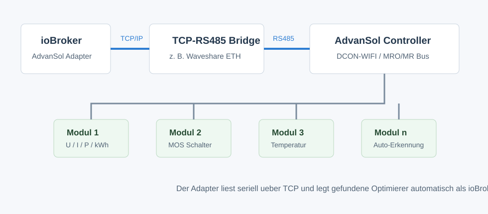
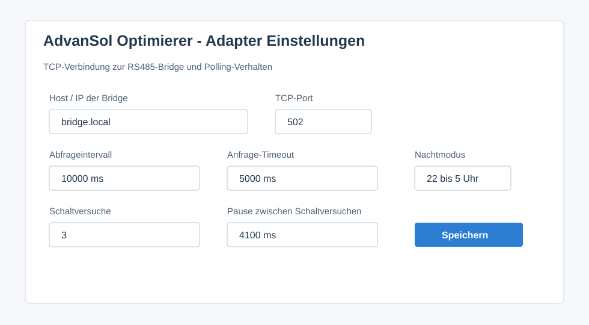
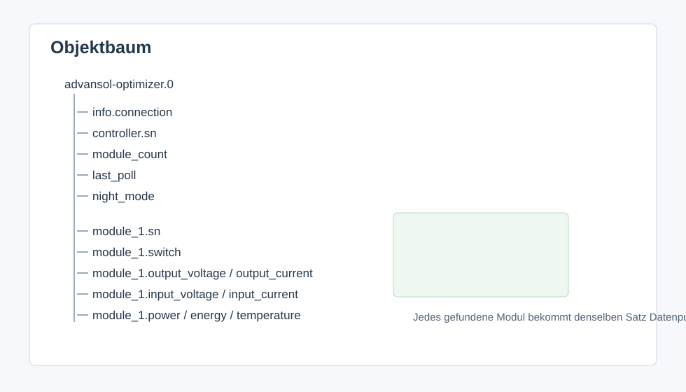

# ioBroker AdvanSol Optimizer Adapter

Адаптер ioBroker для оптимизаторов AdvanSol DCON-WIFI / MRO/MR, подключенных через мост TCP-to-RS485, например, адаптер Waveshare ETH-to-RS485.

Информация о продукте и производителе доступна на [официальном сайте AdvanSol Power](https://www.advansol-power.com/) .

Адаптер основан на оригинальном JavaScript-скрипте ioBroker. `Advinsol Optimierer2` и переносит логику в выделенное пространство имен адаптера ioBroker.

## Функции

- Подключается к мосту TCP RS485.
- Считывает серийный номер контроллера.
- Обнаруживает подключенные модули оптимизатора на всех страницах списка устройств контроллера.
- Проверка наличия добавленных оптимизаторов выполняется каждые пять минут в дневное время; перезапуск не требуется.
- Опрашивает значения модулей циклически.
- Переключает каждый оптимизатор MOS через `module_X.switch`.
- Пропускает опрос в течение настраиваемого ночного периода.
- Отображает состояние соединения и состояние ночного режима.

## Типичная конфигурация

1. ioBroker работает в локальной сети.
2. Мост TCP-RS485 доступен через локальную сеть или Wi-Fi.
3. Сторона RS485 моста подключена к контроллеру AdvanSol.
4. Контроллер взаимодействует с модулями оптимизатора.

Рекомендуемая конфигурация моста:

- Режим: TCP-сервер
- Порт: тот же, что и настроен в адаптере, по умолчанию. `502`
- Настройки последовательного порта: согласование контроллера AdvanSol и шины RS485.
- RS485 A/B подключен правильно.
- На шине RS485 активен только один главный сервер.

## Настройки адаптера

| Параметр             | Значение                                                  | По умолчанию |
| -------------------- | --------------------------------------------------------- | ------------ |
| `Host`               | IP-адрес или имя хоста моста TCP-RS485                    | пустой       |
| `TCP port`           | TCP-порт моста                                            | `502`        |
| `Polling interval`   | Время между циклами опроса в миллисекундах                | `10000`      |
| `Request timeout`    | Максимальное время ожидания ответа                        | `5000`       |
| `Switch retries`     | Количество повторных команд переключения МОП-транзисторов | `3`          |
| `Switch retry delay` | Задержка между попытками переключения                     | `4100`       |
| `Night mode starts`  | Час, в течение которого голосование пропускается.         | `22`         |
| `Night mode ends`    | Час, когда возобновится голосование.                      | `5`          |

Ночное окно позволяет избежать ненужных ошибок, возникающих, когда оптимизаторы не реагируют ночью или при отсутствии напряжения на фотоэлектрической стороне.

## Штаты

Генеральные штаты:

| Состояние         | Значение                                                |
| ----------------- | ------------------------------------------------------- |
| `info.connection` | Подключение к мосту TCP-RS485                           |
| `connection`      | Дополнительное состояние соединения                     |
| `controller.sn`   | серийный номер контроллера                              |
| `module_count`    | Количество обнаруженных оптимизаторов                   |
| `last_poll`       | Время проведения последнего успешного цикла голосования |
| `night_mode`      | Адаптер обнаружил ночной режим                          |

Каждый оптимизатор получает канал с определенным именем. `module_1`, `module_2`, `module_3` и так далее.

| Состояние                 | Значение                                                  | Единица |
| ------------------------- | --------------------------------------------------------- | ------- |
| `module_X.sn`             | Серийный номер оптимизатора                               |         |
| `module_X.switch`         | MOS включен/выключен, возможность записи                  |         |
| `module_X.mos`            | Статус военно-учетной специальности, `0` выключено и `1` на |         |
| `module_X.software`       | Версия программного обеспечения                           |         |
| `module_X.hardware`       | Аппаратная версия                                         |         |
| `module_X.output_voltage` | Выходное напряжение                                       | В       |
| `module_X.output_current` | Выходной ток                                              | А       |
| `module_X.input_voltage`  | Входное напряжение                                        | В       |
| `module_X.input_current`  | Входной ток                                               | А       |
| `module_X.power`          | Власть                                                    | В       |
| `module_X.energy`         | Полная энергия                                            | кВтч    |
| `module_X.temperature`    | Температура                                               | °С      |
| `module_X.raw`            | Исходный ответ в виде шестнадцатеричной строки.           |         |
| `module_X.last_update`    | Последнее обновление модуля                               |         |

## Обнаружение устройств

Контроллер возвращает список устройств постранично, обычно содержащий до десяти оптимизаторов на каждой странице. Адаптер считывает каждую страницу, полученную от контроллера, и создает `module_X` Объекты создаются с использованием адреса контроллера каждого устройства. Ограничений на десять устройств или две страницы нет.

Обнаружение устройств запускается при запуске системы и каждые пять минут вне заданного ночного окна. Вновь зарегистрированные оптимизаторы добавляются автоматически. Недействительные или неполные списки отклоняются; неудачное обновление сохраняет предыдущий список устройств, и опрос продолжается. Существующие объекты сохраняются, если устройство больше не отображается в списке.

## Оптимизаторы переключения

государство `module_X.switch` Доступен для записи. Установка значения `true` Отправляет команду MOS-on для серийного номера модуля. Установка его в `false` Отправляет команду отключения MOS.

Адаптер повторяет команду в соответствии с `Switch retries` и ждет `Switch retry delay` Между попытками. Это сделано намеренно, поскольку преобразователи TCP-RS485 и модули оптимизатора могут не сразу подтверждать каждую команду.

## Поиск неисправностей

- Нет соединения: проверьте IP-адрес, порт и режим TCP-сервера моста.
- `TCP connect timeout` Мост недоступен или указан неверный порт.
- Модули не обнаружены: проверьте RS485 A/B, питание контроллера и питание со стороны фотоэлектрических панелей.
- В дневное время ответы отсутствуют: проверьте параметры и проводку RS485.
- Отсутствие ночных откликов: обычно это нормально, если оптимизаторы находятся в спящем режиме без напряжения от солнечных батарей. Отрегулируйте ночное окно.
- Переключение не работает: должен быть известен серийный номер, модуль должен отвечать, увеличение. `Switch retries` при необходимости.
- Наличие нескольких систем на шине: убедитесь, что активным ведущим устройством, отправляющим кадры, является не более одного.

## Changelog

### 0.1.13

- Read all controller device-list pages so optimizers beyond the first ten are discovered.
- Refresh the device list every five minutes to pick up newly added optimizers.
- Validate page headers, checksums and device addresses; retain the previous list on refresh errors.
- Recover the request queue after failed exchanges and reject measurements with a wrong serial number or checksum.
- (ioBroker-Bot) Adapter requires admin >= 7.8.23 now.

### 0.1.12

- Fixed all findings from the ioBroker latest-repository review.
- Added the official AdvanSol manufacturer link and removed direct-install instructions.
- Changed object names to English and improved state roles and units.
- Validated all configurable timing values and changed polling to sequential timeouts.
- Completed all required admin and adapter-description translations.

### 0.1.11

- Published the adapter with npm provenance.
- Completed repository checker cleanup.

### 0.1.8

- Configured npm token based release publishing for the automated deploy workflow.

### 0.1.7

- Kept the standard ioBroker test workflow focused on package and integration tests.

### 0.1.6

- Switched CI to the standard ioBroker testing actions.
- Added standard package and integration tests for the repository checker.
- Added ioBroker development tooling and release configuration.
- Enabled jsonConfig i18n files.

### 0.1.5

- Fixed remaining adapter checker findings for repository metadata, workflow configuration and admin configuration.

### 0.1.4

- Published through the automated GitHub Actions release workflow with npm provenance.

### 0.1.3

- Added GitHub Actions release workflow with npm provenance publishing.
- Added responsive admin configuration metadata.
- Added repository metadata required by the ioBroker adapter checker.
- Updated README content for English-only publication checks.

### 0.1.2

- Updated package metadata for ioBroker adapter checker compatibility.
- Added repository, testing, license information, tier and extended translations.

### 0.1.1

- Added adapter icon and localized admin configuration labels.

### 0.1.0

- Initial adapter version based on the existing ioBroker JavaScript optimizer script.

Older entries can be moved to CHANGELOG_OLD.md when the changelog grows.

## License

Copyright (c) 2026 TheBam

MIT License. See [LICENSE](https://github.com/TheBam1990/ioBroker.advansol-optimizer/blob/main/LICENSE) for details.