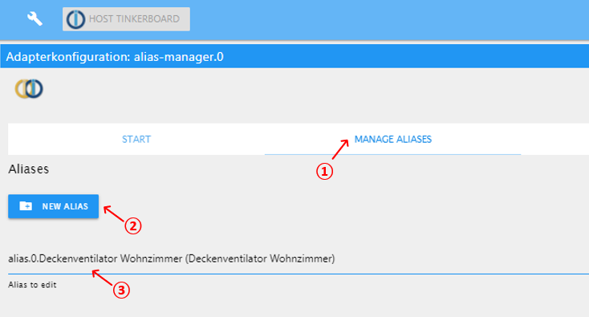
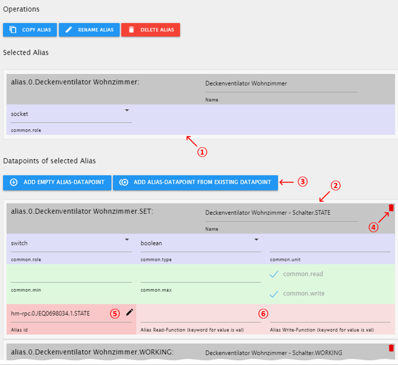
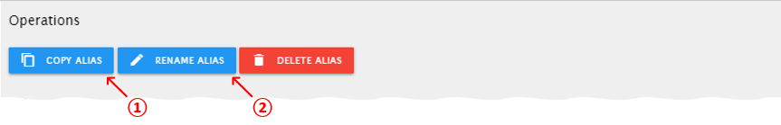
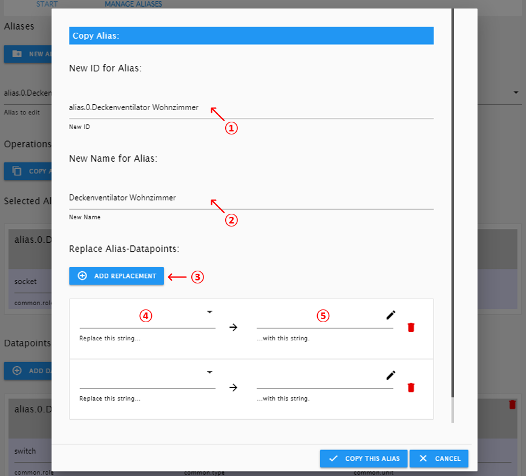
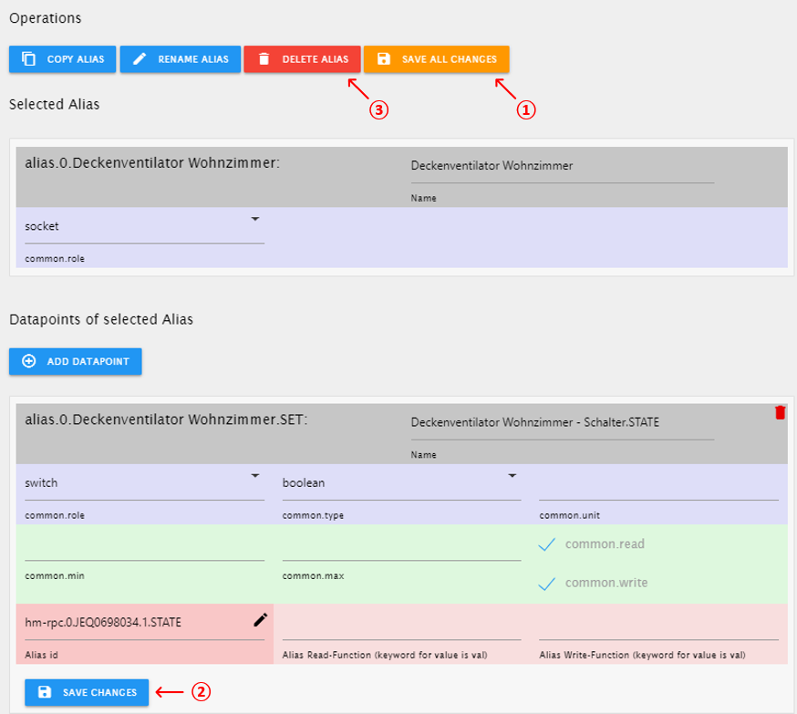
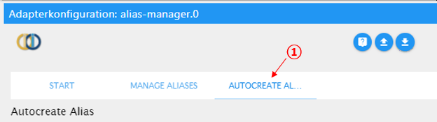
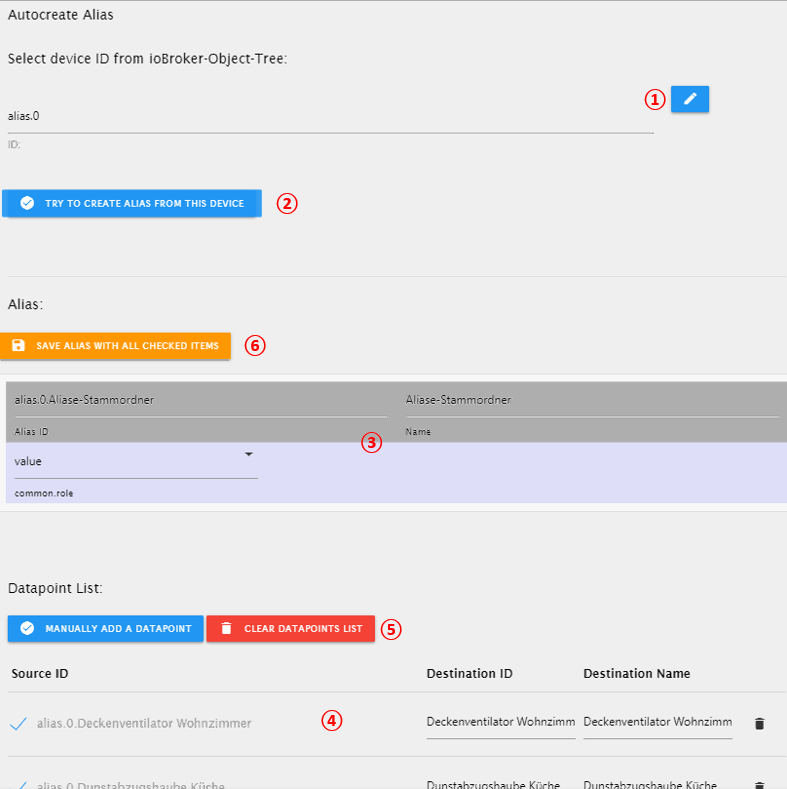

# ioBroker.alias-manager

## адаптер alias-manager для ioBroker

Управляет псевдонимами и создает их.

## Кредиты

Создание этого адаптера было бы невозможно без замечательной работы @sbormann ( <https://github.com/sbormann> ), который разрабатывал предыдущие версии этого адаптера.

## Как сообщать о проблемах и отправлять запросы на добавление новых функций

В идеале, пожалуйста, используйте для этого раздел "Проблемы" на GitHub, а наилучший способ — установить для адаптера режим отладочного логирования (Экземпляры -> Экспертный режим -> Уровень логирования столбцов). Затем получите файл лога с диска через подкаталог ioBroker 'log', **а не** через административную панель, так как это позволит сократить строки.

## Краткое введение

### Управление псевдонимами

- (1) Нажмите на «УПРАВЛЕНИЕ ПСЕВДОНИМАМИ»
- (2) Чтобы создать новый псевдоним, нажмите «НОВЫЙ ПСЕВДОНИМ» или
- (3) Выберите существующий псевдоним для редактирования

- (1) Затем вы найдете область с общими настройками этого псевдонима, такими как имя или общая роль.
- (2) Ниже вы найдете список всех точек данных псевдонима.
- (3) Вы можете добавить псевдонимы-точки данных в этот список либо добавив пустую, либо выбрав существующую точку данных iobroker и скопировав ее настройки в новую псевдонимную точку данных.
- (4) Вы можете удалить точки данных, нажав на значок мусора.
- Каждая точка данных имеет несколько полей для ее настройки:
  - В серой области вы можете задать имя или удалить точку данных.
  - В синей области можно настроить роль, тип и — при желании — подразделение.
  - В зеленой области можно задать необязательные значения min и max, а также определить, должна ли точка данных быть доступна только для чтения (common.write отключена) и разрешен ли доступ к ее значению (common.read включена — это будет правильной настройкой в большинстве случаев).
  - В красной зоне вы можете:
    - (5) Настройте исходную точку данных ioBroker, к которой привязана эта псевдонимная точка данных. Обе точки данных (исходная и псевдонимная) будут синхронизированы.
    - (6) Кроме того, вы можете настроить функции преобразования для чтения и записи.
      - Пример: Если вы установите `val / 10` В качестве "функции чтения" значение псевдонима данных всегда будет составлять 10 процентов от исходного значения.
      - В большинстве случаев вам потребуется выполнить настройку. `val * 10` в качестве "функции записи", чтобы сохранить это соотношение и при записи в псевдонимную точку данных.
    - Подробнее об этом можно прочитать в документации ioBroker, посвященной псевдонимам, по адресу <https://www.iobroker.net/#en/documentation/dev/aliases.md>

- (1) При нажатии на кнопку «КОПИРОВАТЬ ПСЕВДОНИМ» для копирования или
- (2) При нажатии на кнопку «ПЕРЕИМЕНОВАТЬ ПСЕВДОНИМ» откроется следующее диалоговое окно:

\
&#x20;Здесь вы можете:

- (1) Установите новый идентификатор и
- (2) Установить новое общее имя для псевдонима
- (3) Нажав на кнопку «ДОБАВИТЬ ЗАМЕНУ», вы можете добавить строки в следующий список, где вы можете:
  - (4) Введите строку, которая будет найдена и заменена (5) этой строкой.
  - С помощью этой функции вы можете быстро изменить исходные точки данных ioBroker, к которым привязаны ваши псевдонимные точки данных.
  - Пример:
    - У вас есть вентилятор с несколькими параметрами, например: `SET`, `ERROR` и `UNREACH`
    - Эти псевдонимы данных связаны с исходными точками данных, такими как `hm-rpc.0.JEQ0698034.1.STATE`, `hm-rpc.0.JEQ0698034.0.ERROR` и `hm-rpc.0.JEQ0698034.0.UNREACH`
    - Если ваше устройство сломалось и его нужно заменить новым, его серийный номер изменится, скажем, на ASDF1234.
    - Чтобы обновить все ссылки во всех ваших псевдонимах данных одновременно, вы можете выполнить поиск по следующему запросу: `hm-rpc.0.JEQ0698034` и заменить его на `hm-rpc.0.ASDF1234`
    - Это также полезно при создании новых псевдонимов, похожих на старый. Просто скопируйте псевдоним, задайте новый идентификатор и имя и используйте функцию замены для корректировки связанных точек данных.

- После изменения настроек вы можете:
- (1) Сохраните все измененные точки данных псевдонимов одним нажатием кнопки «СОХРАНИТЬ ВСЕ ИЗМЕНЕНИЯ» или
- (2) Сохраните только одну точку данных, нажав кнопку «СОХРАНИТЬ ИЗМЕНЕНИЯ».
- (3) Наконец, вы можете удалить весь псевдоним, нажав на кнопку «УДАЛИТЬ ПСЕВДОНИМ».

### Автоматическое создание псевдонима

- (1) Нажмите на кнопку «АВТОСОЗДАТЬ ПСЕВДОНИМ»

- (1) Сначала выберите идентификатор устройства из дерева объектов ioBroker.
- (2) Затем нажмите «ПОПРОБОВАТЬ СОЗДАТЬ ПСЕВДОНИМ С ЭТОГО УСТРОЙСТВА»
- (3) После этого вы найдете определенные настройки для псевдонима и
- (4) Список всех точек данных выбранного устройства
  - Будут проверены все автоматически распознанные точки данных (сохранены будут только проверенные строки).
  - Если точка данных распознана автоматически, ей будет присвоен «Идентификатор назначения». Это будет соответствующая точка данных для псевдонима (исходная точка данных будет связана с этой новой точкой данных псевдонима). Функция автоматического создания пытается сопоставить стандартизированные идентификаторы точек данных в зависимости от типа распознанного устройства. Однако вы можете изменить настройки по своему усмотрению, но каждый «Идентификатор назначения» должен быть уникальным.
  - И наконец, вы можете ввести имя для целевой точки данных (alias-datapoint).
  - Все точки данных, которые НЕ были распознаны автоматически, отображаются в списке без отметки. Вы можете вручную настроить параметры и активировать флажок.
  - (5) Вы также можете вручную добавить другие точки данных в этот список или очистить весь список.
- (6) Затем вы можете сохранить новый псевдоним со всеми отмеченными (!) точками данных (неотмеченные точки данных будут удалены).
- После этого вы автоматически перейдете на вкладку «УПРАВЛЕНИЕ ПСЕВДОНИМАМИ», где откроется новый псевдоним, и вы сможете настроить его параметры по своему усмотрению.

## Changelog
<!--
	Placeholder for the next version (at the beginning of the line):
	### **WORK IN PROGRESS**
-->
### **WORK IN PROGRESS**
- (copilot) Adapter requires admin >= 7.6.17 now
- (mcm1957) unused backend code has been removed
- (mcm1957) Dependencies have been updated.

### 3.0.0 (2026-10-13)
- (copilot) Adapter requires node.js >= 22 now
- (@GermanBluefox) Corrected loading via ioBroker.pro

### 2.1.0 (2026-02-12)
- (copilot) Adapter requires node.js >= 20 now
- (copilot) Adapter requires js-controller >= 6.0.11 now
- (copilot) Adapter requires admin >= 7.6.17 now
- (copilot) Added Node.js 24.x to testing matrix
- (mcm1957) Dependencies have been updated.

### 2.0.0 (2024-10-20)
- (mcm1957) Adapter has been moved to iobroker-community-adapter organisation.
- (mcm1957) Adapter requires js-controller 5, admin 6 and node.js 20 now.
- (mcm1957) Dependencies have been updated.

### 1.2.6 (2022-03-02)
* (sbormann) Updated dependencies.
* (sbormann) Fixed saving of common.custom.

### 1.2.5 (2022-03-02)
* (sbormann) Added All and None Buttons to select Datapoint while autocreating alias.
* (sbormann) Some GUI-Enhancements and fixes for dark mode.

## License
MIT License

Copyright (c) 2024-2026 iobroker-community-adapters <iobroker-community-adapters@gmx.de>  
Copyright (c) 2022 Sebastian Bormann <sebastian@bormann.net>

Permission is hereby granted, free of charge, to any person obtaining a copy
of this software and associated documentation files (the "Software"), to deal
in the Software without restriction, including without limitation the rights
to use, copy, modify, merge, publish, distribute, sublicense, and/or sell
copies of the Software, and to permit persons to whom the Software is
furnished to do so, subject to the following conditions:

The above copyright notice and this permission notice shall be included in all
copies or substantial portions of the Software.

THE SOFTWARE IS PROVIDED "AS IS", WITHOUT WARRANTY OF ANY KIND, EXPRESS OR
IMPLIED, INCLUDING BUT NOT LIMITED TO THE WARRANTIES OF MERCHANTABILITY,
FITNESS FOR A PARTICULAR PURPOSE AND NONINFRINGEMENT. IN NO EVENT SHALL THE
AUTHORS OR COPYRIGHT HOLDERS BE LIABLE FOR ANY CLAIM, DAMAGES OR OTHER
LIABILITY, WHETHER IN AN ACTION OF CONTRACT, TORT OR OTHERWISE, ARISING FROM,
OUT OF OR IN CONNECTION WITH THE SOFTWARE OR THE USE OR OTHER DEALINGS IN THE
SOFTWARE.