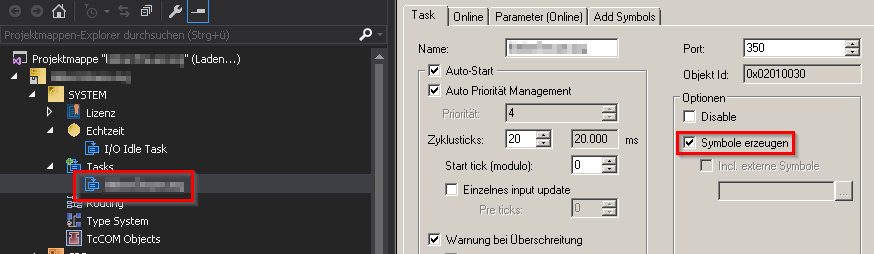
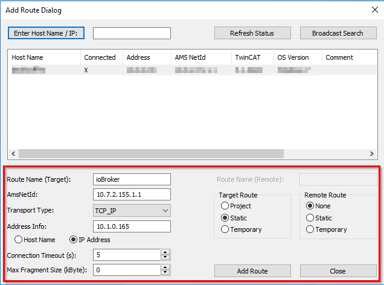

# ioBroker.beckhoff

Этот адаптер ioBroker обеспечивает связь с контроллером Beckhoff (TwinCAT 2 или 3) по протоколу ADS. Протокол ADS реализован в каждом контроллере Beckhoff и может использоваться без лицензии.

Данный проект не имеет никакого отношения к компании Beckhoff.

## Описание

### Требования

- Устройство Beckhoff с сетевым подключением, расположенное в сети, доступной для ioBroker.
  - Контроллеру необходимо присвоить фиксированный IP-адрес.
  - Контроллер должен быть доступен для проверки связи (ping) через ioBroker.
  - TwinCAT 2 **(за исключением контроллеров BC)** или TwinCAT 3

### Управление конфигурацией

1. В проекте необходимо включить ADS. Для этого перейдите в конфигурацию задачи в управляющем проекте и снимите флажок. `Symbole erzeugen` Активируйте. Затем загрузите конфигурацию на контроллер и перезапустите его. Перезапуск необходим только в том случае, если используется TwinCAT 2.

   

2. В контроллере необходимо создать статический маршрут. Маршрут должен быть совместим с ioBroker (IP-адрес и идентификатор AMS-Net).

   Вот пример того, как может выглядеть маршрут, добавленный непосредственно в контроллер. Маршрут также можно добавить через инженерный компьютер.

   

   Дополнительную информацию о маршрутизаторе TwinCAT и системе управления в целом можно найти в [информационной системе Beckhoff](https://infosys.beckhoff.com/ "Beckhoff Information System") .

3. В TwinCAT 2 сначала необходимо создать структуру в контроллере. Затем эта структура добавляется в глобальную таблицу переменных. Здесь можно определить все необходимые переменные. После этого обмен данными осуществляется автоматически системой ADS и адаптером.

   ##### В настоящее время поддерживаются следующие типы данных: BOOL, BYTE, WORD, DWORD, SINT, USINT, INT, UINT, DINT, UDINT, REAL, LREAL, TIME, TIME\_OF\_DAY, TOD, DATE, DATE\_AND\_TIME, DT, STRING

   ДОПОЛНИТЕЛЬНО: Переменную можно создать непосредственно в таблице переменных без вложенности, используя точное имя -> ioBrokerResync (регистр и тип данных не имеют значения) -> Каждый раз, когда это значение изменяется, таблица переменных в ioBroker перечитывается.

4. В TwinCAT 3 необходимо создать глобальную таблицу переменных в контроллере. Здесь можно определить все необходимые переменные. После этого обмен данными осуществляется автоматически системой ADS и адаптером.

   ##### В настоящее время поддерживаются следующие типы данных: BOOL, BYTE, WORD, DWORD, SINT, USINT, INT, UINT, DINT, UDINT, REAL, LREAL, TIME, TIME\_OF\_DAY, TOD, DATE, DATE\_AND\_TIME, DT, STRING

   ДОПОЛНИТЕЛЬНО: Переменную можно создать непосредственно в таблице переменных без вложенности, используя точное имя -> ioBrokerResync (регистр и тип данных не имеют значения) -> Каждый раз, когда это значение изменяется, таблица переменных в ioBroker перечитывается.

### Настройки адаптера

#### Twincat 3 и Twincat 2

1. Выберите версию среды выполнения
2. Введите целевой IP-адрес и AMS-Net-ID.
3. В TwinCAT 2 введите имя экземпляра структуры из глобальной таблицы переменных.
4. Введите правильное имя таблицы переменных в TwinCAT 3.
5. Остальные пункты, как правило, менять не нужно.

#### TwinCAT 2 <= v2.11.2240

Необходимо загрузить файл \*.tpy из проекта ПЛК. -> Этот файл необходимо загружать повторно при каждом изменении структуры, отвечающей за связь с ioBroker.

### Обмен данными

- Как только значение переменной в контроллере изменяется, оно автоматически передается в соответствующее состояние в ioBroker.
- Когда значение изменяется в ioBroker (важно: ACK должно быть FALSE!!), оно автоматически передается контроллеру. Как только контроллер принимает значение, ACK устанавливается в TRUE.

### Важный

1. Маршрутизатор TwinCAT AMS не допускает множественных TCP-соединений с одного и того же хоста. Если с одного и того же хоста на один и тот же маршрутизатор TwinCAT устанавливаются два соединения, маршрутизатор автоматически закрывает первое соединение и отвечает только на новое.
2. Адаптер автоматически синхронизирует все переменные в ioBroker. Существует несколько способов инициировать повторную синхронизацию:
   - Когда значение переменной Resyc изменяется (см. [здесь](#Konfiguration-der-Steuerung) ).
   - Если контроллер не находится в режиме RUN дольше, чем интервал переподключения, таблица переменных синхронизируется повторно при переходе контроллера в режим RUN.
   - При загрузке проекта в контроллер возникает исключение -> OnlineChange
   - При перезагрузке адаптера.
3. «Синхронизация» или «чтение» относится не к обмену значениями переменных, а к синхронизации самих переменных и их созданию или удалению в ioBroker.

## Кэш соединений и символов

Новая конфигурация принимает либо IPv4-адрес, либо имя хоста. Идентификатор сети AMS по-прежнему требуется указывать отдельно.

- `adsTimeout` Время ожидания для каждого запроса ADS в миллисекундах, по умолчанию 500. Для медленных соединений может быть более подходящим значение 2000.
- `reconnectInterval` Время ожидания перед новой попыткой подключения и интервал проверки состояния ПЛК, стандартный — 15 секунд.
- `cacheSymbolTable` Повторное использование описаний символов во время кратковременных прерываний соединения (по умолчанию включено).
- `symbolCacheMaxAge` Максимальное время простоя для повторного использования, по умолчанию 300 секунд. Значение ноль отключает повторное использование после сбоя.

После переподключения проверяется версия символа, создаются новые дескрипторы ADS и уведомления, а также считываются текущие значения. Если версия символа остается неизменной, символы и типы данных загружаются не полностью; поэтому синхронизация объектов пропускается. Существующие идентификаторы, имена и сопоставления сохраняются.

Изменены версии символов, обнаружены переходы ПЛК «остановка/запуск», ошибки с кэшированными символами и внесены изменения в `ioBrokerResync` Это запускает полную синхронизацию. Отсутствие подтверждения записи лишь обновляет значения и не повторяет команды записи ПЛК.

Символьная версия представляет собой 8-битный счетчик. Если перезапуск ПЛК останется незамеченным во время прерывания или если счетчик переполнится, может появиться та же самая версия. По возможности в системе отключите кэш или `ioBrokerResync` Изменения в ПЛК происходят при запуске и при модификации программы. Одного лишь временного ограничения недостаточно для надежного обнаружения таких изменений.

## Загрузка файла TPY

Для TwinCAT 2 <= v2.11.2240, `.tpy` Файл можно загрузить и выбрать. Файлы находятся в файловом хранилище ioBroker в папке... `beckhoff.<Instanz>.tpy` Адаптер считывает выбранный файл при запуске. Если файл не выбран, сохраняется существующее содержимое. `xmlTpyData` Используемый файл по-прежнему можно редактировать. Приоритет имеет выбранный файл. После внесения изменений в определения символов ПЛК необходимо обновить файл TPY.

## Changelog

### **WORK IN PROGRESS**
- (copilot) Adapter requires node.js >= 22.19.0 now
<!--
    Placeholder for the next version (at the beginning of the line):
    ### **WORK IN PROGRESS**
-->
### 2.0.0 (2026-10-19)
- (copilot) Adapter requires node.js >= 22 now
- (copilot) Adapter requires admin >= 7.7.22 now
- (zonfacter) Reuse validated symbol metadata after short reconnects, renew ADS handles and refresh values; fully synchronize on metadata changes, observed PLC stops or expired caches
- (zonfacter) Add a configurable ADS request timeout and hostname support; preserve variable-table prefix matching and existing object mappings
- (zonfacter) Migrate to responsive jsonConfig with native TPY upload, persistent filename feedback and packaged translations; retain legacy XML and TPY paths
- (zonfacter) Prepare a named TPY file directory without removing originals or overwriting differing files; support configuration requests through supportedMessages.custom
- (zonfacter) Isolate compact-mode sessions, reject stale callbacks and avoid a metadata reload when only a write acknowledgement is missing
- (zonfacter) Fix synchronization when a metadata notification arrives during the final connection-state write
- (mcm1957) Dependencies have been updated

### 1.7.0 (2026-02-12)
- (mcm1957) Adapter requires node.js >= 20 now
- (copilot) Adapter requires js-controller >= 6.0.11 now
- (copilot) Adapter requires admin >= 7.6.17 now
- (copilot) Migrated to ESLint 9 and @iobroker/eslint-config standard configuration
- (mcm1957) Dependencies have been updated

### 1.6.0 (2024-04-02)

* (mcm1957) Adapter requires node.js 18 and js-controller >= 5 now
* (mcm1957) Dependencies have been updated

### 1.5.3 (2023-10-29)

- (mcm1957) Dependencies have been updated

### 1.5.3-alpha.0 (2023-10-29)

- (mcm1957) Standard test environment has been updated

## License

The MIT License (MIT)

Copyright (c) 2024-2026 iobroker-community-adapters <iobroker-community-adapters@gmx.de>  
Copyright (c) 2018-2023 dkleber89 <dkleber89@gmail.com>

Permission is hereby granted, free of charge, to any person obtaining a copy
of this software and associated documentation files (the "Software"), to deal
in the Software without restriction, including without limitation the rights
to use, copy, modify, merge, publish, distribute, sublicense, and/or sell
copies of the Software, and to permit persons to whom the Software is
furnished to do so, subject to the following conditions:

The above copyright notice and this permission notice shall be included in
all copies or substantial portions of the Software.

THE SOFTWARE IS PROVIDED "AS IS", WITHOUT WARRANTY OF ANY KIND, EXPRESS OR
IMPLIED, INCLUDING BUT NOT LIMITED TO THE WARRANTIES OF MERCHANTABILITY,
FITNESS FOR A PARTICULAR PURPOSE AND NONINFRINGEMENT. IN NO EVENT SHALL THE
AUTHORS OR COPYRIGHT HOLDERS BE LIABLE FOR ANY CLAIM, DAMAGES OR OTHER
LIABILITY, WHETHER IN AN ACTION OF CONTRACT, TORT OR OTHERWISE, ARISING FROM,
OUT OF OR IN CONNECTION WITH THE SOFTWARE OR THE USE OR OTHER DEALINGS IN
THE SOFTWARE.