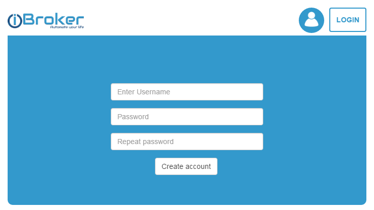

# облачный адаптер ioBroker

Этот адаптер позволяет подключаться из интернета через облако ioBroker к локальной установке ioBroker.

**Этот адаптер использует библиотеки Sentry для автоматического сообщения разработчикам об исключениях и ошибках в коде.** Более подробную информацию, а также инструкции по отключению отправки сообщений об ошибках, см. [в документации Sentry-Plugin](https://github.com/ioBroker/plugin-sentry#plugin-sentry) ! Система отчетности Sentry используется начиная с js-controller 3.0.

## Настройки

### КЛЮЧ ПРИЛОЖЕНИЯ

Для использования облачного адаптера сначала необходимо получить ключ приложения на [сайте https://iobroker.net](https://iobroker.net) .

Это ключ приложения, который пользователь может получить на сайте <https://iobroker.net> . Пожалуйста, получите ключ там и введите его здесь.



### Пример

Все запросы от облачного адаптера будут направляться на конкретный веб-экземпляр. Пользователь должен указать здесь веб-экземпляр; он будет показан пользователю при входе на сайт <https://iobroker.net> .

### Права

Пользователь, зарегистрированный на iobroker.net или iobroker.pro, не определяет, к чему ему можно получить доступ в ioBroker. Права доступа предоставляются пользователем, указанным в поле "доступ как". `defaultUser`) из случаев:

- Запросы к страницам и файлам веб-сайта, административной панели и Lovelace поступают от пользователя соответствующего экземпляра.
- Состояния Lovelace считываются и записываются пользователем экземпляра Lovelace.
- Объекты, состояния и файлы, запрашиваемые страницами веб-интерфейса и административной панели, выполняются от имени пользователя веб-экземпляра. Веб-интерфейс и административная панель используют одно и то же соединение, поэтому для обоих существует только один пользователь. Без веб-экземпляра используется пользователь административной панели, в противном случае — пользователь экземпляра Lovelace.

Если вы разрешите административный доступ, и в веб-экземпляре будет другой пользователь, отличный от пользователя, управляющего веб-экземпляром, администратор будет иметь только права пользователя веб-экземпляра. В этом случае адаптер запишет предупреждение в журнал.

Пользователи с ограниченными правами не проверяются на каждое отдельное событие изменения: если такой пользователь может подписываться на состояния или объекты, он получает изменения всего, что соответствует шаблону, как и на любом другом веб-сокете ioBroker.

### Разрешить использование самоподписанных сертификатов

Если вы используете стандартное облако iobroker.net, вы можете его отключить. Эта опция важна только в том случае, если вы используете собственное облако.

### Настройки Alexa

_**Alexa не поддерживается в `cloud` Больше не нужен адаптер. Используйте для этого адаптер ioBroker.iot.**_

## IFTTT

[инструкции](/#/docs/adapterref/iobroker.cloud/doc/ifttt.md)

## Услуги

Есть возможность отправлять сообщения в облачный адаптер. Если вы позвоните... `[POST]https://iobroker.net/service/custom_<NAME>/<user-app-key>` и ценность в качестве полезной нагрузки.

```bash
curl --data "myString" https://iobroker.net/service/custom_test/<user-app-key>
```

Если в настройках в поле «Белый список для сервисов» указать имя _custom\_test_ и вызвать сервис, указав в качестве имени сервиса «custom\_test», то состояние `cloud.0.services.custom_test` будет установлено на `myString`.

Вы можете добавить символ "\*" в белый список, и все сервисы будут разрешены.

Начиная с версии 2.0.5, вы можете использовать GET-запросы в форме. `[GET]https://iobroker.net/service/custom_<NAME>/<user-app-key>/<data>` разместить `\<data\>` в `cloud.0.services.custom_\<NAME\>`.

Здесь вы найдете инструкции по использованию [Tasker](/#/docs/adapterref/iobroker.cloud/doc/tasker.md) .

Использование сервиса IFTTT разрешено только при наличии установленного ключа IFTTT.

Зарезервированные имена `ifttt`, `text2command`, `simpleApi`, `swagger` Их необходимо использовать без `"custom_"` префикс.

### текст2команда

Вы можете написать `text2command` В белом списке можно отправлять POST-запросы. `https://iobroker.net/service/text2command/<user-app-key>` записывать данные в `text2command.X.text` переменная.

Параметр "X" можно задать в настройках с помощью опции "Использовать экземпляр text2command".

### simpleApi

Вы можете использовать следующие команды (только в версии Pro):

- `[GET]https://iobroker.pro/service/simpleApi/<user-app-key>/get/stateID` - для чтения значения состояния =>`{"val":103.516,"ack":true,"ts":1604132484682,"q":0,"from":"system.adapter.admin.0","lc":1604132469672,"result":"OK"}`
- `[GET]https://iobroker.pro/service/simpleApi/<user-app-key>/getPlainValue/stateID` - для чтения значения состояния =>`103.641`
- `[GET]https://iobroker.pro/service/simpleApi/<user-app-key>/set/stateID?value=1` - установить значение состояния =>`{"result":"OK"}`

**Не забудьте добавить `simpleApi` к разрешенным службам в конфигурации.**

### Ограничения

Если на определенном веб-экземпляре включен HTTPS (безопасность) или аутентификация, это не будет работать.

Вы можете отключить HTTPS и аутентификацию на этом экземпляре веб-сайта, но лучше создать новый экземпляр веб-сайта, привязанный к... `localhost` и выберите этот экземпляр в настройках облака.

## Удалённая оболочка (SSH)

В версии **Pro** облако может выступать в качестве SSH-сервера, поэтому вы можете получить доступ к командной оболочке (или любой службе TCP) на этой машине из любой точки мира, авторизовавшись с помощью своего облачного адреса электронной почты и пароля. Внутреннее SSH-соединение между вашим клиентом и локальным сервером зашифровано сквозным шифрованием. `sshd` Таким образом, облако пересылает только байты.

Включите эту функцию в разделе **«Удалённая оболочка»** в настройках адаптера:

- **Включить удалённую оболочку** — по умолчанию отключено.
- **Разрешенные адреса** — таблица правил; адрес разрешен, если ему соответствует хотя бы одна строка. Это авторитетный список разрешенных адресов, облако не открывает ничего, что адаптер не разрешает. Каждая строка содержит:

  - **Хост** — отдельный IP-адрес или имя хоста (`127.0.0.1`, `localhost`), подстановочный знак (`192.168.*`), CIDR (`192.168.1.0/24`), или диапазон (`192.168.1.10-192.168.1.50`).
  - **Порты** — список и/или диапазоны (`22`, `22, 8081`, `8000-8100`), или пустой /`*` /`all` для любого порта.

  По умолчанию: `127.0.0.1` и `localhost` любой порт (только на этом устройстве). Таким образом, одна строка может открывать только SSH на устройстве ioBroker, в то время как другая открывает целую подсеть, например. `127.0.0.1 → 22` плюс `192.168.1.0/24 → *`.

Затем подключитесь (с помощью вашего собственного sshd, переместив его с порта 22) и `pi` являясь пользователем этого компьютера:

```bash
ssh -J <email>@iobroker.pro pi@localhost
```

`-L 8081:localhost:8081` туннелирует административный интерфейс. `scp` /`sftp` копирование файлов и так далее. UDP не передается (поэтому для KNXnet/IP по UDP требуется шлюз с поддержкой TCP или VPN).

При запуске адаптер проверяет, доступен ли SSH-сервер. `127.0.0.1:22` и публикует результат в штат&#x435;** `info.sshAvailable` ** На странице настроек это состояние отображается в режиме реального времени: если SSH-сервер не найден (или учетная запись не является профессиональной), отображается подсказка, и **настройки удаленной оболочки полностью скрываются** , поэтому они появляются только тогда, когда их включение позволяет фактически получить доступ к оболочке.

## Android-приложение

В новом приложении для Android изменено расположение переменных, отвечающих за яркость и местоположение.

Теперь их можно было найти в `cloud.X.devices.NAME`:

- `cloud.X.devices.NAME.brightness`
- `cloud.X.devices.NAME.currentLocation`.
- `cloud.X.devices.NAME.batteryLevel`
- `cloud.X.devices.NAME.batteryState`.

<!--
	Placeholder for the next version (at the beginning of the line):
	### **WORK IN PROGRESS**
-->

## Changelog
### 6.4.0 (2026-11-15)
* (@GermanBluefox) Prepared the switch to socket.io 4: a cloud address with `wss://` is connected with socket.io 4. If it cannot be reached, the adapter goes back to the current cloud
* (@GermanBluefox) A cloud address counts as one of ioBroker.pro if it contains "iobroker.pro", whatever protocol and port it names. Before, only `https://iobroker.pro:<port>` did, so a pro key with `wss://iobroker.pro:<port>` was sent to `https://iobroker.pro:10555`
* (@GermanBluefox) After a big answer (e.g. all objects for the editor of vis-2 via the cloud) the adapter waits longer for the pong of the cloud: as long as a slow upload needs for what was sent, at most 160 seconds. Before, it disconnected with "Ping timeout" while the answer was still on its way, and the editor never got its objects
* (@GermanBluefox) After a lost connection the adapter always comes back: if it cannot get its app-key at the start because the network or the server is away (timeout, no DNS, reset, 5xx), it tries again after 10 seconds, then twice as long each time, at most every 5 minutes. Before, only "connection refused" was retried; any other network error (e.g. `ETIMEDOUT`) ended the start, and the instance stayed alive without a connection to the cloud. The request for the app-key now gives up after 15 seconds instead of minutes. A wrong login still stops with an error

### 6.3.0 (2026-11-09)
* (@GermanBluefox) Commands from the cloud run as the "access as" user of the web instance and no longer always as admin. If this user is restricted, the pages of web and admin only have its rights via cloud

### 6.2.11 (2026-10-16)
* (@GermanBluefox) The adapter is stopped with `terminate()` only, `process.exit()` is no longer used (compact mode)
* (@GermanBluefox) Added the missing translations and the Ukrainian words for the blockly block
* (@GermanBluefox) Corrected the responsive sizes of the settings dialog
* (@GermanBluefox) Removed the unused dependency `cookie-parser`

### 6.2.10 (2026-10-14)
* (@GermanBluefox) Corrected the loading of materialized configurations on ioBroker.pro

### 6.2.8 (2026-10-12)
* (@GermanBluefox) The states `alive` and `onScreen` of an app device are corrected to type boolean if an earlier version created them as string, so values written to them are no longer refused

## License
The MIT License (MIT)

Copyright (c) 2016-2026 bluefox <dogafox@gmail.com>

Permission is hereby granted, free of charge, to any person obtaining a copy
of this software and associated documentation files (the "Software"), to deal
in the Software without restriction, including without limitation the rights
to use, copy, modify, merge, publish, distribute, sublicense, and/or sell
copies of the Software, and to permit persons to whom the Software is
furnished to do so, subject to the following conditions:

The above copyright notice and this permission notice shall be included in all
copies or substantial portions of the Software.

THE SOFTWARE IS PROVIDED "AS IS", WITHOUT WARRANTY OF ANY KIND, EXPRESS OR
IMPLIED, INCLUDING BUT NOT LIMITED TO THE WARRANTIES OF MERCHANTABILITY,
FITNESS FOR A PARTICULAR PURPOSE AND NONINFRINGEMENT. IN NO EVENT SHALL THE
AUTHORS OR COPYRIGHT HOLDERS BE LIABLE FOR ANY CLAIM, DAMAGES OR OTHER
LIABILITY, WHETHER IN AN ACTION OF CONTRACT, TORT OR OTHERWISE, ARISING FROM,
OUT OF OR IN CONNECTION WITH THE SOFTWARE OR THE USE OR OTHER DEALINGS IN THE
SOFTWARE.