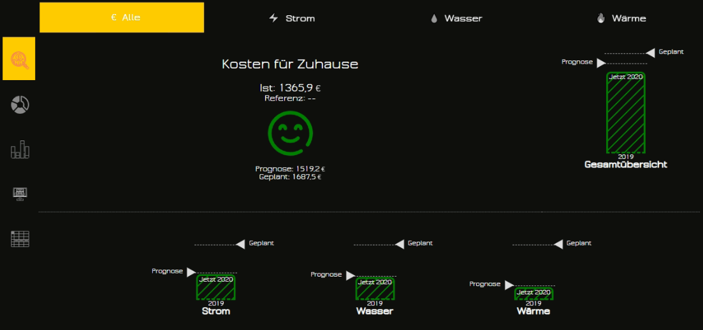
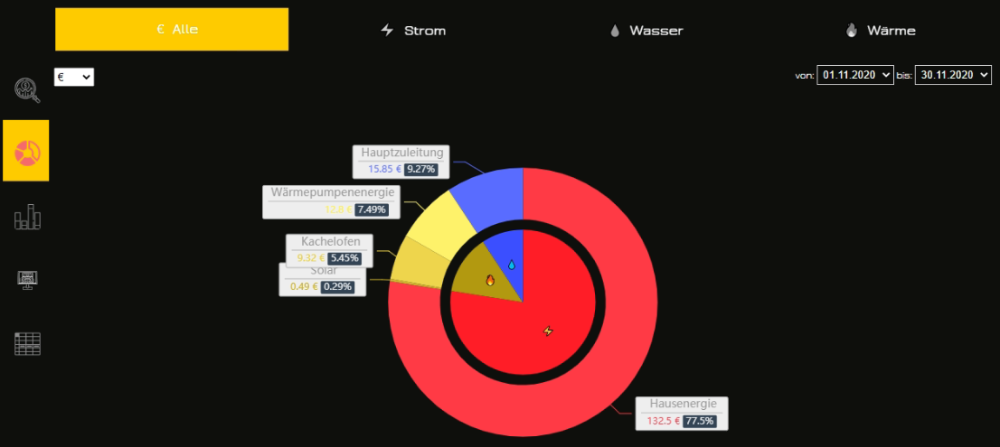
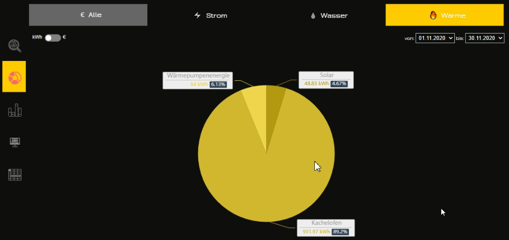
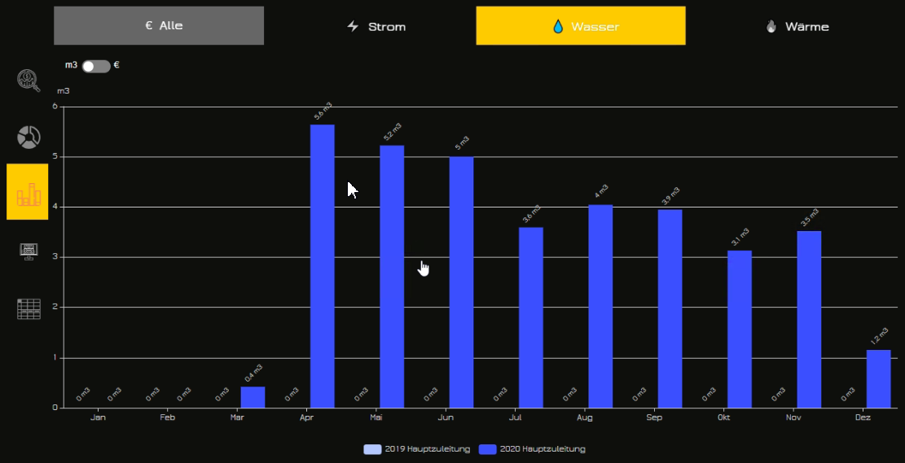
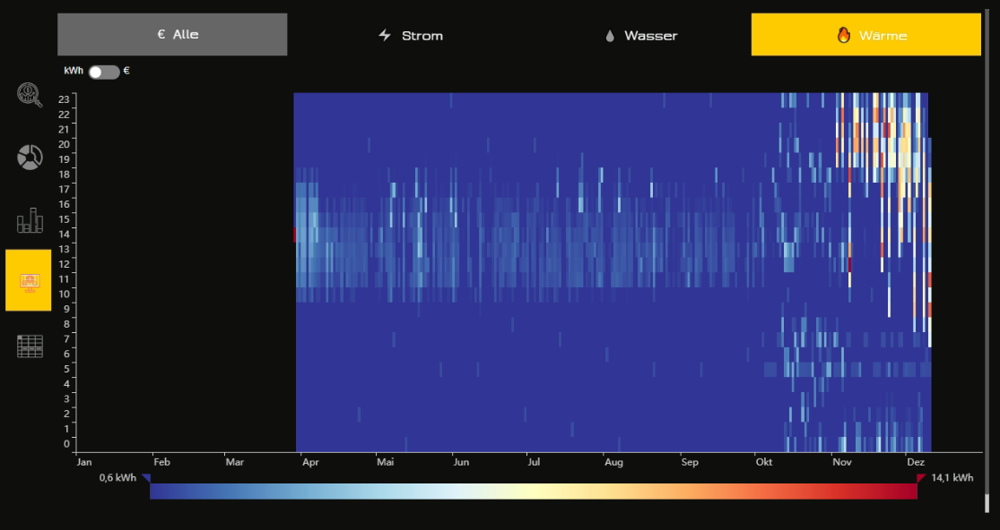
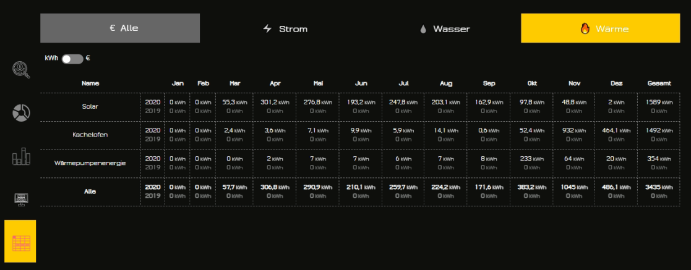

# ioBroker.consumption

## Адаптер потребления для ioBroker

Вычисляет потребление энергии для заданных датчиков и ресурсов.

Вы можете определить различные ресурсы, такие как вода, отопление, электричество, и провести анализ в Visual.

Реализованы 4 различных типа анализа:

- Плановое потребление — фактическое потребление в евро/долларах США в этом году по сравнению с плановыми значениями и по сравнению с предыдущим годом.
- Круговая диаграмма (или диаграмма «пончик») — сравнение показаний датчиков или ресурсов в виде круговой диаграммы.
- Стек — ежемесячное потребление каждого датчика и ресурса в сравнении с данными за предыдущий год в виде столбчатой диаграммы.
- Тепловая карта — почасовое потребление ресурсов в этом году.
- Таблица — Ежемесячное потребление каждого датчика и ресурса в сравнении с предыдущим годом в табличном виде.

## Требования

Для работы адаптера требуется установленная база данных MySQL или PostgreSQL и адаптер ioBroker.sql (они будут установлены автоматически). Он также должен работать с SQLite, но это не рекомендуется из-за снижения производительности.

Поддержка MS-SQL пока отсутствует, но при необходимости её можно легко реализовать.

**Адаптер всё ещё находится в стадии бета-тестирования.**

**Бесплатная версия поддерживает только четыре датчика и одну станцию.** Для поддержки большего количества датчиков или станций вам потребуется действующая лицензия. Запросите её по адресу <info@iobroker.com> .

## Использование

У вас есть ресурсы (такие как вода, энергия, отопление, газ и т. д.), станции (например, дом, дача, деревенская вилла и т. д.) и датчики.

Датчик — это счётчик, значение которого постоянно увеличивается, подобно электросчётчику, показания которого постоянно растут.

Сначала необходимо распределить все эти датчики по определенным ресурсам, а затем по станциям.

**На самом деле поддерживается только одна станция!**

После этого вы сможете проанализировать свое потребление времени и ресурсов в течение нескольких лет.

Вы можете сравнить текущий год с предыдущим и составить прогноз потребления.

Проведите план всех расходов на текущий год.

Распределение затрат по ресурсам.

Распределение потребления одного ресурса по показаниям датчиков.

Распределение потребления одного ресурса по датчикам и месяцам.

Тепловая карта потребления одного ресурса за текущий год.

Таблица потребления одного ресурса за текущий год по месяцам.

### Скрытая функция

Данные с датчика можно преобразовать, но формула должна быть линейной. Вы можете написать формулу на JavaScript, но убедитесь, что результат должен быть числом (с плавающей запятой). Примеры:

- Вт·ч => кВт·ч: `val / 1000`
- кВт·ч => Вт·ч: `val * 1000`
- °F => °C: `(val - 32) / 1.8`
- °C => °F: `val * 1.8 + 32`

## Обновление электронных диаграмм (только для разработчиков)

Перейдите по ссылке <https://echarts.apache.org/en/builder.html> и выберите:

- Диаграмма: столбчатая, линейная, круговая, тепловая карта.
- Системы координат: сетка
- Компоненты: заголовок, легенда, всплывающая подсказка, точка отметки, область отметки, визуальная карта, панель инструментов.
- Другие инструменты: рендерер SVG, утилиты, сжатие кода.

## Список дел

- Цена за каждый возможный датчик

- Изменить цены:
  - Удалить все цены по ресурсам.
  - Добавить флажок рядом с каждым датчиком: собственная цена
  - скрыть станцию => цену ресурса, если у каждого датчика своя цена
  - Записывайте данные непосредственно в состояния, не сохраняя цену в объекте.

- Тепловая карта
  - Показать по годам

- Диаграммы

- Экспорт данных в формате PDF

- Более одной станции.

- Выбор стиля осуществляется в соответствии с темой (единица измерения, начало, конец).

<!--
	Placeholder for the next version (at the beginning of the line):
	### **WORK IN PROGRESS**
-->

## Changelog
### 1.0.3 (2026-10-14)
* (@GermanBluefox) Updated packages and the metadata, the adapter requires node.js >= 22 and js-controller >= 6.0.11 now

### 1.0.2 (2024-03-19)
* (bluefox) Fixed plan display

### 1.0.1 (2023-09-14)
* (bluefox) Fixed pie chart

### 0.8.0 (2023-05-12)
* (bluefox) Do not take the price of sensor if it is empty or 0
* (bluefox) Refactoring (async/await)

### 0.7.0 (2023-02-08)
* (bluefox) Added offset and factor to sensors

## License

Commercial license.

Copyright (c) 2020-2026 Bluefox <dogafox@gmail.com>, all rights reserved.

This license is a legal agreement between you and ioBroker GmbH (“ioBroker”) for the use of `ioBroker.consumption` adapter (the “Software”).
By downloading of `ioBroker.consumption` adapter you agree to be bound by the terms and conditions of this license.
ioBroker GmbH reserves the right to alter this agreement at any time, for any reason, without notice.

### Permitted Use
One license grants the right to perform one installation of the Software.
Each additional installation of the Software requires an additional purchased license.

The complete license text can be found in the [LICENSE](https://github.com/ioBroker/ioBroker.consumption/blob/master/LICENSE) file.