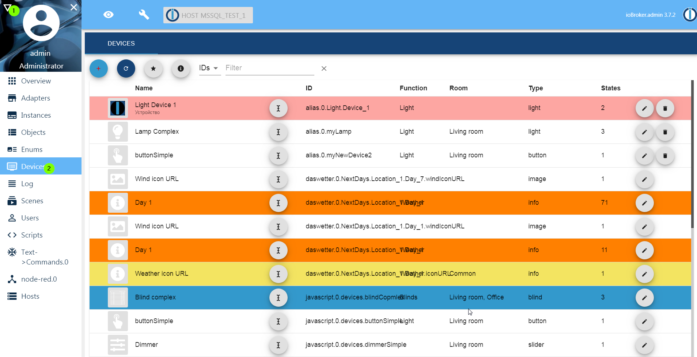

# ioBroker.devices

## Адаптер устройства для ioBroker

Управляйте и создавайте устройства для использования в других адаптерах, таких как Material, IoT, Matter...

**Важно: включите вкладки в админке, такие как «Журнал» и «Скрипты».**

**Этот адаптер использует библиотеки Sentry для автоматического сообщения разработчикам об исключениях и ошибках в коде.** Более подробную информацию, а также сведения о том, как отключить отправку сообщений об ошибках, см. [в документации Sentry-Plugin](https://github.com/ioBroker/plugin-sentry#plugin-sentry) ! Система отчетности Sentry используется начиная с js-controller 3.0.

## Руководство пользователя адаптера ioBroker.devices

### Обзор

Он `ioBroker.devices` Адаптер — это компонент платформы умного дома ioBroker, предназначенный для упрощения управления устройствами путем создания и управления виртуальными устройствами.

Эти виртуальные устройства предоставляют стандартизированный интерфейс для физических устройств, упрощая интеграцию, создание сценариев, визуализацию и управление устройствами разных производителей и протоколов.

Адаптер обеспечивает единообразие в именовании и структуре точек данных, уменьшая необходимость в изменении скриптов или визуализаций при изменении оборудования.

Он преобразует любой набор состояний в ioBroker (физических **или** виртуальных) в корректно сформированные **устройства** с богатой информацией:

- `type`, `role`, `smartName`, `color`, `room`, `function`, `icon`, `unit` и многое другое

Полученные данные используются панелями мониторинга (Material UI, VIS-2), голосовыми помощниками (Alexa/Google), адаптером Material, адаптером **IoT/Cloud** и скриптами, обеспечивая чистое, перспективное дерево объектов.

**Примечание:** адаптер **не** опрашивает оборудование. Он работает как веб-версия только для вкладок → не потребляет ресурсы ЦП/ОЗУ.

### Цель

Он `ioBroker.devices` Адаптер служит следующим целям:

- Стандартизация: Создает виртуальные устройства с согласованной структурой точек данных, независимо от базового оборудования или протокола, используемого для разных точек данных.
- Упрощенное обслуживание: позволяет пользователям заменять физические устройства без обновления скриптов или визуализаций путем переназначения точек данных в адаптере.
- Расширенная совместимость: бесшовная интеграция с адаптерами визуализации (например, Material UI, VIS) и адаптерами IoT (например, Alexa, Google Home).
- Удобный интерфейс: упрощает управление устройством для начинающих пользователей, обеспечивая при этом гибкость для опытных пользователей.

#### Стандартизация

Многие адаптеры, такие как MQTT, KNX или аналогичные, предоставляют точки данных с различными именами и структурами. Этот адаптер создает виртуальное устройство с согласованной структурой, что упрощает управление и визуализацию устройств. Он автоматически добавляет роли, единицы измерения и имена к состояниям.

#### Упрощенное техническое обслуживание

Он `ioBroker.devices` Адаптер позволяет пользователям создавать виртуальные устройства, которые можно легко переназначать на другие физические устройства. Это означает, что при изменении физического устройства вам не нужно обновлять скрипты, визуализации или настройки истории; вам нужно просто переназначить точки данных в адаптере.

#### Улучшенная совместимость

Адаптер знает, как должны выглядеть устройства и как ими пользоваться. Он создает виртуальное устройство с той же структурой, что и физическое устройство, что упрощает интеграцию с другими адаптерами.

#### Удобный

Он `ioBroker.devices` Адаптер разработан с учетом удобства использования, что делает его доступным для начинающих, одновременно предлагая расширенные функции для опытных пользователей. Интуитивно понятный интерфейс позволяет пользователям создавать и управлять виртуальными устройствами без необходимости обладать обширными техническими знаниями.

## Конфигурация

После установки настройте адаптер на вкладке «Устройства» в административном интерфейсе ioBroker.

### Создание виртуального устройства

Откройте вкладку «Устройства» в панели администратора.

#### Добавить устройство

- Нажмите кнопку "+", чтобы создать новое виртуальное устройство.
- Введите название для устройства (например, "LivingRoomLight").
- Выберите тип устройства (например, светильник, выключатель, термостат) из предопределенного списка.
- При желании можно присвоить организации категорию (например, освещение, отопление).

Точки данных на карте:

Для каждой функции (например, включение/выключение, яркость) сопоставьте точку данных виртуального устройства с соответствующим состоянием физического устройства (например, `hm-rpc.0.12345.1.STATE` (для выключателя Homematic).

Используйте интерфейс для просмотра и выбора состояний из других адаптеров.

Сохранить: Нажмите «Сохранить», чтобы создать виртуальное устройство. Оно появится в папке alias.0.<DeviceName> на вкладке «Объекты».

#### Типы устройств

Он `ioBroker.devices` Адаптер поддерживает три основных подхода к созданию устройства:

1. Автоматически обнаруженные устройства

Некоторые адаптеры (например, ioBroker.zigbee, ioBroker.hm-rpc) уже предоставляют допустимую структуру для устройств, и они будут обнаружены автоматически, **если им присвоена какая-либо категория (функция или помещение)** . Без присвоенной категории автоматически обнаруженное устройство не будет обработано.

2. Связанные устройства

Связанные устройства — это виртуальные устройства, созданные вручную для зеркального отображения данных конкретного физического устройства. `ioBroker.linkeddevices`.

Рекомендуется использовать `ioBroker.devices` и `alias.0` ветка вместо `linkeddevices`.

3. Псевдонимы

Псевдонимы — это легковесные виртуальные устройства, которые служат в качестве ярлыков или упрощенных ссылок на существующие состояния, не создавая при этом полноценную структуру устройства.

Вы можете создать новое виртуальное устройство в `alias.0` Ветка. Выбрав тип устройства, необходимо заполнить все обязательные состояния (отмечены \*). При желании можно добавить необязательные состояния (например, влажность по датчику температуры). Для каждого обязательного состояния и заполненного необязательного состояния адаптер создает структуру псевдонимов. Например, если вы создали устройство измерения температуры с именем `Temperature` При условии соблюдения обоих условий (температуры и влажности) вы найдете следующие состояния и канал. `alias.0` ветвь:

- `alias.0.Temperature` - канал
- `alias.0.Temperature.temperature` - состояние с единицей измерения '°C'. Оно должно иметь виртуальную связь с некоторым реальным состоянием с температурой. Если удалить псевдоним в `ioBroker.devices` адаптер, это состояние сохранится без связи.
- `alias.0.Temperature.humidity` - состояние с единицей измерения '%'. Это будет иметь виртуальную связь с реальным состоянием (например, с `hm-rpc.0.JHAGHGJJJ.1.HUMIDITY` Если удалить псевдоним в `ioBroker.devices` адаптер, это состояние будет удалено.

Практически каждый тип устройства может иметь дополнительные состояния (индикаторы) для отображения заряда батареи, состояния подключения, ошибки и других параметров. Они являются необязательными, но некоторые адаптеры (например, `material` или `matter`) мог бы это интерпретировать.

Для каждого состояния можно указать все параметры, поддерживаемые псевдонимами:

- Различные состояния для чтения и записи.
- Преобразование формулы для чтения и записи

#### Управление устройствами

Редактирование устройства: На вкладке «Устройства» щелкните значок карандаша рядом с устройством, чтобы изменить его имя, тип, категорию, цвет, значок или сопоставление точек данных.

Удаление устройства: Нажмите на значок корзины, чтобы удалить виртуальное устройство. Это не повлияет на физическое устройство или его адаптер.

Организация устройств: используйте категории для группировки устройств (например, «Освещение», «Отопление») для упрощения управления в визуализациях.

### Веб-компоненты других адаптеров

Адаптеры могут предоставлять веб-компоненты (`common.webComponents`, видеть[`@iobroker/web-components`](https://github.com/ioBroker/web-components) В режиме редактирования кнопка "Добавить виджет" отображает их вместе с виджетами их адаптера, и компонент становится плиткой, как и любой другой виджет.

Диалоговое окно настроек такого элемента отображает размер и цвет элемента, а затем настройки компонента, отображаемые с помощью JSON-Config. Настройка типа `selectSendTo` или `autocompleteSendTo` получает свои параметры от адаптера через `sendTo` как в JSON-Config. Без `instance` В настройках устройство запрашивает первый экземпляр адаптера, который предоставляет компонент (`<adapter>.0`), нет `devices.0` То же самое относится и к формам, которые компонент открывает в виде диалогового окна.

## Типы устройств

Этот адаптер изготовлен с помощью `type-detector` [Здесь](https://github.com/ioBroker/ioBroker.type-detector/blob/master/DEVICES.md) можно найти все возможные устройства.

## Видео

## Changelog
<!--
	Placeholder for the next version (at the beginning of the line):
	### **WORK IN PROGRESS**
-->
### 4.4.0 (2026-11-13)
* (@GermanBluefox) Web components: the settings types `selectSendTo` and `autocompleteSendTo` (`@iobroker/web-components` 0.8.0) ask the adapter that brings the component (`<adapter>.0`) when the setting names no `instance`, and not devices itself; also in the forms a component opens as a dialog
* (@GermanBluefox) Fixed: a setting of type `selectSendTo` no longer spins forever when the instance does not answer - it shows a text field, so the value stays editable (`@iobroker/json-config` 10.1.22)

### 4.3.2 (2026-11-10)
* (@GermanBluefox) Nested folders under alias.0 keep their place, name and color in the GUI; only folders on the top level are merged with a room of the same name (issue #739)
* (@GermanBluefox) New widget "Note (Markdown)" for free text like comments or instructions
* (@GermanBluefox) Updated packages
* (@GermanBluefox) Animated icons of `@iobroker/gui-components`: the folder buttons "expand/collapse all" show on hover what they will do, the button "clear filter" has the funnel with the cross, the rows of an opened folder slide out, the widget groups open and close animated, and the notices "not active", "no permission" and "could not be loaded" have their own symbol
* (@GermanBluefox) The switch to hide the config button in the runtime is back in the settings of the root category; users without the edit right still do not see the button
* (@GermanBluefox) If the devices cannot be loaded, for example because the user may not call `sendTo`, the page says so instead of loading forever
* (@GermanBluefox) The list of devices only holds what the logged-in user may read according to the ACLs of the objects (js-controller 7.2.5 or newer). A changed ACL counts at once

### 4.3.1 (2026-11-07)
* (@GermanBluefox) Color light 2×2: the saved colors are shown on the tile and applied with a tap
* (@GermanBluefox) Saving a device no longer resets the names of its states; only the states that were changed are written (issue #725)

### 4.3.0 (2026-11-05)
* (@GermanBluefox) Web components of other adapters (`common.webComponents`, see `@iobroker/web-components`) can be added as tiles: the palette lists them, the settings dialog shows their settings next to the size of the tile, and their dialogs open as dialogs of devices. The list and the settings come from the manifests of the components; the module of a component is loaded when its first tile is shown
* (@GermanBluefox) Plugins may bring background services (`common.deviceWidgets.services`): the app renders them once next to the category, with the widgets of the adapter in all categories the user may control, whichever category is shown - e.g. so that a phone stays registered and rings in every category
* (@GermanBluefox) The dimmer widget is easier to operate in every size: the 1×1 tile fills up like a glass, a tap switches and dragging up or down dims; the wide tiles and the new 2×2 size have a large slider with quick selection, or a bar to tap or drag with ± buttons instead of the small round knob. Only the power button switches these tiles, and a drag sends only the value it is released at
* (@GermanBluefox) Color lights with a dimmer are operated like the dimmer: the 1×1 tile fills with the light color, a tap switches, dragging up or down dims and a long press opens the color dialog; the larger tiles (now also 2×2) have the slider or the bar and a button for the color dialog. Their quick selection can show the saved states instead of brightness values, with "+" to save the current state
* (@GermanBluefox) Dimmer 2×0.5: the slider knob and the status icons no longer touch the power button
* (@GermanBluefox) A plugin or web component tile that cannot be loaded can be deleted directly in the edit mode
* (@GermanBluefox) Delete, reload, folder and play/pause buttons use the animated icons of `@iobroker/gui-components`
* (@GermanBluefox) The "Add widget" dialog is much larger and shows the widgets in sets - the built-in ones by theme, everything an adapter brings (plugin widgets and web components) together - with a search and a filter by set
* (@GermanBluefox) If an adapter brings a plugin and a web component of the same name, like the "Flow diagram" of flow, "Add widget" offers only the plugin; tiles of the web component keep working
* (@GermanBluefox) Web components get the colors, the font and the corners of the theme of devices (`@iobroker/web-components` 0.5.0), not only light or dark

### 4.2.7 (2026-10-25)
* (@GermanBluefox) Added widget for the device type `tv` with a remote control dialog

## License
MIT License

Copyright (c) 2019-2026 bluefox <dogafox@gmail.com>

Permission is hereby granted, free of charge, to any person obtaining a copy
of this software and associated documentation files (the "Software"), to deal
in the Software without restriction, including without limitation the rights
to use, copy, modify, merge, publish, distribute, sublicense, and/or sell
copies of the Software, and to permit persons to whom the Software is
furnished to do so, subject to the following conditions:

The above copyright notice and this permission notice shall be included in all
copies or substantial portions of the Software.

THE SOFTWARE IS PROVIDED "AS IS", WITHOUT WARRANTY OF ANY KIND, EXPRESS OR
IMPLIED, INCLUDING BUT NOT LIMITED TO THE WARRANTIES OF MERCHANTABILITY,
FITNESS FOR A PARTICULAR PURPOSE AND NONINFRINGEMENT. IN NO EVENT SHALL THE
AUTHORS OR COPYRIGHT HOLDERS BE LIABLE FOR ANY CLAIM, DAMAGES OR OTHER
LIABILITY, WHETHER IN AN ACTION OF CONTRACT, TORT OR OTHERWISE, ARISING FROM,
OUT OF OR IN CONNECTION WITH THE SOFTWARE OR THE USE OR OTHER DEALINGS IN THE
SOFTWARE.