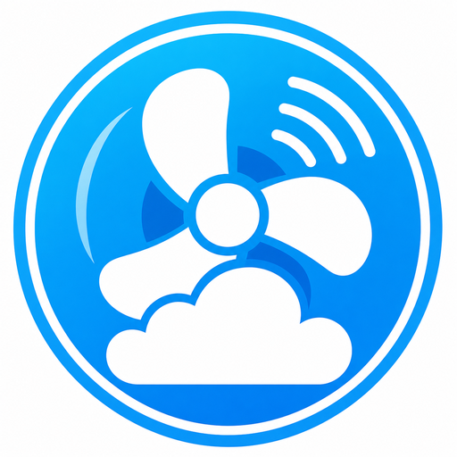

# IoBroker.dreo-cloud
## Облачный адаптер DREO для ioBroker
Неофициальный адаптер ioBroker для некоторых устройств DREO, подключенных к облаку.

Веб-сайт производителя DREO: https://www.dreo.com/

Этот проект не связан с организацией DREO, не одобрен ею и не поддерживается ею.

## Текущий статус
Адаптер находится в стадии активной разработки.

Текущая версия: `0.1.5`.

В этом релизе используется `@mehrwiedu/dreo-api` `0.1.5`.
Проверка проведена на восьми реальных устройствах шести моделей DREO.

Реализовано:

- Обнаружение устройств на основе FamilyTree
- обнаружение новых доступных устройств в режиме реального времени
- начальная загрузка состояния
- Обновления WebSocket в режиме реального времени
- автоматическое создание простых и удобных для использования объектов
- динамическое создание новых необработанных ключей только для чтения.
- двунаправленное управление подтвержденными функциями
- автоматическое обновление сессии и повторное подключение WebSocket
- эффективные дружественные государства
- централизованное подтверждение записи и согласование ошибок

Адаптер использует:

```text
@mehrwiedu/dreo-api 0.1.5
```

Детали протокола DREO и собственная логика команд остаются внутри SDK.

## Протестированные устройства
| Модель | Тип | Количество | Проверенные участки |
|---|---|---:|---|
| `DR-HCF007S` | Потолочный вентилятор | 3 | Вентилятор, режимы, основное освещение, яркость, цветовая температура, атмосферное освещение, таймеры, блокировка от детей, семантика маски питания/компонентов и обновления в реальном времени |
| `DR-HPF002S` | Напольный вентилятор | 1 | Вентилятор, режимы, дисплей, направленное вращение, независимые углы осей и обновления в реальном времени |
| `DR-HHM001S` | Увлажнитель | 1 | Мощность, режимы, уровень тумана, целевая влажность, индикаторы, состояние фильтра, рабочая информация, таймеры и обновления в реальном времени |
| `DR-HHM003S` | Увлажнитель | 1 | Мощность, режимы, уровень тумана, целевая влажность, теплый туман, уровни индикаторов, пороговые значения влажности, состояние фильтра и обновления в реальном времени |
| `DR-HAP009S` | Очиститель воздуха | 1 | Мощность, режимы, уровень вентилятора, подсветка, дисплей, отключение звука, блокировка от детей, восстановление питания, качество воздуха, срок службы фильтра и обновления в реальном времени |
| `DR-HAP009S` | Очиститель воздуха | 1 | Мощность, режимы, уровень вентилятора, подсветка, дисплей, отключение звука, блокировка от детей, восстановление питания, качество воздуха, срок службы фильтра и обновления в реальном времени |

Другие устройства могут отображаться в исходном состоянии, но автоматически не считаются полностью поддерживаемыми.

## Настройка учетной записи
Используйте учетную запись DREO, которая поддерживает вход по электронной почте и паролю.

Адаптер может использовать либо основную учетную запись владельца, либо отдельную дополнительную учетную запись с доступом к домашней странице DREO.

Для работы адаптера рекомендуется использовать отдельный дополнительный аккаунт, но это не обязательно.

Вход через Apple и Google не поддерживается.

## Конфигурация
- Электронная почта DREO
- Пароль DREO
- регион: ЕС или США

Пароль хранится в зашифрованном и защищенном виде в настройках ioBroker.

## Структура объекта
```text
dreo-cloud.0.devices.<deviceId>
```

Возможные варианты ответвлений:

```text
info
power
fan
humidifier
light.main
light.atmosphere
display
settings
timer
raw
```

Ветка `raw` отражает значения DREO и доступна только для чтения.

## Поддерживаемые элементы управления
Точный набор зависит от устройства.

К распространенным мерам контроля относятся:

```text
power.on
fan.on
fan.speed
fan.mode
settings.mute
settings.childLock
light.main.on
light.main.brightness
light.main.colorTemperature
light.atmosphere.on
light.atmosphere.brightness
display.on
timer.*
```

К элементам управления, специфичным для данной модели, относятся:

```text
fan.oscillationMode
fan.oscillation.horizontalAngle
fan.oscillation.verticalAngle
humidifier.mode
humidifier.fogLevel
humidifier.autoTargetHumidity
humidifier.sleepTargetHumidity
humidifier.humidityIndicatorLowerThreshold
humidifier.humidityIndicatorUpperThreshold
humidifier.warmMist
light.mood.on
light.mood.level
display.level
airPurifier.mode
airPurifier.fanLevel
settings.powerRecovery
settings.filterInstalled
```

Информация о работе, доступная только для чтения, включает в себя срок службы фильтра, часы работы, концентрацию PM2.5 и уровень качества воздуха (если таковой указан).

## Поведение записи
Запись данных направляется в общедоступные методы SDK.

- Адаптер не создает собственные полезные нагрузки DREO.
- Идентичные успешные операции записи подтверждаются немедленно.
- Отклоненные операции записи восстанавливаются до последнего подтвержденного значения.
- Фактические изменения остаются в силе до подтверждения отчетом об устройстве, если таковое требуется.
- Неудачные сообщения `control-reply` от DREO отображаются как ошибки SDK.

## Намеренно не поддерживается
Избранные значения потолочных вентиляторов, основанные на исходных значениях `predefine`, не подлежат записи.

Тестирование на реальных устройствах показало, что запись в слот не приводит к выполнению сохраненной сцены. Числовые записи были отклонены облаком. Поэтому `raw.predefine` остается доступным только для чтения.

Непроверенные поля, такие как `fixedconf` и дополнительные эффекты RGB, также остаются только в необработанном виде.

## Зависимость от облака
Адаптер зависит от частных облачных API DREO и не обеспечивает управление только локально.

## Конфиденциальность и безопасность
- Не публикуйте учетные данные, токены, серийные номера устройств или неотредактированные журналы.
- Предпочтительно использовать отдельный дополнительный аккаунт DREO.
- Перед тем как прикреплять журналы к проблемам, просмотрите их.

## Известные ограничения
- Вход через Apple и Google не поддерживается.
- Доступны только регионы ЕС и США.
- Не для каждого исходного состояния существует удобная карта.
- Удобные структуры еще не генерируются, если известный ключ впервые появляется только после инициализации.
- Для частично совместного использования домов/устройств по-прежнему требуется отдельное тестирование.
- Компания DREO может изменять закрытый API без предварительного уведомления.

## Разработка
```bash
npm install
npm test
npm run check
npm run lint
npm run build
```

## Changelog
### 0.1.5 (2026-10-30)

- Updated `@mehrwiedu/dreo-api` to `0.1.5`, adding a 30-second HTTP timeout for cloud requests.
- Removed an unused admin translation key from all 11 language files.

### 0.1.4 (2026-10-03)

- Fixed the ioBroker object hierarchy by exposing the device container as a folder
- Updated Friendly-State and RAW-state roles to comply with current ioBroker object-structure requirements
- Prevented numeric constraints from being applied to non-numeric Friendly States
- Added startup migration for previously stored runtime-discovered RAW states so corrected type and role metadata is applied after upgrades
- Updated `@mehrwiedu/dreo-api` to `0.1.4`, including the validated `DR-HCF007S` power/component-mask behavior

### 0.1.3 - 2026-10-01

- Promoted the validated 0.1.3 beta feature set to a regular release
- Added current ioBroker repository-checker compatibility and complete admin translations
- Clarified that either the primary owner account or an authorized secondary email/password account can be used

### 0.1.3-beta.1 - 2026-09-27

- Added validated `DR-HHM003S` humidifier support
- Added validated `DR-HAP009S` air-purifier support
- Validated runtime hot-add without an adapter restart
- Added model-aware write routing for overlapping Friendly-State paths
- Added control-reply error propagation through the SDK
- Removed unverified ceiling-fan favorite control

### 0.1.2-beta.1

- Added support for older DREO devices without a `poweron` state

### 0.1.1 - 2026-07-17

- Added the official DREO Cloud adapter logo
- Moved full device serial numbers from info logs to debug logs
- Enabled GitHub Actions trusted publishing for future npm releases

### 0.1.0 - 2026-07-17

- Added the Creator-based ioBroker adapter structure
- Added DREO account configuration for EU and US regions
- Added FamilyTree-based device discovery
- Added runtime discovery of newly available devices
- Added automatic creation of device, information, raw, and friendly states
- Added live raw and friendly state updates through the DREO WebSocket connection
- Added bidirectional control of supported power, fan, speed, and light functions
- Added dynamic read-only creation of previously unknown raw states
- Added automatic re-login and WebSocket reconnect after renewed DREO sessions
- Added effective friendly on/off states while preserving original raw device values

## License

MIT License

Copyright (c) 2026 mehrwiedu <david@vonderhoeh.net>

Permission is hereby granted, free of charge, to any person obtaining a copy
of this software and associated documentation files (the "Software"), to deal
in the Software without restriction, including without limitation the rights
to use, copy, modify, merge, publish, distribute, sublicense, and/or sell
copies of the Software, and to permit persons to whom the Software is
furnished to do so, subject to the following conditions:

The above copyright notice and this permission notice shall be included in all
copies or substantial portions of the Software.

THE SOFTWARE IS PROVIDED "AS IS", WITHOUT WARRANTY OF ANY KIND, EXPRESS OR
IMPLIED, INCLUDING BUT NOT LIMITED TO THE WARRANTIES OF MERCHANTABILITY,
FITNESS FOR A PARTICULAR PURPOSE AND NONINFRINGEMENT. IN NO EVENT SHALL THE
AUTHORS OR COPYRIGHT HOLDERS BE LIABLE FOR ANY CLAIM, DAMAGES OR OTHER
LIABILITY, WHETHER IN AN ACTION OF CONTRACT, TORT OR OTHERWISE, ARISING FROM,
OUT OF OR IN CONNECTION WITH THE SOFTWARE OR THE USE OR OTHER DEALINGS IN THE
SOFTWARE.