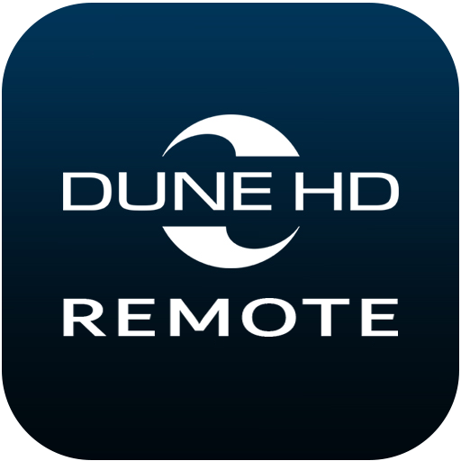

# ioBroker.dune-hd-remote

Управляйте медиаплеерами [Dune HD](https://dune-hd.com/) по IP-сети с помощью ioBroker.

[Компания Dune HD](https://dune-hd.com/) производит высококачественные сетевые медиаплееры, поддерживающие воспроизведение 4K HDR, Blu-ray и широкий спектр медиаформатов. Все плееры Dune HD на базе Linux поддерживают IP-управление через HTTP API, который данный адаптер использует для обеспечения полного удаленного управления из ioBroker.

## Функции

- Полное управление воспроизведением (воспроизведение, пауза, остановка, перемотка, предыдущая/следующая композиция, перемотка вперед/назад).
- Навигация (D-pad, Enter, Return, меню)
- Регулировка громкости и отключение звука
- Опрос состояния (состояние проигрывателя, позиция, продолжительность, громкость, битрейт, язык аудио, разрешение видео)
- Встроенный веб-пульт PWA — используйте свой телефон в качестве пульта дистанционного управления.
- Интеллектуальный опрос в автономном режиме — снижает частоту опроса, когда игрок недоступен.
- Ввод текста в PWA — отправка текста непосредственно на экранную клавиатуру игрока.
- PWA Play URL — запуск воспроизведения мультимедиа с любого URL-адреса непосредственно с пульта дистанционного управления.

## Поддерживаемые модели

Все медиаплееры Dune HD с поддержкой IP-управления (прошивка на базе Linux).\
&#x20;Протестировано на: **Dune HD Pro 4K** (прошивка с форматом ответа XML).

| Тип модели                              | Порт по умолчанию |
| --------------------------------------- | ----------------- |
| На базе Linux (Pro 4K, Solo 4K и т. д.) | 80                |
| На базе Android/ATV                     | 11080             |

### Примечания для моделей Android

- **Приложения Android:** Когда приложение Android находится на переднем плане, кнопки управления воспроизведением (воспроизведение, пауза, остановка, предыдущий, следующий, перемотка назад, перемотка вперед) отправляются как клавиши дистанционного управления, а не как команды API, поскольку команды API достигают только самого плеера Dune. Внутри плеера Dune ничего не меняется. Кнопка «медленно» не имеет клавиши Android и ничего не делает в приложениях Android.
- **Питание/режим ожидания на сертифицированных Google ATV-приставках (известное ограничение):** На сертифицированных Google ATV-приставках сторонних производителей, работающих с приложением Dune Media Center (например, на устройствах Android 14, порт 11080), кнопка питания (`control.power` (и PWA) не может перевести приставку в режим ожидания. Приставка принимает команду, и адаптер не сообщает об ошибке, но Android отказывается переводить приставку в спящий режим, потому что у приложения Dune нет системного разрешения. `android.permission.DEVICE_POWER`. Это разрешение могут получить только системные приложения, поэтому для этого нет настроек, параметров адаптера или обходных путей. Выключайте такое устройство с помощью собственного пульта дистанционного управления. Все остальные кнопки работают нормально. На плеерах Dune HD с прошивкой на базе Linux кнопка питания работает.

## Конфигурация

### Игрок

| Поле               | Описание                                         |
| ------------------ | ------------------------------------------------ |
| Имя игрока         | Отображаемое имя (только для справки)            |
| IP-адрес игрока    | IP-адрес HD-плеера Dune                          |
| Порт игрока        | HTTP-порт (по умолчанию: 80)                     |
| Таймаут соединения | Время ожидания запроса в мс (по умолчанию: 5000) |

### Опросы состояния

| Поле                                | Описание                                                                    |
| ----------------------------------- | --------------------------------------------------------------------------- |
| Включить опрос состояния            | Включить периодические обновления статуса                                   |
| Интервал опроса                     | Интервал в секундах, когда игрок находится в сети (по умолчанию: 5)         |
| Интервал опроса в автономном режиме | Интервал в секундах, в течение которого игрок недоступен (по умолчанию: 30) |

### Пульт дистанционного управления PWA

Включите встроенный веб-пульт дистанционного управления, чтобы управлять плеером из любого браузера или мобильного устройства.

| Поле                                  | Описание                                                  |
| ------------------------------------- | --------------------------------------------------------- |
| Включить дистанционное управление PWA | Запустите встроенный веб-сервер.                          |
| Привязать IP-адрес                    | Сетевой интерфейс для привязки (0.0.0.0 = все интерфейсы) |
| Порт сервера PWA                      | Порт для удаленного веб-доступа (по умолчанию: 8765)      |

После включения откройте `http://<iobroker-host>:8765/` в вашем браузере.\
&#x20;URL-адрес также хранится в `info.pwaUrl` Состояние. Администратор также отображает ссылку на удаленный доступ рядом с экземпляром на вкладке « **Экземпляры»** . Администратор всегда отображает эту ссылку, поэтому она работает только тогда, когда удаленный доступ к PWA включен.

**Функции PWA:**

- Главная вкладка: крестовина, элементы управления воспроизведением, громкость, перемотка.
- Главная вкладка: поле ввода текста — отправляет текст на клавиатуру активного игрока (`set_text` API)
- Главная вкладка: Поле «URL воспроизведения» — запускает воспроизведение медиафайлов с любого URL-адреса (`launch_media_url` API)
- Вкладка «Цифры»: цифровые клавиши, цветные кнопки (A/B/C/D), субтитры, масштабирование, извлечение диска, запись.
- Вкладка «Настройки»: темная/светлая тема, параметры подключения.
- Работает как устанавливаемое PWA на iOS и Android (добавляется на главный экран).

### Плагин Dune Notify

Во время воспроизведения видео необходимо отображать уведомления от ioBroker **поверх видео** .\
&#x20;Для работы требуется установленный на плеере PHP-плагин **dune-notify** (см. `dune-notify/` папка).

| Поле                                            | Описание                                              |
| ----------------------------------------------- | ----------------------------------------------------- |
| Включить уведомления                            | Включите интеграцию с Dune-Notify.                    |
| Уведомить о превышении времени ожидания запроса | Время ожидания HTTP-запроса в мс (по умолчанию: 3000) |

## Штаты

| Состояние                               | Тип        | Описание                                                                                                                   |
| --------------------------------------- | ---------- | -------------------------------------------------------------------------------------------------------------------------- |
| `info.connection`                       | логический | Игрок доступен                                                                                                             |
| `info.pwaUrl`                           | нить       | Удаленный URL PWA                                                                                                          |
| `info.playerModel`                      | нить       | Название модели игрока                                                                                                     |
| `info.firmwareVersion`                  | нить       | Версия прошивки                                                                                                            |
| `status.playerStatus`                   | нить       | игра / остановлен / пауза                                                                                                  |
| `status.position`                       | число      | Позиция воспроизведения (секунды)                                                                                          |
| `status.duration`                       | число      | Общая продолжительность (в секундах)                                                                                       |
| `status.volume`                         | число      | Уровень громкости                                                                                                          |
| `status.mute`                           | логический | Состояние немоты                                                                                                           |
| `status.caption`                        | нить       | Текущее название СМИ                                                                                                       |
| `status.audioLang`                      | нить       | Язык аудио                                                                                                                 |
| `status.videoWidth/Height`              | число      | Разрешение видео                                                                                                           |
| `status.bitrate`                        | число      | Текущая скорость передачи данных (бит/с)                                                                                   |
| `control.play/pause/stop`               | логический | Запуск действий воспроизведения                                                                                            |
| `control.power`                         | логический | Питание / режим ожидания (не поддерживается на сертифицированных Google ТВ-приставках, см. примечания для моделей Android) |
| `control.volume`                        | число      | Установить громкость                                                                                                       |
| `navigation.up/down/left/right/ok/back` | логический | Навигационные кнопки                                                                                                       |
| `media.playUrl`                         | нить       | Воспроизведение медиафайлов по URL-адресу                                                                                  |
| `media.seek`                            | число      | Стремиться к позиции (в секундах)                                                                                          |
| `notify.send`                           | нить       | Отправить уведомление (текстовое или JSON)                                                                                 |
| `notify.hide`                           | логический | Скрыть текущее уведомление                                                                                                 |
| `notify.lastResult`                     | нить       | Результат последнего запроса на уведомление                                                                                |

## Changelog

### **WORK IN PROGRESS**
- `@iobroker/testing` 6.3.2 (repository checker W0037)

### 1.2.14
- The port of the PWA remote is declared in the used resources registry of js-controller (js-controller 8 and newer), and a warning is logged when another instance already uses it; nothing changes on older controllers

### 1.2.13
- README: notes for Android models; the Power button cannot switch Google-certified ATV boxes to standby (Android restriction), `control.power` added to the states table

### 1.2.12
- Fix Play, Pause, Stop, Previous, Next, Rewind and Fast-forward in Android apps: the PWA remote and the control states send the remote's transport keys (IR codes, delivered to Android as media keys) while an Android app is in the foreground; inside the Dune player the API commands are still used

### 1.2.11
- Fix a crash of the adapter when the player did not answer a PWA request in time (the timeout answered the request twice)
- Replace the deprecated `url.parse()` in the PWA server by the WHATWG `URL` API
- Create the object tree also when no player IP is configured yet
- README: badge block, changelog trimmed to the last five versions
- Update transitive dependencies in the lock file (`npm audit fix`)

### 1.2.10
- Fix the "Test Connection" button: enable messagebox, use the current form values (useNative) and the same status request as the polling

For older changelog entries see CHANGELOG_OLD.md.

## License

MIT License

Copyright (c) 2026 sadam6752-tech <sadam6752@gmail.com>

Permission is hereby granted, free of charge, to any person obtaining a copy
of this software and associated documentation files (the "Software"), to deal
in the Software without restriction, including without limitation the rights
to use, copy, modify, merge, publish, distribute, sublicense, and/or sell
copies of the Software, and to permit persons to whom the Software is
furnished to do so, subject to the following conditions:

The above copyright notice and this permission notice shall be included in all
copies or substantial portions of the Software.

THE SOFTWARE IS PROVIDED "AS IS", WITHOUT WARRANTY OF ANY KIND, EXPRESS OR
IMPLIED, INCLUDING BUT NOT LIMITED TO THE WARRANTIES OF MERCHANTABILITY,
FITNESS FOR A PARTICULAR PURPOSE AND NONINFRINGEMENT. IN NO EVENT SHALL THE
AUTHORS OR COPYRIGHT HOLDERS BE LIABLE FOR ANY CLAIM, DAMAGES OR OTHER
LIABILITY, WHETHER IN AN ACTION OF CONTRACT, TORT OR OTHERWISE, ARISING FROM,
OUT OF OR IN CONNECTION WITH THE SOFTWARE OR THE USE OR OTHER DEALINGS IN THE
SOFTWARE.