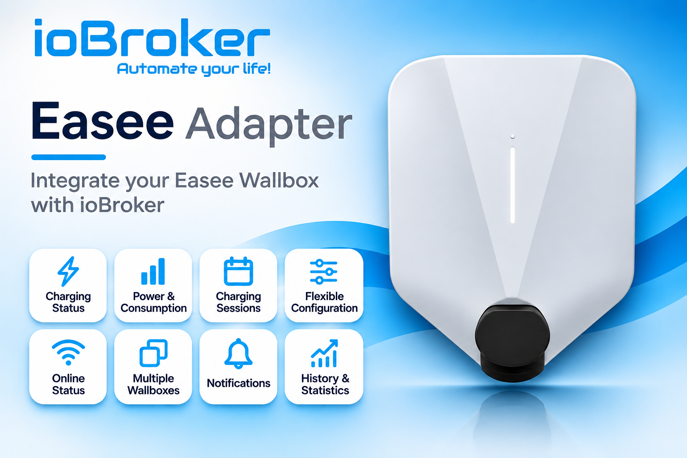

# ioBroker.easee

> \[!ВАЖНО] Этот адаптер нельзя установить из GitHub

## Адаптер easee для ioBroker

Адаптер для подключения [настенных коробок Easee](https://easee.com/) .

## Требования

- Node.js 22.19.0 или более поздняя версия
- ioBroker js-controller 7.2.2 или новее
- ioBroker Admin 7.7.22 или более поздняя версия

## Помощь

### Режим подключения

Режим подключения по умолчанию — «Облако». В настройках адаптера выберите **Easee Cloud** или **Bluetooth (локальный)** . В режиме «Облако» используется ваша учетная запись Easee. В режиме Bluetooth подключение осуществляется напрямую к зарядным устройствам, настроенным в Диспетчере устройств на вкладке «Подключение». Используйте его для добавления, редактирования и удаления локальных зарядных устройств; режим Bluetooth не выполняет вход в облако и не переключается на него автоматически. Введите серийный номер каждого зарядного устройства и PIN-код Bluetooth (не пароль вашей учетной записи Easee), затем сохраните настройки и перезапустите адаптер. Необязательное имя — это всего лишь метка ioBroker. PIN-код хранится в зашифрованном виде в конфигурации адаптера.

Зарядное устройство должно находиться в зоне действия Bluetooth и быть доступным для локального подключения. На вкладке **«Расширенные функции Bluetooth»** отображается состояние Bluetooth и способ подключения, а также предлагается дополнительный ручной поиск. Результаты поиска не настраивают зарядные устройства и не заменяют необходимый серийный номер и PIN-код. Режим Bluetooth не предоставляет информацию, доступную только в облаке, такую как цены на услуги, история сеансов или сведения о токене авторизации. Отображаются только данные, поддерживаемые выбранным режимом подключения; неподдерживаемые данные, созданные адаптером, удаляются после переключения режимов. Для настройки, обеспечения совместимости и устранения неполадок см. [руководство по Bluetooth](/#/docs/adapterref/iobroker.easee/docs/bluetooth.md) .

### Состояние зарядного устройства и элементы управления

`<chargerId>.status.chargerOpMode` Отображает текущее состояние зарядки. В браузере объектов администратора зарядные устройства помечаются как находящиеся в сети или вне сети с помощью `<chargerId>.status.isOnline` в облачном режиме или `<chargerId>.info.bluetoothConnection` в режиме Bluetooth.

| Ценить | Состояние                    |
| -----: | ---------------------------- |
|      0 | Офлайн                       |
|      1 | Отключено                    |
|      2 | Ожидание начала              |
|      3 | Зарядка                      |
|      4 | Приостановлено или завершено |
|      5 | Ошибка                       |
|      6 | Готов к зарядке              |
|      7 | Ожидание аутентификации      |
|      8 | Завершение аутентификации    |

В облачном режиме Easee может выдавать токен авторизации после сеанса зарядки. `status.authToken` Когда токен совпадает с ключом в вашей учетной записи Easee, `status.authTokenName` Отображает имя владельца ключа; в противном случае отображается другое имя. `unknown` Оба состояния остаются пустыми до тех пор, пока не появится доступный токен.

В облачном режиме запишите новое имя в `<chargerId>.name` Чтобы переименовать зарядное устройство, необходимо иметь разрешение на изменение названий зарядных устройств на сайте в вашей учетной записи Easee.

`config.dynamicCircuitCurrentP1` –`P3` Установите текущий лимит для каждой фазы. В облачном режиме обновите значения всех фаз одновременно. В режиме Bluetooth перед применением изменения считываются значения других фаз, и оно отклоняется, если они недоступны.

Опрос облачных сессий по умолчанию выполняется автоматически. В административной панели можно установить отдельный интервал для каждого зарядного устройства; для предотвращения чрезмерного количества запросов настраиваются очень короткие интервалы.

## Кредиты

Создание этого адаптера было бы невозможно без замечательной работы @Newan ( <https://github.com/Newan> ), который разрабатывал предыдущие версии этого адаптера.

## Пожертвование

## Changelog
<!--
  Placeholder for the next version (at the beginning of the line):
  ### **WORK IN PROGRESS**
-->
### 4.1.0 (2026-11-19)
- (Voodoo2man) Added online/offline indicators for chargers in the Admin object browser.
- (Voodoo2man) Improved cleanup of Bluetooth connections that complete while the adapter shuts down.

### 4.0.1 (2026-11-15)
- (Voodoo2man) Fixed repository-checker findings and improved automatic Bluetooth binding selection, timer cleanup, and bounded shutdown handling (up to 10 seconds).
- (Voodoo2man) Limited the displayed charging power to two decimal places in the Device Manager card.

### 4.0.0 (2026-11-10)
- (Voodoo2man) Added optional local Bluetooth connectivity alongside Cloud, with charger discovery and setup through the Device Manager.
- (Voodoo2man) Improved Cloud status and session updates, charger controls, and Bluetooth charger configuration saving.

### 3.2.0 (2026-11-07)
- (Voodoo2man) Added the ability to change the charger name through the writable `<chargerId>.name` state.
- (Voodoo2man) Replaced the adapter icon.
- (Voodoo2man) Added an authorization token datapoint that is cleared when charging starts and set after the session, with a separate owner-name datapoint.

### 3.1.0 (2026-11-01)
- (Voodoo2man) Corrected cable-lock status reporting and improved the reliability of charger status updates.
- (Voodoo2man) Added a readable and adjustable permanent cable-lock setting, kept separate from the actual cable-lock status.
- (Voodoo2man) Improved recovery of live charger updates after connection interruptions while retaining regular status updates when live updates are disabled.

## License
MIT License

Copyright (c) 2026 iobroker-community-adapters <iobroker-community-adapters@gmx.de>  
Copyright (c) 2025 Newan <info@newan.de>

Permission is hereby granted, free of charge, to any person obtaining a copy
of this software and associated documentation files (the "Software"), to deal
in the Software without restriction, including without limitation the rights
to use, copy, modify, merge, publish, distribute, sublicense, and/or sell
copies of the Software, and to permit persons to whom the Software is
furnished to do so, subject to the following conditions:

The above copyright notice and this permission notice shall be included in all
copies or substantial portions of the Software.

THE SOFTWARE IS PROVIDED "AS IS", WITHOUT WARRANTY OF ANY KIND, EXPRESS OR
IMPLIED, INCLUDING BUT NOT LIMITED TO THE WARRANTIES OF MERCHANTABILITY,
FITNESS FOR A PARTICULAR PURPOSE AND NONINFRINGEMENT. IN NO EVENT SHALL THE
AUTHORS OR COPYRIGHT HOLDERS BE LIABLE FOR ANY CLAIM, DAMAGES OR OTHER
LIABILITY, WHETHER IN AN ACTION OF CONTRACT, TORT OR OTHERWISE, ARISING FROM,
OUT OF OR IN CONNECTION WITH THE SOFTWARE OR THE USE OR OTHER DEALINGS IN THE
SOFTWARE.