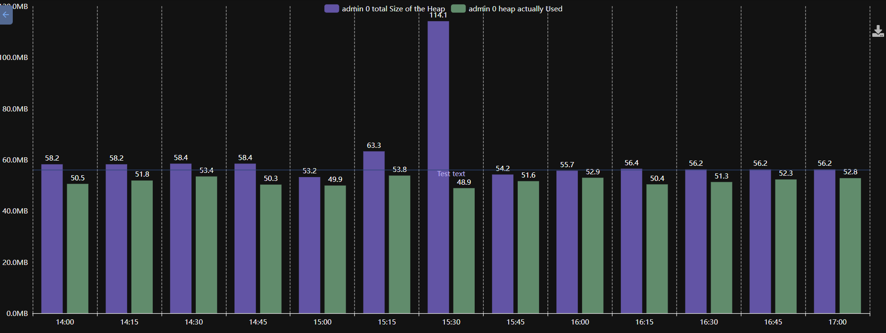
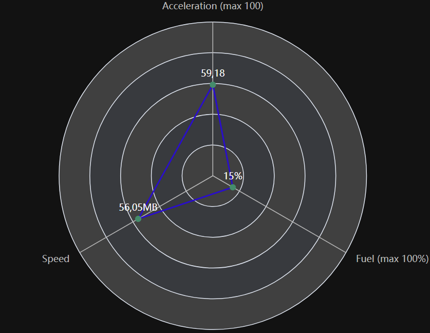
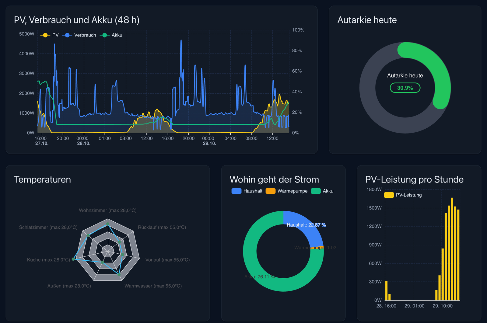

# ioBroker.echarts

**Этот адаптер использует библиотеки Sentry для автоматического сообщения разработчикам об исключениях и ошибках в коде.** Более подробную информацию, а также инструкции по отключению отправки сообщений об ошибках см. [в документации Sentry-Plugin](https://github.com/ioBroker/plugin-sentry#plugin-sentry) !

## адаптер echarts для ioBroker

Создавайте полезные графики в ioBroker:




 Для получения прогнозируемого результата используйте агрегацию "Фактическое значение".

### Один столбик на каждую точку данных

Обычно ось X столбчатой диаграммы — это время, и каждый столбец соответствует одному интервалу. В **настройках столбчатой диаграммы → Один столбец на линию** ось X становится списком линий: каждая линия получает ровно один столбец, который показывает последнее значение этой линии. Вместе с агрегацией «Фактическое значение», которая представляет собой текущее значение каждого состояния, например, потребления каждого устройства.

**Горизонтальные полосы** поворачивают диаграмму на 90°, так что названия располагаются на оси Y. Это лучший вариант для длинных названий или для большого количества строк.

## Использование

Добавьте это после перезапуска вкладки в админке:

Созданный пресет также доступен в веб-адаптере. URL: `http://IP:8082/echarts/index.html?preset=echarts.0.PRESETID`.

Для `vis` Имеется специальный виджет с удобным выбором предустановок.

### Виджет "Диапазон времени"

Рядом с виджетом диаграммы находится виджет «Временной диапазон E-Charts». Он отображает те же три поля, что и вкладка «Время» редактора предустановок — тип (относительный или статический), конец и диапазон — и предоставляет пользователю выбор виджетам диаграмм в этом же представлении. Каждое из трех полей можно отключить в настройках виджета; отключенное поле сохраняет значение, указанное в его атрибуте. Пока в разделе «Диаграммы» не выбран ни один график, все виджеты E-Charts в этом представлении следуют за ним.

То же самое работает и без виджета: график, открытый с предустановленными параметрами, извлекает диапазон из хеша URL, например. `http://IP:8082/echarts/index.html?preset=echarts.0.PRESETID#range=60&relativeEnd=now`. `range`, `relativeEnd`, `timeType`, `start`, `start_time`, `end` и `end_time` Они считываются там и переопределяют предустановку, не изменяя саму предустановку.

### Режимы построения графиков

В редакторе предустановок открывается вкладка «Параметры», где отображается «Режим диаграммы», описывающий всю диаграмму:

- **Смешанный** график, как всегда: ось времени, и каждая линия имеет свой собственный характер.
- **Пончик** — одно кольцо, по одному сегменту на строку с текущим значением его состояния. Размер отверстия, подписи на сегментах, текст внутри отверстия и порядок сегментов задаются рядом. Значения поступают по подписке, поэтому кольцо следует состояниям без обновления.
- **Полосы (текущее значение)** - одна полоса на строку вместо одной полосы на временной интервал. Именно так работала галочка "Одна полоса на строку"; старый предустановленный режим считывается как таковой и продолжает работать.
- **Радар** — полярная карта. Раньше существовал тип карты, где могла располагаться одна линия, которая затем автоматически отображала все остальные линии; старый предустановленный режим считывается именно так.
- **Калибр** — в форме «Круги» шкала изогнута в полный круг, и на каждой линии расположено кольцо, а в центре — названия и значения; в форме «Калибр» открытая шкала остается неизменной, и на каждой линии размещается указатель, а под ним в ряду расположены названия и значения.

Функции Donut и "Bar (текущее значение)" считывают данные о состоянии системы, а не об истории изменений, поэтому им не требуется временной диапазон и агрегирование.

В режиме просмотра vis-2 каждый график представляет собой один из предустановленных режимов, отображаемых с помощью виджета "Echarts Chart": смешанный (линии со второй осью Y), индикатор, радар, кольцевой график и почасовые столбцы.



### Диаграмма без iframe (экспериментальная версия)

Виджет диаграммы vis-2 отображает диаграмму в iframe: каждая диаграмма в представлении использует собственное приложение React, собственный объект echarts и, прежде всего, собственное сокетное соединение. Атрибут "Without iframe" отображает её внутри виджета — в этом случае модель использует соединение, уже имеющееся в среде выполнения vis, а диаграмма отображается в теме vis-2.

Виджет для ioBroker.devices имеет одинаковые настройки. Оба встраиваются. `ChartEmbed` из `src-chart` Это единственное место, где модель графика связана с представлением графика.

Код диаграммы загружается по запросу (около 1,5 МБ, 480 КБ в сжатом виде) при первом отображении виджета с этой настройкой, поскольку ни vis-2, ни хост устройства не используют общие диаграммы. Страница без такого виджета ничего дополнительного не загружает. iframe остается вариантом по умолчанию и остается единственным способом для автономного URL-адреса и для предварительного просмотра в редакторе.

### Веб-компоненты

Адаптер обеспечивает работу веб-компонента. `<iob-echarts-chart>` (`common.webComponents` Aura и все остальные компоненты веб-приложений ioBroker отображают его как отдельный виджет; vis-2 и другие устройства продолжают предлагать свой виджет E-Charts, который носит то же имя.

Он рисует предустановленный (`echarts.0.<name>`), или — без предустановки — историю отдельного состояния, как это делает виджет vis-2: тип диаграммы, агрегация, обновление в реальном времени, деления, диапазон и конец задаются в компоненте. Экземпляр истории — это тот, который записывает состояние, история по умолчанию — первая. Диаграмма отрисовывается непосредственно с подключением хоста — без iframe, без собственного сокета — в светлой или темной теме и шрифте хоста.

Кнопки предустановки работают так же, как и на странице диаграммы: сохранить как изображение, экспортировать данные в CSV, выбрать линии; перемещение и масштабирование с помощью мыши и пальцев. Настройка «Выбор временного диапазона» добавляет кнопку для выбора временного диапазона, даже если в предустановке его нет. Она предлагает относительный диапазон с конечным значением или фиксированный диапазон — то же самое, что делает виджет vis-2 «Временной диапазон E-Charts» для диаграмм представления. Этот виджет не имеет собственного компонента: он управляет другими виджетами того же представления, и множество веб-компонентов не имеют такой связи.

Модуль включает в себя echarts (только те диаграммы, компоненты и средства визуализации, которые может использовать предустановленный набор параметров), moment и код диаграмм. `src-chart` Размер файла: около 925 КБ, в сжатом виде — 300 КБ, загружается только при отображении компонента на хосте. Создан с помощью... `npm run build:wc` от `src-webcomponents/` в `admin/webcomponents/`.

### Всплывающая подсказка

Нижний регистр `i` Это означает, что значение было интерполировано из значений двух соседних элементов и в данный момент времени оно отсутствует.


### Данные из JSON

Источник данных можно определить из JSON. В этом случае можно создать пользовательское состояние соответствующего типа. `json` и сохраните значение следующим образом:

```json
[
    { "ts": 1675887847000, "val": 45 },
    { "ts": 1675887848000, "val": 77 },
    { "ts": 1675887849000, "val": 180 }
]
```

Поддерживаются альтернативные имена атрибутов для `val`: `value`, `v`, `data`, `y` И далее для `ts`: `time`, `t`, `date`.

В настройках диаграммы Echarts невозможно задать начальную и конечную точки. Начальная и конечная точки будут автоматически рассчитаны на основе данных. Агрегация также невозможна. Все манипуляции должны выполняться путем записи данных в формате JSON. Диаграмма будет автоматически обновляться каждый раз при изменении значения.

### Рендеринг на стороне сервера

Вы можете отобразить предустановки на сервере и получить их в виде URL-адреса в формате base64, либо сохранить их на диске или в базе данных ioBroker:

```js
sendTo(
    'echarts.0',
    {
        preset: 'echarts.0.myPreset', // the only mandatory attribute

        renderer: 'svg', // svg | png | jpg | pdf, default: svg

        width: 1024, // default 1024
        height: 300, // default 300
        background: '#000000', // Background color
        theme: 'light', // Theme type: 'light', 'dark'

        title: 'ioBroker Chart', // Title of PDF document
        quality: 0.8, // quality of JPG
        compressionLevel: 3, // Compression level of PNG
        filters: 8, // Filters of PNG (Bit combination https://github.com/Automattic/node-canvas/blob/master/types/index.d.ts#L10)

        fileOnDisk: '', // Path on disk to save the file.
        fileName: '', // Path in ioBroker DB to save the files on 'echarts.0'. E.g. if your set "chart.svg", so you can access your picture via http(s)://ip:8082/echarts.0/chart.png

        cache: 600, // Cache time for this preset in seconds, default: 0 - no cache
    },
    result => {
        if (result.error) {
            console.error(result.error);
        } else {
            console.log(result.data);
        }
    },
);
```

В качестве предустановленного параметра может также использоваться отдельный график, не содержащий предустановленного объекта, например, температура наружного воздуха за последние 24 часа:

```js
sendTo('echarts.0', 'send', {
    preset: {
        l: [{ id: 'alias.0.Outside.Temperature' }], // the lines: id, and optional name, unit, color, instance (history adapter)
        range: 1440, // minutes back from now
        title: 'Outside',
    },
    renderer: 'png',
    background: '#ffffff',
    fileName: 'agent/outside.png', // then e.g. telegram: sendTo('telegram.0', 'send', { text: 'iobfile://echarts.0/agent/outside.png' })
});
```

`sendTo('echarts.0', 'help', {})` Ответы содержат описание сообщений для агентов ИИ (например, pi-agent) и авторов скриптов; в ответе перечислены все команды. `write` (изменяет ли команда что-либо).

**Внимание: на сенсорных устройствах с включенным масштабированием невозможно включить/отключить линии в легенде.**

## Руководство разработчика

**Для тех, кто не занимается разработкой, эта ссылка не работает!**

Для отладки диаграмм можно использовать локальную команду:

- cd iobroker.echarts/src-chart
- npm run start
- Браузер: <http://localhost:8081/adapter/echarts/tab.html?dev=true>

## Все

- виджет для vis (кнопка)
- отображать значки перечислений в папках или рядом с ними
  <!--
  	Placeholder for the next version (at the beginning of the line):
  	### **WORK IN PROGRESS**
  -->

## Changelog
### **WORK IN PROGRESS**
* (GermanBluefox) The preset editor has a switch "Auto preview" and a button "Update preview": with the switch off, the preview is updated only by the button; with the switch on, the preview waits briefly after a change so fast changes cause only one reload (#1323)

### 6.5.1 (2026-11-20)
- (@GermanBluefox) The help for AI agents describes charts without a preset (states and time range in the message), e.g. "the outside temperature of today", and how to send a chart with a messenger
- (@GermanBluefox) Fixed: the message "send" with renderer "pdf" now answers with the PDF instead of never answering; a failure while rendering or writing `fileOnDisk` is answered as an error as well
- (@GermanBluefox) Fixed: the message "send" now answers errors with their text instead of an empty object
- (@GermanBluefox) Fixed: the message "send" with an unknown preset now answers with an error instead of no answer at all

### 6.5.0 (2026-11-19)
- (@GermanBluefox) Added the message "help": a description of all messages for AI agents (e.g. pi-agent), and common.supportedMessages.help

### 6.4.1 (2026-11-17)
- (@GermanBluefox) Fixed the build with echarts-for-react 3.1.0: version 6.4.0 failed to build and was not published, this version contains its changes

### 6.4.0 (2026-11-17)
- (@GermanBluefox) A chart can show an arrow at each side that moves the time range by its own length: a week back for "7 days", the month before for "this month". After a click into the chart the arrow keys ← and → do the same. The option "Show arrows for the previous and next period" is in the time settings of the preset; it works for lines and for bars, which stay on their raster of days, weeks or months. Stepping forward back to the present brings the live update back
- (@GermanBluefox) Added the short form of the web component manifests (tag, name, icon, size) to `common.webComponents`, so that hosts like Aura can list the components before the adapter is installed; the build writes it with `iob-web-components sync-io-package`
- (@GermanBluefox) Updated packages
- (@GermanBluefox) The editor lists the states of a running history instance from its answer to `getEnabledDPs` and no longer only from `common.custom`, so the states that the recorder selects by itself appear as well

### 6.3.0 (2026-11-09)
- (@GermanBluefox) Added web component `<iob-echarts-chart>` for Aura and other hosts (`common.webComponents`)
- (@GermanBluefox) Fixed: a chart drawn without iframe kept the first fixed time range and ignored every later one

## License

ioBroker.echarts is available under the Apache License V2.

Copyright (c) 2019-2026 @GermanBluefox <dogafox@gmail.com>

Apache ECharts
Copyright (c) 2017-2026 The Apache Software Foundation

This product includes software developed at
The Apache Software Foundation (https://www.apache.org/).