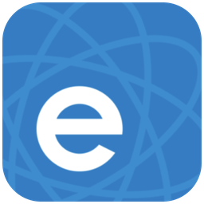

# ioBroker.ewelink

## Адаптер ewelink для ioBroker

Управляйте выключателями [Sonoff](https://sonoff.tech/) /eWeLink в локальной сети. Адаптер взаимодействует с каждым устройством напрямую через TCP-порт 8081 и получает изменения его состояния в виде mDNS-сообщений, поэтому переключение работает без доступа к интернету и без облачной платформы eWeLink.

Эта версия поддерживает **одноканальные переключатели** — устройства с одним реле, которые передают сигнал. `switch` например, розетки Sonoff MICRO, BASIC R2/R3/R4, MINI R2/R3/R4, RF R3 и S26.

Поддерживаются два типа устройств:

- **Управление локальной сетью eWeLink** (обычный режим настройки устройств в приложении eWeLink). Запросы к этим устройствам шифруются с помощью ключа, доступного каждому устройству, который известен только облаку eWeLink. Адаптер получает ключи **один раз** , при входе в учетную запись eWeLink из настроек экземпляра, и сохраняет их в зашифрованном виде. После этого он не обращается к облаку.
- **[Режим DIY](https://sonoff.tech/diy-developer/)** (открытый, незашифрованный API локальной сети, который предлагают некоторые модели). Для этого не требуется учетная запись eWeLink.

## Требования

- Node.js 22 или новее, js-controller 6.0.11 или новее, admin 7.6.20 или новее
- Хост ioBroker находится в **той же сети (подсети),** что и коммутаторы: устройства объявляют о себе и своем состоянии по протоколу mDNS, который не проходит через маршрутизаторы. (Устройства в режиме DIY с настроенным IP-адресом также могут опрашиваться в разных подсетях.)
- Для управления устройством по локальной сети eWeLink: необходимо включить _управление по локальной сети_ для устройства в приложении eWeLink, а также иметь бесплатную учетную запись разработчика в [центре разработчиков eWeLink](https://dev.ewelink.cc/) или ключи доступа к устройству, полученные из другого источника (см. ниже).

## Получение ваших устройств от eWeLink

Приложения, созданные в центре разработчиков eWeLink, могут входить в систему только с использованием OAuth 2.0, поэтому адаптер не сможет получить ваш пароль от eWeLink. Вместо этого:

1. Зарегистрируйтесь в [центре разработчиков eWeLink](https://dev.ewelink.cc/) (одобрение может занять несколько дней) и создайте приложение. Укажите URL-адрес перенаправления, указанный в настройках адаптера. `http://127.0.0.1:8000/callback` по умолчанию — там ничего запускаться не нужно).
2. В настройках экземпляра, на вкладке **«Учетная запись eWeLink»** , введите **идентификатор приложения (App ID)** и **секретный ключ приложения (App Secret** ).
3. Нажмите **«Войти через eWeLink»** и войдите на страницу eWeLink. Затем ваш браузер откроет URL-адрес перенаправления, на котором отобразится страница с ошибкой — это ожидаемо.
4. **После входа в систему скопируйте полный адрес из адресной строки браузера в поле «Адрес»** и нажмите **«Получить устройства»** через несколько минут.

Одноканальные коммутаторы учетной записи добавляются в таблицу устройств, а ключи устройств, уже находящихся в таблице, обновляются. Повторите эту процедуру при добавлении устройства в вашу учетную запись.

## Ввод ключа устройства вручную

Без учетной записи разработчика вы можете ввести уже имеющиеся у вас ключи, например, из интеграции Sonoff LAN с Home Assistant: на вкладке **«Учетная запись eWeLink»** введите **идентификатор устройства** и **ключ устройства** и нажмите **«Сохранить ключ устройства»** . Ключ будет сохранен в зашифрованном виде, как и полученный ранее, и устройство, которого еще нет в таблице устройств, будет добавлено. Неправильный ключ отобразится в журнале как «невозможно расшифровать данные устройства». Ключ устройства изменяется при повторном сопряжении в приложении eWeLink.

## Конфигурация

| Параметр                                                                       | Значение                                                                                                                                                                                                                                                                                                                                                                                                                                                                                                                                                                                                     |
| ------------------------------------------------------------------------------ | ------------------------------------------------------------------------------------------------------------------------------------------------------------------------------------------------------------------------------------------------------------------------------------------------------------------------------------------------------------------------------------------------------------------------------------------------------------------------------------------------------------------------------------------------------------------------------------------------------------ |
| **Устройства**                                                                 | Одна строка на каждый коммутатор: активный, имя, IP-адрес, порт (8081) и идентификатор устройства. Имя становится папкой в дереве объектов (`ewelink.0.<name>` Устройствам, полученным из eWeLink, нужен только идентификатор устройства — IP-адрес определяется из их mDNS-сообщений и обновляется при изменении. Для устройства в режиме DIY нужен IP-адрес; идентификатор устройства необязателен.                                                                                                                                                                                                        |
| **Интервал опроса**                                                            | 5–3600 с (по умолчанию 10 с). Устройства в режиме DIY опрашиваются по HTTP с этим интервалом. Устройства управления локальной сетью eWeLink передают свое состояние; с этим интервалом адаптер запрашивает у них подтверждение своего состояния. Устройство, пропустившее подтверждение, вместо этого опрашивается по HTTP, поскольку Wi-Fi иногда теряет многоадресные пакеты; оно помечается как недоступное, если это не удается дважды или если подтверждение не поступает более пяти интервалов (изменения состояния, внесенные в приложение или на устройстве, в этом случае останутся незамеченными). |
| **Идентификатор приложения / Секретный ключ приложения / URL перенаправления** | Приложение для разработчиков, используемое для получения ключей устройства.                                                                                                                                                                                                                                                                                                                                                                                                                                                                                                                                  |
| **Идентификатор устройства / Ключ устройства**                                 | Ключ устройства вводится вручную, а не считывается автоматически; удаляется после сохранения.                                                                                                                                                                                                                                                                                                                                                                                                                                                                                                                |

Деактивация строки сохраняет объекты устройства (и их историю/настройки псевдонимов); удаление строки удалит их при следующем запуске.

## Штаты

| Состояние                      | Тип                      | Значение                                                                                                                           |
| ------------------------------ | ------------------------ | ---------------------------------------------------------------------------------------------------------------------------------- |
| `info.connection`              | логический               | По крайней мере одно устройство доступно.                                                                                          |
| `<device>.control.power`       | логический, записываемый | Включение/выключение реле. Запись `true` /`false` переключение; подтверждение поступает после того, как устройство приняло команду. |
| `<device>.info.reachable`      | логический               | Устройство отвечает на сообщения или объявляет о своем присутствии.                                                                |
| `<device>.info.firmware`       | нить                     | Версия прошивки, которую сообщает само устройство.                                                                                 |
| `<device>.info.deviceId`       | нить                     | Идентификатор устройства eWeLink                                                                                                   |
| `<device>.info.signalStrength` | число (дБм)              | Уровень сигнала Wi-Fi, отображаемый устройством.                                                                                   |

## Отказ от ответственности

Sonoff и eWeLink являются товарными знаками соответствующих владельцев (ITEAD Intelligent Systems Co., Ltd. и CoolKit Technologies). Данный адаптер не связан с ними и не поддерживается ими.

## Changelog
<!--
    Placeholder for the next version (at the beginning of the line):
    ### **WORK IN PROGRESS**
-->
### 0.1.0 (2026-10-20)
* (Alan Paris) Initial release: single-channel switches in eWeLink LAN control mode (device keys fetched once via eWeLink sign-in, or entered by hand) and DIY mode

## License
MIT License

Copyright (c) 2026 Alan Paris <alan.paris@scottish.rugby>

Permission is hereby granted, free of charge, to any person obtaining a copy
of this software and associated documentation files (the "Software"), to deal
in the Software without restriction, including without limitation the rights
to use, copy, modify, merge, publish, distribute, sublicense, and/or sell
copies of the Software, and to permit persons to whom the Software is
furnished to do so, subject to the following conditions:

The above copyright notice and this permission notice shall be included in all
copies or substantial portions of the Software.

THE SOFTWARE IS PROVIDED "AS IS", WITHOUT WARRANTY OF ANY KIND, EXPRESS OR
IMPLIED, INCLUDING BUT NOT LIMITED TO THE WARRANTIES OF MERCHANTABILITY,
FITNESS FOR A PARTICULAR PURPOSE AND NONINFRINGEMENT. IN NO EVENT SHALL THE
AUTHORS OR COPYRIGHT HOLDERS BE LIABLE FOR ANY CLAIM, DAMAGES OR OTHER
LIABILITY, WHETHER IN AN ACTION OF CONTRACT, TORT OR OTHERWISE, ARISING FROM,
OUT OF OR IN CONNECTION WITH THE SOFTWARE OR THE USE OR OTHER DEALINGS IN THE
SOFTWARE.