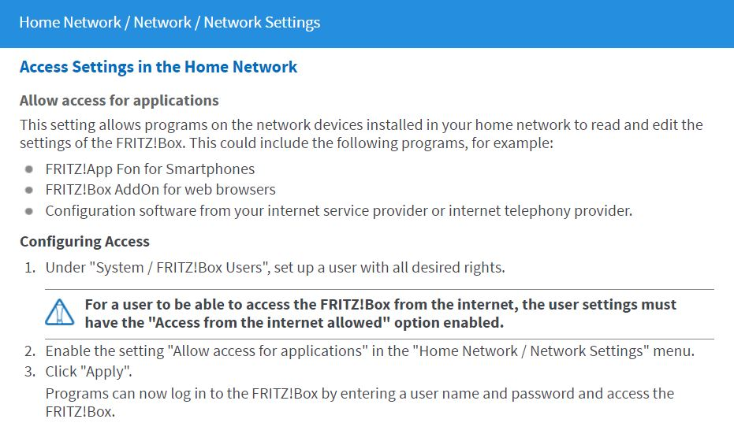
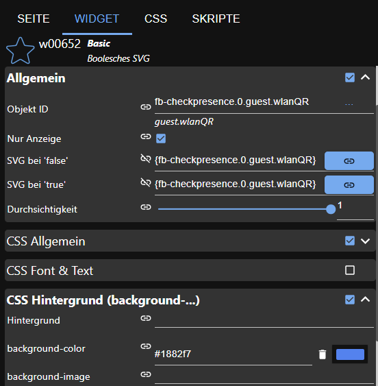

# ioBroker.fb-checkpresence

## Адаптер fb-checkpresence для ioBroker

Адаптер проверяет наличие членов семьи на основе данных об устройствах, сообщаемых FRITZ!Box. Для каждого включенного члена семьи необходимо указать имя члена, MAC-адрес, IP-адрес и имя хоста. Выберите, следует ли идентифицировать устройство по MAC-адресу, IP-адресу или имени хоста. Группа и комментарий являются необязательными. Адаптер создает точки данных о присутствии на основе имени члена семьи.

### Использован открытый исходный код

#### npm dateformat v4.5.3

(c) 2007-2009 Стивен Левитан \<stevenlevithan.com> npm: <https://www.npmjs.com/package/dateformat> github: <https://github.com/felixge/node-dateformat> лицензия: MIT

### Предварительные условия адаптера

Адаптер «История» является необязательным. Выберите поддерживаемый адаптер «История», SQL или InfluxDB для хранения и анализа исторических данных о членах семьи. Обнаружение присутствия работает и без адаптера «История», но информация, основанная на истории, будет недоступна.

Вы можете выбрать один из следующих адаптеров:

- История
- SQL
- ИнфлюксД

## ФРИЦ!Бокс

Этот адаптер использует плату AVM FRITZ!Box и взаимодействует с ней по протоколу TR-064. Для получения дополнительной информации о продуктах FRITZ!Box посетите [веб-сайт AVM](https://fritz.com/collections/fritz-box) .

### Требования TR-064

Используемый интерфейс TR-064 от Fritzbox описан здесь: <https://avm.de/service/schnittstellen/> .

Адаптер использует следующие службы и действия TR-064:

- Hosts:1 — X\_AVM-DE\_GetHostListPath (поддерживается с 09.01.2017)
- Hosts:1 — X\_AVM-DE\_GetMeshListPath
- Хосты:1 — GetSpecificHostEntry
- Hosts:1 — X\_AVM-DE\_GetSpecificHostEntryByIP (поддерживается с 18.05.2016)
- DeviceInfo:1 — GetSecurityPort
- DeviceInfo:1 — GetInfo
- WANPPPConnection:1 — GetInfo
- WANIPConnection:1 — GetInfo
- WLANConfiguration3 — SetEnable
- WLANConfiguration3 — GetInfo
- WLANConfiguration3 — GetSecurityKeys
- X\_AVM-DE\_HostFilter — DisallowWANAccessByIP
- X\_AVM-DE\_HostFilter — GetWANAccessByIP
- DeviceConfig:1 — Перезагрузка
- LANConfigSecurity1 — X\_AVM-DE\_GetCurrentUser

Доступ к TR-064 по умолчанию отключен на FRITZ!Box. Чтобы включить его, войдите в веб-интерфейс FRITZ!Box и переключитесь в расширенный режим просмотра. Откройте **«Главная сеть» » «Сеть» » «Сетевые настройки»** и включите параметр **«Разрешить доступ для приложений»** . Перезагрузите FRITZ!Box после изменения этого параметра.

> **Примечание:** Названия пунктов меню могут немного отличаться в зависимости от версии FRITZ!OS.



## Конфигурация

### Общий

Форма конфигурации проверяет необходимые значения и предотвращает сохранение при наличии ошибки проверки.

### Адрес, имя пользователя и пароль FRITZ!Box

Введите IP-адрес или имя хоста вашего FRITZ!Box, а также имя пользователя и пароль пользователя FRITZ!Box. В последних версиях FRITZ!OS (7.25 и более поздних) для такого типа доступа требуется учетная запись пользователя. Создайте пользователя в настройках FRITZ!Box и предоставьте ему необходимые права доступа к FRITZ!Box.

Пароль хранится в зашифрованном виде с помощью ioBroker и не сохраняется в открытом виде. Имена пользователей и пароли FRITZ!Box могут содержать до 32 символов. См. [рекомендации AVM по входу в FRITZ!Box](https://avm.de/fileadmin/user_upload/Global/Service/Schnittstellen/Empfehlungen%20zur%20Benutzerfu%CC%88hrung%20bei%20der%20Anmeldung%20an%20einer%20FRITZ%21Box_v1.1.pdf) и [информацию AVM о допустимых символах](https://service.avm.de/help/de/FRITZ-Box-Fon-WLAN-7490/014/hilfe_zeichen_fuer_kennwoerter) .

Если адаптер сообщает о таймаутах подключения, проверьте имя пользователя, пароль и права доступа. FRITZ!Box может временно блокировать пользователя после нескольких неудачных попыток входа в систему. В этом случае проверьте FRITZ!Box и его журналы; для снятия блокировки может потребоваться перезагрузка.

### SSL

Включите **SSL** для подключения к FRITZ!Box через HTTPS. Если включена **проверка сертификата** , адаптер проверяет, является ли сертификат FRITZ!Box действительным и доверенным. Эта опция отключена по умолчанию для совместимости с установками FRITZ!Box, использующими самоподписанные или иные недоверенные сертификаты.

Если ваш FRITZ!Box использует действительный сертификат от доверенного центра сертификации, включите **проверку сертификата** для повышения уровня безопасности. Если адаптер не может установить HTTPS-соединение, сначала проверьте сертификат и конфигурацию FRITZ!Box. При необходимости отключите **проверку сертификата** или полностью отключите **SSL** , чтобы перейти к незашифрованному HTTP-соединению.

### Интервалы опроса

Адаптер имеет отдельные интервалы опроса для членов семьи и устройств FRITZ!Box. Для обоих можно установить интервал от 10 до 3600 секунд. Каждый цикл опроса начинается после завершения предыдущего.

### Время фильтрации

Когда статус члена семьи меняется на «отсутствует», адаптер ожидает истечения заданной задержки фильтра и снова проверяет статус. Статус «отсутствует» устанавливается только в том случае, если член семьи по-прежнему отсутствует. Изменение статуса на «присутствует» применяется немедленно.

### адаптер истории

Адаптер «История» является необязательным. Выберите поддерживаемый адаптер «История», SQL или InfluxDB для хранения и анализа исторических данных о членах семьи. Обнаружение присутствия работает и без адаптера «История», но информация и статистика, основанные на истории, будут недоступны.

### Формат даты

Формат даты используется в отформатированном HTML- и JSON-выводе адаптера. Список доступных масок формата см. [в документации по формату даты](https://www.npmjs.com/package/dateformat#mask-options) .

### Точки данных устройства FRITZ!Box

Включите функцию **«Создавать точки данных для устройств FRITZ!Box»** , чтобы создавать отдельные точки данных для устройств, входящих в сеть FRITZ!Box.

Чтобы ограничить круг устройств, получающих отдельные точки данных, включите параметр **«Использовать только выбранные устройства»** и выберите нужные устройства из списка. Устройства сопоставляются по их MAC-адресу. Если этот параметр отключен, отдельные точки данных создаются для всех устройств.

Списки устройств и счетчики устройств продолжают отображать полную информацию об устройствах, предоставляемую FRITZ!Box, независимо от выбранного параметра. Выбор управляет только созданием и обновлением отдельных устройств. `fb-devices.<device>.*` точек данных.

Изменение выбора не приводит к удалению ранее созданных точек данных. Если вам больше не нужны точки данных для устройств, которые больше не выбраны, удалите их вручную в представлении объектов ioBroker.

> **Примечание:** Выбор устройства доступен только при включенной опции **«Создавать точки данных для устройств FRITZ!Box»** .

### Синхронизация данных устройства FRITZ!Box

Вы можете синхронизировать данные устройств FRITZ!Box один раз или настроить периодическую синхронизацию. Периодическая синхронизация выполняется с указанным интервалом и удаляет данные для устройств, которые больше не отображаются в FRITZ!Box. Интервал определяет, как часто выполняется синхронизация; это не время, в течение которого устройство должно быть неактивным до удаления данных.

Параметр "выбранное устройство" не удаляет существующие точки данных для устройств, которые больше не выбраны. Удалите эти точки данных вручную, если они больше не нужны.

### Информация о сетке

При включении функции отображения информации о ячеистой сети адаптер создает дополнительные точки данных для устройств и интерфейсов в ячеистой сети FRITZ!Box. Для использования этой опции необходимо включить функцию **создания точек данных для устройств FRITZ!Box** .

### Информация о гостевой сети

Включите отображение информации о гостевой сети, чтобы получать подробные сведения об устройствах, подключенных к гостевой сети, и обновлять соответствующие состояния гостевой сети.

### QR-код для гостевого Wi-Fi

Включите генерацию QR-кода, чтобы создать QR-код для гостевой сети Wi-Fi. Код хранится в `guest.wlanQR` Состояние может отображаться в VIS с помощью виджета **Basic Boolesches SVG** . Используйте следующие примеры настроек:



### Совместимость членов семьи

Параметр совместимости управляет структурой объекта, используемой для состояний членов семейства:

- **Совместимость включена, группа пуста:** используется устаревшая структура объектов.
- **Включена совместимость, набор групп:** Использует новую структуру, с состояниями в рамках `familyMembers` папка.
- **Совместимость отключена:** используется новая структура, в которой состояния находятся под... `familyMembers` папка.

Устаревшая структура может быть удалена в будущей версии. При переходе с устаревшей структуры следуйте инструкциям в журнале адаптера. Возможно, потребуется обновить скрипты или виджеты VIS, которые ссылаются на старые идентификаторы состояний.

### Присутствие членов семьи и фильтрация

Адаптер создает состояние присутствия для каждого включенного члена семейства и проверяет, присутствует ли настроенное устройство или отсутствует. Состояние присутствия изменяется при изменении обнаруженного статуса.

Вы можете включить фильтрацию для отдельного члена семьи. При использовании старого фильтра (новый фильтр на основе истории отключен) фильтрация напрямую влияет на члена семьи. `presence` состояние: когда устройство определяется как присутствующее, `presence` изменения в `true` Немедленно; если обнаружено отсутствие, адаптер ожидает заданную задержку и выполняет повторную проверку. `presence` изменения в `false` только если устройство по-прежнему отсутствует после задержки.

При включении нового фильтра на основе истории, данные участника `presence` В отчете о состоянии системы напрямую отображается обнаруженный статус. Отфильтрованный результат публикуется отдельно. `presenceFiltered`; это позволяет считать участника присутствующим до тех пор, пока его отсутствие не продлится в течение заданного времени действия фильтра.

Некоторая информация об устройстве, например скорость соединения, считывается из отдельных точек данных устройства FRITZ!Box. Включите параметр **«Создавать точки данных для устройств FRITZ!Box»** , чтобы сделать эту информацию доступной.

### Отфильтрованные семейные и групповые состояния

Существующие агрегированные состояния сохраняют свое первоначальное поведение. Следующие дополнительные состояния только для чтения используют отфильтрованные результаты включенных членов семейства без второй задержки фильтрации:

| Состояние                                         | Значение                                       |
| ------------------------------------------------- | ---------------------------------------------- |
| `presenceFiltered`                                | Присутствует как минимум один член             |
| `presenceAllFiltered`                             | Все участники присутствуют.                    |
| `absenceFiltered`                                 | По меньшей мере один член отсутствует.         |
| `absenceAllFiltered`                              | Все члены отсутствуют.                         |
| `presentMembersFiltered` /`absentMembersFiltered` | Имена участников, разделённые запятыми         |
| `presentCountFiltered` /`absentCountFiltered`     | Количество присутствующих/отсутствующих членов |

В нынешней структуре общесемейные штаты находятся ниже. `familyMembers` и государства группы ниже `familyMembers.<group>` Отфильтрованные состояния всей семьи включают **всех включенных участников** , в том числе участников, назначенных именованным группам. В режиме совместимости состояния всей семьи находятся в корне адаптера; пути к группам остаются неизменными. Отключенные участники исключаются.

Благодаря новому фильтру, основанному на истории изменений, в агрегированном результате используется именно тот результат, который был опубликован для каждого отдельного пользователя. `presenceFiltered` Значение. Участники с отключенной фильтрацией немедленно используют свой обнаруженный статус. При использовании устаревшего фильтра используются уже отфильтрованные результаты присутствия. Если необходимый отфильтрованный результат не может быть рассчитан (например, отсутствует ответ устройства или недоступна история), агрегированный результат публикуется как `null` с качеством `0x40` Вместо сообщения о неопределенном отсутствии. Пустой список включенных участников также неизвестен. Существующий резервный вариант с пустой историей остается без изменений.

### Ручной запуск обнаружения присутствия

Вы можете вручную запустить проверку присутствия, отправив соответствующее сообщение. `triggerPresence` Сообщение отправляется адаптеру. Дальнейшие запросы на запуск отклоняются в течение 10-секундной паузы. Функция обратного вызова возвращает результат. `false` если запрос заблокирован и `true` если адаптер его принимает.

```javascript
sendTo('fb-checkpresence.0', 'triggerPresence', {}, result => {
    log(result, 'info');
});
```

### Настройки белого списка

Выберите устройства FRITZ!Box, которые следует считать известными. Устройства, не включенные в белый список, рассматриваются как неизвестные и могут появиться в черном списке.

Также можно добавить устройство в белый список с помощью JavaScript. Адаптер проверяет предоставленное имя хоста и MAC-адрес по списку устройств FRITZ!Box. Если устройство найдено и еще не находится в белом списке, оно добавляется в конфигурацию белого списка.

```javascript
sendTo(
    'fb-checkpresence.0',
    'addDeviceToWhitelist',
    {
        hostname: 'devicename',
        mac: '00:00:00:00:00:00',
    },
    result => {
        log(result, 'info');
    },
);
```

## Функции

### Проверка возможностей FRITZ!Box

Адаптер проверяет, какие службы и функции FRITZ!Box доступны, и записывает результаты в журнал. Он также проверяет, имеет ли настроенный пользователь FRITZ!Box необходимые права доступа. Если служба недоступна или у пользователя отсутствуют необходимые разрешения, соответствующая функция отключается. Если функция не работает, проверьте журнал адаптера и права доступа пользователя FRITZ!Box.

### Включить или выключить гостевой Wi-Fi

Установите `guest.wlan` государство к `true` или `false` Для включения или выключения гостевого Wi-Fi на устройстве FRITZ!Box.

### QR-код для гостевого Wi-Fi

Когда включена функция генерации QR-кода, гостевой QR-код Wi-Fi сохраняется в `guest.wlanQR` Его можно отобразить в VIS с помощью виджета **Basic Boolesches SVG** .

### Заблокировать или разрешить доступ устройства в интернет.

Для поддерживаемых устройств FRITZ!Box установите следующие параметры. `disabled` государство в соответствии `fb-devices` к `true` заблокировать доступ этого устройства в интернет или `false` чтобы снова разрешить доступ.

### Гостевые устройства и черный список

Адаптер сообщает об устройствах, подключенных к гостевой сети. Он также сравнивает обнаруженные устройства с белым списком; устройства, не включенные в белый список, могут быть внесены в черный список.

### Присутствие и история членов семьи

Для каждого настроенного члена семьи адаптер отслеживает его присутствие. Если выбран и доступен адаптер «История», он также может рассчитывать и сохранять время прибытия и отъезда, а также другую информацию, относящуюся к истории.

### Количество устройств

Адаптер отображает общее количество устройств и количество активных устройств, по данным FRITZ!Box. Эти данные отражают список устройств FRITZ!Box, а не только устройства, выбранные для отдельных устройств. `fb-devices` точек данных.

## Объекты

### `presenceAll`

`true` когда присутствуют все настроенные члены семьи.

### `presence`

`true` когда присутствует хотя бы один настроенный член семьи.

### `devices`

Общее количество устройств, зарегистрированных системой FRITZ!Box.

### `activeDevices`

Количество активных устройств, зарегистрированных устройством FRITZ!Box.

### HTML и JSON таблицы

В выходных данных в форматах HTML и JSON содержится информация о прибытии и отъезде членов семьи.

### `info`

Содержит информацию об адаптере, включая последнее обновление и состояние подключения.

### `guest`

Содержит информацию о гостевой сети, включая количество активных гостей и таблицы с подробными сведениями об устройствах гостей.

### `blacklist`

Содержит количество неизвестных устройств и таблицы с информацией об этих устройствах.

### `member.present`

Содержит информацию о присутствии участника в текущий день, включая продолжительность его присутствия с момента последнего изменения статуса.

### `member.absent`

Содержит информацию об отсутствии сотрудника в текущий день, включая продолжительность отсутствия с момента последнего изменения статуса.

### `member.comming` и `member.going`

Содержит информацию о прибытии и отъезде участника. Удостоверение личности штата. `comming` Сохранено для обеспечения совместимости.

### `member.history` и `member.historyHtml`

Содержит историю изменений профиля пользователя за текущий день.

## Changelog
### **WORK IN PROGRESS**
* (afuerhoff) Fixed legacy `presenceFiltered` states that did not update
* (afuerhoff) Fixed false-positive presence detection for devices with duplicate hostnames or MAC addresses and added warnings for conflicting active MAC addresses (issue #151)
* (afuerhoff) Fixed the legacy filter to restore presence immediately when the device is detected again after a short absence
* (softwarecrash) Added filtered family-wide and group presence/absence states, member lists and counts
* (afuerhoff) Improved JavaScript type checking and fixed type-safety issues in error handling and timer usage
* (afuerhoff) Guarded device names before applying string operations
* (afuerhoff) Added TypeScript definitions for adapter configuration options
* (afuerhoff) Added explicit checks for missing adapter configuration objects
* (afuerhoff) Initialized history tables and guarded optional callback and state results
* (afuerhoff) Added Fritzbox connection and host-list guards for nullable state
* (afuerhoff) Corrected assignability issues in adapter state, timer, request, and test types
* (afuerhoff) Added Mocha type definitions for editor and TypeScript support in tests
* (afuerhoff) Corrected invalid boolean comparisons and adapter status typing
* (afuerhoff) Fixed group checks to use the family member configuration
* (afuerhoff) Kept required JSDoc types enabled without redundant-type warnings in JavaScript files
* (afuerhoff) Used numeric timestamps explicitly for presence and history duration calculations
* (afuerhoff) Corrected missing-property typing in device caching, QR output, date formatting, and package tests
* (afuerhoff) Added null-safe history adapter state checks and date-format timezone handling
* (afuerhoff) Corrected adapter constructor and logger calls to match their argument signatures
* (afuerhoff) Typed optional AMD loader detection in the date-format library
* (afuerhoff) Replaced implicit boolean/date arithmetic in date formatting with explicit numeric operations
* (afuerhoff) Resolved remaining TypeScript errors in adapter calls, request config, and test types
* (afuerhoff) Replaced broad date-format utility types with explicit input, return, and unknown-value types
* (afuerhoff) Initialized guest WLAN data before QR creation and handled missing SSID or passphrase explicitly

### 1.5.0 (2026-10-26)
* (afuerhoff) Adapter requires node.js >= 22 now
* (afuerhoff) configuration changed to jsonConfig
* (afuerhoff) dependencies updated
* (afuerhoff) dependabot.yml fixed [#358](https://github.com/afuerhoff/ioBroker.fb-checkpresence/issues/358)
* (afuerhoff) new fb-devices cyclic sync option integrated
* (afuerhoff) SSL certificate validation added; certificate checks can be enabled explicitly, while self-signed certificates remain compatible when disabled
* (afuerhoff) readme updated
* (softwarecrash) PR398 fixes a crash in newfilter mode
* (afuerhoff) issues [#413]

### 1.4.2 (2025-10-30)
* (afuerhoff) dependencies updated
* (afuerhoff) package.json issues fixed [#350](https://github.com/afuerhoff/ioBroker.fb-checkpresence/issues/350)
* (afuerhoff) npm security changes
* (afuerhoff) filter time extended to 300s
* (afuerhoff) guest wlan bug fixed [#353](https://github.com/afuerhoff/ioBroker.fb-checkpresence/issues/353)
* (afuerhoff) deprecated functions changed

### 1.4.1 (2025-09-19)
* (afuerhoff) dependencies updated
* (afuerhoff) repository checker & code scanning issues fixed

### 1.4.0 (2025-05-28)
* (afuerhoff) dependencies updated
* (afuerhoff) error handling optimized
* (afuerhoff) enhancement  [#336](https://github.com/afuerhoff/ioBroker.fb-checkpresence/issues/336)
* (afuerhoff) issue [#337](https://github.com/afuerhoff/ioBroker.fb-checkpresence/issues/337)
* (afuerhoff) issue [#335](https://github.com/afuerhoff/ioBroker.fb-checkpresence/issues/335)

### 1.3.1 (2025-03-02)
* (afuerhoff) dependencies updated
* (afuerhoff) bug fixed [#333](https://github.com/afuerhoff/ioBroker.fb-checkpresence/issues/333)
* (afuerhoff) bug fixed [#305](https://github.com/afuerhoff/ioBroker.fb-checkpresence/issues/305)

## License
MIT License

Copyright (c) 2019-2026 Achim Fürhoff <achim.fuerhoff@outlook.de>

Permission is hereby granted, free of charge, to any person obtaining a copy
of this software and associated documentation files (the "Software"), to deal
in the Software without restriction, including without limitation the rights
to use, copy, modify, merge, publish, distribute, sublicense, and/or sell
copies of the Software, and to permit persons to whom the Software is
furnished to do so, subject to the following conditions:

The above copyright notice and this permission notice shall be included in all
copies or substantial portions of the Software.

THE SOFTWARE IS PROVIDED "AS IS", WITHOUT WARRANTY OF ANY KIND, EXPRESS OR
IMPLIED, INCLUDING BUT NOT LIMITED TO THE WARRANTIES OF MERCHANTABILITY,
FITNESS FOR A PARTICULAR PURPOSE AND NONINFRINGEMENT. IN NO EVENT SHALL THE
AUTHORS OR COPYRIGHT HOLDERS BE LIABLE FOR ANY CLAIM, DAMAGES OR OTHER
LIABILITY, WHETHER IN AN ACTION OF CONTRACT, TORT OR OTHERWISE, ARISING FROM,
OUT OF OR IN CONNECTION WITH THE SOFTWARE OR THE USE OR OTHER DEALINGS IN THE
SOFTWARE.