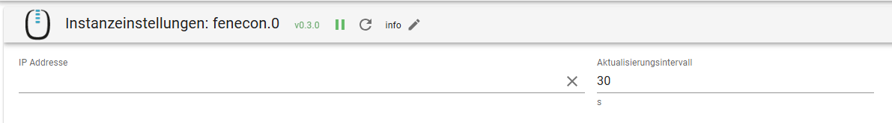

# ioBroker.fenecon

## Фенекон

[Fenecon](https://fenecon.de) — немецкий производитель фотоэлектрических инверторов, систем хранения энергии и систем управления энергопотреблением для домов и предприятий. Большинство систем работают на платформе **FEMS** (Fenecon Energy Management System), основанной на платформе управления энергопотреблением с открытым исходным кодом [OpenEMS](https://github.com/OpenEMS/openems) . Fenecon является одним из основных разработчиков OpenEMS.

Поскольку FEMS предоставляет доступ к своим данным через **REST/JSON API** OpenEMS, этот адаптер работает со всеми системами FEMS, предоставляющими этот интерфейс, независимо от конкретной модели устройства (домашнее, коммерческое и т. д.).

## Адаптер

Этот адаптер подключается к центральному блоку FEMS по локальной сети и считывает все доступные значения каналов через интерфейс OpenEMS REST/JSON. `http://<ip>/rest/channel/...` Он дублирует возвращаемые значения в состояния ioBroker, назначает осмысленные роли и единицы измерения и может, при необходимости, записывать совместимые значения обратно в FEMS.

Этот адаптер является адаптером опроса (`dataSource: poll`), работает как демон и поддерживает компактный режим.

Функции:

- считывает все каналы блока FEMS или только настраиваемое подмножество.
- Создает дерево объектов ioBroker (каналы и состояния) автоматически при первом запуске.
- каждому известному каналу FEMS присваивается определенная роль ioBroker, и блок FEMS сохраняется.
- Преобразует температуру, указанную в деци градусах Цельсия. `dC`) в градусах Цельсия
- Вычисляет ставки **автаркии** и **самопотребления** на основе сводных значений.
- Низкая нагрузка на FEMS и ioBroker: неизмененные значения не перезаписываются (только периодический сигнал подтверждения), а обновления записываются параллельными пакетами.
- необязательная обратная запись: доступна для записи (`RW` /`WO` Каналы можно настроить через административный интерфейс, скрипты или Blockly.
- Устойчивость к некорректным ответам и изменениям прошивки: некорректные записи отбрасываются, а новые/неизвестные каналы регистрируются в журнале.

## Как это работает

1. При запуске адаптер проверяет конфигурацию (IPv4-адрес и интервал обновления).
2. Программа получает список каналов с устройства FEMS. Без пользовательских конечных точек она запрашивает универсальную конечную точку. `.*/.*`, которая возвращает все доступные каналы. При использовании пользовательских конечных точек запрашиваются только настроенные компоненты/каналы.
3. Для каждого допустимого канала `component/channel` Создаются объект **канала** ioBroker и объект **состояния** . Запрещенные символы заменяются, чтобы адрес FEMS можно было использовать в качестве идентификатора объекта. Объекты расширяются/обновляются только при изменении управляемого определения (имя, описание, роль, тип, модуль, чтение, запись).
4. Значения записываются с помощью `ack: true` Значение записывается только тогда, когда оно фактически изменилось; неизмененные значения по-прежнему обновляются как минимум каждые 10 минут (пульс), чтобы метки времени не устаревали.
5. Следующий запуск планируется с использованием заданного интервала обновления.

## Конфигурация

Для установления соединения необходим IP-адрес центрального блока FEMS. Интервал обновления также можно настроить.

| Параметр                                                  | Описание                                                                                                                                                                       |
| --------------------------------------------------------- | ------------------------------------------------------------------------------------------------------------------------------------------------------------------------------ |
| **IP-адрес**                                              | IPv4-адрес центрального блока FEMS в локальной сети (например, `192.168.1.50` Поле проверено на соответствие стандарту IPv4, и сохранение блокируется при неправильном формате. |
| **Интервал обновления**                                   | Интервал опроса в секундах. Допустимый диапазон: `5` -`3600` с (по умолчанию) `30` с).                                                                                           |
| **Используйте определяемые пользователем конечные точки** | Если отключено (по умолчанию), то все каналы считываются через общий запрос. Если включено, запрашиваются только конечные точки из таблицы.                                    |
| **Конечные точки**                                        | Таблица `Component ID` /`Channel ID` пары, используемые при включении пользовательских конечных точек.                                                                          |

### Пользовательские конечные точки

Вы можете использовать пользовательские конечные точки, чтобы извлекались не все данные. Для этого активируйте флажок и настройте строки в таблице. Каждая строка приводит к одному запросу к `<Component ID>/<Channel ID>` и снижает нагрузку, когда требуется лишь небольшое количество значений.

Он `Channel ID` может содержать один канал, несколько каналов, разделенных `;` или регулярное выражение/подстановочный знак:

- Компонент `_sum`, Канал `.*` -> все каналы сводки
- Компонент `ess0`, Канал `.*` -> все каналы аккумуляторного хранилища
- Компонент `_sum`, Канал `GridActivePower;EssSoc` -> только эти два канала

## Штаты

Состояния генерируются автоматически при запуске адаптера. Если канал или состояние были случайно удалены, в файле журнала появятся предупреждения: перезапустите адаптер, и отсутствующие объекты будут созданы заново.

Структура дерева объектов отражает структуру компонентов FEMS следующим образом: `<component>.<channel>`, например `fenecon.0._sum.GridActivePower` (Номер экземпляра может отличаться).

Общие компоненты:

| Компонент                              | Значение                                                                           |
| -------------------------------------- | ---------------------------------------------------------------------------------- |
| `_sum`                                 | Сводные показатели всей системы (сеть, производство, потребление, батарея)         |
| `ess0`                                 | Система хранения энергии (инвертор/зарядное устройство для батарей)                |
| `battery0`                             | Аккумуляторная батарея (элементы, температура, данные системы управления батареей) |
| `batteryInverter0`                     | Аккумуляторный инвертор (например, GoodWe)                                         |
| `meter0`                               | Сетевой/энергетический счетчик                                                     |
| `charger10`, `charger11`               | Станции зарядки электромобилей (EVCS)                                              |
| `ctrl*`                                | Контроллеры OpenEMS (оптимизация заряда, балансировка и т. д.)                     |
| `io0`, `io1`                           | Цифровой/аналоговый ввод/вывод                                                     |
| `modbus0`, `modbus1`, `modbus2`         | Интерфейсы Modbus                                                                  |
| `_host`, `_power`, `_energy`, `_cycle` | Информация о системе OpenEMS и решатель задач энергоснабжения/потребления энергии  |
| `scheduler0`, `predictor0`, `rrd4j0`   | Планировщик, прогнозирование и система хранения данных OpenEMS                     |

Ниже приведены наиболее важные сводные значения. `_sum`:

- `_sum.GridActivePower` - Мощность сети в Вт (положительное значение = покупка электроэнергии из сети, отрицательное значение = подача электроэнергии в сеть)
- `_sum.ProductionActivePower` - Мощность фотоэлектрических систем, вырабатываемых солнечными батареями, в Вт
- `_sum.ConsumptionActivePower` - потребляемая мощность дома в Вт
- `_sum.EssActivePower` - Мощность батареи в Вт (знак зависит от уровня заряда/разряда)
- `_sum.EssSoc` - Уровень заряда батареи в %
- `_sum.GridBuyActiveEnergy` /`_sum.GridSellActiveEnergy` - покупка/продажа энергии в Вт·ч
- `_sum.ProductionActiveEnergy` /`_sum.ConsumptionActiveEnergy` - произведенная/потребленная энергия в Вт·ч

Каждое государство имеет описание (`desc`) взято из текста канала FEMS и роль, соответствующая его значению. Известным каналам присваивается определенная роль (например, `value.power`, `value.energy`, `value.voltage`, `value.current`, `value.temperature`, `value.frequency`, `indicator`, `text` Каналы, которые еще не внесены в таблицу сопоставления, получают роль, определяемую юнитом, и один раз заносятся в журнал для последующего добавления.

### Расчетные значения

Помимо исходных значений FEMS, адаптер вычисляет два дополнительных состояния:

- `_sum.Autarchy` - Доля автаркии в % (доля потребления, покрываемая собственным производством)
- `_sum.SelfConsumption` - Доля самопотребления в % (доля произведенной энергии, потребленной вместо того, чтобы быть переданной в сеть)

### Обратная запись (команды)

Каналы, которые FEMS помечает как доступные для записи (режим доступа). `RW` или `WO`) создаются с помощью `write: true` и адаптер подписывается на них. Когда значение записывается без `ack` (например, из административного интерфейса, скрипта или Blockly), адаптер отправляет его обратно в FEMS с помощью `POST` запрос и устанавливает состояние на `ack: true` после успешной записи. Только для чтения (`RO` Каналы отклоняют операции записи и регистрируют предупреждение.

Значения, указанные в деци градусах Цельсия, перед записью переводятся обратно в шкалу FEMS.

## Поиск неисправностей

- **В журнале отсутствуют данные/ошибки** : проверьте IP-адрес (действительный IPv4 и доступность с хоста ioBroker) и убедитесь, что устройство FEMS отвечает. `http://<ip>/rest/channel/`.
- **Конфигурация отклонена** : IP-адрес должен быть действительным IPv4-адресом, а интервал обновления должен составлять от 5 до 3600 секунд.
- **Отсутствующие или пустые состояния** : адаптер удаляет недействительные записи FEMS и сообщает о неизвестных каналах в журнале. Перезапустите адаптер, чтобы дерево объектов было перестроено; неизвестные каналы можно добавить в таблицу сопоставления состояний (см. примечания для разработчиков).
- **Состояния были удалены** : перезапустите адаптер, чтобы воссоздать их. Объекты, измененные вручную, перезаписываются только в том случае, если их управляемое определение отличается.

## Примечания для разработчиков

Адаптер написан на TypeScript. Исходный код находится в папке... `src/` и скомпилированный результат генерируется в `build/`, это каталог, поставляемый вместе с пакетом npm.

Исходная структура:

- `src/main.ts` - жизненный цикл адаптера, цикл опроса и обновления состояния
- `src/fems-client.ts` - REST-клиент для API каналов OpenEMS/FEMS
- `src/state-factory.ts` - Вспомогательные функции для объектов/ролей/единиц и преобразования значений
- `src/calculations.ts` - расчет автархии и самопотребления
- `src/states.ts` - Создана таблица сопоставления всех известных каналов FEMS с ролями ioBroker.
- `src/types.ts` - общие типы и вспомогательные средства проверки во время выполнения

Полезные npm-скрипты:

- `npm run build` собирает источники
- `npm run watch` перекомпилируется при каждом изменении
- `npm run check` выполняет строгую проверку типов (`tsc --noEmit`)
- `npm run lint` запускает ESLint
- `npm run test` запускает модульные тесты (`test:ts`) и тесты пакета ioBroker (`test:package`)
- `npm run test:integration` запускает интеграционные тесты
- `npm run generate:states` восстанавливает сопоставление ролей в `src/states.ts` (бегать `node tools/generate-states.js src/states.ts --check` (для проверки актуальности)
- `npm run benchmark` запускает тест производительности обновления состояния (`tools/benchmark.js`)

Для проверки в реальном времени используйте [сервер @iobroker/dev-server](https://github.com/ioBroker/dev-server) вместо рабочего экземпляра: выполните `setup` один раз, затем `watch` или `debug` для проверки поведения во время выполнения, переподключений, обновлений объектов и административного интерфейса.

## Changelog

<!--
	Placeholder for the next version (at the beginning of the line):
-->
### 1.0.1 (2026-11-07)

- (SG-App) update mapping table after FEMS update to 2026.10.2

### 1.0.0 (2026-11-07)

- (SG-App) migrate the adapter sources to TypeScript, compiled output is generated into `build/`
- (SG-App) validate the configured IP address strictly as IPv4
- (SG-App) use the sanitized channel and state names consistently for the object ids
- (SG-App) validate the FEMS response and drop invalid entries instead of creating nonsense states
- (SG-App) only write states when the value changed, with a heartbeat to refresh the timestamps
- (SG-App) write state updates in parallel batches to lower the CPU load
- (SG-App) cache the existing objects at startup and only extend objects when the definition changed
- (SG-App) assign a specific role to every known state and log unknown channels for later additions
- (SG-App) add the channels reported as unknown to the state mapping table
- (SG-App) support writing values back to FEMS through onStateChange for writable channels
- (SG-App) convert the temperature values delivered in deci degrees Celsius (dC) to degrees Celsius
- (SG-App) extend the README with a detailed adapter description, configuration, state overview and troubleshooting

### 0.7.0 (2025-09-28)

- (SG-App) dependency updates
- (SG-App) allow multi channel configuration
- (SG-App) optimize Rest request and log channel not exists

### 0.6.2 (2025-02-11)

- (SG-App) fix loading single channel

### 0.6.1 (2025-02-10)

- (SG-App) fix missing size attributes

## License

MIT License

Copyright (c) 2025-2026 Georg Schreiner <info@sg-app.de>

Permission is hereby granted, free of charge, to any person obtaining a copy
of this software and associated documentation files (the "Software"), to deal
in the Software without restriction, including without limitation the rights
to use, copy, modify, merge, publish, distribute, sublicense, and/or sell
copies of the Software, and to permit persons to whom the Software is
furnished to do so, subject to the following conditions:

The above copyright notice and this permission notice shall be included in all
copies or substantial portions of the Software.

THE SOFTWARE IS PROVIDED "AS IS", WITHOUT WARRANTY OF ANY KIND, EXPRESS OR
IMPLIED, INCLUDING BUT NOT LIMITED TO THE WARRANTIES OF MERCHANTABILITY,
FITNESS FOR A PARTICULAR PURPOSE AND NONINFRINGEMENT. IN NO EVENT SHALL THE
AUTHORS OR COPYRIGHT HOLDERS BE LIABLE FOR ANY CLAIM, DAMAGES OR OTHER
LIABILITY, WHETHER IN AN ACTION OF CONTRACT, TORT OR OTHERWISE, ARISING FROM,
OUT OF OR IN CONNECTION WITH THE SOFTWARE OR THE USE OR OTHER DEALINGS IN THE
SOFTWARE.