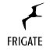

# ioBroker.frigate

> \[!ВАЖНО] Этот адаптер нельзя установить из GitHub

**Этот адаптер использует библиотеки Sentry для автоматического сообщения разработчикам об исключениях и ошибках в коде.** Более подробную информацию, а также сведения о том, как отключить отправку сообщений об ошибках, см. [в документации Sentry-Plugin](https://github.com/ioBroker/plugin-sentry#plugin-sentry) ! Система отчетности Sentry используется начиная с js-controller 3.0.

## адаптер для фрегата для ioBroker

Адаптер для [Frigate NVR](https://frigate.video/) — системы видеонаблюдения с открытым исходным кодом и возможностью самостоятельного размещения, использующей обнаружение объектов на основе искусственного интеллекта.

## Документация

[🇺🇸 Документация](/#/docs/adapterref/iobroker.frigate/docs/en/README.md)

[🇩🇪 Документация](https://github.com/iobroker-community-adapters/ioBroker.frigate/blob/main/docs/de/README.md)

## Сообщения для скриптов и агентов искусственного интеллекта.

`sendTo('frigate.0', 'help', {}, result => ...)` ответы `{ help, commands }`: описание всех сообщений и состояний для агентов ИИ (например, ioBroker.pi-agent) и авторов скриптов, а также список всех команд, каждая с указанием их содержимого. `write: true` если это оказывает влияние, выходящее за рамки простого возврата информации.

## Обсуждение и вопросы

<https://forum.iobroker.net/topic/64928/frigate-adapter-für-iobroker>

## Changelog

<!--
    Placeholder for the next version (at the beginning of the line):
  ### **WORK IN PROGRESS**
-->
### 3.4.0 (2026-11-19)
- (@GermanBluefox) Added the message "help": a description of all messages for AI agents (e.g. pi-agent), and `common.supportedMessages.help`
- (@GermanBluefox) Added the short form of the web component manifests (tag, name, icon, size) to `common.webComponents`, so that hosts like Aura can list the components before the adapter is installed; the build writes it with `iob-web-components sync-io-package`
- (@GermanBluefox) Every export in Frigate left 12 objects behind for good in `job_state.export.results.<camera>_<id>`, with the status "running" (a motion search one state per result): Frigate only reports the jobs that are queued or running. The objects of a job are now deleted as soon as it is no longer in `job_state`, and the job states from before the start are deleted at the start
- (@GermanBluefox) New settings "Event history per camera" (off: only `events.history`) and "Event history as single states" (off: only the JSON). As single states each event takes about 34 objects, (cameras + 1) × the number of events, which brought installations with many cameras over the limit at which ioBroker warns about too many objects (5000 per instance). Objects that are no longer needed are deleted at the start. Both settings are on by default, so nothing changes until they are switched off. The history of each camera is now also written as JSON to `<camera>.history.json`
- (@GermanBluefox) Dependencies have been updated; Dependabot now also updates the web components

### 3.3.0 (2026-11-08)
- (@GermanBluefox) Added the web components `iob-frigate-snapshot` and `iob-frigate-live` - the devices widgets "Frigate Snapshot" and "Frigate Live" for Aura and other hosts (`common.webComponents`). The names of the devices widgets are translated now

### 3.2.6 (2026-11-06)
- (@GermanBluefox) `thumbnail` in the event history (`events.history.*`, `<camera>.history.*`, `events.history.json`) was the broken picture `data:image/jpeg;base64,null` with Frigate 0.14 and newer: Frigate keeps the thumbnails as files since then and no longer sends them with the events. It is now the address of the thumbnail (`http://<frigate>/api/events/<id>/thumbnail.jpg`), like `websnap` and `webclip`. Older Frigate versions that still send the picture keep it as before

### 3.2.5 (2026-11-06)
- (@GermanBluefox) The event history showed values of older events: the entries are numbered by position, and a field the new event at a position does not have (e.g. `sub_label` without a recognized name, a zone it did not enter) kept the value of the event that was there before. When Frigate returned fewer events than before (e.g. after its retention period), the positions beyond kept the old events. Such values are now set to `null`, also the ones left from before an update of the adapter

### 3.2.4 (2026-11-06)
- (@GermanBluefox) The event history (`events.history.*`, `<camera>.history.*`, `events.history.json`) is fetched again after every event, and nearly all of it was written again unchanged - several thousand writes within seconds, which every adapter subscribed to all states (e.g. MQTT with `*`, JavaScript) had to process as well. Now only values that changed are written, also after a restart. After an event only the overall history and the history of that camera are fetched, no longer those of all cameras. Live values from MQTT are written as before

## License

MIT License

Copyright (c) 2026 iobroker-community-adapters <iobroker-community-adapters@gmx.de>  
Copyright (c) 2024-2025 TA2k <tombox2020@gmail.com>

Permission is hereby granted, free of charge, to any person obtaining a copy
of this software and associated documentation files (the "Software"), to deal
in the Software without restriction, including without limitation the rights
to use, copy, modify, merge, publish, distribute, sublicense, and/or sell
copies of the Software, and to permit persons to whom the Software is
furnished to do so, subject to the following conditions:

The above copyright notice and this permission notice shall be included in all
copies or substantial portions of the Software.

THE SOFTWARE IS PROVIDED "AS IS", WITHOUT WARRANTY OF ANY KIND, EXPRESS OR
IMPLIED, INCLUDING BUT NOT LIMITED TO THE WARRANTIES OF MERCHANTABILITY,
FITNESS FOR A PARTICULAR PURPOSE AND NONINFRINGEMENT. IN NO EVENT SHALL THE
AUTHORS OR COPYRIGHT HOLDERS BE LIABLE FOR ANY CLAIM, DAMAGES OR OTHER
LIABILITY, WHETHER IN AN ACTION OF CONTRACT, TORT OR OTHERWISE, ARISING FROM,
OUT OF OR IN CONNECTION WITH THE SOFTWARE OR THE USE OR OTHER DEALINGS IN THE
SOFTWARE.