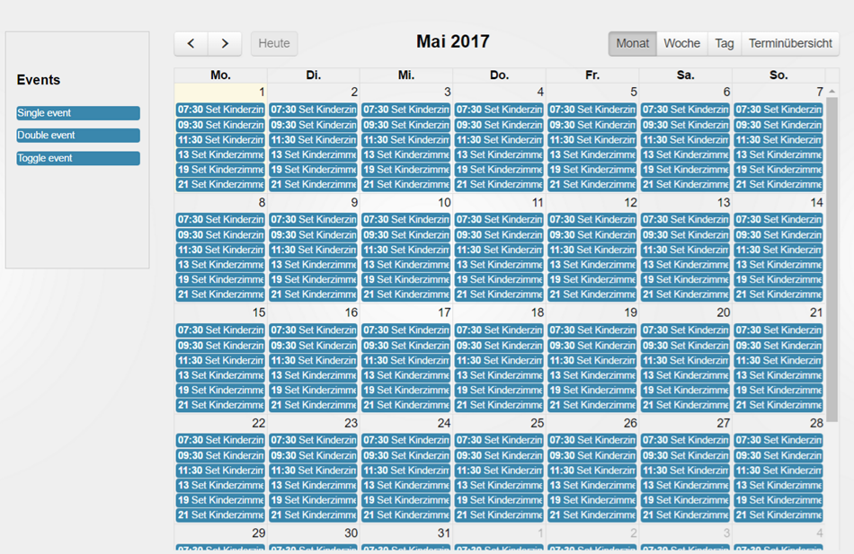
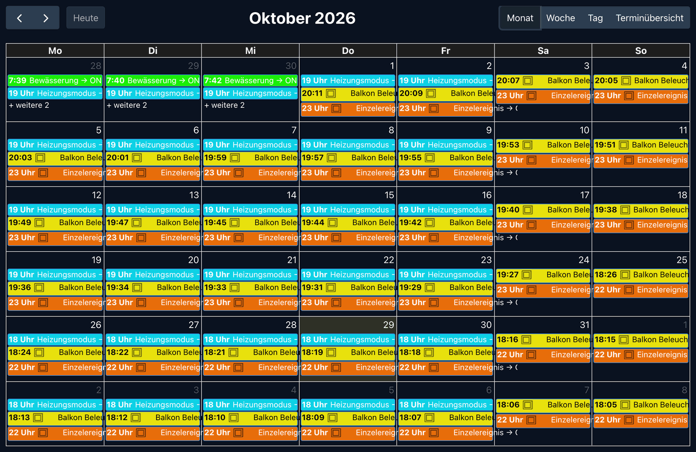

# ioBroker.fullcalendar

**Этот адаптер использует библиотеки Sentry для автоматического сообщения разработчикам об исключениях и ошибках в коде.** Более подробную информацию, а также инструкции по отключению отправки сообщений об ошибках см. [в документации Sentry-Plugin](https://github.com/ioBroker/plugin-sentry#plugin-sentry) ! Система отчетности Sentry используется начиная с js-controller 3.0.

Расписания с использованием [fullcalendar](https://fullcalendar.io) .

## Планируйте мероприятия (контролируйте свои устройства)

Запрещено использовать любые внешние ресурсы; планирование осуществляется исключительно в ioBroker и не будет интегрировано с какими-либо внешними сервисами, такими как «Google Calendar» или «iTunes».



Виджет vis-2 в режиме просмотра месяца с темной темой: полив, режим отопления и освещение балкона в качестве событий.



Вы можете управлять своими событиями с помощью календаря и планировать их периодическое проведение.

- **Длительность** событий «Вкл/Выкл» и «Переключение» может быть задана в секундах, минутах или часах. При длительности в 1 секунду событие срабатывает как нажатие кнопки.
- **Условие** ("Только если"): событие записывает свое значение только в том случае, если другое состояние в этот момент имеет заданное значение (`==`, `!=`, `>`, `>=`, `<`, `<=` Например, ставни опускаются только в том случае, если дверь на террасу закрыта. Если условие не выполняется, всё событие пропускается (событие "Вкл/Выкл" также не записывает конечное значение), и в журнал записывается строка.
- **Календари** можно отключать (кнопка в списке календарей или кнопка «Активный» в диалоговом окне календаря): их события сохраняются, но не выполняются до тех пор, пока календарь не будет снова включен. Таким образом, можно подготовить сценарии, например, «Отпуск», и переключать их с помощью скрипта. `enableCalendar`, см. ниже).

## Моделирование событий

Вы можете записывать свое поведение и воспроизводить записи позже. Например, вы можете создать две записи: для рабочего дня и для выходных, и воспроизводить их в соответствующие дни.

Или вы можете записать всю неделю и прослушать запись в последующие недели, пока вас нет.

Способ применения:

- Перейдите на вкладку «Симуляция».
- Создайте новую симуляцию, нажав кнопку «+» и выбрав тип симуляции: день или неделя.
- Нажмите кнопку записи и подождите 24 часа или 7 дней, пока моделирование не остановится, чтобы записать события.
- Теперь вы можете повторно запустить симуляцию, нажав кнопку воспроизведения. Кроме того, вы можете указать время начала симуляции.

## Веб-компоненты

Помимо виджета vis-2, адаптер предоставляет календарь в качестве веб-компонента для любого хоста [веб-компонентов ioBroker](https://github.com/ioBroker/web-components) , например, Aura или устройств: `<iob-fullcalendar>` (`admin/webcomponents/fullcalendar.js`, описанный `fullcalendar.json` в `common.webComponents`).

Он отображает события экземпляра — или одного из его календарей — в виде месяца, недели, дня или списка и, если он не находится в режиме только для чтения, создает, перемещает, изменяет размер, редактирует и удаляет их, как виджет, в диалоговом окне хоста. Он читает и записывает события через экземпляр. `sendTo` с `getEventObjects`, `setEventObject`, `deleteEventObject`), следовательно, экземпляр должен быть запущен.

Создайте это с помощью `npm run build-wc` (часть `npm run build`).

## Повестка дня

Адаптер записывает запланированные действия в состояния, например, для того, чтобы спросить об этом в чате или у голосового помощника, или чтобы отобразить это в визуализации:

| Состояние                           | Содержание                                                                                    |
| ----------------------------------- | --------------------------------------------------------------------------------------------- |
| `fullcalendar.0.events.list`        | все события (JSON): имя, календарь, состояние, значение, время или cron, следующее выполнение |
| `fullcalendar.0.events.today`       | выполненные сегодня (JSON), а также уже выполненные                                           |
| `fullcalendar.0.events.tomorrow`    | казни завтра (JSON)                                                                           |
| `fullcalendar.0.events.next`        | следующее выполнение (JSON, `null` = нет)                                                      |
| `fullcalendar.0.events.count`       | количество событий                                                                            |
| `fullcalendar.0.events.lastChanged` | время последнего изменения события                                                            |

Один из вариантов выполнения выглядит следующим образом (время указано по локальному времени хоста ioBroker):

```json
{"id": "fullcalendar.0.event-…", "name": "Light living room", "calendar": "", "time": "2026-10-28T22:30:00", "ts": 1793223000000,
 "oid": "hm-rpc.0.ABC.1.STATE", "value": false, "recurring": false}
```

«Двойное» событие имеет `endTime` и `endValue` слишком, `calendar` является `""` Для календаря по умолчанию. События, связанные с моделированием, не входят в повестку дня.

## API для скриптов и адаптеров (sendTo)

Другие адаптеры и скрипты могут планировать события, например, голосовой помощник для команды «выключить свет через 2 часа»:

```js
// in 2 hours (`in`: seconds, or "90s", "30m", "2h", "1h30m", "1d")
sendTo('fullcalendar.0', 'addEvent', { oid: 'hm-rpc.0.ABC.1.STATE', value: false, in: '2h' }, res => log(JSON.stringify(res)));
// at a time (local time, or a timestamp in ms), for 10 minutes, in the calendar "Garden"
sendTo('fullcalendar.0', 'addEvent', {
    oid: 'hm-rpc.0.PUMP.1.STATE', value: true, start: '2026-10-29T07:30', duration: '10m', calendar: 'Garden', name: 'Pump',
}, res => log(JSON.stringify(res))); // {id, name, type, start, ts} or {error}
// every year on June 15 at 08:00 (a birthday), the start may be in the past
sendTo('fullcalendar.0', 'addEvent', {
    oid: '0_userdata.0.birthday', value: 'Anna', start: '2020-06-15T08:00', recurring: 'yearly', name: 'Birthday Anna',
}, res => log(JSON.stringify(res))); // {id, name, type, start: next execution, ts, cron: "0 0 8 15 6 *"}
// move an event to 09:30 (a series keeps its days) and let it switch for 2 minutes
sendTo('fullcalendar.0', 'updateEvent', { id: 'fullcalendar.0.event-…', start: '09:30', duration: '2m' }, res => log(JSON.stringify(res)));
// delete all events with this name
sendTo('fullcalendar.0', 'deleteEvent', { name: 'Birthday Anna' }, res => log(JSON.stringify(res)));
// a new calendar; addEvent finds it by its name
sendTo('fullcalendar.0', 'addCalendar', { name: 'Garden' }, res => log(JSON.stringify(res))); // {id, name, enabled}
```

| Командование        | Сообщение                                                                                            | Отвечать                                                                                                                                  |
| ------------------- | ---------------------------------------------------------------------------------------------------- | ----------------------------------------------------------------------------------------------------------------------------------------- |
| `addEvent`          | см. ниже                                                                                             | `{id, name, type, start, ts, cron?}` (`start` /`ts` = первое исполнение)                                                                  |
| `updateEvent`       | `id` и параметры `addEvent` Чтобы изменить, см. ниже.                                                 | `{id, name, type, enabled, start, ts, cron?}` (`start` /`ts` = следующее выполнение, `null` (если нет)                                     |
| `deleteEvent`       | `id`, `ids` (список) и/или `name` (все события с точно таким же названием; необязательно) `calendar`) | `{result: "ok", deleted: [id, …], notFound?: [id, …]}`                                                                                    |
| `getEvent`          | `id`                                                                                                 | `{event: definition}`                                                                                                                     |
| `getEvents`         | необязательный `calendar`                                                                            | `{events: [definition, …]}`                                                                                                               |
| `listEvents`        | необязательный `from`, `to` (по умолчанию сейчас… 7 дней, или `days`), `calendar`, `max`              | `{events: [execution, …]}`                                                                                                                |
| `getCalendars`      | –                                                                                                    | `{calendars: [{id, name, enabled}, …]}`                                                                                                   |
| `addCalendar`       | `name` (новый); необязательный `color`, `icon`, `enabled` (по умолчанию `true`)                       | `{id, name, enabled}`                                                                                                                     |
| `enableCalendar`    | `calendar` (имя или идентификационный номер), `enabled` (`true` /`false`)                            | `{id, enabled}`                                                                                                                           |
| `getEventObjects`   | необязательный `calendar` (`<namespace>.Calendars.<id>`)                                             | `{events: [object, …]}`: объекты расписания для веб-компонента                                                                           |
| `setEventObject`    | `event` (объект расписания данного экземпляра)                                                       | `{result: "ok"}`                                                                                                                          |
| `deleteEventObject` | `id`                                                                                                 | `{result: "ok"}`                                                                                                                          |
| `getCommands`       | –                                                                                                    | `{commands: [{command, description, params, answer, write}, …]}` (`write` (команда что-то меняет)                                         |
| `help`              | –                                                                                                    | `{help, commands: [{command, write}, …]}`: `help` Это описание всех сообщений для агентов искусственного интеллекта (например, pi-agent). |

Параметры `addEvent`:

| Параметр                  | Значение                                                                                                                                                                                                                                                                                                         |
| ------------------------- | ---------------------------------------------------------------------------------------------------------------------------------------------------------------------------------------------------------------------------------------------------------------------------------------------------------------- |
| `oid`                     | Состояние для записи (должно существовать и быть доступным для записи)                                                                                                                                                                                                                                           |
| `value`                   | ценность для написания                                                                                                                                                                                                                                                                                           |
| `start` или `in`           | `start` местное время (`"2026-10-29T07:30"`, `"07:30"` = сегодня) или метка времени в миллисекундах; `in`: задержка (секунды, или `"90s"`, `"30m"`, `"2h"`, `"1h30m"`, `"1d"`)                                                                                                                                   |
| `duration` /`durationSec` | после этого времени (те же форматы, что и `in`) второе значение записывается; затем `type` является `"double"` по умолчанию                                                                                                                                                                                        |
| `type`                    | `"single"` (по умолчанию), `"double"` (пишет) `endValue` после `duration`), `"toggle"` (возвращается обратно после) `duration`)                                                                                                                                                                                     |
| `endValue`                | значение `"double"`; для логического значения `value` По умолчанию происходит обратное.                                                                                                                                                                                                                           |
| `recurring`               | `"daily"`, `"weekly"`, `"monthly"` или `"yearly"`: повторяется в указанное время суток `start` (также из `start` в прошлом). День происходит из `start` или из `weekdays` (список, `0` = Воскресенье или `"MO"`, `"TU"` …), `monthDays` (список, 1…31), `months` (список, 1…12)                                          |
| `rrule`                   | вместо `recurring` правило iCal, например `"FREQ=YEARLY"`, `"FREQ=WEEKLY;BYDAY=MO,FR"`, `"FREQ=MONTHLY;BYMONTHDAY=1,15"` Поддерживается: `FREQ` (ЕЖЕДНЕВНО, ЕЖЕНЕДЕЛЬНО, ЕЖЕМЕСЯЧНО, ЕЖЕГОДНО), `BYDAY` (обычные будние дни), `BYMONTHDAY`, `BYMONTH` Не поддерживается: `INTERVAL` > 1, `COUNT`, `UNTIL`, `BYDAY=2MO` |
| `name`                    | название события, по умолчанию: название штата                                                                                                                                                                                                                                                                   |
| `calendar`                | Название или идентификатор календаря, по умолчанию: календарь по умолчанию.                                                                                                                                                                                                                                      |
| `color`                   | цвет в календаре                                                                                                                                                                                                                                                                                                 |

`updateEvent` При изменении события на месте, параметры, не указанные ранее, остаются без изменений:

- `start` или `in` Это событие происходит один раз; в серии оно меняет время суток, а дни остаются неизменными.
- `recurring` или `rrule` сделать это серией (на момент) `start` или в текущее время суток), `recurring: false` вместе с `start` или `in` Это снова превратит мероприятие в разовое событие.
- `value`, `oid`, `type`, `duration` /`durationSec`, `endValue`, `name`, `color` как в `addEvent` Если логическое событие переключается в другую сторону (`value`), его конечное значение следует далее.
- `enabled: false`/`true` включает или выключает его.
- `calendar` Переносит событие в другой календарь. Событие получает новый идентификатор, и ответ его содержит.

Ошибки возвращаются в виде `{error}` Неизвестная команда отвечает списком команд. В календаре появляется новое событие, как созданное вручную, и его можно редактировать там. Повторяющиеся события происходят с интервалом в целые минуты.

## Все

- Время недели и дня недели необходимо прокрутить до текущего момента.

<!--
	Placeholder for the next version (at the beginning of the line):
	### **WORK IN PROGRESS**
-->

## Changelog
### 3.6.0 (2026-11-19)
* (@GermanBluefox) Added the message `help`: a description of all messages for AI agents (e.g. pi-agent), built from the table of `getCommands`, which has `description` and `write` now; and `common.supportedMessages.help`

### 3.5.1 (2026-11-13)
* (@GermanBluefox) Calendar (admin, vis-2 widget and web component): "Today" works also when today is in the view; the list scrolls to today (or to the next day with events), and the day lights up briefly - in the month view its tile, in the week and day view its column

### 3.5.0 (2026-11-13)
* (@GermanBluefox) Added the short form of the web component manifests (tag, name, icon, size) to `common.webComponents`, so that hosts like Aura can list the components before the adapter is installed; the build writes it with `iob-web-components sync-io-package`
* (@GermanBluefox) vis-2 widget: in a narrow widget the list and the toolbar fit (no scrolling sideways, the buttons wrap), the day of the list is one line, and styles of the page can no longer put frames around its entries
* (@GermanBluefox) vis-2 widget and web component: in a narrow month view the events are dots, so a daily event no longer looks like a bar over the whole week
* (@GermanBluefox) vis-2 widget and web component: new option "Only the names of the events" hides the values and the duration ("Watering" instead of "Watering → ON → 20 min. → OFF"); the widget translates ON/OFF, and a repeated double event shows its end
* (@GermanBluefox) Added the message `addCalendar` to create a calendar

### 3.4.1 (2026-11-09)
* (bluefox) Web component: the time of an event always has minutes, so a full hour no longer looks different from "19:45", and a long title ends with "..." instead of being cut off

### 3.4.0 (2026-11-09)
* (bluefox) Added the web component `<iob-fullcalendar>` for Aura, devices and other hosts of web components (`common.webComponents`)
* (bluefox) Added the messages `getEventObjects`, `setEventObject` and `deleteEventObject` for the web component

## License
The MIT License (MIT)

Copyright (c) 2017-2026 Bluefox <dogafox@gmail.com>

Permission is hereby granted, free of charge, to any person obtaining a copy
of this software and associated documentation files (the "Software"), to deal
in the Software without restriction, including without limitation the rights
to use, copy, modify, merge, publish, distribute, sublicense, and/or sell
copies of the Software, and to permit persons to whom the Software is
furnished to do so, subject to the following conditions:

The above copyright notice and this permission notice shall be included in
all copies or substantial portions of the Software.

THE SOFTWARE IS PROVIDED "AS IS", WITHOUT WARRANTY OF ANY KIND, EXPRESS OR
IMPLIED, INCLUDING BUT NOT LIMITED TO THE WARRANTIES OF MERCHANTABILITY,
FITNESS FOR A PARTICULAR PURPOSE AND NONINFRINGEMENT. IN NO EVENT SHALL THE
AUTHORS OR COPYRIGHT HOLDERS BE LIABLE FOR ANY CLAIM, DAMAGES OR OTHER
LIABILITY, WHETHER IN AN ACTION OF CONTRACT, TORT OR OTHERWISE, ARISING FROM,
OUT OF OR IN CONNECTION WITH THE SOFTWARE OR THE USE OR OTHER DEALINGS IN
THE SOFTWARE.