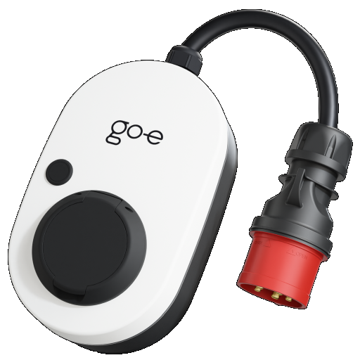

# ioBroker.go-eCharger

## Версии

## Sentry

Этот адаптер использует библиотеки Sentry для автоматического сообщения разработчикам об исключениях и ошибках в коде. Для получения более подробной информации и сведений о том, как отключить отправку сообщений об ошибках, обратитесь к [документации Sentry-Plugin](https://github.com/ioBroker/plugin-sentry#plugin-sentry) !

## Адаптер ioBroker для настенных зарядных устройств go-e Charger EV.

Этот адаптер интегрирует одну или несколько настенных зарядных устройств go-e Charger в вашу систему домашней автоматизации ioBroker. Он циклически опрашивает каждое зарядное устройство через его локальный HTTP API, предоставляет все необходимые данные в соответствии с настройками ioBroker и позволяет управлять зарядкой непосредственно из вашей системы умного дома.

Для получения более подробной информации об оборудовании go-e Charger посетите веб-сайт производителя: [go-e GmbH](https://go-e.com) .

### Функции

- Поддерживает использование нескольких зарядных устройств go-e в рамках одного адаптера.

- мониторинг состояния автомобиля, мощности зарядки, тока зарядки, фаз сети и статистики энергопотребления.

- **ChargeNOW** – начните зарядку немедленно с настраиваемым током.

- **ChargeManager** – автоматическая зарядка избытка солнечной энергии: зарядный ток постоянно регулируется в зависимости от доступной солнечной энергии, учитывая потребление электроэнергии в доме и уровень заряда домашней батареи. Зарядку вашего электромобиля можно отложить до тех пор, пока домашняя батарея не достигнет настраиваемого минимального уровня заряда.

  > **Примечание:** Если функция ChargeManager включена одновременно на нескольких зарядных устройствах, доступный избыток энергии распределяется между ними в порядке списка настенных зарядных устройств — см. [раздел «Несколько настенных зарядных устройств на одном источнике солнечной энергии»](#several-wallboxes-on-one-pv-surplus) .

- Переключение между однофазной и трехфазной зарядкой (оборудование 3-го поколения и новее)

- Статистика энергопотребления по каждой RFID-карте (название карты, идентификатор и уровень заряженной энергии).

- Режим только для чтения для каждого настенного зарядного устройства — мониторинг только зарядного устройства без отправки **каких-либо** команд управления (без отпускания заряда, без зарядного тока, без переключения фаз), например, когда зарядка контролируется другим устройством или доступ управляется с помощью RFID-меток.

Протестировано с прошивками V033, V040.0, V041.0, V054.7, V054.11, V055.5, V055.7, V055.8, V56.1, V56.2, V56.8, V56.9, V56.11, V57.0, V57.1, V59.4, V60.0, V60.1, V60.2, V60.5, V60.6 и с параллельным подключением до 3 зарядных устройств.

### Требования

- Для аппаратных устройств 3-го и 4-го поколений необходимо включить "HTTP API v1" в вашем приложении go-e.
- Для переключения фаз дополнительно необходимо включить "HTTP API v2" в вашем приложении go-e (для оборудования 3-го поколения и новее).

## Конфигурация

Добавьте по одной записи для каждого зарядного устройства go-e в список настенных зарядных устройств и укажите его IP-адрес. При желании присвойте каждому зарядному устройству имя.

Включите **режим только для чтения** для зарядного устройства, если адаптер должен только считывать данные и никогда не записывать их. В режиме только для чтения адаптер не отправляет никаких команд управления — ни команды разблокировки заряда, ни команды зарядного тока, ни команды переключения фаз. Состояния ChargeNOW и ChargeManager по-прежнему можно переключать, но они не влияют на работу зарядного устройства в режиме только для чтения. Используйте этот режим, если зарядка данного настенного зарядного устройства контролируется другой системой или управляется локально с помощью RFID-меток.

Длительность цикла опроса определяет, как часто адаптер считывает данные с зарядных устройств и регулирует зарядный ток (минимум 3 секунды, по умолчанию 10 секунд).

#### Ограничения тока для каждого настенного блока

Каждому зарядному устройству можно дополнительно задать **минимальный** и **максимальный зарядный ток** \[А]. Эти параметры применяются **как** к ChargeManager (избыток солнечной энергии), так и к ChargeNOW, например, для регулирования мощности одного зарядного устройства или для балансировки нагрузки между несколькими устройствами, подключенными к общей сети.

- Значение `0` означает «не установлено»: минимальное значение возвращается к техническому минимуму в 6 А, а максимальное — к максимальному зарядному току, установленному для всей установки, исходя из стандартных настроек.
- Максимальное количество зарядных устройств, устанавливаемое на один блок, позволяет снизить мощность зарядного устройства только ниже установленного предела, но никогда не превысить его.
- Если заданное минимальное значение окажется выше максимального, минимальное значение будет ограничено максимальным, и в журнал будет внесено предупреждение.

Адаптер также считывает текущие значения емкости, сообщаемые каждым зарядным устройством — абсолютный максимальный ток, ограничение тока кабеля и (через API v2) минимальный зарядный ток — и включает их в эффективные ограничения, поэтому зарядное устройство никогда не будет работать за пределами возможностей своего оборудования или подключенного кабеля. Обнаруженные значения емкости публикуются в виде `Wallbox_X.info.hardwareMaxChargeCurrent` и `Wallbox_X.info.hardwareMinChargeCurrent` чтобы помочь вам выбрать разумные значения за коробку.

### Зарядка излишков солнечной энергии с помощью ChargeManager

ChargeManager вычисляет зарядный ток на основе числовых состояний ioBroker, предоставляемых системой управления энергопотреблением, инвертором, счетчиком или созданным пользователем источником данных. Он не зависит от конкретного производителя, но выбранные состояния должны соответствовать величинам, описанным ниже.

Настройте идентификаторы объектов для следующих состояний:

- Доступная в настоящее время солнечная энергия \[Вт]
- Текущее потребление электроэнергии в доме \[Вт]
- Текущий уровень заряда вашей домашней батареи \[%] (требуется только в режимах, учитывающих состояние батареи, см. _режим «Домашняя батарея»_ ниже)

#### Входные требования

| Вход                                           | Ожидаемое значение                                    | Единица | Знак                      |
| ---------------------------------------------- | ----------------------------------------------------- | ------- | ------------------------- |
| Солнечная энергия                              | Суммарная текущая выработка фотоэлектрической энергии | В       | Позитивное поколение      |
| Потребление электроэнергии в домашних условиях | Совокупный текущий спрос домохозяйств                 | В       | Положительное потребление |
| Уровень заряда домашней батареи                | Текущий уровень заряда батареи                        | %       | от 0 до 100               |

Все настроенные состояния должны содержать числовые значения. Значения мощности в кВт необходимо преобразовать в Вт перед их выбором. Состояние импорта/экспорта в сеть нельзя использовать напрямую, поскольку ChargeManager в настоящее время ожидает отдельные значения генерации и потребления.

Если домашняя батарея не установлена, установите **режим домашней батареи** в _положение «Отключено»_ (см. ниже). Состояние заряда батареи настраивать не нужно, и ChargeManager заряжает батарею исключительно за счет доступного избытка солнечной энергии. Предыдущий обходной путь с использованием вспомогательного состояния (постоянное состояние, установленное на `Settings.Setpoint_HomeBatSoC`) больше не требуется.

#### Потребление электроэнергии настенным блоком в единицах домашнего потребления

**Потребление зарядного устройства включается в значение потребления электроэнергии в доме** , когда выбранный режим потребления электроэнергии в доме увеличивается примерно на мощность зарядки после начала зарядки. Затем ChargeManager добавляет измеренную мощность настенного зарядного устройства обратно, прежде чем рассчитать доступный избыток. Это предотвращает ситуацию, когда контроллер рассматривает собственную зарядную нагрузку как дополнительную потребность домохозяйства.

Оставьте эту опцию отключенной, если выбранное состояние уже исключает потребление энергии настенным блоком.

#### Расчет

ChargeManager использует следующий расчет один раз за цикл опроса:

```text
available power =
    solar power
  - home power consumption
  + wallbox power, if it is included in home power consumption
  - grid reserve
  + battery bonus (Battery priority mode only)

target current = floor(available power / 230 V / active phases)
```

На странице конфигурации ChargeManager шесть параметров позволяют настроить этот расчет:

- **Режим работы домашней батареи** (по умолчанию — _Приоритет батареи_ ) — как учитывается состояние домашней батареи:
  - _Отключено_ – домашний аккумулятор не используется. Состояние заряда батареи не требуется настраивать, и питание от батареи никогда не подается на автомобиль.
  - _Минимальный уровень заряда батареи (SOC)_ – зарядка электромобиля заблокирована ниже этого значения. `Settings.Setpoint_HomeBatSoC` Однако батарея никогда не подает питание в автомобиль.
  - _Приоритет батареи_ – как указано выше, плюс бонус за использование батареи, описанный ниже.
- **Гистерезис уровня заряда батареи** \[%] (по умолчанию 0) – насколько уровень заряда может опуститься ниже минимального значения, прежде чем _работающий_ контроллер остановится. Он предотвращает переключение режима разряда батареи на минимальное значение при каждом цикле; для запуска по-прежнему требуется полный минимальный уровень заряда.
- **Максимальный срок службы батареи (SoC)** \[с] (по умолчанию 0 = выключено) – управление избыточным зарядом прекращается, если состояние SoC не обновлялось в течение этого времени, поэтому неработающий вспомогательный модуль не может незаметно поддерживать зарядку автомобиля.
- **Резервная мощность сети** \[Вт] (по умолчанию 100) – мощность, сохраняемая в сети вместо того, чтобы выделяться автомобилю. Увеличьте её для обеспечения большего запаса мощности; установите значение на `0` передать весь излишек автомобилю.
- **Максимальный бонус батареи** \[Вт] (по умолчанию 2000) – сколько дополнительной энергии, помимо чисто солнечной, может быть потреблено, пока домашняя батарея находится выше минимального уровня заряда. Бонус составляет `0` Когда уровень заряда батареи точно достигает минимального значения, он линейно возрастает до этого максимума по мере приближения к 100%, поэтому более полная батарея позволяет автомобилю заряжаться быстрее. Установите это значение. `0` Заряжать аккумулятор исключительно за счет измеренного избытка солнечной энергии, не разряжая домашний аккумулятор в автомобиль.
- **Минимальный ток ChargeManager** \[А] (по умолчанию 6) – избыточный зарядный ток, ниже которого зарядное устройство отключается после небольшой задержки. Это относится только к зарядке избыточного тока от солнечных батарей.

**Максимальный зарядный ток** \[А] (по умолчанию 16, до 32) настраивается на **странице стандартных настроек** , а не здесь: это ограничение, действующее на всю систему общего электропитания (главный выключатель/защита цепи), а не значение, устанавливаемое в ChargeManager. Оно ограничивает ток, который адаптер когда-либо будет назначать **любой** настенной зарядной станции, **как** в ChargeManager (избыток солнечной энергии) **, так и** в ChargeNOW.

> **⚠️ Не устанавливайте максимальный зарядный ток выше, чем позволяет ваше зарядное устройство go-e и особенности вашей электропроводки.** Модели зарядных устройств go-e рассчитаны на разные максимальные токи (например, 16 А или 32 А), и фактическое ограничение также зависит от вашего кабеля, вилки и проводки. Установка значения выше номинального значения оборудования/установки может привести к срабатыванию защитных устройств или повреждению оборудования. В случае сомнений, оставьте значение по умолчанию — 16 А.

В режимах, учитывающих состояние батареи, зарядка электромобиля отключена (см. ниже). `Settings.Setpoint_HomeBatSoC` Таким образом, приоритет отдается домашней батарее. Зарядка начинается, как только внутренний целевой ток достигает 10 А (или минимального тока, если он установлен выше); затем происходит текущая зарядка до достижения целевого тока и его снижения до минимального значения. Расчетный ток ограничен заданным максимальным значением, а внутренний целевой ток изменяется не более чем на 1 А за цикл опроса, чтобы уменьшить резкие изменения.

#### Несколько настенных коробок на одном избыточном солнечном источнике энергии.

Избыток представляет собой единый общий ресурс, поэтому он распределяется между блоками, а не предоставляется каждому из них целиком. Блоки обслуживаются в **порядке, указанном в списке** , который, следовательно, определяет и их приоритет: первый блок берет столько избытка, сколько может использовать, а последующие блоки видят только то, что осталось. Измените порядок списка, чтобы изменить, какой автомобиль будет заряжаться первым.

Настенный контейнер резервирует излишки только тогда, когда к нему подключено транспортное средство. Пустой контейнер пропускается, поэтому он не может хранить излишки, которые могли бы быть использованы другим контейнером прямо сейчас.

Описанные выше ограничения по току для каждого зарядного устройства по-прежнему применяются к каждому устройству в отдельности, что позволяет ограничить ток для одного зарядного устройства, даже если оно находится первым в списке.

#### Включение ChargeManager

После запуска адаптера используйте указанные ниже состояния записи. Заменить экземпляр. `0` и номер настенного ящика `0` при необходимости.

| Состояние                                         | Цель                                                                                     |
| ------------------------------------------------- | ---------------------------------------------------------------------------------------- |
| `go-e-charger.0.Settings.Setpoint_HomeBatSoC`     | Минимальный уровень заряда домашней батареи, при котором допускается избыточная зарядка. |
| `go-e-charger.0.Wallbox_0.Settings.ChargeManager` | Включает или отключает управление избытком солнечной энергии                             |
| `go-e-charger.0.Wallbox_0.Settings.ChargeNOW`     | Принудительная зарядка; отключение ChargeManager.                                        |
| `go-e-charger.0.Wallbox_0.Settings.ChargeCurrent` | Текущий ток, потребляемый ChargeNOW                                                      |
| `go-e-charger.0.Wallbox_0.Settings.Charge3Phase`  | Выбирает однофазную или трехфазную зарядку на поддерживаемом оборудовании.               |
| `go-e-charger.0.Wallbox_0.Settings.PhaseMode`     | `1` /`3` исправляет количество фаз, `0` переключается автоматически                       |

Для дополнительной зарядки установите `ChargeManager` к `true` ChargeNOW заряжает устройство в соответствии с заданными параметрами. `ChargeCurrent` без учета имеющегося избытка. Два режима взаимоисключающие: включение одного выключает другой.

Функция ChargeNOW завершается автоматически и отключается при отсоединении автомобиля от сети или, при **включенной функции отключения зарядки при прекращении зарядки автомобиля** (доступной для настенного зарядного устройства), когда автомобиль не потребляет энергию в течение 5 минут. Включение ChargeNOW до подключения к сети допустимо: функция ожидает подключения автомобиля, не активируя зарядное устройство.

#### Однофазная и трехфазная зарядка

На оборудовании третьего поколения и более новых версий, `Charge3Phase` выбирает фазовый режим:

- `false` однофазная зарядка
- `true` трехфазная зарядка

Поскольку в текущей реализации зарядка начинается, когда внутренний целевой ток превышает 9 А, эффективная начальная точка составляет 10 А. Это требует приблизительно 2,3 кВт в однофазном режиме или 6,9 кВт в трехфазном режиме после корректировки резерва и батареи. Таким образом, однофазный режим обеспечивает более широкий диапазон работы для небольших фотоэлектрических систем или при переменчивой погоде.

##### Автоматическое переключение фаз

Включите **автоматическое переключение между 1- и 3-фазным режимом** для каждой настенной розетки (только для устройств 3-го поколения и старше, по умолчанию отключено), чтобы ChargeManager мог выбирать фазовый режим из доступного избытка:

- После насыщения однофазной зарядки (превышения однофазного максимума) она переключается **на три фазы** , обеспечивая доступ к более высокому трехфазному лимиту.
- Когда избыток тока больше не может поддерживать минимальный трехфазный режим (\~4,1 кВт при 6 А), он переключается **на однофазный режим** , поэтому уменьшающийся избыток тока продолжает заряжать однофазную сеть, вместо того чтобы остановиться.
- Разница между этими пороговыми значениями плюс время задержки предотвращает быстрое переключение туда-обратно, которое каждый раз прерывало бы зарядку.

Эта опция обеспечивает автоматическое переключение; `Settings.PhaseMode` выбирает его во время выполнения без перезапуска адаптера:

- `0`: автоматическое переключение (допускается только при включенной опции и на оборудовании 3-го поколения и выше; в этом случае используется значение по умолчанию), начинается с количества фаз, используемых зарядным устройством.
- `1`: стационарная однофазная зарядка, комплекты `Charge3Phase` к `false`
- `3`: стационарная трехфазная зарядка, комплекты `Charge3Phase` к `true`

В автоматическом режиме ChargeManager выбирает количество фаз без изменения. `Charge3Phase`, что по-прежнему относится к ChargeNOW. Написание `Charge3Phase` Этот параметр не отключает автоматический режим напрямую. Поскольку переключение на короткое время прерывает зарядку, и не каждый автомобиль корректно реагирует на это, данная опция по умолчанию отключена.

#### Режимы работы

| ChargeNOW | ChargeManager | Результат                                                                        |
| --------- | ------------- | -------------------------------------------------------------------------------- |
| `false`   | `false`       | Адаптер не заряжает                                                              |
| `false`   | `true`        | Зарядка осуществляется в соответствии с рассчитанным избытком солнечной энергии. |
| `true`    | `false`       | Принудительная зарядка при `ChargeCurrent`                                        |

При выключенных обоих режимах адаптер отключает только тот режим зарядки, который он сам себе задал. Зарядка, начатая через приложение go-e, кнопку на зарядном устройстве или по умолчанию, остается без изменений.

В режиме только для чтения эти состояния по-прежнему можно изменять, но соответствующая команда управления на зарядное устройство не отправляется.

#### Проверка и устранение неполадок

Прежде чем полагаться на автоматическую зарядку, проверьте выбранные состояния входных сигналов в представлении объекта ioBroker:

1. Ночью выработка солнечной энергии близка к нулю, а днем она соответствует текущей выработке.
2. Потребление электроэнергии в домашних условиях остается положительным и демонстрирует адекватную реакцию при включении бытовых потребителей.
3. Уровень заряда батареи остается в пределах от 0 до 100.
4. Все значения мощности выражены в Вт, а не в кВт.
5. Параметр «потребление от настенной зарядной станции» определяет, включена ли мощность зарядки в выбранное значение потребления электроэнергии в доме.
6. `Wallbox_0.info.connection` является `true`.
7. `Wallbox_0.Power.Charge`, `Wallbox_0.Power.GridPhases` и, на поддерживаемом оборудовании, `Wallbox_0.Power.EnabledPhases` содержат правдоподобные значения.

Для начала зарядки может потребоваться несколько циклов опроса, поскольку внутреннее целевое значение увеличивается всего на 1 А за цикл. При стандартном 10-секундном цикле и начальном целевом значении 0 А достижение стандартного начального значения 10 А может занять приблизительно 100 секунд.

Когда ChargeManager одновременно управляет несколькими настенными зарядными устройствами, избыток солнечной энергии распределяется между ними в порядке следования элементов в списке устройств, поэтому первое устройство имеет приоритет, а последующие получают только оставшийся избыток (см. [зарядку избытка солнечной энергии с помощью ChargeManager](#pv-surplus-charging-with-chargemanager) выше).

#### Общий текущий бюджет (защита предохранителями)

Для защиты общего предохранителя или линии электропитания, питающей несколько зарядных устройств, установите **максимальный суммарный зарядный ток** \[А] на странице стандартных настроек. Это общий бюджет для всей системы: суммарный зарядный ток **всех** зарядных устройств никогда не превышает его **ни** в ChargeManager, ни в ChargeNOW. В отличие от избытка солнечной энергии (измеряемого в ваттах), предохранитель защищается в **амперах** , поскольку линия электропитания, рассчитанная, например, на 20 А, пропускает 20 А независимо от того, заряжает ли зарядное устройство однофазное или трехфазное питание.

Бюджет распределяется в порядке приоритета: сначала зарядные устройства ChargeNOW, затем зарядные устройства ChargeManager в порядке списка зарядных устройств. Зарядное устройство, которое больше не подходит, ограничивается оставшимся током или отключается, если даже его минимальное количество не помещается. Пока бюджет активен, зарядное устройство без подключенного транспортного средства остается выключенным и ничего не резервирует, поэтому несколько неактивных зарядных устройств, подключенных одновременно, никогда не превысят лимит до следующего цикла перепланирования, и неактивное зарядное устройство никогда не будет лишать питания то, которое уже заряжается.

Значение `0` (по умолчанию) отключает ограничение бюджета; в этом случае адаптер не устанавливает суммарный лимит, поэтому убедитесь, что сумма максимальных токов каждого настенного блока остается в пределах мощности вашей установки.

В режиме работы адаптер также **отслеживает фактически измеренный зарядный ток** : если зарядное устройство потребляет значительно меньше допустимого тока (например, автомобиль с более низким лимитом бортового зарядного устройства, автомобиль, почти полностью заряженный, или снижение мощности из-за температуры), его неиспользованный ток восстанавливается через несколько циклов и передается следующему зарядному устройству в порядке приоритета. Зарядное устройство поддерживает небольшой запас по сравнению с фактическим потреблением и получает на один ампер больше в каждом цикле, пока использует полученный ток, чтобы восстановить свой лимит. Для обеспечения безопасности зарядное устройство всегда _снижает_ мощность только для восстановления емкости — его контрольная мощность никогда не остается высокой, пока освобождаемые амперы отдаются, — поэтому суммарный ток никогда не может превысить предохранитель, даже если автомобиль внезапно снова увеличит потребление.

> Это консервативная модель, не зависящая от фазы: каждый ампер учитывается в рамках одного бюджета независимо от того, на какой фазе он находится. Он никогда не превышает номинал предохранителя, но при распределении нагрузок по фазам может остаться неиспользованная часть мощности.

## Переход с адаптера go-e

Переходите с адаптера [ioBroker.go-e](https://github.com/MK-2001/ioBroker.go-e) ? Руководство по миграции содержит информацию о точках данных и настройках, отвечает на часто задаваемые вопросы (режим приложения go-e, HTTP API v1/v2, подпись входных значений, параллельный запуск обоих адаптеров в режиме только для чтения) и перечисляет то, что пока не поддерживается:

- [Руководство по миграции (на английском языке)](/#/docs/adapterref/iobroker.go-e-charger/docu/migration-from-go-e.md)
- [Umstiegsanleitung (Deutsch)](/#/docs/adapterref/iobroker.go-e-charger/docu/migration-from-go-e_de.md)

## Пожертвовать

<a href="https://www.paypal.com/donate/?hosted_button_id=76GBRV9BX5US8"></a> Если вам понравился этот проект — или вы просто в хорошем настроении — подумайте о том, чтобы угостить меня пивом. За ваше здоровье! :beers:

## Changelog

<!--
  Placeholder for the next version (at the beginning of the line):
  ### **WORK IN PROGRESS**
-->

### **WORK IN PROGRESS**

- (HombachC) moved the Sentry notice near the top of README.md to satisfy the repository checker (#938)
- (hombach) updated iobroker/testing
- (hombach) updated dependencies

### 1.10.2 (2026-11-01)

- (HombachC) added a migration guide from the go-e adapter (ioBroker.go-e) in English and German
- (HombachC) fixed the RFID card energy (statistics.RFID<n>.chargedEnergy) on gen 3+ chargers freezing at the value read at adapter start: it is now read from the API V2 card keys in Wh precision, with an API V1 fallback refreshed every cycle (#889)

### 1.10.1 (2026-10-31)

- (HombachC) an unreachable charger (e.g. without power) is now shown offline: its info.connection turns false, live readings are cleared and it is left out of ChargeManager and current budget until it answers again; the error is logged once instead of every cycle
- (HombachC) added read-only state info.ipAddress with the configured IP address of each charger
- (HombachC) log messages now name a charger by its configured name (e.g. charger "WEST - Tesla" (192.168.11.181)) instead of its number; the number is only used when no name is configured
- (typhosj) ChargeManager: new state `Settings.PhaseMode` switches between fixed one-phase, fixed three-phase and automatic phase switching at runtime; the instance option now only makes the automatic mode available

### 1.10.0 (2026-10-29)

- (HombachC) improved log message for invalid wallbox responses (no longer suggests checking the IP)
- (HombachC) fixed maxAmpTotal config: default 16 A, max 64 A consistent between admin and code
- (HombachC) fixed outdated native defaults in io-package.json (e.g. subtractSelfConsumption undefined on new installs)
- (typhosj) with ChargeNOW and ChargeManager both off, the adapter no longer aborts a charge it did not start - a charge started from the go-e app, the button or after a charger restart used to be cut off in the next cycle, until the vehicle gave up
- (typhosj) ChargeNOW now switches itself off when the vehicle is unplugged, and with the option above when the vehicle stops drawing power; it used to hold the charge release until switched off by hand, so the next vehicle plugged in started charging at the full ChargeNOW current. While ChargeNOW waits for a vehicle, nothing is sent to the charger
- (typhosj) ChargeNOW and ChargeManager are now exclusive: switching one on switches the other off, instead of ChargeNOW silently taking precedence
- (typhosj) a ChargeManager that takes over a charger - at adapter start or after ChargeNOW - continues a running charge at its current, with a fresh shutdown delay; it used to start from its previous state and could withdraw the release in its first cycle
- (typhosj) ChargeManager: a charger in force state neutral, where it decides by itself and charges any vehicle, is now held off unless the adapter released it - firmware 60.6 comes back from every restart in that state, the go-e app sets it when a setting is saved, and firmware 59.4 and 60.6 set it when a vehicle is unplugged; the next vehicle used to charge at full power from the grid until the shutdown delay ran out. The release the charger reports in that state is no longer taken for one the adapter gave
- (HombachC) fixed TypeError in log when a state change arrives for an unconfigured wallbox number

### 1.9.0 (2026-10-28)

- (solar0x) new states `Wallbox_X.Power.VoltageL1`, `VoltageL2` and `VoltageL3` show the voltage the charger measures on each grid phase, in V; all hardware generations. As in the go-e app, a single-phase supply with L and N swapped shows its N voltage as L1
- (typhosj) new state `Wallbox_X.Power.GridFrequency` shows the grid frequency the charger measures, in Hz; hardware gen 3 and newer with HTTP API v2 enabled only, and it stays empty while the charger reports the frequency as unknown [#898]
- (typhosj) new state `Wallbox_X.info.chargeState` explains why the charger is charging or not - waiting for a vehicle, charging the home battery first, not enough PV surplus, ramping up to the start current, charging, current budget exhausted, both modes off; every change of the reason is also logged once. A charger that never started used to leave no trace in the log, because most of these reasons were only logged together with a write to the charger
- (typhosj) ChargeManager: new per-wallbox option to withdraw the charge release when the vehicle draws no power for 5 minutes - vehicles such as the Renault Zoe otherwise stay in charging mode, e.g. in the evening when the battery bonus keeps the release active (reported by a user)
- (hombach) phase voltages and grid frequency are rounded to 2 decimal places
- (hombach) updated dependencies

### 1.8.1 (2026-10-11)

- (typhosj) after an automatic switch from one to three phases the ChargeManager now continues at the power the car was charging with instead of the one-phase current; 16 A on one phase used to become 16 A on three phases (about 11 kW) and came down only one ampere per cycle, drawing the difference from the battery or the grid
- (typhosj) after an automatic switch from three to one phase the ChargeManager now also continues at the power reached so far, capped at what the surplus carries on one phase; it used to keep the three-phase current, so a car plugged in while the charger still held three phases from the last charge took about a minute longer to start

## License

MIT License

Copyright (c) 2020-2026 C.Hombach <go-e-charger@homba.ch>

Permission is hereby granted, free of charge, to any person obtaining a copy
of this software and associated documentation files (the "Software"), to deal
in the Software without restriction, including without limitation the rights
to use, copy, modify, merge, publish, distribute, sublicense, and/or sell
copies of the Software, and to permit persons to whom the Software is
furnished to do so, subject to the following conditions:

The above copyright notice and this permission notice shall be included in all
copies or substantial portions of the Software.

THE SOFTWARE IS PROVIDED "AS IS", WITHOUT WARRANTY OF ANY KIND, EXPRESS OR
IMPLIED, INCLUDING BUT NOT LIMITED TO THE WARRANTIES OF MERCHANTABILITY,
FITNESS FOR A PARTICULAR PURPOSE AND NONINFRINGEMENT. IN NO EVENT SHALL THE
AUTHORS OR COPYRIGHT HOLDERS BE LIABLE FOR ANY CLAIM, DAMAGES OR OTHER
LIABILITY, WHETHER IN AN ACTION OF CONTRACT, TORT OR OTHERWISE, ARISING FROM,
OUT OF OR IN CONNECTION WITH THE SOFTWARE OR THE USE OR OTHER DEALINGS IN THE
SOFTWARE.