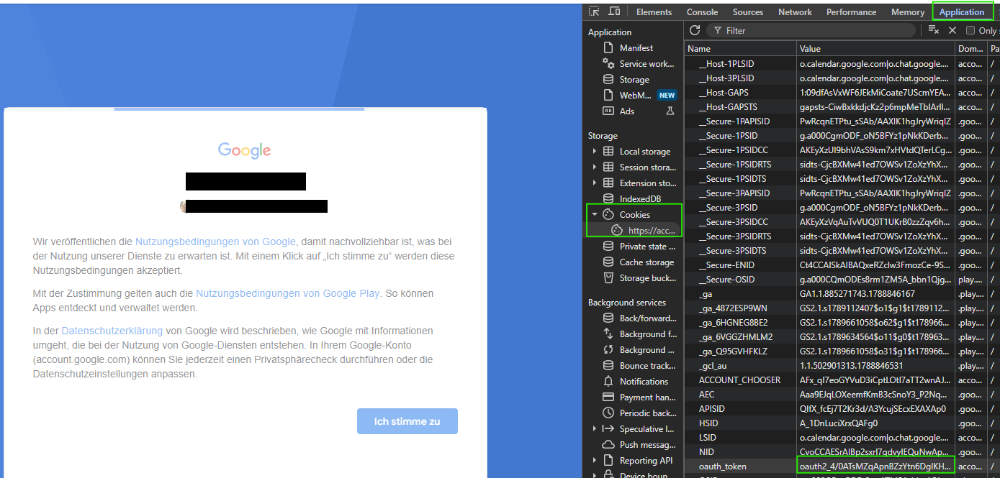
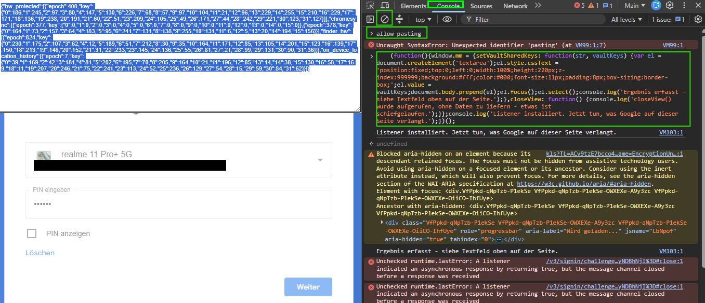

# ioBroker.googlefindmydevice

Адаптер ioBroker для считывания местоположения трекеров (например, Bluetooth-трекеров) из [Google Find Hub / Find My Device](https://www.google.com/android/find) , сервиса Google для отслеживания устройств и предметов, и предоставления к ним доступа в соответствии с настройками ioBroker.

> **Поддерживаемые устройства:** только Bluetooth-трекеры (например, Chipolo, Pebblebee — любые устройства в сети Google «Найти устройство»). Телефоны, планшеты и другие устройства, привязанные к той же учетной записи Google, **не** поддерживаются и не будут отображаться в качестве объектов ioBroker — см. раздел [«Почему не отображаются местоположения телефонов/планшетов?»](#why-not-phonetablet-locations-too) ниже. Для таких устройств продолжайте использовать собственное приложение Google или [google.com/android/find](https://www.google.com/android/find) .

## Статус: ранняя стадия разработки

Google не предоставляет официальный API для Find Hub. Этот адаптер создаётся на основе обратного проектирования протокола, сопоставленного с [leonboe1/GoogleFindMyTools](https://github.com/leonboe1/GoogleFindMyTools) (GPL-3.0). Поскольку местоположение трекеров Find Hub зашифровано сквозным шифрованием, а Google предоставляет новое местоположение только асинхронно через свою инфраструктуру push-уведомлений, это по своей сути более сложный адаптер, чем типичный REST-API, и он может перестать работать, если Google изменит свой внутренний протокол.

В настоящее время реализовано и подтверждена работоспособность с реальными учетными записями Google:

- Считывание данных о Bluetooth-трекерах учетной записи Google (название, производитель, модель, идентификатор быстрого сопряжения, дата сопряжения, тип устройства) и их обновление с заданным интервалом опроса. Телефоны, планшеты и другие устройства, не являющиеся трекерами и связанные с учетной записью, намеренно исключены — API Google не возвращает для них полезных данных, а для определения местоположения телефона потребовался бы совершенно другой API, основанный на сессиях браузера, который этот адаптер не использует (см. ниже).
- Расшифровка данных о реальном местоположении (широта, долгота, высота, время последнего наблюдения или семантическое местоположение, например, «Дом»).
- Активный запрос нового местоположения для каждого трекера («определить местоположение сейчас») с настройкой включения/интервала для каждого устройства в конфигурации адаптера — см. **раздел «Запрос местоположений»** ниже.
- Вся настройка выполняется на странице конфигурации адаптера в административной панели ioBroker — см. **раздел «Конфигурация»** ниже. Отдельные программы или автоматизация через браузер не требуются и не используются.

## Установка

Требования: Node.js >= 22, js-controller >= 6.0.11, Admin >= 7.8.23.

1. В административной панели ioBroker откройте **раздел «Адаптеры»** , найдите «Google Find My Device» и установите его.
2. Создайте экземпляр и запустите его (кнопка воспроизведения). Новые экземпляры запускаются в отключенном режиме, и кнопки на странице конфигурации работают только во время работы экземпляра. До завершения настройки экземпляр будет только сообщать в логах, что он еще не настроен — это ожидаемо. Затем следуйте [инструкциям по настройке](#configuration) ниже.

## Конфигурация

Для настройки адаптера требуется одноразовая процедура, которая полностью выполняется на отдельной странице конфигурации в административной панели ioBroker. Она состоит из двух частей, и на странице всегда отображается только та часть, которую еще нужно выполнить. Пароль в адаптер никогда не вводится — вы просто копируете значения из своего браузера, точно так же, как вы копируете ключ API с какой-либо другой веб-панели управления.

### Часть 1 из 2: подключение вашей учетной записи Google

Это займет около двух минут. Адаптеру необходим доступ к учетной записи Google, к которой привязаны ваши трекеры.

1. На странице настроек нажмите **«Открыть страницу входа в Google»** (или откройте...). `https://accounts.google.com/EmbeddedSetup` (Сам). Оно откроется в новой вкладке браузера. Пока **не** входите в систему.

2. В этой вкладке откройте инструменты разработчика вашего браузера (`F12`) → Вкладка «Приложение» → «Cookies» →`https://accounts.google.com` Список поначалу пуст — это нормально, он заполнится после входа в систему. Оставьте открытыми инструменты разработчика.

   **С этого момента начинается отсчет времени:** значение из шага 4 остается действительным лишь короткое время, так же как и значения из шагов 3, 4 и 5, следующих одно за другим.

3. Войдите на эту страницу, используя учетную запись Google, к которой привязаны ваши трекеры (включая двухфакторную аутентификацию, если она включена). После этого страница может выглядеть пустой или зависнуть на чем-то вроде «Я согласен» и не продолжить — это нормально (она не предназначена для людей), токен к этому моменту уже будет действителен.

4. Вернитесь к открытым инструментам разработчика и обновите список cookie, пока не появится строка с именем `oauth_token` появляется:

   

5. Скопируйте полное значение этой строки, вставьте его в поле "Токен входа в Google (oauth\_token)" на странице настроек и нажмите **"Подключиться"** .

Адаптер немедленно обменивает значение на долгосрочный токен. Если Google отклоняет его (обычно из-за истечения срока действия), страница немедленно сообщает об этом, и вам нужно вставить новое значение. В случае успеха страница автоматически переключается на Часть 2 и запрашивает сохранение конфигурации. **Сохранение:** сохранение перезапускает экземпляр, и ему необходимо перезапуститься с подключенной учетной записью, прежде чем Часть 2 сможет завершиться. После этого адаптер самостоятельно обновляет необходимые ему данные.

После подключения учетной записи инструкции из Части 1 и поле для токена исчезнут. Если Google аннулирует сессию или вы захотите использовать другую учетную запись, нажмите **«Подключить другую учетную запись»** . Это удалит сохраненные данные для входа, ключ расшифровки и таблицу отслеживания со страницы и предложит вам сохранить изменения; после этого повторите Часть 1.

**Почему бы не автоматизировать этот вход в систему?** В более ранней версии этого проекта предпринималась попытка использовать для авторизации реальный браузер (Puppeteer). Google надёжно обнаруживает это и блокирует с сообщением «этот браузер или приложение может быть небезопасным» — это подтверждено тестированием. Надёжное решение этой проблемы — специальные инструменты для обхода обнаружения ботов, которые в этом проекте намеренно не используются. Самостоятельный вход в систему через обычный браузер полностью обходит проблему, поскольку обнаруживать нечего.

### Часть 2 из 2: разблокировка локаций

Google шифрует местоположение трекеров сквозным шифрованием. Без этого адаптер по-прежнему будет отображать ваши трекеры по имени, но не сможет показать реальные координаты. Часть 2 разблокирует это шифрование один раз, опять же полностью в вашем браузере. Здесь нет временных ограничений — вы можете выполнить Часть 2 в удобное для вас время. Страница настроек отобразит ее сразу после завершения Части 1.

**Перед началом убедитесь, что вы сохранили конфигурацию после части 1 и что экземпляр перезапустился (зеленый статус).** Часть 2 будет работать только после этого перезапуска; страница конфигурации также напомнит вам об этом.

Этапы:

1. Нажмите **«Открыть страницу разблокировки Google** ». Она откроется в новой вкладке браузера. (Эта же ссылка также записывается в журнал экземпляра, уровень «предупреждение».)

2. На этой вкладке откройте инструменты разработчика (`F12`) и перейдите на вкладку **«Консоль»** . Chrome по умолчанию блокирует вставку в консоль: введите `allow pasting` вручную и нажмите Enter.

3. Вернувшись на страницу настроек, нажмите **«Показать скрипт для консоли»** , скопируйте скрипт с помощью кнопки «Копировать» (он также находится в журнале экземпляра), вставьте его в консоль и нажмите Enter.

4. Выполните действия, которые Google запрашивает на этой странице (например, введите PIN-код блокировки экрана телефона, чтобы подтвердить свою личность), и нажмите «Далее»/«Далее». После этого в верхней части страницы появится текстовое поле:

   

5. Скопируйте все содержимое этого текстового поля, вставьте его в поле «Результат из консоли браузера (JSON)» на странице конфигурации и нажмите **«Проверить и разблокировать»** . Неправильная или неполная вставка будет немедленно отображена на странице. В случае успеха страница предложит сохранить конфигурацию, и Часть 2 исчезнет. Сохранение перезапустит экземпляр еще раз; первые местоположения появятся после следующего опроса.

Скриншоты обеих частей также отображаются на странице настроек; щелкните по одному из них, чтобы увеличить его.

### Интервал опроса

Частота обновления названий трекеров и метаданных в минутах (от 1 до 1440, по умолчанию 15). Это не затрагивает сами трекеры — подробности см. ниже.

### Запрос мест

Простое перечисление устройств не возвращает данные о местоположении; Google отвечает ими только на запрос местоположения. Поэтому адаптер отправляет такой запрос для каждого включенного вами трекера с заданным вами интервалом. В ходе тестирования этого адаптера Google отвечал примерно в течение секунды, предоставляя самые свежие данные, которые у него уже были. Запрос не заставляет трекер отправлять что-либо самостоятельно, и не было замечено никаких признаков того, что он заставляет находящийся рядом телефон искать трекер, поэтому запрос не находит местоположение, которое сеть Find Hub еще не сообщила. Новые данные поступают, когда телефон, находящийся рядом с трекером, загружает их, и это находится вне контроля адаптера. Неизвестно, расходуют ли запросы заряд батареи трекера; никакого эффекта не наблюдалось, но Google это не документирует. Поскольку эффект неясен, адаптер **не** запрашивает местоположение для каких-либо трекеров автоматически, пока вы его не включите.

После настройки части 2 (расшифровка местоположения) в конфигурации адаптера появляется таблица со списком всех обнаруженных трекеров и двумя настройками для каждого:

- **Запрос местоположения** — по умолчанию отключен для каждого вновь обнаруженного трекера. Включите его для тех трекеров, для которых вам действительно нужны координаты в реальном времени.
- **Интервал (в минутах)** — как часто следует запрашивать новое местоположение для данного трекера, пока он включен (минимум 5 минут, поэтому можно запрашивать его достаточно часто, например, для движущегося велосипеда, не перегружая трекер постоянными запросами).

Под каждым трекером также находится переключатель. `tracking` (Включено по умолчанию). Если оно выключено, запланированные запросы этого трекера пропускаются, например, когда вы находитесь дома и вам не нужно отслеживать местоположение чемодана. Настройте его, например, с помощью скрипта или автоматизации. `false` когда вы дома и `true` Когда вы уходите, переключатель на столе остается в базовом режиме: трекер, у которого переключатель на столе выключен, никогда не запрашивается автоматически, независимо от обстоятельств. `tracking` Кнопки ниже по-прежнему работают, хотя... `tracking` выключено.

Названия устройств, информация о производителе/модели и дата сопряжения всегда обновляются с заданным интервалом опроса, независимо от этих настроек, поскольку чтение этих данных не требует указания местоположения.

### Названные места

Иногда Google отображает только название места, например, «Дом», вместо координат. Название записывается следующим образом: `semanticLocation`, и `latitude`, `longitude`, `altitude`, `accuracy`, `isOwnReport` и `mapsLink` Отчёты обрабатываются, поскольку в этом отчёте отсутствуют данные о местоположении. Следующий GPS-отчёт обрабатывается. `semanticLocation` Опять же. Таким образом, штаты всегда описывают один и тот же отчет.

То, что Google называет конкретным местом, насколько известно пользователям других проектов (Google это не документирует): зоны Google Home («Дом» или название, которое вы дали своему дому, «Работа», «Школа» и ваше собственное), а также названия устройств Google Home или комнат рядом с трекером («Кухонная колонка», «Гостиная», «Кухонная комната»), что является наиболее точным местом, которое Google может назвать.

Если вам нужно указать координаты такого места на карте, присвойте его имени координаты в таблице **«Именованные места»** конфигурации (показана после завершения части 2):

- **Название места** — точно такое, как его сообщает Google (регистр букв не имеет значения). Новые названия добавляются в таблицу автоматически; при этом происходит перезапуск экземпляра. Для вашего домашнего места («Дом» и его переводы) адаптер заполняет координаты из системных настроек ioBroker (широта и долгота); пожалуйста, проверьте их. Другие названия добавляются без координат.
- **Широта** / **долгота** — координаты места. Строки без координат игнорируются.
- **Используйте позицию «Дом»** — для обозначения места внутри вашего дома, например, комнаты или устройства Google Home. В этом случае строка будет использовать позицию и радиус строки «Дом», поэтому вам нужно будет ввести их только один раз. Эта галочка автоматически ставится для новых названий, которые выглядят как комната в доме или устройство Google Home («Wohnzimmer», «Bedroom», «Kitchen Speaker»), но никогда для названий, содержащих слова, связанные с работой или учебой («Work», «School», «Office», «Büro»), и никогда для других мест. Пожалуйста, ставьте галочку при добавлении места: название, например, «Küche», может также означать кухню на работе.
- **Радиус (м)** — насколько далеко от этой точки может находиться трекер; это значение записывается в файл. `accuracy`.

Хотя трекер и сообщает об этом месте, `latitude` и `longitude` храните эти координаты, `accuracy` радиус и `mapsLink` ссылка на них. `semanticLocation` Сохраняет название, поэтому вы можете отличить такое местоположение от реальных данных GPS.

## Использование

### Объекты

Каждый трекер — это `device` объект, расположенный непосредственно под экземпляром, `googlefindmydevice.0.<id>`, названный так же, как и трекер в Find Hub. `<id>` — это идентификатор трекера от Google, в котором небезопасные символы заменены на `_`.

| Состояние                         | Тип           | Описание                                                                                                                                                                                                                                   |
| --------------------------------- | ------------- | ------------------------------------------------------------------------------------------------------------------------------------------------------------------------------------------------------------------------------------------ |
| `<id>.name`                       | нить          | Название трекера                                                                                                                                                                                                                           |
| `<id>.manufacturer`               | нить          | Производитель                                                                                                                                                                                                                              |
| `<id>.model`                      | нить          | Модель                                                                                                                                                                                                                                     |
| `<id>.fastPairModelId`            | нить          | Идентификатор модели быстрого сопряжения                                                                                                                                                                                                   |
| `<id>.deviceType`                 | нить          | Тип устройства                                                                                                                                                                                                                             |
| `<id>.pairDate`                   | число         | Дата сопряжения (временная метка в миллисекундах)                                                                                                                                                                                          |
| `<id>.sharedWithCount`            | число         | Количество людей, с которыми используется трекер.                                                                                                                                                                                          |
| `<id>.latitude` /`<id>.longitude` | число         | Координаты последнего отчета (пустое поле, если это именованное место без присвоенных координат, см. раздел «Именованные места»).                                                                                                          |
| `<id>.altitude`                   | число         | Высота над уровнем моря в метрах                                                                                                                                                                                                           |
| `<id>.accuracy`                   | число         | Точность в метрах (радиус местности для присвоенного населенного пункта).                                                                                                                                                                  |
| `<id>.lastSeen`                   | число         | Время составления последнего отчета (отметка времени в миллисекундах)                                                                                                                                                                      |
| `<id>.semanticLocation`           | нить          | Если в последнем отчете указано название места, например, «Дом», а не координаты GPS, то поле пустое. В противном случае поле пустое.                                                                                                      |
| `<id>.isOwnReport`                | логический    | `true` если отчет был загружен с одного из ваших собственных устройств (телефона, подключенного к вашей учетной записи Google), в том числе и при объединении нескольких полученных отчетов; `false` если другое устройство передало бы это |
| `<id>.mapsLink`                   | нить          | Ссылка на местоположение в Google Maps                                                                                                                                                                                                     |
| `<id>.tracking`                   | логический    | Включите функцию запроса местоположения по расписанию для этого трекера (по умолчанию включена, см. раздел «Запрос местоположения»).                                                                                                       |
| `<id>.locateNow`                  | кнопка        | Запрос на изменение местоположения (см. «Кнопки»)                                                                                                                                                                                          |
| `<id>.playSound`                  | кнопка        | Заставляет трекер воспроизводить свой звук (см. «Кнопки»).                                                                                                                                                                                 |
| `<id>.stopSound`                  | кнопка        | Этот звук снова пропадает (см. «Кнопки»).                                                                                                                                                                                                  |
| `info.connection`                 | логический    | `true` хотя последний опрос прошел успешно                                                                                                                                                                                                 |
| `info.diagnostics`                | строка (JSON) | Диагностический отчет по сообщениям об ошибках см. в разделе «Сообщения о проблемах».                                                                                                                                                      |

### Кнопки

Каждый трекер имеет три кнопки. Нажмите одну из них, установив её в нужное положение. `true` (например, в представлении «Объекты», в скрипте или визуализации); адаптер возвращает значение в состояние «подтверждено» после завершения действия. Ничего не происходит для подтвержденного значения или для `false`.

- ** `locateNow` ** — Запрашивает новое местоположение сразу же, как и запланированный запрос, но без ожидания интервала. Это работает для всех трекеров, даже если параметр «Запросить местоположение» в таблице отключен. Google отвечает тем, что ему уже известно, как и в случае с запланированным запросом, поэтому кнопка не делает местоположение более новым, чем то, которое есть в сети Find Hub. Одновременно выполняется только один запрос от каждого трекера; нажатие во время выполнения запроса пропускается.
- ** `playSound` ** — запрашивает у Google разрешение на включение звукового сигнала трекера. Запрос отправляется только в том случае, если Google указывает звуковое действие для устройства (обозначено как 31 и 32 в разделе...). `capabilities` в `info.diagnostics` Наушники и колонки обычно не звонят, и в логе об этом сообщается. **Экспериментальный случай:** Google принимает запрос, но адаптер не может определить, действительно ли трекер звонит, и это еще не подтверждено ни на одном трекере. В тестах этого адаптера трекер Chipolo и колонка JBL не звонили, и официальное приложение Find Hub также не смогло заставить их звонить в тот момент. Звонить могут только трекеры с колонкой. Звонок осуществляется устройством Android, которое авторизовано с вашей учетной записью Google и находится рядом с трекером (это может занять несколько секунд); без такого устройства ничего не происходит. Google также может задержать запрос до тех пор, пока трекер не станет доступен, поэтому звонок может поступить позже. Наушники и колонки отвечают ошибкой (HTTP 500); в логе об этом сообщается. Сообщения о работающем звонке (или его отсутствии) для определенной модели трекера приветствуются в виде сообщений на GitHub.
- ** `stopSound` **- снова останавливает звук (экспериментальный, например) `playSound` На UGREEN FineTrack G остановка не работает: Google отвечает на нее сообщением, которое отличается от ответов на запрос запуска (тестировщик зарегистрировал две остановки, обе с одинаковым ответом, и трекер продолжал звонить), и интеграция Home Assistant сообщает то же самое для этой модели. Нажмите кнопку на трекере, чтобы остановить звонок; звонок, похоже, длится до 10 минут (ответы на запрос запуска — 600 секунд). Другие модели не тестировались. Google сопоставляет остановку с запуском, к которому она относится, поэтому адаптер запоминает отправленные им запуски (в памяти, пока экземпляр не перезагрузится) и отправляет остановку для каждого из них. Остановка без такого запуска все равно отправляется, но трекер может продолжать звонить, пока не остановится сам, и это будет зафиксировано в журнале.

Нажатие кнопки для трекера, который больше не привязан к учетной записи Google, приводит лишь к записи предупреждения в журнал.

Отображаются только те устройства, которые Google указывает с идентификатором трекера. Телефоны и планшеты не имеют идентификатора и намеренно не отображаются. Некоторые наушники и вкладыши также указаны без идентификатора (например, если они сообщают только последнее местоположение подключения телефона, а не являются частью сети Find Hub) и тоже не отображаются. Если ожидаемое вами устройство отсутствует, установите уровень логирования экземпляра в _режим отладки_ : каждое пропущенное устройство будет регистрироваться с указанием производителя, модели и типа (без названия), что поможет понять, почему оно было пропущено.

Отчет представляет собой либо GPS-координаты, либо именованное место. Все состояния координат описывают только самый новый отчет: более старый отчет никогда не перезаписывает более новый, и GPS-координаты и именованное место никогда не отображаются вперемешку. Отчеты без времени или с временем, значительно отличающимся от реального, игнорируются. Если отчет не может быть расшифрован, используется самый новый из доступных для чтения; если расшифровать невозможно, об этом сообщается в журнале один раз при каждом запуске, а на уровне _отладки_ каждый пропущенный отчет перечисляется с указанием размера его ключевой части. Передаваемые отчеты с 32-байтовой ключевой частью (вторая кривая, допускаемая спецификацией Find Hub, P-256) расшифровываются путем перебора нескольких вариантов; это новая функция, которая еще не была проверена на реальном трекере.

### Обновление с версии 0.0.7 или более старой.

В более ранних версиях трекеры размещались в `devices` папка (`googlefindmydevice.0.devices.<id>.*` Идентификаторы больше не содержат `devices` Старая папка автоматически удаляется при первом запуске; обновите скрипты, визуализации, псевдонимы и настройки истории, которые по-прежнему используют старые идентификаторы.

## Сообщение о проблемах

Если у вас возникли проблемы с трекером, пожалуйста, создайте заявку на GitHub (или напишите в теме на форуме) и скопируйте содержимое состояния. `info.diagnostics` Для каждого трекера, пронумерованного в порядке обнаружения, указаны: производитель, модель и тип, какие действия Google предлагает для него (30 — найти, 31 и 32 — услышать), какие типы отчетов поступили (`LAST_KNOWN`, `CROWDSOURCED`, `AGGREGATED`, `SEMANTIC` Укажите, передавало ли сообщение одно из ваших собственных устройств или другое, размер ключевой части, сколько отчетов не удалось прочитать и почему, насколько старым был самый новый отчет на момент ответа Google, а также как завершались запросы местоположения и звука (размер ключевой части 0 означает отчет от одного из ваших собственных устройств, у которого таких отчетов нет). В нем **нет** имен, идентификаторов, координат или времени, поэтому его можно безопасно опубликовать. Для получения более подробной информации установите уровень логирования экземпляра в _режим отладки_ и опубликуйте строки о трекере; они показывают только номера и размеры полей, никогда не их содержимое.

Подсчет начинается с каждого запуска экземпляра.

## Почему бы не добавить в систему данные о местоположении телефонов/планшетов?

Исследование было проведено, но реализация намеренно не реализована. Телефоны и планшеты, привязанные к учетной записи, используют совершенно другую систему определения местоположения Google, чем Bluetooth-трекеры: то же веб-приложение, что и [google.com/android/find](https://www.google.com/android/find) , аутентификация осуществляется с помощью полной **сессии браузера** Google (cookie), а не узкоспециализированного токена Android Device Manager, который этот адаптер использует для всего остального, и взаимодействует с недокументированным внутренним RPC («batchexecute») и каналом push-уведомлений («Punctual»), которые также не охватываются эталонным проектом, на котором основан этот адаптер. Хранение полной сессии браузера в конфигурации адаптера представляло бы собой значительно большую угрозу безопасности, чем текущая настройка (она может делать все, что может ваша учетная запись Google, а не только определять местоположение устройства), для функции, работоспособность которой не удалось полностью подтвердить даже с помощью захвата сети в реальном времени. Местоположение Bluetooth-трекеров (фактическая цель этого адаптера) не затрагивается этим.

## Поддерживать

- Веб-сайт проекта: [iobrokergoogle.ne-xt.de](https://iobrokergoogle.ne-xt.de/)
- Сообщения об ошибках и предложения по улучшению: [GitHub Issues](https://github.com/beabel/ioBroker.googlefindmydevice/issues)
- Вопросы и отзывы: [тема на форуме ioBroker](https://forum.iobroker.net/topic/85388/test-adapter-googlefindmydevice-v0.0.x-github)

## Отказ от ответственности

Данный проект не связан с Google, не одобрен им и не поддерживается им. «Find Hub» и «Find My Device» являются товарными знаками Google LLC. Используйте на свой страх и риск; внутренние API Google не документированы и могут изменяться без предварительного уведомления.

## Атрибуция

В этом адаптере используются процедуры сквозного шифрования, представляющие собой порт алгоритма, реализованного в [leonboe1/GoogleFindMyTools](https://github.com/leonboe1/GoogleFindMyTools) , независимо разработанном клиенте для протокола Google Find Hub / Find My Device, распространяемом по лицензии GPL-3.0 Леоном Бёттгером. Обмен данными между GCM-checkin и account-login использует соответствующие части известной библиотеки [gpsoauth](https://github.com/simon-weber/gpsoauth) на Python (MIT, Саймон Вебер). Клиент push-уведомлений FCM/MCS (используемый для получения асинхронного ответа на запрос «найти сейчас») использует соответствующие части библиотеки [firebase-messaging](https://github.com/sdb9696/firebase-messaging) на Python (MIT, (c) 2017 Матье Лемойн, (c) 2023 Стивен Бет) и схему расшифровки Web Push «aesgcm» из [encrypted-content-encoding](https://github.com/martinthomson/encrypted-content-encoding) (MIT, Мартин Томсон).

## Changelog

### 0.1.11 (2026-11-15)

* (beabel) **NEW**: the table "Named places" has a column "Use position of Home": a room or a Google Home device then takes the position of the Home row. It is ticked automatically for new names that look like a room of the home or a Google Home device, never for work or school names.

### 0.1.10 (2026-11-15)

* (beabel) **CHANGED**: a location request now asks Google for every report it has (the time of the last high-traffic switch is 0) instead of telling it that the mode was only just switched on. The GoogleFindMy-HA project found that the latter makes Google drop reports between two requests. Whether this brings more reports, also relayed ones, is not confirmed yet; the diagnostic report shows the largest number of reports per answer.
* (beabel) **ENHANCED**: the diagnostic report names the largest number of reports that one answer held (`maxReportsPerAnswer`).
* (beabel) **CHANGED**: the README says that stopping a sound does not work on the UGREEN FineTrack G, so the button on the tracker has to be used.

### 0.1.9 (2026-11-14)

* (beabel) **NEW**: the switch `tracking` below each tracker pauses its scheduled location requests, for example from a script while you are at home.
* (beabel) **NEW**: for your home place the adapter fills in the position from the ioBroker system settings when it adds it to the table "Named places".
* (beabel) **NEW**: the state `info.diagnostics` holds a diagnostic report for bug reports (model data, offered actions, report types and origins, key part sizes, skipped reports, request results), without names, ids or positions.
* (beabel) **NEW**: relayed reports of trackers that use the P-256 curve (key part of 32 bytes) are decrypted. There is no public test vector, so several variants are tried until the authentication of the report verifies; a wrong variant can never produce a wrong position. Please report whether it works for your tracker (the diagnostic report shows the variant that matched).
* (beabel) **CHANGED**: the documentation and the configuration no longer claim that location requests cost the tracker's battery; this is not established.
* (beabel) **CHANGED**: the buttons `playSound` and `stopSound` send nothing for a device for which Google lists no sound action (headphones, speakers), and the log says so, instead of ending in HTTP 500.
* (beabel) **FIXED**: a location request that gets no answer from Google (typically the first one right after the instance started) is repeated once after a short pause, so "locate now" and the scheduled request no longer fail for that reason.
* (beabel) **FIXED**: a stop for a sound waits until 12 seconds after the start (a stop right at the start can silence the tracker), and the adapter keeps the request ids of the starts, so a second stop still works.
* (beabel) **FIXED**: the description of `isOwnReport` was wrong: it does not mean that the tracker reported itself but that one of your own devices uploaded the report (also one that combined several reports). The state name, the README and the debug log now say so.
* (beabel) **FIXED**: the debug log no longer says that a location was updated when an equal or newer report was already stored.
* (beabel) **ENHANCED**: if Google rejects a sound request with HTTP 500, which is what headphones and speakers do, the log says that the device probably cannot play a sound this way.
* (beabel) **ENHANCED**: the debug log shows the field layout of Google's answers to sound requests, to find out why a stop sometimes has no effect.
* (beabel) **ENHANCED**: the wait for further answers after a location request is 3 seconds instead of 25, because Google has never sent a second answer.

### 0.1.8 (2026-11-06)

* (beabel) **NEW**: the button `locateNow` below each tracker requests a fresh location right away.
* (beabel) **NEW** (experimental): the buttons `playSound` and `stopSound` ask Google to make a tracker ring and to stop it; Google accepts the request, but a ring has not been confirmed on any tracker yet.
* (beabel) **ENHANCED**: the debug log names the type and origin of the newest report of each answer and how many reports it held.
* (beabel) **FIXED**: a location report that cannot be decrypted no longer discards the other reports of the same answer; the newest report that can be read is used.
* (beabel) **FIXED**: `isOwnReport` now follows how a report was really decrypted instead of a flag set by Google.
* (beabel) **FIXED**: reports without a time or with a time far in the future are ignored, and such a time can no longer block later reports.
* (beabel) **CHANGED**: a named place such as "Home" now clears latitude, longitude, altitude, accuracy and the maps link, and a GPS report clears the named place, so the states always describe one and the same report.
* (beabel) **NEW**: the table "Named places" in the configuration assigns coordinates to a place name such as "Home"; new names are added to it automatically, and a change applies right after saving.
* (beabel) **ENHANCED**: the log says once per tracker when none of its reports can be decrypted, and the debug log shows the size of the key part of every skipped report.

### 0.1.7 (2026-11-05)

* (beabel) **FIXED**: an older location report no longer overwrites a newer one; the "last seen" time could jump back to an older report when Google answered with only part of its data.
* (beabel) **ENHANCED**: after a location request the adapter now also waits for further answers from Google (up to 25 seconds after the first one) and uses the newest report of all.
* (beabel) **ENHANCED**: the setup now says in the configuration page and in this README that the configuration has to be saved and the instance restarted before Part 2.

Older changelog entries: CHANGELOG_OLD.md

## License

Because this adapter is a derivative of the GPL-3.0 GoogleFindMyTools work
credited above, it is licensed under the **GNU General Public License v3.0**
— see the full text in [LICENSE](LICENSE).

Copyright (c) 2026 Maik Ries <iobroker@ne-xt.de>