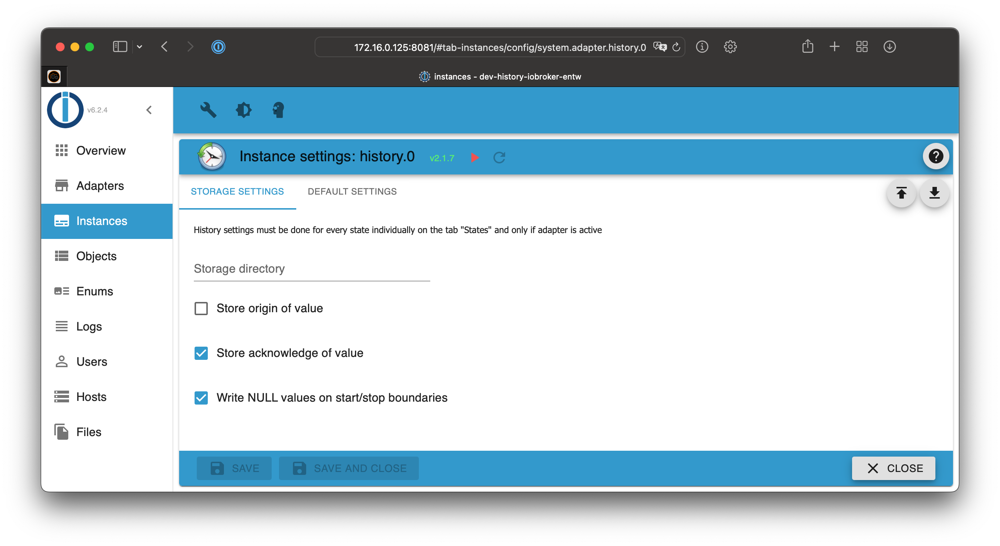
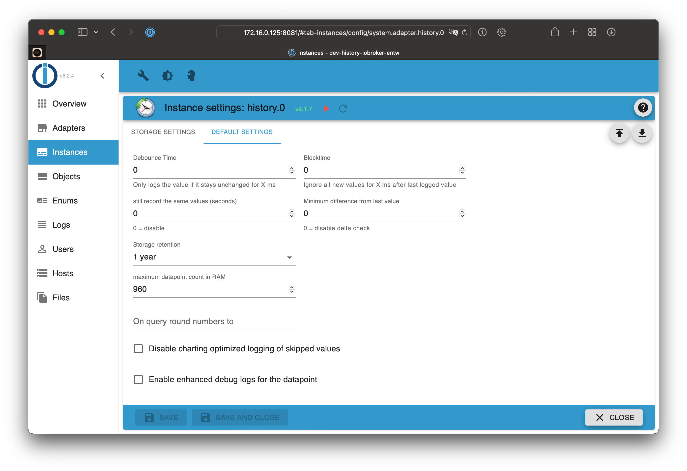
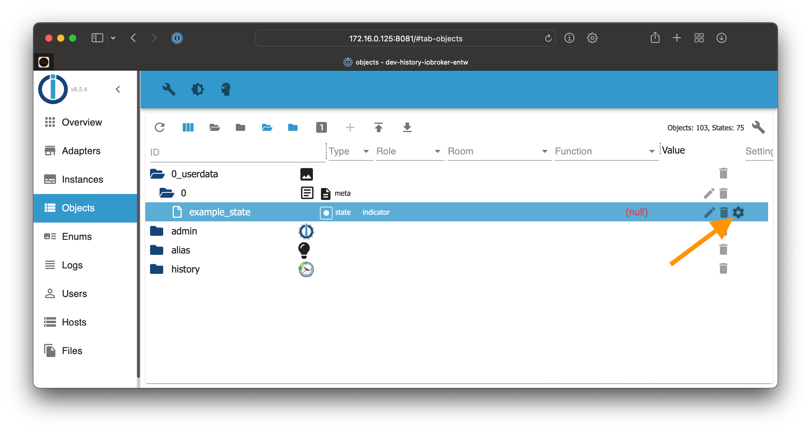
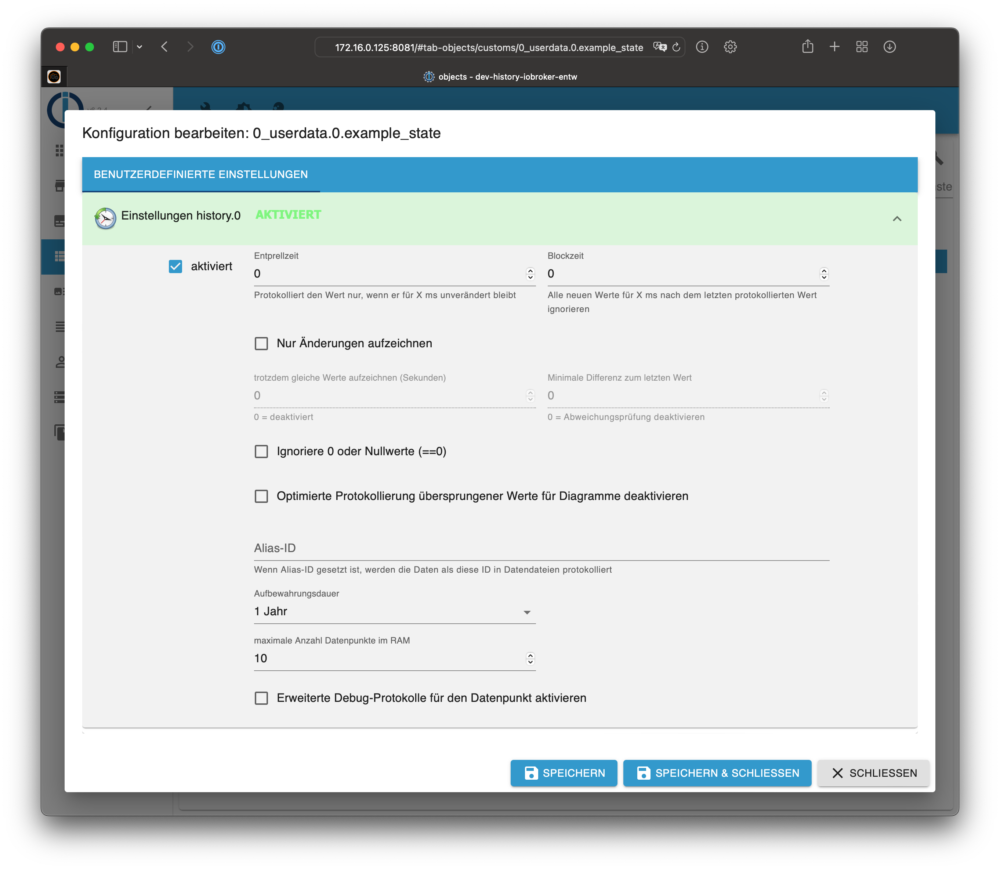
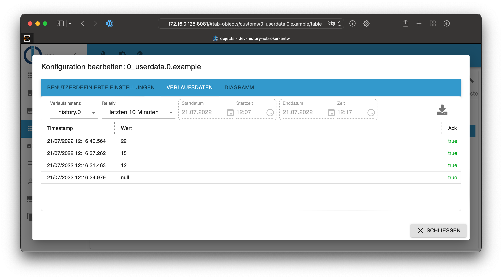
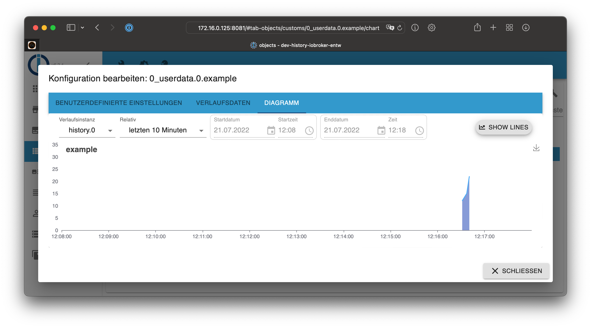
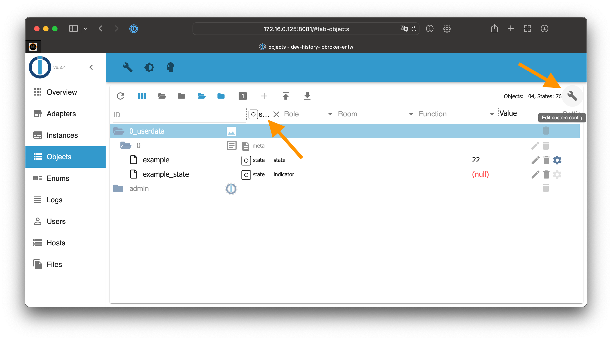

# IoBroker.history
* [Описание](#description)
* [Конфигурация адаптера](#adapter-configuration)
* [Настройки хранилища](#storage-settings)
* [Настройки по умолчанию для штатов](#default-settings-for-states)
* [Настройки для штатов](#settings-for-states)
* [Использование](#использование)
* [Исторические данные](#history-Data)
* [Диаграмма](#диаграмма)
* [Включить ведение журнала для нескольких состояний одновременно](#enable-logging-for-multiple-states-at-once)
* [Доступ к значениям из адаптера JavaScript](#access-values-from-javascript-adapter)
* [Управление историей событий с помощью JavaScript](#history-logging-management-via-javascript)
* [Получить список включенных состояний](#get-list-of-enabled-states)
* [Перенос исторических данных в SQL или InfluxDB](#migrate-history-data-to-sql-or-influxdb)

## Описание
Этот адаптер сохраняет историю состояний в два этапа.

1. Первоначально данные хранятся в оперативной памяти.
2. Как только они достигнут максимальной длины (maxLength), они будут сохранены на диске.

## Конфигурация адаптера
### Настройки хранилища


**Каталог хранения** Путь к каталогу, где будут храниться файлы.

Каталог будет создан относительно каталога по умолчанию ``/opt/iobroker/iobroker-data``.

В этой директории каждый день будет создаваться новая поддиректория, содержащая записанную информацию.

Без указания пути данные будут сохранены в местоположение по умолчанию ``/opt/iobroker/iobroker-data/history``

Поддерживаются также абсолютные пути, например, ``/mnt/history`` (Linux) or ``D:/History`` (Windows).

Пожалуйста, НЕ сохраняйте данные ни в какой директории ``node_modules``!

**Сохранение источника значения** Определяет, будет ли также сохраняться атрибут "from".

**Магазин подтверждает ценность товара**

**Записывать значения NULL на начальных/конечных границах**

**Максимальное количество параллельных запросов** Агрегированные запросы к истории (например, для графиков) обрабатываются в отдельных процессах. Этот параметр ограничивает количество одновременно работающих процессов (по умолчанию: 3). Дальнейшие запросы ожидают в очереди, пока не освободится какой-либо процесс, поэтому при высокой нагрузке они могут выполняться дольше, но потребление памяти остается предсказуемым. `0` отключает ограничение.

### Настройки по умолчанию для штатов
Для каждого нового состояния установлены параметры по умолчанию, которые должны быть зарегистрированы.
Каждое значение можно изменить индивидуально для каждого состояния впоследствии.



**Защита от дребезга контактов**: защита от нестабильных значений, гарантирующая, что в лог будут записываться только стабильные значения, если значение не изменялось в течение заданного количества миллисекунд.

**Время блока** Определяет, в течение какого времени после сохранения последнего значения никакие дальнейшие значения не сохраняются.
По истечении заданного времени в миллисекундах в лог записывается следующее значение, удовлетворяющее всем остальным проверкам.

**Запись тех же значений (в секундах)** При использовании параметра "Записывать только изменения" вы можете установить временной интервал в секундах, по истечении которого неизмененные значения также будут повторно записываться в базу данных.

**Минимальная разница по сравнению с последним значением** При использовании параметра "Записывать только изменения" вы можете задать требуемую минимальную разницу между новым значением и последним значением. Если эта разница не достигнута, значение не записывается.

**Срок хранения** Сколько значений из прошлого будет сохранено на диске. Данные удаляются по истечении заданного времени, как только для точки данных потребуется сохранить новые данные.

**Максимальное количество точек данных в ОЗУ** Определите, сколько значений будет храниться в ОЗУ, прежде чем они будут сохранены на диске. Вы можете контролировать объем операций ввода-вывода. Это может быть полезно для систем, использующих SD-карту для хранения данных, чтобы продлить срок ее службы.

**Округление чисел при запросе** Укажите, до скольких знаков после запятой следует округлять значения при запросе.

**Отключить оптимизированное для построения графиков логирование пропущенных значений** ??

**Включить расширенные отладочные журналы для точки данных** Если вы хотите видеть более подробные журналы для этой точки данных, вы можете включить эту опцию.
Для отображения этих дополнительных значений вам все равно необходимо включить уровень логирования «отладка»! Это помогает в отладке проблем или понимании того, почему адаптер регистрирует значение (или нет).

## Настройки для штатов
Настройки состояний, которые должны быть зарегистрированы, определяются на вкладке «Объекты».
Для настройки параметров логирования используйте значок шестеренки в правом столбце.



Открывается следующее диалоговое окно:



**Включено** Активировать ведение журнала состояния

**Защита от дребезга контактов**: защита от нестабильных значений, гарантирующая, что в лог будут записываться только стабильные значения, если значение не изменялось в течение заданного количества миллисекунд.

**Время блока** Определяет, в течение какого времени после сохранения последнего значения никакие дальнейшие значения не сохраняются.
По истечении заданного времени в миллисекундах в лог записывается следующее значение, удовлетворяющее всем остальным проверкам.

**Только запись изменений** Эта функция гарантирует, что в журнал будут записываться только измененные значения, если они соответствуют другим проверкам (см. ниже). Значения, оставшиеся неизменными, в журнал записываться не будут.

**Запись тех же значений (в секундах)** При использовании параметра "Записывать только изменения" вы можете установить временной интервал в секундах, по истечении которого неизмененные значения также будут повторно записываться в базу данных.

**Минимальная разница по сравнению с последним значением** При использовании параметра "Записывать только изменения" вы можете задать требуемую минимальную разницу между новым значением и последним значением. Если эта разница не достигнута, значение не записывается.

**Игнорируйте значения ниже указанного**. Не регистрируйте значения, меньшие этого значения.

**Игнорируйте значения выше указанного**. Не регистрируйте значения, превышающие это значение.

**Игнорировать значения 0 или null (==0)** Эта опция предотвращает сохранение значений ``0`` or ``null`` в базу данных.

**Отключить оптимизированное для построения графиков логирование пропущенных значений** ??

**Идентификатор-псевдоним** Вы можете задать псевдоним для идентификатора. Это полезно, если вы сменили устройство и хотите обеспечить непрерывную запись данных.

**Срок хранения** Сколько значений из прошлого будет сохранено на диске. Данные удаляются по истечении заданного времени, как только для точки данных потребуется сохранить новые данные.

**Максимальное количество точек данных в ОЗУ** Определите, сколько значений будет храниться в ОЗУ, прежде чем они будут сохранены на диске. Вы можете контролировать объем операций ввода-вывода. Это может быть полезно для систем, использующих SD-карту для хранения данных, чтобы продлить срок ее службы.

**Округление чисел при запросе** Укажите, до скольких знаков после запятой следует округлять значения при запросе.

**Включить расширенные отладочные журналы для точки данных** Если вы хотите видеть более подробные журналы для этой точки данных, вы можете включить эту опцию.
Для отображения этих дополнительных значений вам все равно необходимо включить уровень логирования «отладка»! Это помогает в отладке проблем или понимании того, почему адаптер регистрирует значение (или нет).

## Использование
### Исторические данные
Щелчок по значку шестеренки объекта открывает настройки. Сохраненную историю можно найти на вкладке «История»:



### Диаграмма
Для числовых данных по штатам вы также можете использовать вкладку «Диаграмма», которая отобразит данные в виде графика.



## Включить ведение журнала для нескольких состояний одновременно
Чтобы включить логирование для нескольких состояний одновременно, можно отфильтровать список объектов по типу "состояние".

После этого можно включить логирование для всех состояний одновременно.

Внимание: В крупных системах могут храниться тысячи состояний. Включение логирования для множества состояний одновременно может занять много времени. Следующий процесс - всего лишь пример!

1. Переключитесь в режим списка на вкладке «Объекты».
2. Фильтр по типу "состояние"
3. Нажмите на значок гаечного ключа в правом верхнем углу, чтобы открыть настройки параметров журнала.
4. Включите ведение журнала.
5. Настройте дополнительные параметры, такие как "отображать только изменения в записях".
6. Сохраните конфигурацию.



## Просмотр и экспорт данных
Вкладка **Обозреватель данных** в конфигурации экземпляра отображает значения, хранящиеся для точки данных, точно так же, как они находятся в файлах (вместе со значениями, которые все еще находятся в оперативной памяти), и позволяет вставлять, редактировать и удалять отдельные значения.

Кнопка «Экспорт» на панели инструментов записывает все значения выбранной точки данных за выбранный временной диапазон в файл, начиная с самых старых:

- **CSV-файл** со столбцами `ts` (миллисекунды с 1970 года, UTC), `time` (местное время), `val`, `ack`, `q` и

`from`. Можно выбрать разделитель столбцов и десятичных знаков; предварительный выбор (`;` и `,` для большинства языков, `,` и `.` для английского и китайского языков) соответствует тому, что обычно ожидает Excel, исходя из языка администратора.
`ack` и `from` заполняются только в том случае, если включены параметры «Сохранить подтверждение значения» и «Сохранить источник значения».

- **JSON** в виде массива `{ts, val, ack, q, from}` (плюс `user` и `c`, если значение их содержит) -

Формат [`storeState`](#storestate) принимает значения, поэтому их можно записать обратно, например, в другую точку данных:

```javascript
const fs = require('fs');
const values = JSON.parse(fs.readFileSync('/opt/export/hm-rpc.0.ABC123.1.TEMPERATURE.json', 'utf8'));
sendTo('history.0', 'storeState', { id: 'javascript.0.temperatureCopy', state: values }, result =>
    console.log(JSON.stringify(result)),
);
```

Экспорт считывает диапазон значений в виде временных окон, каждое из которых содержит несколько тысяч значений, поэтому адаптер считывает только файлы за один день из одного окна и никогда не хранит миллионы значений в памяти. При наличии более 100 000 значений в диапазоне адаптер прекращает их подсчет, и вместо этого отслеживается ход выполнения. Даже очень большой экспорт занимает некоторое время и требует памяти браузера для обработки всего файла.

## Доступ к значениям из адаптера JavaScript
Доступ к этим значениям можно получить через установленный JavaScript-адаптер. Примеры:

- Получить 50 последних сохраненных событий для всех идентификаторов

```javascript
sendTo('history.0', 'getHistory', {
    id: '*',
    options: {
        end:       Date.now(),
        count:     50,
        aggregate: 'onchange',
        addId:     true
    }
}, function (result) {
    for (var i = 0; i < result.result.length; i++) {
        console.log(result.result[i].id + ' ' + new Date(result.result[i].ts).toISOString());
    }
});
```

- Получение сохраненных значений для ``system.adapter.admin.0.memRss`` за последний час

```javascript
var end = Date.now();
sendTo('history.0', 'getHistory', {
    id: 'system.adapter.admin.0.memRss',
    options: {
        start:      end - 3600000,
        end:        end,
        aggregate: 'onchange'
    }
}, function (result) {
    for (var i = 0; i < result.result.length; i++) {
        console.log(result.result[i].val + ' ' + new Date(result.result[i].ts).toISOString());
    }
});
```

Доступные варианты:

- **start** - (необязательно) время в миллисекундах - *Date.now()*. Значение `0` обрабатывается как "не задано": в этом случае возвращаются самые новые записи. Чтобы получить самые старые сохраненные записи, используйте `start: 1`.
- **конец** - (необязательно) время в миллисекундах - *Date.now()*, по умолчанию (текущее время + 5000 секунд)
- **шаг** - (необязательно) используется в агрегированном виде (макс., мин., среднее, суммарно, ...) шаг в миллисекундах интервалов
- **count** - количество значений, если агрегирование выполняется с помощью 'onchange', или количество интервалов, если используется другой метод агрегирования. Значение count будет проигнорировано, если задан шаг, в противном случае значение по умолчанию равно 500, если не задано.
- **от** - если поле *от* должно быть включено в ответ
- **ack** - если поле *ack* должно быть включено в ответ
- **q** - если поле *q* должно быть включено в ответ
- **пользователь** - если поле *пользователь* должно быть включено в ответ
- **комментарий** - следует ли включить поле *c* в ответ
- **addId** - если поле *id* должно быть включено в ответ
- **лимит** - не возвращайте больше записей, чем лимит.
- **округление** - округлить результат до количества знаков после запятой.
- **ignoreNull** - если должны быть включены нулевые значения (false), заменяется последним ненулевым значением (true) или заменяется на 0 (0)
- **removeBorderValues** - По умолчанию возвращаются дополнительные значения границ для оптимизации построения диаграмм. Установите этот параметр в значение true, если это не требуется (например, для обработки данных скриптом).
- **returnNewestEntries** - Возвращаемые данные всегда сортируются по временной метке в порядке возрастания. При использовании агрегатной функции "none" и указании параметров "count" или "limit" обычно возвращаются самые старые записи (если только не указаны данные "start"). Установите этот параметр в значение true, чтобы получать самые новые записи.
- **агрегировать** - метод агрегирования (по умолчанию: 'среднее'):
- *minmax* - используется специальный алгоритм. Весь временной диапазон разбит на небольшие интервалы, и для каждого интервала находятся максимальное, минимальное, начальное и конечное значения.
- *max* - Разделите весь временной диапазон на небольшие интервалы и для каждого интервала найдите максимальное значение, затем используйте его для этого интервала (значения null будут игнорироваться).
- *мин* - То же, что и макс, но принимает минимальное значение.
- *среднее* - То же самое, что и максимальное значение, но берется среднее значение.
- *Итого* - То же, что и максимум, но рассчитывается общая сумма.
- *count* - То же, что и max, но вычисляет количество значений (значения null будут учтены).
- *процентиль* - Вычислить n-й процентиль (n задается в options.percentile или по умолчанию равно 50, если не указано).
- *квантиль* - Вычислить n-й квантиль (n задается в options.quantile или по умолчанию равно 0,5, если не указано).
- *интеграл* - Вычислите интеграл (дополнительные параметры см. ниже).
- *нет* - Никакой агрегации вообще. Только исходные значения за указанный период.
- **процентиль** - (необязательно) при использовании агрегатного метода "процентиль" определяет уровень процентиля (0..100) (по умолчанию 50)
- **квантиль** - (необязательно) при использовании агрегатного метода "квантиль" определяет уровень квантиля (0..1) (по умолчанию 0.5)
- **integralUnit** - (необязательно) при использовании агрегатного метода "integral" определяет единицу измерения в секундах (по умолчанию 60 секунд). Например, чтобы получить интеграл в часах для Вт·ч или чего-то подобного, установите значение 3600.
- **integralInterpolation** - (необязательно) при использовании агрегатного метода "integral" определяет метод интерполяции (по умолчанию "none").
- *линейная* - линейная интерполяция
- *нет* - нет/пошаговая интерполяция

Для агрегаций будут рассчитаны первая и последняя точки, за исключением агрегации **нет**.
Если вы вручную запрашиваете какую-либо агрегацию, следует игнорировать первое и последнее значения, поскольку они рассчитываются на основе значений, выходящих за пределы периода.

### StoreState
Если вы хотите записывать другие данные в базу данных истории, вы можете использовать встроенную системную функцию **storeState**. Эта функция также может использоваться для преобразования данных из других адаптеров истории, таких как History или SQL.

Успешный ответ не означает, что данные действительно записаны на диск. Это лишь означает, что они были обработаны!

Указанные идентификаторы не проверяются в базе данных ioBroker и не требуют настройки или включения в ней. Если используются собственные идентификаторы без настроек, параметр "rules" не поддерживается и приведет к ошибке. Для таких идентификаторов используется значение по умолчанию "Максимальное количество значений, хранящихся в оперативной памяти".

Сообщение может иметь один из следующих трех форматов:

1. Один объект ID и один объект состояния.
2. Один идентификатор и массив объектов состояния.
3. Массив из нескольких идентификаторов, каждый из которых содержит один объект состояния.

```javascript
// 1.
sendTo('history.0', 'storeState', {
    id: 'mbus.0.counter.xxx',
    state: {
        ts: 1589458809352,
        val: 123,
        ack: false,
        from: 'system.adapter.whatever.0'
    }
}, result => console.log('added'));

// 2.
sendTo('history.0', 'storeState', {
    id: 'mbus.0.counter.xxx',
    state: [
        {
            ts: 1589458809352,
            val: 123,
            ack: false,
            from: 'system.adapter.whatever.0'
        },
        {
            ts: 1589458809353,
            val: 123,
            ack: false,
            from: 'system.adapter.whatever.0'
        }
    ]
}, result => console.log('added'));

// 3.
sendTo('history.0', 'storeState', [
    {
        id: 'mbus.0.counter.xxx',
        state: {
            ts: 1589458809352,
            val: 123,
            ack: false,
            from: 'system.adapter.whatever.0'
        }
    },
    {
        id: 'mbus.0.counter.yyy',
        state: {
            ts: 1589458809353,
            val: 123,
            ack: false,
            from: 'system.adapter.whatever.0'
        }
    }
], result => console.log('added'));
```

Кроме того, вы можете добавить атрибут ``rules: true`` in message to activate all rules, like ``counter``, ``changesOnly``, ``de-bounce`` и так далее.

### Удалить состояния
Если вы хотите удалить записи из базы данных, вы можете использовать встроенную системную функцию **delete**. Она удаляет значение, точно соответствующее заданному значению `ts`:

```javascript
sendTo('history.0', 'delete', [
    {id: 'mbus.0.counter.xxx', state: {ts: 1589458809352}},
    {id: 'mbus.0.counter.yyy', state: {ts: 1589458809353}}
], result => console.log('deleted'));
```

Можно отправить одну запись без списка (`{id: 'mbus.0.counter.xxx', state: {ts: 1589458809352}}` или `{id: 'mbus.0.counter.xxx', ts: 1589458809352}`), а несколько значений одной точки данных - как `{id: 'mbus.0.counter.xxx', ts: [1589458809352, 1589458809353]}`.

Чтобы удалить ВСЕ исторические данные для определенной точки данных, выполните следующее:

```javascript
sendTo('history.0', 'deleteAll', [
    {id: 'mbus.0.counter.xxx'},
    {id: 'mbus.0.counter.yyy'}
], result => console.log('deleted'));
```

Чтобы удалить исторические данные для определенной точки данных и для определенного диапазона, выполните следующую команду:

```javascript
sendTo('history.0', 'deleteRange', [
    {id: 'mbus.0.counter.xxx', start: '2019-01-01T00:00:00.000Z', end: '2019-12-31T23:59:59.999'},
    {id: 'mbus.0.counter.yyy', start: 1589458809352, end: 1589458809353}
], result => console.log('deleted'));
```

Можно отправить один диапазон без списка: `{id: 'mbus.0.counter.xxx', start: 1589458809352, end: 1589458809353}` или `{id: 'mbus.0.counter.xxx', state: {start: 1589458809352, end: 1589458809353}}`. `start` является обязательным, `end` - необязательным и по умолчанию принимает значение now.

Время может быть указано в миллисекундах с начала эпохи или в виде строки, которая может быть преобразована с помощью объекта Date в JavaScript. `0` - это допустимое время.

Значения будут удалены, **включая установленные ограничения** (``ts >= start AND ts <= end``).

Каждая запись должна содержать допустимое значение `ts` (одно значение) или допустимое значение `start` (диапазон; `end` само по себе не принимается). Если у записи нет ни того, ни другого, адаптер отвечает значением `{success: false, error}`, указывая его имя, и ничего не удаляет, даже допустимые записи из того же сообщения. Для удаления всех значений точки данных используйте `deleteAll`.

Если ничего не найдено для удаления, ответом на вопрос `{success: false}` является отдельная запись, а ответом на вопрос `{success: true}` всегда является список.

## Обновление состояний
Если вы хотите изменить значения, качество или флаг подтверждения в базе данных, вы можете использовать встроенную системную функцию. **Обновление**:

```javascript
sendTo('history.0', 'update', [
    {id: 'mbus.0.counter.xxx', state: {ts: 1589458809352, val: 15, ack: true, q: 0},
    {id: 'mbus.0.counter.yyy', state: {ts: 1589458809353, val: 16, ack: true, q: 0}
], result => console.log('deleted'));
```

Флаг ``ts`` является обязательным. В объекте состояния должен быть указан как минимум один другой флаг.

## Управление историей событий с помощью JavaScript
Адаптер поддерживает включение и отключение ведения истории с помощью JavaScript, а также получение списка включенных точек данных с их настройками.

### Давать возможность
Для корректного отображения сообщения необходимо указать ``id`` для точки данных. Кроме того, можно указать необязательный параметр ``options`` для определения настроек, специфичных для данной точки данных:

```javascript
sendTo('history.0', 'enableHistory', {
    id: 'system.adapter.history.0.memRss',
    options: {
        changesOnly:  true,
        debounce:     0,
        retention:    31536000,
        maxLength:    3,
        changesMinDelta: 0.5,
        aliasId: ''
    }
}, function (result) {
    if (result.error) {
        console.log(result.error);
    }
    if (result.success) {
        //successfull enabled
    }
});
```

### Запрещать
Сообщение должно содержать ``id`` точки данных.

```javascript
sendTo('history.0', 'disableHistory', {
    id: 'system.adapter.history.0.memRss',
}, function (result) {
    if (result.error) {
        console.log(result.error);
    }
    if (result.success) {
        //successfull enabled
    }
});
```

## Получить список включенных состояний
Сообщение не имеет параметров.

```javascript
sendTo('history.0', 'getEnabledDPs', {}, function (result) {
    // result is an object. Example:
    {
        "system.adapter.history.0.memRss": {
            changesOnly: true,
            debounce: 0,
            retention: 31536000,
            maxLength: 3,
            changesMinDelta: 0.5,
            enabled: true,
            changesRelogInterval: 0,
            aliasId: ""
        }
    }
});
```

## Перенос исторических данных в SQL или InfluxDB
### Общая идея
Когда у вас накапливается много данных за определенный период времени, адаптер для истории может оказаться не лучшим выбором, и лучше использовать настоящую базу данных. Для этого существует множество адаптеров для хранения данных. Например, для баз данных SQL (PostgreSQL, MS-SQL, MySQL, SQLite) и InfluxDB.
В связи с этим возникает вопрос, как преобразовать собранные данные из прошлого в эти новые адаптеры.

Для этого в каталог ``/opt/iobroker/node_modules/iobroker.history/converter`` that can help and do the job. These scripts are called from the command line with ``node`` были помещены некоторые скрипты-конвертеры.

### Рекомендации по выполнению преобразования
При переходе от одного метода анализа истории событий к другому я предлагаю следующий процесс:

1. Активируйте новый метод истории (sql/influxdb) для соответствующих состояний, запустите логирование и убедитесь, что всё работает как положено. Это означает, что вы записываете данные "дважды" (в историю и в новый целевой объект).
2. Запустите скрипты анализа, чтобы определить точки отсечения, где началось дублирование записей в логах.
3. Остановите адаптер истории и выполните миграцию (это может занять некоторое время). Таким образом, старые значения будут добавлены к новым.
4. Если вы уверены, что ничего не сделали, и проверили файлы ошибок: удалите данные истории, чтобы освободить место.

### Шаг 1: Подготовка и анализ существующих данных в целевом объекте передачи
При преобразовании данных следует передавать только те данные, которых еще нет. Поэтому существует первый набор скриптов под названием **analyze<db>.js**. Этот скрипт необходимо выполнить один раз в начале, чтобы собрать некоторые данные для существующих данных и сохранить их в локальных файлах .json, которые будут использоваться основным скриптом преобразования.

Собираются два типа данных:

- **самое раннее значение идентификатора точки данных**: метка времени самой первой записи

Для каждой существующей точки данных сохраняется и используется импортированными данными для игнорирования всех новых значений по умолчанию. Предполагается, что данные заполняются полностью, начиная с этой первой записи, и все предыдущие значения в противном случае будут дублироваться.
Это предположение может быть изменено при импорте с помощью параметров.

- **существующие значения за день по каждому идентификатору точки данных**: Анализируются существующие данные.

Данные сохраняются ежедневно, и каждый день хранится там, где они уже есть. Это можно использовать в качестве альтернативы исходным данным, чтобы заполнить «пробелы» в данных.

#### Analyzeinflux.js
Этот скрипт собирает указанные данные для экземпляра InfluxDB.

**Применение**:

``node analyzeinflux.js [InfluxDB-Instance] [Loglevel] [--deepAnalyze]``

**Пример**:

``node analyzeinflux.js influxdb.0 info --deepAnalyze``

Параметры:

- Экземпляр InfluxDB: какой экземпляр адаптера InfluxDB следует использовать? (По умолчанию: influxdb.0) Если задано, то должен быть первым параметром после имени скрипта.
- Уровень логирования: Уровень логирования для вывода (по умолчанию: info). Если задан, должен быть вторым параметром после имени скрипта.
- ``--deepAnalyze``: собирает также существующие значения за каждый день; по умолчанию запрашивается только самое раннее значение.

Затем скрипт сгенерирует один или три файла .json с собранными данными. Эти файлы затем используются реальным скриптом конвертера.

#### Analyzesql.js
Этот скрипт собирает указанные данные для экземпляра SQL.

**Применение**:

``node analyzesql.js [SQL-Instance] [Loglevel]``

**Пример**:

``node analyzesql.js sql.0 info``

Параметры:

- Экземпляр SQL: какой экземпляр SQL-адаптера следует использовать? (По умолчанию: sql.0) Если задано, оно должно быть первым параметром после имени скрипта.
- Уровень логирования: Уровень логирования для вывода (по умолчанию: info). Если задан, должен быть вторым параметром после имени скрипта.

Затем скрипт сгенерирует два файла .json с собранными данными. Эти файлы затем используются реальным скриптом конвертера.

### Преобразование исторических данных в базу данных
Скрипт будет напрямую использовать сгенерированные JSON-файлы из адаптера истории на диске для переноса их в базу данных. Кроме того, он использует предварительно сгенерированные файлы данных для уже существующих значений в целевой базе данных, чтобы преобразовывать только несуществующие данные.

Скрипт можно запустить без предварительного анализа (шаг 1), затем необходимо задать начальные данные в качестве параметра, и он просто преобразует все значения с этой точки времени назад во времени.

Если вы ранее выполняли анализ и существует файл **earliestDBValues.json**, то преобразуются только эти точки данных, если только вы не используете параметры для изменения этого.

Если анализ проводился ранее и использовались файлы данных, они также обновлялись всеми преобразованными данными, поэтому при повторном запуске обычно не будет создаваться дубликатов.

Для сброса данных удалите файлы **earliestDBValues.json**, **existingDBValues.json** и/или **existingDBTypes.json**.

Затем конвертер перемещается назад во времени по всем доступным дням и определяет, какие данные следует перенести в InfluxDB.

Чтобы прервать процесс, нажмите "x" или "<CTRL-C>".

Сам скрипт конвертера должен работать со всеми адаптерами History, поддерживающими метод **storeState**.

> Примечание: Перенос большого объема данных создаст определенную нагрузку на систему, особенно > если конвертер и целевой экземпляр базы данных работают на одной машине.
> Отслеживайте загрузку и производительность вашей системы во время выполнения операции и, возможно, используйте параметр > ``delayMultiplicator`` для увеличения задержек в конвертере.

**Применение:**

``node history2db.js [DB-Instanz] [Loglevel] [Date-to-start|0] [path-to-Data] [delayMultiplicator] [--logChangesOnly [relog-Interval(m)]] [--ignoreExistingDBValues] [--processNonExistingValuesOnly] [--processAllDPs] [--simulate]``

**Пример**:

``node history2db.js influxdb.0 info 20161001 /path/to/data 2 --logChangesOnly 30 --processNonExistingValuesOnly``

Возможные варианты и параметры:

- **DB-Instance**: Экземпляр базы данных, в которую будут отправлены данные. Обязательный параметр. Должен быть первым параметром после имени скрипта.
- **Уровень логирования**: Уровень логирования для вывода (по умолчанию: info). Если задан, должен быть вторым параметром после имени скрипта.
- **Дата начала**: День начала в формате `yyyymmdd` (например, 20161028). Используйте "0", чтобы использовать обнаруженные самые ранние значения. Если задано, должно быть третьим параметром после имени скрипта.
- **path-to-Data**: Путь к файлам данных. По умолчанию используется iobroker-install-directory/iobroker-data/history-data. Если задано, должно быть четвертым параметром после имени скрипта.
- **<delayMultiplicator>**: Изменяет задержки между несколькими действиями в скрипте с помощью множителя. "2" означает, что задержки, рассчитанные самим преобразованным элементом, удваиваются. Если задано, должно быть пятым параметром после имени скрипта.
- **--logChangesOnly [relog-Interval(m)]**: при установке параметра --logChangesOnly данные анализируются и сокращаются, так что в InfluxDB сохраняются только измененные значения. Кроме того, можно установить "интервал повторной записи в минутах" для повторной записи неизмененных значений после этого интервала.
- **--ignoreExistingDBValues**: При использовании этого параметра все существующие данные игнорируются, и все данные вставляются в базу данных. Убедитесь, что не создаются дубликаты. Эта опция полезна для исправления «пробелов» в данных, где отсутствуют некоторые данные. По умолчанию она заполняет все точки данных, имеющие хотя бы одну запись в базе данных. Это можно переопределить с помощью `--processAllDPs`.
- **--processNonExistingValuesOnly**: При использовании этого параметра для каждого дня и каждой точки данных используется файл "существующие точки данных по дням" из скрипта анализа. **В этом режиме существующие значения в базе данных всегда игнорируются и не обновляются, поэтому, пожалуйста, выполните еще один запуск анализа после использования этого режима!!!**
- **--processAllDPs**: Этот параметр гарантирует, что все существующие точки данных из файлов истории будут перенесены в базу данных, даже если они еще не существуют в этой базе данных.
- **--simulate**: Этот параметр включает режим моделирования, что означает отсутствие реальной записи и, следовательно, ненужное обновление файлов анализируемых данных при завершении работы программы.

## Changelog
### 5.4.0 (2026-11-19)
* (@GermanBluefox) Fixed: `delete` / `deleteRange` without a valid `ts` or range no longer deletes all values of the state. A single `{id, state: {start, end}}`, a state without `ts` or with `ts: 0` deleted all values in RAM and all files up to today, an unparsable `start` everything up to `end`. Such a message is refused now with an error and nothing is deleted; `{id, state: {start, end}}` and `{id, start, end}` delete the range, `ts: 0` the value at 0
* (@GermanBluefox) Added the message "help": a description of all messages for AI agents (e.g. pi-agent), and `common.supportedMessages.help`

### 5.3.0 (2026-11-04)
* (@GermanBluefox) Data browser: the values of a datapoint can be exported as CSV (e.g. for Excel) or as JSON (the format of `storeState`) for the selected time range
* (@GermanBluefox) Data browser: with "Oldest first" and more than 100000 values in the range, the table shows now the oldest values. Before, it showed the oldest of the newest 100000 values
- (copilot) Adapter requires node.js >= 22.19.0 now

### 5.2.0 (2026-10-29)
* (@GermanBluefox) Fixed the crash `Cannot read properties of undefined (reading 'val'/'ts')` in `getHistory` (#575, #490, #470, #396)
* (@GermanBluefox) `getHistory` with `aggregate: 'none'` and `count`/`limit` returns now the oldest entries from the files, if `returnNewestEntries` is not set (#530, #331, #210)
* (@GermanBluefox) `getHistory` accepts `intervalBorders`: the client can send the borders of the intervals itself, e.g. the local days of a chart. With `count` or `step` every interval after a switch of the daylight saving time ended an hour away from the midnight, so a value written at 23:59:59 was shown on the next day (ioBroker/ioBroker.echarts#1311)
* (@GermanBluefox) The number of parallel history queries can be limited now (default: 3). Further queries are queued (#536)
* (@GermanBluefox) Updated packages

### 5.1.2 (2026-10-23)
* (@GermanBluefox) The timed relog (`changesRelogInterval`) starts right after the adapter start also when "Write NULL values on start/stop boundaries" (`writeNulls`) is off, not only with the first update of the state

### 5.1.1 (2026-10-13)
* (@GermanBluefox) Values stored with `storeState` for a datapoint without history settings no longer get an additional `null` value when the object of the datapoint changes

## License

The MIT License (MIT)

Copyright (c) 2014-2026 Bluefox <dogafox@gmail.com>, Apollon77

Copyright (c) 2016 Smiling_Jack

Copyright (c) 2014 hobbyquaker

Permission is hereby granted, free of charge, to any person obtaining a copy
of this software and associated documentation files (the "Software"), to deal
in the Software without restriction, including without limitation the rights
to use, copy, modify, merge, publish, distribute, sublicense, and/or sell
copies of the Software, and to permit persons to whom the Software is
furnished to do so, subject to the following conditions:

The above copyright notice and this permission notice shall be included in
all copies or substantial portions of the Software.

THE SOFTWARE IS PROVIDED "AS IS", WITHOUT WARRANTY OF ANY KIND, EXPRESS OR
IMPLIED, INCLUDING BUT NOT LIMITED TO THE WARRANTIES OF MERCHANTABILITY,
FITNESS FOR A PARTICULAR PURPOSE AND NONINFRINGEMENT. IN NO EVENT SHALL THE
AUTHORS OR COPYRIGHT HOLDERS BE LIABLE FOR ANY CLAIM, DAMAGES OR OTHER
LIABILITY, WHETHER IN AN ACTION OF CONTRACT, TORT OR OTHERWISE, ARISING FROM,
OUT OF OR IN CONNECTION WITH THE SOFTWARE OR THE USE OR OTHER DEALINGS IN
THE SOFTWARE.