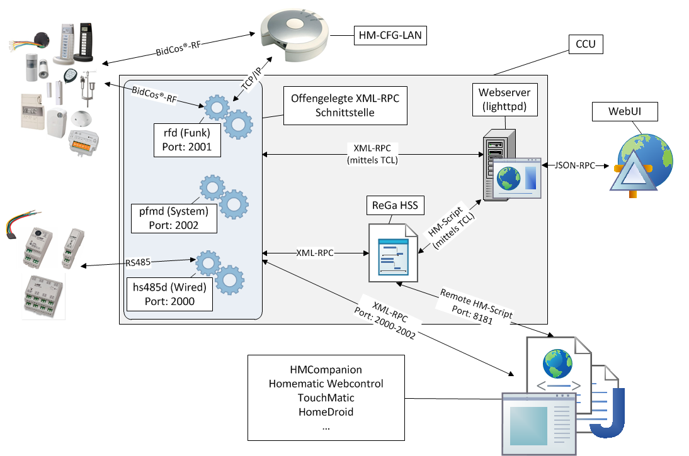
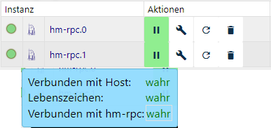

# ioBroker HomeMatic RPC Adapter

Этот адаптер соединяет процессы интерфейса HomeMatic (сервисы BidCos, Homegear и CUxD) с ioBroker. Для обмена данными используется XML-RPC или BIN-RPC.

**Этот адаптер использует библиотеки Sentry для автоматического сообщения разработчикам об исключениях и ошибках в коде.** Он также сообщает о новых схемах устройств. Для получения более подробной информации и сведений о том, как отключить отправку сообщений об ошибках, см. [документацию по плагину Sentry](https://github.com/ioBroker/plugin-sentry#plugin-sentry) и главу [«Что такое Sentry.io»](#what-is-sentryio) .

## Что такое Homematic?

> Homematic — это система «умного дома» от eQ-3. Она позволяет осуществлять комплексное управление множеством различных функций в доме или квартире. Эти функции могут комбинироваться как в простых, так и в сложных сценариях.

> Ассортимент продукции включает устройства для управления освещением, рольставнями и отоплением, детекторы опасности, датчики безопасности и устройства для измерения погодных условий. Радиосвязь упрощает подключение устройств к существующим зданиям. В новых зданиях можно использовать компоненты проводной шины.

Источник: [Домашняя страница производителя eQ-3](https://www.eq-3.de/produkte/homematic.html)

## Компоненты Homematic в ioBroker

Для управления компонентами Homematic с помощью ioBroker требуется два адаптера:

### 1. Homematic ReGaHss

Этот адаптер подключается к логическому слою Homematic "ReGaHSS" ( **Residential** **Gateway** ). Он синхронизирует названия устройств, системные переменные, комнаты, функции и программы между Homematic и ioBroker.

### 2. Homematic RPC

RPC расшифровывается как **Remote** **Procedure Call (** удалённая процедура **)** . Это технология для обмена данными между процессами. Данный адаптер подключается к коммуникационным модулям центрального блока Homematic (CCU, CCU2, CCU3 и более новых моделей). Поддерживаются следующие модули:

- `rfd` для радиоустройств,
- `HMIP-rfd` для IP-устройств Homematic,
- `hs485d` для проводных устройств,
- `CUxD` для внешних компонентов, таких как EnOcean или FS20 (CUxD — это дополнительное программное обеспечение для CCU),
- `CCU-Jack` для виртуальных устройств [CCU-Jack](https://github.com/mdzio/ccu-jack) (дополнения для CCU),
- `Homegear` в качестве замены отделения интенсивной терапии.

На этой диаграмме показана структура и интерфейсы связи:



Источник: [wikimatic.de](http://www.wikimatic.de/wiki/Datei:Homematic_Aufbau.png)

## Как работает адаптер

Один экземпляр адаптера отвечает ровно за один коммуникационный модуль (`rfd`, `hs485d` и так далее). Если вы хотите использовать несколько модулей одновременно, необходимо создать отдельный экземпляр для каждого модуля.

Адаптер взаимодействует с модулем либо через BIN-RPC, либо через XML-RPC. Для связи используется интерфейс событий, поэтому важны правильные адреса. CCU автоматически отправляет события на адаптер, и циклический опрос не требуется.

Кроме того, адаптер проверяет соединение с блоком управления через фиксированные интервалы времени.

Если вы подключаете новые устройства к блоку управления CCU, необходимо включить опцию «Синхронизировать объекты (однократно)» и перезапустить адаптер. Только после этого информация о новых устройствах Homematic будет передана на адаптер.

## Конфигурация

### Основные настройки

#### Адрес HomeMatic

IP-адрес CCU или хоста, на котором работает сервис BidCos.

#### Порт HomeMatic

Порт зависит от выбранного коммуникационного модуля. Адаптер автоматически выбирает порт, как только вы выбираете демона. Изменяйте порт только в том случае, если ваши порты отличаются от стандартных.

По умолчанию используются следующие порты:

| Демон                  | Модуль связи                  | Стандартный порт                        | порт HTTPS        |
| ---------------------- | ----------------------------- | --------------------------------------- | ----------------- |
| HomeMatic IP           | HMIP-rfd                      | 2010                                    | 42010             |
| рфд                    | радиоустройства               | 2001                                    | 42001             |
| Виртуальные устройства | виртуальные устройства        | 9292                                    | 49292             |
| hs485d                 | hs485d (проводные устройства) | 2000                                    | 42000             |
| CUxD                   | CUxD                          | 8701                                    | не поддерживается |
| Homegear               | Homegear                      | как настроено в Homegear                | не поддерживается |
| CCU-Джек               | CCU-Джек                      | 2121                                    | 2122              |
| openccu-lite           | lite-rpc системы              | 80 (см. [openccu-lite](#openccu-lite) ) | 443               |

Порты HTTPS работают только с протоколом XML-RPC.

#### Адрес адаптера

IP-адрес хоста, на котором работает адаптер. CCU использует этот адрес для подключения к адаптеру, поэтому CCU должен иметь возможность связаться с этим адресом. Записи "0.0.0.0 Listen on all IPs" и "127.0.0.1" предназначены только для особых случаев, поскольку CCU не может связаться с ioBroker по этим адресам.

#### Порт адаптера

Порт, на котором адаптер ожидает подключения CCU. Оставьте значение "0", чтобы ioBroker автоматически выбирал свободный порт. Изменяйте это значение только в особых случаях.

#### Демон

CCU поддерживает различные типы устройств (радио, проводные, Homematic IP, CUxD, CCU-Jack). Для каждого типа необходимо создать отдельный экземпляр адаптера. Демон `openccu-lite` подключает интерфейс системы openccu-lite, см. [openccu-lite](#openccu-lite) .

#### Протокол

Для обмена данными доступны два протокола: XML-RPC и BIN-RPC. BIN-RPC быстрее, но некоторые устройства его не поддерживают или поддерживают некорректно. В этом случае выберите протокол XML-RPC.

**Примечание:** CUxD работает только с BIN-RPC. Homematic IP, виртуальные устройства и CCU-Jack работают только с XML-RPC. Для этих демонов адаптер автоматически использует правильный протокол.

#### Синхронизация объектов (один раз)

При первом запуске экземпляр считывает _все_ устройства из CCU. Если вы позже измените конфигурацию (переименуете устройства, добавите или удалите устройства), включите эту опцию, чтобы снова синхронизировать конфигурацию в ioBroker.

Экземпляр немедленно перезапускается, снова считывает все устройства и отключает эту опцию.

### Дополнительные настройки

#### Адрес обратного вызова адаптера

Иногда ioBroker работает за маршрутизатором. В этом случае входящий и исходящий адреса различаются. Введите здесь IP-адрес маршрутизатора. Маршрутизатор перенаправляет трафик в ioBroker по номеру порта.

Если ioBroker работает в контейнере Docker, введите здесь IP-адрес хоста Docker. Также необходимо перенаправить порт адаптера (см. "Порт адаптера") в контейнер. Для этого можно выбрать любой свободный порт, например, 12001 или 12010.

#### Проверьте интервал обмена данными (в секундах)

Адаптер отправляет ping-запрос в CCU с заданным интервалом.

#### Интервал переподключения (в секундах)

Адаптер ожидает это время, прежде чем предпринять следующую попытку подключения.

#### Не удаляйте устройства.

По умолчанию адаптер удаляет устройство из дерева объектов, если не находит его в CCU при запуске адаптера или если CCU сообщает об удалении устройства во время работы адаптера. Включите эту опцию, чтобы сохранить такие устройства, например, если вы удалили устройство из CCU только временно.

Эта опция также позволяет избежать проблемы на стороне CCU: устройства Homematic IP иногда некорректно передаются в ioBroker, и CCU сообщает о них как об удаленных, например, во время обновления прошивки, хотя они по-прежнему существуют. Без этой опции их объекты удаляются и создаются заново только после перезапуска адаптера. По этой причине опция автоматически включается, как только вы выбираете Homematic IP в качестве демона.

При включении этой опции можно вручную удалить объекты устройства, которое вы ранее удалили из CCU, в дереве объектов.

#### Подавлять промежуточные уровни движущихся каналов

Диммер или жалюзи немедленно подтверждают команду, еще до завершения регулировки или изменения положения. Блок управления (CCU) передает это подтверждение в виде событий, указывая текущий уровень вместе с `WORKING = true` (Гомематический) или `PROCESS = NOT_STABLE` (Homematic IP). Заключительный уровень отображается через несколько секунд со следующим сообщением о состоянии (для диммеров BidCos после). `STATUSINFO_MINDELAY` +`STATUSINFO_RANDOM` (по умолчанию 2-3 с). Поэтому состояние скачкообразно, например. `0 → 100` (команда, `ack: false`) `→ 0.5` (Благодарность) `→ 100` (конечное значение).

Если эта опция включена, то `LEVEL` /`LEVEL_2` канал, который имеет `WORKING` или `PROCESS` Данные сохраняются до тех пор, пока не поступит флаг того же сообщения о состоянии (блок управления каналом (CCU) отправляет его через несколько миллисекунд после уровня, ожидание составляет не более 300 мс). Уровень отбрасывается, если канал все еще движется, в противном случае он записывается. Таким образом, состояние сохраняет заданное значение до получения конечного уровня. `WORKING`, `PROCESS` и `DIRECTION` Они всегда записываются, поэтому само движение по-прежнему может быть обнаружено. Каналы без такого флага не затрагиваются.

#### Используйте https

Если эта опция включена, адаптер использует HTTPS вместо HTTP. Это работает только с протоколом XML-RPC.

#### Имя пользователя и пароль

Если включена опция «Использовать HTTPS», введите здесь имя пользователя и пароль пользователя CCU. Введите эти учетные данные также, если API CCU требует аутентификации; адаптер отправляет их с помощью XML-RPC с HTTPS и без него. BIN-RPC не поддерживает аутентификацию.

### openccu-lite

[openccu-lite](https://github.com/openccu-lite/openccu-lite) — это прошивка CCU без ReGaHSS. Доступ к процессам интерфейса осуществляется через _lite-rpc_ : запросы проходят через веб-порт системы с токеном, а события поступают в виде потока, который открывает адаптер — нет сервера обратного вызова, нет адреса обратного вызова, нет `init` Таким образом, адаптер может работать за маршрутизатором или в контейнере Docker без переадресации портов.

Выберите демон **openccu-lite** и введите адрес системы в поле "HomeMatic Address" (порт соответствует опции "Use https": 443 или 80). Затем:

- **Интерфейс** : интерфейс системы, к которой подключается данный экземпляр (`HmIP-RF`, `BidCos-RF`, `BidCos-Wired`, `VirtualDevices` Как и в случае с CCU, один экземпляр подключает один интерфейс; после сопряжения экземпляра в списке отображаются интерфейсы, которые использует система.
- **Сопряжение** : экземпляр должен быть запущен. Нажмите кнопку: под ней появится шестизначный код вместе со ссылкой на страницу состояния системы. Подтвердите запрос там (как один из администраторов системы, используя пароль или ключ доступа) — код на странице состояния должен совпадать. Токен и отпечаток сертификата системы затем сохраняются в конфигурации экземпляра; сохраните конфигурацию, и экземпляр перезапустится с ними. В диалоговом окне сообщается об отклоненном или истекшем запросе, неверном адресе и системе без сопряжения. Каждый экземпляр сопрягается со своим собственным токеном (система допускает несколько потоков событий на один токен).
- Отпечаток **токена** и **отпечаток сертификата** заполняются путем сопоставления. API-токен, созданный в системе, также можно ввести вручную; отпечаток привязывает сертификат системы (оставьте это поле пустым, если сертификат является доверенным для Node.js или доступ к системе осуществляется по протоколу HTTP).
- **Заимствование имен, помещений и функций из системы** (по умолчанию включено): устройства, каналы и состояния именуются так же, как и в системе (`<channel name>.<DATAPOINT>` (для штатов, как их называет hm-rega), а помещения и функции системы заполняют `enum.rooms` и `enum.functions` - в режиме реального времени, всякий раз, когда в системе изменяется имя или номер комнаты. Дерево комнат становится плоским: каждый узел становится собственным перечислением, названным по его пути (`eg/wohnzimmer` →`enum.rooms.eg_wohnzimmer`), и канал является членом только своей самой внутренней комнаты. Адаптер управляет только членами своего собственного экземпляра в перечислении, поэтому устройства других адаптеров остаются. Без этой опции объекты сохраняют адрес в качестве имени, как в случае с CCU.

Устройства синхронизируются при каждом запуске экземпляра (система отправляет список устройств вместе с потоком), поэтому параметр "Синхронизировать объекты (один раз)" не требуется в openccu-lite. Параметр "Не удалять устройства" работает так же, как и с CCU. Значения, хранящиеся в системе, записываются в состояния при подключении экземпляра, поэтому состояния актуальны до первого события. Параметры "Адрес адаптера", "Порт адаптера", "Протокол", "Адрес обратного вызова адаптера", "Интервал проверки связи", "Интервал переподключения", "Имя пользователя" и "Пароль" не применяются и скрыты.

### Диспетчер устройств

Вкладка «Диспетчер устройств» отображает все устройства данного экземпляра. Вы можете переименовать устройство, управлять им напрямую, а также прочитать установленную и доступную версии прошивки устройства.

## Экземпляры



Установленные экземпляры адаптера перечислены в разделе _«Экземпляры_ » ioBroker. Цветной кружок слева показывает, включен ли экземпляр и подключен ли он к CCU.

Если навести указатель мыши на символ, отобразится подробная информация.

## Объекты адаптера

В разделе « _Объекты»_ отображаются все значения и вся информация, которую CCU отправляет адаптеру. Значения представлены в виде древовидной структуры.

Какие объекты и какие значения отображаются, зависит от устройств (функций и каналов) и от внутренней структуры блока управления.

Центральный блок использует идентификатор. `BidCoS-RF` Все виртуальные кнопки перечислены под этим идентификатором. Устройства создаются по их серийному номеру, а группам присваивается имя. `INT000000x`.

### Канал 0 (для всех устройств)

Этот канал создаётся для каждого устройства. Он содержит следующие функциональные данные:

| Точка данных                                                             | Значение                                                      |
| ------------------------------------------------------------------------ | ------------------------------------------------------------- |
| AES\_Key                                                                 | Шифрование включено или отключено                             |
| Конфигурация (ожидающие подтверждения / ожидающие подтверждения тревоги) | Ожидающая конфигурация                                        |
| Служебный велосипед / Сигнализация для служебного велосипеда             | Время передачи данных устройств Homematic                     |
| RSSI (Устройство / Партнер)                                              | Уровень сигнала между устройством и центральным блоком.       |
| Низкий уровень летучей мыши / Сигнализация низкого уровня летучей мыши   | Низкий заряд батареи                                          |
| Залипание кнопки "Недоступно" / Сигнализация о недоступности             | Системное сообщение об ошибке связи (ошибка произошла ранее). |
| Сигнализация о недостижении                                              | Системное сообщение об ошибке связи (текущее состояние)       |

### Каналы с 1 по 6

Эти каналы содержат измеренные значения, управляющие данные и данные о состоянии. Отображаемые данные зависят от функции устройства. В следующей таблице приведены некоторые примеры:

| Функция                          | Канал | Возможные значения                                                                       |
| -------------------------------- | ----- | ---------------------------------------------------------------------------------------- |
| Датчики                          | 1     | Температура, влажность, уровень заполнения, открытое или закрытое состояние и так далее. |
| Термостаты отопления             | 4     | Режим работы, заданная температура, фактическая температура, положение клапана и т.д.    |
| Исполнительные механизмы         | 1     | Уровень (роллетные ставни, диммер), направление движения (роллетные ставни) и так далее. |
| Приборы с измерительной функцией | 3     | Статус                                                                                   |
|                                  | 6     | Счетчик потребления, напряжение, мощность и так далее.                                   |

## Пользовательские команды

Вы можете отправлять на адаптер пользовательские команды, например, для чтения и управления главной зоной устройства. Главная зона позволяет настраивать недельные программы отопления и многое другое.

Для этой цели отправьте сообщение адаптеру. Сообщение содержит метод в качестве первого параметра, за которым следует объект. Этот объект должен содержать `ID` целевого устройства. В качестве опции он может содержать `paramType`, которая выбирает, например, область MASTER. Отправьте дополнительные параметры в `params` объект.

**Примеры:**

Запишите все значения из области MASTER устройства в журнал:

```javascript
sendTo('hm-rpc.0', 'getParamset', {ID: 'OEQ1861203', paramType: 'MASTER'}, res => {
    log(JSON.stringify(res));
});
```

Присвойте атрибуту области MASTER определенное значение:

```javascript
sendTo('hm-rpc.0', 'putParamset', {ID: 'OEQ1861203', paramType: 'MASTER', params: {'ENDTIME_FRIDAY_1': 700}}, res => {
    log(JSON.stringify(res));
});
```

Список всех устройств:

```javascript
sendTo('hm-rpc.0', 'listDevices', {}, res => {
    log(JSON.stringify(res));
});
```

Задайте значение, как это делает адаптер. `stateChange`:

```javascript
sendTo('hm-rpc.1', 'setValue', {ID: '000453D77B9EDF:1', paramType: 'SET_POINT_TEMPERATURE', params: 15}, res => {
    log(JSON.stringify(res));
});
```

Считывание текущего значения точки данных из интерфейсного процесса CCU (аналогично) `.State()` (в скрипте HomeMatic):

```javascript
sendTo('hm-rpc.1', 'getValue', {ID: '000453D77B9EDF:1', paramType: 'ACTUAL_TEMPERATURE'}, res => {
    if (!res.error) {
        log(`Temperature: ${res.result}`);
    } else {
        log(res.error);
    }
});
```

Процесс интерфейса возвращает кэшированное значение, он не запрашивает новое значение у устройства. Адаптер уже получает каждое изменение этого значения как событие, поэтому обычно состояние в ioBroker имеет одно и то же значение. Частота, с которой устройство сообщает значение (например, мощность исполнительного механизма переключателя с измерением мощности), задается в области MASTER его канала.

Прочитайте `paramsetDescription` канала устройства:

```javascript
sendTo('hm-rpc.1', 'getParamsetDescription', {ID: '000453D77B9EDF:1', paramType: 'VALUES'}, res => {
    log(JSON.stringify(res));
});
```

Считывание информации о прошивке устройства. В этом примере состояние прошивки записывается в журнал:

```javascript
sendTo('hm-rpc.1', 'getDeviceDescription', {ID: '0000S8179E3DBE', paramType: 'FIRMWARE'}, res => {
    if (!res.error) {
        log(`FW status: ${res.result.FIRMWARE_UPDATE_STATE}`)
    } else {
        log(res.error)
    }
});
```

## Дополнительная информация

### Состояние обновления прошивки

Для устройств, описание которых содержит состояние обновления прошивки (IP-адрес Homematic), адаптер создает это состояние. `<device>.0.FIRMWARE_UPDATE_STATE` Обновление происходит всякий раз, когда CCU сообщает об изменении статуса обновления прошивки, а также при каждом запуске адаптера. Возможные значения: например, `UP_TO_DATE`, `NEW_FIRMWARE_AVAILABLE`, `DELIVER_FIRMWARE_IMAGE` (Прошивка переносится), `READY_FOR_UPDATE` (Передача завершена, можно начинать обновление) `DO_UPDATE_PENDING` (Обновление необходимо запустить на устройстве) и `PERFORMING_UPDATE`.

```javascript
on({id: /^hm-rpc\.1\..*\.0\.FIRMWARE_UPDATE_STATE$/, val: 'READY_FOR_UPDATE'}, obj => {
    log(`Firmware of ${obj.id.split('.')[2]} is transferred`);
});
```

### Пример программы для отображения состояний кнопки.

Если вы используете выключатели или пульты дистанционного управления HomeMatic, блок управления CCU подтверждает состояние кнопок только в том случае, если на нем запущена «фиктивная» программа. Эта программа должна использовать состояние соответствующего выключателя или пульта дистанционного управления. Без такой программы ioBroker не получает состояния кнопок.

Для нескольких кнопок можно использовать одну фиктивную программу. Добавьте все состояния кнопок в условие if и объедините их с оператором «или» или с оператором «и». Условие then программы может оставаться пустым. После этого состояние в ioBroker обновляется при каждом нажатии кнопки.

## Что такое Sentry.io?

Sentry.io — это сервис для разработчиков. Он предоставляет обзор ошибок в их приложениях. Именно это и реализовано в данном адаптере.

Если адаптер зависает или возникает другая ошибка в коде, сообщение об ошибке отправляется в Sentry. Это же сообщение отображается и в журнале ioBroker. Если вы разрешили ioBroker GmbH собирать диагностические данные, ваш идентификатор установки также отправляется. Этот идентификатор установки является уникальным **и не содержит** никакой дополнительной информации о вас, например, вашего адреса электронной почты или имени. Он позволяет Sentry группировать ошибки и показывать, сколько пользователей затронуто ошибкой. Все это помогает разработчику создавать адаптеры, которые не содержат ошибок и практически никогда не зависают.

## Разработка

Для обновления образов всех устройств выполните следующую команду:

```bash
npm run update-images
```

## Changelog
### 4.3.1 (2026-11-21)
- (@hobbyquaker) openccu-lite: a device paired later no longer deletes the objects of the other devices of the instance; objects of devices removed on the system are cleaned up when the instance connects, without leaving broken objects behind ("obj.type has to exist")

### 4.3.0 (2026-11-18)
- (copilot) Adapter requires node.js >= 22.19.0 now
- (@hobbyquaker) New daemon `openccu-lite`: connects an interface of an [openccu-lite](https://github.com/openccu-lite/openccu-lite) system through its lite-rpc (requests with a token, events as a stream - no callback server). The pairing runs from the instance settings: press "Pair", approve the six-digit code on the Status page of the system, the token and the certificate fingerprint are stored by themselves. The names of the devices, channels and states, the rooms and functions come from the system's metadata and follow its changes live
- (@gcaruso73) New option "Suppress interim levels of moving channels": the LEVEL of the acknowledgement of a dimmer or blind (`WORKING = true` / `PROCESS = NOT_STABLE`) is not written, so the state no longer jumps to the start value of the ramp before the final value arrives
<!--
	Placeholder for the next version (at the beginning of the line):
	### **WORK IN PROGRESS**
-->

### 4.2.4 (2026-10-22)
* (@GermanBluefox) Do not re-register every 5 minutes if events with an outdated interface id keep arriving (#1542)

### 4.2.3 (2026-10-19)
* (@GermanBluefox) After an unclean stop, the CCU kept sending the events with the old interface ID and they were discarded silently. The adapter now removes an old registration before it registers, and registers again with a warning if events with an old ID of this instance arrive (#1542)

### 4.2.2 (2026-10-13)
* (@GermanBluefox) The virtual devices of CCU-Jack can be connected with the new daemon `CCU-Jack` (port 2121, HTTPS 2122, XML-RPC only) (#1003)
* (@GermanBluefox) The state `updated` (new devices for hm-rega) is no longer marked as writable, as expected for the role `indicator`
* (@GermanBluefox) Homebrew devices (AskSin++) of the add-ons from jp112sdl (JP-HB-Devices-addon) and TomMajor (HB-TM-Devices-AddOn) get the same icon as in the CCU WebUI (#903)

### Older changelog
[here](/#/docs/adapterref/iobroker.hm-rpc/OLD_CHANGELOG.md)

## License

The MIT License (MIT)

Copyright (c) 2014-2026 bluefox <dogafox@gmail.com>  
Copyright (c) 2014 hobbyquaker <hq@ccu.io>

Permission is hereby granted, free of charge, to any person obtaining a copy
of this software and associated documentation files (the "Software"), to deal
in the Software without restriction, including without limitation the rights
to use, copy, modify, merge, publish, distribute, sublicense, and/or sell
copies of the Software, and to permit persons to whom the Software is
furnished to do so, subject to the following conditions:

The above copyright notice and this permission notice shall be included in
all copies or substantial portions of the Software.

THE SOFTWARE IS PROVIDED "AS IS", WITHOUT WARRANTY OF ANY KIND, EXPRESS OR
IMPLIED, INCLUDING BUT NOT LIMITED TO THE WARRANTIES OF MERCHANTABILITY,
FITNESS FOR A PARTICULAR PURPOSE AND NONINFRINGEMENT. IN NO EVENT SHALL THE
AUTHORS OR COPYRIGHT HOLDERS BE LIABLE FOR ANY CLAIM, DAMAGES OR OTHER
LIABILITY, WHETHER IN AN ACTION OF CONTRACT, TORT OR OTHERWISE, ARISING FROM,
OUT OF OR IN CONNECTION WITH THE SOFTWARE OR THE USE OR OTHER DEALINGS IN
THE SOFTWARE.