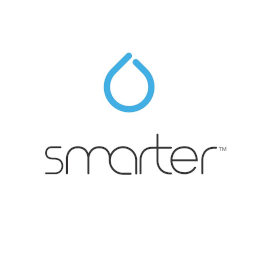

# ioBroker.ikettle2

## адаптер ikettle2 для ioBroker

Управляйте своим умным чайником iKettle 2.0 с помощью ioBroker.

## Присоединяйтесь к серверу Discord, чтобы обсудить все, что касается ioBroker!

Если вам нравится моя работа, пожалуйста, не стесняйтесь сделать личное пожертвование.\
&#x20;(Это личная ссылка для пожертвований Джея Си, не имеющая отношения к проекту ioBroker!)\

---

## Руководство

### Описание объекта

**on** - Включает чайник. Перед этим необходимо установить значение set\_temperature.

**on\_formula** - Включает чайник, нагревает его и поддерживает заданную температуру формулы в течение заданного времени нагрева. Параметры formula\_temperature и warming\_time необходимо установить заранее.

**калибровка** - Запуск базовой калибровки.

**on\_plate** - Указывает, стоит ли чайник на подставке.

**set\_temperature** - Целевая температура для нагрева воды.

**formula\_temperature** - Целевая температура после нагрева воды до значения set\_temperature.

**water\_temperature** - Фактическая температура воды.

**water\_level** - Количество воды в чайнике в литрах. Весовой датчик в основании смещается в зависимости от температуры, поэтому уровень измеряется только тогда, когда чайник находится в режиме ожидания и температура ниже заданной в настройках (по умолчанию 40 °C). Во время нагрева и при горячей воде сохраняется последнее измеренное значение. См. _Калибровка уровня воды_ ниже.

**water\_level\_raw** — Необработанное значение датчика веса (медиана последних значений). Используется для калибровки уровня воды.

**warming\_time** — Время, в течение которого чайник будет поддерживать температуру воды, указанную в формуле, до выключения. Примечание: 0 = Не используется, минимальное время — 5 минут, максимальное — 30 минут.

**get\_preset** - Считывает предустановленные значения для ручного управления (без приложения) с чайника.

**set\_preset** - Установите предустановленные значения для чайника для ручного управления (без приложения). Параметры formula\_temperature, temperature и warming\_time в папке preset необходимо установить заранее.

---

### Калибровка

Достаньте чайник из подставки, затем установите параметр калибровки объекта в значение «истина». После звукового сигнала с подставки вы можете поставить чайник обратно на подставку и использовать его.

### Калибровка уровня воды

Адаптер преобразует исходное значение датчика в литры с использованием калибровочных точек из настроек экземпляра. Значения по умолчанию (2090 = 0 л, 2185 = 1,8 л) соответствуют значениям более ранних версий и подходят не для всех чайников.

Датчик нелинейный: на протестированном чайнике первый литр увеличил исходное значение на 64, следующие 0,8 л — всего на 31 (пустой 2067, 1 л 2131, 1,8 л 2162). Поэтому можно установить дополнительную третью точку для пустого чайника; точки соединяются прямыми линиями.

1. Поставьте пустой чайник на подставку, подождите около минуты и запишите результат. `kettle.water_level_raw` как _пустой чайник_ .
2. Налейте известное количество холодной воды (например, 1 л) и запишите значение как точку 1.
3. Наполните емкость до второго объема (например, до максимальной отметки, налив 1,8 л) и запишите значение как точку 2.

Исходное значение изменяется на несколько единиц, поэтому считывайте показания после того, как чайник некоторое время постоит неподвижно.

---

## Changelog
### **WORK IN PROGRESS**
- (sadam6752-tech) Fix: messages are split at the terminator 0x7e, answers to commands are no longer mixed up with status messages
- (sadam6752-tech) Fix: reconnect with a growing delay (5 s to 60 s) instead of reconnecting at once in a loop
- (sadam6752-tech) Fix: `kettle.preset.get_preset` works now (it was not subscribed)
- (sadam6752-tech) Fix: command states are confirmed only after the kettle accepted the command; invalid temperatures are not sent
- (sadam6752-tech) Water level only measured while the kettle is idle and cold, calibration with two or three points (optional empty kettle) in the instance settings, new state `kettle.water_level_raw`
- (copilot) Adapter requires node.js >= 22 now
### 1.0.11 (2026-11-03)
* chore(deps-dev): bump @types/node from 25.9.8 to 25.9.9

### 1.0.10 (2026-10-03)
* chore(deps-dev): bump @types/node from 25.9.5 to 25.9.8

### 1.0.9 (2026-09-03)
* chore(deps-dev): bump @tsconfig/node22 from 22.0.5 to 22.0.6
* chore(deps-dev): bump @alcalzone/release-script-plugin-license

### 1.0.8 (2026-08-03)
* chore(deps-dev): bump @iobroker/testing from 5.2.2 to 5.3.0
* chore(deps-dev): bump @types/node from 25.9.4 to 25.9.5

### 1.0.7 (2026-07-03)
* chore(deps-dev): bump @alcalzone/release-script-plugin-manual-review
* chore(deps-dev): bump @alcalzone/release-script from 5.2.0 to 5.2.1
* chore(deps-dev): bump @types/node from 25.9.1 to 25.9.4

### 1.0.6 (2026-06-03)
* chore(deps-dev): bump @alcalzone/release-script from 5.1.1 to 5.2.0
* chore(deps-dev): bump @alcalzone/release-script-plugin-iobroker
* chore(deps-dev): bump @types/node from 25.6.0 to 25.9.1
* chore(deps-dev): bump @iobroker/eslint-config from 2.2.0 to 2.3.4
* chore(deps-dev): bump @alcalzone/release-script-plugin-license
* Update from template: S6020-addChangelogOld
* Update from template: X0000-dropNode20
* Update from template: W8917-dependabot-addIgnoreTypesNode
* chore(deps-dev): bump typescript from 5.9.3 to 6.0.3

### 1.0.5 (2026-05-03)
* chore(deps-dev): bump @types/node from 25.5.0 to 25.6.0
* Update from template: X0000-updateNodeJsAtTestAndRelease

### 1.0.4 (2026-04-02)
* (jey-cee) fix some issues found by adapter checker

### 1.0.3 (2026-03-31)
* (iobroker-bot) Adapter requires node.js >= 20 now.
* (Jey Cee) Correct size of ip input on xl displays
* (Jey Cee) update dependencies
* (Jey Cee) fix issues found by adapter checker

### 1.0.2
* (Jey Cee) Add watchdog for connection to prevent adapter freeze
* (Jey Cee) Migrate config to JSON Config
* (Jey Cee) Update dependencies 
* (Jey Cee) Fix issues found by adapter checker

### 1.0.1
* (Jey Cee) fixes for Beta release

### 1.0.0
* (Jey Cee) initial release

## License
MIT License

Copyright (c) 2021-2026 Jey Cee <jey-cee@live.com>

Permission is hereby granted, free of charge, to any person obtaining a copy
of this software and associated documentation files (the "Software"), to deal
in the Software without restriction, including without limitation the rights
to use, copy, modify, merge, publish, distribute, sublicense, and/or sell
copies of the Software, and to permit persons to whom the Software is
furnished to do so, subject to the following conditions:

The above copyright notice and this permission notice shall be included in all
copies or substantial portions of the Software.

THE SOFTWARE IS PROVIDED "AS IS", WITHOUT WARRANTY OF ANY KIND, EXPRESS OR
IMPLIED, INCLUDING BUT NOT LIMITED TO THE WARRANTIES OF MERCHANTABILITY,
FITNESS FOR A PARTICULAR PURPOSE AND NONINFRINGEMENT. IN NO EVENT SHALL THE
AUTHORS OR COPYRIGHT HOLDERS BE LIABLE FOR ANY CLAIM, DAMAGES OR OTHER
LIABILITY, WHETHER IN AN ACTION OF CONTRACT, TORT OR OTHERWISE, ARISING FROM,
OUT OF OR IN CONNECTION WITH THE SOFTWARE OR THE USE OR OTHER DEALINGS IN THE
SOFTWARE.