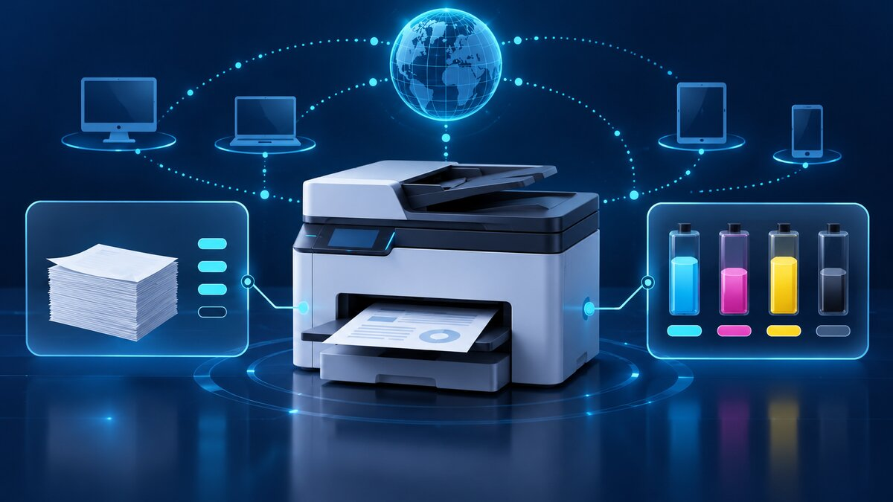

# Протокол интернет-печати ioBroker

## ioBroker Internet Printing Protocol Adapter

Адаптер опрашивает настроенные сетевые принтеры с использованием протокола интернет-печати (IPP) и публикует информацию о доступности только для чтения, состоянии принтера, уровне тонера или чернил, а также поддерживаемых счетчиках страниц. Он использует `Get-Printer-Attributes` Совместимость осуществляется через IPP/2.0; поддержка устройств и микропрограмм различается, поэтому не все принтеры могут отображать дополнительные атрибуты. Совместимость зависит от реализации IPP в каждом принтере; совместимость с данной реализацией не проверялась ни на одном конкретном устройстве.

Описание модели протокола и определение атрибутов см. в [RFC 8011](https://www.rfc-editor.org/rfc/rfc8011.html) .

Для работы требуются Node.js версии 22 или новее, Admin версии 8.2.0 или новее и js-controller версии 7.2.2 или новее.

## Конфигурация

Настройте интервал опроса и время ожидания запроса в верхней части страницы конфигурации адаптера. Добавляйте и управляйте принтерами ниже с помощью Диспетчера устройств. Используйте действия **«Добавить принтер»** , **«Редактировать»** и **«Удалить»** ; карточки принтеров отображают настроенный хост, состояние активного подключения и модель (при наличии). Во время удаления принтера или очистки устаревших данных адаптер сохраняет поддерево объектов, если какое-либо состояние потомка изменилось. `common.custom` В настройках и журналах появляется предупреждение. Удаленный принтер больше не опрашивается, поэтому сохраненные значения могут устареть; после переноса или удаления пользовательских настроек при необходимости удалите сохраненные объекты вручную.

Настройки принтера хранятся в резервной копии файлового хранилища для каждого экземпляра адаптера (например, по адресу...). `ipp.0/printer-config.json` Таким образом, сохранение других настроек экземпляра в разделе «Администрирование» не может перезаписать одновременные изменения в Диспетчере устройств. Существующие `native.printers` конфигурации и устаревшие конфигурации для каждого экземпляра хранятся по адресу `ipp.0.info.printerConfig/printers.json` Перенесены автоматически при первом запуске. Предыдущие общие `ipp/printer-config.json` Файл не переносится автоматически, поскольку невозможно безопасно определить экземпляр, которому он принадлежит; восстановите список принтеров через Диспетчер устройств соответствующего экземпляра. Существующие принтеры с устаревшим идентификатором. `info` остаются пригодными для использования независимо от регистра букв; новые принтеры не могут использовать `info` независимо от регистра.

| Параметр                 | Описание                                                                                                                                                                                                                                                                                       |
| ------------------------ | ---------------------------------------------------------------------------------------------------------------------------------------------------------------------------------------------------------------------------------------------------------------------------------------------- |
| ИДЕНТИФИКАТОР            | Стабильный идентификатор дерева объектов; используйте от 1 до 32 букв, цифр, подчеркиваний или дефисов. Немецкие умлауты транслитерируются. `ä` к `ae`, `ö` к `oe`, `ü` к `ue`, `ß` к `ss` Идентификатор нельзя изменить после создания, поскольку он определяет идентификаторы состояний принтера. |
| Этикетка                 | Отображаемое имя для принтера.                                                                                                                                                                                                                                                                 |
| Хозяин                   | Имя хоста или IP-адрес принтера без схемы, порта, учетных данных, пути, запроса, фрагмента или встроенных пробелов. Литералы IPv6 должны быть заключены в скобки.                                                                                                                              |
| Порт                     | Порт IPP; по умолчанию используется `631`.                                                                                                                                                                                                                                                     |
| Путь к ресурсу IPP       | Абсолютный путь к ресурсу без `..` пробел, запрос или фрагмент; по умолчанию используется `/ipp/print`.                                                                                                                                                                                         |
| Используйте TLS          | Используйте IPPS вместо TLS.                                                                                                                                                                                                                                                                   |
| Проверить сертификат TLS | Проверка TLS-сертификата принтера; по умолчанию отключена для самоподписанных сертификатов принтера.                                                                                                                                                                                           |

Интервал опроса по умолчанию составляет 60 секунд и ограничен 10 секундами в течение 24 часов. Время ожидания запроса по умолчанию составляет 5000 мс и ограничено 500-30000 мс; это жесткий крайний срок для полного запроса и ответа, включая медленные или неполные ответы. Адаптер отправляет только данные для чтения. `Get-Printer-Attributes` Эта функция не отправляет задания на печать и не изменяет настройки принтера. Настраивайте только принтеры, которые предоставляют конечную точку IPP на выбранном хосте, порту и пути к ресурсу.

Пустые строки-заполнители игнорируются во время запуска и миграции. Другие недопустимые строки принтера пропускаются с предупреждением, указывающим на недопустимые поля. В отладочном журнале отображаются настроенные имена полей и типы значений без вывода настроенных значений.

Когда принтер выключен или временно недоступен, адаптер помечает его как находящийся в автономном режиме без добавления предупреждений в журнал; сведения о подключении и таймауте доступны на уровне отладки. Ошибки протокола IPP, TLS и конфигурации остаются предупреждениями.

## Штаты

Каждый настроенный принтер получает устройство с `status`, `supplies`, `counters`, и `details` каналы. Дополнительные скалярные числовые, логические и строковые атрибуты IPP создаются непосредственно в `details` (например, `details.printer_up_time` Строковые значения возвращаются в качестве данных и могут содержать локализованный для принтера текст. Массивы и структурированные значения опускаются, а атрибуты, уже представленные каноническими состояниями статуса, модели и счетчика, не дублируются. Адаптер запрашивает все атрибуты IPP и создает состояния для возвращаемых значений, за исключением явно исключенных возможностей, семейств атрибутов с подробным выводом и необработанных значений маркеров; выбранные атрибуты возможностей/по умолчанию сохраняются. Канонические имена атрибутов в нижнем регистре, состоящие из буквенно-цифровых сегментов, разделенных одинарным дефисом, сохраняют свои нормализованные идентификаторы; другие имена источников получают детерминированные суффиксы. Ранее опубликованные идентификаторы могут изменяться, если имя источника было неканоническим или если обработка коллизий присвоила числовой суффикс; старые состояния детализации очищаются после успешного опроса, поэтому автоматизация, использующая эти идентификаторы, может потребовать обновления. `status.online` всегда присутствует; `status.model`, `status.message` и числовые `status.state` Публикуются, когда это поддерживается. Полная обрезанная версия. `printer-make-and-model` значение раскрывается как `status.model` В сообщениях о состоянии используются английские метки, полученные из ключевых слов, обозначающих причину, указанные в протоколе IPP, включая «распознанный». `-report`, `-warning`, и `-error` суффиксы или из канонического состояния принтера; устройство, предоставляемое принтером. `printer-state-message` не опубликовано. Значение состояния равно `0` (`off`) пока принтер недоступен, и возвращается к сообщенному состоянию IPP после повторного подключения. Ранее считанные измерения остаются доступными в автономном режиме, а последние показания тонера сохраняются, если запрос не содержит достоверных данных о расходе. В названиях расходных материалов используются распознаваемые английские цветовые/типовые метки вместо необработанных. `marker-names` В случае отсутствия таких названий используется общее английское название. IPP `marker-levels` Значения уже являются процентными и используются напрямую; дополнительные уровни маркеров (нижний/верхний) не изменяют их масштаб. Недопустимые, зарезервированные или выходящие за пределы диапазона значения пропускаются, в то время как расходный материал сохраняет свое исходное положение в массивах маркеров принтера. `pages_completed`, `impressions_completed`, и `media_sheets_completed` Они создаются только тогда, когда принтер сообщает о них. Отсутствующие значения счетчика и подробных данных очищаются, а не заменяются нулями во время успешных опросов, в том числе после перезапуска адаптера. Подробные сведения о запросе не записываются в журнал.

Для составления отчетов о поставках адаптер объединяет каждый из них. `marker-names` запись с тем же положением `marker-levels` вход; признанный `marker-types` и `marker-colors` Укажите отображаемое имя на английском языке, при этом исходное имя маркера сохраняется для существующего идентификатора штата. Если распознаваемый тип недоступен, используется отображаемое имя. `Supply N` Предложение пропускается, если его название или процентное значение отсутствуют, недействительны или выходят за пределы диапазона 0-100. Счетчики отображаются из `pages-completed`, `impressions-completed`, и `media-sheets-completed` к `pages_completed`, `impressions_completed`, и `media_sheets_completed` При сообщении об отсутствующих значениях укажите модель принтера и микропрограмму, какой из этих атрибутов IPP возвращает принтер, а также необработанные значения или идентификаторы состояний, которые отсутствуют.

## Changelog
<!--
    Placeholder for the next version (at the beginning of the line):
    ### **WORK IN PROGRESS**
-->
### 0.3.0 (2026-11-19)

- (Voodoo2man) Exposed printer online/offline status in ioBroker Admin.
- (Voodoo2man) Preserved custom states in printer objects during cleanup.
- (Voodoo2man) Prevented empty legacy printer rows from causing startup warnings.

### 0.2.1 (2026-11-11)

- (Voodoo2man) Hardened printer configuration storage with normalized request timeouts, safer migration, per-instance file isolation, and cleanup of owned orphaned legacy roots.
- (Voodoo2man) Treated temporary printer gateway errors as offline states without warning-level logs.
- (Voodoo2man) Improved published printer data with stable detail IDs, English IPP reason labels, complete model names, and scalar text details that may retain printer-localized wording.
- (Voodoo2man) Combined basic settings and printer management on one configuration page.

### 0.2.0 (2026-11-08)

- (Voodoo2man) Hardened IPP response handling, corrected supply percentages and state clearing, preserved legacy printer configurations, normalized printer IDs, refreshed state metadata, localized Device Manager actions, scheduled polls after each completed cycle, and isolated Device Manager storage from Admin saves.
- (Voodoo2man) Aligned saved endpoint validation with polling, made colliding dynamic detail IDs unique, and removed unused UI translation entries.

### 0.1.1 (2026-11-07)

- (Voodoo2man) Kept the last toner readings when printers temporarily omit supply data.

### 0.1.0 (2026-11-03)

- (Voodoo2man) Replaced the printer list with Device Manager configuration and split basic settings into a separate tab.

Older release notes are available in CHANGELOG_OLD.md.

## License
MIT License

Copyright (c) 2026 Voodoo2man <Voodoo2man@outlook.de>

Permission is hereby granted, free of charge, to any person obtaining a copy
of this software and associated documentation files (the "Software"), to deal
in the Software without restriction, including without limitation the rights
to use, copy, modify, merge, publish, distribute, sublicense, and/or sell
copies of the Software, and to permit persons to whom the Software is
furnished to do so, subject to the following conditions:

The above copyright notice and this permission notice shall be included in all
copies or substantial portions of the Software.

THE SOFTWARE IS PROVIDED "AS IS", WITHOUT WARRANTY OF ANY KIND, EXPRESS OR
IMPLIED, INCLUDING BUT NOT LIMITED TO THE WARRANTIES OF MERCHANTABILITY,
FITNESS FOR A PARTICULAR PURPOSE AND NONINFRINGEMENT. IN NO EVENT SHALL THE
AUTHORS OR COPYRIGHT HOLDERS BE LIABLE FOR ANY CLAIM, DAMAGES OR OTHER
LIABILITY, WHETHER IN AN ACTION OF CONTRACT, TORT OR OTHERWISE, ARISING FROM,
OUT OF OR IN CONNECTION WITH THE SOFTWARE OR THE USE OR OTHER DEALINGS IN THE
SOFTWARE.