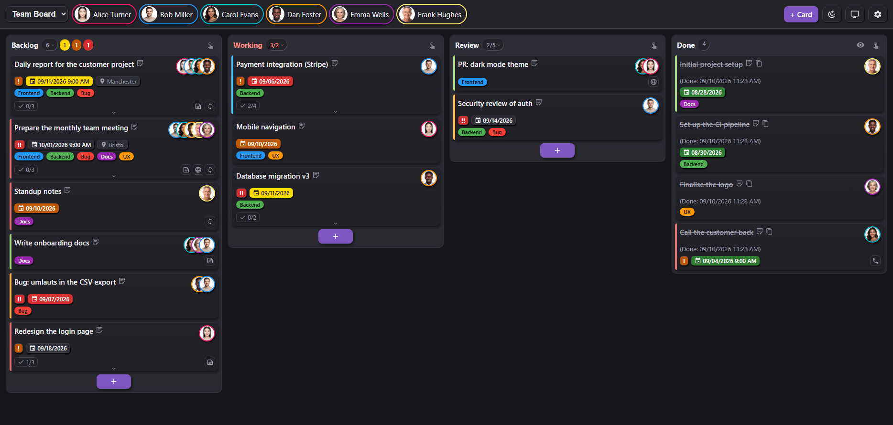

# IoBroker Kanban: документация (на английском языке)
**Канбан-доска в виде выделенного адаптера ioBroker**. Она поставляется со своим собственным веб-сервером, обслуживает одностраничное приложение без фреймворка (использует только JavaScript) и синхронизирует все открытые представления через WebSocket. Карточки перемещаются методом перетаскивания, доски и столбцы свободно настраиваются, задачи могут повторяться, а уведомления отправляются по электронной почте, с приглашением в календарь по запросу. Все доступно извне через REST, веб-хуки и `sendTo`.

**Для кого это предназначено?** Для семей, которые совместно управляют задачами, будь то семейные обязанности, совместное проживание или планирование технического обслуживания дома, и хотят выполнять эти задачи там, где уже работает ioBroker. Каждое событие попадает в состояние, доступное для чтения скриптами и Node-RED, а доска встраивается в Lovelace в виде карточки веб-страницы.



---

## Содержание
- **[Установка и первые шаги](#installation--first-steps)**
- **[Часть A: Настройки экземпляра (административная панель ioBroker)](#part-a-instance-settings-iobroker-admin)**
- [Вкладка "Общие"](#tab-general)
- [Вкладка "Пользователи"](#tab-users)
- [Вкладка "Уведомления"](#tab-notifications)
- [Вкладка "Веб-перехватчики (в)"](#tab-webhooks-in)
- [Вкладка "Веб-перехватчики (вне)"](#tab-webhooks-out)
- **[Часть B: Доска (веб-интерфейс)](#part-b-the-board-web-ui)**
- [Заголовочная панель](#header-bar)
- [Доски, колонки и подписи](#доски-колонки-подписи)
- [Количество в заголовке столбца](#counts-in-the-column-header)
- [Мусор](#мусор)
- [Переместите готовые карточки в корзину](#очистка)
- [Карточки: все поля](#cards-all-fields)
- [Шаблоны открыток](#card-templates)
- [Сортировка и порядок](#sorting--order)
- [Рецидив](#рецидив)
- [Государственные праздники](#public-holidays)
- [Пользователи на доске](#users-in-the-board)
- [Мобильный просмотр](#mobile-view)
- [Параметры URL для совместного доступа к представлениям](#sharing-views--url-parameters)
- **[Часть C: Интеграция и автоматизация](#part-c-integration--automation)**
- [REST API](#rest-api)
- [Веб-хуки: входящие](#webhooks-inbound)
- [Webhooks: outbound](#webhooks-outbound)
- [sendTo & action state](#sendto--action-state)
- [Синхронизация в реальном времени и глубокие ссылки](#live-sync--deep-links)
- [Состояния и объекты ioBroker](#iobroker-states--objects)
- **[Часть D: Справочная информация](#part-d-reference)**
- [Безопасность и контроль доступа](#security--access-control)
- [Язык / интернационализация](#language--internationalization)
- [Часто задаваемые вопросы и подводные камни](#faq--pitfalls)

---

## Установка и первые шаги
1. **Установите адаптер.** В административной панели ioBroker в разделе *Адаптеры* найдите `kanban` и установите его (инструкцию по установке на GitHub см. в [Инструкция по установке в основном файле README](/#/adapters/kanban#installation)).
2. **Создайте экземпляр.** Откройте меню **⋮** на плитке адаптера и выберите **"+"**. ioBroker создаст экземпляр (`kanban.0`) и отобразит консольное окно, которое можно закрыть после `Процесс завершился с кодом 0`. Повторите для каждого последующего экземпляра (`kanban.1`, `kanban.2`, ...).
3. **Установите порт.** В разделе *Экземпляры* откройте значок шестеренки экземпляра, вкладка **Общие**: настройте **порт** (по умолчанию `8095`), **привязку IP-адреса** (по умолчанию `0.0.0.0`) и **базовый URL**.

**При наличии нескольких экземпляров:** каждому требуется свой собственный порт. Если настроенный порт занят, адаптер всё равно запускается и переключается на следующий свободный порт. Однако в списке экземпляров продолжает отображаться *настроенный* порт, и ссылка там ведёт к неправильному экземпляру. Фактически используемый порт указан в журнале: `Port 8095 is in use - falling back to free port 8096. The instance list still shows the configured port; enter the free port there to keep both in sync.` Затем введите этот порт в настройках.

4. **Добавьте пользователя.** Вкладка **Пользователи**: в новом экземпляре **пользователей** нет. Введите хотя бы одного человека, поскольку каждой карточке нужен ответственный. Обратите внимание на ID: его нельзя изменить после первого запуска, в то время как отображаемое имя можно изменить в любое время. [Вкладка "Пользователи"](#tab-users) объясняет почему.
5. **Откройте веб-интерфейс:** ** `http://<host>:<port>/` **
6. При первом запуске доска еще не создана. Используйте значок шестеренки в правом верхнем углу (), чтобы создать ее. Каждая новая доска поставляется с тремя столбцами по умолчанию:
   - **Сделать** (`todo`)
- **В процессе** (в работе)
- **Выполнено** (`выполнено`, отмечено как столбец «Выполнено»)
7. Создайте первую задачу с помощью **"+ Карточка"**.

**Множественные экземпляры:** Каждый экземпляр (`kanban.0`, `kanban.1`, ...) представляет собой полностью независимую систему со своим собственным портом, языком, пользователями и платами. **Данные не передаются друг другу.** Полезно, например, для отдельных зон (семья и клуб) или тестовой системы рядом с производственной платой.

**Как организована эта документация:** [Часть A](#part-a-instance-settings-iobroker-admin) описывает все настройки, заданные в **административной панели ioBroker** в разделе *Экземпляры → `kanban.0` → gear* (порт, язык, список пользователей, электронная почта, токены веб-хуков). [Часть B](#part-b-the-board-web-ui) описывает **веб-интерфейс** самой доски (доски, столбцы, карточки, представления). [Часть C](#part-c-integration--automation) предназначена для скриптов и сторонних систем, [Часть D]](#part-d-reference) содержит разделы по безопасности, языкам программирования и часто задаваемым вопросам.

---

## Часть A: Настройки экземпляра (административная панель ioBroker)
Эти настройки находятся в **административной панели ioBroker** в разделе *Экземпляры → `kanban.0` → значок шестерёнки*. Они применяются ко **всему экземпляру** и вступают в силу только после **сохранения**, при этом адаптер перезапускается. Разделы ниже соответствуют пяти вкладкам страницы конфигурации.

В этом документе `kanban.0` обозначает **локальный** экземпляр. При наличии второго экземпляра все пути и состояния обозначаются как `kanban.1`, `kanban.2`, ... соответственно.

### Вкладка «Общие»


| Обстановка | Смысл |
|---|---|
| **Порт** | Порт веб-сервера (по умолчанию `8095`). Если он занят, адаптер переключается на свободный порт, но в списке экземпляров по-прежнему отображается настроенный порт. Как это обнаружить и исправить, описано в [Установка, шаг 3](#installation--first-steps). |
| **IP-адрес** | Адрес привязки (по умолчанию `0.0.0.0` = все интерфейсы). |
| **Тема оформления по умолчанию** | `auto` (системная), `light` или `dark`. |
| **Цвет акцента** | Цвет элементов управления (по умолчанию `#7E57C2`). |
| **Язык** | Язык пользовательского интерфейса. Доступно одиннадцать языков, перечисленных в разделе [Язык / интернационализация](#language--internationalization). Пусто/автоматически = системный язык ioBroker. Может быть переопределен для каждого URL-адреса с помощью `?lang=xx`. |
| **Формат даты** | Формат отображения даты платежа. Поле **по умолчанию пустое** и использует **системный формат ioBroker**. Токены см. в таблице ниже; `DD.MM.` - один из возможных вариантов. При запуске адаптер проверяет, содержит ли формат день, месяц или год. Некорректный ввод отбрасывается (с указанием причины в журнале), и отображение возвращается к системному формату. |
| **Формат времени** | `24 hours (14:00)` или `12 hours (2:00 PM)`. Применяется к необязательному времени суток на карточках. |
| **Пользовательский CSS** | Используется как `/api/custom.css` для индивидуальных настроек. |
| **Пользовательский CSS** | Используется как `/api/custom.css` для индивидуальных настроек. |

#### Токены формата даты
Используется стандартная нотация moment/Day.js (регистр имеет значение):

| Токен | Значение | Пример (20 июля 2026 г.) |
|---|---|---|
| `D` / `DD` | день без / с ведущим нулем | `5` / `05` |
| `MMM` / `MMMM` | краткое/полное название месяца | `Jul` / `July` |
| `YY` / `YYYY` | год, две / четыре цифры | `26` / `2026` |
| `ddd` / `dddd` | короткий/полный будний день | `Mon` / `Monday` |
| `ddd` / `dddd` | короткий/полный будний день | `Mon` / `Monday` |

Названия месяцев и дней недели отображаются на языке доски. Примеры: `DD.MM.` → `20.07.` · `DD MMMM YYYY` → `20 July 2026` · `dddd, DD MMM` → `Monday, 20 Jul` · `MM/DD/YYYY` → `07/20/2026`.

Примечание: сам ioBroker использует `OO`/`O` для названий месяцев. Они **не** поддерживаются здесь; строку, скопированную из системного формата и содержащую `OO`, необходимо переписать на `MMMM`.

### Вкладка "Пользователи"
Здесь создаются пользователи. Список применяется ко всему экземпляру. На доске они отображаются в виде фишек в верхней панели и могут быть назначены карточкам.


| Поле | Значение |
|---|---|
| **ID** (`name`) | Внутренний идентификатор, строчные буквы, без специальных символов (например, `bjoern`). Используется в параметрах URL и присваиваниях. |
| **Электронная почта** (`email`) | Необязательно. Адрес получателя для уведомлений по электронной почте. |
| **уведомлять...** | Девять флажков для каждого пользователя, управляющих уведомлениями, см. [Вкладка «Уведомления»](#tab-notifications). |
| **уведомлять...** | Девять флажков для каждого пользователя, управляющих уведомлениями, см. [Вкладка "Уведомления"](#tab-notifications). |

Добавьте строку со знаком "+" в заголовке таблицы; значок корзины в конце строки удаляет её (без запроса). Две стрелки рядом с ним перемещают строку вверх или вниз; порядок в таблице соответствует порядку отображения пользователей на доске. Строки без ID удаляются при сохранении. В новом экземпляре **нет** пользователей; пока не будет добавлен первый пользователь, кнопка "+ Карточка" на доске будет заблокирована и будет отображаться соответствующее сообщение.

> **Идентификатор нельзя изменить после его создания.** Доски и карточки находят своих пользователей через него, а изображения аватаров и адреса общих пространств также привязаны к нему. Изменение его позже приведет к тому, что все это будет указывать в никуда, и адаптер даже не сможет выполнить очистку после этого: переименование невозможно отличить от «удаленного и вновь созданного». Поэтому адаптер исправляет идентификатор, как только пользователь был сохранен. Для этого он записывает маркер в конфигурацию экземпляра при следующем запуске и перезапускается один раз во время этого процесса - один раз для каждого нового пользователя, больше никогда.
> > **Когда поле блокируется:** только после того, как что-то привязано к идентификатору, то есть к нему назначена карточка или он содержит изображение аватара. До этого момента его можно свободно изменять; идентификатор, на который ничто не указывает, можно безопасно переименовать. Таким образом, только что созданный экземпляр с пользователями, но без карточек, никогда не записывает свою конфигурацию обратно и никогда не перезапускается.

> > **Если поле остается доступным для ввода:** сохранение настроек экземпляра в момент, когда адаптер записывает маркер обратно, перезаписывает его тем, что все еще содержалось в форме. Адаптер повторяет попытку до трех раз, после чего регистрирует сообщение «Не удалось заблокировать идентификатор(ы) пользователя» и оставляет поля доступными для ввода. Однако это состояние отображается только **после полной перезагрузки страницы администратора**: на открытой странице поле остается доступным для ввода, даже если адаптер заблокировал его давно. Журнал является более надежным источником; в нем говорится либо «Идентификатор(ы) пользователя... теперь исправлены», либо предупреждение. В случае реального сбоя перезапустите экземпляр и убедитесь, что поля заблокированы **прежде чем** создавать какие-либо карточки.
> > **Отображаемое имя** остается свободно редактируемым. «Том Райх» становится «Томми Райх» без каких-либо изменений в карточках.
> > *Рекомендация:* уделите немного времени идентификатору в самом начале. Строчный регистр, без умлаутов, и достаточно читабельно, чтобы сохраниться в общем адресе (`?users=bjoern`).
> > <a id="renaming-a-user"></a> > **Если карточки никуда не указывают**, адаптер сообщает об этом при запуске в журнале и в состоянии `info.orphanedAssignees`, а значок шестеренки  в заголовке доски получает маленькую точку. Это происходит, когда кто-то был удален и создан заново, или когда карточка поступила через API с чужим идентификатором.
> > Исправление находится в **Настройки → Пользователи → Осиротевшие исполнители**. Этот раздел существует только тогда, когда есть что исправить - когда все в порядке, на вкладке отображаются только аватары пользователей. Для каждого осиротевшего идентификатора создается строка с его областью действия и задействованными досками; Количество карточек увеличивается до списка, поэтому ничего не перемещается незаметно. Рядом с ним находится выпадающий список с существующими пользователями и кнопка, которая запрашивает предварительный запрос. Корзина туда не попадает: то, что находится на пути к удалению, не обязательно должно принадлежать кому-либо.
> > То же самое работает через интерфейс: > > ```bash > curl -X POST "http://<host>:8095/webhook/<TOKEN>/action" -H 'Content-Type: application/json' -d '{"cmd":"reassignUser","from":"bjoern_old","to":"bjoern"}' > ``` > > Это переносит назначенных пользователей каждой карточки, списки участников досок **и** аватарку. Аватарку только если у целевого пользователя её ещё нет. Если новый ID уже был на карточке, дублирующаяся запись не появляется. Идентификатор целевого объекта должен существовать в настройках экземпляра, в противном случае вызов завершится ошибкой `400`.

### Вкладка "Уведомления"
Уведомления срабатывают при событиях, связанных с картой, и доставляются по электронной почте (через адаптер ioBroker `email`) и/или через исходящие веб-хуки. Кроме того, каждое событие записывается в состояние `kanban.0.lastEvent` (в качестве триггера скрипта).


| Обстановка | Смысл |
|---|---|
| **Экземпляр почтового адаптера** | Какой экземпляр `email.x` используется для отправки. |
| **Время напоминания** | `HH:MM`, когда отмечены карты с истекшим сроком оплаты (по умолчанию `08:00`). |
| **Напоминание за X дней до срока** | Время подготовки для напоминаний `cardDue` (`0` до `30`, по умолчанию `1`). |
| **Отправлять уведомление о просроченной оплате в указанное для карты время суток** | **По умолчанию отключено**. В дополнение к ежедневному напоминанию, для карт с указанием **времени суток** отправляется `cardDue` точно в это время (`detail.exact = true`), поэтому автоматизация может запускаться с точностью до минуты без запроса к API. **Примечание:** событие проходит через обычный путь уведомлений, поэтому второе электронное письмо с уведомлением о просроченной оплате также отправляется всем, у кого включено это уведомление. Чтобы запускать только скрипты и веб-хуки, уведомление о просроченной оплате по электронной почте следует отключить для этого пользователя. |
| **Отправлять уведомление о задолженности по карте в указанное для карты время суток** | **По умолчанию отключено**. В дополнение к ежедневному напоминанию, для карт с **временем суток** уведомление о задолженности отправляется точно в это время (`detail.exact = true`), поэтому автоматизация может запускаться с точностью до минуты без обращения к API. **Примечание:** событие проходит через обычный путь уведомлений, поэтому второе электронное письмо с уведомлением о задолженности также отправляется всем, у кого включено это уведомление. Чтобы запускать только скрипты и веб-хуки, уведомление о задолженности по электронной почте следует отключить для этого пользователя. |
| **По умолчанию** | Глобальные резервные настройки для каждого события. Они применяются, если у пользователя нет собственных настроек уведомлений на вкладке «Пользователи» (см. ниже). |

В самом низу вкладки находится блок **"Другие сервисы (Telegram, Pushover, ...)"**. В нем нет никаких настроек, только примечание о том, что единственным встроенным способом уведомлений является электронная почта, а также ссылка на примеры подключения других адаптеров, например, Telegram: [Уведомления для любой службы](#other-services).

#### Кто получает уведомления и когда?
На вкладке «Пользователи» у каждого пользователя есть девять флажков. Они определяют, какие события запускают отправку электронного письма этому человеку:

| Флажок | Когда именно срабатывает | Получатели |
|---|---|---|
| **назначен** (`notifyAssigned`) | Как только кто-то назначен исполнителем, срабатывает при создании каждой первоначальной записи и при последующем добавлении. Срабатывает **один раз для каждого человека**. | **Только для соответствующего лица** |
| **изменено** (`notifyUpdated`) | При каждом редактировании карточки (заголовок, дата, метки, контрольный список...). | Все ответственные за карточку |
| **перемещено** (`notifyMoved`) | При перемещении в другой столбец. | Все получатели карты |
| **выполнено** (`notifyDone`) | **В дополнение** к "перемещено", если целевой столбец помечен как *выполнено*. | Все ответственные за карточку |
| **создано** (`notifyCreated`) | **Один раз** при создании карты; аналогично при ее копировании с другой доски и при повторном появлении следующей карты. | **Все участники доски**, независимо от того, кому она назначена |
| **корзина** (`notifyDeleted`) | Когда карта перемещается в **корзину**, независимо от того, удалена ли она вручную или автоматически. По умолчанию: выключено. | Все ответственные за карту |
| **восстановлено** (`notifyRestored`) | Когда карта **восстановлена** из корзины. По умолчанию: выключено. | Все пользователи карты |
| **удалено** (`notifyPurged`) | Когда карта удаляется **навсегда**, либо через 30 дней после помещения в корзину, либо вручную. По умолчанию: выключено. | Все правообладатели карты |
| **удалено** (`notifyPurged`) | Когда карта удаляется **навсегда**, либо через 30 дней после удаления в корзину, либо вручную. По умолчанию: выключено. | Все получатели карты |

Основное различие между **назначено** и **создано**: «назначено» - это **личное** сообщение для назначенного лица, которое отправляется только этому человеку. «создано» - это **сообщение о статусе** для всей команды, каждого участника доски, даже если карточка принадлежит кому-то другому.

**Осторожно, события перекрываются.** Некоторые действия запускают несколько событий одновременно. Любой пользователь, у которого установлены оба флажка, получит **несколько электронных писем**, объединение писем невозможно.

| Действие | События развернулись |
|---|---|
| Создать карточку **с** назначенными лицами | **создано** + **назначено** |
| Редактировать карточку и добавить пользователя | **изменено** + **назначено** |
| Перетащите карточку в столбец "Готово" | **перемещено** + **готово** |
| Переключить столбец в редакторе карточек на столбец "Выполнено" | **изменено** + **перемещено** + **выполнено** |
| Переключить столбец в редакторе карточек на свободный столбец | **изменено** + **перемещено** |

В большинстве случаев достаточно простого «назначено». «Создано» выгодно там, где важны и карточки, созданные *другими*, при совместном назначении.

**Резервный вариант:** если у пользователя для события ничего не настроено, применяется **глобальное значение по умолчанию** (вкладка «Уведомления», раздел «По умолчанию»). Таким образом, существующие пользователи продолжают получать уведомления, не настраивая все параметры по отдельности.

**Без самоспама:** тот, кто инициирует изменение, не получает уведомления об этом изменении.

**Предварительное условие:** письма получают только пользователи, **у которых есть зарегистрированный адрес электронной почты**; все остальные пропускаются.

> **Маршрут тоже учитывается.** Перемещение карточки перетаскиванием генерирует события перемещения. Смена столбца в **редакторе карточек** также считается изменением карточки, поэтому **изменено** отображается первым. При установке каждого флажка одно действие генерирует три сообщения.

> **События в корзине:** «перемещено в корзину», «восстановлено» и «удалено навсегда» имеют свои собственные флажки, все они **выключены** по умолчанию. **Автоматическая очистка** отправляет не одно письмо на каждую карточку, а **одно сводное письмо на каждого пользователя** со списком всех затронутых карточек. Удаление одной карточки вручную по-прежнему отправляет обычное индивидуальное письмо. Кнопка со **значком метлы**  очищает всю корзину сразу и, следовательно, также отправляет сводное письмо, а не одно сообщение на каждую карточку.

#### Приглашение в календарь (.ics)
Если для карточки включена опция **"Приглашение в календарь"** и задана дата, адаптер добавляет `termin.ics` к электронному письму с уведомлением:

- **Без времени** → мероприятие на весь день в установленный срок.
- **Со временем** → событие с заданной **длительностью** на карточке (`calendarDuration`, по умолчанию один час).
- **При повторяемости** → **серия** вместо единичного события: приглашение содержит `RRULE`, поэтому календарь создает всю серию. Сопоставляются ежедневно, каждые X дней, еженедельно (с будними днями), ежемесячно (день месяца), ежемесячно (n-й/последний будний день) и ежегодно. **Исключение:** «рабочий день месяца» зависит от государственных праздников, которые стандарт календаря не знает, поэтому такие карточки остаются единичными событиями.
- **Приглашение отправляется только один раз.** Оно прикрепляется при **создании** карточки или **новом назначении** кому-либо. Приложения к последующим карточкам повторяющегося события **не** отправляют новых приглашений (серия уже есть в календаре), а напоминания или письма о перемещении также ничего не прикрепляют. **Обновленное** приглашение отправляется только при изменении **срока выполнения, времени, продолжительности или правила повторения**. Это приглашение имеет тот же `UID` и более высокий `SEQUENCE`, поэтому календарь заменяет существующую запись, а не добавляет вторую. Другие изменения (например, заголовок) намеренно не запускают отправку нового приглашения.
- **Удаление отправляет уведомление об отмене.** Когда карточка с приглашением перемещается в корзину или удаляется навсегда, создается файл `.ics` с `METHOD:CANCEL`, тем же `UID` и следующим `SEQUENCE`. Календарь очищает запись, а не оставляет ее.
- Заголовок («SUMMARY»), описание, местоположение («LOCATION») и ссылка («URL») сохраняются.
- **Часовой пояс:** события, происходящие по расписанию, однозначно передаются в формате UTC; базовый часовой пояс определяется системой (или файлом `system.config`), включая летнее время. События, происходящие в течение всего дня, намеренно не привязаны к часовому поясу.

Вложение прилагается к **каждому** уведомлению о карте, поэтому приглашение, активированное позже, придет со следующим письмом «Карта изменена».

### Вкладка "Веб-перехватчики (в)"
Другие системы (или сам ioBroker) могут изменять карты и доски через HTTP. Эти запросы защищены **токенами**, которые управляются здесь. Соответствующие конечные точки и команды описаны в [Часть C](#webhooks-inbound).

| Поле | Значение |
|---|---|
| **имя** | Метка (отображается как источник в логах). |
| **токен** | Секретный токен, часть URL. |
| **allowedBoards** | `*` = все доски или список разрешенных идентификаторов досок (разделенных пробелом, запятой или точкой с запятой). **Пусто = нет доски**: такой токен ничего не может записать. Введите `*` явно, чтобы обозначить все доски. |
| **включено** | Токен активен/неактивен. |

Кнопка «Сгенерировать новый токен» (над таблицей) автоматически добавляет новую строку с защищенным случайным токеном (32 шестнадцатеричных символа) и именем `agent`/`agent1`/.... Затем измените имя, при необходимости ограничьте `allowedBoards` и **сохраните**. В качестве альтернативы заполните поле токена вручную (например, `openssl rand -hex 16`). **Рекомендация:** используйте отдельный токен для каждой интеграции (каждого агента, каждого скрипта), чтобы каждый из них можно было отозвать или заменить индивидуально с помощью флажка `enabled`.

Недействительный токен → HTTP `401`. Доступ к доске запрещен → HTTP `403`.

**Быстрая проверка:** один вызов показывает, работает ли только что созданный токен. В стандартном случае нет необходимости переходить к [Часть C](#webhooks-inbound):

```bash
curl -X POST "http://<host>:8095/webhook/<YOUR_TOKEN>/action" \
  -H 'Content-Type: application/json' -d '{"cmd":"listBoards"}'
```

Если возвращается **список досок**, токен действителен. Все дальнейшие команды, а также полный список ответов и кодов ошибок находятся в [Часть C](#webhooks-inbound).

Под столом расположены еще два переключателя: **"Принимать команды через состояние действия"** (см. [sendTo & action state](#sendto--action-state)) и **"Разрешенные источники браузера (CORS)"**. Последний обычно остается пустым и нужен только тогда, когда веб-сайт по другому адресу вызывает API из браузера. Подробности см. в разделе [Безопасность и контроль доступа].](#security--access-control)).

### Вкладка "Веб-перехватчики (выход)"
Адаптер может отправлять **HTTP POST** на произвольные URL-адреса при каждом событии, например, в Node-RED, IFTTT, чат-сервис или скрипт, написанный для этой цели.

| Поле | Значение |
|---|---|
| **имя** | Метка. |
| **url** | Целевой URL (получает `POST` с телом в формате JSON). |
| **события** | `*` = все события или список типов событий (разделенных запятой/точкой с запятой/пробелом). |
| **включено** | Активно/неактивно. |

**Типы событий:** `cardCreated`, `cardUpdated`, `cardMoved`, `cardAssigned`, `cardDone`, `cardDeleted`, `cardRestored`, `cardPurged`, `cardDue`.

Структура полезной нагрузки JSON и сведения о доставке приведены в [Часть C](#webhooks-outbound).

---

## Часть B: Доска (веб-интерфейс)
Веб-интерфейс по адресу ** `http://<host>:8095/` ** представляет собой фактическое рабочее пространство. Все настройки в этой части вводятся непосредственно в браузере и вступают в силу немедленно, без перезагрузки адаптера. Благодаря синхронизации в реальном времени изменения отображаются на всех открытых устройствах сразу же.

### Панель заголовка
В **заголовочной панели** слева направо расположены: **селектор платы**, **пользовательские чипы** (выполняющие также функцию фильтра пользователей, см. [Пользователи на доске](#users-in-the-board)), кнопка "+ Карточка"**, переключатель темы (солнце/луна ), диалоговое окно "Виды"** (значок монитора , см. [Совместное использование представлений]](#sharing-views--url-parameters)) и **настройки** (значок шестеренки ).

*Примечание: в режиме встраивания (`embed=1`) заголовок полностью скрыт.*


### Доски, колонки и этикетки
Кнопка со значком **шестерёнки**  открывает менеджер плат. Он имеет три вкладки: **Плата**, **Шаблоны** (см. [Шаблоны карточек](#card-templates)) и **Пользователи** (цвета и аватары см. [Пользователи на доске]](#users-in-the-board)). Изменения применяются только при **сохранении**.

В самом верху вкладки «Доска» находится строка с тремя элементами. Четвертый пункт таблицы, «Удалить доску», расположен внизу вкладки:

| Элемент | Эффект |
|---|---|
| **Выбор доски** | Выбирает доску для редактирования. Доска, отображаемая на заднем плане, не изменяется. При несохраненных изменениях сначала запрашивается подтверждение (сохранить, отменить, отменить). |
| **Кнопка со стрелкой** | Переключает отображаемую доску на редактируемую, при этом диалоговое окно остается открытым. Она неактивна (затемнена), если активная доска уже выбрана. |
| **Поле "Имя" + "Создать"** | Создает новую доску. Она немедленно становится редактируемой доской и изначально содержит всех известных пользователей в качестве участников, а также собственную колонку "Корзина". |
| **"Удалить доску"** (внизу) | Удаляет редактируемую доску после подтверждения. Последнюю оставшуюся доску нельзя удалить через веб-интерфейс. Через API и веб-перехватчик (`deleteBoard`) эта блокировка **не** применяется: последнюю доску можно удалить и там, после чего в окне снова отобразится "Досок пока нет". |

Ниже следует название совета директоров, а также порядок выбора членов (см. раздел [Пользователи на доске](#users-in-the-board)), столбцы, метки, целевая ссылка уведомления и [Переместить карточки «Выполнено» в корзину]](#cleanup)).

#### Столбцы
Столбцы можно создавать, переупорядочивать с помощью перетаскивания, переименовывать и удалять. **Удаление столбца не приводит к потере карточек**, они автоматически перемещаются в первый столбец доски. Столбец [мусор](#trash) является системным и не отображается в этом списке.

Каждое действие, которое нельзя отменить (удаление карточки или доски, очистка корзины, окончательное удаление), запрашивает подтверждение в диалоговом окне **внутри пользовательского интерфейса**, оформленном так же, как и остальная часть доски, и на настроенном языке.


Над списком столбцов находится строка заголовка с названиями полей (**Название · Макс · В процессе · Новый · Готово**).

- **Идентификатор столбца:** помимо видимого заголовка, каждый столбец имеет **неизменяемый идентификатор**. Три столбца по умолчанию называются `todo`, `doing` и `done`; вновь созданным столбцам присваивается сгенерированный уникальный идентификатор. **Переименование сохраняет идентификатор**, поэтому общие ссылки `columns=` и вызовы `moveCard` продолжают работать без изменений. Идентификаторы можно найти с помощью `GET /api/boards/<id>` (см. [REST API](#rest-api)).
- **Ширина столбцов:** столбцы всегда занимают **всю ширину окна**, поэтому два столбца занимают по половине пространства. Горизонтальная прокрутка панели становится возможной только тогда, когда в каждом столбце остается менее 280 пикселей.
- **Максимальное количество отображаемых карточек:** число > 0 отображает только первые N карточек в этом столбце; под последней появляется кнопка «+X ещё», а ниже - кнопка добавления. «0» = показать все. Счетчик в заголовке столбца по-прежнему подсчитывает **все** карточки столбца. «+X ещё» - это **кнопка**: один щелчок отображает оставшиеся карточки, затем появляется строка «- снова скрыть X», а второй щелчок сворачивает их. Ограничение на доске остается неизменным; только локальный браузер запоминает отклонение, как и режим сортировки и значок глаза .
- **Ограничение в процессе разработки**: число > 0 ограничивает рекомендуемое количество карточек. При превышении этого значения столбец визуально предупреждает (счетчик и заголовок подсвечиваются). `0` = ограничение отсутствует. Ограничение является **предупреждением**, а не жесткой блокировкой. Оно всегда относится к **общему** количеству карточек в столбце, даже если фильтр по человеку/метке показывает меньшее количество. После превышения счетчик **столбца** отображается перед косой чертой, даже при включенном фильтре, поэтому "7/5" - это именно то число, от которого зависит цвет предупреждения. Подсказка содержит информацию о том, сколько карточек на самом деле содержит столбец и сколько показывает фильтр. Пока действует ограничение, активный фильтр просто отображает совпадения без косой черты; соотношение отфильтрованных карточек к ограничению приведет к смешиванию двух разных наборов.
- **"Новый"** (`allowAdd`): управляет тем, какие столбцы принимают новые карточки. Внизу такого столбца находится кнопка добавления - значок «+» на цветной панели.
- **Столбец «Выполнено»** (`isDone`): перемещенные сюда карточки считаются выполненными (установлен параметр `doneAt`, запускаются повторные действия). Их заголовок отображается с **зачеркнутым текстом**, а ниже в скобках указывается время выполнения, например, `(Выполнено: 26/07/2026 20:09)`, в формате даты и времени экземпляра. Для этой строки необходимо установить параметр `doneAt`; карточки, которые никогда не проходили через столбец «Выполнено», его не отображают.
- **Показывать/скрывать выполненные задания (значок глаза ):** В каждом столбце "Выполненные задания" в правом верхнем углу есть переключатель в форме глаза, который отображает или скрывает выполненные карточки (этот параметр сохраняется для каждого устройства).
- **Ограничение количества видимых завершенных карточек:** параметр URL `doneLimit=N` (см. [Совместное использование представлений / параметры URL](#sharing-views--url-parameters)) отображает только N последних завершенных карточек; удобно для компактных, совместно используемых представлений.
- **Копирование готовой карточки:** рядом с заголовком готовой карточки находится небольшой значок копирования . Он открывает редактор с тем же содержимым, что и **новая** карточка. При сохранении она попадает в первый столбец с пометкой «Новая», пункты контрольного списка изначально не отмечены, а срок выполнения заполняется **сегодня**, если в оригинале он был (время суток сохраняется).

<a id="counts-in-the-column-header"></a>

#### Количество в заголовке столбца
Рядом с заголовком колонки отображается не только количество карточек, но и, по запросу, число карточек в этой колонке, срок оплаты которых истекает завтра, сегодня или которые уже просрочены.

Нажатие на одну из цифр открывает небольшое меню с четырьмя пунктами. Каждая отмеченная галочкой запись отображается в виде отдельного значка рядом с другими.

| Вход | Выставки |
|---|---|
| **Итого** | привычное число: все карточки столбца, `7/5` с ограничением на количество незавершенных работ. При активном фильтре совпадения отображаются, но как только лимит превышен, счетчик столбца снова увеличивается. |
| **Завтра** | карточки в пределах установленного временного окна, желтые |
| **Сегодня** | открытки сдаются сегодня, оранжевые |
| **Просроченные** | открытки, срок действия которых истек, отмечены красным |

Три номера сроков выполнения имеют **те же цвета, что и значки на карточках** и подчиняются той же арифметике, включая время суток. «Завтра» означает ровно следующий календарный день, независимо от того, какой запас времени установлен в настройках экземпляра для напоминания по электронной почте. Когда номер равен `0`, значок остается на месте и просто теряет свой предупреждающий цвет, поэтому заголовок не подскакивает при каждом изменении, и меню остается доступным.

Остается хотя бы одна цифра: последнюю оставшуюся галочку снять нельзя, иначе нечего будет использовать для повторного открытия меню.

Выбор применяется **к каждому столбцу** и сохраняется **для каждого устройства**, как режим сортировки и значок глаза . Фильтр по человеку или метке влияет на все четыре числа одинаково. В столбце «Выполнено» и в корзине нет меню: каждая карточка там считается выполненной, поэтому раскрашивать там нечего.

Клавиатура охватывает все эти элементы. Клавиша Tab перемещается по цифрам, Enter открывает меню, стрелки перемещаются внутри него, Enter ставит или снимает отметку, Escape закрывает меню и возвращает фокус. То же самое относится и к меню сортировки.


<a id="trash"></a>

#### Мусор
На каждой доске есть **системная колонка «Корзина»**. Удаленные карточки не исчезают сразу: они остаются там **30 дней** и могут быть восстановлены в любое время. Только после этого они удаляются окончательно.

- **Видимость:** корзина **по умолчанию скрыта**. Отобразить её можно с помощью **«Показать корзину»** в нижней части настроек доски. Эта настройка применяется **только к локальному устройству**, поэтому другие пользователи будут видеть свою обычную доску.
- **Что там в итоге оказывается:** всё, что было удалено с помощью кнопки **Удалить** в редакторе карточек, карточки, **перетащенные** в корзину, и карточки из [автоматической очистки](#cleanup).
- **Чтобы вернуть карточку:** перетащите ее из корзины или нажмите значок **восстановить** на карточке. Она вернется в первый открытый столбец.
- **Удаление навсегда сразу же:** второй значок на карточке удаляет ее необратимо. Кнопка со значком метлы  в заголовке столбца очищает **всю** корзину. Оба действия требуют предварительного запроса. Через API и веб-хук `purgeCard` также применяется **только к карточкам в корзине**: для активной карточки он возвращает `400` с сообщением "Карточка '...' не находится в корзине". Таким образом, чтобы обойти срок хранения, всегда сначала нужно очистить корзину.
- **Внимательное прочтение подтверждений:** в подтверждении при удалении карточки говорится именно то, что происходит на самом деле: «Переместить эту карточку в корзину? Вы можете восстановить ее оттуда в течение 30 дней». Действительно необратимыми являются только второй значок на карточке **внутри** корзины и кнопка метлы в заголовке столбца; в диалоговых окнах об этом прямо указано.
- **Оставшееся время:** на каждой карте указано, как долго она еще будет храниться, например, "осталось 30 дней".
- **Его собственный облик:** колонна намеренно выполнена в нейтральном сером цвете, независимо от тематики и акцентного цвета, чтобы она выделялась на фоне рабочих колонн.
- **Особый статус:** корзина всегда находится в крайнем правом углу, её нельзя переименовать, переместить или удалить, и она не отображается в настройках столбца. У неё нет ограничения на количество незавершенных работ и нет ссылки «+ Добавить карточку», и она не учитывается в счётчиках других столбцов. У неё есть **переключатель сортировки**, как и у всех остальных столбцов. По умолчанию сортировка по времени удаления, начиная с самых старых - поэтому всё, что ближе всего к окончательному удалению, находится сверху.

<a id="cleanup"></a>

#### Переместите выполненные задания в корзину
Чтобы столбец «Выполнено» не разрастался бесконечно, каждая доска может автоматически перемещать старые выполненные карточки в корзину. Эта настройка находится внизу вкладки «Доска» и **по умолчанию отключена**.

| Режим | Эффект |
|---|---|
| **Выкл.** | Ничего не перемещается автоматически (по умолчанию). |
| **По возрасту** | Карты, заполненные более *X* дней назад, перемещаются в корзину. По умолчанию: 90 дней. |
| **По количеству** | В каждом столбце «Выполнено» остаются только *X* самых последних выполненных карточек, остальные перемещаются в корзину. По умолчанию: 100 карточек. |

Запуск происходит **один раз в день** и **при запуске адаптера**. Используется метка времени завершения (`doneAt`); карты без такой метки остаются без изменений. Карта сохраняется после удаления: если удалить уже выполненную карту и восстановить её, её исходное время завершения всё ещё будет отображаться. Поскольку карты перемещаются только в корзину, остаётся ещё 30 дней, чтобы что-то восстановить.


*На каждой карточке указано, как долго она будет храниться, а ниже - возможность восстановления и полного удаления. Метла  в заголовке колонки очищает всю корзину.*

#### Метки
Метки представляют собой цветные теги и управляются **для каждой доски** на вкладке *Доска* (создать, переименовать, изменить цвет, удалить). На карточке они отображаются в виде цветного значка с автоматически контрастирующим текстом; в [Диалоговое окно «Виды»](#sharing-views--url-parameters) их можно использовать в качестве черного списка для скрытия карточек.

Метки снабжены маркером перетаскивания , как и столбцы выше, поэтому их **порядок** можно задать произвольно, и этот порядок применяется везде: на карточках, в окне выбора внутри редактора карточек и в сводке заголовка раздела. Поэтому две карточки с одинаковыми метками выглядят одинаково.


*Обе карточки содержат разделы Frontend, Backend и Bug - в том же порядке, независимо от того, какой из них был нажат первым.*

#### Ссылка в уведомлениях


Каждая доска сама определяет, куда будет вести ссылка «открыть карточку» в уведомлениях по электронной почте: **просмотр доски** (по умолчанию открывает доску и кратко выделяет карточку), **редактор карточек** (открывает диалоговое окно редактирования напрямую) или **пользовательский URL** (фиксированный адрес, например, панель мониторинга Lovelace, в которую встроена доска).

### Карты: все поля
**Анатомия карточки:** **исполнитель**, или, если их несколько, стопка аватаров, располагается в правом верхнем углу, а текст заголовка обтекает его. При наличии нескольких исполнителей, при наведении курсора или касании, изображения расширяются влево, не изменяя переносы строк. Длинные заголовки обрезаются после **двух строк** многоточием, полный заголовок остается доступным во всплывающей подсказке. Если карточка содержит **контрольный список**, она получает нижний колонтитул: индикатор прогресса слева, стрелка расширения  посередине и значки для **описания, ссылки и повторения** справа, в указанном порядке. Без контрольного списка нижний колонтитул отсутствует, и те же значки располагаются в правом конце строки метки или значка. Щелчок по значку описания открывает описание в **окне только для чтения** с отображаемым Markdown; Ссылки внутри списка всегда открываются в новой вкладке. Состояние списка (развернутый или свернутый) **запоминается для каждого устройства и доски**, как и режимы сортировки по столбцам, и сохраняется после перезагрузки.


**Иконки на карточке**, в том порядке, в котором они появляются:

| Значок | Где | Значение |
|---|---|---|
|  Лист с карандашом | справа от заголовка | Откройте редактор карточек. Единственный способ войти. |
|  Два офсетных листа | справа от заголовка, только готовые карточки | Перенесите содержимое в **новую** карточку, см. [Скопируйте заполненную карточку](#boards-columns--labels) |
|  Стрелка в круге | в корзину, в отдельной строке внизу карточки | Восстановите карточку. Оставшийся срок хранения указан над ней. |
| `!` оранжевый, `!!` красный | под заголовком | Высокий или срочный приоритет. При обычном приоритете ничего не отображается. |
|  Календарный лист с датой | под заголовком | Срок выполнения, выделенный цветом [Цвета даты окончания](#due-date-colours) |
|  Календарный лист с датой | под заголовком | Срок выполнения, раскрашенный [Цвета сроков выполнения](#due-date-colours) |
|  Маркер на карте | под заголовком | Местоположение, сокращенное. Полный текст во всплывающей подсказке. |
|  Различные значки ссылок | рядом с ними | На карточке есть ссылка. Какой значок отображается, зависит от адреса, см. [Типы ссылок](#link-types). |
|  Различные значки ссылок | рядом с ним | На карточке есть ссылка. Какой значок отображается, зависит от адреса, см. [Типы ссылок](#link-types). |
|  Отметка с `3/12` | в левом нижнем углу карточки | Состояние контрольного списка. Треугольник рядом с ней позволяет его развернуть. |
|  Отметка с `3/12` | в левом нижнем углу карточки | Состояние контрольного списка. Треугольник рядом с ней расширяет его. |

Редактор открывается с помощью значка карандаша  прямо рядом с концом заголовка; щелчок в любом месте карточки не открывает ее. Это предотвращает случайное открытие редактора при прокрутке или касании. Карточки по-прежнему можно захватывать и перетаскивать в любое место.

Сначала идут два обязательных поля: **заголовок**, а непосредственно под ним **исполнители**. Затем строка с датой выполнения, временем, приоритетом и столбцом, а ниже - приглашение в календарь. Все остальное находится в **сворачиваемых разделах**: описание, метки и цвет карточки, ссылка, местоположение, периодичность, контрольный список.

В правой части заголовка каждого раздела указано его содержимое: краткое описание, выбранные метки с цветным маркером, местоположение, шаблон повторения, состояние контрольного списка. Информация о том, какие разделы открыты, **запоминается для каждого устройства** и применяется к следующей новой карточке; при чистой установке будет открыто только описание.

В нижнем колонтитуле расположены кнопки **Удалить**, **Управление** (перенос, клонирование, сохранение как шаблон), **Отмена** и **Сохранить**. Кнопка **×** в правом верхнем углу закрывает диалоговое окно, как и все остальные диалоговые окна доски.

**Несохраненные изменения** не исчезают. После внесения изменений в карточку сначала запрашивается клавиша Escape, щелчок по крестику и **кнопка «Назад» в браузере**. На планшете кнопка «Назад» наиболее важна, поскольку это обычный способ выхода из диалогового окна. В диалоговом окне есть три кнопки: **Сохранить**, **Отменить** и **Отменить**.

**Клавиатура позволяет добраться до всего.** Клавиша Tab перемещает курсор между полями, а также на заголовки разделов; Enter или пробел открывают раздел. Группы элементов (исполнители, метки, цвет карточки, типы ссылок) каждая имеет свою точку табуляции: внутри них клавиши со стрелками перемещают курсор, Home и End переводят в конечные области, пробел или Enter выделяют. Внутри контрольного списка Enter создает следующий элемент; оттуда Ctrl + Enter сохраняет.

**Если карта принадлежит лицу, которого больше не существует**, старый идентификатор отображается как отдельный чип в поле *назначенные лица*, с прочерком и пометкой "(удалено)". Здесь его можно снять; перемещение происходит в разделе [Настройки → Пользователи](#renaming-a-user).

Карточка содержит следующие поля (настраиваются через API под теми же именами):


| Поле | Тип | Описание |
|---|---|---|
| **заголовок** | текст | Название задачи (обязательно). |
| **Описание** | Markdown | Описание, отображаемое в формате Markdown (ссылки, изображения, списки...). Как только поле содержит текст, редактор отображает **предварительный просмотр** отрендеренного Markdown **под полем ввода**, чтобы результат был виден во время набора текста. Встроенный HTML-код проходит проверку перед отображением (защита от XSS). |
| **срок сдачи** | `YYYY-MM-DD` | Срок сдачи. Цвет значка соответствует штату, см. [Цвета даты окончания](#due-date-colours). |
| **приоритет** | `0`/`1`/`2` | Обычный / Высокий / Срочный. На карточке это отображается в виде значка под заголовком (перед датой и местом выполнения): **Обычный** - ничего, **Высокий** - оранжевый `!`, **Срочный** - красный `!!`. Другие значения отклоняются через API с ошибкой (см. [Ответы и ошибки](#responses--errors)). |
| **Назначенные лица** | Список идентификаторов пользователей | Назначенные лица. Определяет, кто получает уведомления. **Требуется также через API:** должен быть указан как минимум один человек, и каждый идентификатор должен существовать в настройках экземпляра. В противном случае интерфейс отвечает `400` и называет известные ему идентификаторы. **Исключение:** если настроен ровно один пользователь, поле заполняется автоматически, а не отклоняется. Идентификатор, **уже указанный на карточке**, остается разрешенным при редактировании, даже если пользователь больше не существует - в противном случае, "осиротевшая" карточка будет единственной карточкой, которую никто не сможет изменить. По умолчанию **все** пользователи экземпляра могут быть назначены; список участников доски сужает этот список. |
| **Назначенные лица** | Список идентификаторов пользователей | Назначенные лица. Определяет, кто получает уведомления. **Требуется также через API:** должен быть указан хотя бы один человек, и каждый идентификатор должен существовать в настройках экземпляра. В противном случае интерфейс отвечает кодом `400` и называет известные ему идентификаторы. **Исключение:** если настроен ровно один пользователь, поле заполняется автоматически, а не отклоняется. Идентификатор, **уже указанный на карточке**, остается разрешенным при редактировании, даже если пользователь больше не существует - в противном случае, "осиротевшая" карточка будет единственной карточкой, которую никто не сможет изменить. По умолчанию **все** пользователи экземпляра могут быть назначены; список участников доски сужает этот список. |
| **метки** | список идентификаторов меток | Цветные метки. Управление метками осуществляется для каждой доски отдельно (создание, переименование, изменение цвета, удаление). Если через API поступает метка, которая неизвестна доске, она **создается**, а не отклоняется (заголовок = ID, цвет, в свою очередь, берется из той же палитры, что и в интерфейсе; оба параметра можно редактировать впоследствии). |
| **ссылка** | URL | Ссылка. На карточке отображается **значок, зависящий от типа** (см. [Типы ссылок](#link-types)). |
| **местоположение** | текст | Местоположение. Отображается в виде значка местоположения (булавки) на карточке и копируется в приглашение в календарь как `LOCATION`. |
| **контрольный список** | список | Подпункты с флажками; как только их станет не менее двух, перетащите небольшой **рычажок**  слева в редакторе, чтобы изменить их порядок. Отображается как индикатор выполнения `✓ 2/5` в левом нижнем углу карточки. **Шеврон**  в середине нижнего колонтитула карточки разворачивает/сворачивает элементы непосредственно на карточке, где их также можно **отметить галочкой** (сохраняется немедленно). |
| **Приглашение в календарь** | да/нет | Если включено **и** установлена дата выполнения, то к каждому электронному письму с уведомлением для этой карточки будет прикреплено ** `.ics` приглашение в календарь**. |
| **calendarDuration** | `HH:MM` | Продолжительность приглашения в календарь, по умолчанию ** `01:00` ** (один час). Поле появляется в редакторе рядом с флажком **приглашение в календарь** после его включения. Действует только для событий **с указанием времени**; без указания времени событие остается событием на весь день. |
| **повторение** | объект | Правило повторения (см. [Рецидив](#recurrence)). |
| **повторение** | объект | Правило повторения (см. [Повторение](#повторение)). |

Адаптер также автоматически управляет: `id`, `columnId`, `order`, `createdAt`, `createdBy`, `movedAt`, `doneAt`, `trashedAt`, а также внутренними маркерами `lastReminderAt`, `lastExactAt` (чтобы одно и то же напоминание или событие, связанное со временем суток, не срабатывало дважды в один и тот же день) и `icsUid`/`icsFingerprint`/`icsSeq` (календарная серия: один и тот же UID для всего повторения). цепочка и обнаружение измененных данных о назначенных встречах).

Каждый объект карточки в **REST API** дополнительно содержит вычисляемое поле ** `dueAt` **, дату выполнения, включая время в виде метки времени ISO с локальным смещением (например, `2026-08-01T13:30:00+02:00`; `00:00` без времени, `null` без даты). Оно идентично полю `dueAt` событий, **не хранится** и игнорируется при записи, поэтому автоматизациям не нужно самостоятельно комбинировать `due` + `dueTime` + часовой пояс.

`movedAt` записывает **с момента, когда карта находится в текущем столбце**, и является основой для режима сортировки «возраст в столбце». Она обновляется только при реальном изменении столбца; изменение порядка в пределах одного столбца в режиме ручной сортировки не затрагивает её. `trashedAt` отмечает момент, когда карта была отправлена в корзину, и определяет 30-дневный срок.

#### Перенести или клонировать карту
В нижней части редактора карточек, прямо рядом с кнопкой **Удалить**, находится кнопка **Управление**. Она открывает диалоговое окно с тем же названием, в котором перечислены четыре параметра один под другим, каждый с пояснением: **Клонировать**, **Копировать**, **Переместить** и **Сохранить как шаблон**. Поля ниже и надпись кнопки в правом нижнем углу следуют за выбранным параметром. Действие кнопки "Сохранить как шаблон" описано в разделе [Шаблоны открыток](#card-templates).

- Функция **Клонирование** дублирует карточку **в пределах той же доски**. Отображается только **целевой столбец**, предварительно выбранный столбцом, в котором в данный момент находится карточка. Столбцы, в которых карточка уже выполнена, не отображаются, поскольку клонируется новая карточка; если оригинал находится в таком столбце, предварительно выбирается первый столбец с флажком «Новый». Клон переносит все: контрольный список, метки, ответственных, повторяемость. Если оставить его в предварительно выбранном столбце, он окажется непосредственно **под оригиналом**; если выбрать другой столбец, он будет добавлен **вниз** этого столбца.
- Функции **Копировать** и **Переместить** дополнительно отображают **целевое игровое поле**; его первый столбец с пометкой «Новое» предварительно выделен. Функция «Переместить» перемещает карточку вместе с собой (она покидает текущее игровое поле), функция «Копировать» создает новую карточку на целевом поле, оставляя исходную нетронутой. Если другого игрового поля нет, обе опции отключаются, и открывается диалоговое окно с выбранной опцией «Сохранить как шаблон».
- **Метки** сопоставляются по **имени**. Если на целевой плате есть метка с тем же именем, она сохраняется; метки, не соответствующие запросу, удаляются. Целевая плата никогда не расширяется автоматически новыми метками.
- **Назначенные лица** сохраняются только в том случае, если они являются **членами** целевой доски. В диалоговом окне заранее отображается, какие элементы будут удалены.
- Если **никого** не останется, в диалоговом окне отобразится список участников целевой доски, и перевод будет разрешен только после выбора хотя бы одного человека. Таким образом, ни одна карточка не останется без исполнителя.
- Перемещение вызывает событие `cardMoved` (помеченное как изменение на игровом поле), копирование и клонирование вызывают событие `cardCreated` с новым идентификатором карты (клон дополнительно имеет `detail.clone = true`).

#### Типы ссылок
На доске отображается соответствующая иконка (иконки Material Design) на основе введенного адреса. Правила оцениваются сверху вниз, **побеждает тот, кто первым найдет подходящего соперника**.

| Значок | Обнаружено | Пример |
|:--:|---|---|
|  | `mailto:` | `mailto:hausmeister@example.com` |
|  | `youtube.com` / `youtu.be` | `https://youtu.be/xxxxxxxxxxx` |
|  | адрес заканчивается на `.pdf` | `https://example.com/anleitung.pdf` |
|  | `.jpg` `.jpeg` `.png` `.gif` `.webp` `.svg` | `https://example.com/grundriss.png` |
|  | route: `waze.com`, `/maps/dir/`, `daddr=` | `https://www.waze.com/ul?ll=52.52,13.405` |
|  | место: Google/Apple Maps, OpenStreetMap, `geo:` | `geo:52.52,13.405` |
|  | внутренний адрес: частные диапазоны (`10.`, `172.16.` до `172.31.`, `192.168.`), `127.`, `169.254.`, `localhost` плюс имена хостов, заканчивающиеся на `.local` `.lan` `.home` `.internal` `.fritz.box` | `http://192.168.1.10:8123/` |
|  | внешние веб-ссылки | `https://example.com` |
|  | внешние веб-ссылки | `https://example.com` |

Над полем для ссылки располагается **панель с девятью значками**, расположенная в следующем порядке: веб-ссылка, внутренний адрес, электронная почта, телефон, YouTube, PDF, изображение, маршрут, местоположение. Щелчок по одному из них помещает соответствующий пример в поле в качестве заполнителя, например, `tel:+49123456789` вместо `https://...`. Все уже введенное значение остается неизменным. В обратном порядке панель подсвечивает тип, соответствующий текущему введенному адресу, и следует за вводом.

Доступны для нажатия только безопасные схемы `http(s)`, `mailto:`, `tel:` и `geo:` (см. [Безопасность и контроль доступа](#security--access-control)). **Поле принимает именно то, что доска отобразит позже:** поверх этих схем это означает относительные пути и адреса без схемы, такие как `example.com`, к которым добавляется `https://`. Все остальное, например, `javascript:` или `data:`, отклоняется при сохранении.

### Шаблоны открыток
Шаблон - это именованный набор полей карточки. Он принадлежит игровому полю, располагается рядом с карточками и работает скорее как штамп, чем как ссылка: всё, что из него выходит, впоследствии становится обычной карточкой и ничего не знает о своём происхождении.

**Создание шаблона.** На существующей карточке выберите «Управление», а затем «Сохранить как шаблон». Поле «Имя» будет предварительно заполнено заголовком карточки; это же имя будет использоваться для последующих карточек. Если шаблон с таким именем уже существует, адаптер запросит подтверждение перед заменой его содержимого. Это также способ изменить содержимое шаблона, не открывая его во вкладке.


**Два момента остаются неизменными.** Срок выполнения отменяется, поскольку фиксированная дата устаревает: шаблон, сохраненный в январе, создаст карточки, датированные позавчерашним днем в марте. И отметки в контрольном списке сбрасываются, поскольку шаблон хранит элементы, а не их состояние. Время суток сохраняется, поскольку 17:00 - это свойство задачи.

**Использование одного элемента.** При создании карточки в левом нижнем углу редактора, на месте кнопок «Удалить» и «Управление» во время редактирования, располагается элемент выбора. При отсутствии шаблонов на доске элемент выбора отсутствует. Выбор устанавливает **все** поля заново, включая пустые в шаблоне; если редактор уже что-то зафиксировал, сначала задается вопрос. Метки, которых больше нет на доске, и ответственные лица, не являющиеся членами доски, исключаются. Затем элемент выбора возвращается на свое место.


Если шаблон содержит повторяющуюся дату, а поле «срок оплаты» оставлено пустым, адаптер самостоятельно вычисляет следующую дату и привязывает шаблон к сегодняшнему дню. Таким образом, шаблон «каждые 30 дней» создает карточку, срок оплаты которой истекает сегодня, и отсчет начинается с этой даты, а не с шаблона, установленного полгода назад.

**Управление ими.** Настройки → вкладка «Шаблоны». Каждый шаблон получает строку с флажком, маркером перетаскивания , полем для имени и тремя кнопками:

| Кнопка | Эффект |
|---|---|
| ✎ | открывает шаблон в редакторе карточек; имя остается таким, как указано на вкладке |
| ↗ | экспортирует этот шаблон |
| × | удаляет шаблон |

Порядок строк определяется порядком в окне выбора карточек редактора. При переименовании заголовок сохраняется и для последующих карточек. Здесь нет кнопки для его создания, поскольку шаблон всегда берется из карточки. Все изменения на этой вкладке вступают в силу после нажатия кнопки сохранения в диалоговом окне.


**Экспорт и импорт.** Под списком расположены две кнопки. Левая кнопка отображает надпись «Экспортировать все», если отмечены все флажки, и «Экспорт выделенного», если отмечено меньшее количество флажков; если ничего не отмечено, кнопка неактивна. Обе кнопки открывают диалоговое окно с текстом, кнопкой загрузки и кнопкой копирования. Текст не является декоративным элементом: на планшете в режиме киоска нет ни выбора файла, ни папки для загрузки, и копирование - единственный способ получить к ним доступ.

Функция «Импорт» запускает собственный диалог, состоящий из двух шагов.

На первом этапе текст экспорта вводится в поле либо с помощью кнопки «Выбрать файл», либо путем вставки. Выбранный файл также попадает в поле, поэтому становится видно, что будет прочитано. С момента выбора файла и до его получения рядом с кнопкой отображается сообщение «Чтение файла...». Кнопка «Чтение» остается неактивной, пока поле пустое. Если текст не является допустимым JSON или не содержит шаблонов Kanban, в диалоговом окне под полем появляется ошибка.

На втором шаге отображается список найденных шаблонов с галочками, поэтому отдельные шаблоны можно пропустить. Если галочка отсутствует, кнопка «Добавить» недоступна. Правила следующие:

- **Добавлено, никогда не заменено.** При импорте невозможно сказать, что скрывается за именем в файле, и ошибочно подтвержденное перезаписывание нельзя отменить. Имя, которое уже существует, получает счетчик, как в "Изменение фильтра (2)".
- **Метки сопоставляются по имени**, которое указывается в нижнем регистре. Идентификатор метки с другой доски ничего не значит на этой. Все, что не совпадает, отбрасывается; импорт не добавляет метки на целевую доску без запроса.
- **При создании карточки исключаются лица, не являющиеся членами целевой комиссии.** Если таких лиц не осталось, редактор запрашивает выбор.
- Максимум 50 шаблонов на доску. Все, что превышает это количество, исключается; если список уже заполнен, в диалоговом окне отображается ошибка.

После нажатия кнопки «Добавить» диалоговое окно закрывается, и новые шаблоны появляются внизу списка. Под двумя кнопками вкладки отображается баланс: добавлено, переименовано, удалены метки, не подошло. Заканчивается строкой «Еще не сохранено», поскольку импорт также вступает в силу только при нажатии кнопки сохранения в диалоговом окне.

**Из скрипта.** Команда `addCard` принимает поле `template`, которое сначала сопоставляется с идентификатором, а затем с именем:

```json
{ "cmd": "addCard", "board": "house", "template": "Filter change", "due": "2026-10-01" }
```

Указанные явно поля превосходят шаблон, всё остальное определяется им. Неизвестное имя является ошибкой и не создаёт карточку, так что опечатка в скрипте не приводит к тому, что карточки месяцами остаются наполовину заполненными.

### Сортировка и порядок
По умолчанию порядок карточек в столбце устанавливается вручную: щелкните карточку, удерживайте ее и перетащите вверх или вниз (это работает и с сенсорным управлением на телефоне). Аналогичным образом карточка перемещается в другой столбец, чтобы изменить свой статус. Выбранный порядок сохраняется и синхронизируется в режиме реального времени со всеми открытыми представлениями.

Это справедливо даже в том случае, если **не все карточки видны**, при активном фильтре по людям или меткам, или при наличии ограничения на отображение. В этом случае карточка попадает точно туда, куда была помещена, между видимыми соседними карточками, а скрытые карточки сохраняют свой порядок вокруг неё.

Вместо этого **каждый столбец по отдельности** может быть отсортирован автоматически. Щелчок по значку сортировки в заголовке столбца открывает небольшое меню с пятью режимами:

| Режим | Поведение |
|---|---|
| **Перетаскивание** | Порядок, созданный вручную. Карты захватываются и перетаскиваются напрямую (по умолчанию). |
| **Маркеры перетаскивания**  | Порядок также задан вручную, но каждая карточка имеет маркер слева. Перетаскивание работает только с помощью этого маркера, что упрощает изменение порядка на сенсорном экране. |
| **Срок оплаты** | Начиная с самой ранней даты, с учетом времени суток. Карточки без даты кладутся вниз. |
| **Приоритет** | Приоритет отдается наивысшим приоритетам; в рамках одного приоритета определяется сроком выполнения. |
| **Возраст в столбце** | Карточка, которая была добавлена в этот столбец последней, находится сверху. В столбце «Выполнено» это задача, отмеченная последней. |

Для трех автоматических режимов рядом со значком сортировки появляется **переключатель направления сортировки**. Один щелчок меняет порядок на обратный, и стрелка показывает текущее направление сортировки с первого взгляда. В режиме «возраст в столбце» это означает либо карты, которые были отсортированы последними сверху, либо карты, которые лежали дольше всего.

Некоторые детали предсказуемо меняются местами: переворачивается только главный критерий. Карты без даты или времени остаются внизу, в случае равенства результатов по-прежнему учитывается заголовок, а в рамках одного и того же приоритета срок выполнения сортируется по возрастанию.

Меню также можно управлять с клавиатуры: клавиша Tab достигает кнопки, Enter открывает её, клавиши со стрелками перемещаются по меню, Escape закрывает его и возвращает фокус.

В корзине тоже есть такое меню. Там «перетаскивание» и «перетаскивание маркеров» означают не порядок, заданный вручную - в корзину всё равно ничего нельзя перетащить - а порядок по времени удаления, начиная с самых старых. Это порядок по умолчанию, и в нём сверху располагаются файлы, которые ближе всего к окончательному удалению. Переключатель направления также меняет порядок на обратный. Остальные три режима работают точно так же, как и в любой другой колонке.

**Режим и направление сохраняются для каждого устройства отдельно** (как значок глаза ), поэтому они влияют только на тот вид, для которого были установлены. В автоматическом режиме изменение порядка внутри столбца отключено, поскольку это не окажет никакого эффекта; перемещение карточек в другой столбец по-прежнему работает. Переключение обратно на «перетаскивание» или «перетаскивание маркеров» возвращает сохраненный вручную порядок без изменений.

Независимо от всего этого, соответствующий значок имеет цвет, поэтому любая срочная информация выделяется независимо от ее положения.


<a id="due-date-colours"></a>

#### Цвета даты окончания срока
| Цвет | Штат |
|---|---|
| **красный** | Срок выполнения уже в прошлом |
| **оранжевый** | Срок оплаты карты истекает сегодня, но он еще не истек |
| **жёлтый** | Оплата карты производится завтра, то есть на следующий календарный день |
| нейтральный | Оплата по карте производится не позднее послезавтра или позже |
| **зеленый** | Задание на карточке выполнено |

За этим стоят два вопроса, которые рассчитываются по-разному. **Окно раннего предупреждения** (жёлтое) - это планирование, и оно измеряется в **календарных днях**: жёлтый цвет обозначает ровно следующий календарный день. Это не скользящее 24-часовое окно, поэтому завтра остаётся завтрашним днём.

Параметр [**Напомнить за X дней до срока**](#tab-notifications) определяет, как рано отправляется **напоминание по электронной почте**, и ни на что другое. Цвета на доске от него не зависят.

Просрочка платежа: если на карте указано **время суток**, например, 17:00, то она считается просроченной в 17:01, и именно в это время срабатывает событие `cardDue` с `detail.exact`. Без указания времени цвет меняется в полночь. Состояния [`overdueCount` и `overdueList`](#iobroker-states--objects) следуют тому же правилу, поэтому цвет и счетчик меняются в одну и ту же минуту.

Всплывающая подсказка на значке объясняет значение цвета: просрочено, срок сдачи сегодня, срок сдачи завтра, срок сдачи позже, выполнено.

Цвета можно изменить с помощью [[Пользовательский CSS](#faq--pitfalls): `--danger` для красного, `--warn` для оранжевого и `--due-upcoming` с `--due-upcoming-text` для желтого. Та же группировка находится за [counts в заголовке столбца]](#counts-in-the-column-header).

### Рецидив
Повторяющиеся задачи работают **по завершении** (метод Канбана): как только повторяющаяся карточка перемещается в столбец «Выполнено», в первом столбце «Не выполнено» автоматически создается **новая карточка** с ближайшей совпадающей датой выполнения (пункты контрольного списка сбрасываются). Все поля содержимого шаблона переносятся: заголовок, описание, ответственные лица, метки, цвет карточки, приоритет, ссылка, **время суток**, **местоположение** и флаг **приглашения в календаре**. Карточки с повторяющимися задачами имеют значок повторяющегося события (значок круговых стрелок ). **Выполненная** карточка не сохраняет это правило: она полностью перемещается в следующую карточку, поэтому значок там исчезает.

Если для повторяющейся карточки указана дата **без** ручного указания даты, адаптер автоматически устанавливает следующую соответствующую дату.

| Тип (`recurrence.type`) | Значение | Дополнительные поля |
| `daily` | Каждый день | нет |
| `weekly` | В определенные дни недели | `dayOfWeek`: список `[1..7]` (1 = понедельник ... 7 = воскресенье) |
| `monthly` | Фиксированный день месяца | `dayOfMonth`: `1..31` (31-е число привязано к последнему дню в коротких месяцах) |
| `monthly_weekday` | N-й/последний рабочий день месяца, например, **второй вторник** | `ordinal`: `1..4` или `-1` (последний), `dayOfWeek`: `[iso]` |
| `workday` | Первый/последний/n-й **рабочий день** месяца | `workdayPos`: `first` / `last` / `nth` / `nth_last`, `n`: для `nth`/`nth_last` |
| `yearly` | Ежегодно | `month`: `1..12`, `dayOfMonth`: `1..31` |
| `every_n_days` | Каждые X дней с даты начала | `interval`: N, `startDate`: `YYYY-MM-DD` |
| `every_n_days_done` | Каждые X дней **с момента завершения** | `interval`: N |
| `cron` | Выражение Cron, используемое в качестве шаблона | `cron`: `"0 8 * * 1-5"` |
| `cron` | Выражение Cron, используемое в качестве шаблона | `cron`: `"0 8 * * 1-5"` |

Два типа отсчета **X дней** похожи, но отсчет ведется по-разному. Отсчет "Каждые X дней" ведется с фиксированной сетки, начиная с начальной даты: если карточка, которую нужно выполнить каждые 30 дней, и она выполнена на десять дней позже, следующая дата ее выполнения будет на следующей точке сетки, то есть через 20 дней. Отсчет "Каждые X дней (после выполнения предыдущей)" начинается с момента выполнения предыдущей карточки, что составляет полные 30 дней.

Для всех видов карточек, привязанных к календарю, следующая дата всегда **в будущем**. Ежедневная карточка, оставленная без внимания на две недели, а затем отмеченная галочкой, приводит к появлению следующей карточки, которую нужно выполнить завтра, а не в какой-то день прошлой недели. Если карточка выполнена **раньше**, то в качестве ориентира остается календарь, иначе дата сдвигалась бы вперед с каждой ранней отметкой.

Для такого типа карточек календаря невозможно составить **целую серию**: дата следующей даты определяется только по завершении карточки. Поэтому [приглашение в календарь](#cards-all-fields) содержит только одну дату, как и «рабочий день месяца».

Рабочий день означает: не выходной **и** не государственный праздник (см. ниже). Пример: «первый рабочий день мая» приходится на 4-е число, если 1 мая - выходной/праздник.

#### Выражение Cron
Для шаблонов, которые не могут быть выражены фиксированными типами, существует тип **cron expression**. Он принимает обычные пять полей:

```
minute  hour  day  month  weekday
   0      8    *     *      1-5    -> Monday to Friday at 08:00
```

Каждое поле понимает `*`, отдельные числа, списки (`1,15`), диапазоны (`1-5`), шаги (`*/3`, `1-7/2`) и английские сокращенные названия месяца (`jan`... `dec`) и дня недели (`mon`... `sun`). Воскресенье обозначается как `0`, так и `7`. Длина выражения может составлять не более 120 символов, и даже самый длинный разумный шаблон остается значительно короче этого значения.

Три вещи отличают его от настоящего демона cron:

- **Это выражение представляет собой шаблон, а не расписание.** В эти моменты адаптер ничего не запускает. Он использует шаблон для определения следующей даты выполнения, когда карточка будет завершена. Как и в случае с любым повторением, следующая карточка появляется, когда карточка отмечена как выполненная, а не сама по себе.
- **Минуты и часы задают время на карточке.** `0 8 ** 1-5` создает карточки со временем `08:00`; поле* ремя* в редакторе заполняется из шаблона и блокируется. Если имя шаблона повторяется несколько раз (`15,45 8-10 *** ), побеждает самое раннее.
- **Термины `L`, `W`, `#` и `?` не существуют.** Для обозначения «последнего рабочего дня месяца» или «второго вторника» используйте типы *рабочий день месяца* и *ежемесячный (будний день)*, которые также учитывают логику государственных праздников, которую не может выразить ни один cron.

Если **день** и **день недели** одновременно ограничены, они объединяются с помощью **или**, как в оригинале: `0 8 1 * mon` соответствует каждому первому числу месяца *и* каждому понедельнику.

Под полем ввода редактор отображает правило в текстовом виде и следующие три даты. Если выражение содержит ошибку, вместо предварительного просмотра там отображается причина, и карточку сохранить невозможно.

**Приглашение в календарь:** простые шаблоны преобразуются в правило повторения (ежедневно, фиксированные дни недели, фиксированные дни месяца, ежегодно). Вложенные шаблоны (день и день недели одновременно или шаги по нескольким полям) не имеют эквивалента в стандарте календаря; такие карточки отправляют одно событие за каждое событие.

### Государственные праздники
Для **повторяющихся рабочих дней** адаптер самостоятельно рассчитывает государственные праздники (пасхальная формула + фиксированные даты + немецкий «Buß- und Bettag»), поэтому даже даты, находящиеся далеко в будущем, рассчитываются корректно.

- Если установлен адаптер ioBroker ** `feiertage` **, адаптер Kanban принимает его **конфигурацию штата/региона** (какие праздники применяются). Учитываются только действительно выходные государственные праздники; дни, которые не являются выходными (например, День святого Валентина), игнорируются.
- Без адаптера `feiertage` используется **резервный вариант** с учетом общенациональных государственных праздников.

Изменения в адаптере `feiertage` будут учтены при следующем запуске `kanban.0`.

### Пользователи на форуме
Наличие пользователей определяется настройками экземпляра ([Вкладка «Пользователи»](#tab-users)). Однако их внешний вид и назначение на доску поддерживаются непосредственно в веб-интерфейсе без перезапуска адаптера.

**При наличии только одного человека** назначение полностью исчезает из интерфейса: нет фишек в заголовке, нет аватаров на карточках, нет поля *назначенные лица* в редакторе карточек и нет средства выбора пользователя в диалоговом окне просмотра. Нечего будет выбирать и ничего фильтровать. Новые карточки также автоматически получают этого человека через API: `POST` без `assignees` больше не отклоняется с `400`, а незаметно завершается. Указанный ID по-прежнему проверяется.

**Если в таблице вообще нет данных о пользователе**, создать карточку невозможно: поле «исполнитель» является обязательным, а «никто» не означает «кто-либо». Поэтому кнопка «+ Карточка» блокируется и при нажатии сначала выдает сообщение об отсутствии пользователя в настройках экземпляра, как и значок «+» внизу столбцов. Такое состояние может быть достигнуто без предупреждения путем удаления всех строк в этой таблице.

То же самое относится и к **доске без столбцов**: без столбца карточке некуда разместиться, об этом сообщает кнопка, и редактор даже не открывается.

> **В столбце «Выполнено» карточки не создаются.** Карточки перемещаются туда, а не создаются: редактор карточек пропускает столбцы «Выполнено» при создании и копировании, внизу такого столбца нет знака «+», и API отклоняет попытку. Причина - метка времени завершения. У карточки, созданной там, такой метки не будет, что выведет её из [возраст в столбце](#sorting--order) сортировка, вне [предела отображения](#columns) для готовых карточек и вне [автоматической очистки]](#cleanup) и оставит там навсегда. При **перемещении** карточки и при редактировании существующей столбец «Выполнено» остаётся доступным для выбора, что является обычным способом завершения карточки.

Как только в настройках экземпляра появляется второй пользователь, всё возвращается на свои места. Созданные за это время карточки содержат данные этого человека и отображаются с этого момента. Если карточка содержит идентификатор, которого больше не существует, он остаётся в текущем состоянии, а не перемещается незаметно; для этого и предназначен параметр [ремонт для осиротевших назначенных лиц](#renaming-a-user).

**Фигурки в заголовке как фильтр:** Фишки пользователя в заголовке также выполняют функцию **фильтра с множественным выбором**, нажатие на который включает или выключает отображение человека. При частичном выборе на доске отображаются только карточки выбранных людей; при активном режиме **все или ни один** отображаются все карточки. Выбор **сохраняется для каждой доски в браузере** и восстанавливается при следующем посещении.

**Цвет пользователя:** Цвет кольца и фишки аватара сохраняется **в пользовательском интерфейсе доски** ( → Пользователи) и применяется немедленно, без перезапуска экземпляра.

**Изображение аватара (необязательно):** По умолчанию на аватаре отображаются инициалы (цвета пользователя). В пользовательском интерфейсе доски в разделе ** → "Аватары пользователей"** можно загрузить **PNG/JPG** изображение для каждого пользователя, которое затем отображается в виде круглого аватара (с предварительным просмотром; изображение автоматически обрезается до квадрата, масштабируется до 128 пикселей и сохраняется в файловом хранилище ioBroker, без увеличения размера конфигурации). Кнопка "Удалить аватар" возвращает к инициалам.


**Количество участников на доске:** на вкладке «Доска» в настройках ( → Доска**), прямо под заголовком доски, находится выбор пользователей, которым можно назначить ответственных (диалоговое окно карточки, заголовочные элементы и диалоговое окно «Виды» отображают только участников). Каждая доска должна иметь **как минимум одного участника**; новые доски начинают работу со всеми пользователями. При удалении пользователя, у карточки которого не останется назначенного ответственного, диалоговое окно сначала запрашивает и называет номер: эти карточки сохраняют назначение, но больше не отображаются в фильтре пользователей доски. Средство выбора доски вверху также предоставляет доступ к участникам других досок без переключения на них.


### Мобильная версия
На узких экранах доска располагает столбцы вертикально; каждый столбец складывается как аккордеон (состояние запоминается для каждого устройства). Диалоги карточек, доски и представлений открываются в полноэкранном режиме с фиксированной панелью действий внизу. Чтобы переместить карточку, нажмите и удерживайте кнопку мыши кратковременно; во время перетаскивания появится меню быстрого перемещения с целевыми столбцами. Это же меню появляется всякий раз, когда столбцы перестают помещаться на экране полностью, независимо от того, перетаскивается ли палец или мышь. Диалоговое окно «Представления» может включить эту функцию навсегда с помощью параметра «Всегда показывать зоны перетаскивания во время перетаскивания»; этот переключатель передается как параметр в сгенерированной ссылке. Корзина отображается в ней только тогда, когда отображается сам столбец с корзиной.

 

*Слева - командное поле: столбцы сложены гармошкой, первый из них свернут. Справа - другое поле, поле для всей семьи, на котором отображается меню быстрых действий, появляющееся над целевыми столбцами при перетаскивании карточки.*

### Совместное использование представлений / Параметры URL
Значок монитора в заголовке () открывает диалоговое окно "Виды". Оно формирует отфильтрованный вид и предлагает **готовый к копированию URL-адрес** ниже. Идеально подходит для встраивания в Vis 2.0, Lovelace (карточка веб-страницы) или для обмена.

Диалоговое окно охватывает **наиболее распространенные** фильтры: доска объявлений, пользователи (несколько), метки (несколько), включая переключение между **«Скрыть эти метки»** (черный список) и **«Показать только эти метки»** (белый список), видимые столбцы, ограничение на количество выполненных заданий (`doneLimit`) и элементы управления для скрытия (`hideSettings`, `embed`). **Не** включены в диалоговое окно, но доступны **только в качестве параметров URL**, `theme`, `accent`, `lang`, `card` и `focus`. При необходимости они добавляются к сгенерированному адресу вручную.


Все параметры также можно добавить непосредственно к URL-адресу:

| Параметр | Эффект |
|---|---|
| `board=<id>` | Открывает эту плату. Адресная строка отслеживает текущую плату: переключение через средство выбора платы устанавливает `?board=<id>` (без дополнительной записи в историю, все остальные параметры сохраняются), поэтому адрес можно скопировать и использовать как есть. |
| `label=<id,id>` | **Черный список меток** (возможны несколько вариантов): скрывает карточки, имеющие одну из этих меток; новые метки автоматически остаются видимыми. |
| `onlyLabel=<id,id>` | **Белый список меток**: отображает **только** карты, имеющие хотя бы одну из этих меток, поэтому карты без метки исключаются. Может сочетаться с `label=` (сначала белый список, затем черный список). |
| `columns=<id,id>` | Отображает только эти столбцы. Остальные скрыты. |
| `doneLimit=N` | В столбцах "Выполнено" отображать только N последних выполненных карточек (`0` = нет, опустить = все). |
| `hideSettings=1` | Скрывает значок настроек . |
| `embed=1` | **Режим встраивания**: скрывает всю панель заголовка (для iframe/Lovelace). |
| `theme=auto\|light\|dark` | Навязывает тему. |
| `accent=%23RRGGBB` | Акцентный цвет (шестнадцатеричное значение, кодировать `#` как `%23`). |
| `card=<id>` | Открывает карточку напрямую (прямая ссылка, например, из электронных писем). |
| `focus=<id>` | Не открывает редактор, а лишь кратковременно выделяет карточку на доске (мигающий контур). Генерируется уведомлениями, целевая ссылка которых - **просмотр доски**. |
| `lang=<code>` | Переопределяет язык пользовательского интерфейса для этого представления (de, en, fr, nl, it, es, pl, pt, ru, uk, zh-cn). |
| `lang=<code>` | Переопределяет язык пользовательского интерфейса для данного представления (de, en, fr, nl, it, es, pl, pt, ru, uk, zh-cn). |

**Примеры**

```
# Compact embed: only board "familie", no header
http://192.168.1.10:8095/?board=familie&embed=1&theme=auto

# Only "In progress" + last 3 done cards, filtered to two people
http://192.168.1.10:8095/?board=familie&columns=doing,done&doneLimit=3&users=bjoern,heike

# Everything except cards with label "private", settings hidden
http://192.168.1.10:8095/?board=familie&label=private&hideSettings=1

# The other way round: only cards carrying the label "care-heike"
http://192.168.1.10:8095/?board=familie&onlyLabel=care-heike&hideSettings=1&embed=1
```

> **Lovelace/iframe:** адаптер не устанавливает заголовки фреймов (`X-Frame-Options`/`frame-ancestors`). CSP представляет собой тег `<meta>` и **не** ограничивает встраивание, поэтому пользовательский интерфейс по-прежнему может быть встроен непосредственно в карточку веб-страницы Lovelace или в `<iframe>`.

---

## Часть C: Интеграция и автоматизация
Платы и карты могут управляться полностью извне, с помощью скриптов ioBroker, Node-RED, скриптов командной оболочки или агентов LLM.

### REST API
Для интеграций в рамках одной сети существует REST API (тот же, что используется в веб-интерфейсе). **Чтение** (`GET`) доступно, **запись** (`POST`/`PATCH`/`DELETE`) требует токена (см. [Безопасность и контроль доступа](#security--access-control)).

| Метод и путь | Цель |
|---|---|
| `GET /api/config` | Настройки пользовательского интерфейса (пользователи, тема, акцентный цвет). |
| `GET /api/custom.css` | Пользовательский CSS, настроенный в параметрах. |
| `GET /avatars/<name>` | Изображение аватара пользователя (PNG). |
| `POST /api/users/<name>/avatar` | Установить аватар (`{ image: "data:image/png;base64,..." }`, максимум 512 КБ; требуется токен). |
| `DELETE /api/users/<name>/avatar` | Удалить аватар (требуется токен). |
| `GET /api/boards` | Все доски (краткая форма). |
| `POST /api/boards` | Создать доску (`{ id?, title }`). |
| `GET /api/boards/<id>` | Доска со всеми картами. При `?rev=<n>` возвращается `{unchanged:true}`, если карта не изменена (опрос). |
| `PATCH /api/boards/<id>` | Изменить доску (заголовок, столбцы, метки, участников, настройки очистки `cleanup: { mode, days, count }`). |
| `PATCH /api/users/<name>` | Установить цвет пользователя (`{ color: "#RRGGBB" }`). Используется для управления пользователями на доске. |
| `DELETE /api/boards/<id>` | Удалить доску. |
| `POST /api/boards/<id>/cards` | Создать карточку. |
| `PATCH /api/boards/<id>/cards/<cardId>` | Сменить карту. |
| `POST /api/boards/<id>/cards/<cardId>/move` | Переместить карту (`{ columnId, order }`). |
| `DELETE /api/boards/<id>/cards/<cardId>` | Переместить карту **в корзину**, а не удалить навсегда. |
| `POST /api/boards/<id>/cards/<cardId>/restore` | Верните карточку из корзины (`{ columnId? }`, иначе - в первый свободный столбец). |
| `POST /api/boards/<id>/cards/<cardId>/purge` | Удалить карту **навсегда**. |
| `POST /api/boards/<id>/trash/empty` | Полностью очистите корзину доски. |
| `GET /api/users/orphaned/<name>` | Карточки, скрывающиеся за "осиротевшим" ID: заголовок, доска, столбец, срок выполнения, выполнено или нет. `?limit=<n>` сокращает список, полное количество остается в `total`. "Мусор" удаляется. |
| `POST /api/boards/<id>/cards/<cardId>/transfer` | Перенесите карту на другую доску (`{ toBoard, toColumn?, mode: "move"\|"copy", assignees? }`). При `toBoard` = на ту же доску, а при `mode: "copy"` карта клонируется на месте. |
| `POST /api/boards/<id>/cards/<cardId>/transfer` | Перенести карточку на другую доску (`{ toBoard, toColumn?, mode: "move"\|"copy", assignees? }`). При `toBoard` = та же доска и `mode: "copy"` карточка клонируется на месте. |

> **Для записи** в `/api` требуется токен (`X-Kanban-Token`; веб-интерфейс отправляет его автоматически), **чтение** остается открытым в локальной сети. Подробности и ограничения: [Безопасность и контроль доступа](#security--access-control). Для внешнего доступа используйте веб-перехватчики на основе токенов.](#webhooks-inbound).

#### Структура объекта столбца
Вот как функция `GET /api/boards/<id>` возвращает каждый столбец, и именно так `PATCH /api/boards/<id>` ожидает получить его обратно:

```json
{ "id": "todo", "title": "To do", "maxVisible": 0, "wipLimit": 0, "isDone": false, "allowAdd": true }
```

| Поле | Значение |
|---|---|
| `id` | Неизменяемый [идентификатор столбца](#columns) (`todo`, `doing`, `done` или сгенерированный, например, `col_msd0mu8tkck68`). Он сохраняется после переименования. |
| `maxVisible` | Ограничение отображения ("Макс"): число > 0 отображает только первые N карт, `0` = все. |
| `wipLimit` | Порог предупреждения о незавершенной работе, `0` = без ограничений. |
| `isDone` | `true` = Столбец "Выполнено" (устанавливает `doneAt` и запускает повторения). |
| `allowAdd` | `true` = внизу столбца отображается кнопка добавления. |
| `allowAdd` | `true` = внизу столбца отображается кнопка добавления. |

Корзина отображается в виде дополнительного столбца с `isTrash: true`. Она управляется самим адаптером и **не** должна передаваться вместе с данными при записи.

> ** `PATCH` полностью заменяет список столбцов.** Изменить отдельный столбец невозможно: прочитайте текущий список через `GET /api/boards/<id>`, измените или расширьте его там и отправьте **полный** список обратно. Все отсутствующие элементы считаются удаленными, и карточки этого столбца перемещаются в первый столбец игрового поля.

### Веб-хуки: входящие
Используемые здесь **токены** управляются в настройках экземпляра ([Вкладка "Веб-перехватчики (в)"](#tab-webhooks-in)).

#### Универсальная конечная точка (рекомендуется)
```
POST /webhook/<token>/action
Content-Type: application/json
```

Тело содержит `cmd` плюс соответствующие поля. Используется тот же **словарь команд**, что и для `sendTo` и состояния `action`:

| `cmd` | Обязательные поля | Дополнительные поля |
| `addBoard` | `title` | `id` (необязательно, в противном случае выводится из заголовка) |
| `deleteBoard` | `board` | нет |
| `addCard` | `board`, `title` | все поля карты (`due`, `assignees`, `labels`, `priority`, `location`, `recurrence`, ...), `columnId` |
| `updateCard` (псевдоним `editCard`) | `board`, `cardId`\|`id` | поля карточки для изменения |
| `moveCard` | `board`, `cardId`\|`id`, `column`\|`columnId` | `order` |
| `doneCard` | `board`, `cardId`\|`id` |, (перемещается в столбец "Выполнено") |
| `deleteCard` | `board`, `cardId`\|`id` |, (перемещается в корзину) |
| `restoreCard` | `board`, `cardId`\|`id` | `column`\|`columnId` (целевой столбец; в противном случае - первый открытый столбец) |
| `purgeCard` | `board`, `cardId`\|`id` |, (удаляет навсегда) |
| `emptyTrash` | `board` |, (очищает корзину) |
| `transferCard` | `board`, `cardId`\|`id`, `toBoard` | `toColumn`, `mode` (`move` или `copy`, по умолчанию `move`), `assignees`. При `mode: "copy"`, `toBoard` может быть собственная доска (клон) карты |
| `listOrphanedAssignees` | нет | нет |
| `reassignUser` | `from`, `to` | перемещает каждое назначение из `from` в `to`, см. [Переименование пользователя](#renaming-a-user) |
| `listBoards` / `getBoards` | нет | нет |
| `getBoard` | `board` | нет |
| `getBoard` | `board` | none |

> **Ошибки в названиях полей (важно!)** > - Идентификатор карты - ** `cardId` ИЛИ `id` **, **а не** `card`.

> - Целевой столбец для `moveCard` - ** `column` ИЛИ `columnId` **.

> - Игровое поле задается через ** `board` ИЛИ `boardId` **.

**Примеры**

```bash
TOKEN=your_token
BASE=http://192.168.1.10:8095

# Create a card
curl -X POST "$BASE/webhook/$TOKEN/action" -H 'Content-Type: application/json' -d '{
  "cmd": "addCard",
  "board": "familie",
  "columnId": "todo",
  "title": "Take out the bins",
  "due": "2026-07-20",
  "assignees": ["bjoern"],
  "labels": ["household"],
  "priority": 1
}'

# Move a card to another column
curl -X POST "$BASE/webhook/$TOKEN/action" -H 'Content-Type: application/json' -d '{
  "cmd": "moveCard", "board": "familie", "cardId": "c_abc123", "column": "doing"
}'

# Mark a card as done
curl -X POST "$BASE/webhook/$TOKEN/action" -H 'Content-Type: application/json' -d '{
  "cmd": "doneCard", "board": "familie", "id": "c_abc123"
}'

# Update a card (e.g. enable the calendar invite afterwards)
curl -X POST "$BASE/webhook/$TOKEN/action" -H 'Content-Type: application/json' -d '{
  "cmd": "updateCard", "board": "familie", "id": "c_abc123",
  "calendarInvite": true, "location": "Town hall"
}'

# Move a card to the trash (restorable for 30 days)
curl -X POST "$BASE/webhook/$TOKEN/action" -H 'Content-Type: application/json' -d '{
  "cmd": "deleteCard", "board": "familie", "id": "c_abc123"
}'

# Bring a card back from the trash
curl -X POST "$BASE/webhook/$TOKEN/action" -H 'Content-Type: application/json' -d '{
  "cmd": "restoreCard", "board": "familie", "id": "c_abc123"
}'

# Copy a card to another board
curl -X POST "$BASE/webhook/$TOKEN/action" -H 'Content-Type: application/json' -d '{
  "cmd": "transferCard", "board": "familie", "id": "c_abc123",
  "toBoard": "wohnung", "mode": "copy"
}'
```

#### Ресурсные конечные точки (альтернативные)
Те же действия также доступны в виде REST-подобных маршрутов веб-перехватчиков (токен в URL):

```
POST   /webhook/<token>/boards/<id>/cards
PATCH  /webhook/<token>/boards/<id>/cards/<cardId>
POST   /webhook/<token>/boards/<id>/cards/<cardId>
POST   /webhook/<token>/boards/<id>/cards/<cardId>/move
```

#### Ответы и ошибки
Каждый вызов, как веб-хук, так и REST, отвечает в формате JSON. В случае успеха ответ - HTTP `200` с соответствующим объектом (картой или доской); команды без собственного результата, такие как `emptyTrash`, сообщают `{"ok":true}`. В случае сбоя причина указывается в поле `error` (адаптер отправляет эти сообщения дословно, на немецком языке):

| Ситуация | Код | Ответ |
|---|---|---|
| Успех | `200` | затронутый объект или `{"ok":true}` |
| Доска заблокирована для этого токена | `403` | `{"error":"Token darf Board '...' nicht ändern"}` |
| Запись команды без доски, в то время как токен ограничен досками | `403` | `{"error":"token is limited to specific boards"}` |
| Доска не существует | `404` | `{"error":"Board '...' existiert nicht"}` |
| Карта не существует | `404` | `{"error":"Karte '...' existiert nicht"}` |
| Столбец не существует | `404` | `{"error":"Spalte '...' existiert nicht in Board '...'"}` |
| Отсутствует обязательное поле | `400` | `{"error":"title fehlt"}` |
| Неверная дата | `400` | `{"error":"due muss im Format YYYY-MM-DD vorliegen, nicht '...'"}` |
| Недопустимый приоритет | `400` | `{"error":"priority kennt nur 0, 1 oder 2, nicht '...'"}` |
| Неверный приоритет | `400` | `{"error":"приоритет равен 0, 1 или 2, нет '...'"}` |

> **Некорректные входные данные отклоняются, а не исправляются.** Неизвестный `columnId`, недопустимые `due` и `getBoard` на неизвестной плате каждый раз возвращают **ошибку**, поэтому ничего незаметно не оказывается не на своем месте.

### Веб-хуки: исходящие
Целевые URL-адреса и фильтры событий настраиваются в параметрах экземпляра ([Вкладка «Веб-перехватчики (выход)»](#tab-webhooks-out)).

**Способ доставки:** HTTP POST с `Content-Type: application/json`, таймаут 5 секунд, **одна** автоматическая повторная попытка через 2 секунды.

**Пример полезной нагрузки** (тело исходящего POST-запроса):

```json
{
  "event": "cardMoved",
  "ts": "2026-07-12T14:05:46.415Z",
  "board": { "id": "familie", "title": "Family" },
  "card": {
    "id": "c_abc123",
    "title": "Take out the bins",
    "columnId": "doing",
    "due": "2026-07-20",
    "assignees": ["bjoern"],
    "labels": ["household"],
    "priority": 1
  },
  "detail": { "fromColumn": "todo", "toColumn": "doing", "by": "bjoern" }
}
```

Каждое событие имеет форму `{ event, ts, board:{id,title}, card:{...}, detail:{...}, link, dueAt }`. Поле `detail` различается в зависимости от типа события (например, `assignee` для `cardAssigned`, `fromColumn`/`toColumn` для `cardMoved`, `auto`/`reason` для массовых действий, `clone`/`crossBoardCopy` при клонировании или копировании на другую доску, `crossBoard` при перемещении на одну доску, `exact` для точного отображения на карточке `cardDue`). `dueAt` содержит дату и время выполнения в формате ISO с локальным смещением.

<a id="other-services"></a>

### Уведомления в любой сервис (Telegram, Pushover и т. д.)
Помимо встроенной функции уведомлений по электронной почте, к адаптеру можно подключить **любой** сервис без необходимости его жесткой привязки к нему. При каждом событии адаптер записывает состояние `kanban.0.lastEvent` и - если настроено - отправляет [исходящий веб-перехватчик](#webhooks-outbound). Короткий скрипт (адаптер на JavaScript) или поток Node-RED перехватывает это сообщение и пересылает его в Telegram, Pushover, Signal, Pushbullet и так далее.

**Структура события** (содержание `lastEvent` / тела веб-хука):

```json
{
  "event": "cardAssigned",
  "ts": "2026-07-25T09:00:00.000Z",
  "board": { "id": "familie", "title": "Familie" },
  "card": { "id": "c_abc", "title": "Muelltonne rausstellen", "due": "2026-07-27", "dueTime": "18:00", "assignees": ["user1"], "priority": 1, "labels": ["haushalt"] },
  "detail": { "assignee": "user1", "by": "user2" },
  "link": "http://<host>:8095/?board=familie&card=c_abc",
  "dueAt": "2026-07-27T18:00:00+02:00"
}
```

- `event` - тип события: `cardCreated`, `cardAssigned`, `cardUpdated`, `cardMoved`, `cardDone`, `cardDeleted`, `cardRestored`, `cardPurged`, `cardDue`.
- `card.assignees` - ответственные лица (идентификаторы пользователей, а не отображаемые имена); уведомление предназначено для них.
- `link` - готовая к использованию прямая ссылка на карточку, использующая базовый URL-адрес из настроек экземпляра.
- `dueAt` - начиная с версии 0.3.0: дата платежа в формате ISO с локальным смещением, например, `2026-08-01T09:00:00+02:00`. Без указания времени отправляется `00:00`; без указания даты платежа значение равно `null`. Каждый объект карты в REST API содержит это же поле.
- ** `cardDue` бывает двух типов:** ежедневное напоминание в заданное время (на основе дня, включая время ожидания и просроченные карты, `detail.overdue` может быть `true`). Второй тип требует параметра экземпляра "Fire 'card due' at the card's time of the time" и представляет собой событие с **точной датой срабатывания** в момент срабатывания карты с параметрами `detail.exact: true` и `detail.dueTime`. Последний срабатывает один раз для каждой карты в день; если момент срабатывания попадает в период простоя, он компенсируется при следующем запуске в тот же день. Скрипты, которые учитывают только точное время, фильтруют по `ev.detail && ev.detail.exact`.

**События, связанные с корзиной:** `cardDeleted` теперь означает «перемещено в корзину» - карточку можно восстановить в течение 30 дней. `cardRestored` срабатывает при возвращении, `cardPurged` - при окончательном удалении. При массовых операциях `detail` дополнительно передает `auto: true` и `reason`: `cleanup` (перемещение из состояния «выполнено» в корзину), `retention` (истек 30-дневный срок) или `emptyTrash` (корзина очищена вручную). Во всех трех случаях электронные письма отправляются как **одно сводное сообщение на пользователя** вместо одного на карточку; исходящие веб-хуки по-прежнему срабатывают для каждой карточки.

**Повторения:** завершение повторяющейся карточки немедленно создает следующий экземпляр. Это запускает `cardCreated` плюс один `cardAssigned` для каждого назначенного, оба несут `detail.recurrence: true`. Таким образом, без фильтра скрипт объявляет о новом назначении следующей карточки сразу после того, как старая карточка отмечена галочкой. Одна строка скрывает эти события:

```javascript
if (ev.detail && ev.detail.recurrence) return;   // follow-up card of a recurrence
```

- `detail.by` - **кто инициировал изменение.** Важно: доска работает **без авторизации** - веб-интерфейс не знает, кто является инициатором, и оставляет поле `by` пустым или `api`. Оно заполняется только для изменений, внесенных через API, веб-хук или скрипт, передающий `by` (например, агент, написанный для этой цели). Поэтому фильтр «не уведомлять инициатора» работает только для таких источников.

> **Предварительное условие для каждого сервиса:** получатель должен быть известен сервису. Для **Telegram** пользователь должен один раз отправить боту `/start` (плюс пароль, если он настроен); после этого он отображается со своим числовым **chatId** в состоянии `telegram.0.communicate.users`. Поместите этот chatId в `USERS` в качестве значения - **ключ** - это идентификатор пользователя Kanban (например, `user1`), а не отображаемое имя.

**Пример: Telegram** (создайте как скрипт в JavaScript-адаптере). Отрегулируйте `USERS` (идентификатор канбана -> **идентификатор чата** Telegram) и `BASE_URL` вверху. Для другого сервиса просто поменяйте местами строку `sendTo` (см. ниже):

```javascript
// ============================================================
//  Kanban  ->  messenger notifications (Telegram example)
//  Runs in the ioBroker JavaScript adapter.
//  Reacts to kanban.0.lastEvent and sends the assigned users a
//  message. The same pattern works with Pushover, Signal,
//  Pushbullet, WhatsApp ... - just swap the sendTo line.
// ============================================================

// ---- Configuration -----------------------------------------
const KANBAN    = 'kanban.0';                 // Kanban instance
const MESSENGER = 'telegram.0';               // messenger instance (Telegram here)
const BASE_URL  = 'http://192.168.1.10:8095'; // board base URL (fallback if the event has no link)

// Mapping: Kanban user id  ->  messenger chat id
// Key   = the Kanban user id (lowercase "name" as in card.assignees, e.g. "user1"), NOT the display name.
// Value = the recipient id (Telegram: the numeric "ID" column of telegram.0.communicate.users).
const USERS = {
    user1: '123456789',
    // user2: '234567890',
};

// Which events should trigger a message?
// Available: cardCreated, cardAssigned, cardUpdated, cardMoved, cardDone,
//            cardDeleted (= moved to trash), cardRestored, cardPurged, cardDue
// Tip: 'cardAssigned' + 'cardDue' is enough for most setups. Adding 'cardCreated'
//      sends an extra message when a card is created.
const EVENTS = ['cardAssigned', 'cardDue'];

// Skip the person who triggered the change? Uses ev.detail.by (the actor).
// Note: the board has NO login, so the web UI does not identify the actor -
// "by" is only filled for changes made via API / webhooks / scripts that pass
// a "by" field (e.g. your own agents). For plain clicks in the board UI this
// option therefore has no effect.
const SKIP_SELF = true;

// If a person has no messenger mapping: send to everyone? (false = skip)
const BROADCAST_IF_UNMAPPED = false;
// ------------------------------------------------------------

const HEADER = {
    cardAssigned: 'Assigned to you',
    cardDue:      'Due',
    cardCreated:  'New card',
    cardMoved:    'Moved',
    cardDone:     'Done',
    cardUpdated:  'Updated',
};
const PRIO = ['', 'Priority: High', 'Priority: Urgent'];

function buildText(ev) {
    const c = ev.card || {};
    const b = ev.board || {};
    const lines = ['[Kanban] ' + (HEADER[ev.event] || ev.event), ''];
    lines.push(c.title || '(no title)');
    lines.push('Board: ' + (b.title || b.id || '?'));
    if (c.due)      lines.push('Due: ' + c.due + (c.dueTime ? ' ' + c.dueTime : ''));
    if (c.priority) lines.push(PRIO[c.priority]);
    // The adapter adds a ready-to-use deep link as ev.link; fall back to building one
    const link = ev.link || (c.id && b.id
        ? BASE_URL + '/?board=' + encodeURIComponent(b.id) + '&card=' + encodeURIComponent(c.id)
        : '');
    if (link) { lines.push(''); lines.push(link); }
    return lines.join('\n');
}

on({ id: KANBAN + '.lastEvent', change: 'any' }, (obj) => {
    let ev;
    try { ev = JSON.parse(obj.state.val); } catch (e) { return; }
    if (!ev || !EVENTS.includes(ev.event)) return;

    // Determine recipients
    let recipients;
    if (ev.event === 'cardAssigned' && ev.detail && ev.detail.assignee) {
        recipients = [ev.detail.assignee];                 // only the newly assigned person
    } else {
        recipients = (ev.card && ev.card.assignees) || []; // all assignees
    }

    // Optionally drop the person who triggered the change (no self-notification)
    const by = ev.detail && ev.detail.by;
    if (SKIP_SELF && by) recipients = recipients.filter(u => u !== by);
    if (!recipients.length) return;

    const text = buildText(ev);

    const already = new Set();
    for (const uid of recipients) {
        const chatId = USERS[uid];
        if (chatId) {
            if (already.has(chatId)) continue;
            already.add(chatId);
            sendTo(MESSENGER, { chatId: chatId, text: text }); // adjust to your messenger's sendTo parameters if needed
        } else if (BROADCAST_IF_UNMAPPED) {
            sendTo(MESSENGER, { text: text }); // adjust to your messenger's broadcast parameters if needed
        }
        // otherwise: no mapping -> skipped
    }
});
```

**Другие услуги** - просто поменяйте местами линию отправки:

```javascript
// Pushover  (message is mandatory; title/sound/priority/device optional)
sendTo('pushover.0', { title: 'Kanban', message: text });

// Pushbullet
sendTo('pushbullet.0', { type: 'note', title: 'Kanban', message: text });

// WhatsApp (whatsapp-cmb) - phone optional = default number
sendTo('whatsapp-cmb.0', 'send', { text: text, phone: '+49170...' });
```

### SendTo и состояние действия
Один и тот же набор команд (`addCard`, `moveCard`, ...) доступен несколькими способами:

** `sendTo` (из скриптов ioBroker):**

```javascript
sendTo('kanban.0', 'addCard', {
    board: 'familie',
    title: 'Created from a script',
    due: '2026-07-20',
    assignees: ['bjoern']
}, (res) => log(JSON.stringify(res)));
```

**Состояние `action`:** записать команду JSON в состояние `kanban.0.action` (без `ack`):

```javascript
setState('kanban.0.action', JSON.stringify({
    cmd: 'moveCard', board: 'familie', cardId: 'c_abc123', column: 'done'
}));
```

Адаптер выполняет команду и снова очищает состояние.

> **Доступ:** ни один из маршрутов не использует токен: любой, кому разрешено запускать скрипты или записывать состояния в ioBroker, может делать здесь все, включая `deleteBoard` и `emptyTrash`. Это сделано намеренно, поскольку оба являются локальными интерфейсами ioBroker. Состояние `action` можно отключить в разделе "Веб-хуки (вход)", если в него не записывается ни один скрипт, а необратимые команды регистрируются с указанием их источника. Для доступа извне используйте маршрут веб-хука со своим собственным токеном и ограничениями на использование платы.

### Синхронизация в реальном времени и прямые ссылки
- **WebSocket `/ws`:** При каждом изменении сервер отправляет сообщение `dirty` всем открытым представлениям, которые перезагружают соответствующую доску. Все устройства видят изменения практически мгновенно.
- **Резервный режим опроса:** если WebSocket недоступен, пользовательский интерфейс периодически проверяет наличие изменений с помощью `?rev=`.
- **Глубокая ссылка:** `.../?board=<id>&card=<id>` открывает указанную карточку напрямую, именно так создаются ссылки в электронных письмах с уведомлениями («Открыть карточку на доске»).
- **Одновременное редактирование:** редактор карточек работает **без блокировки**, но он выдает сообщение. Если кто-то изменил карточку, пока она оставалась открытой, сохранение вызывает сообщение «Карточка была изменена тем временем» с кнопками *Сохранить в любом случае* и *Отменить*. Сохранение в любом случае по-прежнему имеет приоритет - на этот раз осознанно. Сравнивается **содержимое** карточки; перемещение карточки в другой столбец или ее отметка за это время не вызывают сообщения об изменении.
- **После перезапуска адаптера:** открытая страница **самостоятельно переподключается**, что также распространяется на все сохранения настроек экземпляра, поскольку это перезапускает адаптер. Кроме того, отображение синхронизируется каждый раз, когда вкладка возвращается на передний план, и раз в минуту. Если отображение по-прежнему выглядит устаревшим, перезагрузка исправит это.

### Состояния и объекты ioBroker
Помимо пользовательского интерфейса, адаптер создает состояния для использования в скриптах, VIS/Lovelace или Node-RED:

| Штат | Тип | Значение |
|---|---|---|
| `kanban.0.info.connection` | bool | Веб-сервер запущен. |
| `kanban.0.action` | json (доступен для записи) | Ввод команд, см. [sendTo и состояние действия](#sendto--action-state). |
| `kanban.0.info.orphanedAssignees` | json | Назначенные лица, которые больше не существуют как пользователи, с указанием количества карточек и досок. Пусто, пока все совпадает. См. [Переименование пользователя](#renaming-a-user). |
| `kanban.0.info.apiSecret` | строка | Внутренний токен записи хранится в файловом хранилище адаптера, а не в этом состоянии. На вновь созданных экземплярах состояние вообще не создается; на обновленных экземплярах оно остается **пустым**. Для скриптов используйте токены из "Webhooks (in)". |
| `kanban.0.info.freezeRetries` | число | Как часто адаптер пытался записать обратно маркер для заблокированных идентификаторов пользователей. `0` означает, что попытка удалась с первой попытки. См. [Пользователи](#tab-users). |
| `kanban.0.boards.<id>.data` | json | Полное игровое поле (карточки, столбцы, метки). |
| `kanban.0.boards.<id>.rev` | номер | Номер редакции (увеличивается при каждом изменении, для опроса). |
| `kanban.0.boards.<id>.cardCount` | число | Количество карт на игровом поле. |
| `kanban.0.boards.<id>.overdueCount` | номер | Просроченные карточки на доске отображаются по тому же правилу, что и карточки, выделенные красным цветом: учитывается время суток, без него значение меняется в полночь. Столбцы «Выполнено» и «Корзина» в них не попадают. |
| `kanban.0.users.<id>.assignedCount` | номер | Открытые карты, назначенные этому человеку. |
| `kanban.0.users.<id>.overdueCount` | номер | Из них просроченные. |
| `kanban.0.users.<id>.overdueList` | json | Список просроченных карточек (заголовок + доска/колонка). |
| `kanban.0.users.<id>.overdueList` | json | Список просроченных карточек (заголовок + доска/столбец). |

Ветви `<id>` под `users.*` - это отображаемое имя в нижнем регистре, с написанием умлаутов целиком, а всё остальное заменяется дефисами: "Björn Müller" становится `users.bjoern-mueller`. Ветви под `users.*`, не принадлежащие ни одному настроенному пользователю, удаляются при запуске, и об этом сообщается в журнале.

Зеркальные состояния `boards.*` и `users.*` удобны для панелей мониторинга («Бьорн: 3 открытых, 1 просроченный») или автоматизации без запроса к REST API. При удалении пользователя в настройках экземпляра его ветка в `users.*` также удаляется, поэтому на панели мониторинга не остается лишних записей о каком-либо пользователе.

---

## Часть D: Справочная информация
### Безопасность и контроль доступа
**Защита от записи для REST API (токен).** Доступ на чтение (`GET`) к `/api` остается открытым в локальной сети (веб-интерфейс и простые панели мониторинга не требуют токена). **Доступ на запись** (`POST`/`PATCH`/`DELETE`) требует наличия токена в заголовке `X-Kanban-Token` или в поле `_token` в теле запроса. Допустимые токены:

- автоматически сгенерированный **секрет SPA**, который сервер передает своему пользовательскому интерфейсу в виде `<meta name="kanban-token">`, веб-интерфейс отправляет его прозрачно, ничего настраивать не нужно;
- любой активный **inboundToken** (вкладка "Webhooks (in)"), чтобы скрипты/агенты также могли записывать данные через `/api`.

Без действительного токена → HTTP `401`. Встроенная настройка `apiWriteProtection: false` отключает защиту (в этом случае `/api` также принимает операции записи без токена).

> **Также:** > - Ограничение на доски, заданное токеном (**разрешенные доски**), применяется к **обоим** маршрутам: REST (`/api/boards/<id>/...`) и командам веб-хуков (`addCard`, `moveCard`, `deleteBoard`, `transferCard`, ...). Учитывается доска, к которой **фактически обращается** вызов: для REST - доска в пути, плюс целевая доска передачи, а для команд - поле, которое оценивает данная конкретная команда. Другая доска дает `403`. Команда **записи**, которая вообще не указывает доску, например `addBoard` или редактирование пользователей и аватаров, также закрыта для ограниченных токенов, независимо от того, что еще содержит тело запроса. Команды, предназначенные исключительно для **чтения** (`listBoards`, `getBoard`), остаются открытыми, поскольку для чтения токен в любом случае не требуется.
> - Токены **не принимаются в качестве параметра URL** (`?token=...`), поскольку URL-адреса попадают в журналы, историю браузера и рефереры. Используйте поле заголовка или тела запроса.
> - **Секрет SPA теперь хранится в файловом хранилище адаптера** вместо читаемого состояния `kanban.0.info.apiSecret`; состояние сохраняется, но остается пустым. Существующее значение переносится при первом запуске, а затем очищается.
> - **Необратимые команды** (`deleteBoard`, `emptyTrash`, `purgeCard`) регистрируются вместе с их источником.

**Сторонние веб-сайты не могут получить доступ к API (CORS).** Адаптер отправляет разрешения CORS только для `/api` и `/webhook` и только для источников, перечисленных в *Веб-хуки (в)* → **Разрешенные источники браузеров**. По умолчанию поле пустое, что означает доступ только из того же источника. Проверка касается доступа **только из браузера**: скрипты, Node-RED и `curl` не проверяются на источник и работают как с указанием источника, так и без него.

Запись необходима только в том случае, если веб-сайт по **другому** адресу вызывает API **из браузера**, например, отдельная панель управления по адресу `https://dashboard.local:8123`. Разделяйте несколько источников запятыми. `*` тоже подойдет, но предоставит каждому веб-сайту доступ на чтение ко всем доскам, поэтому предпочтительнее указывать фактические адреса.

> **Честное ограничение этой защиты:** поскольку пользовательский интерфейс работает **без авторизации**, любое устройство в той же сети, которое загружает страницу, может прочитать секрет SPA. Таким образом, токен надежно блокирует **сторонние веб-сайты/CSRF** и неопытные сканеры, но **не** заменяет сетевую изоляцию. Для жесткой изоляции привяжите порт только к LAN/`127.0.0.1` и установите перед ним аутентифицирующий обратный прокси-сервер.

**Предварительный просмотр очищенного описания.** Перед отображением описание в формате Markdown очищается с помощью HTML-санитайзера (DOMPurify), а встроенные символы `<script>`, `onerror` и т. д. удаляются (защита от хранимых XSS-атак).

**Только для безопасных схем создания ссылок.** Значок ссылки на карточке является кликабельным только для `http(s)`, `mailto:`, `tel:` и `geo:`; другие схемы (например, `javascript:`) не выполняются как ссылка.

**Политика безопасности контента.** Пользовательский интерфейс устанавливает политику безопасности контента (CSP) (как `<meta>`), которая блокирует сторонние/встроенные скрипты. Она **намеренно опускает** `frame-ancestors`, чтобы встраивание iframe/Lovelace оставалось свободным.

### Язык / интернационализация
Интерфейс является **многоязычным**. Язык по умолчанию соответствует **системному языку, настроенному в ioBroker**; язык можно дополнительно указать в настройках экземпляра.

Переводы хранятся в виде **одного файла на каждый язык** в папке `www/i18n/` (например, `de.json`, `en.json`). В настоящее время включено **одиннадцать языков**: **немецкий, английский, французский, голландский, итальянский, испанский, польский, португальский, русский, украинский и китайский (упрощенный)**, все они выбираются в раскрывающемся списке "Язык" экземпляра, рядом с "Авто". Дополнительные языки можно добавить, просто перетащив еще один JSON-файл с теми же ключами. Если для запрошенного языка нет файла, в качестве резервного используется английский.

### Часто задаваемые вопросы и подводные камни
- **Электронные письма не приходят.** Доставка полностью зависит от настроенного адаптера `email`. Проверьте учетные данные там (современные почтовые ящики часто требуют OAuth2 вместо пароля). Адаптер Kanban только передает сообщение.
- **Файл `.ics` не прикреплен.** Прикрепление создается только в том случае, если для карточки включена функция **"Приглашение в календарь"** и установлен **срок сдачи".
- **Время без даты исчезает.** Время всегда привязано к сроку выполнения, без даты оно отбрасывается.
- **Выбор цвета.** Адаптер намеренно использует **встроенный** инструмент выбора цвета (а не стандартное системное диалоговое окно), поэтому полное цветовое пространство, включая шестнадцатеричный ввод, доступно на каждом устройстве, включая мобильные устройства.
- **Индивидуальный дизайн (тема оформления).** Пользовательский интерфейс можно изменить через **настройки экземпляра → Общие → "Пользовательский CSS"**. Он основан на переменных CSS, которые можно переопределить, например, для черно-оранжевого оформления (вдохновленного Lovelace):

```css
:root, html[data-theme="dark"] {
  --bg: #000000;                  /* page background */
  --surface: #161616;             /* cards & dialogs */
  --surface2: rgba(10,10,10,.55); /* column background */
  --text: #f5f5f5;
  --border: rgba(255,152,0,.3);   /* borders (everywhere) */
  --accent: #ff9800 !important;   /* accent color */
}
.column { border: 1px solid var(--border); }
```

Ключевые переменные: `--bg`, `--surface`, `--surface2`, `--text`, `--muted`, `--border`, `--accent`, `--danger`, `--warn`, `--radius`. Переменная `!important` в `--accent` необходима, поскольку акцентный цвет также задается через поле конфигурации.

- **Нажатие кнопки «Закрыть» в диалоговом окне настроек отменяет изменения.** Менеджер доски применяет изменения только при **сохранении**; нажатие кнопки «Закрыть» отменяет их без запроса подтверждения.
- **Дата в диалоговом окне редактирования выглядит иначе, чем на карточке.** Вводимая дата - это стандартное поле даты браузера, соответствующее языку браузера; отображение на карточках соответствует **формату даты**, настроенному для данного экземпляра. Обе даты означают одно и то же.
- **"Karte 'undefined' existiert nicht" из команды веб-хука.** Почти всегда это неправильное поле ID: это `cardId` или `id`, **а не** `card`.
- **"Spalte '...' existiert nicht in Board '...'" при создании карточки.** Неизвестный `columnId` возвращает `404`. Допустимые [идентификаторы столбцов](#columns) перечислены в запросе `GET /api/boards/<id>`. Внимание: заголовок столбца **не** является его идентификатором.
- **"due muss im Format YYYY-MM-DD vorliegen".** Срок оплаты принимается только в формате `YYYY-MM-DD` (например, `2026-07-20`), а не в формате `20/07/2026` или в виде временной метки. Неверная дата приведет к ошибке `400`.
- **"priority kennt nur 0, 1 oder 2".** Приоритет знает ровно три значения: `0` = нормальный, `1` = высокий, `2` = срочный. Текст, например, `"high"` или большие числа, отклоняется с кодом `400`.
- **В общем URL-адресе отсутствуют новые столбцы.** Фильтр `columns=` является статическим. Если столбец добавляется позже, представление необходимо будет предоставить в общий доступ заново. В самом диалоговом окне «Представления» столбцы определяются в режиме реального времени.