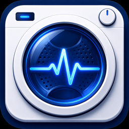

# ioBroker.laundrylens

Самообучающийся адаптер ioBroker для автоматического определения циклов работы стиральной, сушильной и посудомоечной машин с помощью измерения потребляемой мощности интеллектуальной розетки. Распознает запущенные программы, оценивает оставшееся время и отправляет уведомления в Telegram – полностью локально, без облачного хранилища.

---

## Как это работает

LaundryLens записывает кривую энергопотребления каждого цикла и сравнивает её с сохраненными профилями программ, используя корреляцию с учетом сегментов и алгоритм DTW-lite. Достоверность результатов накапливается в течение нескольких раундов сопоставления, прежде чем программа будет принята, что предотвращает срабатывание ошибочного сопоставления из-за отдельных выбросов. Оставшееся время оценивается динамически на основе как прошедшего времени, так и текущего энергопотребления, а не только фиксированного среднего значения.

Адаптер самообучающийся: предустановленных профилей нет. Каждая программа обучается на вашем конкретном устройстве. Распознавание улучшается с каждым завершенным циклом.

---

## Функции

- Обнаружение циклов с помощью конечного автомата (ВЫКЛ → НАЧАЛО → РАБОТА ↔ ПАУЗА → ЗАВЕРШЕНИЕ)
- Сопоставление программ самообучения (взвешенная по сегментам корреляция + разрешение дизъюнкции DTW)
- Накопление баллов в нескольких раундах с учетом пороговых значений достоверности, специфичных для каждого устройства.
- Блокировка отмены: программы, выбранные вручную, не перезаписываются фоновым сопоставлением.
- Адаптивная оценка оставшегося времени, сочетающая сигналы, основанные на времени и скорости потребления энергии.
- Административный интерфейс с расширяемым списком циклов, встроенным графиком мощности (холст), легендой фаз, обрезкой и разделением по касанию/перетаскиванию.
- Уведомления в Telegram с настраиваемыми порогами обновления, заполнителями (`{progress}`, `{prevTime}`, `{state:objectId}` для любой точки данных ioBroker) и условных текстовых блоков
- Также поддерживает Pushover, Signal, WhatsApp, Matrix, notify-my-android, Prowl и электронную почту (через [ioBroker.email](https://github.com/iobroker-community-adapters/ioBroker.email) ) в качестве получателей уведомлений.
- Несколько устройств: один экземпляр на каждое устройство (стиральная машина, сушилка и т. д.).
- Одна розетка для стиральной и посудомоечной машин, которые никогда не работают одновременно: обнаруженная программа показывает, какая из них запущена.
- Виджет для ioBroker.vis-2 и плитка для ioBroker.devices с отображением состояния, программы, этапа и оставшегося времени.
- Локализованные, готовые к отображению текстовые данные (`phaseText`, `stateText`, `programText`) наряду с внутренними языково-нейтральными средствами, позволяющими сразу перейти к панели мониторинга VIS.

---

## Требования

- ioBroker с js-контроллером ≥ 6.0.11
- Node.js ≥ 22
- ioBroker.admin ≥ 8.0.0
- «Умная» розетка или адаптер для измерителя мощности, предоставляющий данные о потребляемой мощности каждого устройства (например [, Shelly EM](https://www.shelly.com/en/products/shop/shelly-em) ).

---

## Установка

Установите **LaundryLens** через список адаптеров в административной панели ioBroker (вкладка "Адаптеры"), затем создайте отдельный экземпляр адаптера для каждого устройства и выберите точку данных "ватт" в конфигурации экземпляра.

---

## Конфигурация

Каждый экземпляр имеет следующие настройки:

| Параметр                                | Описание                                                                                                                                                                                                                                                                                  |
| --------------------------------------- | ----------------------------------------------------------------------------------------------------------------------------------------------------------------------------------------------------------------------------------------------------------------------------------------- |
| Название устройства                     | Отображаемое имя для этого устройства                                                                                                                                                                                                                                                     |
| Тип устройства                          | `washing_machine`, `dishwasher`, `dryer`, `washer_dryer` или `washer_dishwasher` (влияет на логику определения фазы, см. [Один разъем для двух машин](#one-plug-for-a-washing-machine-and-a-dishwasher) )                                                                                  |
| Датчик мощности (Вт)                    | Данные ioBroker, предоставляющие значения мощности в ваттах.                                                                                                                                                                                                                              |
| Пороговая мощность (Вт)                 | Минимальная мощность, при которой устройство считается работающим.                                                                                                                                                                                                                        |
| Пороговая мощность (Вт)                 | Необязательно. Рабочий цикл завершается только тогда, когда уровень мощности остается на этом уровне или ниже в течение задержки выключения, например, 0 Вт для посудомоечной машины, потребляющей несколько ватт в тихом режиме. Пусто = то же самое, что и пороговое значение мощности. |
| Задержка выключения (мин)               | После отключения электроэнергии следует подождать, прежде чем завершать цикл.                                                                                                                                                                                                             |
| Начальная энергия (Вт·ч)                | Минимальное количество энергии, потребляемое до начала сопоставления (фильтрует короткие всплески).                                                                                                                                                                                       |
| Допуск по продолжительности             | Допустимое отклонение от средней продолжительности обучения (0,05–0,5)                                                                                                                                                                                                                    |
| Интервал совпадения (мин)               | Как часто происходит сопоставление данных в течение цикла?                                                                                                                                                                                                                                |
| Подтверждение матчей                    | Количество последовательных раундов, которые должен выдержать матч, прежде чем он будет принят.                                                                                                                                                                                           |
| Порог автоматического подтверждения (%) | Уровень уверенности, при котором матч подтверждается автоматически.                                                                                                                                                                                                                       |
| Порог мгновенного подтверждения (%)     | Уверенность, при которой матч принимается немедленно (2 раунда подряд)                                                                                                                                                                                                                    |
| Порог обнаружения программы (%)         | Минимальный уровень уверенности, необходимый для того, чтобы кандидат вообще был рассмотрен.                                                                                                                                                                                              |
| Уведомить о вероятном совпадении        | Отправить уведомление еще до официального подтверждения матча                                                                                                                                                                                                                             |
| Игнорируйте средство против скатывания  | Не следует игнорировать фазы предотвращения образования складок в конце цикла сушки.                                                                                                                                                                                                      |

Порог обнаружения — это компромисс: чем ниже он, тем быстрее уведомления, но тем выше риск ошибочных совпадений.

---

## Одна розетка для стиральной и посудомоечной машин.

С типом устройства `washer_dishwasher` Одна розетка может питать обе машины, если они никогда не работают одновременно. Две работающие машины дают одну кривую мощности, которую невозможно различить.

1. Выберите тип устройства и дайте ему имя, подходящее для обоих вариантов.
2. На вкладке «Программы» выберите машину для каждой программы. Запомненные ранее программы по умолчанию относятся к стиральной машине, поэтому переместите программы посудомоечной машины один раз. Записанные циклы получат соответствующие этапы.

Обнаруженная программа затем определяет, какая машина работает: этапы, `appliance` точка данных и `{device}` За ним следуют заполнители уведомлений. Пока программа не известна, этапы еще не определены. `{device}` Это название устройства, которое также относится к уведомлению о запуске. Задержка выключения общая для обоих устройств, поэтому она должна соответствовать более длительной (по умолчанию 8 минут).

---

## Количество точек данных на устройство

| Точка данных        | Тип           | Описание                                                                                                                                                                                        |
| ------------------- | ------------- | ----------------------------------------------------------------------------------------------------------------------------------------------------------------------------------------------- |
| `state`             | нить          | выключено / запуск / выполняется / приостановлено / завершение (языконейтральная внутренняя клавиша, предназначенная для автоматизации)                                                         |
| `stateText`         | нить          | То же самое, что и `state` но в виде готового к отображению локализованного текста (например, "Running ⚙️" / "Läuft ⚙️") - см.[`displayLanguage`](#configuration)                                |
| `running`           | логический    | Простой индикатор включения/выключения                                                                                                                                                          |
| `appliance`         | нить          | Запуск машины как языково-независимая клавиша: тип устройства или использование общего разъема. `washing_machine` /`dishwasher` как только программа станет известна (до этого она будет пустой) |
| `program`           | нить          | Обнаружено название программы                                                                                                                                                                   |
| `programText`       | нить          | То же самое, что и `program` но с `detecting...` Заполнитель локализован (подтвержденная программа — это ваше собственное сохраненное имя, переданное без изменений)                              |
| `confidence`        | число         | Достоверность совпадения в %                                                                                                                                                                    |
| `timeRemaining`     | число         | Примерное оставшееся время в секундах                                                                                                                                                           |
| `totalDuration`     | число         | Расчетная общая продолжительность цикла в секундах                                                                                                                                              |
| `cycleProgress`     | число         | Прогресс цикла 0–100 %                                                                                                                                                                          |
| `phase`             | нить          | Текущая фаза цикла (языко-нейтральная внутренняя клавиша, например) `washing`, `dryer_drying`)                                                                                                  |
| `phaseText`         | нить          | То же самое, что и `phase` но в виде готового к отображению локализованного текста с эмодзи (например, "🫧 Washing" / "🫧 Wäscht")                                                               |
| `lastCycleProgram`  | нить          | Программа последнего завершенного цикла                                                                                                                                                         |
| `lastCycleDuration` | число         | Продолжительность последнего цикла в минутах                                                                                                                                                    |
| `lastCycleEnergy`   | число         | Энергия, потребленная в последнем цикле (Вт·ч)                                                                                                                                                  |
| `availablePrograms` | строка (JSON) | Массив всех сохраненных названий программ, например, для внешних выпадающих списков.                                                                                                            |

`phase` /`state` /`program` Они предназначены для автоматизации/скриптов и используют фиксированные, не зависящие от языка значения, которые никогда не меняются в зависимости от языка вашего ioBroker — используйте соответствующий параметр. `*Text` В качестве точки данных используйте другой подход, если хотите отображать статус непосредственно на панели мониторинга VIS без создания собственной таблицы переводов. Язык для `phaseText` /`stateText` /`programText` По умолчанию используется системный язык ioBroker, который можно переопределить для каждого устройства с помощью параметра "Язык отображения".

---

## Виджеты

Адаптер предоставляет виджет для ioBroker.vis-2 и плитку для ioBroker.devices. Они отображают состояние, программу, фазу и оставшееся время устройства, а также индикатор выполнения. При нажатии отображаются все подробности, включая последний цикл и количество циклов для проверки. Виджеты отображают только текст: подтверждение цикла остается во вкладке администратора.

| Хозяин           | Виджет                       | Макеты                                                                 |
| ---------------- | ---------------------------- | ---------------------------------------------------------------------- |
| ioBroker.vis-2   | Набор виджетов "LaundryLens" | Автоматический по размеру, компактный, барный, широкий, всё что угодно |
| ioBroker.devices | Плитка «LaundryLens»         | 1x1, 2x1, 2x½                                                          |

В vis-2 добавьте виджет из набора "LaundryLens". В ioBroker.devices используйте "Добавить виджет" в режиме редактирования. В обоих случаях выберите устройство из списка в настройках виджета. Тексты статуса, этапа и программы отображаются по мере их записи адаптером. `stateText`, `phaseText` и `programText` Поэтому они следуют языку системы и опции «без эмодзи».

веб-компонент `<iob-laundrylens-device>` из[`@iobroker/web-components`](https://github.com/ioBroker/web-components) Отображает те же представления на других хостах. Например, используется идентификатор объекта устройства. `laundrylens.0.device_0_97io` На других хостах это еще не тестировалось.

## Использование точек данных в уведомлениях

Помимо встроенных заполнителей (`{device}`, `{program}`, `{duration}`, `{energy}`, `{startTime}`, `{endTime}`, `{progress}`, `{prevTime}` В шаблоне уведомления можно указать текущее значение **любой** точки данных ioBroker, используя следующие параметры:

```
{state:objectId}
```

Например, чтобы включить текущую температуру наружного воздуха и цену на электроэнергию в сообщение о завершении:

```
🧺 {device} done!
⏱️ Total runtime: {duration} min
🌡️ Outside: {state:0_userdata.0.outsideTemp}°C
💶 Price: {state:0_userdata.0.electricityPrice} ct/kWh
```

Это также работает внутри условного оператора. `[...]` блоки: `[🌡️ Outside: {state:0_userdata.0.outsideTemp}°C]` Если этот идентификатор объекта пуст или не существует, он полностью исчезает из сообщения, точно так же, как и в случае с пустым встроенным заполнителем. Отсутствующий или нечитаемый идентификатор объекта никогда не нарушает целостность сообщения — он просто преобразуется в ничто.

---

## Советы для начинающих

- Перед тем как ожидать надежного обнаружения, дайте устройству поработать не менее 3–5 циклов на каждую программу.
- Начните с меньшего количества программ. Чем меньше профилей у вас будет, тем выше будет точность сопоставления.
- Используйте **вкладку «Циклы»** в административном интерфейсе, чтобы просмотреть прошлые циклы, удалить шум в начале/конце записанного трассировочного файла или разделить трассировочный файл, содержащий две программы.
- Перед любым обновлением воспользуйтесь функцией **экспорта** , чтобы создать резервную копию изученных профилей и истории циклов.

---

## Кредиты

Новая вкладка администратора в версии 0.6.0 — работа [GermanBluefox](https://github.com/GermanBluefox) . Он переработал её с помощью React 19 в виде вкладки JSON ( [#65](https://github.com/backfisch88/ioBroker.laundrylens/pull/65) ), а также обнаружил и исправил посудомоечную машину, переименовал устройство и `lastCycle` проблемы ( [#66](https://github.com/backfisch88/ioBroker.laundrylens/pull/66) ). Поскольку запросы на слияние больше нельзя было объединять после других изменений в `main` Я перенял его коммиты, сделав его автором, и добавил свои иконки и мобильную раскладку. Спасибо за отличную работу!

В версии 0.7.0 [GermanBluefox](https://github.com/GermanBluefox) добавил общий плагин для стиральной и посудомоечной машин, а также виджет для ioBroker.vis-2, плитку для ioBroker.devices и веб-компонент ( [#66](https://github.com/backfisch88/ioBroker.laundrylens/pull/66) ). Он также протестировал их на своей системе и обнаружил и исправил пустой столбец с машинами в таблице программ. Спасибо еще раз!

---

## Вклад

Приветствуются сообщения об ошибках и запросы на изменение кода: [Issues](https://github.com/backfisch88/ioBroker.laundrylens/issues)

---

## Changelog

### **WORK IN PROGRESS**

### 0.7.1 (2026-11-20)
- New: optional end power threshold per device, for appliances with quiet phases of a few watts ([#76](https://github.com/backfisch88/ioBroker.laundrylens/issues/76))
- Fix: recipient "All (broadcast)" showed an empty field ([#77](https://github.com/backfisch88/ioBroker.laundrylens/issues/77))

### 0.7.0 (2026-11-17)
- New: one plug for a washing machine and a dishwasher (device type `washer_dishwasher`, data point `appliance`) by [GermanBluefox](https://github.com/GermanBluefox) ([#66](https://github.com/backfisch88/ioBroker.laundrylens/pull/66))
- New: widget for ioBroker.vis-2, tile for ioBroker.devices and the web component `<iob-laundrylens-device>` by [GermanBluefox](https://github.com/GermanBluefox) ([#66](https://github.com/backfisch88/ioBroker.laundrylens/pull/66))
- Fix: checker findings (`common.adminUI.tab`, Dependabot for the widget folders)

### 0.6.0 (2026-11-13)
- BREAKING: requires ioBroker.admin 8 or newer
- Changed: admin tab rebuilt with React 19 by [GermanBluefox](https://github.com/GermanBluefox) ([#65](https://github.com/backfisch88/ioBroker.laundrylens/pull/65)); follows the Admin theme, duotone icons, phone layout
- Fix: dishwasher heating detected from 800 W (by GermanBluefox, [#66](https://github.com/backfisch88/ioBroker.laundrylens/pull/66))
- Fix: renamed device kept the old name in its channel object (by GermanBluefox, [#66](https://github.com/backfisch88/ioBroker.laundrylens/pull/66))
- Fix: `lastCycle` and `lastCycleProgram` after a correction (by GermanBluefox, [#66](https://github.com/backfisch88/ioBroker.laundrylens/pull/66))
- Fix: some admin tab messages were always German

### 0.5.0 (2026-11-12)
- New: light/dark theme in the admin tab
- Changed: SVG icons instead of emoji, new adapter icon
- Fix: programs table on small screens

### 0.4.44 (2026-11-08)
- Fix: kWh when splitting, trimming and merging cycles
- Fix: admin error messages translated

### 0.4.43 (2026-11-08)
- Changed: merge with the previous cycle via one button

### 0.4.42 (2026-11-08)
- New: merge 2-3 cycles into one (Cycles tab)

Older changelog entries can be found in CHANGELOG_OLD.md.

---

## License

MIT License

Copyright (c) 2026 backfisch88 <henrik.schoenhofen@icloud.com>

Permission is hereby granted, free of charge, to any person obtaining a copy
of this software and associated documentation files (the "Software"), to deal
in the Software without restriction, including without limitation the rights
to use, copy, modify, merge, publish, distribute, sublicense, and/or sell
copies of the Software, and to permit persons to whom the Software is
furnished to do so, subject to the following conditions:

The above copyright notice and this permission notice shall be included in all
copies or substantial portions of the Software.

THE SOFTWARE IS PROVIDED "AS IS", WITHOUT WARRANTY OF ANY KIND, EXPRESS OR
IMPLIED, INCLUDING BUT NOT LIMITED TO THE WARRANTIES OF MERCHANTABILITY,
FITNESS FOR A PARTICULAR PURPOSE AND NONINFRINGEMENT. IN NO EVENT SHALL THE
AUTHORS OR COPYRIGHT HOLDERS BE LIABLE FOR ANY CLAIM, DAMAGES OR OTHER
LIABILITY, WHETHER IN AN ACTION OF CONTRACT, TORT OR OTHERWISE, ARISING FROM,
OUT OF OR IN CONNECTION WITH THE SOFTWARE OR THE USE OR OTHER DEALINGS IN THE
SOFTWARE.