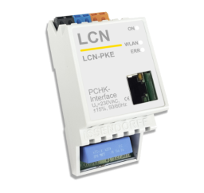
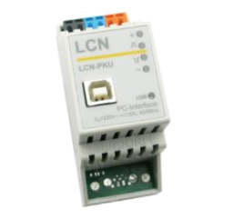

# ioBroker.lcn

**Этот адаптер использует библиотеки Sentry для автоматического сообщения разработчикам об исключениях и ошибках в коде.** Более подробную информацию, а также инструкции по отключению отправки сообщений об ошибках см. [в документации Sentry-Plugin](https://github.com/ioBroker/plugin-sentry#plugin-sentry) ! Система отчетности Sentry используется начиная с js-controller 3.0.

Этот адаптер позволяет подключить локальную сеть управления [(LCN)](https://www.lcn.eu/) к ioBroker.

## Поддерживаемые шлюзы

- LCN-PKE



- LCN-PKU с LCN-PCHK



**Не забывайте об этом `ioBroker.lcn` Заблокирует одну лицензию подключения LCN.**

Конфигурация и модули будут автоматически обнаружены в ходе сканирования, которое необходимо запустить вручную на вкладке «Модули» диалогового окна конфигурации и которое можно повторить в любое время.

Требуется версия admin >= 7.8.23 (на вкладке "Модули" используется диспетчер устройств).

## Типы

Поддерживаются следующие группы чтения и записи:

- Аналоговые значения (выход/вход)
- Реле (выход)
- Датчики (входные)
- Светодиоды (выход/вход)
- Переменные (входные данные)

## Переменные

Для применения допустимых функций преобразования к переменным, переменные должны иметь допустимые роли. Поддерживаются следующие роли:

- **значение.температуры** - температура в градусах Цельсия
- **value.brightness** - Люкс (I-вход) в люксах
- **value.speed.wind** - скорость ветра в м/с
- **value.voltage** - напряжение в вольтах
- **value.current** - текущее значение в амперах
- **value.sun.azimuth** - азимут солнца
- **value.sun.elevation** - высота солнца

Без одной из этих ролей отображается исходное значение. Исключение: `VAR02` и `VAR03` (Обычно R1Var и R2Var регуляторов) отображаются в °C, как и в предыдущих версиях. При изменении роли переменной адаптер снова считывает ее значение из модуля.

Модули с прошивкой до версии 170206 имеют только 3 переменные (TVar, R1Var, R2Var). Они создаются следующим образом: `VARS.VAR01` -`VARS.VAR03` Модули, которые были просканированы с помощью более старой версии адаптера, необходимо просканировать повторно (в диспетчере устройств выберите «Просканировать снова»), чтобы адаптер обнаружил новую прошивку.

Модули отправляют значения переменных не всегда самостоятельно. Опция «Читать переменные каждые (мин)» в расширенных настройках циклически считывает переменные всех модулей. `0` = выключено). Переменные считываются одна за другой, поэтому при наличии множества модулей один цикл может занять некоторое время.

## Отображать

Для каждого устройства можно активировать параметр наличия или отсутствия дисплея (дисплей в диспетчере устройств: "Настройки модуля").

## Регулятор (Реглер)

Для каждого устройства можно активировать параметр наличия или отсутствия регуляторов (диспетчер устройств: "Настройки модуля").

## Выходные реле

Для каждого устройства можно задать количество выходных реле (0-8), которые необходимо создать (диспетчер устройств: "Настройки модуля").

## Настройки

- Интервал переподключения (сек.) — как часто адаптер пытается подключиться. По умолчанию — каждые 30 секунд.
- Время ожидания подключения (мс) — время, в течение которого адаптер ожидает ответа о подключении, включая аутентификацию. По умолчанию — 6 секунд.
- Время ожидания ответа при сканировании (мс) — время, в течение которого адаптер ожидает ответов после сканирования модулей.
- Тайм-аут ответа (мс) - время ожидания для команд управления.
- Интервал пинга (сек.) — как часто адаптер отправляет запросы пинга.
- Таймаут ответа Ping (мс) - время ожидания для запросов ping
- Считывать переменные каждые (мин) - циклически считывать переменные всех модулей. `0` = выключено (по умолчанию)
- Реле входа/выхода одинаковы — если реле «выхода» и «входа» одинаковы или если это разные реле.

```
// =====================  Same relays =============================
//                                    +-------+
// ----------------- OUT -----------> |       |
//                                    | Relay |
// <----------------- IN ------------ |       |
//                                    +-------+
// 
// 
// ======================  Different relays =======================
//                                    +-------+
//                                    |       |
// ----------------- OUT -----------> | Relay |
//                                    |       |
//                                    +-------+
// 
//                                    +--------+
//                                    | Sensor |
// <----------------- IN ------------ |   or   |
//                                    | Relay  |
//                                    +--------+
```

## Как использовать

После первого запуска необходимо выполнить сканирование устройств. Откройте вкладку «Модули» в диалоговом окне конфигурации и нажмите кнопку сканирования (значок лупы) в диспетчере устройств. Введите адрес самого старшего модуля, который необходимо просканировать (например, `250`) или диапазон, например `5-30`.

Если шина имеет сегментные сцепки, введите сегменты, которые необходимо отсканировать, разделяя их запятой (например, `0, 5, 7`). `0` Это собственный сегмент (сегмент, к которому подключен шлюз), все остальные сегменты адресуются по их идентификатору сегмента. Сканирование сегментов происходит один за другим. Модули получают идентификаторы. `S<segment>.M<module>` например `lcn.0.S005.M010`.

Каждый найденный модуль выполняет следующие действия:

- **Настройки модуля** — количество выходных реле, дисплей и регуляторы.
- **Повторное сканирование** — повторное считывание названия, комментария, серийного номера и состояний этого модуля (в сегменте модуля).

## API сообщений

- `sendTo('lcn.0', 'scan', { max: '250', segment: 0 }, result => ...)` - просканировать один сегмент автобуса (`max` может быть `"max"` или `"min-max"`, `segment` является необязательным: `0` = собственный сегмент, в противном случае — идентификатор сегмента). Результат: `{ total, _new }` или `{ error }`
- `sendTo('lcn.0', 'getAll', null, devices => ...)` - список всех модулей `[{ id, common, native }]`
- `lcn.0.scan.manual` - писать `*` прочитать состояние всех модулей или `S0:6` прочитать состояние сегмента 0, модуля 6

## ToDO

- Диалоговое окно настроек для определения типа переменных.

<!--
	Placeholder for the next version (at the beginning of the line):
	### **WORK IN PROGRESS**
-->

## Changelog
### 4.0.0 (2026-11-13)
* (GermanBluefox) Added concurrency configuration to the test-and-release workflow to cancel outdated runs (#118)
* (GermanBluefox) Fixed repochecker warnings: size attributes in the configuration, Sentry notice, dependabot cooldown (#132)

### 4.0.0-beta.3 (2026-11-03)
- (bluefox) Fixed: `VAR02` and `VAR03` were converted twice, if a role like `value.temperature` was set. Without such a role they are still shown in °C
- (bluefox) Fixed: the scan wrote the values of the variables without the conversion of their role
- (bluefox) The value of a variable is read again from the module, when its role is changed

### 4.0.0-beta.2 (2026-11-03)
- (bluefox) Fixed: commands could get stuck in the queue, if several commands waited behind a command, that waits for an answer
- (bluefox) Fixed: variables of modules with a firmware before 170206 (only 3 variables) were not created. These modules must be scanned again (#22)
- (bluefox) Added option to read the variables of all modules cyclically (#22)
- (bluefox) Values without the number of the variable are ignored now. Before, the adapter logged an error for `MEASURES.MEASURE`

### 4.0.0-beta.1 (2026-11-03)
- (bluefox) Modules in other segments can be scanned: the scan dialog accepts a list of segments (#53)

### 4.0.0-beta.0 (2026-11-03)
- (bluefox) Breaking change: Adapter requires admin >= 7.8.23 now
- (bluefox) The adapter was refactored to TypeScript
- (bluefox) The configuration dialog was migrated to JsonConfig. The modules are scanned and configured in the device manager
- (bluefox) Fixed: the adapter reconnected to LCN after it was stopped and did not finish the stop correctly
- (bluefox) Fixed: `ir.lowbat` was never set
- (bluefox) Fixed: finger sensor codes were written into `ir.serial` instead of `finger.code`
- (bluefox) Fixed: a failed authentication on LCN-PCHK was not recognized
- (bluefox) Fixed: regulator states of scanned modules were recreated on every change of the device object
- (bluefox) Fixed: writing a state, whose object cannot be read, could crash the adapter

## License
The MIT License (MIT)

Copyright (c) 2018-2024 Denis Haev <dogafox@gmail.com> Private License  
Copyright (c) 2025-2026 Denis Haev <dogafox@gmail.com> MIT License

Permission is hereby granted, free of charge, to any person obtaining a copy
of this software and associated documentation files (the "Software"), to deal
in the Software without restriction, including without limitation the rights
to use, copy, modify, merge, publish, distribute, sublicense, and/or sell
copies of the Software, and to permit persons to whom the Software is
furnished to do so, subject to the following conditions:

The above copyright notice and this permission notice shall be included in all
copies or substantial portions of the Software.

THE SOFTWARE IS PROVIDED "AS IS", WITHOUT WARRANTY OF ANY KIND, EXPRESS OR
IMPLIED, INCLUDING BUT NOT LIMITED TO THE WARRANTIES OF MERCHANTABILITY,
FITNESS FOR A PARTICULAR PURPOSE AND NONINFRINGEMENT. IN NO EVENT SHALL THE
AUTHORS OR COPYRIGHT HOLDERS BE LIABLE FOR ANY CLAIM, DAMAGES OR OTHER
LIABILITY, WHETHER IN AN ACTION OF CONTRACT, TORT OR OTHERWISE, ARISING FROM,
OUT OF OR IN CONNECTION WITH THE SOFTWARE OR THE USE OR OTHER DEALINGS IN THE
SOFTWARE.