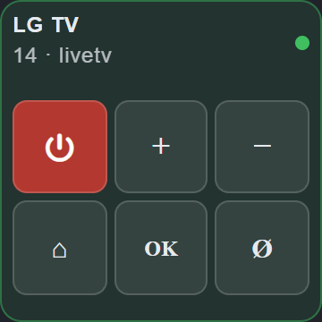
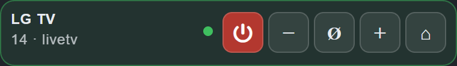

# IoBroker.lgtv
> [!ВАЖНО] > Этот адаптер нельзя установить из GitHub

Адаптер LG WebOS SmartTV для ioBroker

Дистанционное управление смарт-телевизором LG WebOS (модели 2013 года и выше) с помощью [ioBroker](https://www.iobroker.net).

---

## Использование:
Установите адаптер через административный интерфейс ioBroker.
В настройках адаптера введите IP-адрес вашего телевизора LG WebOS. Во время работы экземпляра в поле IP-адреса будут отображаться телевизоры, найденные в сети, для выбора.
При первом подключении на экране телевизора появится запрос на сопряжение, где вам следует разрешить подключение.

### Опрос
Некоторые телевизоры отключаются от веб-сокета при выключении и некорректно передают эту информацию адаптеру. В этом случае требуется дополнительный опрос. Время опроса можно задать в настройках. Если значение пустое, адаптер пытается определить это автоматически: при перезагрузке адаптера опрос (каждые 60 секунд) активен до тех пор, пока не будет обнаружено первое корректное событие выключения телевизора.

## Несколько примеров:
`setState('lgtv.0.states.popup', 'Some text!');`

В результате на экране телевизора появится всплывающее окно с текстом "Некоторый текст!".
В тексте можно использовать переносы строк HTML (br).

`setState('lgtv.0.states.turnOff', true);`

Выключаю телевизор.

`setState('lgtv.0.states.mute', true);`

Выключите звук на телевизоре.

`setState('lgtv.0.states.mute', false);`

Включите звук на телевизоре.

`setState('lgtv.0.states.volumeUp', true);`

Это увеличит громкость телевизора.

`setState('lgtv.0.states.volumeDown', true);`

Уменьшите громкость телевизора.

`setState('lgtv.0.states.channelUp', true);`

Увеличение количества текущих телеканалов.

`setState('lgtv.0.states.channelDown', true);`

Сокращение количества текущих телеканалов.

`setState('lgtv.0.states.3Dmode', true);`

Активирует 3D-режим на телевизоре.

`setState('lgtv.0.states.3Dmode', false);`

Отключает 3D-режим на телевизоре.

`setState('lgtv.0.states.channel', 7);`

Переключение прямого эфира на канал номер 7.

`setState('lgtv.0.states.launch', 'livetv');`

Переключение в режим просмотра телепередач в прямом эфире.

`setState('lgtv.0.states.launch', 'smartshare');`

Открытие приложения SmartShare на телевизоре.

`setState('lgtv.0.states.launch', 'tvuserguide');`

Запускает приложение «Руководство пользователя телевизора» на телевизоре.

`setState('lgtv.0.states.launch', 'netflix');`

Открытие приложения Netflix на телевизоре.

`setState('lgtv.0.states.launch', 'youtube');`

Открывает приложение YouTube на телевизоре.

`setState('lgtv.0.states.launch', 'prime');`

Открывает приложение Amazon Prime на телевизоре.

`setState('lgtv.0.states.launch', 'amazon');`

На некоторых телевизорах эта команда открывает приложение Amazon Prime.

`setState('lgtv.0.states.openURL', 'http://www.iobroker.net');`

Открывает веб-браузер на телевизоре и переходит на сайт www.iobroker.net.
Также может использоваться для открытия изображений или видео (в браузере).

`setState('lgtv.0.states.input', 'av1');`

Переключает вход на телевизоре на AV1.

`setState('lgtv.0.states.input', 'scart');`

Переключает вход телевизора на Scart.

`setState('lgtv.0.states.input', 'component');`

Переключает вход телевизора на компонентный.

`setState('lgtv.0.states.input', 'hdmi1');`

Переключает вход телевизора на HDMI 1.

`setState('lgtv.0.states.input', 'hdmi2');`

Переключает вход телевизора на HDMI 2.

`setState('lgtv.0.states.input', 'hdmi3');`

Переключает вход телевизора на HDMI 3.

`setState('lgtv.0.states.youtube', 'https://www.youtube.com/watch?v=AjSpMQfRmEo'); OR setState('lgtv.0.states.youtube', 'AjSpMQfRmEo');`

Воспроизвести видео на YouTube.

`setState('lgtv.0.states.raw', '{"url": "ssap://system.launcher/launch", "cmd": "{id: 'netflix'}" }');` `setState('lgtv.0.states.raw', '{"url": "ssap://api/getServiceList", "cmd": ""}');`

Отправка и получение RAW-команд через API.

`setState('lgtv.0.remote.*KEY*', true);`

Отправьте кнопку дистанционного управления на телевизор.

`setState('lgtv.0.states.power', true/false);`

Выключите телевизор и включите его (включите, работает только по локальной сети, с использованием WOL).

`setState('lgtv.0.states.soundOutput', 'external_arc');`

Переключение аудиовыхода через ARC (HDMI).

---

## Штаты
`channel`

содержит текущий канал

`volume`

Сохраняет текущий уровень громкости и может изменять его. По умолчанию увеличение на 5 или более происходит с шагом в 2 каждые 500 мс, чтобы не нагружать динамики; отключите параметр *Увеличение громкости с плавным изменением* в настройках экземпляра, чтобы установить все уровни одновременно.

`on`

Значение истинно, когда телевизор включен, и ложно, если телевизор выключен. Значение соответствует состоянию питания, которое сообщает сам телевизор (`states.powerState`): `on`, `screen_off` и `screen_saver` считаются включенными, `standby` (режим быстрого запуска, в котором телевизор некоторое время поддерживает сетевое соединение открытым) и `off` считаются выключенными. Телевизоры без этой конечной точки (webOS 3 и более старые версии) считаются включенными, пока они сообщают о наличии приложения на переднем плане.

`powerState`

Состояние питания, сообщаемое телевизором, сопоставляется с `on`, `screen_off`, `screen_saver`, `standby` или `off` (сам телевизор сообщает `Active`, `Screen Off`, `Screen Saver`, `Active Standby` и `Suspend`/`Power Off`)

---

## Виджет дистанционного управления для `ioBroker.devices`
В комплект адаптера входит виджет **Управление ТВ** для адаптера `devices`. Добавьте его туда через *Добавить виджет → Управление ТВ*, выберите экземпляр lgtv, и виджет будет напрямую управлять состояниями `remote.*` этого экземпляра. В строке состояния отображается текущая громкость, состояние отключения звука и запущенное приложение; точка в углу соответствует состоянию `states.on`.

Кнопка питания соответствует `remote.power`: она отправляет сигнал нажатия кнопки POWER, когда телевизор включен, и пакет Wake-on-LAN, когда он выключен.

| Компактный (1x1) | Широкий (2x0,5) | Полноценный пульт дистанционного управления (2x1 / 2x2) |
|--------------------------------------------|--------------------------------------|---------------------------------------------|
|  |  | ![Полная удаленная компоновка]](../../../en/adapterref/iobroker.lgtv/docs/widget-full.png) |

В настройках виджета можно отключить кнопки переключения каналов, медиа-клавиши, цветовые клавиши и цифровую клавиатуру. Под клавишами на пульте дистанционного управления расположены кнопки для приложений канала `tv` (см. ниже) и, если они включены в настройках виджета, для управления его входами.

## Удаленное управление в административной панели
В настройках экземпляра есть две вкладки. **Настройки** содержат конфигурацию; **Пульт дистанционного управления** - это полноценный пульт для телевизора, поэтому им можно управлять непосредственно из административной панели без скрипта или представления `devices`.

Он записывает те же состояния `remote.*`, что и виджет выше, и отображает состояние питания телевизора, запущенное приложение, текущий вход и громкость, которую также можно перетаскивать. Клавиши действуют немедленно - это запись состояния, а не настроек, поэтому кнопка *Сохранить* в диалоговом окне к ним не имеет никакого отношения.

Рядом с ним можно одним нажатием запустить приложения и входы канала `tv` (см. ниже). После нажатия на пульт также можно управлять им с помощью клавиатуры: стрелки, Enter, Backspace (назад), Esc (выход), Home, `+` / `-` (громкость), `M` (отключение звука), пробел (воспроизведение) и `0`-`9`.

Экземпляр должен быть запущен: когда он остановлен, клавиши отключены, и об этом сообщается на вкладке.

## Веб-компонент для Aura и других хостов
Пульт дистанционного управления также доступен в виде веб-компонента `<iob-lgtv-remote>` (`common.webComponents`), поэтому каждый хост, отображающий веб-компоненты ioBroker - Aura и vis-2, `devices`, а также административная панель, где они поддерживаются, - может его разместить. Он носит то же имя, что и виджет выше (**Control TV**), поэтому `devices` продолжает предлагать свой собственный виджет.

Он записывает те же состояния `remote.*` и отображает тот же заголовок: имя, громкость, состояние отключения звука, запущенное приложение и точку в `states.on`. Размер отображаемой части пульта зависит от размера его устройства:

| Ящик | Ключи |
|-------------------------------------------|-----------------------------------------------------------------|
| от 340 пикселей в высоту и 180 пикселей в ширину | весь пульт дистанционного управления, включая строки, в которых включены настройки |
| Плоская полоса (высотой до 110 пикселей) | Питание, Уменьшение громкости, Отключение звука, Увеличение громкости, Домой |
| всё остальное | питание, увеличение и уменьшение громкости, домой, ОК, отключение звука |

На двух небольших макетах кнопка `⋯` рядом с названием открывает весь пульт дистанционного управления в диалоговом окне.

Весь пульт, в большом окошке и в диалоговом окне, также содержит панель состояния вкладки «Пульт» в административной панели: работает ли телевизор, состояние питания, запущенное приложение, вход, а также регулятор громкости с ползунком и состояние отключения звука. В широком окошке он располагается рядом с кнопками, в высоком - над ними; там, где ни один из них не помещается, строка состояния под названием остается.

Настройки, как в виджете выше: экземпляр LGTV, статус (линия или панель), клавиши управления каналами, клавиши управления мультимедиа, клавиши управления цветом, цифровая клавиатура и собственное имя.

## Канал `tv` (детектор типа)
В дополнение к существующим объектам адаптер создает канал `lgtv.0.tv`, который детектор типов ioBroker (>= 6.2.0) распознает как тип устройства `tv`. С помощью этого адаптера можно управлять телевизором, используя визуализации и устройства:

| Штат | Роль | Описание |
|------------------|---------------------------------|----------------------------------------------------------------------|
| `tv.power` | `switch.power` | включено (пробуждение по локальной сети) / выключено |
| `tv.volume` | `level.volume` | объем 0-100, то же, что и `states.volume` |
| `tv.muted` | `media.mute` | mute |
| `tv.volumeUp` | `button.volume.up` | увеличить громкость |
| `tv.volumeDown` | `button.volume.down` | уменьшение громкости |
| `tv.input` | `media.input` | `TV`, `HDMI1`... `HDMI4`, `AV`, `COMPONENT`, `SCART` |
| `tv.app` | `media.app` | Запуск приложения: `YOUTUBE`, `NETFLIX`, `PRIME_VIDEO`, `DISNEY_PLUS`, ... |
| `tv.unreach` | `indicator.maintenance.unreach` | адаптер не подключен к телевизору |
| `tv.unreach` | `indicator.maintenance.unreach` | адаптер не подключен к телевизору |

`tv.input` и `tv.app` начинаются с TV, HDMI 1-4 и YouTube, Netflix, Prime Video и Browser. Как только телевизор подключен, адаптер отображает входы и установленные приложения телевизора, которые известны детектору типа.
Оба также следуют за телевизором: они показывают вход или приложение, находящееся на переднем плане, и остаются пустыми для всего остального.

## Changelog

<!--
    Placeholder for the next version (at the beginning of the line):
    ### **WORK IN PROGRESS**
-->

### **WORK IN PROGRESS**
- (@GermanBluefox) Added the short form of the web component manifests (tag, name, icon, size) to `common.webComponents`, so that hosts like Aura can list the components before the adapter is installed; the build writes it with `iob-web-components sync-io-package`

### 3.2.1 (2026-11-09)
- (GermanBluefox) The keys of the web component `<iob-lgtv-remote>` no longer turn into blue emoji on Windows

### 3.2.0 (2026-11-09)
- (GermanBluefox) The TV remote is also available as a web component for Aura and other visualizations, in large boxes with power state, input and a volume slider; the name of the devices widget is translated

### 3.1.0 (2026-10-29)
- (GermanBluefox) The IP field of the settings offers the TVs found in the network
- (GermanBluefox) Added the channel `tv`, so visualizations and the devices adapter can control the TV
- (GermanBluefox) The remote control in the settings has buttons for apps and inputs and can be operated with the keyboard
- (GermanBluefox) The remote control widget of the devices adapter has buttons for apps and inputs
- (AlanSRU) Added an option to set the volume immediately instead of raising it step by step
- (mcm57) Fixed invalid state roles and read/write flags in object definitions

### 3.0.5 (2026-09-10)
- (GermanBluefox) The instance settings have a second tab with a remote control, so the TV can be operated directly from the admin
- (krobipd) `states.scroll` and `states.drag` no longer ignore a movement whose horizontal or vertical part is zero, so plain vertical scrolling (`0,5`) works
- (krobipd) The configuration dialog is fully translated in all eleven languages; the minimum-value hints no longer show up as untranslated raw text
- (krobipd) The adapter no longer creates files in the home directory of the ioBroker user; the client key, the MAC cache and the certificate file all stay in the adapter's data directory
- (krobipd) Two volume changes in quick succession no longer fight over the TV, and an unreadable volume from the TV no longer disables the stepped volume ramp
- (krobipd) Stopping the adapter while the TV was connected no longer logs "setTimeout called, but adapter is shutting down"
- (krobipd) A stopped or crashed instance no longer keeps reporting `info.connection` as connected
- (krobipd) The TV is no longer reported as switched off while it is actually running
- (krobipd) The new state `states.powerState` shows the power state the TV reports itself
- (krobipd) Switching the TV off and on repeatedly no longer piles up connection checks

### 3.0.3 (2026-09-05)
- (GermanBluefox) The WebOS 26 pairing fallback now also asks for the pointer permissions, so the remote buttons, pointer moves, scrolling and clicks work after a fresh pairing
- (GermanBluefox) Older TVs get the signed pairing manifest again; the unsigned manifest is only used after the TV rejected the signed one (ported from lgtv2 2.0.1)
- (GermanBluefox) Adopted the upstream `lgtv2` test suite for the vendored transport

## License

MIT License

Copyright (c) 2024-2026 iobroker-community-adapters <iobroker-community-adapters@gmx.de>  
Copyright (c) 2023 Sebastian Schultz.

Permission is hereby granted, free of charge, to any person obtaining a copy
of this software and associated documentation files (the "Software"), to deal
in the Software without restriction, including without limitation the rights
to use, copy, modify, merge, publish, distribute, sublicense, and/or sell
copies of the Software, and to permit persons to whom the Software is
furnished to do so, subject to the following conditions:

The above copyright notice and this permission notice shall be included in
all copies or substantial portions of the Software.

THE SOFTWARE IS PROVIDED "AS IS", WITHOUT WARRANTY OF ANY KIND, EXPRESS OR
IMPLIED, INCLUDING BUT NOT LIMITED TO THE WARRANTIES OF MERCHANTABILITY,
FITNESS FOR A PARTICULAR PURPOSE AND NONINFRINGEMENT. IN NO EVENT SHALL THE
AUTHORS OR COPYRIGHT HOLDERS BE LIABLE FOR ANY CLAIM, DAMAGES OR OTHER
LIABILITY, WHETHER IN AN ACTION OF CONTRACT, TORT OR OTHERWISE, ARISING FROM,
OUT OF OR IN CONNECTION WITH THE SOFTWARE OR THE USE OR OTHER DEALINGS IN
THE SOFTWARE.