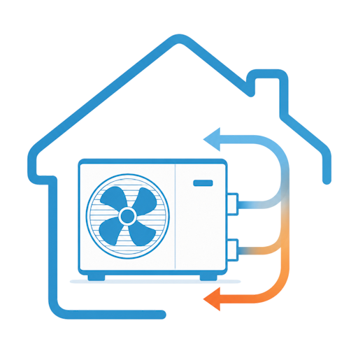

# ioBroker.luxtronik2-controller

## адаптер luxtronik2-controller для ioBroker

**100% локальный мониторинг, управление и оптимизация** тепловых насосов с [контроллерами Luxtronik 2.x / 3.x](https://www.alpha-innotec.com/en/products/accessories/control/luxtronik) (Alpha Innotec, Novelan, Buderus, Siemens и др.) — полностью **без облачных вычислений** .

Осуществляет прямую связь по протоколу **Native TCP (порт 8889)** и, опционально, комбинирует его с **Modbus TCP (гибридный режим)** для записи параметров непосредственно в энергозависимую оперативную память без износа флэш-памяти EEPROM. Включает встроенную **автоматизацию избыточной мощности фотоэлектрических систем** , **расчет COP/JAZ** в реальном времени, интеллектуальную оптимизацию цикла и интеллектуальное управление насосом (HUP и ZIP).

**Руководство:** [английский](/#/docs/adapterref/iobroker.luxtronik2-controller/documentation/readme_en.md) · [немецкий](/#/docs/adapterref/iobroker.luxtronik2-controller/documentation/readme_de.md)

> **💡 Нет кабеля LAN рядом с вашим тепловым насосом? Не проблема!** Если у вашего контроллера Luxtronik 2.0 есть только свободный USB-порт вместо ближайшей сетевой розетки, вы можете легко подключить его по Wi-Fi, используя умный проект **USB 2.0 powered WiFi/Ethernet Bridge** от _obermolch_ . Он питается непосредственно от USB-порта контроллера и устанавливает беспроводное соединение без дополнительных источников питания. Полное руководство и обсуждение в сообществе можно найти здесь: [ioBroker Forum: USB 2.0 powered WiFi/Ethernet Bridge für Luxtronik 2.0](https://forum.iobroker.net/topic/85773/usb-2-0-powered-wifi-ethernet-bridge-f%C3%BCr-luxtronik-2-0) .

**Если вам нравится этот проект и вы хотите поддержать его развитие, вы можете оставить пожертвование здесь: <https://paypal.me/TJahnke>**

### Функции

#### 🔌 Режимы связи и работы

- **3 гибких режима работы:** плавное переключение между безопасным **режимом только для чтения** (только мониторинг, запись на все аппаратные устройства заблокирована) и **режимом записи на уровне** порта. `8889`), и **в гибридном режиме Modbus** .
- **Встроенная связь TCP и WebSocket:** прямое локальное соединение через классический TCP (`8888` /`8889`) или WebSockets (`8214`) с широкой совместимостью с микропрограммами версий V1.x, V2.x и V3.x (динамические коэффициенты масштабирования и адаптивная синхронизация очереди записи).
- **Поддержка гибридного протокола Modbus TCP (0% износа флэш-памяти):** записывает энергозависимые параметры (целевые температуры, кривые нагрева, режимы работы) и катушки непосредственно в ОЗУ контроллера через Modbus TCP (порт). `502`) без износа флэш-памяти EEPROM, при этом продолжая считывать полную телеметрию через собственный порт. Активные состояния Modbus автоматически помечаются тегами. `(Modbus)` в дереве объектов.

#### ☀️ Автоматизация и повышение эффективности фотоэлектрических систем

- **Управление избытком солнечной энергии (PV-Ready):** Полностью интегрированная система автоматизации управления избытком солнечной энергии, использующая данные о поступающей из сети электроэнергии для повышения заданных параметров отопления и/или горячего водоснабжения (без износа, через Modbus TCP):
  - **Динамический приоритет последовательности:** непрерывно отслеживает температуру в реальном времени и перенаправляет избыток воды между горячей водой и отоплением, как только целевой показатель с приоритетом достигает насыщения.
  - **Гистерезис и интеллектуальные таймеры:** настраиваемые задержки запуска/остановки и выделенный порог остановки (логика триггера Шмитта) предотвращают саморазрушающиеся петли обратной связи при увеличении мощности теплового насоса.
  - **Приоритетное использование батарей:** При желании в расчет избытка энергии включается мощность домашней батареи для ее зарядки, что позволяет отдать приоритет тепловому насосу как тепловому аккумулятору.
  - **Аппаратная защита от циклов:** ожидает естественного завершения активных циклов отопления или горячего водоснабжения, прежде чем вернуться к заданным значениям при снижении выработки солнечной энергии, защищая компрессор.
- **COP и JAZ (Калькулятор эффективности):** отслеживание эффективности в режиме реального времени ( _сегодня_ , _последние 7 дней_ , _текущий месяц_ , _текущий год_ ), автоматическое разделение на _отопление_ , _горячее водоснабжение_ и _общее потребление_ . Поддерживает внутренние счетчики Luxtronik или высокоточные внешние счетчики (например, Shelly 3EM, теплосчетчики M-Bus) с постоянным хранением данных. `hidden.cop_buckets`) и защита от падений и предотвращение развевания.

#### 🛡️ Защита оборудования и интеллектуальная оптимизация

- **Аппаратная защита и защита EEPROM-памяти:**
  - **Кэш «чтение перед записью»:** перехватывает и блокирует избыточные команды записи, если контроллер уже хранит целевое значение.
  - **Счетчики записи во флэш-память:** прозрачно отслеживают ежедневные данные (`write_cycles_today`) и кумулятивный (`write_cycles_total` Операции записи в EEPROM.
  - **Настройки по умолчанию в режиме ожидания и интерактивная кривая нагрева:** автоматически восстанавливает безопасные базовые настройки в режиме ожидания, с предварительным просмотром интерактивной кривой нагрева в формате SVG в административном интерфейсе.
  - **Прошивка `.90` Crash Shield:** Автоматически обнаруживает неисправные прошивки от производителя (`V1.90` /`V2.90`) и блокирует сетевую запись, чтобы предотвратить сбои оборудования.
- **Защита компрессора (оптимизация цикла):** интеллектуально связывает циклы отопления и горячего водоснабжения, предотвращая ненужные остановки и запуски компрессора.
- **Динамическое управление циркуляционным насосом отопления (автоматическое ШИМ-определение):** автоматически регулирует управляющее напряжение 0–10 В циркуляционного насоса отопления в зависимости от разницы температур на входе и выходе. Насосы с ШИМ-управлением автоматически определяются и отключаются.
- **Интеллектуальное трехходовое управление циркуляционным насосом (ZIP):**
  - Выберите один из вариантов подключения: **внутренний контроллер Luxtronik** , **внешний исполнительный модуль** (например, Shelly с нулевым износом) или **Modbus TCP (катушка 7)** .
  - Запуск циркуляции по требованию с помощью датчиков движения/кнопок ioBroker (с защитой от циклического охлаждения) или синхронно во время генерации горячей воды.
  - Включает в себя статус виртуального устройства в режиме реального времени (`Virtual_ZIP_Status`) и обратный отсчет оставшегося времени выполнения в секундах в реальном времени (`Virtual_ZIP_Remaining_Time`).

#### 📊 Мониторинг, диагностика и настройка

- **Интегрированные действия (макросы):** Предварительно заданные триггеры для принудительного нагрева (`Zwangsheizen`), принудительная горячая вода (`Zwangswarmwasser`), кровообращение (`Activate_Zip`), ручные сбросы холостого хода (`Setze_Vorgabewerte`), и полные дампы необработанных данных (`Dump_Raw_To_Log`).
- **Интеллектуальное управление объектами и фильтр видимости:** запрашивает флаги видимости оборудования (команда) `3005`) при запуске скрывает неподдерживаемые компоненты (охлаждение, солнечная энергия, вентиляция, неустановленные смесительные контуры) и корректно удаляет невыбранные точки данных и пустые папки при перезапуске.
- **Пользовательские точки данных:** Гибкое добавление пользовательских значений телеметрии (индекс). `3004`) и записываемые параметры (индекс) `3003`) через административный интерфейс, включая пользовательские коэффициенты масштабирования, единицы измерения и автоматическое форматирование меток времени Unix.
- **Расширенные текстовые сообщения о состоянии и расчеты:** Расчет разброса температур в реальном времени, суммирование тепловой и электрической энергии, а также переведенные текстовые описания состояния системы (на немецком и английском языках).
- **Интеллектуальные уведомления и проверки прошивки:** отправляет журналы ошибок, оповещения о проблемах с подключением и критических сбоях (например, проблемах со скоростью потока) в **Telegram** и **Центр уведомлений ioBroker** (с 60-минутным периодом ожидания для защиты от спама и кнопкой проверки в реальном времени). Также поддерживает запланированные (Cron) и ручные проверки обновления прошивки, включая получение журнала изменений.
- **Автоматическое резервное копирование DTA:** ссылки в один клик и загрузка внутренних файлов по расписанию Cron. `.dta` диагностические журналы напрямую от теплового насоса в `0_userdata.0/luxtronik_backups` для анализа в таких инструментах, как _OpenDTA_ .

## Благодарности и история

Этот проект основан на предварительной работе существующих проектов с открытым исходным кодом. Особая благодарность выражается:

- **[Буни](https://github.com/bouni/luxtronik-2) :** Чья новаторская работа и разработки кода составляют важнейшую основу для взаимодействия с контроллерами Luxtronik.
- **[BenPru](https://github.com/BenPru/luxtronik) и rhammen:** Особая благодарность BenPru и rhammen за их постоянное совершенствование в области доступа и управления контроллером Luxtronik. Без их преданности делу, усилий и идей этот адаптер не достиг бы того уровня развития, на котором он находится сегодня. _(Если вы цените их работу, можете угостить их кофе! ☕) [BenPru](https://github.com/sponsors/BenPru) [rhammen](https://github.com/sponsors/rhammen)_

## ⚠️ Предупреждение

Некоторые настройки, предоставляемые этой интеграцией, могут влиять на производительность вашего теплового насоса. Неправильная настройка может привести к переходу контроллера в состояние неисправности, что потребует ручной перезагрузки на месте.

Цель этого проекта — защитить ваш тепловой насос, ограничив параметры конфигурации безопасными значениями. Однако никаких гарантий дать нельзя. Будьте осторожны, ознакомьтесь с руководством пользователя Luxtronik и не изменяйте настройки, которые вы не до конца понимаете.

## 🔧 Совместимость

Интеграция позволяет отслеживать и управлять тепловыми насосами с помощью контроллера Luxtronik2. Она работает локально, без доступа в интернет. Интеграция тестировалась и продолжает тестироваться с контроллером LWD50A (LD5) от Alpha Innotec. Используется такими производителями, как:

- Альфа Иннотек,
- Сименс,
- Новелан,
- Рот,
- Элко,
- Будерус,
- Нибе,
- Wolf Heiztechnik.

## ⚠️ Предупреждение ⚠️

_Данный проект не связан с компаниями Alpha Innotec, Novelan, ait-deutschland GmbH или какой-либо другой компанией. Это личный проект, который поддерживается в свободное время. Использование на свой страх и риск._

## Установка

> **Примечание для пользователей Raspberry Pi / ARM:** в журнале установки могут появиться красные сообщения об ошибках, связанные с `node-gyp`, `serialport`, или `usocket` Это необязательные зависимости, которые можно полностью игнорировать. Сетевое управление (TCP) Luxtronik будет по-прежнему работать без каких-либо проблем.

//### **РАБОТА В ПРОЦЕССЕ**

## Changelog
### 1.0.3 (2026-11-18)

- Fixed daily COP reset in `copManager.ts` so Heating and Hot Water values reset to `0` after midnight until an active cycle starts

### 1.0.2 (2026-11-17)

- Fixed `node:` protocol imports (`node:fs`, `node:path`) and repository checker lint issues
- Completed and synchronized i18n translations across all supported languages
- Fixed `jsonConfig` label keys in `generateConfig.ts` to prevent inline language object overrides during build

### 1.0.1 (2026-11-16)

- **Update of i10n files**

### 1.0.0 (2026-11-16)

**STABLE**

### 0.25.2 (2026-11-16)

- **Fix i18n**

## License

MIT License

Copyright (c) 2026 TbsJah <github.tbsjah@googlemail.com>

Permission is hereby granted, free of charge, to any person obtaining a copy
of this software and associated documentation files (the "Software"), to deal
in the Software without restriction, including without limitation the rights
to use, copy, modify, merge, publish, distribute, sublicense, and/or sell
copies of the Software, and to permit persons to whom the Software is
furnished to do so, subject to the following conditions:

The above copyright notice and this permission notice shall be included in all
copies or substantial portions of the Software.

THE SOFTWARE IS PROVIDED "AS IS", WITHOUT WARRANTY OF ANY KIND, EXPRESS OR
IMPLIED, INCLUDING BUT NOT LIMITED TO THE WARRANTIES OF MERCHANTABILITY,
FITNESS FOR A PARTICULAR PURPOSE AND NONINFRINGEMENT. IN NO EVENT SHALL THE
AUTHORS OR COPYRIGHT HOLDERS BE LIABLE FOR ANY CLAIM, DAMAGES OR OTHER
LIABILITY, WHETHER IN AN ACTION OF CONTRACT, TORT OR OTHERWISE, ARISING FROM,
OUT OF OR IN CONNECTION WITH THE SOFTWARE OR THE USE OR OTHER DEALINGS IN THE
SOFTWARE.