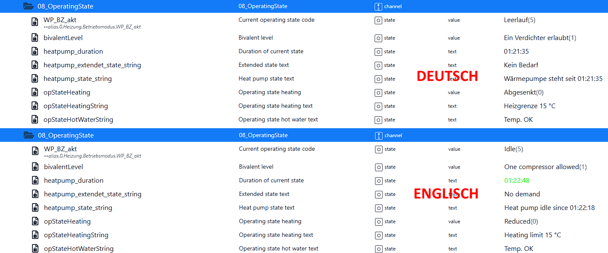

## Конфигурация мгновенного адаптера

При установке адаптеров необходимо изменить конфигурацию. Это в übersichtliche Reiter (Tabs) unterteilt, um die Einrichtung und Optimierung deiner Wärmepumpe, поэтому интуитивно понятный, который может быть полезен.

---

### 1. Reiter: Verbindung

Auf dieser Seite werden die grundlegenden Netzwerkeinstellungen für die Kommunikation mit der Luxtronik-Steuerung vorgenommen sowie die Anzeigesprache des Adaptes festgelegt.

#### Verbindungseinstellungen

- **IP-адрес (хост):** выберите локальный IP-адрес, указанный в локальной сети Netzwerk ein (z. B. `192.168.178.81`).
- **Порт Вермепумпен:** Der Kommunikationsport der Steuerung.
  - `8889` = Стандартный порт для классической TCP-связи (часто в прошивке V1.x/V2.x/V3.x).
  - `8214` = WebSocket-Port (для новой версии прошивки > V3.81).
- **Интервальный интервал (секунды):** В течение определенного периода времени необходимо отложить новое сообщение и параметр теплового насоса (Минимум: 10 секунд, Стандарт: 30 секунд).

> ⚠️ **WICHTIGER TIPP ZUM ABFRAGEINTERVALL:** Wähle diesen Wert **nicht zu gering** ! Ein zu schnelles Опрос флейты во внутреннем процессоре Luxtronik-Steuerung, постоянный с Anfragen. Когда процессор работает в режиме теплового насоса, он начинает работать и управлять устройством (на дисплее также в сети) крайне сложно. Empfohlen sind Werte zwischen **30 и 60 Sekunden** .

#### Опионен

- **Sprache für Texte und Werte:** Legt fest, in welcher Sprache (`Deutsch` Одер `English`) Betriebszustände, Statusmeldungen, Fehlertexte und Auswahlwerte im ioBroker-Objektbaum ausgegeben werden.

_Примечание: Если вы используете Wärmepumpe Wasser aufheizt, schreibt der Adaptor je nach Auswahl entweder `Warmwasser` (Deutsch) oder `Hot water` (English) in den Objektbaum._

---

### 2. Reiter: Modbus (Hybrid)

Стандартные параметры Luxtronik-Steuerung (сверхпорт `8889` /`8214`) во внутреннем EEPROM/Flash-Speicher, вы можете начать работу с устройством Schreibzyklen verträgt.

Комбинация **гибридного режима (Modbus TCP)** с лучшим адаптером в вашем мире:

- **Инструкция:** Все подробные сведения о датчиках и телеметрических данных можно получить при отключении от родного порта (`8889` /`8214`) ausgelesen.
- **Schreiben (0 % Verschleiß):** Изменение параметров (например, Sollwerte, Heizkurven или Pumpen-Schalter) осуществляется непосредственно через **Modbus TCP** в рабочем режиме (RAM) в исходном файле – полностью без Flash-Verschleiß!

#### Einstellungen

- **Активация Modbus TCP:** включает гибридную схему подключения. Автоматический запуск адаптера для предварительной проверки на Modbus-сервере теплового насоса не работает.
- **Modbus Port:** Standardmäßig `502` (должен быть включен в der Luxtronik-Steuerung ebenfalls aktiviert sein).
- **Регистр временного хранения (параметр) auswählen:** Wähle per Checkbox aus, welche Sollwerte bei Änderungen über Modbus statt über den own Port geschrieben werden sollen (z. B. _Rücklauf Soll_ , _Außentemperatur_ , _Betriebsart Heizung/Warmwasser_ , _Heizkurve Endpunkt/Parallelverschiebung_ , _Feste Rücklaufsolltemperatur_ , _Warmwasser Wunschwert_ ).
- **Катушки (Schalter) auswählen:** Erlaubt das direkte Schalten von Ausgängen über Modbus (z. B. _BUP_ , _HUP_ , _Lüfter VEN_ , _Zirkulationspumpe ZIP (Coil 7)_ , _ZUP_ , _SLP_ , _Watchdog Modbus_ , _Reset Error_ ).

> 💡 **Прозрачность в объектах:** все данные, для гибридных устройств для активации Modbus, автоматически передаются в ioBroker-Объектбаум в Namenszusat&#x7A;** `(Modbus)` ** .

---

### 3. Райтер: Леерлауф - Воргабен (Hardware-Schutz)

Во внутреннем флэш-написании Luxtronik zu Schonen, активируйте адаптер для оптимизации (z. B. Takt-Optimierung or HUP-Steuerung) и начните с того, чтобы узнать, как это сделать.

Чтобы включить режим обогрева **(режим ожидания)** , установите эту функцию во время временной проверки параметров автоматически в исходном режиме.

> 💡 **Dringende Empfehlung:** Es wird dringend empfohlen, diese Vorgabewerte zu aktivieren, wenn du die **интеллектуальный Takt-Optimierung (Warmwasser + Heizen)** и/или **динамическое HUP-Steuerung** nutzt!

- **Стандартный режим работы:** Активация автоматического сброса настроек в режиме ожидания.
- **Vorgabewerte Heizen:** Trage hier die originalen Werte deiner Heizungsanlage ein ( _Fußpunkt (°C)_ , _Endpunkt (°C)_ , _Heizen Hysterese (K)_ sowie _HUP Min_ und _HUP Nom_ für den Heizbetrieb).
- **Vorgabewerte Warmwasser:** Trage hier deine Standardwerte für die Warmwasserbereitung ein ( _WW Soll (°C)_ , _WW Hysterese (K)_ sowie _HUP Min_ und _HUP Nom_ for Warmwasser).
- **Интерактивный Heizkurven-Vorschau:** Sobald du Fuß- und Endpunkt anpasst, Generiert der Adaptive live ein Interaktives Diagramm deiner Heizkurve (вкл. подсказки для повышения температуры от -20 °C до +20 °C). _(Ein großes Dankeschön an [mnemotron.de](https://www.mnemotron.de/lux/heatcurve.html) für die Inspiration!)_

---

### 4. Reiter: Effizienz / COP

Berechnet vollautomatisch die Arbeitszahl ( **COP** bzw. Jahresarbeitszahl **JAZ** ) deiner Wärmepumpe über verschiedene Zeiträume ( **Heute** , **Letzte 7 Tage** , **Aktueller Monat** , **Aktuelles Jahr** ) – драгоценности получают в **Gesamt** , **Heizen** und **Warmwasser** .

- **COP / Effizienz-Berechnung aktivieren:** Startet die laufende Auswertung. Все снимки и снимки были абстрактными во внутреннем банке данных адаптера (`hidden.cop_buckets`) gespeichert und überleben jeden Neustart.
- **1. Электрическая энергия (Stromverbrauch):**
  - _Стажер (Luxtronik Schätzwerte):_ Nutzt den internen Energiezähler der Wärmepumpe.
  - _Идентификатор внешнего объекта (z.B. Shelly):_ Verlinke einen externen, geeichten Stromzähler (Gesamt-kWh-Datenpunkt, z.B. Shelly 3EM) для домашнего сообщения.
- **2. Термическая энергия (Wärmeerzeugung):**
  - _Стажер (Luxtronik Zähler):_ Nutzt die interne Wärmemengenerfassung der Luxtronik.
  - _Внешний идентификатор объекта (z.B.M-Bus Zähler):_ Verlinke einen externen Wärmemengenzähler (WMZ Gesamt-kWh).

---

### 5. Reiter: Takt-Optimierung

Стандартные требования к Luxtronik-Steuerung Heiz- und Warmwassertakte strikt getrennt. Dies führt dazu, dass der Verdichter nach der Warmwasserbereitung stoppt, nur um kurz darauf für einen Heiztakt wieder anzulaufen (erhöhter Verschleiß). Переходник для дизельного двигателя необходимо использовать для проверки без отключения питания.

- **Intelligente Takt-Optimierung aktivieren:** Schaltet die übergreifende Logik zur Vermeidung unnötiger Verdichter-Stopps ein (auch über den Datenpunkt) `Actions.Regelung_Aktiv` шалтбар).
  - **Ауслёзер-Регель (Vorzündung):** Венн `(WW Soll - WW Ist) ≥ (WW Hysterese - 1,5 K)` **унд** `Heizung Rücklauf ≤ Rücklauf Soll` и Heizgrenze не активен, он будет направлен непосредственно на Heizbetrieb gestartet и на временную остановку при **температуре 35 °C** , um das das Anlaufen des Verdichters zu erzwingen.
  - **Übergang zu Warmwasser:** Erreicht der Rücklauf am Ende des Heiztaktes das Ziel und das Warmwasser ist um mehr als 2 K abgekühlt, wird der Warmwasser-Sollwert kurzzeitig angehoben, damit der Verdichter nahtlos in die Warmwasserbereitung убергехт.
- **Режим обогрева:** Если включен адаптер, необходимо остановить тепловую установку при температуре 35 °C (чтобы избежать нагревания-остановки), необходимо выполнить проверку на тепловую нагрузку без прямого включения.

> ⚠️ **Wichtiger Hinweis:** Активируйте Bei Nutzung dieser Funktion unbedingt auch **«Standardwerte im Leerlauf erzwingen»** im Reiter _Leerlauf - Vorgaben_ !

---

### 6. Reiter: HUP Steuerung

Динамическая регулировка напряжения **0–10 В для нагрева насоса (HUP)** и температуры (Разница между температурой и температурой). Die Steuerspannung wird während eines laufenden Heiztaktes (sobald der Verdichter Minutestens 10 Minuten läuft) schrittweise angepasst, um die Spreizung im оптимального Zielkorridor zu остановлен.

> ⚠️ **Wichtige Voraussetzungen:**
>
> 1. **Проверка аппаратного обеспечения и проверка ШИМ:** Активация отключается, если указан насос или аналогичный **сигнал 0–10 В** от Luxtronik-Regler gesteuert wird. Это настройка для настройки **PWM-Pumpe** (`heating_max_circ_pump_speed > 0`), включается автоматическая и сверхпружинная регулировка адаптера 0–10 В.
> 2. **Типичный вариант:** Оптимальное использование индивидуально. Eine **Fußbodenheizung (FBH)** имеет температуру **от 3 до 5 Кельвинов** , классические **излучатели (Heizkörper)** часто **от 7 до 10 Кельвинов** .
> 3. **Фактор аппаратного обеспечения:** Wähle zwingend die passende Skalierung zu deiner Прошивка:
>    - `100` для стандарта/прошивки V2.x (`1000 = 10,0 V`)
>    - `10` для новой прошивки V3.x, z. Б. ЛВЦВ 82 (`100 = 10,0 V`)

#### Параметр

- **Динамическая активация HUP-Spreizungsregelung:** Schaltet die Regelung ein.
- **Температура и интервал:** определите _минимальную температуру (K)_ , _максимальную температуру (K)_ и _интервал регулирования (минуты)_ (стандартно: 10 минут).
- **Spannungsbegrenzungen:** Lege die _Untere Grenze (V)_ , _Obere Grenze (V)_ и die _Schrittweite (V)_ (z. B. `0,25 V`) fest, mit der nachgereglt wird.

---

### 7. Рейтер: Zirkulationspumpe (ZIP)

Die Zirkulationspumpe (ZIP) подходит для таких теплых вещей и Zapfstellen, kühlt bei Dauerbetrieb jedoch den Speicher aus. Über diesen Reiter trennst du die **Auslöse-Logik** (Bewegungsmelder, Warmwasser-Kopplung, Button) sauber von der **Hardware-Ansteuerung** .

#### 1. Что вы знаете о циркуляции (ZIP)? (`zip_control_mode`)

В раскрывающемся меню выберите физическое действие, которое не будет автоматически использовано:

- **Über Luxtronik Regler (стажер):** Der Adaptor schaltet die Pumpe über die interne Handsteuerung/Entlüftung (im Standby) bzw. über die Zeittabelle.
  - ⚠️ _Совет:_ Verursacht Schreibvorgänge im Flash-Speicher der Luxtronik (4-14 Schreibvorgänge pro Lauf). Falls ein externes Relais seinen Betriebsstrom Direct vom ZIP-Ausgang der Wärmepumpe bezieht, muss der Haken bei _«Регулярная деактивация ZIP Werte»_ entfernt werden!
- **Über externen Aktor (z.B. Shelly) – _Empfohlen_ :** Der physische Luxtronik-Ausgang wird dauerhaft Stillgelegt (`00:00` Часы /`0 Min An`) и адаптер, управляющий умными реле (Shelly, Zigbee-Steckdose и т. д.) напрямую от ioBroker и ➔ **0 % Flash-Verschleiß!**
- **Использование Modbus TCP (гибрид):** Die Pumpe wird полный вариант Flash-Verschleiß напрямую с **Modbus Coil 7** (активируется Modbus в Reiter _Modbus_ voraus) ➔ **0 % Flash-Verschleiß!**

#### 2. Optionen & Vorgabewerte

- **Обычное отключение ZIP-таймера (Luxtronik-Timer auf 0): Запустите** внутренний Luxtronik-Timer с `00:00` (`Aus: 60 Min / An: 0 Min`), um die interne Zeitsteuerung dauerhaft ruhigzustellen.
- **ZIP-Optimierung zulassen:** Aktiviert die Zeit- und bedarfsgesteuerte Logik.
- **ZIP Dauer an(s):** Laufzeit der Pumpe bei Auslösung (Стандарт: `120 s`).
- **ZIP Dauer aus (s):** Sperrzeit (Перезарядка) zwischen zwei Läufen zum Schutz vor ständigem Takten (Стандарт: `1200 s` = 20 мин).
- **ZIP Dauer an bei Warmwasserbetrieb (s):** Bei verschleißfreier Steuerung (Aktor orer Modbus) kann die Zirkulationspumpe autotisch synchronzur Warmwasserbereitung mitlaufen (Стандарт: `600 s`).

#### 3. Bewegungssensoren и внешние актеры

- **Bewegungssensoren aktiv nutzen:** Klappt eine Tabelle auf, in der du beliebig viele Bewegungsmelder orer Taster (Boolean-Datenpunkte aus ioBroker, z. B. Bad/Küche) hinterlegen kannst. Чтобы начать работу с ZIP, необходимо начать работу с почтовым ящиком (под управлением Sperrzeit).
- **Externe Relais/Aktoren:** (Nur sichtbar im Modus _Externer Aktor_ ) Tabelle zum Hinterlegen deiner Relais-Datenpunkte (z. B. `shelly.0...Switch`).

> 💡 **Virtuelle Datenpunkte für deine Visualisierung (VIS / Lovelace):** Unter `Information.03_Outputs` Скажите, пожалуйста, об адаптере, который не используется при использовании Live-Datenpunkte:
>
> - `Virtual_ZIP_Status`: Zeigt an, ob aktuell ein Zirkulationszyklus aktiv ist (`true` /`false`).
> - `Virtual_ZIP_Remaining_Time`: Ein **Live-Countdown in Sekunden** , der die verbleibende Restlaufzeit des aktuellen ZIP-Taktes herunterzählt!

---

### 8. Reiter: Datenpunkte / Objekte

Лучшее в деталях, включая даты и порядок адаптера в ioBroker-Objektbaum, а также актуальные и актуальные данные. Деактивируйте дату и ознакомьтесь с инструкциями по автоматическому запуску адаптеров.

- **Nicht unterstützte Hardware-Parameter autotisch ausblenden (`filter_visibility`):** Когда активен (Стандартный режим), фрагмент адаптера включает Start die internen Sichtbarkeiten der Wärmepumpe ab (Команда `3005`) и blendet nicht verbaute Anlagenteile (z. B. Kühlung, Solar, Lüftung oder ungenutzte Mischkreise) vollautomatisch aus.
- **Kategorien & Einzel-Datenpunkte:** Du kannst komplette Kategorien (z. B. `Information.01 Temperatures` бис `Information.16 Efficiency` сови `Settings.01` бис `Settings.12`) mit einem Klick ein-/ausschalten или einzelne Datenpunkte gazielt abwählen.
- **Соответствующие системные параметры:** Даты, адаптеры для внутренней защиты и оптимизации функций (например, B. Rücklauftemperatur, Betriebszustand или Flash-Schreibzähler) `write_cycles_today` /`write_cycles_total`), выключите и включите актив.

---

### 9. Reiter: Benachrichtigungen

Der Adaptor überwacht kontinuierlich den **Fehlerspeicher** , den **Abschalt-Speicher** (вкл. kritischer Wärmepumpen-Störungen und **Durchfluss-Problemen** mit 60-Minuten-Spam-Schutz) sowie den **Verbindungsstatus** zur Anlage.

- **Сообщение для отправки Telegram:** Отправьте подробную информацию о тревоге и предупреждении (включая Fehlercode, Klartext-Beschreibung und Zeitstempel) über eine ausgewählte **Telegram-Instanz** .
- **Empfänger (Имя / Chat-ID — необязательно):** Узнайте больше о сообщениях Telegram-Nutzer или gezielt einen Benutzernamen bzw. eine numerische Chat-ID eintragen.
- **Используйте также другие функции (Glocke):** Тревога может быть отправлена непосредственно в **центр уведомлений ioBroker** (Glocken-Symbol oben rechts im Admin).
- **Кнопка «TEST: LETZTEN FEHLER SENDEN»:** Вызовите актуальную информацию по электронной почте (или используйте Testnachricht) и отправьте ее в качестве вспомогательного канала по указанному каналу, um deine Einrichtung zu testen.

---

### 10. Reiter: Обновления (прошивки)

Адаптер может быть автоматическим на официальном портале загрузки Alpha Innotec на новой версии встроенного ПО для вашего теплового насоса.

- **Автоматическое обновление встроенного ПО, например:** Aktiviert die Hintergrundprüfung.
- **План автоматического выполнения задач:** Ein frei definierbarer Cron-Job (Стандарт: `0 12 * * *` = Täglich um 12:00 Uhr).
- **Telegram-Benachrichtigung bei neuem Обновление отправлено:** Информирование напрямую через Telegram, sobald eine neue Version mitsamt Changelog bereitsteht.
- **Мануэль Прюфунг:** Über den neuen Button `Information.12_SystemInfo.check_firmware` Im Objektbaum kann die Update-Prüfung jderzeit для нажатия кнопки мыши.

> 💡 **Примечание:** Die gesammelten Ergebnisse (Verfügbare Version, Update-Indikator für Visualisierungen und die Offiziellen Release Notes) legt der Adaptor unter `Information.12_SystemInfo` аб.

---

### 11. Reiter: PV / Überschuss

Интегрированное управление «PV-Ready»: Не используйте солнечную энергию, а также тепловую насосную установку для нагрева. Чтобы использовать солнечную энергию в сети, включите автоматический и бесплатный адаптер (через Modbus-RAM) для обеспечения теплой и/или нагрева.

- **PV-Überschusssteuerung aktivieren:** Schaltet die Logik ein.
- **Datenpunkt für aktuelle Netzleistung:** Verlinke hier den Live-Datenpunkt deines Smart-Meters или Wechselrichters (zB SMA, Shelly 3EM, Kostal).
- **Дополнительная батарея (Wärmepumpe Priorisieren):** Опционально Datenpunkt deiner Hausbatterie. Если батарея будет отключена от Solarstrom, ее можно будет использовать как «сумасшедший сверхмощный заряд». Die Wärmepumpe fängt den Strom может быть первым термоаккумулятором, прежде чем он будет установлен в Haus-Akku fließt.
- **Активирование (Einschaltbedingungen):**
  - Lege den _Überschuss-Schwellenwert_ (zB 2000 Watt) и eine _Mindestdauer_ (zB 5 Minuten) фестиваль, um ervöses Takten bei Wolken zu vermeiden.
  - Гиб, um wie viel Kelvin das Warmwasser und die Heizkurve angehoben werden sollen.
  - **Приоритет повышения (Reihenfolge):** Wähle, ob die Wärme _Gleichzeitig_ , _Warmwasser zuerst_ или _Heizen zuerst_ in System geleitet wird. Интеллектуальное регулирование температуры обеспечивает автоматическое повышение температуры, а также приоритетное значение максимальной температуры.
- **Деактивация (Rückfallbedingungen):**
  - **Ausschalt-Schwellenwert (Schalthysterese):** Verhindert den klassischen Feedback-Loop. В случае превышения мощности электропитания при запуске теплового насоса, включение режима Boost не будет отключено, а отдельный источник питания (zB 0 Вт = Netzbezug) не будет использоваться.
  - **Verzögerung vor Rücksetzung:** Verhindert einen sofortigen Abbruch, wenn die Sonne kurz verdeckt wird.
  - **Активный режим сброса для нормального режима работы (аппаратного обеспечения):** Fällt der Überschuss weg, wird der Sollwert nicht sofort hart zurückgesetzt. Адаптер бородавка, если он находится на регулярной (непригодной) установке Zyklus, является небезопасным.
  - _Verzögerung vor Rücksetzung:_ Verhindert einen sofortigen Abbruch, wenn die Sonne kurz verdeckt wird.
  - _Активный режим сброса для нормального режима работы (аппаратного обеспечения):_ Fällt der Überschuss weg, wird der Sollwert nicht sofort hart zurückgesetzt. Интеллектуальный адаптер должен быть активирован в соответствии с действующим законодательством.

---

### 12. Райтер: Эйджин Верте (по индивидуальному заказу)

Deine Wärmepumpe Lifert auf einem bestimmten Index einen speziellen Wert, der noch nicht im Standard Mapping enthalten ist? В этой Таблице, которая может быть определена в соответствии с вашими собственными датами, автоматический режим в порядк&#x435;** `Custom` ** angelegt werden:

- **Актив:** Schaltet den benutzerdefinierten Datenpunkt ein oder aus.
- **Идентификатор Luxtronik (индекс):** Die Registernummer aus dem Array der Wärmepumpe (подсказка: Über den Button `Actions.Dump_Raw_To_Log` вы можете указать все параметры, указанные в ioBroker-Log schreiben lassen).
- **Источник данных:**
  - _Мессверт (`rawValues` / Телеметрия):_ Reine Lese-Datenpunkte aus Befehl `3004`.
  - _Параметр (`rawParams`):_ Конфигурации от Befehl `3003` – diese Datenpunkte werden autotisch **beschreibbar (`write: true`)** angelegt!
- **Имя, Datentyp, Faktor и Einheit:** Vergib einen freien Namen (z.B. `Meine Temperatur`), wähle den Datentyp (`Zahl`, `Text`, `Wahr/Falsch`, `Datum/Uhrzeit (Unix)`), einen optionen Umrechnungsfaktor (z.B. `0.1` für Zehntelgrad) и die Einheit (z.B. `°C`).

---

### 13. Reiter: Резервное копирование и диагностика

Внутренний веб-сервер Luxtronik-Steuerung содержит подробные системные журналы (`.dta` -Dateien) загружен и находится на ПК с бесплатным графическим анализом **[OpenDTA](https://sourceforge.net/projects/opendta/)** .

#### Скачать руководство

- **Прямой эфир DTA (`/NewProc`):** Чтобы создать список, вы можете легко создать его и получить доступ к браузеру.
- **Vorhandenes DTA (`/proclog`):** Lädt die letzte autotisch auf der Anlage gespeicherte Datei herunter (часто 2–3 Stunden alt).

#### Автоматическое резервное копирование DTA

- **Автоматическая активация загрузки DTA: При активации** адаптера Live-DTA-Log volautomatisch im Hintergrund von der Wärmepumpe ab (вкл. Fallback auf `/procdta`).
- **Zeitplan (Cron):** Lege fest, wann das Backup erfolgen soll (Стандарт: `0 2 * * *` – jede Nacht um 02:00 Uhr).
- **Примечание:** Резервные копии выполняются с Zeitstempel (`dta_live_YYYY-MM-DDTHH-mm-ss.dta`) sicher im globalen ioBroker-Dateisystem abgelegt. Вы найдете это меню ioBroker-Hauptmenü под **«Dateien»** в Ordne&#x72;** `0_userdata.0/luxtronik_backups` ** .

---

## 🛡️ Eingebaute Hardware-Schutzfunktionen

1. **Schutz (Read-BeforeWrite) `safeRawWrite` /`writePumpSafe`):** Бевор эйн Бефель убер Порт `8889` /`8214` Если вы используете адаптер в кэше, параметр для теплового насоса должен быть точным. Unnötige Schreibzugriffe auf den EEPROM был полностью заблокирован.
2. **Flash-Schreibzähler:** Unter `Information.12_SystemInfo` протокол адаптера `write_cycles_today` (wird um Mitternacht zurückgesetzt) и `write_cycles_total` прозрачный jeden physchen Schreibzugriff mit.
3. **Прошивка `.90` Crash-Schutzschild:** Die Hersteller-Прошивки `V1.90` унд `V2.90` besitzen einen bekannten Ошибка, der beim Beschreiben von Parametern über das Netzwerk zu Systemabstürzen führt. Ошибка адаптера `.90` -Прошивка автоматически блокирует аппаратное обеспечение и выдает предупреждение в журнале.

---

## 🛠 Фелеранализ/Устранение неполадок

### 1. Рекомендации по Raspberry Pi / ARM-Nutzer (Журнал установок)

Падает при установке адаптера в ioBroker-журнал без ошибо&#x43A;** `node-gyp` ** ,** `serialport` ** Оде&#x440;** `usocket` ** auftauchen, können diese **komplett ignoriert werden** . Этот пакет с дополнительными опциями для серийного кабеля (Modbus RTU) должен быть компилирован в системе ARM. Адаптер, подключенный к сети (TCP/WebSockets), коммуницирует и функционирует без ограничений.

### 2. Тестовый скрипт TCP без использования исходных данных (`Test_Script.ts`)

В некоторых случаях (в зависимости от версии встроенного программного обеспечения V1.x) могут быть установлены настройки или тайм-ауты в зависимости от версии прошивки (z. B. `Timeout writing TCP parameter 105`).

Когда вы обнаружите, что проблема связана с адаптером или с теплым насосом, который находится в изолированном тестовом сценарии (`Test_Script.ts` им Орднер `Scripte`) Бэй. Коммуникационный сценарий полностью укомплектован адаптером, предназначенным для использования непосредственно с TCP-сокетами с помощью Luxtronik-Steuerung. Es testet den Schreib- und Lesezugriff, indem es den Warmwasser-Sollwert ausliest, ihn testweise minerhöht und soft wieder den Originalwert herstellt.

#### Ausführung im ioBroker:

1. 🛑 **ВНИМАНИЕ:** Stoppe zwingend **alle** laufenden Luxtronik-Adapter-Instanzen im ioBroker (auf «Rot» stellen)! Alte Luxtronik-Steuerungen lassen nur einzige gleichzeitige Netzwerkverbindung zu. При использовании адаптера во внутреннем пространстве порт блокируется, а сценарий не работает в течение тайм-аута.
2. Kopiere den Inhalt der Filei `Test_Script.ts` в новом скрипте в ioBroker **JavaScript-адаптере** (тип: _TypeScript_ auswählen).
3. Passe ganz oben im Skript die Konstante `HOST` IP-адрес, указанный в Wärmepumpe.
4. Запустите скрипт и получите журнал регистрации ioBrokers.

#### Ergebnis-Auswertung:

- **✅ ERFOLG:** Скрипт läuft zügig durch und die Wärmepumpe bestätigt den Schreibbefehl. Для этого необходимо выбрать установку (и прошивку) и получить необходимые настройки.
- **❌ TIMEOUT / FEHLER:** Das Skript bleibt beim Lesen/Schreiben hängen order wird abgewiesen. Dies bedeutet, dass die Anlage die TCP-Kommunikation physch verweigert. В этом случае часто блокируются порты (например, Loxone, FHEM или другие системы Smart-Home), механизмы прошивки или дополнительная сетевая карта в тепловом насосе (здесь часто используется Strom-Reset der Anlage). С адаптером могут возникнуть проблемы с подключением сети.