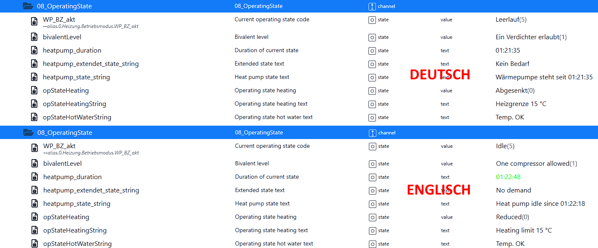

## Конфигурация экземпляра адаптера

После установки адаптера открывается интерфейс настройки. Он организован в виде структурированных вкладок, чтобы сделать настройку и оптимизацию вашего теплового насоса максимально интуитивно понятной и простой.

---

### 1. Вкладка: Подключение

Настройте основные сетевые параметры для связи с контроллером Luxtronik и выберите язык отображения адаптера.

#### Настройки подключения

- **IP-адрес (хост):** Введите локальный IP-адрес вашего теплового насоса в вашей сети (например, `192.168.178.81`).
- **Порт теплового насоса:** Коммуникационный порт контроллера.
  - `8889` = Стандартный порт для классической TCP-связи (обычно в прошивке версий V1.x / V2.x / V3.x).
  - `8214` = Порт WebSocket (обычно требуется для более новых систем, работающих с прошивкой версии > V3.81).
- **Интервал опроса (секунды):** определяет, как часто адаптер запрашивает телеметрию и параметры теплового насоса в режиме реального времени (минимум: 10 секунд, по умолчанию: 30 секунд).

> ⚠️ **ВАЖНЫЙ СОВЕТ ПО ИНТЕРВАЛУ ОПРОСА:** **Не** устанавливайте это значение слишком низким! Слишком частый опрос перегружает внутренний процессор теплового насоса сетевыми запросами. Это приводит к высокой нагрузке на ЦП и делает контроллер крайне медленным (как на физическом дисплее, так и по сети). Настоятельно рекомендуется установить значение от **30 до 60 секунд** .

#### Параметры

- **Язык для текстов и ценностей:** Выберите язык (`English` или `Deutsch`) используется для отображения рабочих состояний, сообщений о состоянии, журналов ошибок и значений выбора, созданных в дереве объектов ioBroker.

_Пример: При нагреве бытовой воды адаптер преобразует коды штатов в `Hot water` (английский) или `Warmwasser` (Немецкий)._

---

### 2. Вкладка: Modbus (гибридный)

Стандартные настройки параметров выполняются через порт. `8889` или `8214` Запись осуществляется во внутреннюю EEPROM/флэш-память Luxtronik, которая имеет ограниченное количество циклов записи за весь срок службы устройства.

**Гибридный режим (Modbus TCP)** сочетает в себе преимущества обоих типов протоколов:

- **Чтение:** Все подробные телеметрические данные, показания датчиков температуры и данные о наработке часов по-прежнему считываются через встроенный сокет (`8889` /`8214`).
- **Запись (0% износа флэш-памяти):** Выбранные энергозависимые переменные (такие как целевые заданные значения, кривые нагрева и сигналы запуска насоса) записываются непосредственно в ОЗУ контроллера по протоколу **Modbus TCP** без ухудшения характеристик EEPROM.

#### Настройки

- **Включение Modbus TCP:** активирует гибридный конвейер маршрутизации. При запуске адаптер выполняет предварительную проверку доступности интерфейса Modbus.
- **Порт Modbus:** по умолчанию —`502` (Также должна быть включена в настройках сети Luxtronik).
- **Выберите регистры хранения (параметры):** Отметьте, какие заданные значения должны передаваться по Modbus в энергозависимом режиме (например, _целевая температура возврата_ , _температура наружного воздуха_ , _режим работы отопления/горячей воды_ , _конечная точка кривой нагрева/параллельное смещение_ , _фиксированная целевая температура возврата_ , _целевая температура горячей воды_ ).
- **Выберите катушки (переключатели):** выберите, какие выходы могут быть активированы напрямую через катушки Modbus (например, _BUP_ , _HUP_ , _вентилятор VEN_ , _циркуляционный насос ZIP (катушка 7)_ , _ZUP_ , _SLP_ , _сторожевой таймер Modbus_ , _сброс ошибки_ ).

> 💡 **Прозрачность дерева объектов:** точки данных, отображаемые для записи в энергозависимом режиме через Modbus, автоматически получаю&#x442;** `(Modbus)` ** суффикс имени в дереве ioBroker.

---

### 3. Вкладка: Настройки простоя по умолчанию (Защита флэш-памяти)

Для защиты контроллера Luxtronik от износа флэш-памяти оптимизация записи выполняется только во время активного цикла (нагрев или горячая вода).

Как только тепловой насос перейдет в **режим ожидания (простой)** , эта функция сбросит все временно измененные значения до заданных вами безопасных базовых значений по умолчанию.

> 💡 **Настоятельно рекомендуется:** Включение настроек по умолчанию для режима ожидания настоятельно рекомендуется, если вы используете **интеллектуальную оптимизацию цикла (горячая вода + отопление)** и/или **динамическое управление HUP** !

- **Принудительное использование значений по умолчанию в режиме ожидания:** включает автоматическую процедуру переключения на резервный режим при обнаружении перехода в спящий режим.
- **Значения по умолчанию: Нагрев:** Укажите базовые значения вашей системы ( _базовая точка (°C)_ , _конечная точка (°C)_ , _гистерезис нагрева (K)_ и базовые _минимальные/номинальные напряжения HUP_ для нагрева).
- **Значения по умолчанию: Горячая вода:** Базовые значения для бытового водоснабжения ( _целевое значение HW (°C)_ , _гистерезис HW (K)_ и базовые значения _минимального/номинального напряжения HUP_ для горячей воды).
- **Интерактивный предварительный просмотр кривой теплопроводности:** ввод базовой и конечной точек генерирует SVG-кривую с всплывающими подсказками для каждого градуса внешней температуры в диапазоне от -20°C до +20°C. _(Особая благодарность [mnemotron.de](https://www.mnemotron.de/lux/heatcurve.html) за вдохновение!)_

---

### 4. Вкладка: Эффективность / КПД

Вычисляет коэффициент полезного действия ( **COP** ) и сезонный коэффициент полезного действия ( **JAZ** ) за несколько временных периодов ( **сегодня** , **последние 7 дней** , **текущий месяц** , **текущий год** ) — с разбивкой по категориям: **общее потребление** , **отопление** и **горячее водоснабжение** .

- **Включить расчет COP/эффективности:** активирует отслеживание. Снимки и расчетные блоки надежно сохраняются после перезапусков внутри системы. `hidden.cop_buckets`.
- **1. Электрическая энергия (потребление электроэнергии):**
  - _Внутренние (оценки Luxtronik):_ Использует внутренние оценки электросчетчика контроллера.
  - _Идентификатор внешнего объекта (например, Shelly):_ привяжите точку данных внешнего откалиброванного счетчика электроэнергии (общее количество кВт·ч, например, Shelly 3EM).
- **2. Тепловая энергия (выделение тепла):**
  - _Внутренние (счетчики Luxtronik):_ Используют внутренние расчеты тепловыделения.
  - _Идентификатор внешнего объекта (например, счетчик M-Bus):_ привязать точку данных внешнего теплосчетчика (WMZ Total kWh).

---

### 5. Вкладка: Оптимизация цикла

По умолчанию контроллеры Luxtronik обрабатывают циклы отопления и горячего водоснабжения как изолированные операции. Это часто приводит к тому, что компрессор отключается сразу после нагрева воды, чтобы затем снова запуститься через несколько минут для обогрева помещения. Этот адаптер связывает циклы, чтобы компрессор работал непрерывно.

- **Включить интеллектуальную оптимизацию цикла:** активирует координацию между циклами (также можно включить/выключить с помощью `Actions.Regelung_Aktiv`).
  - **Правило срабатывания (предварительное воспламенение):** Если `(DHW Target - DHW Actual) ≥ (DHW Hysteresis - 1.5 K)` **И** `Heating Return ≤ Return Target` Если пороговое значение температуры наружного воздуха неактивно, отопление запускается немедленно, а целевая температура возврата установлена на **35°C** для принудительного включения компрессора.
  - **Переход на горячую воду:** как только температура обратной воды достигнет целевого значения и уровень горячей воды снизится более чем на 2 К, целевая температура горячей воды временно повышается, чтобы принудительно переключить компрессор на горячую воду без остановки.
- **Нагрев после горячей воды:** поддерживает целевую температуру обратной воды на уровне 35°C во время нагрева воды, благодаря чему компрессор немедленно переключается в режим отопления дома без остановки.

> ⚠️ **Важное примечание:** При использовании оптимизации циклов всегда включайте параметр **"Принудительное использование значений по умолчанию в режиме ожидания"** на вкладке _"Настройки по умолчанию в режиме ожидания_ "!

---

### 6. Вкладка: HUP (Насос циркуляции тепла)

Динамическое регулирование напряжения для управляемых **циркуляционных насосов отопления (ЦНН) с напряжением 0–10 В** на основе разброса температур (разница температур между подачей и возвратом). Напряжение насоса постепенно увеличивается во время активных циклов отопления (после того, как компрессор проработает не менее 10 минут), чтобы поддерживать разброс температур в пределах целевых значений.

> ⚠️ **Предварительные требования:**
>
> 1. **Обнаружение аппаратной части и ШИМ:** Используйте только в том случае, если ваш насос подключается через аналоговый **сигнал 0–10 В** от платы Luxtronik. Если настроено **ШИМ** (`heating_max_circ_pump_speed > 0`), адаптер автоматически это обнаруживает и обходит регулирование 0–10 В.
> 2. **Типы систем:** Идеальное распределение тепла зависит от типа нагревательных элементов. **Для систем подогрева пола (UFH)** обычно требуется температура **от 3 до 5 К** , в то время как для стандартных **радиаторов** — **от 7 до 10 К.**
> 3. **Аппаратная шкала напряжения:** выберите множитель, соответствующий вашей прошивке:
>    - `100` для стандартной версии / прошивки V2.x (`1000 = 10.0 V`)
>    - `10` для прошивки версии 3.x, например, LWCV 82 (`100 = 10.0 V`)

#### Параметры

- **Включить динамическое управление распространением HUP:** активирует динамическое регулирование.
- **Диапазон целевой температуры и интервалы:** Задайте _минимальный диапазон (K)_ , _максимальный диапазон (K)_ и _интервал корректировки оценки (минуты)_ (по умолчанию: 10 мин).
- **Границы напряжения:** Определите _нижний предел (В)_ , _верхний предел (В)_ и _шаг изменения напряжения (В)_ (например) `0.25 V`).

---

### 7. Вкладка: Циркуляционный насос (ZIP)

Циркуляционный насос для бытового горячего водоснабжения (ZIP) обеспечивает мгновенную подачу горячей воды в краны, но его непрерывная работа приводит к значительным потерям тепла из накопительного бака. Эта вкладка четко разделяет **логику запуска** и **управление оборудованием** .

#### 1. Как управляется ваш циркуляционный насос (ZIP)? `zip_control_mode`)

Выберите путь физического управления из выпадающего меню — неприменимые настройки автоматически скрываются:

- **Через контроллер Luxtronik (внутренний):** адаптер запускает насос с помощью внутренних команд ручного управления/деаэрации (в режиме ожидания) или таблиц таймера.
  - ⚠️ _Примечание:_ Вызывает циклы записи во флэш-память контроллера (от 4 до 14 записей за цикл). Если внешнее реле получает питание непосредственно от выходного терминала Luxtronik ZIP, снимите флажок _«Отключить базовые значения ZIP»_ .
- **Через внешнего исполнителя (например, Shelly) – _Рекомендуется_ :** Физический выход Luxtronik будет навсегда отключен. `00:00` /`0 min ON`) и адаптер управляет вашим интеллектуальным реле (Shelly, Zigbee-переключателем и т. д.) напрямую через ioBroker ➔ **0% износа флэш-памяти!**
- **Через Modbus TCP (гибридный режим):** Насос управляется с нулевым износом напрямую через **Modbus Coil 7** (требуется активный Modbus на вкладке _Modbus_ ) ➔ **0% износа!**

#### 2. Параметры и значения по умолчанию

- **Отключить базовые значения ZIP (установить таймеры Luxtronik на 0):** перезаписывает внутренние таймеры Luxtronik при запуске. `00:00` (`OFF: 60 min / ON: 0 min`) чтобы навсегда отключить внутренний график.
- **Разрешить оптимизацию ZIP:** Обеспечивает выполнение задач в зависимости от времени и спроса.
- **Продолжительность работы ZIP-насоса (с):** длительность работы насоса при срабатывании (по умолчанию: `120 s`).
- **Длительность отключения ZIP (с):** Длительность периода ожидания перед разрешением следующего запуска (по умолчанию: `1200 s` = 20 мин).
- **Длительность работы ZIP-модуляции в режиме горячего водоснабжения (с):** В режимах, исключающих износ (Actor или Modbus), насос может работать синхронно с производством горячей воды для бытовых нужд (по умолчанию: `600 s`).

#### 3. Датчики движения и внешние реле

- **Активное использование датчиков движения:** Разворачивает таблицу для связи датчиков движения или настенных кнопок (логические значения, например, ванная/кухня). Движение немедленно запускает выполнение (с задержкой).
- **Внешние реле/исполнители:** (Видны только в режиме _внешнего исполнителя_ ) Таблица для связи точек данных внешнего переключателя (например) `shelly.0...Switch`).

> 💡 **Виртуальные точки данных для визуализации (VIS / Lovelace):** В разделе `Information.03_Outputs` При этом две точки данных в реальном времени всегда обновляются независимо от режима управления:
>
> - `Virtual_ZIP_Status` Логическое значение, указывающее, запущен ли цикл циркуляции (`true` /`false`).
> - `Virtual_ZIP_Remaining_Time`: **Обратный отсчет в секундах** , отслеживающий оставшуюся продолжительность активного цикла ZIP!

---

### 8. Вкладка: Точки данных / Объекты

Настройте, какие точки данных и категории адаптер должен создавать и поддерживать в дереве ioBroker. Отключенные точки данных и пустые папки удаляются при запуске.

- **Автоматическое скрытие неподдерживаемых параметров оборудования (`filter_visibility`):** При включении (по умолчанию) адаптер считывает флаги аппаратных возможностей при запуске (команда). `3005`) и скрывает неподдерживаемые компоненты (например, системы охлаждения, солнечной энергии, вентиляции или неустановленные смесительные контуры).
- **Категории и отдельные данные:** переключение между целыми папками (например, `Information.01 Temperatures` к `Information.16 Efficiency` и `Settings.01` к `Settings.12`) или отдельных точек данных.
- **Критически важные системные данные:** необходимые входные и выходные данные для внутренних алгоритмов (например, температура возврата, рабочее состояние, счетчики записи во флэш-память). `write_cycles_today` /`write_cycles_total`) отображаются серым цветом и всегда активны.

---

### 9. Вкладка: Уведомления

Отслеживает **журнал ошибок** , **журнал отключений** (обнаруживает сигналы тревоги теплового насоса и **проблемы с потоком воды** с 60-минутным периодом ожидания для защиты от спама) и **подключение контроллера** .

- **Отправка сообщений об ошибках через Telegram:** Отправляет структурированные уведомления о тревогах (включая код ошибки, описание и метку времени) через выбранный **экземпляр Telegram** .
- **Получатель (Имя / Идентификатор чата - Необязательно):** Имя пользователя получателя или числовой идентификатор чата (оставьте поле пустым, чтобы уведомить всех известных пользователей).
- **Отображать ошибки также в виде уведомлений (значок колокольчика):** ошибки регистрируются непосредственно в собственном **Центре уведомлений ioBroker** (значок колокольчика в административном интерфейсе).
- **Кнопка "ТЕСТ: ОТПРАВИТЬ ПОСЛЕДНЮЮ ОШИБКУ":** считывает последнюю запись в журнале ошибок (или создает фиктивное оповещение о проверке) и немедленно отправляет ее.

---

### 10. Вкладка: Обновления (прошивки)

Адаптер может автоматически проверять официальный портал загрузки Alpha Innotec на наличие новых версий прошивки для вашего теплового насоса.

- **Автоматическая проверка наличия обновлений прошивки:** включает фоновую проверку.
- **Обновление расписания проверки:** свободно настраиваемое задание cron (по умолчанию: `0 12 * * *` = Ежедневно в 12:00.
- **Отправлять уведомления в Telegram о новых обновлениях:** система напрямую информирует вас через Telegram, как только станет доступна новая версия, включая список изменений.
- **Ручная проверка:** Вы можете в любой момент запустить проверку обновлений вручную, используя новую функцию. `Information.12_SystemInfo.check_firmware` кнопка в дереве объектов.

> 💡 **Примечание:** Собранные результаты (доступная версия, индикатор обновления визуализаций и официальные примечания к выпуску) сохраняются адаптером в следующем виде: `Information.12_SystemInfo`.

---

### 11. Вкладка: PV / Излишек

Встроенная система управления "PV-Ready": использует избыточную солнечную энергию для преобразования теплового насоса в тепловой аккумулятор. Как только ваша солнечная система подаст достаточно энергии в сеть, адаптер автоматически и без износа (через Modbus RAM) повысит заданные значения для горячей воды и/или отопления.

- **Включить управление излишками солнечной энергии:** активирует соответствующую логику.
- **Данные о текущем уровне электроэнергии в сети:** подключите данные в режиме реального времени с вашего интеллектуального счетчика или инвертора (например, SMA, Shelly 3EM, Kostal).
- **Учитывайте мощность зарядки аккумулятора (приоритет теплового насоса):** необязательный параметр для вашего домашнего аккумулятора. Если аккумулятор в данный момент заряжается от солнечной энергии, эта энергия рассматривается как «полезный избыток». Тепловой насос выступает в качестве основного теплового аккумулятора, перехватывая энергию до того, как она поступит в химический аккумулятор.
- **Активация (Усиление):**
  - Определите _пороговое значение избыточной мощности_ (например, 2000 Вт) и _минимальную продолжительность_ (например, 5 минут), чтобы предотвратить кратковременные переключения во время переменной облачности.
  - Укажите, на сколько Кельвинов следует увеличить смещение кривой горячего водоснабжения и отопления.
  - **Приоритет подачи мощности (последовательность):** выберите, будет ли мощность подаваться _одновременно_ , _сначала горячая вода_ или _сначала отопление_ . Интеллектуальная проверка насыщения автоматически перенаправляет оставшуюся мощность во время повышения мощности, как только приоритетная целевая температура достигнет своего максимального значения.
- **Деактивация (Сброс):**
  - **Порог остановки (логика триггера Шмитта):** предотвращает классическую петлю обратной связи. Если избыток энергии падает из-за потребления энергии пусковым тепловым насосом, повышение мощности не отменяется до тех пор, пока этот отдельный порог (например, 0 Вт = потребление сети) не будет превышен.
  - **Задержка перед перезагрузкой:** предотвращает немедленное выключение, если солнце на короткое время закрывается облаком.
  - **Завершение активного цикла до базовой целевой отметки после сброса (аппаратная защита):** Если избыток солнечной энергии падает, заданная отметка не сбрасывается резко. Адаптер интеллектуально ожидает, пока текущий цикл отопления или горячего водоснабжения естественным образом завершит свой обычный (нижний) целевой уровень, чтобы избежать резкой остановки компрессора.

---

### 12. Вкладка: Пользовательские значения (Custom)

Если ваш тепловой насос использует уникальные индексы датчиков, не охваченные стандартными сопоставлениями, определите пользовательские объекты, хранящиеся в соответствующем разделе.** `Custom` ** дерево:

- **Активно:** Переключает отображение пользовательской точки данных.
- **Идентификатор Luxtronik (индекс):** номер индекса исходного массива (Подсказка: нажмите) `Actions.Dump_Raw_To_Log` (для вывода всех доступных индексов в журнал ioBroker).
- **Источник данных:**
  - _Телеметрия (`rawValues`):_ Телеметрия только для чтения из командной строки `3004`.
  - _Параметр (`rawParams`):_ Параметры конфигурации из команды `3003` – создан как **доступный для записи (`write: true`)** !
- **Имя, тип данных, коэффициент и единица измерения:** присвойте отображаемое имя, выберите тип (`Number`, `Text`, `True/False`, `Date/Time (Unix)`), множитель (например) `0.1`), и единица измерения (например) `°C`).

---

### 13. Вкладка: Резервное копирование и диагностика

Скачать архивы системных журналов (`.dta` файлы) напрямую с веб-сервера теплового насоса и анализируйте их графически на своем ПК с помощью таких инструментов, как **[OpenDTA](https://sourceforge.net/projects/opendta/)** .

#### Ручная загрузка

- **Прямой эфир DTA (`/NewProc`):** Принуждает тепловой насос немедленно скомпилировать новый дамп памяти и загрузить его в ваш браузер.
- **Существующее соглашение об избежании двойного налогообложения (`/proclog` Загружает** последний автоматически сохраненный системный журнал с контроллера (часто старше 2–3 часов).

#### Автоматическое резервное копирование DTA

- **Включить автоматическую загрузку DTA:** автоматически загружает журналы DTA в фоновом режиме (с резервным вариантом). `/procdta`).
- **Расписание (Cron):** Расписание выполнения (по умолчанию: `0 2 * * *` — ежедневно в 02:00 утра.
- **Место хранения:** Файлы сохраняются с метками времени (`dta_live_YYYY-MM-DDTHH-mm-ss.dta`) в системе хранения ioBroker по&#x434;** `0_userdata.0/luxtronik_backups` ** .

---

## 🛡️ Встроенная аппаратная защита

1. **Защита «чтение перед записью»`safeRawWrite` /`writePumpSafe`):** Перед передачей любой команды записи через порт `8889` /`8214` Адаптер проверяет соответствие своим параметрам кэшу. Если контроллер уже находится на целевом значении, запись подавляется.
2. **Счетчики записи во флэш-память:** прозрачное отслеживание в фоновом режиме. `Information.12_SystemInfo` с помощью `write_cycles_today` (сбрасывается в полночь) и `write_cycles_total`.
3. **Прошивка `.90` Crash Shield:** прошивки от производителей `V1.90` и `V2.90` Страдают от известной ошибки производителя, вызывающей сбои оборудования во время записи сетевых параметров. Если `.90` Обнаружена прошивка, запись по сети заблокирована, в журнале отображается предупреждение.

---

## 🛠 Устранение неполадок

### 1. Примечание для пользователей Raspberry Pi / ARM (Журнал установки)

Красные ошибки компиляции в журнале установки, касающиес&#x44F;** `node-gyp` ** ,** `serialport` ** , ил&#x438;** `usocket` ** Их можно **смело игнорировать** . Они относятся к необязательным зависимостям последовательной связи (Modbus RTU). Поскольку этот адаптер обменивается данными исключительно по сети (TCP/WebSockets), функциональность сети остается совершенно неизменной.

### 2. Исходный тестовый скрипт TCP (`Test_Script.ts`)

Если вы сталкиваетесь с обрывами сетевого соединения или таймаутами записи на более старых версиях контроллеров (например, `Timeout writing TCP parameter 105`), используйте диагностический скрипт `Test_Script.ts` расположен в `Scripte` Каталог репозитория. Он осуществляет обмен данными по необработанным TCP-сокетам независимо от адаптера для проверки принятия контроллером записи.

#### Запуск в ioBroker:

1. 🛑 **ВАЖНО:** Остановите **все** запущенные экземпляры адаптера Luxtronik в ioBroker! Более старые контроллеры допускают только один активный сетевой сокет одновременно.
2. Вставьте содержимое `Test_Script.ts` в новый скрипт **JavaScript-адаптера** ioBroker (выберите _TypeScript_ ).
3. Обновите `HOST` В начале скрипта укажите постоянный IP-адрес вашего теплового насоса.
4. Запустите скрипт и отслеживайте вывод логов ioBroker.

#### Результаты диагностики:

- **✅ УСПЕХ:** Скрипт завершается быстро, и контроллер подтверждает команду записи. Ваше оборудование и микропрограмма корректно принимают удаленные TCP-запросы на запись.
- **❌ ТАЙМ-АУТ / ОШИБКА:** Скрипт истекает по тайм-ауту или отклоняется. Аппаратный интерфейс контроллера физически блокирует запись в сетевой сокет. Типичные причины включают исчерпание портов (конкурирующие соединения от Loxone, FHEM или других концентраторов умного дома), блокировки прошивки производителя или не отвечающий сетевой модуль контроллера (часто это решается перезагрузкой теплового насоса).