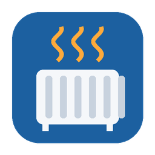

# ioBroker.mill-local

_Прочтите это на другом языке: [Deutsche Kurzbeschreibung](/#/docs/adapterref/iobroker.mill-local/README_de.md) ._

Подключайте устройства **Mill третьего поколения** ( [Mill International AS](https://millnorway.com/) ) к ioBroker через их **локальный REST API** — без облака, без учетной записи Mill, без приложения. Работает для всех устройств третьего поколения с локальным API:

| Тип устройства                   | Обнаружено                                                           | Дополнительные значения                 |
| -------------------------------- | -------------------------------------------------------------------- | --------------------------------------- |
| Wi-Fi розетка Gen 3              | название модели (`Mill HeaterGen3Socket`) /`additional-socket-mode` | влажность, дополнительный режим розетки |
| Панельный обогреватель Gen 3     | название модели /`limited-heating-power`, `pid-parameters`           | ограничение мощности                    |
| Конвекционный обогреватель Gen 3 | название модели                                                      | –                                       |
| Масляный обогреватель Gen 3      | название модели /`oil-heater-power`                                  | уровень мощности 40/60/100 %            |

Адаптер определяет тип по названию модели, указанному пользователем. `GET /status` Кроме того, система проверяет необязательные конечные точки, поэтому она также справляется с названиями моделей, которые ей пока неизвестны. Поддерживается несколько устройств на один экземпляр. Устройства 1-го и 2-го поколений не имеют локального API и не поддерживаются (для них используются облачные решения).

## Функции

- **Каждое значение существует ровно один раз.** Записываемые значения содержат значение устройства (ack=true) и одновременно являются и дисплеем, и исполнительным механизмом — отдельной копии только для чтения нет.
- `control.*`: целевая температура (нормальная), режим работы (четыре режима работы мельницы плюс)** `Switch` ** ), включение/выключение термостата, перезапуск
- **Включение/выключение как у термостата** (см. ниже): ВКЛ возвращает к последнему режиму работы термостата, ВЫКЛ всегда выключает; постоянный обогрев без термостата возможен только в рабочем режиме. `Switch`
- `settings.*` (доступно для записи): смещение калибровки, блокировка от детей, блокировка от коммерческого использования, дисплей, прогнозируемый обогрев, связь с облаком (после перезагрузки устройства), гистерезис выше/ниже целевого значения, температуры в режимах «Комфорт»/«Сон»/«Вне дома», обнаружение открытого окна и его пять параметров, уровень мощности масляного обогревателя, ограничение мощности панели, дополнительный режим розетки, смещение часового пояса, тип контроллера (только ПИД-регулятор для панельных обогревателей), ограничения блокировки от коммерческого использования, параметры ПИД-регулятора (панельные обогреватели), **недельная программа, разовые таймеры и отпуск** (читаемый JSON, см. ниже); `info.customName` переименовывает устройство
- Только для чтения: температура в помещении (калиброванная и исходная), влажность (розетки), **активная целевая температура** (значение, которое устройство регулирует в данный момент, например, в течение текущего недельного программного периода), мощность нагрева, управляющий сигнал, текущий режим нагрева (реле), **активная блокировка** , обнаружено открытое окно, подключение к облаку.
- Расчетная энергия (`energy.total/today/yesterday` кВт·ч) на основе показаний мощности
- **Управление включено по умолчанию** ; выключено. `control.*` и `settings.*` стать доступным только для чтения (с ролями, доступными только для чтения) и `control.restart` не создан
- Перед отправкой каждое значение проходит проверку (диапазон, шаг, список значений).
- Поиск в сети (устройства не объявляют о себе через mDNS), автоматическое повторное обнаружение по MAC-адресу при изменении IP-адреса устройства.
- Дополнительный ключ API (для устройств, переключившихся на HTTPS)

## Конфигурация

1. **Устройства** – введите IP-адрес каждого устройства или укажите сеть (например, `192.168.1.0/24`) и нажмите **«Поиск устройств»** , затем сохраните. MAC-адрес будет заполнен в процессе поиска; с его помощью адаптер сможет снова найти устройство после изменения адреса.
2. **Опрос** – статус каждые 30 с (температура, мощность, режим), настройки каждые 600 с, таймаут запроса 5 с. Значения, выходящие за пределы (10–3600 с, 60–86400 с, 1–30 с), корректируются с **предупреждением в журнале** , указывающим на использованное значение; таймаут также корректируется, если он не короче интервала опроса. См. _раздел «Подключение и опрос»_ ниже.
3. **Управление** включено по умолчанию. Снятие флажка _«Включить управление»_ приводит к следующему: `control.*` и `settings.*` Только для чтения. Дополнительный ключ API хранится в зашифрованном виде и используется для каждой строки устройства, в которой отмечен _ключ API_ .

## Объекты

Каждое устройство создано как `mill-local.0.<mac>` (12 шестнадцатеричных цифр) с каналами `info`, `sensor`, `status`, `control`, `settings` и `energy`. `<device>.refresh` Считывает данные с устройства немедленно. Состояния более старых версий, которые больше не являются частью модели (например, `status.operationMode` рядом с `control.operationMode`) удаляются при запуске. `info.connection` является `true` при условии, что **хотя бы одно** настроенное устройство доступно (см. ниже).

### Подключение и опрос

- **Доступность** означает: устройство ответило на последний запрос корректными данными. Запрос — это... `GET /control-status` и `GET /set-temperature` (Обычный режим); каждые _интервалы настройки_ параметры также считываются. Запросы к одному устройству отправляются **один за другим** (устройство обрабатывает один запрос за раз); несколько устройств опрашиваются независимо и с поэтапным началом.
- Запрос завершается неудачей по следующим причинам: отсутствие соединения, отсутствие ответа в течение установленного времени ожидания (также устройство, которое принимает соединение, но никогда не отвечает, или передает данные с перебоями), ошибка HTTP, ответ, не являющийся JSON или пустой, ответ с... `status` кроме `ok` или `control-status` Без учета режима работы и температуры. Неудачный опрос **не изменяет значения** — все состояния сохраняют свое последнее допустимое значение (с подтверждением) и метку времени.
- После **трех неудачных попыток опроса подряд** устройство отображается как отключенное: `<mac>.info.online = false`, предупреждение в журнале (один раз, с указанием причины) и, если включено, поиск MAC-адреса в сети (не чаще, чем каждые 30 минут). Первый действительный ответ снова переводит устройство в онлайн-режим (информация в журнале).
- ** `info.connection` ** является `true` пока доступно хотя бы одно настроенное устройство, `false` Когда ни одно устройство не находится в сети (или ни одно устройство не настроено). Информация о том, какое устройство находится в автономном режиме, отображается. `<mac>.info.online` (также на плате устройства).
- **Команды** ставятся в очередь после выполнения запроса и отправляются сразу после него; показания, начавшиеся до команды, никогда не перезаписывают ее результат, показания устройства считываются снова сразу после этого. Когда экземпляр останавливается, выполняющийся запрос прерывается, и команды из очереди **не** отправляются.
- Устройства не могут автоматически передавать изменения: изменение на устройстве (кнопки, приложение) отобразится при следующем опросе.

## Диспетчер устройств

Данная система поддерживает **менеджер устройств** ioBroker (вкладка _«Устройства»_ в административной панели). Каждое настроенное устройство получает карточку только для **текущей работы** : имя и модель, доступность, сообщение об ошибке устройства в виде предупреждения, индикатор _обнаружения открытого окна_ , температура в помещении, влажность (розетки), режим работы, целевая температура, текущая мощность (Вт) и расчетное энергопотребление за сегодняшний день. Все значения указаны на самой карточке.

- **Включение/выключение** — это переключатель в строке состояния; его символ и текст соответствуют состоянию. `status.switchedOn` (Выкл = режим работы _«Выкл»_ , или _переключатель_ с разомкнутым реле). Щелчок запрашивает подтверждение. Он делает то же самое, что и `control.power` В _режиме «выкл_ » термостат выключается, _в режиме_ «вкл» возвращается к последнему режиму работы (по умолчанию — _индивидуальное управление_ ); в режиме _«переключатель»_ реле размыкается и замыкается. Постоянного обогрева из _режима «выкл»_ или из режима работы термостата не предусмотрено.

- **Режим работы** (выбор) и **целевая температура** (ползунок, отправляется после того, как он отключится на 1 секунду) остаются доступными, даже когда нагреватель выключен; выбор режима, отличного от _«Выкл.»_ , включает его.

- **Недельная программа** (кнопка календаря): сетка недели, по одной строке на каждый будний день от 0 до 24 часов; каждый блок представляет собой период с соответствующей температурой, например, _«Комфорт» (22 °C)_ . Перетащите границу (шаг 15 минут; с помощью клавиатуры: клавиши со стрелками, Shift = 1 час, Delete удаляет границу), щелкните по блоку, чтобы изменить его период или разделить его, дважды щелкните, чтобы разделить в этой точке, скопируйте и вставьте целые дни. Температуры «Комфорт», «Сон», «Вне дома» и «Нормальный» можно изменить в легенде. _OK_ записывает программу (максимум 64 точки переключения); если устройство еще не запускает недельную программу, адаптер спрашивает, следует ли ее активировать. Страница представляет собой обычный HTML-код. `admin/weekly.html`) в диалоге.

Элементы управления существуют только тогда, когда управление включено. Карта записывает существующие состояния (ack=false), поэтому применяется та же проверка, что и для скриптов — отправляются только документированные режимы работы.

На карточках намеренно отсутствуют **какие-либо действия по настройке** (поиск, добавление, удаление или изменение адреса); устройства по-прежнему настраиваются в параметрах экземпляра. Устройство, которое никогда не отвечало, отображается только со своим именем и адресом. После добавления устройств или включения управления обновите список устройств.

## Примечания и подводные камни

- **Устройство распознает каждый режим работы. `"ok"` и отключается при неизвестных значениях.** Поэтому адаптер отправляет только задокументированные режимы (`Control individually`, `Weekly program`, `Independent device`, `Off` Устройство сообщает о выключенном режиме как `OFF`; адаптер показывает `Off`.
- Устройство обрабатывает один запрос за раз; адаптер ставит в очередь все запросы для каждого устройства.
- Режим работы, неизвестный адаптеру (указан в описании API). `Invalid`) показано, как указано в `control.operationMode` Считается выключенным и регистрируется один раз как предупреждение. Оно никогда не отправляется; `control.power` = ON возвращает термостат к последнему режиму работы.
- В `Independent device` одноразовый таймер типа `Off` /`AlwaysHeating` сообщает те же значения, что и `Switch` при открытом/закрытом реле (`set_temperature` 0 / 99). Адаптер различает их по считанным таймерам (последний прошедший таймер); таймер, установленный на устройстве, отображается при следующем опросе настроек. Получено из описания API, пока не проверено на реальном устройстве.
- В режиме `Independent device` Новая целевая температура вступает в силу только при `set-temperature-in-independent-mode-now`; адаптер отправляет его автоматически.
- `POST /open-window` и `POST /hysteresis-parameters` Необходим полный набор параметров; адаптер сначала считывает текущие значения и изменяет только то, которое было записано.
- **Вкл./выкл.** `control.power` (роль `switch.power`) — это включение/выключение **термостата** , поскольку визуализации (Material, Alexa, Lovelace…) ожидают его рядом с целевой температурой, и аналогично переключателю на карточке устройства. **ВКЛ** возвращает к последнему режиму работы термостата. `Control individually`, `Weekly program` или`Independent
  device `; по умолчанию` Control individually `) – в режиме термостата ничего не передается. **Выкл** устанавливает режим работы.` Off `. Читать:` true ` = включен (то же самое, что и` status.switchedOn `). Замкнуто ли сейчас реле — это...` status.heating`.
- **Постоянное отопление без термостата только в рабочем режиме. `Switch` ** (режим адаптера): записано в `control.operationMode` В этом режиме он запускается с разомкнутым реле; `control.power` включает (вкл) и выключает (выкл) реле независимо от недельной программы и целевой температуры. `Switch` =`Independent device` с принудительной передачей через реле `set-temperature-in-independent-mode-now` 99 (вкл.) / 0 (выкл.) – проверено на Wi-Fi розетке Gen 3. Чтобы снова использовать термостат для обогрева, выберите режим работы термостата. `current_power` Потребляемая мощность равна 0 Вт, когда в розетку ничего не подключено. `switched_on` остался `false` в то время как реле было замкнуто; поэтому адаптер использует управляющий сигнал.
- **До версии 0.3.x** `control.power = true` переключился на `Switch` при замкнутом реле (постоянный нагрев) считываемое значение соответствовало состоянию реле. Скрипты, которые использовали `control.power` как гласило "сейчас накаляется"`status.heating` вместо.
- **Детектор типов:** устройство (и его `control` (канал) определяется как один термостат: заданное значение `control.targetTemperature` фактическая температура `sensor.temperature` влажность, вкл/выкл `control.power` Заданные температуры `settings.*` Таким образом, исходная температура и активная мишень выполняют свои функции. `level` /`value` (с единицей измерения °C).
- **Время, недельная программа, таймеры, отпуск:** устройство не имеет резервных часов от батареи и API для установки времени. После каждого запуска оно запрашивает подтверждение.** `pool.ntp.org` ** через NTP (отслеживается в журнале DNS; при отключенной связи с облаком запросы больше ни к чему не обращаются). **Перед этим проверяется подключение к интернету с помощью ICMP-пинга. `4.2.2.1` ** (Встроенная функция; наблюдалось на Wi-Fi Socket Gen 3): без шлюза по умолчанию предполагается xxx1, и без ответа на ping время никогда не запрашивается. Опция DHCP 42 (NTP-сервер) не используется. Полностью локальная настройка, которая работает: шлюз через DHCP, брандмауэр разрешает только эхо-запросы ICMP от устройства к `4.2.2.1` (все остальное, что связано с интернетом, заблокировано), и `pool.ntp.org` указывает на локальный NTP-сервер, например, с переадресацией DNS только для IoT-клиентов (AdGuard: `||pool.ntp.org^$dnsrewrite=NOERROR;A;<ntp-server>,client=<iot-net>` Устройство затем повторяет DNS-запрос примерно каждые 2 минуты. Проверка: еженедельная запись программы переключается в ожидаемую минуту. Часовой пояс — это отдельная настройка. `timezone-offset`, 1440 = не задано); При использовании _параметра «Поддерживать часовой пояс устройства в соответствии с ioBroker_ (по умолчанию)» адаптер устанавливает его с хоста ioBroker, в том числе и при переходе на летнее время.
  - `settings.weeklyProgram`: `[{"day":"Mon","time":"06:30","type":"Comfort"}, …]` – Типы: Комфорт, Сон, Вне дома, Нормальный, Выкл., Постоянное отопление; сохранено в минутах с понедельника 00:00; активно в режиме `Weekly program`.
  - `settings.timers`: `[{"time":"2026-10-19T06:30","type":"Normal"}, …]` (местное время) – типы: Нормальный, Выкл., Всегда обогрев; активен в режиме `Independent device`.
  - `settings.vacation`: `{"start":"2026-12-24T08:00","end":"2027-01-02T18:00"}`, `{}` = ни одного. Все три хранятся и работают внутри устройства; адаптер только считывает и записывает их.
- Опрос, который уже выполнялся в момент получения команды, больше не возвращает состояние к старому значению (показания, полученные после получения команды, отбрасываются, устройство считывается снова сразу после этого).
- Устройство принимает только вариант "дисплейный блок", указанный в документации. `Farenheit`; адаптер отображается и принимает `Fahrenheit` и переводит его. `Fahrenheit` само по себе признается с `ok` и проигнорировали.
- Предложение не было сделано намеренно: `set-api-key` (необратимо без сброса к заводским настройкам), программный/аппаратный сброс, обновление по воздуху (требуется URL-адрес прошивки и доступ в интернет), настройка Wi-Fi, `ablecloud-message`, `max-heater-power` (Калибровка измерителя мощности, считывание данных невозможно).
- **Интернет не требуется:** локальный API и режим `Control individually` Работает без интернета. Для еженедельной программы и таймеров требуется точное время, которое устройство получает из интернета только после перезагрузки (у него нет резервных часов от батареи). Облачную связь можно отключить на устройстве; это отображается в `settings.cloudCommunication`.
- **Ключ API:** после `POST /set-api-key` Устройство переключается на HTTPS с самоподписанным сертификатом (адаптер его не проверяет) и ожидает ключ в заголовке. `Authentication` Адаптер сам никогда не устанавливает ключ — для его удаления требуется сброс к заводским настройкам. Устройства с ключом API не обнаруживаются поиском.
- Значения энергии являются **приблизительными** (мощность × время между двумя опросами); промежутки между опросами не учитываются.
- ioBroker в Docker: работает в мостовой сети, адаптер только открывает исходящие HTTP-соединения.

## Избыток фотоэлектрической энергии

Нагреватели мельницы представляют собой простую нагрузку для управления избыточным напряжением (например, с помощью скрипта):

- **Масляные обогреватели:** `settings.oilHeaterPower` Устанавливает уровень мощности (40, 60 или 100 % от номинальной мощности; API также принимает значение 0). Повышайте его с избытком, понижайте без избытка. Устройство продолжает регулировать мощность до достижения целевой температуры – уровень мощности лишь ограничивает мощность.
- **Панельные обогреватели:** `settings.limitedHeatingPower` Ограничение мощности с шагом в 1 % (10–100 %); тот же принцип, но с более высокой точностью.
- **Wi-Fi розетка и все остальные устройства:** включайте и выключайте термостат с помощью `control.power` (поддерживает заданную температуру) или используйте режим работы `Switch` для простой нагрузки: `control.power` Затем замыкает и размыкает реле без термостата.
- Записывайте такие значения только при их изменении, а не при каждом избыточном вычислении (устройство отвечает только на один запрос за раз; за каждой командой следует чтение). Проверьте результат в `status.power` (Вт) и расчетная энергия.

## Миграция с ioBroker.millheater

1. Откройте настройки экземпляра mill-local, вкладка _«Устройства»_ , и нажмите « **Перенять управление от millheater»** . Адаптер считывает все данные. `millheater.<n>` Задает экземпляр (адрес, интервалы опроса, тайм-аут), MAC-адрес и имя из его состояний и заполняет таблицу устройств (обновляется существующая строка с тем же MAC-адресом или именем, а не дублируется). Интервалы за пределами локального диапазона устройства корректируются в соответствии с ними.
2. Сохраните изменения, затем **остановите экземпляр(ы) нагревателя мельницы** : устройство Mill отвечает только на один запрос за раз, а два адаптера, опрашивающие одно и то же устройство, сталкиваются с таймаутами.
3. Укажите скрипты, визуализации и псевдонимы на новые идентификаторы (`<mac>` (MAC-адрес, 12 шестнадцатеричных цифр):

| нагреватель мельницы (`millheater.<n>.`) | местная мельница (`mill-local.<n>.<mac>.`)               | Примечание                                                               |
| ----------------------------------------- | --------------------------------------------------------- | ------------------------------------------------------------------------ |
| `control-status.ambient_temperature`      | `sensor.temperature`                                      |                                                                          |
| `control-status.raw_ambient_temperature`  | `sensor.temperatureRaw`                                   |                                                                          |
| `control-status.set_temperature` (писать) | `control.targetTemperature`                               | Нормальная температура, показания также читаемы в выключенном состоянии. |
| `control-status.set_temperature` (читать) | `status.activeTargetTemperature`                          | пустой (не 0) в выключенном состоянии                                    |
| `control-status.operation_mode`           | `control.operationMode`                                   | `Off` вместо `OFF` плюс `Switch`                                          |
| `control-status.current_power`            | `status.power`                                            |                                                                          |
| `control-status.control_signal`           | `status.controlSignal`                                    |                                                                          |
| `control-status.switched_on`              | `status.heating`                                          | Реле замкнуто (от управляющего сигнала)                                  |
| `control-status.lock_active`              | `status.lockActive`                                       |                                                                          |
| `control-status.open_window_active_now`   | `status.openWindowActive` +`settings.openWindowDetection` | два логических значения вместо текста                                    |
| `control-status.connected_to_cloud`       | `status.cloudConnected`                                   |                                                                          |
| `settings.temperature_calibration_offset` | `settings.calibrationOffset`                              |                                                                          |
| `settings.heating_level_percentage`       | `settings.oilHeaterPower`                                 | масляные обогреватели                                                    |
| `settings.limited_heating_power`          | `settings.limitedHeatingPower`                            | панельные обогреватели                                                   |
| `settings.additional_mode`                | `settings.additionalSocketMode`                           | Розетка Wi-Fi                                                            |
| `status.name`                             | `info.model`                                              |                                                                          |
| `status.custom_name`                      | `info.customName`                                         | записываемый                                                             |
| `status.version`                          | `info.firmware`                                           |                                                                          |
| `status.mac_address`                      | `info.mac`                                                |                                                                          |
| `status.operation_key`                    | `info.operationKey`                                       |                                                                          |
| `info.connection`                         | `info.connection` /`<mac>.info.online`                    | за экземпляр / за устройство                                             |

История старых государств не передается.

## Отличие от ioBroker.millheater

[ioBroker.millheater](https://github.com/webbummler/ioBroker.millheater) также использует локальный API и поддерживает те же типы устройств третьего поколения (конвекционные, масляные и панельные обогреватели, Wi-Fi-розетки). Он запускает одно устройство на экземпляр и фокусируется на целевой температуре, режиме работы, калибровке и уровне мощности (например, для управления избытком солнечной энергии), с подробными тестами и документацией. **mill-local** запускает **несколько устройств на экземпляр** с сетевым поиском и повторным обнаружением по MAC-адресу, охватывает **все настройки, которые может изменить локальный API** (блокировки, гистерезис, открытое окно, предустановленные температуры, недельная программа, таймеры, отпуск, часовой пояс, ПИД-регулятор и т. д.), влажность Wi-Fi-розетки, простой режим включения/выключения без термостата, оценку энергопотребления и карты управления устройствами. Ни одному из адаптеров не требуется учетная запись Mill или облачное хранилище.

## Визуализация (vis)

Адаптер поставляется со своими собственными **виджетами** (настройка _локальной сети_ ): карта устройства, карта телефона, комнатная температура с целевым значением − / +, значения, режим работы, недельная программа (отображение), сегодняшние периоды работы нескольких устройств, общая потребляемая мощность и **график истории** (комнатная температура, целевое значение в виде ступенчатой линии, текущая потребляемая мощность в виде площади, влажность Wi-Fi-розетки; 24 часа или 7 дней). Готовые представления для обзора, страницы с подробной информацией и телефона находятся в[`vis-templates/`](/#/docs/adapterref/iobroker.mill-local/vis-templates/README.md) Свет и тьма, тексты на одиннадцати языках.

Диаграмма считывает записанные значения из любого адаптера истории (`history`, `influxdb`, `sql`; атрибут _экземпляра истории_ , пустой = по умолчанию). **Адаптер отключает запись** — включите ее в дереве объектов (значок шестеренки) для `sensor.temperature`, `status.activeTargetTemperature`, `status.power`, `sensor.humidity` (розетка Wi-Fi) и опционально `control.targetTemperature` каждого устройства.

## Разработка и тестирование

- `npm test` – пакетное и модульное тестирование; `npm run lint` – ESLint 9 (плоская конфигурация) `@iobroker/eslint-config`).
- `IOB_CONTROLLER=latest npm run test:integration`– запускает js-контроллер с адаптером для имитированных устройств (`test/fakeMill.js`): Wi-Fi розетка, панель, масляный и конвекционный обогреватель, недельная программа / таймеры / отпуск с подвижными часами и без NTP, открытое окно, блокировка от детей, неизвестные режимы работы, неверные ответы, тайм-ауты, обрывы соединения, перезапуск, ловушка режима работы и выключение с запросом по сети.
- `node test/simulator.js --base 18000 --pid sim.pid` – Четыре имитированных устройства (порты 18001–18004) с помещением, которое нагревается вместе с нагреваемым устройством, для проверки адаптера без использования оборудования. `GET http://127.0.0.1:18000/` показывает им `POST http://127.0.0.1:18000/<n>` например `{"windowOpen": true}` или `{"offline": true}` изменяет симуляцию; остановиться на `kill $(cat sim.pid)` Не является частью пакета npm.

## Источники

- Официальное описание API: [Mill-International-AS/Generation\_3\_REST\_API](https://github.com/Mill-International-AS/Generation_3_REST_API) (версия API 0x220727; частично устарела или неверна – адаптер соответствует реальным устройствам)
- Поведение было проверено с помощью интеграции с Home Assistant.[`mill`](https://github.com/home-assistant/core/tree/dev/homeassistant/components/mill) (Apache-2.0) и [pyMillLocal](https://github.com/Danielhiversen/pyMillLocal) (MIT). Код не копировался.
- Идеи и тестовые сценарии взяты из проекта [ioBroker.millheater](https://github.com/webbummler/ioBroker.millheater) от webbummler (MIT): активная целевая температура, активная блокировка, описание подключения и опроса, примечания к избытку солнечной энергии и сценарии сбоев тестов (неверные ответы, тайм-аут, запись во время опроса, выключение с запросом по сети), проверка значений времени в административной форме (диапазоны значений и правило _«тайм-аут < интервал опроса_ , не сохраняется при неверных значениях») и обработка сообщаемого режима. `Invalid` Тесты для этого адаптера были написаны заново; код не копировался.

## Торговая марка

Mill является товарным знаком компании Mill International AS. Данный адаптер является независимым проектом и не связан с компанией Mill International AS и не получает от нее одобрения.

## Changelog

<!--
	Placeholder for the next version (at the beginning of the line):
	### **WORK IN PROGRESS**
-->
### 0.4.1 (2026-11-20)

- (Immanuel) Fix: the integration test failed on hosts in UTC (time zone offset -0 instead of 0); no functional changes
  compared to 0.4.0.

### 0.4.0 (2026-11-20)

- (Immanuel) **Breaking:** `control.power` is now the on/off of the thermostat, as visualisations expect it: ON returns
  to the last thermostat mode, OFF switches off. Permanent heating without thermostat only in the operation mode
  `Switch` (there `control.power` is the relay). The relay is the new state `status.heating`.
- (Immanuel) New states `status.activeTargetTemperature` (empty instead of 0 while off) and `status.lockActive`.
- (Immanuel) Type detector: exactly one thermostat per device (setpoint `control.targetTemperature`, actual
  temperature `sensor.temperature`).
- (Immanuel) `info.connection` is true while at least one device is reachable.
- (Immanuel) Clear warnings for invalid timing settings; empty or invalid answers keep the last values; the
  shutdown aborts the running request and drops queued commands.
- (Immanuel) Takeover from ioBroker.millheater (button in the instance settings), migration table in the README.
- (Immanuel) Weekly program on the device card as a week grid: draggable switching points, periods with their
  temperatures, copy/paste days, keyboard operation; asks after OK whether to activate the weekly program.
- (Immanuel) Unknown reported operation modes (e.g. `Invalid`) count as off and are logged once.
- (Immanuel) Admin form: timing values are checked (ranges, timeout shorter than the polling interval) and not
  saved while invalid.
- (Immanuel) Upgrade notice for the changed meaning of `control.power` (admin message on the update and one
  warning per device in the log).
- (Immanuel) vis widgets (set *mill-local*) with ready-made views (overview, detail page with weekly program and history
  chart, phone) in `vis-templates/`; the history chart reads any history adapter and switches no recording on.
- (Immanuel) Cards and objects: "Current power" instead of "Heating power" for `status.power`.
- (Immanuel) Requires js-controller 7.0.7 or newer.
- (Immanuel) Tests: simulator for Wi-Fi socket, panel, oil and convection heater with weekly program, timers,
  vacation, device clock, open window, child lock and connection loss; `test/simulator.js` for a demo instance.
- (Immanuel) Ideas and test scenarios from ioBroker.millheater by webbummler, MIT.

### 0.3.0 (2026-11-12)

- Device manager support (`@iobroker/dm-utils`, suggested by mcm1957 in issue #2): one card per device for the
  running operation – model, reachability, fault report, open-window indicator, room temperature, humidity,
  heating power and energy today; on/off toggle with confirmation, operation mode and target temperature
  directly on the card (also while off). No configuration actions.
- New state `status.switchedOn`: false only when the heater is off (mode *Off*, or *Switch* with the relay open).

### 0.2.2 (2026-10-23)

- Roles: operation mode, display unit, predictive heating and controller type use the role `text`
  (`level.mode` is not a valid role). With control disabled, the values get read-only roles and the restart
  button is left out.
- Configured intervals are also checked in the adapter (same limits as the admin UI, never above the timer
  limit); `info.connection` is reset when the adapter stops.
- Translations: remaining texts that were identical to English are translated; tab bar layout for small screens.
- Manufacturer link in the README; versions before 0.2.0 moved to CHANGELOG_OLD.md.

### 0.2.1 (2026-10-23)

-   Release via GitHub Actions with npm provenance (no functional changes).

### 0.2.0 (2026-10-23)

- First public release (functionally the same as 0.1.4): published on GitHub and npm, test data anonymised.

Older entries (versions before the first public release) are in CHANGELOG_OLD.md.

## License

MIT License

Copyright (c) 2026 Immanuel <github@freitag.online>

Permission is hereby granted, free of charge, to any person obtaining a copy of this software and associated
documentation files (the "Software"), to deal in the Software without restriction, including without limitation
the rights to use, copy, modify, merge, publish, distribute, sublicense, and/or sell copies of the Software, and
to permit persons to whom the Software is furnished to do so, subject to the following conditions:

The above copyright notice and this permission notice shall be included in all copies or substantial portions of
the Software.

THE SOFTWARE IS PROVIDED "AS IS", WITHOUT WARRANTY OF ANY KIND, EXPRESS OR IMPLIED, INCLUDING BUT NOT LIMITED TO
THE WARRANTIES OF MERCHANTABILITY, FITNESS FOR A PARTICULAR PURPOSE AND NONINFRINGEMENT. IN NO EVENT SHALL THE
AUTHORS OR COPYRIGHT HOLDERS BE LIABLE FOR ANY CLAIM, DAMAGES OR OTHER LIABILITY, WHETHER IN AN ACTION OF CONTRACT,
TORT OR OTHERWISE, ARISING FROM, OUT OF OR IN CONNECTION WITH THE SOFTWARE OR THE USE OR OTHER DEALINGS IN THE
SOFTWARE.