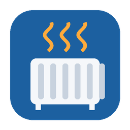

# ioBroker.mill-local – Kurzbeschreibung auf Deutsch

Дополнительная документация находится на английском языке [README](/#/adapters/mill-local) .

Привязка адаптера Mill-Geräte der **Generation 3** ( [Mill International AS](https://millnorway.com/) ) (Panel-, Konvektions- und Ölheizungen sowie die WLAN-Steckdose) связана с **локальным API** в – в облаке, в сети или в приложении. Чтобы создать мгновенный доступ, выберите автоматический режим работы, сетевое соединение и поиск адреса по MAC-адресу.

- **Джеден Верт всегда был в восторге.** `control.*` (Solltemperatur, Betriebsart, Ein/Aus) и `settings.*` (все Einstellungen, die die API ändern kann) Zeigen Den Gerätewert und Sind Direct Beschreibbar.
- **Steuerung ist ab Werk ein** ; ausgeschaltet sind `control.*` унд `settings.*` нур лесбар (с Нур-Лезе-Роллен), `control.restart` entfällt.
- **Ein/Aus wie beim Thermostat:** `control.power` EIN kehrt in die letzte Thermostat-Betriebsart zurück (sonst `Control individually`), AUS setzt die Betriebsart `Off` – wie der Umschalter auf der Gerätekarte и так, wie Material, Alexa или Lovelace ihn neben der Solltemperatur verstehen. **Dauerheizen без термостата в Betriebsart `Switch` ** : dort schließt/öffnet `control.power` дас Реле. Ob das Relais gerade zu ist, zeigt `status.heating` (бис 0.3.x war das der Lesewert von `control.power`, и EIN schaltete auf Dauerheizen).
- **Neu в версии 0.4.0:** `status.activeTargetTemperature` (активный Sollwert, z. B. aus dem Wochenprogramm; leer statt 0, solange aus), `status.lockActive` (активный Сперре), `status.heating`.
- **Verbindung und Abfrage:** Erreichbar heißt, das Gerät Hat die Letzte Abfrage gültig beantwortet. Eine fehlgeschlagene Abfrage (keine/ungültige/leere Antwort, Zeitüberschreitung, HTTP-Fehler) ändert keinen Wert; nach drei Fehlschlägen в Folge ist das Gerät офлайн (`<mac>.info.online`). `info.connection` ист `true`, solange **mindestens ein** Gerät erreichbar ist. Befehle warten hinter einer laufenden Abfrage; beim Beenden wird die laufende Anfrage abgebrochen und Wartendes nicht mehr gesendet. Непревзойденный интервал в настройке был связан с предупреждением об исправлении журнала.
- **PV-Überschuss:** Ölradiatoren über `settings.oilHeaterPower` (40/60/100 %), Panelheizungen über `settings.limitedHeatingPower` (10–100 %), alle Geräte über `control.power` bzw. die Betriebsart `Switch`. Nur bei Änderung schreiben.
- **Время:** Das Gerät Holt Sie Nur для NTP von `pool.ntp.org` – und nur, wenn vorher ein Ping an `4.2.2.1` beantwortet wird (fest eingebaut; ohne Gateway nimmt es xxx1 an). Локальное управление: шлюз для DHCP, поддержка межсетевого экрана и ICMP в соответствии с требованиями `4.2.2.1`, `pool.ntp.org` для каждого DNS на локальном NTP-сервере. Установите Zeitzone для адаптера от ioBroker. Wochenprogramm, Einzeltimer и Urlaub, включая уроки JSON и schreibbar.
- **Ответ:** Вы должны выйти из строя с помощью «ОК» и выбрать его без необходимости в AUS – отправка адаптера должна быть завершена без документации.
- **В Интернете:** Lokale API и Betriebsart «Индивидуальное управление» в Интернете; Wochenprogramm und Timer brauchen die Uhrzeit, die das Gerät nur aus dem Internet holt.
- **Geräteverwaltung (Reiter «Geräte» im Admin):** je Gerät eine Karte für den laufenden Betrieb – Erreichbarkeit, Modell, Störungsmeldung, Anzeige «Fenster Offen», Raumtemperatur, Feuchte, Betriebsart, Solltemperatur, aktuelle Leistung (W) и geschätzte Energie Heute. Ein/Aus ist ein Umschalter in der Statuszeile mit Rückfrage (folgt dem Datenpunkt `status.switchedOn`; „Ein“ kehrt in die letzte Thermostat-Betriebsart zurück, в `Switch` Schaltet er das Relais). Чтобы установить температуру и температуру, установите режим «Aus» в режиме ожидания (alles nur bei eingeschalteter Steuerung). **Wochenprogramm** (Kalender-Knopf): Wochenraster Mo–So, 0–24 Uhr, Blöcke je Abschnitt mit Temperatur (z. B. «Комфорт (22 °C)»); Grenzen ziehen (15 мин, Tastatur: Pfeile), Block anklicken zum Ändern/Teilen, Tage kopieren; Температура der Abschnitte in der Legende. После того, как фрагмент адаптера будет активирован, рабочая программа будет активирована. Лучшая конфигурация на карте – вы можете использовать мгновенную настройку.
- Eine unbekannte gemeldete Betriebsart (die API-Beschreibung nennt) `Invalid`) wird angezeigt, zählt als aus und wird einmal gewarnt; gesendet wird sie nie.
- **Tests ohne Gerät:** `test/fakeMill.js` одновременное использование Steckdose, Panel-, Öl- und Konvektionsheizung samt Wochenprogramm, Timeern, Urlaub, Geräteuhr, Fenster Offen, Kindersicherung und Verbindungsabbrüchen; `node test/simulator.js` Начните работу с симуляцией для создания мгновенного зондирования (на английском языке README).
- Die Energiewerte sind geschätzt (Leistung × Zeit zwischen zwei Abfragen).
- **Unterschied zu `millheater`:** Адаптер Jener не требует локального API и не требует дизельного двигателя Gen-3-Gerätearten (Konvektor, Öl, Panel, WLAN-Steckdose), с его мгновенным запуском и подключением к Sollwert, Betriebsart, Kalibrierung und Leistungsstufe. `mill-local` Вы можете получить мгновенный доступ к API, а также к Einstellungen, Luftfeuchte der Steckdose, Energieschätzung und Gerätekarten.
- **Умстиг фон `millheater`:** In den Instanzeinstellungen (Reiter «Geräte») übernimmt der Knopf **«Aus millheater übernehmen»** Адрес, MAC, имя и интервал времени `millheater` -Instanzen in die Gerätetabelle. Danach speichern und die millheater-Instanzen anhalten (das Gerät beantwortet nur eine Anfrage gleichzeitig). Die Zuordnung alte ID → новый ID указан в таблице в английском README («Миграция с ioBroker.millheater»).
- **Визуализация (вид 1):** собственные виджеты ( _местная мельница_ Satz) – Gerätekarte, Handykarte, Raumtemperatur mit Soll − / +, Werte, Betriebsart, Wochenprogramm (Anzeige), heutige Abschnitte, Gesamtleistung und ein **Verlaufsdiagramm** (Raumtemperatur, Soll als Stufenlinie, aktuelle) Leistung als Fläche, Luftfeuchte der Steckdose 24 часа или 7 дней). Фертиге Ансихтен в[`vis-templates/`](/#/docs/adapterref/iobroker.mill-local/vis-templates/README.md) . Datenquelle frei wählbar (история, influxdb, sql); **die Aufzeichnung schaltet der Anwender ein** , nicht der Adaptor: im Objektbaum am Zahnrad für `sensor.temperature`, `status.activeTargetTemperature`, `status.power`, `sensor.humidity` (Доза поштучно) и опционально `control.targetTemperature`.