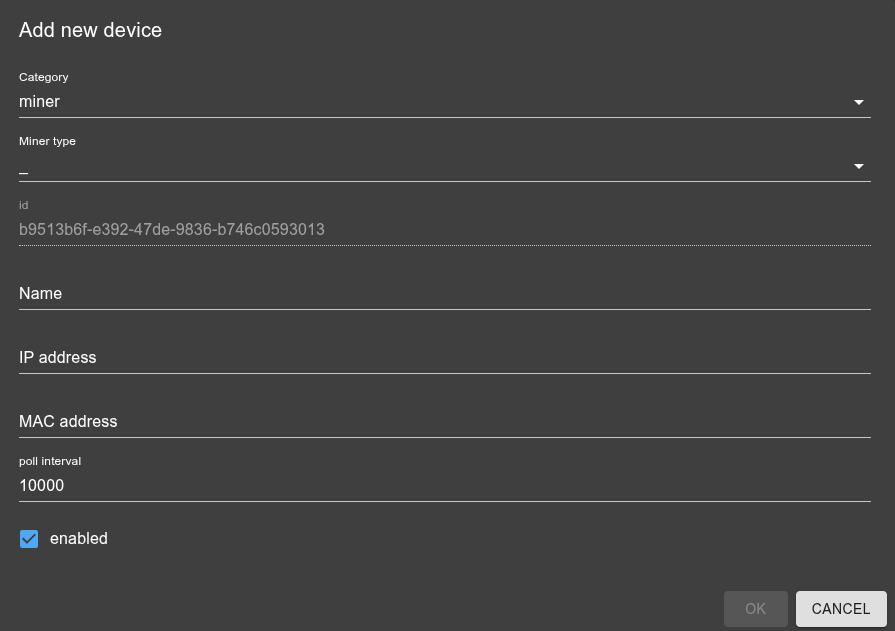

# ioBroker.miner

## Адаптер майнера для ioBroker

Взаимодействуйте с различными API криптомайнеров.

## Дорожная карта

- [x] v0.1: управление устройствами, реализация TRM
- [x] Поддержка большего количества майнеров: bos+, xmrig, avalon, ...?
- [ ] Внедрить больше функций (управление + информация с устройств).
- [ ] поддержка бассейнов
- [ ] обнаружение устройства
- [ ] sentry
- [ ] Подробнее: см. Todo.md / issues

## Использование

При добавлении нового устройства в настройках экземпляра (или на вкладке «Администратор устройств») должно появиться диалоговое окно, подобное этому:



Все параметры должны быть достаточно понятны. Для каждого из них также есть всплывающие подсказки с более подробной информацией. Если что-то осталось непонятным, не стесняйтесь задавать вопросы в разделе "Проблемы", обсуждении или на форуме.

### Типы майнеров Brains OS

Существует две реализации майнера Braiins, поскольку компания Braiins изменила стек API при переходе на разные поколения прошивки:

- `bos` Используйте это для официальной прошивки Brain OS. `>= 23.03` Как правило, это Antminer серии S19 и более новые модели. В данной реализации используется публичный API Braiins OS (PAPI) через gRPC.
- `bosMiner` Используйте это для устаревшей прошивки Brain OS. `< 23.03` Как правило, это устройства, выпущенные до S19, такие как серии Antminer S9 и S17. При этом используется более старый API, совместимый с CGMiner.

`bosMiner` также поддерживает `control.powerTarget` состояние. Устаревшая версия Brainins OS не предоставляет эту информацию через API, совместимый с CGMiner, поэтому адаптер использует обходной путь через SSH: он подключается к майнеру и обновляет его. `power_target` в `[autotuning]` раздел и `timestamp` в `[format]` раздел `/etc/bosminer.toml` хранит резервную копию по адресу `/etc/bosminer.toml.iobroker-power-target.bak` остановки `bosminer` записывает конфигурацию и запускает `bosminer` Снова настройте действительные учетные данные SSH для `bosMiner` устройства; имя пользователя по умолчанию —`root` без пароля.

Предупреждение: изменения `control.powerTarget` на старом `bosMiner` устройства требуют полного `bosminer` Цикл остановки/запуска. Не меняйте это значение часто; используйте его для целенаправленных изменений целевых параметров, а не для быстрых циклов автоматизации.

Если вы не уверены в выборе, сначала проверьте поколение прошивки/семейство устройств:

- Образы ОС Braiins для S19/S21/T19 и более новых моделей указаны в текущем процессе загрузки прошивки и обычно должны использовать `bos`.
- Изображения S17 опубликованы как `v 23.01` и изображения S9 в качестве `v 22.08.1` на странице загрузки Braiins, поэтому представителям старшего поколения следует использовать `bosMiner`.

Ссылки:

- Публичный API ОС Braiins: <https://academy.braiins.com/braiins-os/papi-about>
- Загрузка прошивки Braiins OS: <https://braiins.com/os-firmware/download>

### Вход в Avalon через веб-браузер без приложения.

Веб-интерфейс майнеров Avalon Nano 3 / 3S не содержит поля для ввода пароля: вместо этого отображается QR-код, который необходимо отсканировать с помощью приложения Avalon Family. Адаптер может подтвердить этот вход в систему:

1. Введите веб-пароль майнера в настройках устройства (`web password` Это пароль, установленный для майнера в приложении Avalon Family.
2. Откройте IP-адрес майнера в браузере, чтобы отобразилась страница входа с QR-кодом.
3. В диспетчере устройств нажмите кнопку «Подтвердить вход через веб-браузер». Вход в систему будет выполнен в течение 5 секунд.

Это работает так же, как сканирование QR-кода: адаптер отправляет майнеру данные. `qr_auth` Команда, отправляемая приложением, подписывается паролем от веб-сервера.

### Напоминание о пылевом фильтре Avalon

Майнеры Avalon Nano 3 / 3S подсчитывают, сколько времени работает их пылевой фильтр с момента последней чистки. Адаптер отображает это значение следующим образом: `custom.filter.runtime` (часов) и на карточке устройства в диспетчере устройств.

- Когда время выполнения достигнет интервала напоминания, указанного в настройках устройства (`filter cleaning reminder (days)` (по умолчанию 30 дней, 0 = выключено). `custom.filter.cleanDue` повороты `true` (также на плате устройства), и адаптер отправляет уведомление ioBroker (категория «Требуется очистка пылевого фильтра»), которое адаптеры уведомлений, такие как notification-manager, могут пересылать, например, в Telegram или по электронной почте.
- После очистки фильтра сбросьте напоминание: нажмите кнопку «Сбросить напоминание о фильтре» в элементах управления устройства (за кнопкой управления устройством в диспетчере устройств) или установите `custom.filter.reset` к `true` Эта функция делает то же самое, что и "Очистка фильтра" в приложении Avalon Family: она отправляет майнеру... `ascset|0,filter-clean,1` команда, которая возвращает время выполнения фильтра к нулю.

Проверка прошивки для BOS использует последний зарегистрированный тип платы управления и установленную версию, в том числе, когда устройство находится в автономном режиме или отключено. Устройство BOS должно было хотя бы раз сообщить о своей идентификации. В настоящее время проверки обновлений Avalon охватывают только конкретную модель Nano 3: приложение `nano3` В ленте новостей отсутствует подтвержденная совместимость с Nano 3S, поэтому статус обновления для Nano 3S остается неизвестным.

## Объектная модель

Все объекты создаются в рамках:

`miner.<instance>.miner.<minerId>`

`<minerId>` — это стабильный идентификатор из конфигурации устройства (`settings.id` Это позволяет запускать несколько майнинговых процессов на одном хосте.

### Группы (каналы)

- `info`: identity/config/firmware/connection meta
- `stats`: показатели производительности в реальном времени (хешрейт, количество ресурсов, энергопотребление, температура и т. д.)
- `control`: элементы управления с возможностью записи (запуск/остановка, перезагрузка и т. д.)
- `raw`: необработанные данные API (эксперт)

### Сущности (необязательные поддеревья)

Некоторые майнеры раскрывают информацию о своих дочерних объектах. Если они доступны, то размещаются ниже майнера:

- `pools.<index>...`
- `hardware.gpus.<index>...`
- `hardware.hashboards.<index>...`

### Примеры

- `miner.0.miner.<minerId>.enabled`
- `miner.0.miner.<minerId>.control.running`
- `miner.0.miner.<minerId>.stats.totalHashrate`
- `miner.0.miner.<minerId>.hardware.gpus.0.stats.temp`
- `miner.0.miner.<minerId>.raw.stats`

### Включение/отключение майнера

Каждое майнинговое устройство имеет записываемый верхний уровень. `enabled` состояние:

`miner.<instance>.miner.<minerId>.enabled`

Установите это состояние на `false` Чтобы отключить майнер в адаптере во время выполнения. Отключенные майнеры выгружаются, и для них не активна обработка опроса/управления. Верните значение к исходному. `true` чтобы повторно инициализировать майнер без перезапуска адаптера.

Это отличается от `control.running`: `enabled` контролирует, управляет ли адаптер майнером вообще, в то время как `control.running` Запрашивает у поддерживаемого майнера запуск или остановку майнинга.

### Пример дерева

Это всего лишь общий обзор/идея/план. Не все пункты еще реализованы, но он должен дать вам представление о предполагаемой структуре и названиях. Фактическая реализация может отличаться в некоторых деталях, но общая структура должна быть похожа на эту.

```
miner.0
  miner
    <minerId>                        (device)
      enabled                        (boolean)  enable/disable adapter handling for this miner
      info                           (channel)
        minerType                    (string)   e.g. xmRig / teamRedMiner / bosMiner
        host                         (string)
        version                      (string)   (maps to feature: version)
        online                        (boolean)  derived from lastSeen
        lastSeen                     (number)   unix ms
      stats                          (channel)
        totalHashrate                (number)   H/s (maps to feature: totalHashrate)
        power                        (number)   W
        dynamicPowerTarget           (number)   W, current dynamic target reported by miner
        efficiency                   (number)   H/W
        acceptedShares               (number)
        rejectedShares               (number)
      control                        (channel)  (writable states only here, top-level)
        running                      (boolean)  start/stop (maps to feature: running)
        reboot                       (boolean)  "button"
        profile                      (string)   performance profile (e.g. low/medium/high)
        powerTarget                  (number)   W, configured target to write to miner
      pools                          (channel)
        0                            (channel)
          info
            url                      (string)
            user                     (string)
          stats
            status                   (string)
            acceptedShares           (number)
            rejectedShares           (number)
        1 ...
      hardware                       (channel)
        gpus                         (channel)
          0                          (channel)
            info
              name                   (string)
            stats
              hashrate               (number)
              temp                   (number)   °C
              fanRpm                 (number)
              power                  (number)
          1 ...
        hashboards                   (channel)  (ASICs)
          0
            stats
              hashrate               (number)
              temp                   (number)
      raw                            (channel)
        stats                        (object/string) raw miner payload (maps to feature: rawStats)
      custom                         (channel)  features of a single miner type, not standardised across miners (yet)
        light                        (channel)  e.g. Avalon: LED light
          on                         (boolean)
          effect                     (number)   1 static, 2 flash, 3 breath, 4 loop
          brightness                 (number)   %
          colorTemperature           (number)   0-100
          color                      (string)   #RRGGBB
        lcd                          (channel)  e.g. Avalon: display
          on                         (boolean)
        filter                       (channel)  e.g. Avalon: dust filter
          runtime                    (number)   h since the last cleaning
          cleanDue                   (boolean)  reminder interval reached
          reset                      (boolean)  button: filter cleaned
```

### Пользовательские функции (`custom`)

Некоторые майнеры могут делать то, чего не могут другие поддерживаемые майнеры, например, светодиодную подсветку на Avalon Nano. Вместо того чтобы добавлять такие функции в стандартные состояния, майнер объявляет их сам; они отображаются как подканалы `custom` (Только для майнеров, у которых они есть) в диспетчере устройств: записываемые в качестве элементов управления за кнопкой управления устройства, и только для чтения (например, индикатор обслуживания) на плате устройства. Логическое значение только для чтения может вызвать уведомление ioBroker при его переключении. `true`. Запись состояния отправляет его майнеру; подтверждение происходит, как только майнер его принимает, и следующий запрос отражает то, что майнер фактически применил.

Некоторые каналы зависят от оборудования, например, по одному на каждый хешрейт: они создаются после получения ответа от системы и сохраняются (с последними значениями), если система отсутствует в ответе или майнер еще недоступен.

Если несколько типов майнеров поддерживают одно и то же, это перемещается в общие состояния (например, `control`), и старый `custom` Состояние удалено.

| Шахтер             | Состояние                                                                                                                                                                                                                                                                            | Примечания                                                                                                                                                                                                                                                                                                                                                                  |
| ------------------ | ------------------------------------------------------------------------------------------------------------------------------------------------------------------------------------------------------------------------------------------------------------------------------------ | --------------------------------------------------------------------------------------------------------------------------------------------------------------------------------------------------------------------------------------------------------------------------------------------------------------------------------------------------------------------------- |
| Авалон             | `custom.light.on`, `custom.light.effect`, `custom.light.brightness`, `custom.light.colorTemperature`, `custom.light.color`                                                                                                                                                           | `effect` Сохраняет последний эффект, пока свет выключен, и используется снова при включении; выбор эффекта также включает свет.                                                                                                                                                                                                                                             |
| Авалон             | `custom.lcd.on`                                                                                                                                                                                                                                                                      | дисплей включен/выключен                                                                                                                                                                                                                                                                                                                                                    |
| Авалон             | `custom.filter.runtime`, `custom.filter.cleanDue`, `custom.filter.reset`                                                                                                                                                                                                             | Напоминание о пылевом фильтре, см. [Напоминание о пылевом фильтре Avalon.](#avalon-dust-filter-reminder)                                                                                                                                                                                                                                                                    |
| Brains OS (`bos`) | `custom.hashboard<id>.*`: `enabled`, `chipsCount`, `chipType`, `highestChipTemp`, `boardTemp`, `lowestInletTemp`, `highestOutletTemp`, `lowestWaterInletTemp`, `highestWaterOutletTemp`, `voltage`, `frequency`, `hashrate`, `nominalHashrate`, `model`, `boardName`, `serialNumber` | только для чтения, один канал на каждую хэш-панель (например) `custom.hashboard1` Операционная система Brain OS отображает данные о чипах только для каждой платы, а не для каждого чипа: `highestChipTemp` Это самый горячий чип на плате. Температура в °C, напряжение в В, частота в МГц, хешрейт в Гс; температура воды измеряется только на майнерах с гидроохлаждением. |

## Кредиты

- Логотип был создан с помощью ChatGPT.

## Changelog
<!--
    Placeholder for the next version (at the beginning of the line):
    ### **WORK IN PROGRESS**
-->
### **WORK IN PROGRESS**
* (claude) **NEW**: Avalon: dust filter reminder. The filter runtime since the last cleaning is shown as `custom.filter.runtime` and on the device card; once it reaches the reminder interval of the device settings (default 30 days, 0 = off), `custom.filter.cleanDue` turns `true` and an ioBroker notification is raised. After cleaning, reset it with the "Reset Filter Reminder" device control or `custom.filter.reset`, like "Filter Clear" in the Avalon Family app. Custom features can now raise notifications, and read-only ones are shown on the device card
* (claude) **NEW**: Avalon: control the LED light (on/off, effect, brightness, color temperature, color) and the display (on/off), as states under `custom.light` / `custom.lcd` and in the device manager behind the device's control button. They come with the existing poll request, so they cost no extra round-trip
* (claude) **NEW**: Avalon: `control.profile` (and the profile in the device manager) now shows the miner's active work mode, also when it was changed elsewhere, e.g. in the Avalon Family app. It comes with the existing poll request. A work mode the miner rejects is now logged as an error
* (claude) **NEW**: Braiins OS (`bos`): per-hashboard custom features under `custom.hashboard<id>`: chip count and type, hottest chip temperature, board/inlet/outlet (and water) temperatures, voltage, frequency, hashrate and nominal hashrate. Braiins OS reports chip data only per board, not per chip
* (claude) **NEW**: Custom feature channels can depend on the hardware (e.g. one per hashboard): they are created when a poll first reports them, and their objects are kept while the miner isn't polled yet
* (claude) **NEW**: `custom` channel for features only a single miner type has (not standardised across miners yet); the device manager shows the writable ones, plus running and profile, as device controls

### 1.2.0 (2026-11-03)
* (claude) **NEW**: Check miners for available firmware/software updates once a day and show them in the device manager: new states `info.latestVersion` and `info.updateAvailable` (Braiins OS, XMRig, TeamRedMiner, IceRiver OC firmware, Avalon Nano 3), plus the auto-upgrade status for Braiins OS. Can be turned off in the instance settings; a "check for updates" action checks right away (#195)
* (claude) **FIXED**: `info.online` now switches to `false` after 3 failed polls in a row and back to `true` on the next successful one; a poll that hangs counts as failed after its poll interval, but at least 30 seconds, and requests to Braiins OS (gRPC) and XMRig / IceRiver (HTTP) are now cancelled after that time instead of staying open (#222)
* (claude) **NEW**: Avalon Nano 3 / 3S: log a browser in to the miner's web interface without the Avalon Family app. Enter the miner's web password in the device settings, open the miner's login page, and use the new "Approve web login" device action (#182)
* (claude) **NEW**: Avalon: WiFi signal strength as `info.rssi` (dBm), also shown in the device manager. It comes with the existing poll request, so it costs no extra round-trip; miners on a wired connection or with firmware that doesn't report it simply leave it empty (#178)
* (claude) **NEW**: Power target in the device manager (Braiins OS `bos` and `bosMiner`): set it right on the device card; the value is only sent with "Set" or Enter, not on every keystroke. For `bos`, `control.powerTarget` now shows the miner's configured target (also when it was changed elsewhere), and values outside the range the miner accepts are rejected before they reach it (#176)
* (claude) **ENHANCED**: An unreachable miner is no longer polled at the full rate: the time between polls doubles with every failed poll, up to 5 minutes and slightly randomized, and returns to the poll interval on the next successful poll (#175)
* (claude) **FIXED**: The instance stayed yellow ("Connected to device or service": no) although its miners were reachable: `info.connection` now lists the reachable miners (comma-separated, like the sonoff adapter does), so the instance is green while at least one enabled miner is reachable and the admin shows which ones (#231)
* (SimonFischer04) Dependency updates

### 1.1.0 (2026-07-12)
- (copilot) Adapter requires node.js >= 22 now
* (SimonFischer04) **NEW**: Added a new `bos` miner type for newer Braiins OS firmware using the Braiins Public API
* (SimonFischer04) **ENHANCED**: Extended legacy `bosMiner` devices with writable `control.powerTarget` support for deliberate power target changes
* (SimonFischer04) **NEW**: Added top-level `enabled` state to dynamically enable or disable miner handling at runtime
* (SimonFischer04) **FIXED**: Removed example configuration (option1, option2) from native section and code (fixes #126 / E5040)

### 1.0.4 (2026-04-07)
* (SimonFischer04) fix repo url in package-json

### 1.0.3 (2026-04-07)
* (SimonFischer04) increase admin requirement to fix DM (does not work at all with current stable 7.7.22)

### 1.0.2 (2026-04-07)
* (SimonFischer04) **CI/CD**: Migrated deploy workflow from NPM classic tokens to Trusted Publishing (OIDC) (fixes #80)
* (SimonFischer04) cleanup readme

## License

Copyright (c) 2026 SimonFischer04 <simi.fischa@gmail.com>  

This project is licensed under the GNU General Public License v3.0 - see [LICENSE](https://github.com/SimonFischer04/ioBroker.miner/blob/main/LICENSE) for details.