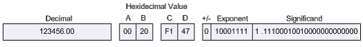
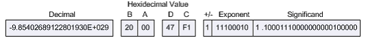
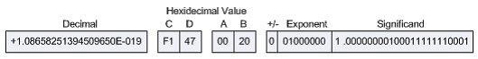
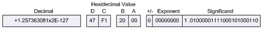
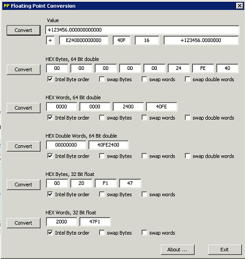

# iobroker.modbus

**Этот адаптер использует библиотеки Sentry для автоматического сообщения разработчикам об исключениях и ошибках в коде.** Более подробную информацию, а также сведения о том, как отключить отправку сообщений об ошибках, см. [в документации Sentry-Plugin](https://github.com/ioBroker/plugin-sentry#plugin-sentry) ! Система отчетности Sentry используется начиная с js-controller 3.0.

Реализация ModBus Slave и Master для ioBroker. Поддерживаются следующие типы:

- Modbus RTU через последовательный порт (ведущий сервер)
- Modbus RTU по TCP (ведущий сервер)
- Modbus TCP (ведомый, ведущий)
- Modbus TCP с SSL/TLS (ведущий сервер)

## Поддержка SSL/TLS

Для безопасного подключения к устройствам, требующим шифрования SSL/TLS (например, к интеллектуальному счетчику электроэнергии Kostal KSEM на порту 802), можно выбрать тип подключения «TCP с SSL/TLS». Это предоставляет следующие параметры конфигурации:

- **Путь к файлу SSL-сертификата** : путь к файлу вашего SSL-сертификата в формате PEM.
- **Путь к файлу закрытого ключа SSL** : путь к файлу закрытого ключа SSL в формате PEM.
- **Путь к файлу сертификата центра сертификации SSL** : путь к файлу сертификата центра сертификации в формате PEM (необязательно)
- **Отклонять несанкционированные сертификаты** : снимите флажок, чтобы разрешить использование самоподписанных сертификатов.

Примечание: Файлы сертификатов должны быть доступны для процесса ioBroker и иметь формат PEM.

## Настройки

### IP-адрес партнера

IP-адрес партнера по протоколу Modbus.

### Порт

TCP-порт партнера Modbus, если он настроен как ведущий (клиент), или собственный порт, если он настроен как ведомый (сервер).

### Идентификатор устройства

Идентификатор устройства Modbus. Важно, если используется мост TCP/Modbus.

### Тип

Раб (сервер) или Мастер (клиент).

### Выберите устройство по (последовательному) номеру

При использовании последовательных соединений можно выбрать способ адресации устройства:

- **Последовательный порт** : выберите фиксированный путь к порту (например, `COM3` или `/dev/ttyUSB0`).
- **Идентификатор USB-устройства** : устройство определяется по его стабильному USB-идентификатору (идентификатор производителя / идентификатор продукта / серийный номер). Фактический порт определяется при запуске, поэтому соединение продолжает работать, даже если операционная система назначает другое имя порта (например, после перезагрузки или повторного подключения).

### Используйте псевдонимы в качестве адреса.

Обычно все регистры могут иметь адреса от 0 до 65535. Используя псевдонимы, можно определить поля виртуальных адресов для каждого типа регистров. Обычно:

- Дискретные входные значения находятся в диапазоне от 10001 до 20000.
- Количество катушек варьируется от 1 до 1000.
- Входные регистры имеют номера от 30001 до 40000.
- Номера регистрационных книг варьируются от 40001 до 60000.

Каждый псевдоним будет внутренне сопоставлен с адресом, например, 30011 будет сопоставлен с входным регистром 10 и так далее.

### Прямые адреса

Используется для двоичных входных данных и катушек. Без этого флага биты будут адресоваться следующим образом: `0 => 15, 1 => 14, 2 => 13, ..., 15 => 0` При активации этого флага биты будут обращаться следующим образом: `0 => 0, 1 => 1, 2 => 2, ..., 15 => 15`.

### Не следует выравнивать адреса по 16 битам (словам).

Обычно адреса катушек и дискретных входов выравниваются по 16 битам. Например, адреса от 3 до 20 будут выравниваться по 0 до 32 битам. Если эта опция активна, адреса не будут выравниваться.

### Не используйте несколько регистров.

Если ведомое устройство не поддерживает команду "запись в несколько регистров", вы можете активировать её, чтобы получать предупреждения о предстоящей записи в несколько регистров.

### Используйте только несколько регистров записи.

Если ведомое устройство поддерживает только команду "запись в несколько регистров", вы можете активировать эту функцию, чтобы запись в регистры всегда выполнялась с помощью команды FC15/FC16.

### Округлить реальное до

Сколько цифр после запятой для чисел с плавающей запятой и чисел двойной точности?

### Интервал опроса данных

Циклический интервал опроса (актуально только для основного сервера)

### Задержка повторного подключения

Интервал переподключения (актуально только для основного устройства)

### Время ожидания чтения истекло

Время ожидания для запросов на чтение измеряется в миллисекундах. Если в течение этого времени от подчиненного узла не будет получен ответ, соединение будет разорвано.

### Время импульса

Если для катушек используется импульсный режим, это определяет интервал в миллисекундах, то есть длительность импульса.

### Время ожидания

Время ожидания между опросом двух разных идентификаторов устройств измеряется в миллисекундах.

### Максимальная длина запроса на чтение

Максимальная длина команды READ\_MULTIPLE\_REGISTERS определяется количеством регистров для чтения.

В некоторых системах для передачи данных при запросе на чтение требуется сначала отправить запрос на запись. Вы можете принудительно включить этот режим, установив параметр «Максимальная длина запроса на чтение» равным 1.

**Примечание:** Некоторые решения на основе USB Modbus (например, основанные на) `socat`) могут испытывать трудности в работе с `serialport` npm модуль.

Существует программный шлюз [**Modbus RTU <-> Modbus RTU over TCP**](http://mbus.sourceforge.net/index.html) , позволяющий использовать последовательный RTU по протоколу TCP.

Оба решения, **RTU поверх TCP** и **TCP,** работают хорошо.

### Интервал чтения

Задержка между двумя запросами на чтение в миллисекундах. По умолчанию 0.

### Записать интервал

Задержка между двумя запросами на запись в миллисекундах. По умолчанию 0.

### Повторные попытки чтения, повторные попытки записи, интервал повторных попыток

Только для главного узла. Блок чтения или записи, завершившийся ошибкой тайм-аута или потерей соединения, отправляется повторно до указанного количества раз (0 = никогда, максимум 3), прежде чем произойдет сбой. Каждая повторная попытка регистрируется на уровне информации. `[retry/k/N] ...` Предупреждение появляется только после последней попытки. Исключение Modbus или недопустимый ответ не повторяются.

При использовании параметра "Поддерживать соединение по истечении таймаута" отправляется повторная попытка подключения к открытому соединению; в противном случае соединение устанавливается заново. Цикл опроса ожидает во время повторных попыток, поэтому, если несколько устройств используют одну шину RS485, следует выбирать низкое значение. Интервал повторных попыток — это задержка перед каждой повторной попыткой в миллисекундах (по умолчанию 100).

### Обновить неизмененные состояния

Обычно, если значение не изменилось, оно не будет записано в ioBroker. Этот флаг позволяет обновлять метку времени значения в каждом цикле.

### Игнорировать идентификатор транзакции в ответах

Только для ведущего устройства по протоколам TCP, UDP или TCP с SSL. Обычно ответ принимается только в том случае, если идентификатор транзакции совпадает с идентификатором запроса, в противном случае он отбрасывается с предупреждением. `Dropped a response with transaction ID ...` В противном случае устаревший или дублирующийся ответ может быть использован для следующего запроса, и регистры другого блока будут сохранены (проблема #829). Включайте эту опцию только в том случае, если устройство не отображает идентификатор транзакции, то есть все ответы отбрасываются.

### Санитизация ценностей

Включите автоматическую проверку недопустимых значений регистров (NaN, бесконечность, экстремальные значения с плавающей запятой, например ±3,4e38). Эта функция помогает предотвратить распространение поврежденных значений Modbus с плавающей запятой в состояния ioBroker, что особенно полезно для таких устройств, как инверторы SolarEdge, которые иногда возвращают недопустимые значения из-за тайм-аутов или внутренних ошибок масштабирования.

При включении этой функции можно настроить параметры проверки данных для каждого регистра:

- **Очистка** : Включить очистку для этого конкретного кассового аппарата.
- **Действие очистки** : выберите способ обработки недопустимых значений.
  - _Keep Last Valid_ : Сохраняет последнее известное допустимое значение при обнаружении недопустимого значения.
  - _Заменить на 0_ : Заменяет недопустимые значения на 0.
- **Минимальное допустимое значение** : необязательный пороговый уровень минимального допустимого значения.
- **Максимально допустимое значение** : необязательный пороговый уровень максимального допустимого значения.

Обнаружены недопустимые значения:

- `NaN` (Не число)
- `Infinity` или `-Infinity`
- Экстремальные значения с плавающей запятой (≥3,4e38 или ≤-3,4e38) — типичные значения ошибок Modbus.
- Значения, выходящие за пределы заданного минимального/максимального диапазона.

### Не указывайте адреса в удостоверении личности.

Не добавляйте адрес в сгенерированный ioBroker iD. `10_Input10` против `_Input10`.

### Сохранять точки в ID

С этим флагом будет Имя `Inputs.Input10` Без =>`Inputs_Input10`.

## Параметры для одной адресной линии в конфигурации

### Адрес

Адрес Modbus для чтения.

### Идентификатор раба

В случае наличия нескольких подчиненных устройств, то используется их идентификатор, если не идентификатор по умолчанию, указанный в глобальной конфигурации.

### Имя

Это название параметра.

### Описание

Описание параметра.

### Единица

Единица измерения параметра.

### Тип

Тип данных для чтения из шины. Подробную информацию о возможных типах данных см. в разделе «Типы данных».

### Длина

Длина параметра. Для большинства параметров она определяется типом данных, но для строк она задаётся в байтах/символах.

### Фактор

Этот коэффициент используется для умножения считанного значения с шины для статического масштабирования. Таким образом, расчет выглядит следующим образом. `val = x * Factor + Offset`.

### Компенсировать

Это смещение добавляется к считанному значению после вышеуказанного умножения. Таким образом, вычисление выглядит следующим образом. `val = x * Factor + Offset`.

### Формула

Это поле можно использовать для сложных вычислений, если полей «Фактор» и «Смещение» недостаточно. **Если это поле задано, поля «Фактор» и «Смещение» игнорируются.** Формула выполняется функцией eval(). Таким образом, поддерживаются все распространенные функции, особенно математические. Формула должна соответствовать синтаксису JavaScript, поэтому необходимо также учитывать регистр букв.

В формуле "x" необходимо использовать для обозначения считанного значения из Modbus. Например: `x * Math.pow(10, sf['40065'])`

Используя массив "sf" (см. пример выше), вы можете получить доступ к другим значениям Modbus, если они помечены как "Scale Factor" в конфигурации (см. информацию о флаге "SF" ниже).

Если формула не может быть вычислена во время выполнения, адаптер записывает предупреждение в журнал.

Ещё одним вариантом применения формул может быть предотвращение получения неправдоподобных данных с помощью таких формул, как... `x > 2000000 ? null : x`

### Роль

Роль ioBroker для назначения.

### Комната

Комната ioBroker для назначения.

### Голосование

При активации значения опрашиваются с заданного интервала времени от подчиненного устройства.

### WP

Записать импульс

### CW

Циклическая запись

### Сан-Франциско

Используйте значение в качестве масштабирующего коэффициента. Это необходимо для динамических масштабирующих коэффициентов, которые в некоторых системах предоставляются через значения в интерфейсе. Если значение помечено этим флагом, то оно будет сохранено в переменной со следующим соглашением об именовании: `sf['Modbus_address']` Эта переменная впоследствии может быть использована в любой формуле для других параметров. Например, следующая формула может установить: `(x * sf['40065']) + 50;`

### Дезинфекция (Экспертный режим)

Включить проверку значений для этого кассового аппарата. Доступно только в том случае, если параметр «Проверка значений» включен глобально в настройках адаптера.

### Функция очистки (Экспертный режим)

Выберите действие, которое будет выполнено при обнаружении недопустимого значения:

- **Keep Last Valid** : Сохраняет последнее известное допустимое значение.
- **Заменить на 0** : Заменяет недопустимое значение на 0.

### Минимальное/максимальное допустимое значение (экспертный режим)

Необязательные минимальные и максимальные пороговые значения для проверки диапазона. Значения, выходящие за пределы этого диапазона, будут считаться недопустимыми и будут очищены в соответствии с действием «Очистка».

## Типы данных

- `uint16be` -`Unsigned 16 bit (Big Endian): AABB => AABB`
- `uint16le` -`Unsigned 16 bit (Little Endian): AABB => BBAA`
- `int16be` -`Signed 16 bit (Big Endian): AABB => AABB`
- `int16le` -`Signed 16 bit (Little Endian): AABB => BBAA`
- `uint32be` -`Unsigned 32 bit (Big Endian): AABBCCDD => AABBCCDD`
- `uint32le` -`Unsigned 32 bit (Little Endian): AABBCCDD => DDCCBBAA`
- `uint32sw` -`Unsigned 32 bit (Big Endian Word Swap): AABBCCDD => CCDDAABB`
- `uint32sb` -`Unsigned 32 bit (Big Endian Byte Swap): AABBCCDD => DDCCBBAA`
- `int32be` -`Signed 32 bit (Big Endian): AABBCCDD => AABBCCDD`
- `int32le` -`Signed 32 bit (Little Endian): ABBCCDD => DDCCBBAA`
- `int32sw` -`Signed 32 bit (Big Endian Word Swap): AABBCCDD => CCDDAABB`
- `int32sb` -`Signed 32 bit (Big Endian Byte Swap): AABBCCDD => DDCCBBAA`
- `uint64be` -`Unsigned 64 bit (Big Endian): AABBCCDDEEFFGGHH => AABBCCDDEEFFGGHH`
- `uint64le` -`Unsigned 64 bit (Little Endian): AABBCCDDEEFFGGHH => HHGGFFEEDDCCBBAA`
- `uint8be` -`Unsigned 8 bit (Big Endian): AABB => BB`
- `uint8le` -`Unsigned 8 bit (Little Endian): AABB => AA`
- `int8be` -`Signed 8 bit (Big Endian): AABB => BB`
- `int8le` -`Signed 8 bit (Little Endian): AABB => AA`
- `floatbe` -`Float (Big Endian): AABBCCDD => AABBCCDD`
- `floatle`-`Float (Little Endian): AABBCCDD => DDCCBBAA`
- `floatsw` -`Float (Big Endian Word Swap): AABBCCDD => CCDDAABB`
- `floatsb` -`Float (Big Endian Byte Swap): AABBCCDD => DDCCBBAA`
- `doublebe` -`Double (Big Endian): AABBCCDDEEFFGGHH => AABBCCDDEEFFGGHH`
- `doublele` -`Double (Little Endian): AABBCCDDEEFFGGHH => HHGGFFEEDDCCBBAA`
- `string` -`String 8 bit (Zero-end): ABCDEF\0 => ABCDEF\0`
- `stringle` -`String 8 bit (Little Endian, Zero-end): ABCDEF\0 => BADCFE\0`
- `string16` -`String 16 bit (Zero-end): \0A\0B\0C\0D\0E\0F\0\0 => ABCDEF\0`
- `string16le` -`String 16 bit (Little Endian, Zero-end): A\0B\0C\0D\0E\0F\0\0\0 => ABCDEF\0`
- `rawhex` -`String with value in hex representation AABBCCDD.... => AABBCCDD....`

Следующее описание скопировано [отсюда.](http://www.chipkin.com/how-real-floating-point-and-32-bit-data-is-encoded-in-modbus-rtu-messages/)

Протокол Modbus «точка-точка» — популярный выбор для связи RTU, хотя бы из-за его простого удобства. Сам протокол управляет взаимодействием каждого устройства в сети Modbus, тем, как устройство устанавливает известный адрес, как каждое устройство распознает его сообщения и как извлекается основная информация из данных. По сути, протокол является основой всей сети Modbus.

Однако такое удобство не обходится без сложностей, и протокол сообщений Modbus RTU не является исключением. Сам протокол был разработан на основе устройств с 16-битной длиной регистра. Следовательно, при реализации 32-битных элементов данных потребовались особые меры. В данной реализации было решено использовать два последовательных 16-битных регистра для представления 32 бит данных, или, по сути, 4 байтов данных. Именно в этих четырех байтах данных данные с плавающей запятой одинарной точности могут быть закодированы в сообщение Modbus RTU.

### Важность порядка байтов

В самом протоколе Modbus не определен тип данных с плавающей запятой, но широко распространено мнение, что он реализует 32-битные данные с плавающей запятой, используя стандарт IEEE-754. Однако стандарт IEEE не содержит четкого определения порядка байтов в полезной нагрузке данных. Поэтому наиболее важным моментом при работе с 32-битными данными является правильная адресация данных.

Например, число 123/456.00, определенное в стандарте IEEE 754 для 32-битных чисел с плавающей запятой одинарной точности, выглядит следующим образом:

Влияние различных порядков байтов имеет существенное значение. Например, порядок 4 байтов данных, представляющих число 123456,00, в... `B A D C` Эта последовательность известна как «обмен байтами». При интерпретации как типа данных с плавающей запятой IEEE 744 результат будет совершенно иным:

Упорядочивание одинаковых байтов в последовательности «CDAB» называется «перестановкой слов». Результаты, опять же, резко отличаются от исходного значения 123456,00:

Кроме того, оба `byte swap` и а `word swap` Это по сути полностью изменило бы последовательность байтов, что привело бы к еще одному результату:

Очевидно, что при использовании сетевых протоколов, таких как Modbus, необходимо уделять пристальное внимание порядку байтов памяти при их передаче, также известному как «порядок байтов».

### Определение порядка байтов

Согласно спецификации протокола Modbus Application Protocol Specification, V1.1.b, сам протокол Modbus объявлен как протокол с порядком байтов "big-Endian":

**В протоколе Modbus для адресов и данных используется порядок байтов «big-Endian». Это означает, что при передаче числового значения, превышающего один байт, старший байт отправляется первым.**

Формат Big-Endian является наиболее распространенным форматом для сетевых протоколов — настолько распространенным, что его также называют «сетевым порядком».

Учитывая, что протокол сообщений Modbus RTU использует порядок байтов big-Endian, для успешного обмена 32-битными данными через сообщение Modbus RTU необходимо учитывать порядок байтов как ведущего, так и ведомого устройства. Многие устройства RTU типа «ведущий-ведомый» позволяют выбирать определенный порядок байтов, особенно в случае программно-имитируемых устройств. Необходимо лишь убедиться, что оба устройства настроены на один и тот же порядок байтов.

Как правило, семейство микропроцессора устройства определяет порядок байтов (endian). Обычно порядок байтов big-Endian (старший байт хранится первым, за ним следует младший байт) встречается в процессорах Motorola. Порядок байтов little-Endian (младший байт хранится первым, за ним следует старший байт) обычно встречается в процессорах Intel. Вопрос о том, какой порядок байтов считается «обратным», является вопросом личного мнения.

Однако, если порядок байтов и порядок байтов не являются настраиваемыми параметрами, вам придётся определить, как интерпретировать байт. Это можно сделать, запросив у ведомого устройства известное значение с плавающей запятой. Если возвращается невозможное значение, например, число с двузначным показателем степени или что-то подобное, скорее всего, потребуется изменить порядок байтов.

### Практическая помощь

Драйверы FieldServer Modbus RTU предлагают несколько вариантов перемещения функций, обрабатывающих 32-битные целые числа и 32-битные значения с плавающей запятой. Что еще более важно, эти варианты перемещения функций учитывают все различные формы последовательности байтов. В следующей таблице показаны варианты перемещения функций FieldServer, которые копируют два смежных 16-битных регистра в 32-битное целочисленное значение.

| Ключевое слово функции | Режим переключения             | Исходные байты  | Целевые байты |
| ---------------------- | ------------------------------ | --------------- | ------------- |
| 2.i16-1.i32            | Н/Д                            | \[ ab ] \[ cd ] | \[ abcd ]     |
| 2.i16-1.i32-s          | Поменяны местами байты и слова | \[ ab ] \[ cd ] | \[ dcba ]     |
| 2.i16-1.i32-sb         | обмен байтами                  | \[ ab ] \[ cd ] | \[ badc ]     |
| 2.i16-1.i32-sw         | замена слов                    | \[ ab ] \[ cd ] | \[ cdab ]     |

В следующей таблице показаны операции функции FieldServer, которые копируют два смежных 16-битных регистра в 32-битное значение с плавающей запятой:

| Ключевое слово функции | Режим переключения             | Исходные байты  | Целевые байты |
| ---------------------- | ------------------------------ | --------------- | ------------- |
| 2.i16-1.ifloat         | Н/Д                            | \[ ab ] \[ cd ] | \[ abcd ]     |
| 2.i16-1.ifloat-s       | Поменяны местами байты и слова | \[ ab ] \[ cd ] | \[ dcba ]     |
| 2.i16-1.ifloat-sb      | обмен байтами                  | \[ ab ] \[ cd ] | \[ badc ]     |
| 2.i16-1.ifloat-sw      | замена слов                    | \[ ab ] \[ cd ] | \[ cdab ]     |

В следующей таблице показаны операции функции FieldServer, которые копируют одно 32-битное значение с плавающей запятой в два смежных 16-битных регистра:

| Ключевое слово функции | Режим переключения             | Исходные байты  | Целевые байты  |
| ---------------------- | ------------------------------ | --------------- | -------------- |
| 1.float-2.i16          | Н/Д                            | \[ ab ] \[ cd ] | \[ ab ]\[ cd ] |
| 1.float-2.i16-s        | Поменяны местами байты и слова | \[ ab ] \[ cd ] | \[ dc ]\[ ba ] |
| 1.float-2.i16-sb       | обмен байтами                  | \[ ab ] \[ cd ] | \[ ба ]\[ дц ] |
| 1.float-2.i16-sw       | замена слов                    | \[ ab ] \[ cd ] | \[ cd ]\[ ab ] |

Учитывая различные варианты выполнения функций FieldServer, правильная обработка 32-битных данных зависит от выбора подходящего варианта. Обратите внимание на следующее поведение этих функций FieldServer при работе с известным десятичным числом с плавающей запятой одинарной точности, равным 123456,00:

| 16-битные значения | Перемещение функции | Результат | Перемещение функции | Результат     |
| ------------------ | ------------------- | --------- | ------------------- | ------------- |
| 0x2000 0x47F1      | 2.i16-1.float       | 123456.00 | 1.float-2.i16       | 0x2000 0x47F1 |
| 0xF147 0x0020      | 2.i16-1.float-s     | 123456.00 | 1.float-2.i16-s     | 0xF147 0X0020 |
| 0x0020 0xF147      | 2.i16-1.float-sb    | 123456.00 | 1.float-2.i16-sb    | 0x0020 0xF147 |
| 0x47F1 0x2000      | 2.i16-1.float-sw    | 123456.00 | 1.float-2.i16-sw    | 0x47F1 0x2000 |

Обратите внимание, что для различных порядков байтов и слов требуется использование соответствующей функции перемещения FieldServer. После выбора подходящей функции перемещения данные можно преобразовывать в обоих направлениях.

Среди множества доступных в интернете конвертеров шестнадцатеричных чисел в числа с плавающей запятой и калькуляторов, лишь немногие позволяют манипулировать порядком байтов и слов. Одна из таких утилит находится по адресу [www.61131.com/download.htm](http://www.61131.com/download.htm) , где можно загрузить версии для Linux и Windows. После установки утилита запускается как исполняемый файл с одним диалоговым интерфейсом. Утилита отображает десятичное значение с плавающей запятой 123456.00 следующим образом:

Затем можно поменять местами байты и/или слова, чтобы проанализировать, какие потенциальные проблемы с порядком байтов могут существовать между ведущим и ведомым устройствами Modbus RTU.

## Экспорт/импорт регистров

Благодаря функциям экспорта/импорта вы можете преобразовать все данные регистра (только одного типа) в файл TSV (значения, разделенные табуляцией) и обратно, чтобы легко копировать данные с одного устройства на другое или редактировать регистр в Excel.

Вы можете делиться своими схемами с другими пользователями в [modbus-templates,](https://github.com/ioBroker/modbus-templates) или же найти там схемы регистров.

## Тест

В папке находятся несколько программ. `test` Для проверки TCP-соединения:

- Ananas32/64 — это симулятор ведомого устройства (он хранит только регистры и входы, без катушек и цифровых входов).
- RMMS — это главный симулятор.
- mod\_RSsim.exe — это симулятор подчиненного узла. Возможно, для его запуска потребуется [пакет распространения Microsoft Visual C++ 2008 SP1](https://www.microsoft.com/en-us/download/details.aspx?id=5582) (из-за ошибки параллельного выполнения).

## Changelog
<!--
	Placeholder for the next version (at the beginning of the line):
	### **WORK IN PROGRESS**
-->
### 9.5.0 (2026-11-19)
* (@LoPromise, @GermanBluefox) Settings for retries of reads and writes after a timeout or a lost connection
* (@GermanBluefox) Updated `@iobroker/modbus` to 7.12.0: pending requests are rejected at once when the connection closes; read and write retries
* (@GermanBluefox) Template library: files marked as optional in the template (e.g. registers of a newer firmware) are not preselected

### 9.4.0 (2026-11-13)
* (@GermanBluefox) Template library: a template with only one register file shows it checked and disabled
* (@GermanBluefox) Updated `@iobroker/modbus` to 7.11.0
* (@GermanBluefox) Device detection: each read waits at most 2 seconds, and a device that does not answer a read no longer closes the connection

### 9.3.2 (2026-11-13)
* (@ipod86) Added the electrical measurement roles from the state roles list (`value.voltage`, `value.current`, `value.frequency`, `value.power.*`, `value.energy.*`) to the role select box

### 9.3.1 (2026-11-12)
* (@GermanBluefox) Updated `@iobroker/modbus` to 7.10.1: cyclic write of holding registers works again, for polled and not polled registers (issue #771)

### 9.3.0 (2026-11-12)
* (@GermanBluefox) Updated `@iobroker/modbus` to 7.10.0:
  - New option "Keep the connection on a timeout" (TCP, UDP and TCP-SSL master, issue #832): for gateways with several devices behind them, a device that does not answer does not close the connection for the others anymore. The connection is still re-established when no device answers
  - An error while processing a response fails only this request. Before, the master could stop polling (issue #831)
  - Characters that are forbidden in object IDs (e.g. `–` or `°` of a copied data sheet) are replaced by `_` in the state ID too, so the object and the state get the same ID (modbus-templates issue #58)
* (@MMeinhardt1, @GermanBluefox) The option `padAddressInId` (pad the address in state IDs with zeros to 5 digits, issue #317) is now available in the admin UI under "Settings"
* (@GermanBluefox) Admin: animated icons of `@iobroker/gui-components` (delete, expert mode, folders, copy, upload, refresh, results) and own animations: new rows slide in, deleted rows slide out, unfolded slave ID groups, tab changes, live values
* (@GermanBluefox) Admin: the status of the instance and of the connection is shown next to the tabs
* (@GermanBluefox) Admin: a file can be dropped on the editor of the import/export dialog
* (@GermanBluefox) Admin: import of TSV/CSV/JSON accepts an empty "Sanitize Action" and uses "Keep Last Valid" (issue #835)
* (@GermanBluefox) Admin: the template library converts the scale factor references in formulas (`sf['40083']`) together with the addresses. Before, a template with scale factors did not work if its addresses were converted (alias template, or "Show aliases" in the instance)

## License
The MIT License (MIT)

Copyright (c) 2015-2026 Bluefox <dogafox@gmail.com>

Permission is hereby granted, free of charge, to any person obtaining a copy
of this software and associated documentation files (the "Software"), to deal
in the Software without restriction, including without limitation the rights
to use, copy, modify, merge, publish, distribute, sublicense, and/or sell
copies of the Software, and to permit persons to whom the Software is
furnished to do so, subject to the following conditions:

The above copyright notice and this permission notice shall be included in
all copies or substantial portions of the Software.

THE SOFTWARE IS PROVIDED "AS IS", WITHOUT WARRANTY OF ANY KIND, EXPRESS OR
IMPLIED, INCLUDING BUT NOT LIMITED TO THE WARRANTIES OF MERCHANTABILITY,
FITNESS FOR A PARTICULAR PURPOSE AND NONINFRINGEMENT. IN NO EVENT SHALL THE
AUTHORS OR COPYRIGHT HOLDERS BE LIABLE FOR ANY CLAIM, DAMAGES OR OTHER
LIABILITY, WHETHER IN AN ACTION OF CONTRACT, TORT OR OTHERWISE, ARISING FROM,
OUT OF OR IN CONNECTION WITH THE SOFTWARE OR THE USE OR OTHER DEALINGS IN
THE SOFTWARE.