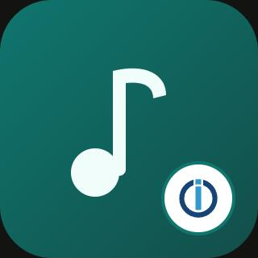

# ioBroker.music-assistant

## адаптер музыкального помощника для ioBroker

Управляйте проигрывателями и очередью воспроизведения Music Assistant через ioBroker.

> **Предупреждение:** Это неофициальный адаптер, созданный сообществом. Он не связан с проектом Music Assistant или фондом Open Home Foundation, не одобрен ими и не поддерживается ими. «Music Assistant» и его логотип являются собственностью соответствующих владельцев.

## Предварительные требования

- Для запуска сервера [Music Assistant](https://music-assistant.io) , доступного с вашего хоста ioBroker или из Docker на хосте ioBroker, адаптер может запустить сам сервер (см. [Music Assistant в Docker](#music-assistant-in-docker) ).
- API-токен (на сервере Music Assistant перейдите в **Настройки → Профиль** и создайте долговременный токен) или имя пользователя и пароль пользователя Music Assistant.

## Конфигурация

В настройках экземпляра адаптера введите:

| Поле                      | Описание                                                          |
| ------------------------- | ----------------------------------------------------------------- |
| Хозяин                    | Имя хоста или IP-адрес сервера Music Assistant                    |
| Порт                      | Порт API WebSocket (по умолчанию) `8095`)                         |
| Токен                     | Созданный выше долгосрочный API-токен                             |
| Имя пользователя / Пароль | Альтернатива токену: учетные данные пользователя Music Assistant. |

В Music Assistant срок действия долгосрочных токенов истекает через год. При использовании имени пользователя и пароля адаптер входит в систему при каждом запуске и никогда не сталкивается с этой проблемой. Если указаны оба параметра, сначала проверяется токен, а после отказа используются учетные данные.

### вкладка Игроки

Вкладка **«Плееры»** в настройках экземпляра отображает все плееры с указанием обложки, названия, исполнителя и позиции, а также управляет ими: воспроизведение/пауза, остановка, следующий/предыдущий трек, перемотка, громкость, отключение звука, перемешивание, повтор и включение/выключение. Текстовое поле под плеером работает как состояние. `playMedia` (см. ниже). Вкладка работает только во время выполнения экземпляра и считывает и записывает те же состояния, что и все остальные адаптеры, поэтому ничего сохранять не нужно.

## Музыкальный ассистент в Docker

Вместо подключения к существующему серверу адаптер может запустить сам Music Assistant в контейнере Docker на хосте ioBroker. Docker должен быть установлен и запущен на этом хосте, и `iobroker` Пользователь должен иметь доступ к CLI Docker (для исправления прав выполните команду...). `iob fix`).

1. Включите функцию **«Запустить музыкальный помощник в Docker»** в настройках экземпляра, введите **имя пользователя** (по умолчанию). `admin`) и **пароль** (не менее 8 символов) и сохраните. После этого хост, порт и токен будут скрыты: адаптер подключится к `127.0.0.1:8095` сам по себе. Контейнер `iob_music_assistant_<instance>` с изображением `ghcr.io/music-assistant/server` создан и запущен.
2. Как только сервер ответит, адаптер создаст этого пользователя в качестве администратора в Music Assistant (та же первоначальная настройка, что и в веб-интерфейсе) и выполнит вход с его помощью. Токен не требуется.
3. Открыть `http://<ioBroker-host>:8095` В браузере — или щелкните плитку _«Музыкальный помощник»_ на вводной странице администратора (она также отображается как ссылка в списке экземпляров; адаптер добавляет эту ссылку и перезапускает свой экземпляр один раз для нее) — войдите в систему с тем же именем пользователя и паролем и завершите настройку там (источники музыки, поставщики проигрывателей).

Пользователь создается только при первом запуске, тогда как в Music Assistant пользователя еще нет. Изменение имени пользователя или пароля в настройках адаптера позже не повлияет на них в Music Assistant: сначала измените пароль в Music Assistant ( **Настройки → Профиль** ), а затем введите новый пароль в настройках адаптера. Если учетные данные будут отклонены, адаптер зарегистрирует ошибку и прекратит попытки подключения до перезапуска.

Примечания:

- Контейнер запускается с `network_mode: host` Поскольку Music Assistant находит плееры (Sonos, Chromecast, AirPlay, DLNA и т. д.) через mDNS/SSDP, плееры получают от них аудиопоток. Веб-интерфейс/API (порт) `8095`) и сервер потоковой передачи (порт) `8097` Таким образом, порты открываются непосредственно на хосте, и эти порты должны быть свободны. В js-controller 8 адаптер сообщает об использовании обоих портов своим экземпляром и предупреждает, если другой экземпляр уже занимает один из них. Сетевое взаимодействие на хосте работает в Linux; в Docker Desktop (Windows/macOS) его необходимо включить в настройках Docker, и обнаружение может быть ограничено.
- Все настройки и библиотека находятся в томе Docker. `ma_data` (`iob_music_assistant_<instance>_ma_data`), поэтому они сохраняются после обновления или повторного создания контейнера. Том включается в резервные копии ioBroker.
- **Функция автоматического обновления образов Docker** загружает последнюю версию образа при каждом запуске адаптера.
- **Функция «Остановить контейнер при остановке экземпляра»** останавливает Music Assistant вместе с экземпляром. Отключите её, если Music Assistant должен продолжать воспроизведение, пока адаптер остановлен.
- Для доступа к сетевым ресурсам (SMB/NFS), которые подключает сам Music Assistant, требуются дополнительные права доступа к контейнеру (`SYS_ADMIN`, `DAC_READ_SEARCH`), которые не разрешены. Вместо этого смонтируйте общий ресурс на хосте и добавьте его как папку (см. ниже), или запустите Music Assistant самостоятельно, если вам это необходимо.

### Музыка с диска или сетевого хранилища (NAS).

В **папке хоста** можно смонтировать до трех папок хоста ioBroker в контейнер, используя синтаксис Docker. `/path/on/host:/path/in/container`, с `:ro` В конце доступен только для чтения:

| Папка 1                          | Папка 2                                |
| -------------------------------- | -------------------------------------- |
| `/mnt/nas/music:/media/music:ro` | `/srv/audiobooks:/media/audiobooks:ro` |

Это обеспечивает такое же крепление, как и `- /mnt/nas/music:/media/music:ro` под `volumes:` в файле docker-compose. В Music Assistant добавьте поставщика музыки **«Локальные файлы»** с указанием пути в контейнере (`/media/music` Пустые папки пропускаются. `/data` Этот путь нельзя использовать в контейнере: он содержит настройки Music Assistant.

- Путь к хосту должен существовать и быть доступным для чтения внутри контейнера. Сначала необходимо смонтировать общий ресурс NAS на хосте, например, через `/etc/fstab` и перед запуском Docker.
- Изменение папки приводит к повторному созданию контейнера при следующем запуске экземпляра. Переключение только `:ro` Включение или выключение не влияет на работу плагина: он не сравнивает флаг "только для чтения", поэтому удалите контейнер вручную.

## Штаты

Для каждого проигрывателя Music Assistant адаптер создает канал. `music-assistant.0.players.<player_id>` (роль `media.music`) с:

| Состояние                                                  | Описание                                                                                             |
| ---------------------------------------------------------- | ---------------------------------------------------------------------------------------------------- |
| `state`                                                    | `0` = пауза, `1` = играть, `2` = остановка (роль) `media.state`)                                       |
| `playing`                                                  | `true` во время игры; письмо `true` пьесы, `false` паузы (для виджетов, ожидающих логическое значение) |
| `playbackState`                                            | Исходное состояние Music Assistant: `idle`, `paused`, `playing`                                       |
| `available`, `powered`, `name`, `activeSource`, `queueId`  | Статус игрока (`powered` (можно записывать)                                                          |
| `source`                                                   | Записываемый источник (`media.input`), см. ниже                                                     |
| `volume` (0-100 %), `muted`                                 | Регулятор громкости с возможностью записи                                                            |
| `shuffle`, `repeat` (`0` = выключено, `1` = все, `2` = один) | Доступные для записи настройки очереди игрока                                                        |
| `mediaTitle`, `mediaArtist`, `mediaAlbum`, `mediaImage`    | Метаданные текущего воспроизведения                                                                  |
| `elapsedTime`, `duration`, `seek`                          | Положение и длина в секундах; написать `seek` перепрыгнуть на позицию                                 |
| `play`, `pause`, `playPause`, `stop`, `next`, `previous`   | Кнопки для записи (`button.play`, `button.pause`, ...)                                              |
| `playMedia`                                                | Введите URI или поисковый запрос для воспроизведения (см. ниже).                                     |

Канал плеера расположен следующим образом: `@iobroker/type-detector` Ожидается наличие медиаплеера, чтобы ioBroker.assistant, ioBroker.devices, Material UI и другие адаптеры распознавали его как медиаплеер. Назначьте канал комнате (`enum.rooms`) поэтому: устройства без помещения или функциональности не предлагаются этими адаптерами.

Доступность записи подтверждается значением, которое Music Assistant сообщает после команды, а не запрошенным значением — если проигрыватель не может включить звук, отображается его реальное значение.

### Выберите источник: `source`

`source` Источником воспроизведения для проигрывателя является его собственная очередь воспроизведения в Music Assistant (идентификатор проигрывателя) или один из его собственных источников, таких как Spotify Connect, AirPlay или линейный вход. `common.states` Отображает их список с их именами и следует за игроком; пассивный источник (который может запустить только сам игрок) отображается только во время его активности. Введите ID источника, чтобы переключиться на него. `players/cmd/select_source`); пустое значение или идентификатор проигрывателя возвращает игрока в очередь Music Assistant. `activeSource` Остаётся тем же, что и прежде: первозданная ценность Music Assistant.

### Сыграйте во что-нибудь: `playMedia`

- **URI** , используемый Music Assistant, например: `library://playlist/3`, `spotify://track/4uLU6hMCjMI75M1A2tKUQC` или URL-адрес потока воспроизводится напрямую.
- **Поиск** любого другого текста осуществляется во всех музыкальных источниках. Побеждает элемент, название которого точно совпадает с текстом (исполнитель, а не плейлист, альбом или трек с тем же названием), в противном случае — трек, наиболее точно соответствующий запросу.
- Префикс сужает область поиска: `artist:Queen`, `album:A Night at the Opera`, `track:Bohemian Rhapsody`, `playlist:Party`, `radio:SWR3` (также `podcast:`, `audiobook:`, `genre:`).

Это заменяет то, что сейчас воспроизводится в очереди игрока.

### Выберите из библиотеки: сообщение `getMedia`

Плееры веб-компонента и обоих виджетов имеют кнопку библиотеки: избранное, исполнители, альбомы, треки, плейлисты, радиостанции, подкасты и аудиокниги Music Assistant с поиском, по 100 записей за раз, с кнопкой для загрузки дополнительных. Они обращаются к адаптеру с сообщением `getMedia` и записать URI выбранной записи в `playMedia` — Исполнитель, альбом или плейлист воспроизводятся целиком. Библиотека открывается с того места, где пользователь её оставил: тот же список, поиск и положение прокрутки, с тем же количеством загруженных записей, что и раньше (запоминается для каждого экземпляра в локальном хранилище браузера). Скрипты тоже могут это использовать:

```js
sendTo('music-assistant.0', 'getMedia', { list: 'radios', search: 'swr', limit: 50 }, answer => {
    // answer.items: [{ uri, name, subtitle, image, type }] - or answer.error
    setState('music-assistant.0.players.kitchen.playMedia', answer.items[0].uri);
});
```

`list` является `favorites`, `artists`, `albums`, `tracks`, `playlists`, `radios`, `podcasts` или `audiobooks`; `search`, `limit` (1-500, по умолчанию 100) и `offset` являются необязательными. Списки отсортированы по имени. `favorites` являются любимыми товарами всех этих типов пользователей Music Assistant, под которыми адаптер входит в систему. `subtitle` Это исполнитель (и альбом, в который входит трек), владелец плейлиста или издатель и авторы подкаста или аудиокниги. `image` Это миниатюра, полученная из прокси-сервера изображений Music Assistant по адресу, указанному сервером (его). `base_url`), поэтому браузеру необходимо до него добраться.

Плеер, удаленный в Music Assistant, удаляется также и в ioBroker (даже если он был удален, когда адаптер не работал), вместе со своей очередью воспроизведения.

Для каждой очереди игроков, `music-assistant.0.queues.<queue_id>` получает:

| Состояние                                                             | Описание                                                                   |
| --------------------------------------------------------------------- | -------------------------------------------------------------------------- |
| `state`, `displayName`, `available`, `currentItemName`, `elapsedTime` | статус очереди                                                             |
| `shuffleEnabled`, `repeatMode`                                        | Настройки очереди записи (`repeatMode`: 0 = выключено, 1 = все, 2 = один) |
| `control.play` /`pause` /`playPause` /`stop` /`next` /`previous`      | Кнопки управления с возможностью записи                                    |

## Виджеты для vis-2 и устройств

Плеер существует как нативный виджет vis-2 и панели управления ioBroker.devices, построенный по аналогии с виджетами SONOS на ioBroker.sonos. Оба имеют имя веб-компонента (см. ниже) — «Music Assistant player». В vis-2 и devices в палитре отображается только нативный виджет; веб-компонент остается для пользовательских интерфейсов без него (Aura, админка) и для более старых версий vis-2 и devices, которые отображают оба виджета.

### vis-2: набор виджетов "Музыкальный помощник"

Один виджет для всех плееров в экземпляре: плееры расположены сверху в виде микросхем — щелчок переключает на нужный плеер, при воспроизведении отображается значок воспроизведения. Под ними отображаются обложка, название и исполнитель, позиция с ползунком для перехода внутри трека, предыдущий/воспроизведение-пауза/следующий, перемешивание, повтор, отключение звука и громкость. У выключенного плеера появляется кнопка питания. Плеер с собственными источниками (Spotify Connect, AirPlay и т. д.) отображает активный плеер после названия в виде списка для переключения. Кнопка библиотеки после названия открывает библиотеку Music Assistant (избранное, исполнители, альбомы, треки, плейлисты, радио, подкасты, аудиокниги) для воспроизведения.

| Параметр                                                         | Описание                                                        |
| ---------------------------------------------------------------- | --------------------------------------------------------------- |
| Пример                                                           | пример музыкального помощника                                   |
| Начать игру                                                      | Игрок, указанный первым, выбран из списка; пусто: первый игрок. |
| Без карты                                                        | Вокруг виджета нет карточки                                     |
| Заголовок                                                        | показано на карточке                                            |
| Показать игроков                                                 | чипы для переключения плеера                                    |
| Скрыть недоступных игроков                                       | Нет чипа для плеера. Музыкальный помощник недоступен.           |
| Показать обложку / громкость / режим случайного воспроизведения… | части игрока                                                    |
| Показать выбор источника                                         | Список источников после заголовка                               |
| Показать библиотеку                                              | кнопка библиотеки после заголовка                               |

### устройства: один игрок на клетку

Плитка отображает обложку с названием, исполнителем и позицией; щелчок по ней открывает весь плеер в виде диалогового окна — обложка, ползунок положения, управление воспроизведением, перемешивание, повтор, отключение звука и громкость, а ниже названия плеера — список его источников, если они есть (Spotify Connect, AirPlay и т. д.). Кнопка «Библиотека» в правом верхнем углу диалогового окна переключает его в библиотеку Music Assistant (избранное, исполнители, альбомы, треки, плейлисты, радио, подкасты, аудиокниги). Размер плитки соответствует размеру, заданному на панели управления: 1x1 — обложка с текстом, 2x0,5 — ряд с маленькой обложкой на размытом фоне, 2x1 и 2x2 — большая обложка с текстом ниже.

| Параметр                   | Описание                                                                         |
| -------------------------- | -------------------------------------------------------------------------------- |
| Пример                     | пример музыкального помощника                                                    |
| Игрок                      | выбраны из числа игроков, о которых сообщает экземпляр (сообщение) `getPlayers`) |
| Показать обложку / том / … | обложка, ползунок громкости, положение, перемешивание и повтор                   |
| Показать выбор источника   | список источников в диалоговом окне проигрывателя                                |
| Показать библиотеку        | кнопка библиотеки в диалоговом окне проигрывателя                                |
| Значок, Имя                | Вместо музыкальной ноты и имени исполнителя отображается                         |

## Веб-компонент: `<iob-ma-player>`

Адаптер предоставляет плеер в виде [веб-компонента](https://github.com/ioBroker/web-components) : элемент, который поддерживается каждым пользовательским интерфейсом ioBroker. `@iobroker/web-components` Аналогично отображаются vis-2, панель управления устройствами, Aura, административная панель. На экране отображается обложка, название, исполнитель и альбом, позиция (в том числе для потока без конца), воспроизведение/пауза, предыдущий/следующий трек, перемешивание, повтор, отключение звука и громкость, а также кнопка питания для выключенного плеера. Если плеер имеет собственные источники (Spotify Connect, AirPlay и т. д.), активный источник отображается после названия плеера в виде списка для переключения. Кнопка «Библиотека» в конце этой строки открывает библиотеку Music Assistant в диалоговом окне — избранное, исполнители, альбомы, треки, плейлисты, радио, подкасты и аудиокниги с поиском; щелчок воспроизводит запись на плеере.

| Параметр                        | Описание                                                                                       |
| ------------------------------- | ---------------------------------------------------------------------------------------------- |
| Игрок                           | канал игрока, `music-assistant.<n>.players.<name>`; любой экземпляр работает                   |
| Имя                             | Вместо имени игрока отображается                                                               |
| Показать обложку                | обложка рядом с текстом или над ним                                                            |
| Показать громкость              | кнопка отключения звука и ползунок регулировки громкости                                       |
| Показать перемешивание и повтор | две кнопки режима                                                                              |
| Показать выбор источника        | Список источников после имени, если у игрока больше источников, чем в его собственной очереди. |
| Показать библиотеку             | кнопка библиотеки после названия                                                               |
| Акцентный цвет                  | ползунки и активные кнопки; пустое значение: основной цвет хоста                               |

Элемент заимствует цвета и шрифт страницы, на которой он отображается: цвет текста и унаследованный шрифт, основной цвет (для акцента), цвета панелей, линий и ошибок, а также светлый или темный цвет из темы, предоставленной администратором. `@iobroker/web-components` (версия 0.5 или новее). Она измеряет свой прямоугольник и располагает себя относительно него, даже при изменении размера прямоугольника:

| Коробка                                | Макет                                                                    |
| -------------------------------------- | ------------------------------------------------------------------------ |
| широкий (примерно 3:2 и шире)          | Обложка слева, рядом с ней текст и все элементы управления.              |
| примерно квадрат                       | Небольшая обложка рядом с текстом, ниже — положение, кнопки и громкость. |
| высокий (узче, чем 4:5)                | Верхняя обложка, все остальное под ней                                   |
| низкое разрешение (менее 120 пикселей) | один ряд: обложка, текст, предыдущий/воспроизвести/следующий             |

Иконки, обложка и шрифты увеличиваются и уменьшаются вместе с рамкой. Всё, что не помещается, исключается: в узкой рамке сначала перемешивается и повторяется, затем «предыдущее»; в низкой рамке сначала указывается положение, затем громкость. Заголовок занимает две строки там, где для него есть место.

Этот элемент записывает только состояния канала проигрывателя — адаптер отправляет команды в Music Assistant.

## Для разработчиков

```bash
npm install
npm run build   # compile TypeScript and build all four GUIs (build:all)
npm run build:ts  # compile TypeScript only
npm run test    # type-check + package tests
npm run lint    # ESLint
npm run build:admin  # build the "Players" tab (src-admin/ -> admin/custom/, commit the result)
npm run build:wc     # build the web component (src-webcomponents/ -> admin/webcomponents/, commit the result)
npm run build:widgets  # build the vis-2 widgets (src-widgets/ -> widgets/music-assistant/, commit the result)
npm run build:devices  # build the devices widgets (src-devices/ -> admin/dm-widgets/, commit the result)
npm run build:gui      # all four of them
npm run build:all      # the adapter and all four GUIs, the same as npm run build
dev-server run  # run against a local test ioBroker instance (see README note below)
```

Примечание: `dev-server watch` зависит от Windows `wmic.exe` для управления дочерними процессами, которые в более новых сборках Windows 11 больше не поставляются по умолчанию. На таких машинах используйте `dev-server run` и запускать/останавливать экземпляр вручную через административный интерфейс.

## Changelog
<!--
    Placeholder for the next version (at the beginning of the line):
    ### **WORK IN PROGRESS**
-->
### 0.3.0 (2026-11-17)
- (copilot) Adapter requires node.js >= 22.19.0 now
* (@GermanBluefox) Added the writable state `source` (`media.input`) to switch the source of a player, and the source selection in the web component and both widgets
* (@GermanBluefox) Added the message `getMedia` (favorites, artists, albums, tracks, playlists, radio stations, podcasts and audiobooks of Music Assistant) and a library in the web component and both widgets to play from them
* (@M1kad0) Fixed player and queue channels sharing or colliding in their object id when Music Assistant ids differ only in case or in replaced characters
* (@M1kad0) Raised the required admin version to 8.0.0, which the custom component of the settings needs
* (@M1kad0) Translated the description of the Music Assistant web interface link into all languages
* (@M1kad0) Removed an unused translation key from the admin translations

### 0.2.1 (2026-11-07)
* (@M1kad0) Changed `queues.<id>.repeatMode` from a string (`off`/`one`/`all`) to a number (0 = off, 1 = all, 2 = one), like `players.<id>.repeat`, so that it matches the type of the role `media.mode.repeat`

### 0.2.0 (2026-11-05)
* (@GermanBluefox) Added the web component `<iob-ma-player>` for vis-2, devices and the other UIs that show web components (`common.webComponents`)
* (@GermanBluefox) Added native player widgets for vis-2 and for the dashboard of devices, built like the SONOS widgets. They have the name of the web component, so vis-2 and devices show only the native one
* (@GermanBluefox) Added the message `getPlayers`, which lists the players of the instance
* (@M1kad0) Added the boolean state `players.<id>.playing` (writable: `true` plays, `false` pauses) for widgets that expect a boolean play/pause state, e.g. the player of vis-2-widgets-material

### 0.1.0 (2026-11-03)
* (@GermanBluefox) Added the tab "Players" to the instance settings to see and control the players
* (@GermanBluefox) Breaking change: the buttons of a player moved from `players.<id>.control.*` directly into `players.<id>` and got the roles `button.play`, `button.pause`, ... The old `control` channel is deleted on the first start
* (@GermanBluefox) Players are now recognized as media players by the type-detector (ioBroker.assistant, devices, ...): new numeric state `state` (`media.state`), `playbackState` keeps the raw text with the role `text`; `shuffle`, `repeat`, `duration` and `seek` were added to the player
* (@GermanBluefox) Added `playMedia` to play a URI or the best hit of a search text
* (@GermanBluefox) Players and queues deleted in Music Assistant are removed from ioBroker
* (@GermanBluefox) Written values are acknowledged with what Music Assistant reports after the command
* (@GermanBluefox) States are only written when their value changes
* (@GermanBluefox) Added the option to run Music Assistant in Docker on the ioBroker host
* (@GermanBluefox) In Docker mode the adapter creates the admin user of Music Assistant itself and signs in with username/password - no token needed
* (@GermanBluefox) Username/password can be used instead of a token for an existing server as well
* (@GermanBluefox) In Docker mode up to three folders of the host (music library, NAS share) can be mounted into the container
* (@GermanBluefox) In Docker mode the host ports of the container (`8095`, `8097`) are reported to js-controller 8 (`registerUsedResource`)

### 0.0.2 (2026-10-18)
* (M1kad0) republish to fix the npm release

### 0.0.1 (2026-10-18)
* (M1kad0) initial release

## License
MIT License

Copyright (c) 2026 M1kad0 <leonie+iobroker@sgessinger.de>

Permission is hereby granted, free of charge, to any person obtaining a copy
of this software and associated documentation files (the "Software"), to deal
in the Software without restriction, including without limitation the rights
to use, copy, modify, merge, publish, distribute, sublicense, and/or sell
copies of the Software, and to permit persons to whom the Software is
furnished to do so, subject to the following conditions:

The above copyright notice and this permission notice shall be included in all
copies or substantial portions of the Software.

THE SOFTWARE IS PROVIDED "AS IS", WITHOUT WARRANTY OF ANY KIND, EXPRESS OR
IMPLIED, INCLUDING BUT NOT LIMITED TO THE WARRANTIES OF MERCHANTABILITY,
FITNESS FOR A PARTICULAR PURPOSE AND NONINFRINGEMENT. IN NO EVENT SHALL THE
AUTHORS OR COPYRIGHT HOLDERS BE LIABLE FOR ANY CLAIM, DAMAGES OR OTHER
LIABILITY, WHETHER IN AN ACTION OF CONTRACT, TORT OR OTHERWISE, ARISING FROM,
OUT OF OR IN CONNECTION WITH THE SOFTWARE OR THE USE OR OTHER DEALINGS IN THE
SOFTWARE.