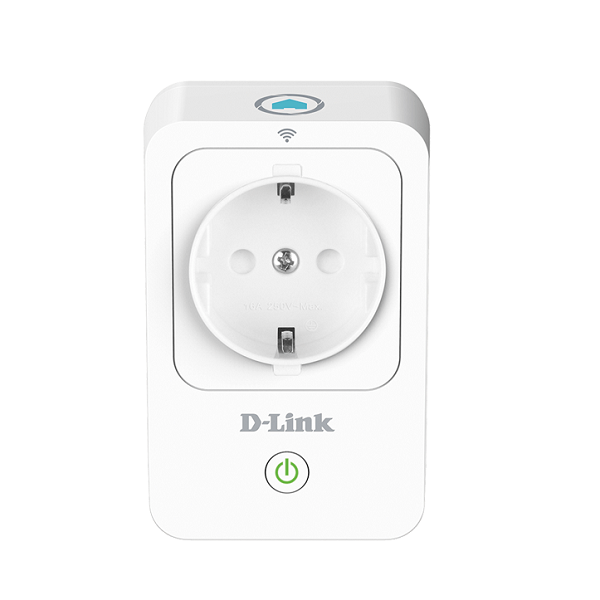
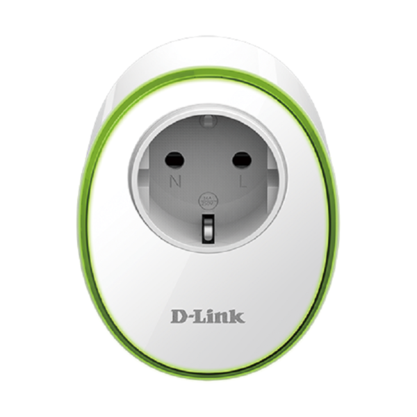
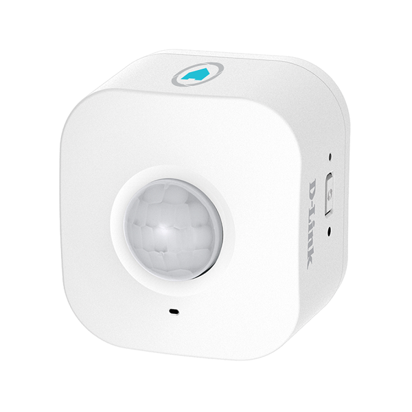

# ioBroker.mydlink

## Адаптер MyDlink для ioBroker.

Позволяет управлять розетками или датчиками движения [D-Link](https://eu.dlink.com/uk/en/for-home/smart-home) из приложения ioBroker.

**Этот адаптер использует библиотеки Sentry для автоматического сообщения разработчикам об исключениях и ошибках в коде.** Более подробную информацию, а также инструкции по отключению отправки сообщений об ошибках см. [в документации Sentry-Plugin](https://github.com/ioBroker/plugin-sentry#plugin-sentry) ! Система отчетности Sentry используется начиная с js-controller 3.0. Это также помогает в поддержке новых устройств.

В настоящее время протестированы следующие устройства:

|  Модель  |                                  Тип                                 |             Изображение            |
| :------: | :------------------------------------------------------------------: | :--------------------------------: |
| DSP-W215 |    «Умная» розетка (розетка, температура, ток) **Требует опроса**    |  |
| DSP-W115 |                         Умная розетка (вилка)                        |  |
|  ДЧ-С150 | Датчик движения (последнее обнаруженное движение) **Требует опроса** |  |
| DSP-W245 |        Умный сетевой фильтр (4 розетки). **Требуется опрос.**        |                                    |

Адаптер опрашивает устройства. Показания датчиков, обнаружение движения и переключение с помощью кнопок устройства задерживаются на интервал опроса (его можно установить для каждого устройства отдельно). Более новые устройства (DSP-W115, DSP-W245) не сообщают адаптеру о переключении или потреблении энергии самостоятельно (см. [раздел «События и измерение энергопотребления»](https://github.com/Garfonso/dlinkWebSocketClient#events-and-power-measurement) ).

**Не поддерживается:** DSP-W118. Его локальный интерфейс не позволяет переключать реле, см. [анализ](https://github.com/iobroker-community-adapters/ioBroker.mydlink/blob/master/docs/DSP-W118-analysis.md) .

#### Конфигурация:

Управление устройствами осуществляется в диспетчере устройств, либо в настройках адаптера, либо в диспетчере устройств администратора.

- **Добавить обнаруженное устройство** : устройства, объявленные в сети, предлагаются для выбора. Введите PIN-код.
- **Добавить устройство по IP-адресу** : для устройств, которые не были обнаружены. Введите IP-адрес и PIN-код.
- Каждое устройство можно редактировать, включать/отключать и удалять. Удаление устройства также приводит к удалению его объектов.

Настройки устройства:

<table>
<tr><td>Name</td><td>set a name here, must be unique (for mydlink devices)</td></tr>
<tr><td>IP</td><td>fill in IP address here, hostname should also work</td></tr>
<tr><td>PIN</td><td>PIN is printed on a sticker on the device, probably at the bottom. Can be TELNET for DSP-W115, see below. The PIN is stored encrypted and can only be changed in the device manager.</td></tr>
<tr><td>Poll interval</td><td>per device poll interval  Set 0 to disable polling.  <b>Recommendation:</b> Set a fast poll interval for sensors and a longer one for plugs.</td></tr>
<tr><td>enable</td><td>if not enabled, will not be polled or controlled.  Devices that are not plugged in can be disabled to avoid network traffic and error messages in the log.</td></tr>
<tr><td>NTP server</td><td>only older devices like DSP-W215 and DCH-S150: time server that is set on the device. Empty keeps the setting of the device. These devices use ntp1.dlink.com. Without correct time the timestamps of the motion detector are wrong, so a local time server (e.g. your router) is a good choice.</td></tr>
</table>

#### Настройки датчика движения (DCH-S150)

Состояния датчика движения также позволяют изменять его настройки:

- `sensitivity`: чувствительность датчика, 0 - 100.
- `backoff`: время в секундах после обнаружения, в течение которого детектор не сообщает о новом обнаружении. По умолчанию устройство использует 30 секунд. При коротком времени (например, 1-5 секунд) и коротком интервале опроса новое движение обнаруживается гораздо раньше.
- `detectionEnabled`: включает или выключает обнаружение движения.

Любое изменение конфигурации приводит к перезапуску адаптера.

Адаптер не мешает работе приложения.

## Настройка DSP-W115

DSP-W115 и другие _более новые_ устройства используют совершенно другой протокол и другую конфигурацию. Существует два способа их использования.

1. Одновременное использование приложения и адаптера: Если вы хотите продолжать использовать приложение, необходимо сбросить устройство до заводских настроек, выполнив следующую процедуру:
2. Для сброса устройства в режим восстановления удерживайте кнопку wps/reset во время загрузки до тех пор, пока она не начнет мигать **красным,** а не оранжевым цветом.
3. Теперь запущен демон Telnet, подключитесь к Wi-Fi устройства.
4. Бегать `telnet 192.168.0.20` и войти в систему с помощью `admin:123456` (или используйте пластилин, не забудьте выбрать) `telnet` вместо `ssh`).
5. Бегать `nvram_set FactoryMode 1`
6. Бегать `reboot; exit;` для перезагрузки устройства.
7. Теперь вам следует войти. `TELNET` в качестве PIN-кода, и адаптер получит необходимые данные непосредственно с устройства.
8. Не хочу пользоваться приложением
9. Удалите устройство из приложения, это сбросит настройки устройства.
10. Запустите настройку в приложении еще раз и настройте Wi-Fi на устройстве.
11. Теперь устройство переподключится к вашей сети Wi-Fi. В это время **закройте** приложение, убедитесь, что оно действительно закрыто.
12. Теперь устройство должно быть подключено к вашей сети Wi-Fi, а не к приложению, чтобы PIN-код с наклейки работал в адаптере. (Если устройство не подключается к вашей сети Wi-Fi или не принимает вход по PIN-коду, попробуйте еще раз. Нажмите кнопку на устройстве, пока она не загорится красным, чтобы выполнить сброс.)

## Changelog

### **WORK IN PROGRESS**
- (copilot) Adapter requires node.js >= 22.19.0 now
<!-- 
	Placeholder for next versions (this needs to be indented):
	### **WORK IN PROGRESS**
-->
### 2.1.0 (2026-10-12)
- (Garfonso) feat: sensitivity, backoff time and detection of motion detectors can be changed with states
- (Garfonso) feat: NTP server of older devices (DSP-W215, DCH-S150) can be set in the device manager
- (Garfonso) feat: devices are polled right after start
- (Garfonso) fix: disabled devices were shown as connected
- (Garfonso) docs: DSP-W245 is tested, DSP-W118 is not supported, devices have to be polled

### 2.0.0 (2026-10-11)
- (copilot) **Breaking:** Adapter requires node.js >= 22 now
- (Garfonso) **Breaking:** Adapter requires js-controller >= 7.0.7 and admin >= 8.0.14 now
- (Garfonso) **Breaking:** PINs are encrypted by js-controller and hidden from other adapters. The configuration is converted on first start, the adapter restarts once. After a downgrade to 1.3.x the PINs have to be entered again.
- (Garfonso) feat: devices are added, edited, enabled / disabled and deleted in the device manager
- (Garfonso) feat: settings page uses jsonConfig and embeds the device manager (#594, #414)
- (Garfonso) fix: adapter did crash on invalid data from websocket devices (#384)
- (Garfonso) fix: auto detection did not work on Linux (replaced mdns-discovery with multicast-dns)
- (Garfonso) fix: total power consumption was written to currentPower
- (Garfonso) fix: log in again if session of a device expired
- (Garfonso) fix: polling can be disabled for devices with known model
- (Garfonso) fix: normalize MAC addresses, fixes endless loop if another device answers on the configured IP
- (Garfonso) fix: detect changed IP of devices and update the configuration
- (Garfonso) fix: websocket devices were reported reachable while offline
- (Garfonso) fix: websocket devices reconnect after they were offline (dlink_websocketclient 0.6.2)
- (Garfonso) fix: pause login of websocket devices for 10 minutes if they refuse it or the PIN is wrong (device locks itself after 10 invalid tokens)
- (Garfonso) fix: no new timers during unload
- (Garfonso) chore: reduced log noise
- (Garfonso) chore: tested with node.js 26 (#632)
- (Garfonso) chore: dependencies updated

### 1.3.6 (2024-05-24)
* fixed: crash with empty pin.

### 1.3.5 (2023-10-30)
* fixed: wrong type warnings with legacy devices

### 1.3.4 (2023-08-18)
* fixed: missing build...

## License
MIT License

Copyright (c) 2026 iobroker-community-adapters <iobroker-community-adapters@gmx.de>  
Copyright (c) 2024-2025 Garfonso <garfonso@mobo.info>

Permission is hereby granted, free of charge, to any person obtaining a copy
of this software and associated documentation files (the "Software"), to deal
in the Software without restriction, including without limitation the rights
to use, copy, modify, merge, publish, distribute, sublicense, and/or sell
copies of the Software, and to permit persons to whom the Software is
furnished to do so, subject to the following conditions:

The above copyright notice and this permission notice shall be included in all
copies or substantial portions of the Software.

THE SOFTWARE IS PROVIDED "AS IS", WITHOUT WARRANTY OF ANY KIND, EXPRESS OR
IMPLIED, INCLUDING BUT NOT LIMITED TO THE WARRANTIES OF MERCHANTABILITY,
FITNESS FOR A PARTICULAR PURPOSE AND NONINFRINGEMENT. IN NO EVENT SHALL THE
AUTHORS OR COPYRIGHT HOLDERS BE LIABLE FOR ANY CLAIM, DAMAGES OR OTHER
LIABILITY, WHETHER IN AN ACTION OF CONTRACT, TORT OR OTHERWISE, ARISING FROM,
OUT OF OR IN CONNECTION WITH THE SOFTWARE OR THE USE OR OTHER DEALINGS IN THE
SOFTWARE.