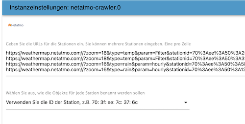

# ioBroker.netatmo-crawler

# адаптер netatmo-crawler для ioBroker

Собирает информацию с общедоступных станций Netatmo.

# Оглавление

- [Кредиты](#credits)
- [Список изменений](#changelog)
- [Лицензия](#license)

# Инструкция

Чтобы найти URL-адрес нужной вам метеостанции, выполните следующие действия:

1. Откройте [карту погоды Netatmo.](https://weathermap.netatmo.com)

2. Найдите свою станцию и нажмите значок «Поделиться».

   

3. Нажмите _«Скопировать ссылку»_

   

4. Вставьте ссылку в настройки экземпляра адаптера.

   

# Общая информация

Программа «Netatmo Crawler» анализирует большой объем реальной местной информации о вашем районе. Что вы будете делать со всей этой информацией? Вот несколько общих фактов и примеров:

## Влажность

В системе Netatmo используется относительная влажность, которая представляет собой отношение текущей абсолютной влажности к максимально возможной абсолютной влажности (зависящей от текущей температуры воздуха). Показатель 100% относительной влажности означает, что воздух полностью насыщен водяным паром и больше не может его удерживать, что создает возможность дождя. Это не означает, что относительная влажность должна быть 100%, чтобы пошел дождь — она должна быть 100% в местах образования облаков, но относительная влажность у поверхности земли может быть значительно ниже.

## Дождь

Используется единица измерения миллиметр. Если вам нужна единица измерения литр на кубический метр, вы можете использовать и эту. Ее можно использовать, например, для полива в саду.

## Давление

Воздух вокруг вас имеет вес и давит на всё, к чему прикасается. Это давление называется атмосферным давлением, или давлением воздуха. Что делать с этим значением? Всё просто: прогноз погоды! Высокое давление = хорошая погода, низкое давление = плохая погода. Нормальное среднее значение составляет 1013 мбар. Для «реального» прогноза погоды вам потребуется история изменения давления за несколько часов (я использую четыре часа). Если давление падает, в будущем ожидается плохая погода, если повышается — хорошая. Я нашёл [скрипт для прогноза здесь](http://www.beteljuice.co.uk/zambretti/forecast.html) (он называется методом Замбретти для 90%-ного прогноза). Другие единицы измерения: 1 мбар = 100 Па = 1 гПа

## Температура

Здесь вы можете рассчитать уровень охлаждения. Для низких температур используется ветровое охлаждение (10 °C или ниже, расчет производится с учетом ветра), для высоких температур — индекс жары (25 °C или выше, расчет производится с учетом влажности). Пример скрипта:

```
windchill1 = windchill(temp, windkmh); //Vars to-from IOBroker

function windchill(temperature, windspeed) {
	var windchill = 13.12 + 0.6215 * temperature - 11.37 * Math.pow(windspeed, 0.16) + 0.3965 * 
			temperature * Math.pow(windspeed, 0.16);
	return windchill;
}

heatindex1 = heatindex(temp, hum); //Vars to-from IOBroker

function heat(temperature, humidity) {
	var heatindex = -8.784695 + 1.61139411 * temperature + 2.338549 * humidity - 0.14611605 * 
			temperature * humidity - 0.012308094 * (temperature * temperature) - 
			0.016424828 * (humidity * humidity) + 0.002211732* (temperature *
			temperature) * humidity + 0.00072546 * temperature * (humidity * humidity)
			- 0.000003582 * (temperature * temperature) * (humidity * humidity);
	return heatindex;
}
```

## Ветер

`stationData.<station>.windangleDegrees` содержит числовое значение направления ветра в градусах; `lastUpdated.windangleDegrees` содержит метку времени измерения. Существующая `windangle` Текст компаса остался без изменений. Значение Netatmo. `-1` сохраняется для спокойных условий, соответствуя существующему `calm` текст.

Скорость ветра — это показатель движения воздуха из области высокого давления в область низкого давления, обычно из-за изменений температуры. Сила порыва ветра — это максимальное значение скорости ветра, измеренное за короткий промежуток времени (например, за три секунды). Вам следует написать скрипт для вашего навеса или для метода Замбретти (см. выше).

## Кредиты

Создание этого адаптера было бы невозможно без замечательной работы @bart1909 ( <https://github.com/jbart1909> ), который создал предварительные версии этого адаптера (до V1.xx).

Большое спасибо компании [backfisch](https://github.com/backfisch88) за первоначальную идею и поддержку!

## Changelog

### **WORK IN PROGRESS**
- (copilot) Adapter requires node.js >= 22.19.0 now
<!--
	Placeholder for the next version (at the beginning of the line):
	### **WORK IN PROGRESS**
-->
### 1.3.0 (2026-10-12)
- (xXBJXx) Updated Moment and translation-tool dependencies ([#211](https://github.com/iobroker-community-adapters/ioBroker.netatmo-crawler/pull/211), [#212](https://github.com/iobroker-community-adapters/ioBroker.netatmo-crawler/pull/212)).
- (xXBJXx) Added numeric wind direction and its measurement timestamp while retaining the existing compass direction ([#43](https://github.com/iobroker-community-adapters/ioBroker.netatmo-crawler/issues/43)).
- (xXBJXx) Migrated settings to jsonConfig, preserved existing configuration and translations, and added responsive field widths and spacing below the Admin toolbar ([#174](https://github.com/iobroker-community-adapters/ioBroker.netatmo-crawler/issues/174), [#213](https://github.com/iobroker-community-adapters/ioBroker.netatmo-crawler/issues/213); supersedes [#221](https://github.com/iobroker-community-adapters/ioBroker.netatmo-crawler/pull/221)).
- (xXBJXx) Fixed missing station data when optional location fields are absent ([#198](https://github.com/iobroker-community-adapters/ioBroker.netatmo-crawler/issues/198), [#94](https://github.com/iobroker-community-adapters/ioBroker.netatmo-crawler/issues/94), [#84](https://github.com/iobroker-community-adapters/ioBroker.netatmo-crawler/issues/84)).
- (xXBJXx) Fixed token renewal, request timeouts and cancellation when disabling the instance.
- (xXBJXx) Cancelled active requests when station settings change, preventing overlapping scheduled runs after saving.
- (xXBJXx) Handled expected network failures as warnings with exit code 0, incorporating [#191](https://github.com/iobroker-community-adapters/ioBroker.netatmo-crawler/pull/191) ([#57](https://github.com/iobroker-community-adapters/ioBroker.netatmo-crawler/issues/57)).
- (xXBJXx) Preserved weather readings when rain history is unavailable.
- (xXBJXx) Replaced deprecated request and URL handling with native Node.js APIs, updated adapter-core, and used adapter timers and termination for compact-mode safety ([#213](https://github.com/iobroker-community-adapters/ioBroker.netatmo-crawler/issues/213)).

### 1.2.0 (2026-05-10)
- (copilot) Adapter requires node.js >= 22 now
- (copilot) Adapter requires admin >= 7.7.22 now
- (mcm1957) Dependencies have been updated.

### 1.1.0 (2025-09-27)
* (mcm1957) Adapter requires node.js 20, js-controller 6.0.11 and admin 7.6.17 now.
* (Bart1909) Missing headers have been added [#95, #96]
* (mcm1957) Dependencies have been updated.

### 1.0.0 (2025-06-13)
* (Bart1909) A problem handling urls and authentication has been fixed.
* (mcm1957) Adapter has been migrated into iobroker-community-adapters organisation.
* (Bart1909) Adapter requires node.js 20, js-controller 6.0.11 and admin 7.4.10 now.
* (mcm1957) Dependencies have been updated.

### 0.8.0
* (Bart19) Adds additional 'rain_lastHour' state as 'rain' state is now real time value

## License

MIT License

Copyright (c) 2025-2026 iobroker-community-adapters <iobroker-community-adapters@gmx.de>  
Copyright (c) 2022 Bart19 <webmaster@bart19.de>

Permission is hereby granted, free of charge, to any person obtaining a copy
of this software and associated documentation files (the "Software"), to deal
in the Software without restriction, including without limitation the rights
to use, copy, modify, merge, publish, distribute, sublicense, and/or sell
copies of the Software, and to permit persons to whom the Software is
furnished to do so, subject to the following conditions:

The above copyright notice and this permission notice shall be included in all
copies or substantial portions of the Software.

THE SOFTWARE IS PROVIDED "AS IS", WITHOUT WARRANTY OF ANY KIND, EXPRESS OR
IMPLIED, INCLUDING BUT NOT LIMITED TO THE WARRANTIES OF MERCHANTABILITY,
FITNESS FOR A PARTICULAR PURPOSE AND NONINFRINGEMENT. IN NO EVENT SHALL THE
AUTHORS OR COPYRIGHT HOLDERS BE LIABLE FOR ANY CLAIM, DAMAGES OR OTHER
LIABILITY, WHETHER IN AN ACTION OF CONTRACT, TORT OR OTHERWISE, ARISING FROM,
OUT OF OR IN CONNECTION WITH THE SOFTWARE OR THE USE OR OTHER DEALINGS IN THE
SOFTWARE.