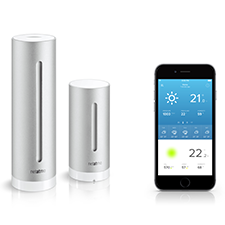

# ioBroker.netatmo

**Этот адаптер использует библиотеки Sentry для автоматического сообщения разработчикам об исключениях и ошибках в коде.** Более подробную информацию, а также инструкции по отключению отправки сообщений об ошибках см. [в документации Sentry-Plugin](https://github.com/ioBroker/plugin-sentry#plugin-sentry) ! Система отчетности Sentry используется начиная с js-controller 3.0.

## Адаптер Netatmo для ioBroker

Обеспечивает связь ioBroker с облаком Netatmo (API Netatmo Connect). Поддерживаемые продукты:

| Продукт                                                                                                                              | Данные                                                              | Требуется собственное приложение.                                                        |
| ------------------------------------------------------------------------------------------------------------------------------------ | ------------------------------------------------------------------- | ---------------------------------------------------------------------------------------- |
| Метеостанция (включая модули для наружного наблюдения, измерения дождя, ветра и дополнительные модули для внутреннего использования) | измерения, минимум/максимум, тренды, батарея, состояние радио/Wi-Fi | нет                                                                                      |
| Тренер по здоровому образу жизни дома                                                                                                | качество воздуха, CO2, влажность, шум                               | нет                                                                                      |
| Камеры (датчики приветствия, присутствия, интеллектуальные датчики дверей и окон)                                                    | статус, события, лица, мониторинг включен/выключен                  | Рекомендуется (прямая трансляция и полный контроль только через собственное приложение). |
| рольставни iDiamant / Bubendorff                                                                                                     | положение, управление                                               | нет                                                                                      |
| Умный видеодомофон                                                                                                                   | статус, звонок, вызовы, события                                     | да                                                                                       |
| Умный дымовой извещатель                                                                                                             | статус, сигналы тревоги                                             | да                                                                                       |
| Интеллектуальный детектор угарного газа                                                                                              | статус, сигналы тревоги                                             | да                                                                                       |

Данный адаптер не поддерживает термостаты и клапаны (Netatmo Energy).

## Требования

- js-controller >= 6.0.0, admin >= 7.6.19
- Для работы с устройствами необходима учетная запись Netatmo.
- Для событий в реальном времени (камеры, дверной звонок, датчики дыма и угарного газа): [экземпляр IoT](https://github.com/ioBroker/ioBroker.iot) (>= 1.14.0), подключенный к учетной записи ioBroker Pro с лицензией Assistant или Remote. Без нее все данные обновляются только путем опроса.
- Рекомендуется: собственное приложение Netatmo (идентификатор клиента и секретный ключ клиента), см. ниже.

## Конфигурация

### Вкладка "Устройства и вход в систему"

1. Выберите продукты Netatmo, которые вы хотите использовать.
2. Необязательно, но рекомендуется: создайте собственное приложение на [dev.netatmo.com](https://dev.netatmo.com/apps/createanapp) и введите его идентификатор клиента и секретный ключ клиента. Собственное приложение необходимо для работы дверного звонка, датчика дыма и угарного газа, а также для полного набора функций камеры, и оно позволяет обновлять данные с интервалом менее 10 минут. Без него используется общее приложение ioBroker, квота API которого распределяется между всеми пользователями.
3. Нажмите «Войти через Netatmo». Откроется новое окно с формой входа в Netatmo. После входа в систему и предоставления доступа адаптер сохранит токены и перезапустится.

При каждом изменении выбранных товаров или идентификатора/секрета клиента необходимо повторно входить в систему, иначе данные могут быть потеряны. Если окно не открывается, проверьте блокировщик всплывающих окон в вашем браузере.

### Вкладка "События в реальном времени"

Отображается только при выборе опций: камеры видеонаблюдения, дверной звонок, датчик дыма или угарного газа.

- **Экземпляр IoT** : экземпляр, используемый для приема событий веб-перехватчика от Netatmo. Оставьте поле пустым, чтобы отключить события в реальном времени.
- **Удалить события старше** (часов), **Интервал очистки** (минут), **Удалить неизвестных лиц, которые последний раз были замечены более** (часов, только камеры)

### Вкладка «Дополнительно»

- **Интервал обновления** (в минутах): не менее 10 минут для общего приложения, не менее 1 минуты для собственного приложения. Netatmo обновляет данные о погоде примерно каждые 10 минут, поэтому более короткие интервалы не обеспечивают увеличения объема данных о погоде. Камеры, дверной звонок и сигнализация опрашиваются с интервалом, вдвое превышающим этот.
- **Высота** над уровнем моря (в метрах): используется для расчета точки росы.

Пожалуйста, соблюдайте [ограничения на количество запросов, установленные Netatmo](https://dev.netatmo.com/guideline#rate-limits) .

## Использование

Адаптер создает состояния для всех устройств выбранных продуктов. Устройства, поддерживающие события, дополнительно получают состояния событий, которые заполняются событиями в реальном времени (см. требования).

Некоторые устройства (например, камеры) инициализируются последним событием соответствующего типа. Для других устройств (например, датчики дыма/угарного газа) состояния событий заполняются следующим событием.

### Дверной звонок

- `ring` установлено на `true` когда кто-то звонит (`incoming_call` Он автоматически перезагружается через 60 секунд, сразу же после включения. `missed_call` /`accepted_call` и при запуске адаптера. Netatmo не обеспечивает надежную передачу. `accepted_call` когда на звонок отвечают в приложении.
- `incoming_call`, `accepted_call` и `missed_call` Содержит время, идентификатор события и URL-адрес снимка последнего события этого типа.
- Netatmo передает события веб-хука с задержкой от нескольких секунд до примерно 2 минут.

### рольставни iDiamant/Bubendorff

### Состояние устройства

Для каждого устройства адаптер записывает значения состояния, предоставляемые Netatmo. Значения, которые тип устройства не предоставляет, не создаются.

| Состояние                                                                                         | Устройства                                                | Значение                                                                             |
| ------------------------------------------------------------------------------------------------- | --------------------------------------------------------- | ------------------------------------------------------------------------------------ |
| `info.connection` (пример)                                                                        | все                                                       | `true` при условии доступности облака Netatmo и действительности авторизации.        |
| `<device>.info.reachable`                                                                         | камеры, дверной звонок, датчик дыма/угарного газа, ставни | `false` если устройство находится в автономном режиме (например, нет Wi-Fi)          |
| `<device>.info.error`                                                                             | камеры, дверной звонок, датчик дыма/угарного газа, ставни | Ошибка устройства Netatmo, например. `device_unreachable`, пусто, если все в порядке |
| `<device>.info.wifi_strength`, `rf_strength`                                                      | в зависимости от устройства                               | Чем ниже уровень сигнала, тем лучше.                                                 |
| `<device>.info.battery_state`, `battery_level`                                                    | батарейные устройства                                     | Состояние батареи и напряжение (мВ)                                                  |
| `<device>.info.firmware`                                                                          | в зависимости от устройства                               | версия прошивки                                                                      |
| `Reachable`, `Firmware` (модули метеостанции), `reachable` (Тренер по здоровому образу жизни дома) | метеостанция, автобус                                     | доступность и микропрограмма                                                         |

Отключение устройства от сети регистрируется один раз как предупреждение, а затем возвращается в виде информации. Обновление также происходит на дверном звонке и камерах. `info.reachable` сразу из `connection` /`disconnection` События в реальном времени, если их отправляет Netatmo.

API Netatmo не предоставляет данные о рольставнях в режиме реального времени, поэтому значения опрашиваются с заданным интервалом обновления. Они неточны в режиме реального времени, если рольставни управляются напрямую или через приложение Netatmo.

При управлении жалюзи через адаптер значения обновляются через 2 и 17 секунд после команды.

В зависимости от устройства, целевое положение может быть установлено на любое значение от 0 % до 100 %, или только на 0 % или 100 % (-1 = стоп, -2 = режим жалюзи для жалюзи с наклонными ламелями). Также можно использовать кнопки открытия, закрытия и остановки.

## команды sendTo

### убранство

Помечает всех людей как находящихся вне дома (например, при использовании в качестве системы сигнализации):

```javascript
sendTo('netatmo.0', 'setAway', { homeId: '1234567890abcdefg' });
```

или для всех домов:

```javascript
sendTo('netatmo.0', 'setAway');
```

Только определённые лица:

```javascript
sendTo('netatmo.0', 'setAway', { homeId: '1234567890abcdefg', personsId: ['123123123123123'] });
```

`homeId` Это идентификатор, отображаемый в качестве папки верхнего уровня дома на вкладке «Объекты» (необязательно, если дом только один). `personsId` Идентификатор человека в папке "Известные люди".

### setHome

Те же параметры, что и `setAway`, определяет отдельных лиц или целые дома как «дом».

## Более старые версии

- **3.0.0** : События в реальном времени принимаются через экземпляр IoT. Прежний сервис Heroku был отключен 28.11.2022.
- **2.0.0** : Новая структура объектов, основанная на уникальных идентификаторах устройств вместо имен. Netatmo отключила вход в систему с использованием имени пользователя и пароля в октябре 2022 года, аутентификация осуществляется с помощью кнопки «Войти с Netatmo».

## Changelog
<!--
    Placeholder for the next version (at the beginning of the line):
    ### **WORK IN PROGRESS**
-->
### 3.2.0 (2026-11-04)
* (@Schimi1983) Fixed adapter crash when changing a state (e.g. camera monitoring) while the access token had expired
* (@Schimi1983) Token refresh: an invalid refresh token is now reported (re-authentication required) instead of silently starting without data; no endless refresh loop; only one refresh at a time (Netatmo rotates refresh tokens)
* (@Schimi1983) Access and refresh tokens and the client secret are no longer written to the log
* (@Schimi1983) Update intervals are validated also with own client ID (empty value led to polling every millisecond)
* (@Schimi1983) A failing event request no longer discards the home and device status of the update cycle
* (@Schimi1983) Device status for all devices: reachable, error, signal strength, battery and firmware; offline/online is logged; new state info.connection
* (@Schimi1983) Temporary Netatmo outages (5xx, timeouts, "Service temporarily unavailable") are logged as warning and only as error after 3 failed requests in a row; recovery is logged; no more duplicate log entries per error
* (@Schimi1983) Realtime events keep working after re-authentication
* (@Schimi1983) Doorbell: "ring" is reset automatically 60 seconds after the call (Netatmo does not reliably send accepted_call), immediately on accepted_call/missed_call, and on adapter start
* (@Schimi1983) README reworked according to the ioBroker guidelines, older changelog entries moved to CHANGELOG_OLD.md
* (@Schimi1983) Reworked configuration page: tabs, responsive layout, info boxes, units and input validation, translations for all languages; requires admin >= 7.6.19
* (@Schimi1983) Help text for event retention corrected (hours instead of minutes); default update interval 10 minutes
* (@Schimi1983) State roles corrected according to the ioBroker state roles (e.g. `date` instead of the non-existing `value.date`, `text` for texts instead of the generic `state`, `level`/`value.blind` for roller shutters); only roles changed, IDs, types and values stay the same
* (@Apollon77) Removed the usage of a deprecated API from Netatmo which was used to enrich person data
* (@Apollon77) Added product type NACamDoorTag
* (@Apollon77) Allows value -2 for target position of Bubendorff roller shutters to put a Bubendorff shutter with jalousieable slats in jalousie mode

### 3.1.0 (2023-01-06)
* (Apollon77) Add support for Bubendorff roller shutters
* (Apollon77) Fix Monitoring State for Welcomes
* (Apollon77) Allow to just use CO2/Smoke sensors
* (Apollon77) Optimize Shutdown procedure

### 3.0.0 (2022-12-14)
* (Apollon77/bluefox) BREAKING CHANGE: Restructure Realtime events to be received via iot instance (iot >= 1.14.0 required)

### 2.1.2 (2022-11-17)
* (bluefox) Added missing objects for `Welcome` devices

### 2.1.1 (2022-09-30)
* (Apollon77) Make sure device types that require custom credentials are not selectable in UI without entering them
* (Apollon77) Fix a potential crash case

## License

The MIT License (MIT)

Copyright (c) 2016-2026 Patrick Arns <iobroker@patrick-arns.de>

Permission is hereby granted, free of charge, to any person obtaining a copy
of this software and associated documentation files (the "Software"), to deal
in the Software without restriction, including without limitation the rights
to use, copy, modify, merge, publish, distribute, sublicense, and/or sell
copies of the Software, and to permit persons to whom the Software is
furnished to do so, subject to the following conditions:

The above copyright notice and this permission notice shall be included in
all copies or substantial portions of the Software.

THE SOFTWARE IS PROVIDED "AS IS", WITHOUT WARRANTY OF ANY KIND, EXPRESS OR
IMPLIED, INCLUDING BUT NOT LIMITED TO THE WARRANTIES OF MERCHANTABILITY,
FITNESS FOR A PARTICULAR PURPOSE AND NONINFRINGEMENT. IN NO EVENT SHALL THE
AUTHORS OR COPYRIGHT HOLDERS BE LIABLE FOR ANY CLAIM, DAMAGES OR OTHER
LIABILITY, WHETHER IN AN ACTION OF CONTRACT, TORT OR OTHERWISE, ARISING FROM,
OUT OF OR IN CONNECTION WITH THE SOFTWARE OR THE USE OR OTHER DEALINGS IN
THE SOFTWARE.