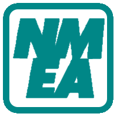
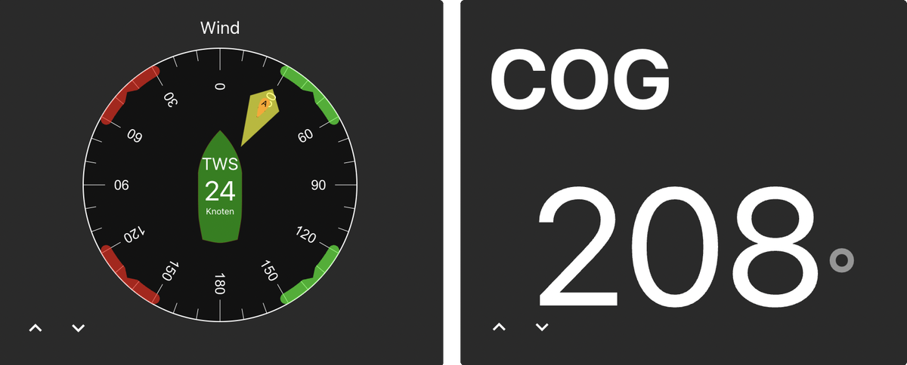
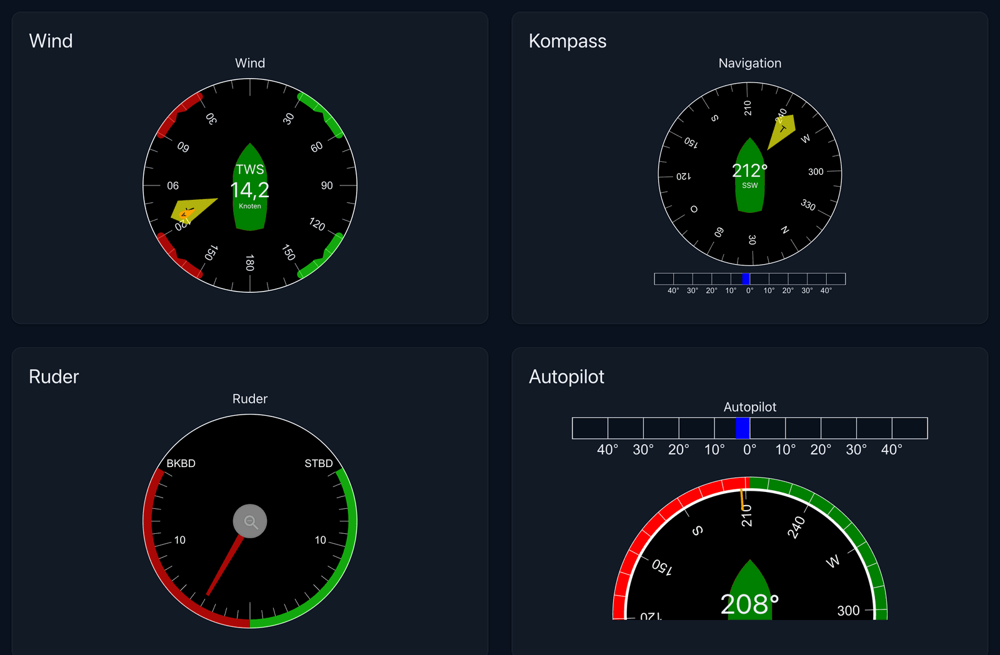
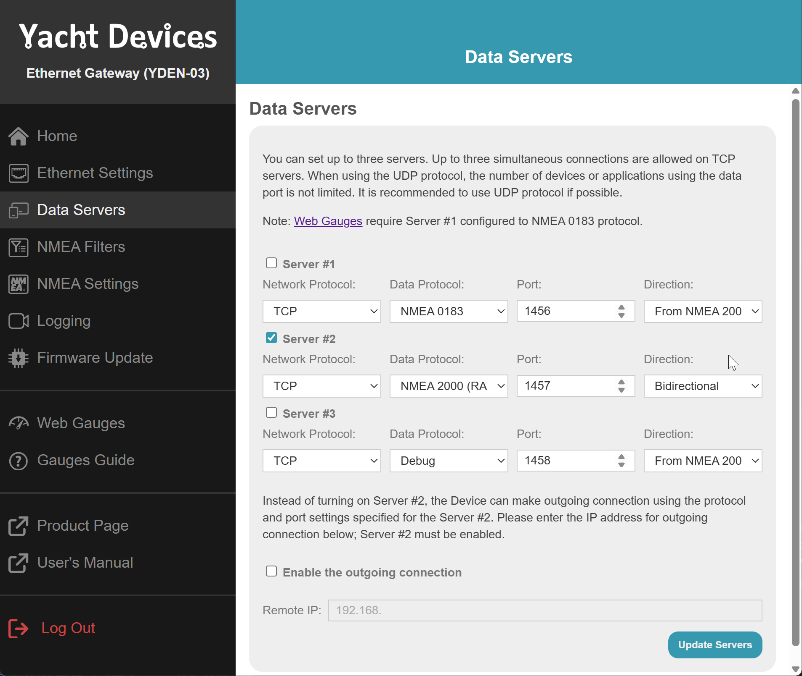

# ioBroker.nmea

Этот адаптер позволяет подключать ioBroker к яхтенной шине NMEA-2000.

**Этот адаптер использует библиотеки Sentry для автоматического сообщения разработчикам об исключениях и ошибках в коде.** Более подробную информацию, а также инструкции по отключению отправки сообщений об ошибках, см. [в документации Sentry-Plugin](https://github.com/ioBroker/plugin-sentry#plugin-sentry) ! Система отчетности Sentry используется начиная с js-controller 3.0.

Для использования этого адаптера вам потребуется оборудование, способное считывать данные с шины NMEA-2000 и преобразовывать их в последовательный порт:

- [Actisense NGT-1 (USB)](https://actisense.com/products/ngt-1-nmea-2000-to-pc-interface/)
- [Actisense NGX1-USB (USB)](https://actisense.com/products/nmea-2000-gateway-ngx-1/)
- или [Raspberry PI с PiCAN-M](https://www.skpang.co.uk/collections/hats/products/copy-of-pican-m-with-can-bus-micro-c-and-rs422-connector-no-smps)
- [Yacht Devices YDWG-02/03](https://www.yachtd.com/products/wifi_gateway.html)
- [Yacht Devices YDEN-02/03](https://www.yachtd.com/products/ethernet_gateway.html)

PiCAN-M может работать с Raspberry Pi 4 и [5](https://copperhilltech.com/blog/testing-pican-can-bus-hats-with-the-raspberry-pi-5/) .



В одном представлении vis-2 виджет "NMEA Complex" отображается четыре раза, при этом каждый экземпляр показывает один параметр: ветер, компас, руль и автопилот.



[Объяснение на YouTube](https://youtu.be/flp_-mypbRU?si=k0lp95OukQ88LBxj)

## Как использовать его на Raspberry PI с PiCAN-M

PiCAN M — это компактная дополнительная плата, разработанная для Raspberry Pi 3/4. Она позволяет подключать к Raspberry Pi сети NMEA2000 и NMEA0183. Питание платы может осуществляться от внешнего источника 12 В. Кроме того, при использовании с платой PiCAN-M она предоставляет возможность питания Raspberry Pi напрямую через шину NMEA2000.

**В плате PiCAN-M отсутствует надлежащая защита от обратной полярности при напряжении питания 12 В. При работе от внешнего источника питания 12 В необходимо установить предохранитель на 1 А в линию питания.**

В связи с высокими требованиями Raspberry Pi к питанию, мы рекомендуем использовать внешний источник питания (не менее 3 А). Питание по протоколам NMEA2000 и USB может осуществляться параллельно без проблем.

### Установка

Более подробная информация содержится в главе 3 [Руководства пользователя PiCAN-M](https://github.com/ioBroker/ioBroker.nmea/blob/master/img/pican-m_UGB_10.pdf) , но вот краткое изложение:

Редактировать файл `/boot/config.txt` (с `sudo nano /boot/config.txt`) и добавьте следующие строки в конец файла:

```
enable_uart=1
dtparam=i2c_arm=on
dtparam=spi=on
dtoverlay=mcp2515-can0,oscillator=16000000,interrupt=25 
```

Отключить вывод на консоль UART:

- начать в командной строке `sudo raspi-config`
- перейти к `3 Interface Options`
- идти `I5 Serial Port`
- Запрещать `shell accessible over serial` и `serial port hardware enabled`
- Выход из `raspi-config` и перезагрузить

Установите can-utils

```shell
sudo apt-get install can-utils
```

## Actisense NGT-1

Устройство Actisense NGT-1 отображается в Windows или Linux без каких-либо дополнительных драйверов. Оно отображается как последовательный порт 'COMn' (Windows) или ttyN (Linux).

## ЙДЕН, ЙДВГ

Включите сервер N2 с протоколом TCP и двунаправленным режимом.



Протокол UDP тоже мог бы подойти, но шлюз непрерывно отправляет данные в сеть, поэтому шина может быть перегружена.

## Все

- Закодировать код
- АИС
- Выясните, почему были отправлены данные с адреса 100.
- Интеграция [iKonvert NMEA 2000](https://digitalyachtamerica.com/product/ikonvert-usb/)
- Интеграция модуля [Shipmodul MiniPlex-3-N2K](https://www.shipmodul.com/products.html)

## Моделирование данных

Вы можете передавать данные с внешних датчиков на шину NMEA2000. Фактически, вы можете только имитировать данные об окружающей среде, такие как температура, влажность, давление.

С флагом `Combined environment` Вы можете указать номер PGN, который будет использоваться для измерения температуры, влажности и давления:

- Если вы снимете выделение с флага `Combined environment` Таким образом, для измерения температуры будет использоваться PGN 130314, для измерения влажности — PGN 130313, а для измерения давления — PGN 130314.
- Если вы выберете флаг `Combined environment` Таким образом, все три значения будут отправлены в формате PGN 130311 вместе с другими возможными значениями параметров окружающей среды.

## Часовой пояс

Существует возможность установить часовой пояс по GPS-координатам. Для этого необходимо включить соответствующую опцию в настройках адаптера и разрешить её использование. `iobroker` Пользователь выполняет команду: `sudo visudo`

```
iobroker ALL=(ALL) timedatectl set-timezone
```

## Автопилот

На самом деле поддерживается только один автопилот: Raymarine.

Разработка Simrad/Navico/B\&G еще не завершена.

### Отображение уровня ветрового давления

Для устройств Raymarine, которые отображают "ориентир пилотного ветра" (PGN 65345), адаптер сохраняет исходный угол в радианах. `seatalkPilotWindDatum.windDatum` (Это каноническое значение, которое автопилот считывает при изменении угла ветра, поэтому оно должно оставаться в радианах).

Кроме того, предусмотрено удобное состояние только для чтения. `seatalkPilotWindDatum.windDatumDisplay` создано. Оно отображает угол точно так же, как и пилотный столик Raymarine:

- `0…180°` → правый борт, `180…360°` → порт,
- каждый как `≤180°` значение плюс дополнительная буква, зависящая от языка (например, значение `230°` показано как `130°P` на английском и `130°B` (на немецком языке). `0°` (прямо вперед) и `180°` (прямо за кормой) не имеют бортового письма.

Использовать `windDatumDisplay` для визуализации и `windDatum` для расчетов/автоматизации.

## Веб-компоненты

Помимо виджетов vis-2 и виджетов устройств, адаптер предлагает веб-компоненты для Aura и других хостов. `common.webComponents`, `admin/webcomponents/` Каждый из них представляет собой отдельный модуль и отображает то же самое, что и соответствующий ему виджет:

| Ярлык                      | Шоу                                                                                                                                                                                                          | Настройки                                                                                                          |
| -------------------------- | ------------------------------------------------------------------------------------------------------------------------------------------------------------------------------------------------------------ | ------------------------------------------------------------------------------------------------------------------ |
| `iob-nmea-wind`            | Ветроизмерительные приборы: кажущийся и истинный ветер, курс, курс, заход на посадку и снос, предпосылочная скорость, целевая скорость ветра, скорость ветра на попутном ветре, скорость ветра на юге и юге. | например, история изменения направления ветра, зона попутного ветра, единица измерения скорости, настройка паруса. |
| `iob-nmea-history-chart`   | График состояния в реальном времени с линиями минимального/среднего/максимального значений, заполняемый на основе истории по умолчанию.                                                                      | состояние, метка, единица измерения, временной интервал, ось Y, линии, десятичные знаки, цвет                      |
| `iob-nmea-autopilot`       | Режим автопилота, фиксированный курс, руль направления и кнопки управления (значительные изменения требуют подтверждения).                                                                                   | например, AWA, рулевая планка                                                                                      |
| `iob-nmea-ais-radar`       | Система AIS наводит курсор на собственную лодку на морской карте, используя траектории и векторы центра тяжести.                                                                                             | экземпляр, диапазон, скрыть после, векторы, курс вверх, собственный MMSI                                           |
| `iob-nmea-anchor-position` | На карте отображаются сигналы тревоги: якорь, лодка, качели, рельсы и якорь; в диалоговом окне устанавливается якорь и сигнал тревоги.                                                                       | например, положение якоря/лодки, длина цепи, глубина при сбросе, стиль карты.                                      |
| `iob-nmea-instrument`      | До четырех значений, как на морском приборе, по одному за раз.                                                                                                                                               | по значению: штат, название, единица измерения, цифры, цвет, знак плюс, изменение мигания                          |
| `iob-nmea-compass`         | Компас с указанием курса относительно земли, истинного направления ветра и руля направления (окно «Навигация» виджета vis-2 «Комплекс»)                                                                      | например, руль                                                                                                     |
| `iob-nmea-rudder`          | Индикатор угла руля, позволяющий увеличить масштаб при малых углах (окно «Руль» виджета «Комплекс» в vis-2).                                                                                                 | экземпляр, полный диапазон, порог масштабирования, гистерезис                                                      |

Источники находятся в `src-webcomponents/`; `npm run build:wc` строит их.

## Благодарности

Декодирование NMEA 2000 с помощью [canboatjs](https://github.com/canboat/canboatjs) , используя базу данных [CANboat](https://github.com/canboat/canboat) PGN (лицензия Apache 2.0).

<!--
	### **WORK IN PROGRESS**
-->

## Changelog

### **WORK IN PROGRESS**
- (@GermanBluefox) Added the short form of the web component manifests (tag, name, icon, size) to `common.webComponents`, so that hosts like Aura can list the components before the adapter is installed; the build writes it with `iob-web-components sync-io-package`

### 3.1.1 (2026-11-09)
- (@GermanBluefox) Web components: the heading of the wind display no longer covers a compass label, and the label of the outer ring of the AIS radar no longer sits on the "N"

### 3.1.0 (2026-11-08)
- (copilot) Adapter requires node.js >= 22.19.0 now
- (@GermanBluefox) The maps of the AIS radar and the anchor position work again: CARTO asks for an API key now, they use Esri Dark Gray and OpenStreetMap
- (@GermanBluefox) Added the web components `iob-nmea-wind`, `iob-nmea-history-chart`, `iob-nmea-autopilot`, `iob-nmea-ais-radar`, `iob-nmea-anchor-position`, `iob-nmea-instrument`, `iob-nmea-compass` and `iob-nmea-rudder` for Aura and other hosts (`common.webComponents`)
- (@GermanBluefox) The switch of the anchor position widget now arms the anchor watch instead of showing the alarm, which turns the alarm circle red; the widget "Instrument" is no longer a musical instrument in Chinese
- (@GermanBluefox) The anchor position widget can be given the chain length and the depth at drop for its swing circle; its settings show proper labels and help texts
- (@GermanBluefox) The anchor position widget speaks all languages, shows the anchor of the anchor alarm when no anchor position is chosen and loads the track from the history also for the own GNSS position; the settings "split view" and "sail trim" of the wind and autopilot widgets are translated into all languages

### 3.0.2 (2026-10-27)
- (@GermanBluefox) Deleted the states without object at the start, e.g. the AIS data of old vessels left by versions before 1.0.0 (needs js-controller 7.2.3 or newer)

### 3.0.1 (2026-10-19)
- (@GermanBluefox) Migrated widgets to React 19

### 2.0.0 (2026-08-04)
- (bluefox) Migrated to devices V3

## License
The MIT License (MIT)

Copyright (c) 2024-2026 bluefox <dogafox@gmail.com>

Permission is hereby granted, free of charge, to any person obtaining a copy
of this software and associated documentation files (the "Software"), to deal
in the Software without restriction, including without limitation the rights
to use, copy, modify, merge, publish, distribute, sublicense, and/or sell
copies of the Software, and to permit persons to whom the Software is
furnished to do so, subject to the following conditions:

The above copyright notice and this permission notice shall be included in
all copies or substantial portions of the Software.

THE SOFTWARE IS PROVIDED "AS IS", WITHOUT WARRANTY OF ANY KIND, EXPRESS OR
IMPLIED, INCLUDING BUT NOT LIMITED TO THE WARRANTIES OF MERCHANTABILITY,
FITNESS FOR A PARTICULAR PURPOSE AND NONINFRINGEMENT. IN NO EVENT SHALL THE
AUTHORS OR COPYRIGHT HOLDERS BE LIABLE FOR ANY CLAIM, DAMAGES OR OTHER
LIABILITY, WHETHER IN AN ACTION OF CONTRACT, TORT OR OTHERWISE, ARISING FROM,
OUT OF OR IN CONNECTION WITH THE SOFTWARE OR THE USE OR OTHER DEALINGS IN
THE SOFTWARE.