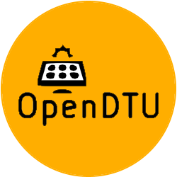

# ioBroker.opendtu

**🇩🇪 [Deutsche Anleitung](https://github.com/iobroker-community-adapters/ioBroker.opendtu/blob/main/docs/de/README.md)**

## Адаптер OpenDTU для ioBroker

[OpenDTU](https://www.opendtu.solar) — это небольшое устройство, которое взаимодействует с микроинверторами Hoymiles по радиосвязи, часто используемое для солнечных систем на балконах. Этот адаптер передает значения вашего OpenDTU в ioBroker в режиме реального времени и без задержек:

- текущая мощность каждого инвертора и всех инверторов вместе взятых
- Выработка за сегодняшний день и с момента ввода в эксплуатацию
- значения для каждой солнечной панели, температура, напряжение и многое другое.
- **Ограничьте мощность** ваших инверторов, например, для обеспечения нулевого поступления электроэнергии в сеть.

## Что вам нужно

- Запущенная и доступная в вашей домашней сети программа OpenDTU (вы можете открыть её веб-страницу в браузере).
- его адрес, например `192.168.1.50`
- Пароль веб-страницы OpenDTU — необходим для ограничения возможностей (см. [Пароль](#password) ).

## Настраивать

1. Установите адаптер в ioBroker в разделе **«Адаптеры»** и создайте экземпляр.
2. В настройках введите **адрес** вашего OpenDTU — тот же самый, который вы вводите в браузере.
3. Введите **пароль** веб-страницы OpenDTU (пользователь). `admin`).
4. **Сохраните** . Через несколько секунд значения появятся в разделе **Объекты → opendtu.0** .

Вот и всё. Протокол (HTTP) и порт (80) нужно менять лишь в редких случаях — они отображаются в экспертном режиме администратора.

### Параметры

| Вариант                                                  | Что это делает                                                                                                                                                 |
| -------------------------------------------------------- | -------------------------------------------------------------------------------------------------------------------------------------------------------------- |
| Установите значения равными 0, если инвертор недоступен. | Рекомендуется. Ночью инверторы отключаются. Без этой опции последние значения, полученные вечером, остаются видимыми всю ночь. Значения выработки сохраняются. |
| Сохраню свои собственные названия предметов              | Включите эту опцию, если вы переименовали объекты в ioBroker. В этом случае адаптер больше не будет перезаписывать имена.                                      |

### Пароль

- Для **чтения** значений пароль не требуется, если в OpenDTU ( _Настройки → Безопасность_ ) включена _опция «Разрешить доступ к веб-интерфейсу только для чтения без пароля»_ . Это значение по умолчанию.
- Для **ограничения мощности** или включения/выключения инвертора всегда требуется пароль.

## Используя значения

Для каждого инвертора создается отдельная папка, названная в честь его серийного номера (рядом с ним отображается имя, которое вы ему присвоили в OpenDTU).

| Объект                                | Значение                                                                  |
| ------------------------------------- | ------------------------------------------------------------------------- |
| `opendtu.0.total.power`               | Суммарная мощность всех инверторов (Вт)                                   |
| `opendtu.0.total.yieldday`            | Производительность всех инверторов сегодня (Вт·ч)                         |
| `opendtu.0.total.yieldtotal`          | Производительность всех инверторов с момента ввода в эксплуатацию (кВт·ч) |
| `opendtu.0.<serial>.ac.phase_1.power` | Текущая мощность этого инвертора (Вт)                                     |
| `opendtu.0.<serial>.yieldday`         | Производительность этого инвертора сегодня (Вт·ч)                         |
| `opendtu.0.<serial>.yieldtotal`       | Производительность этого инвертора с момента ввода в эксплуатацию (кВт·ч) |
| `opendtu.0.<serial>.dc.input_1.power` | Мощность солнечной панели на входе 1 (Вт)                                 |
| `opendtu.0.<serial>.temperature`      | температура инвертора (°C)                                                |
| `opendtu.0.<serial>.available`        | инвертор доступен –`false` ночью это нормально                            |
| `opendtu.0.<serial>.producing`        | инвертор вырабатывает электроэнергию                                      |
| `opendtu.0.dtu.available`             | Доступен сам OpenDTU.                                                     |

**Совет по статистике энергопотребления:** используйте `yieldtotal` Он только увеличивает значение и не подвержен влиянию перезапусков — идеально подходит для адаптеров, таких как _SourceAnalytix_ , или для ваших собственных диаграмм.

## Ограничение мощности

В папке `opendtu.0.<serial>.power_control` Вы можете ограничить мощность инвертора. Просто запишите число в один из этих файлов:

| Объект                         | Лимит                     | Сохраняется ли состояние после перезапуска инвертора? |
| ------------------------------ | ------------------------- | ----------------------------------------------------- |
| `limit_nonpersistent_absolute` | в ваттах, например `300`   | нет                                                   |
| `limit_nonpersistent_relative` | в процентах, например `50` | нет                                                   |
| `limit_persistent_absolute`    | в ваттах                  | да                                                    |
| `limit_persistent_relative`    | в процентах               | да                                                    |

- Для **автоматического управления** (например, нулевая подача данных, изменения каждые несколько секунд или минут) всегда используйте **непостоянные** объекты.
- ⚠️ **Устойчивые** ограничения сохраняются в памяти инвертора, что допускает лишь ограниченное количество записей. Изменяйте их **редко** , например, один раз при настройке системы.
- Действующее в настоящее время ограничение указано в `current_limit_relative` и `current_limit_absolute` После установки абсолютного предела обновление этого значения может занять до 4 минут.
- `limit_set_status` показывает, принял ли инвертор последнее ограничение: `Pending` = отправлено, `Ok` = применено, `Failure` = еще не получено (OpenDTU пытается повторно самостоятельно).

Пример в JavaScript-скрипте – ограничение мощности инвертора до 300 Вт:

```js
setState('opendtu.0.116100000001.power_control.limit_nonpersistent_absolute', 300);
```

Кнопки `power_on`, `power_off` и `restart` Включите, выключите или перезапустите инвертор.

## Сообщения инвертора

`opendtu.0.<serial>.events.last` Отображает последнее сообщение инвертора с указанием времени (например, сообщение о неисправности сети или о запуске). `events.count` — это количество сохраненных сообщений (инвертор удаляет их при запуске утром) и `events.json` Полный список. Вы можете использовать это для уведомлений, например, с помощью скрипта или _менеджера уведомлений_ .

## Вопросы и проблемы

**Значения не отображаются**

- Откройте адрес в настройках вашего браузера. Если страница OpenDTU не открывается, значит, ioBroker тоже не может получить к ней доступ (проверьте адрес, Wi-Fi, брандмауэр или VLAN).
- Если вы отключили _параметр "Разрешить доступ только для чтения"_ в OpenDTU, введите пароль в настройках адаптера.

**Ограничение не применяется.**

- Проверьте пароль в настройках адаптера — для изменения лимита он всегда необходим.
- Посмотрите лог ioBroker; адаптер записывает туда сообщение, если OpenDTU отклоняет команду.

**Ночью все значения равны 0 / инверторы «недоступны».**

- Это нормально: инверторы Hoymiles питаются от солнечных батарей и отключаются в темноте.

**В дневное время инвертор часто "недоступен".**

- Вероятно, радиосвязь слабая. Посмотрите... `opendtu.0.<serial>.radio.rssi` (ниже примерно −80 дБм — слабый уровень) и `opendtu.0.dtu.hints.radio_problem` Разместите OpenDTU ближе к инверторам или поверните его антенну.

**В моей сети отображается множество DNS-запросов от ioBroker.**

- Введите IP-адрес (например) `192.168.1.50`) вместо такого имени, как `opendtu.local`.

<details>
<summary>For advanced users</summary>

### Как работает адаптер

- Данные в реальном времени передаются OpenDTU через веб-сокет. `ws://<address>/livedata` OpenDTU отправляет одно сообщение на каждый инвертор при поступлении новых данных (примерно каждые 1–10 секунд), поэтому опрос отсутствует.
- Статус самого OpenDTU (`dtu.*` Данные (имя хоста, IP-адрес, сигнал Wi-Fi, время работы) считываются каждые 60 секунд. `/api/network/status` и `/api/system/status`.
- Команды отправляются на `/api/limit/config` и `/api/power/config` (Базовая аутентификация, пользователь) `admin`).
- `yieldtotal` Запись повторяется один раз в день в 00:01, чтобы статистические адаптеры заметили наступление нового дня.

### Типы ограничений

| Объект                         | OpenDTU `limit_type` |
| ------------------------------ | -------------------- |
| `limit_nonpersistent_absolute` | 0                    |
| `limit_nonpersistent_relative` | 1                    |
| `limit_persistent_absolute`    | 256                  |
| `limit_persistent_relative`    | 257                  |

Более подробную информацию об ограничениях можно найти в [документации OpenDTU](https://www.opendtu.solar/firmware/web_api/) .

### Структура объекта

```
opendtu.0
├── info.connection         connected to OpenDTU
├── dtu                     OpenDTU itself (incl. hints, heap)
├── total                   sum of all inverters
└── <serial>                one folder per inverter
    ├── ac.phase_1          AC side (grid)
    ├── dc.input_1 … n      DC side (solar panels)
    ├── events              messages of the inverter
    ├── radio               radio statistics
    └── power_control       limits, on/off and command status
```

</details>

## Кредиты

Создание этого адаптера было бы невозможно без замечательной работы @o0Shojo0o ( <https://github.com/o0Shojo0o> ), который разрабатывал предыдущие версии этого адаптера.

## Как сообщать о проблемах и отправлять запросы на добавление новых функций

Пожалуйста, используйте [раздел "Проблемы" на GitHub](https://github.com/iobroker-community-adapters/ioBroker.opendtu/issues) . Будет очень полезно, если вы установите уровень логирования адаптера на _"отладочный_ " (Экземпляры → экспертный режим → _уровень логирования_ столбца) и прикрепите файл лога из ioBroker. `log` Каталог – **не** от администратора, что позволяет избежать длинных очередей.

## Changelog
<!--
	Placeholder for the next version (at the beginning of the line):
	### **WORK IN PROGRESS**
-->
### **WORK IN PROGRESS**
- (Schimi1983) Translations of the settings page moved to the short file format, obsolete workflow file removed (repository checker #413)

### 4.1.1 (2026-11-04)
- (GermanBluefox) Fixed: a limit of 0 % that was not set by the adapter (e.g. in the OpenDTU web UI or via MQTT) was not shown

### 4.1.0 (2026-11-04)
- (Schimi1983) Status of the last limit and on/off command, maximum power of the inverter [#226]
- (Schimi1983) Event log of each inverter (number, last event, list) [#261]
- (Schimi1983) Radio statistics per inverter and hints of OpenDTU (time not synchronized, radio problem, default password)
- (Schimi1983) Temperature, memory and firmware of the OpenDTU; model and firmware of each inverter
- (Schimi1983) Daily maximum power and temperature (OpenDTU v26.9 and newer)
- (Schimi1983) Fixed: host name of the OpenDTU was never shown
- (Schimi1983) Fixed: after a restart of the OpenDTU the current limit showed 0 % for some minutes
- (Schimi1983) Total DC power over all inverters, message ID of the last event (for notifications)
- (Schimi1983) Event log is also updated when it is full (OpenDTU keeps 15 events per inverter)
- (Schimi1983) Clearer object names (e.g. current limit in % and W, persistent / non-persistent limits)
- (Schimi1983) Roles of all objects corrected according to the ioBroker state roles (e.g. yield `value.energy.produced`, availability `indicator.reachable`, limits `level`, buttons write-only)

### 4.0.0 (2026-11-03)
- (copilot) Adapter requires node.js >= 22.19.0 now
- (copilot) Adapter requires admin >= 7.7.22 now
- (copilot) Adapter requires js-controller >= 6.0.11 now
- (Schimi1983) README rewritten for beginners, German guide added (docs/de/README.md)
- (Schimi1983) Settings page: short guide, help texts in simple words, protocol and port only in expert mode, address is checked before saving
- (Schimi1983) New state `info.connection`, the instance shows green/yellow again
- (Schimi1983) Clear log messages for wrong or missing password, connection problems are logged only once
- (Schimi1983) Password is no longer part of the websocket URL
- (Schimi1983) Reconnect waits longer while OpenDTU is offline (2 s up to 60 s), fewer DNS queries [#192]
- (Schimi1983) Fixed: adapter reconnected after it was stopped
- (Schimi1983) Fixed: several adapter instances in compact mode influenced each other
- (Schimi1983) Fixed: with several inverters an offline inverter could show old values again
- (Schimi1983) Commands are confirmed (ack) only after OpenDTU accepted them, invalid limits are rejected
- (Schimi1983) Address field accepts input like `http://192.168.1.10/`
- (Schimi1983) Fixed: `total.yieldtotal` and `total.yieldday` dropped after midnight or an OpenDTU restart until all inverters answered; counters such as SourceAnalytix saw this as a meter reset
- (mcm1957) Dependencies have been updated.

### 3.1.0 (2024-12-02)
- (mattreim) Variable polling interval has been removed and polling intervals hev been increased.
- (mattreim) Description has been translated into supported languages.
- (mattreim) Admin-UI has been adapted for some display sizes.
- (mcm1957) Dependencies have been updated.

### 3.0.1 (2024-10-26)
- (simatec) Admin-UI has been adapted for small displays.
- (mcm1957) Dependencies have been updated.

## License
MIT License

Copyright (c) 2026 iobroker-community-adapters <iobroker-community-adapters@gmx.de>  
Copyright (c) 2024 ioBroker Community Developers <iobroker-community-adapters@gmx.de>  
Copyright (c) 2024 Dennis Rathjen <dennis.rathjen@outlook.de>

Permission is hereby granted, free of charge, to any person obtaining a copy
of this software and associated documentation files (the "Software"), to deal
in the Software without restriction, including without limitation the rights
to use, copy, modify, merge, publish, distribute, sublicense, and/or sell
copies of the Software, and to permit persons to whom the Software is
furnished to do so, subject to the following conditions:

The above copyright notice and this permission notice shall be included in all
copies or substantial portions of the Software.

THE SOFTWARE IS PROVIDED "AS IS", WITHOUT WARRANTY OF ANY KIND, EXPRESS OR
IMPLIED, INCLUDING BUT NOT LIMITED TO THE WARRANTIES OF MERCHANTABILITY,
FITNESS FOR A PARTICULAR PURPOSE AND NONINFRINGEMENT. IN NO EVENT SHALL THE
AUTHORS OR COPYRIGHT HOLDERS BE LIABLE FOR ANY CLAIM, DAMAGES OR OTHER
LIABILITY, WHETHER IN AN ACTION OF CONTRACT, TORT OR OTHERWISE, ARISING FROM,
OUT OF OR IN CONNECTION WITH THE SOFTWARE OR THE USE OR OTHER DEALINGS IN THE
SOFTWARE.