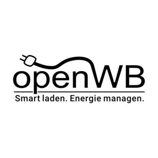

# IoBroker.openwb2
## Адаптер OpenWB2 для ioBroker
*Diese Anleitung is auch [auf Deutsch](https://github.com/seaspotter/ioBroker.openwb2/blob/main/docs/de/README.md) verfügbar.*

Считывает данные с зарядных станций, счетчиков, аккумуляторов, фотоэлектрических панелей и потребителей с контроллера настенной батареи [openWB](https://openwb.de) 2 в режиме реального времени по протоколу MQTT и позволяет управлять зарядкой через его HTTP-интерфейс `simpleAPI` из ioBroker.

> **Отказ от ответственности:** Это независимый адаптер, поддерживаемый сообществом. Он не связан с компанией openWB GmbH & Co. KG, не одобрен ею и не поддерживается ею. «openWB» является товарным знаком соответствующего владельца; значок адаптера - это официальный логотип openWB, используемый с разрешения openWB.

### Чтение через MQTT, запись через HTTP
Этот адаптер считывает данные в реальном времени от MQTT-брокера openWB (`openWB/simpleAPI/#`) и отправляет команды управления через его HTTP-интерфейс `simpleAPI` (`simpleapi.php`). Оба интерфейса должны быть доступны с вашего хоста ioBroker.

### Требования
- openWB 2.3 или более поздняя версия - `simpleAPI` всегда активен в этих версиях, ничего включать не нужно.

### Конфигурация
Административный интерфейс имеет две вкладки:

- **Подключение** - одно общее поле **Хост / IP-адрес** как для HTTP, так и для MQTT-подключения (одно и то же).

устройство в обычной конфигурации). **Проверка соединения** проверяет оба параметра и сообщает о каждом отдельно. **Расширенные настройки** содержат информацию о портах HTTP/MQTT, таймаутах и аутентификации - это актуально только в том случае, если вы непосредственно настроили собственные конфигурационные файлы openWB.

- **Компоненты** - таблица обнаружения устройств. **Запросить сейчас** добавляет недавно обнаруженные точки зарядки, счетчики,

Аккумуляторы, фотоэлектрические модули и потребители отображаются в виде новых строк, по умолчанию отключенных - отметьте строку и сохраните, чтобы активировать ее и создать ее объекты. Присвойте строке **Имя**, чтобы пометить ее в дереве объектов (openWB сообщает имя только по MQTT для точек зарядки). Снимите отметку или удалите ненужную строку; строка, которая больше не наблюдается, помечается, а не удаляется. Вы также можете добавить идентификатор вручную. **Интервал проверки новых устройств** повторяет обнаружение в фоновом режиме (по умолчанию отключено). **Значения энергии, отображаемые как** переключают все счетчики суммарной энергии в рамках экземпляра между `Wh` (по умолчанию) и `kWh`.

### Структура объекта
```
openwb2.0.info.connection                  boolean, true while connected to the MQTT broker
openwb2.0.chargepoint.<id>.<field>          read-only: power, voltages/currents/powers per phase, soc,
                                             state_str, plug_state, charge_state, rfid, configName, ...
openwb2.0.chargepoint.<id>.control.<field>  writable: chargemode, chargepointLock, maxPriceEco,
                                             instantChargingCurrent/Limit/Amount/Soc,
                                             pvChargingLimit/Amount/Soc/MinCurrent/MinSoc, vehicle
openwb2.0.counter.<id>.<field>              read-only
openwb2.0.battery.<id>.<field>              read-only
openwb2.0.battery.<id>.control.batMode           writable enum: min_soc_bat_mode / ev_mode / bat_mode
openwb2.0.battery.<id>.control.batPowerReserve   writable number, W
openwb2.0.pv.<id>.<field>                   read-only
openwb2.0.consumer.<id>.<field>             read-only
openwb2.0.pv.total.<field>                  read-only: power, exported, monthlyExported, yearlyExported -
                                             system-wide sum across all enabled PV modules
openwb2.0.chargepoint.total.<field>         read-only: power, imported, exported - system-wide sum across
                                             all enabled chargepoints
openwb2.0.counter.homeConsumption.<field>   read-only: power, dailyConsumption, totalConsumption,
                                             excludedPower, disengageableSmarthomePower, invalidReadings -
                                             openWB's own estimated whole-house consumption (not a physical
                                             meter); always created, stays null if openWB isn't computing this
```

Значения только для чтения и параметры управления, доступные для записи, находятся в отдельных каналах (`chargepoint.<id>.*` против
`chargepoint.<id>.control.*`). `batMode`/`batPowerReserve` находятся в собственном канале `control` каждой батареи, хотя базовая настройка является глобальной для всех батарей.

Счетчики энергии (`imported`/`exported` и их варианты `daily_`/`monthly_`/`yearly_`) по умолчанию отображаются в **Вт·ч**; переключитесь на `kWh` на вкладке «Компоненты».

В большинстве случаев состояние управления зарядным устройством отображает реальное, подтвержденное устройством значение, а не просто отголосок последней записи.

### Известные ограничения
- Функция обнаружения компонентов только добавляет строки, она всегда отключена - она никогда не активирует и не удаляет ничего самостоятельно.
- В административном интерфейсе для подключения к MQTT-брокеру пока нет опции TLS - доступен только обычный `mqtt://`.

## Руководство разработчика
Этот раздел предназначен для разработчиков.

### Скрипты в `package.json`
| Название скрипта | Описание |
| ------------------ | ---------------------------------------------------------------------------------------------------------------------- |
| `build` | Скомпилируйте бэкенд на TypeScript и административный интерфейс React. |
| `test:ts` | Выполняет модульные тесты из `src/**/*.test.ts`. |
| `test:package` | Гарантирует допустимость `package.json` и `io-package.json`. |
| `test:integration` | Проверяет запуск адаптера с реальным экземпляром ioBroker. |
| `test` | Выполняет `test:ts` и `test:package`. |
| `check` | Проверяет типы как бэкэнда, так и административного интерфейса без компиляции. |
| `lint` | Запускает ESLint. |
| `translate` | Переводит тексты административного интерфейса, см. [`@iobroker/adapter-dev`](https://github.com/ioBroker/adapter-dev#manage-translations). |
| `translate` | Переводит тексты административного интерфейса, см. [`@iobroker/adapter-dev`](https://github.com/ioBroker/adapter-dev#manage-translations). |

### Протестируйте адаптер вручную с помощью dev-сервера
```bash
dev-server watch
```

После этого интерфейс ioBroker.admin будет доступен по адресу http://localhost:8083/. Более подробную информацию см. в разделе [документация `dev-server`](https://github.com/ioBroker/dev-server#command-line).

### Публикация адаптера
Релизы автоматически публикуются в npm через GitHub Actions при добавлении тега `v<major>.<minor>.<patch>` - см. `.github/workflows/test-and-release.yml`. Чтобы адаптер появился в репозитории ioBroker, см. [ioBroker.repositories](https://github.com/ioBroker/ioBroker.repositories#requirements-for-adapter-to-get-added-to-the-latest-repository).

## Changelog

<!--
    Placeholder for the next version (at the beginning of the line):
    ### **WORK IN PROGRESS**
-->
### 0.4.0 (2026-11-16)

- (SeaSpotter) Code cleanup: removed duplicated logic (shared helpers for building an empty
  per-component-type collection, stripping an MQTT topic's `get/` prefix, and the one-shot
  MQTT-probe connection/timeout plumbing), an unused admin UI prop, and corrected a few stale
  code comments left over from earlier fixes.
- (SeaSpotter) Linked the existing German manual ([docs/de/README.md](https://github.com/seaspotter/ioBroker.openwb2/blob/main/docs/de/README.md)) from
  this README - it existed but wasn't discoverable from here.

### 0.3.10 (2026-11-09)

- (SeaSpotter) Bumped `axios` to 1.21.0 - reviewed the changelog; the only breaking change (custom
  class instances no longer treated as header defaults) doesn't affect this adapter, which only
  ever sets a plain `{ Authorization: ... }` header object.

### 0.3.9 (2026-11-02)

- (SeaSpotter) Fixed component rows reappearing right after being deleted (e.g. a removed counter)
  - the adapter's live MQTT connection tracked every component id it had ever seen, indefinitely,
  so "Probe now" and the background discovery check kept re-adding ids long after the underlying
  openWB component was gone. Stale ids now expire after 24h of silence, and the full set is reset
  on every (re)connect.

### 0.3.8 (2026-10-29)

- (SeaSpotter) Fixed `chargepoint.<id>.control.maxPriceEco` reading 100,000x too large - openWB
  now publishes it already in ct/kWh (openWB/core#4195); our adapter's own scaling, which used to
  compensate for openWB previously publishing the raw EUR/Wh value, would otherwise double-convert
  it.

### 0.3.7 (2026-10-23)

- (SeaSpotter) Fixed mistranslated admin UI strings across all 10 non-English languages -
  apparent artifacts of context-free, word-by-word auto-translation. Common patterns: `ID` read
  as an ID card (German "Ausweis", Dutch "Identiteitskaart", Spanish "Identificación", French
  "Identifiant", Russian "Идентификатор", and a garbled "EU IA" in Portuguese); `Advanced` read as
  "cutting-edge" instead of "further settings" (German, Russian, Ukrainian, Chinese);
  `Probe now`/`Probe failed` translated as a literal medical/space probe instead of "search"
  (Spanish, French, Italian, Dutch, Portuguese, Ukrainian); and a sentence about naming counters,
  batteries and PV inverters where "name" (the verb) was misread as part of a noun phrase
  ("name-counters") in Dutch, Russian, Ukrainian and Chinese. Also fixed several button labels
  using the wrong grammatical mood for their language's UI convention, wrong grammatical gender,
  and French's `Type` column header mistranslated as "Taper" ("to type on a keyboard").

Older versions are listed in CHANGELOG_OLD.md.

## License

MIT License

Copyright (c) 2026 SeaSpotter <seatowage@gmail.com>

Permission is hereby granted, free of charge, to any person obtaining a copy
of this software and associated documentation files (the "Software"), to deal
in the Software without restriction, including without limitation the rights
to use, copy, modify, merge, publish, distribute, sublicense, and/or sell
copies of the Software, and to permit persons to whom the Software is
furnished to do so, subject to the following conditions:

The above copyright notice and this permission notice shall be included in all
copies or substantial portions of the Software.

THE SOFTWARE IS PROVIDED "AS IS", WITHOUT WARRANTY OF ANY KIND, EXPRESS OR
IMPLIED, INCLUDING BUT NOT LIMITED TO THE WARRANTIES OF MERCHANTABILITY,
FITNESS FOR A PARTICULAR PURPOSE AND NONINFRINGEMENT. IN NO EVENT SHALL THE
AUTHORS OR COPYRIGHT HOLDERS BE LIABLE FOR ANY CLAIM, DAMAGES OR OTHER
LIABILITY, WHETHER IN AN ACTION OF CONTRACT, TORT OR OTHERWISE, ARISING FROM,
OUT OF OR IN CONNECTION WITH THE SOFTWARE OR THE USE OR OTHER DEALINGS IN THE
SOFTWARE.