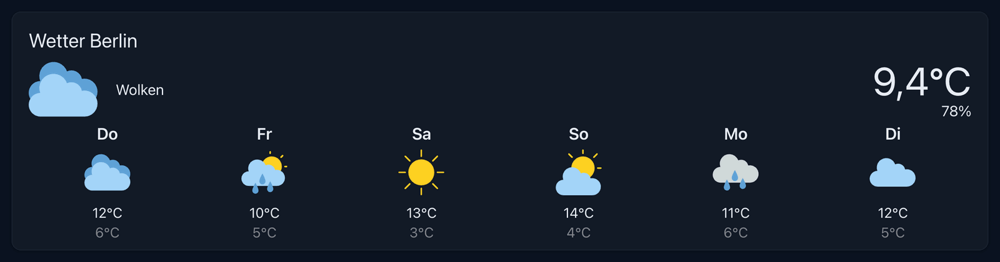

# ioBroker.openweathermap

**Этот адаптер использует библиотеки Sentry для автоматического сообщения разработчикам об исключениях и ошибках в коде.** Более подробную информацию, а также инструкции по отключению отправки сообщений об ошибках см. [в документации Sentry-Plugin](https://github.com/ioBroker/plugin-sentry#plugin-sentry) ! Система отчетности Sentry используется начиная с js-controller 3.0.

Получает прогноз погоды на 5 дней с [сайта https://openweathermap.org/](https://github.com/ioBroker/ioBroker.openweathermap/blob/master/openweathermap.org)

Для доступа к данным вам потребуется ключ API. Ключ API вы можете получить бесплатно после регистрации [здесь](https://home.openweathermap.org/api_keys) .

## виджет vis-2

Виджет «Погода» отображает текущую погоду и прогноз на срок до шести дней. Кнопка «i» открывает диалоговое окно с более подробной информацией (ветер, давление, осадки). Температуру и влажность можно получать с реального датчика, а не из OpenWeatherMap (настройки «Идентификатор текущей температуры» и «Идентификатор текущей влажности»).

Размер значков задается параметрами "Размер значка (текущий)" и "Размер значка (дни)" в пикселях. Пустые значения сохраняют размеры по умолчанию.

## Веб-компонент

Та же самая информация о погоде доступна и в виде веб-компонента. `<iob-openweathermap-weather>` (`@iobroker/web-components`, указан в `common.webComponents`) для Aura, admin, ioBroker.devices и любого другого набора веб-компонентов. vis-2 предлагает вместо этого свой собственный виджет «Погода», поскольку оба имеют одинаковое имя.

Он отображает текущую погоду над прогнозируемыми днями (или рядом с ними в широком и низком прямоугольнике) и масштабируется вместе с этим прямоугольником. Щелчок мышью отображает подробную информацию — ветер, влажность, давление и осадки за сегодня и за каждый день — в диалоговом окне хоста. Настройки: экземпляр, заголовок, что отображать (все, только текущая погода, только дни), количество дней (1-6) и, при необходимости, идентификаторы реальных датчиков температуры и влажности. Единицы измерения соответствуют настройкам экземпляра (метрические или имперские). Размеры значков виджета vis-2 не требуются: значки масштабируются вместе с прямоугольником.

<!--
	### **WORK IN PROGRESS**
-->

## Changelog

### **WORK IN PROGRESS**
* (@GermanBluefox) Added the short form of the web component manifests (tag, name, icon, size) to `common.webComponents`, so that hosts like Aura can list the components before the adapter is installed; the build writes it with `iob-web-components sync-io-package`

### 2.3.0 (2026-11-08)
* (@GermanBluefox) Added the web component `iob-openweathermap-weather` for Aura and other hosts (`common.webComponents`)
* (@GermanBluefox) Corrected wrong translations of the vis-2 widget and the web component, e.g. the weather "Clear" and the "Close" button
* (@GermanBluefox) Corrected the Dutch wind direction south-southeast (ZZO instead of ZSO)
* (@GermanBluefox) The API key is stored encrypted and shown as a password field. An existing key is encrypted automatically at the next start of the instance
* (@GermanBluefox) The vis-2 widget applies the CSS settings for text color, font and background color to all of its texts, the info button and the card

### 2.2.0 (2026-11-05)
* (@GermanBluefox) The place can be selected on a map in the instance settings (needs an admin version with map support for the coordinates field)
* (@GermanBluefox) Updated packages

### 2.1.0 (2026-10-29)
* (@GermanBluefox) Added settings for the icon size of the current weather and of the forecast days in the vis-2 widget

### 2.0.4 (2026-10-22)
* (@GermanBluefox) Fixed raw translation keys (e.g. openweathermap_Wed) in the widget with vis-2 2.15.x (#750)
* (@GermanBluefox) The widget requires vis-2 2.20.2 or newer, if vis-2 is installed

### 2.0.3 (2026-10-17)
* (@GermanBluefox) Updated packages

## License

The MIT License (MIT)

Copyright (c) 2018-2026 bluefox <dogafox@gmail.com>

Permission is hereby granted, free of charge, to any person obtaining a copy
of this software and associated documentation files (the "Software"), to deal
in the Software without restriction, including without limitation the rights
to use, copy, modify, merge, publish, distribute, sublicense, and/or sell
copies of the Software, and to permit persons to whom the Software is
furnished to do so, subject to the following conditions:

The above copyright notice and this permission notice shall be included in all
copies or substantial portions of the Software.

THE SOFTWARE IS PROVIDED "AS IS", WITHOUT WARRANTY OF ANY KIND, EXPRESS OR
IMPLIED, INCLUDING BUT NOT LIMITED TO THE WARRANTIES OF MERCHANTABILITY,
FITNESS FOR A PARTICULAR PURPOSE AND NONINFRINGEMENT. IN NO EVENT SHALL THE
AUTHORS OR COPYRIGHT HOLDERS BE LIABLE FOR ANY CLAIM, DAMAGES OR OTHER
LIABILITY, WHETHER IN AN ACTION OF CONTRACT, TORT OR OTHERWISE, ARISING FROM,
OUT OF OR IN CONNECTION WITH THE SOFTWARE OR THE USE OR OTHER DEALINGS IN THE
SOFTWARE.