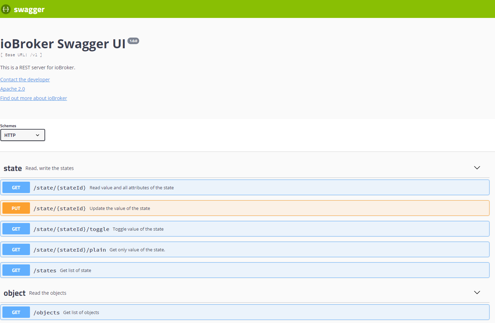

# REST-API адаптер

**Этот адаптер использует библиотеки Sentry для автоматического сообщения разработчикам об исключениях и ошибках в коде.** Более подробную информацию, а также сведения о том, как отключить отправку сообщений об ошибках, см. [в документации Sentry-Plugin](https://github.com/ioBroker/plugin-sentry#plugin-sentry) ! Система отчетности Sentry используется начиная с js-controller 3.0.

Это RESTful-интерфейс для чтения объектов и состояний из ioBroker, а также для записи/управления состояниями посредством HTTP-запросов Get/Post.

Назначение этого адаптера аналогично simple-api. Но этот адаптер поддерживает длительное опросное время (long-polling) и URL-хуки для подписки.

Он имеет удобный веб-интерфейс для работы с запросами:



## Использование

Вызов в браузере `http://ipaddress:8093/` а также использовать Swagger UI для запроса и изменения состояний и объектов.

Примеры запросов:

- `http://ipaddress:8093/v1/state/system.adapter.rest-api.0.memHeapTotal` - чтение состояния в формате JSON
- `http://ipaddress:8093/v1/state/system.adapter.rest-api.0.memHeapTotal/plain` - считывать состояние как строку (только значение)
- `http://ipaddress:8093/v1/state/system.adapter.rest-api.0.memHeapTotal?value=5` - Запись состояния с помощью GET-запроса (только для обратной совместимости с simple-api)
- `http://ipaddress:8093/v1/sendto/javascript.0?message=toScript&data={"message":"MESSAGE","data":"FROM REST-API"}` - отправить сообщение `javascript.0` в сценарии `scriptName`

### Аутентификация

Для включения аутентификации необходимо установить следующие параметры: `Authentication` параметр в диалоговом окне настроек.

Поддерживаются три типа аутентификации:

- Учетные данные в запросе
- Базовая аутентификация
- OAuth2 (Bearer)

Для аутентификации в запросе необходимо установить `user` и `pass` в запросе следующего вида:

```http
http://ipaddress:8093/v1/state/system.adapter.rest-api.0.memHeapTotal?user=admin&pass=admin
```

Для базовой аутентификации необходимо установить следующие параметры: `Authorization` заголовок со значением `Basic base64(user:pass)`.

Для аутентификации OAuth2 необходимо установить следующие параметры: `Authorization` заголовок со значением `Bearer <AccessToken>`.

Токен доступа можно получить с помощью HTTP-запроса следующего вида:

```http
http://ipaddress:8093/oauth/token?grant_type=password&username=<user>&password=<password>&client_id=ioBroker
```

Ответ выглядит так:

```json
{
    "access_token": "21f89e3eee32d3af08a71c1cc44ec72e0e3014a9",
    "expires_in": "2025-02-23T11:39:32.208Z",
    "refresh_token": "66d35faa5d53ca8242cfe57367210e76b7ffded7",
    "refresh_token_expires_in": "2025-03-25T10:39:32.208Z",
    "token_type": "Bearer"
}
```

## Подпишитесь на изменения состояния или объекта.

Ваше приложение может получать уведомления о каждом изменении состояния или объекта.

Для этого ваше приложение должно предоставлять конечную точку HTTP(S) для приема обновлений.

Пример на Node.js смотрите здесь: [demoNodeClient.js](https://github.com/ioBroker/ioBroker.rest-api/blob/master/examples/demoNodeClient.js)

## Долгосрочный опрос

Этот адаптер поддерживает подписку на изменения данных посредством длительного опроса (long polling).

Пример для браузера можно найти здесь: [demoNodeClient.js](https://github.com/ioBroker/ioBroker.rest-api/blob/master/examples/demoBrowserClient.html)

## Веб-расширение

Этот адаптер может работать как веб-расширение. В этом случае путь к нему доступен по адресу: `http://ipaddress:8082/rest-api/`

## Обратный прокси

Если сетевой адаптер работает за обратным прокси-сервером по подкаталогу, укажите этот путь в настройках экземпляра. `Reverse proxy path` например `/rest-api` Затем Swagger UI отправляет свои запросы на `/rest-api/v1/...` вместо `/v1/...` Прокси-сервер должен удалить префикс перед пересылкой запроса, например, для nginx:

```nginx
location /rest-api/ {
    proxy_pass http://iobroker-host:8093/;
}
```

Если адаптер работает как веб-расширение, путь добавляется в начало файла. `/rest-api/` веб-адаптера.

## Напишите множество штатов с помощью одного запроса.

`PATCH /v1/states` записывает несколько состояний одним запросом (замена для `setBulk` из `simple-api`):

```http
PATCH http://ipaddress:8093/v1/states
Content-Type: application/json

[
    { "id": "0_userdata.0.nfc.UserID", "val": "4711" },
    { "id": "0_userdata.0.nfc.NFCID", "val": "04A224B2C35E80" },
    { "id": "0_userdata.0.nfc.TagContent", "val": "door", "ack": true }
]
```

Вместо массива можно передать объект: `{ "0_userdata.0.a": 1, "0_userdata.0.b": { "val": 2, "ack": true } }`.

В ответе содержится по одной записи для каждого штата в том же порядке: `{ id, val, ack }` или `{ id, index, error }` Если бы это состояние нельзя было записать. С `?stopOnError=true` Обработка прекращается при первой ошибке. Максимальное количество состояний на один запрос — 1000.

**Важно:** состояния записываются одно за другим в указанном порядке. Это **не** транзакция: каждое состояние вызывает собственное событие изменения, и скрипт, запущенный при изменении первого состояния, может еще не увидеть новые значения последующих состояний. Если скрипту нужны все значения одновременно, запускайте его только при изменении **последнего** состояния в списке и считывайте остальные состояния оттуда.

## Уведомление

- `POST` Этот параметр всегда используется для создания ресурса (неважно, был ли он продублирован).
- `PUT` Это используется для проверки существования ресурса: если он существует, то его необходимо обновить, в противном случае — создать новый ресурс.
- `PATCH` всегда используется для обновления ресурса.

## Команды

Кроме того, вы можете выполнять множество команд сокета через специальный интерфейс:

`http://ipaddress:8093/v1/command/<commandName>?arg1=Value2&arg2=Value2`

Например

- `http://ipaddress:8093/v1/command/getState?id=system.adapter.admin.0.alive` - прочитать состояние `system.adapter.admin.0.alive`
- `http://ipaddress:8093/v1/command/readFile?adapter=admin.admin&fileName=admin.png` - прочитать файл `admin.admin/admin.png` в виде результата в формате JSON
- `http://ipaddress:8093/v1/command/readFile?adapter=admin.admin&fileName=admin.png?binary` - прочитать файл `admin.admin/admin.png` в виде файла
- `http://ipaddress:8093/v1/command/extendObject?id=system.adapter.admin.0?obj={"common":{"enabled":true}}` - перезапустить административную панель

Вы также можете отправлять все команды методом POST. Тело запроса должно быть объектом с параметрами. Например:

```bash
curl --location --request POST 'http://ipaddress:8093/v1/command/sendTo' \
--header 'Content-Type: application/json' \
--data-raw '{
"adapterInstance": "history.0",
"command": "getHistory",
"message": {"id": "system.adapter.admin.0.memRss","options": {"aggregate": "onchange", "addId": true}}
}'
```

Вы не можете отправлять POST-запросы командам через графический интерфейс.

<!-- START -->

### Штаты

- `getStates(pattern)` - Получить список состояний для заданного шаблона (например, для system.adapter.admin.0.\*). Визуализация результата в графическом интерфейсе может вызывать проблемы.
- `getForeignStates(pattern)` - аналогично getStates
- `getState(id)` - получить значение состояния по идентификатору
- `setState(id, state)` - установить значение состояния с помощью объекта JSON (например) `{"val": 1, "ack": true}`)
- `getBinaryState(id)` - получить бинарное состояние по идентификатору
- `setBinaryState(id, base64)` - установить двоичное состояние по идентификатору

### Объекты

- `getObject(id)` - получить объект по ID
- `getObjects(list)` - Получить все состояния и комнаты. Графический интерфейс может испытывать проблемы с визуализацией результата.
- `getObjectView(design, search, params)` - получить конкретные объекты, например, design=system, search=state, params=`{"startkey": "system.adapter.admin.", "endkey": "system.adapter.admin.\u9999"}`
- `setObject(id, obj)` - установить объект с помощью объекта JSON (например) `{"common": {"type": "boolean"}, "native": {}, "type": "state"}`)
- `delObject(id, options)`- удалить объект по ID

### Файлы

- `readFile(adapter, fileName)` - Чтение файла, например, adapter=vis.0, fileName=main/vis-views.json. Кроме того, вы можете установить параметр binary=true в запросе, чтобы получить ответ в виде файла, а не в формате JSON.
- `readFile64(adapter, fileName)` - Чтение файла как строки base64, например, adapter=vis.0, fileName=main/vis-views.json. Кроме того, вы можете установить параметр binary=true в запросе, чтобы получить ответ в виде файла, а не в формате JSON.
- `writeFile64(adapter, fileName, data64, options)` - запись файла, например, adapter=vis.0, fileName=main/vis-test.json, data64=eyJhIjogMX0=
- `unlink(adapter, name)` - удалить файл или папку
- `deleteFile(adapter, name)` - удалить файл
- `deleteFolder(adapter, name)` - удалить папку
- `renameFile(adapter, oldName, newName)` - переименовать файл
- `rename(adapter, oldName, newName)` - переименовать файл или папку
- `mkdir(adapter, dirName)` - создать папку
- `readDir(adapter, dirName, options)` - прочитать содержимое папки
- `chmodFile(adapter, fileName, options)` - изменить режим доступа к файлу. Например, adapter=vis.0, fileName=main/\*, options =`{"mode": 0x644}`
- `chownFile(adapter, fileName, options)` - изменить владельца файла. Например, adapter=vis.0, fileName=main/\*, options =`{"owner": "newOwner", "ownerGroup": "newgroup"}`
- `fileExists(adapter, fileName)` - проверить, существует ли файл

### Администраторы

- `getHostByIp(ip)` - Чтение информации о хосте по IP-адресу. Например, по адресу localhost
- `readLogs(host)` - Прочитать имя файла и размер файлов журналов. Вы можете прочитать их по адресу <http://ipaddress:8093/><fileName>
- `delState(id)` - удалить состояние и объект. Аналогично удалению объекта.
- `getRatings(update)` - Ознакомьтесь с характеристиками адаптера (например, в административной панели)
- `getCurrentInstance()` - чтение пространства имен адаптера (всегда rest-api.0)
- `decrypt(encryptedText)` - расшифровка строки с использованием системного секрета
- `encrypt(plainText)` - зашифровать строку с помощью системного секрета
- `getAdapters(adapterName)` - Получать объекты типа "адаптер". При желании можно указать adapterName.
- `updateLicenses(login, password)` - чтение лицензий с портала ioBroker.net
- `getCompactInstances()` - прочитать список случаев с краткой информацией
- `getCompactAdapters()` - Прочитать список установленных адаптеров с краткой информацией.
- `getCompactInstalled(host)` - Прочитайте краткую информацию об установленных адаптерах
- `getCompactSystemConfig()` - прочитать краткую конфигурацию системы
- `getCompactSystemRepositories()`
- `getCompactRepository(host)` - прочитать короткий репозиторий
- `getCompactHosts()` - получить краткую информацию о хостах
- `addUser(user, pass)` - добавить нового пользователя
- `delUser(user)` - удалить пользователя
- `addGroup(group, desc, acl)` - создать новую группу
- `delGroup(group)` - удалить группу
- `changePassword(user, pass)` - изменить пароль пользователя
- `getAllObjects()` - Все объекты считываются как список. В графическом интерфейсе пользователя могут возникнуть проблемы с визуализацией результата.
- `extendObject(id, obj)` - Изменить объект по ID с помощью JSON. (например, `{"common":{"enabled": true}}`)
- `getForeignObjects(pattern, type)` - аналогично getObjects
- `delObjects(id, options)` - удаление объектов по шаблону

### Другие

- `updateTokenExpiration(accessToken)`
- `log(text, level[info])` - Нет ответа - добавить запись в лог ioBroker
- `checkFeatureSupported(feature)` - Проверить, поддерживается ли эта функция контроллером js.
- `getHistory(id, options)` - Читать историю. См. варианты: <https://github.com/ioBroker/ioBroker.history/blob/master/docs/en/README.md#access-values-from-javascript-adapter>
- `httpGet(url)` - Чтение URL-адреса с сервера. Вы можете установить binary=true, чтобы получить ответ в виде файла.
- `sendTo(adapterInstance, command, message)` - отправить команду экземпляру. Например: adapterInstance=history.0, command=getHistory, message=`{"id": "system.adapter.admin.0.memRss","options": {"aggregate": "onchange", "addId": true}}`
- `listPermissions()` - чтение статической информации с правами доступа функции
- `getUserPermissions()` - чтение объекта с правами пользователя
- `getVersion()` - прочитать название и версию адаптера
- `getAdapterName()` - чтение имени адаптера (всегда REST API)
- `clientSubscribe(targetInstance, messageType, data)`
- `getAdapterInstances(adapterName)` - Получать объекты типа "экземпляр". При желании можно указать adapterName.

<!-- END -->

<!--
	Placeholder for the next version (at the beginning of the line):
	### **WORK IN PROGRESS**
-->

## Changelog
### 4.2.0 (2026-11-06)
- (copilot) Adapter requires node.js >= 22.19.0 now
- (@GermanBluefox) Web hooks, polling connections and requests waiting for `ack` no longer take the subscription of a state or an object away from each other: when one of them gave it up, the others got no more changes of it. rest-api now unsubscribes only when none of them needs it any more
- (@GermanBluefox) A request waiting for `ack` whose write failed was answered a second time by its timer
- (@GermanBluefox) As a web extension, rest-api is now reloaded by web (9.4.0 or newer) on a change of its settings, without a restart of web (`supportsHotReload`). Requests that still wait for `ack` are answered with 503 when it stops, and it gives up its subscriptions

### 4.1.2 (2026-10-13)
- (@GermanBluefox) Added `PATCH /v1/states` to write many states with one request (bulk update)
- (@GermanBluefox) Fixed `413 Payload Too Large` for request bodies larger than 100kB when authentication is enabled
- (@GermanBluefox) Added option `Reverse proxy path` to make Swagger UI work behind a reverse proxy

### 4.0.4 (2026-10-13)
- (@GermanBluefox) Updated packages
- (@GermanBluefox) Added option to use HTTP/2 on a secure connection (enabled by default, falls back to HTTP/1.1)
- (@GermanBluefox) Report the used port to js-controller

### 4.0.3 (2026-10-13)
- (iobroker-bot) Adapter requires node.js >= 22 now.
- (@GermanBluefox) Replaced `process.exit()` with `terminate()` for compact mode and added tests on Windows and macOS

### 4.0.2 (2026-06-14)
* (@GermanBluefox) Packages were updated
* (@GermanBluefox) Allowed to define the response content type by sendTo queries
* (@GermanBluefox) Corrected some minor issues

## License
Apache 2.0, see [LICENSE](https://github.com/ioBroker/ioBroker.rest-api/blob/master/LICENSE)

Copyright (c) 2017-2026 bluefox <dogafox@gmail.com>