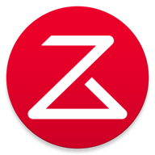

# ioBroker.roborock

## Адаптер Roborock для ioBroker

Этот адаптер позволяет управлять пылесосом Roborock, получать информацию о его состоянии, историю уборки и просматривать карту его местоположения, если он настроен в приложении Roborock.

- [Требования](#requirements)
- [Поддерживаемые роботы](#supported-robots)
- [Зональная очистка](#zone-cleaning)
- [Использование скрипта](#script-usage)
- [Список изменений](#changelog)
- [Лицензия](#license)

**Этот адаптер использует библиотеки Sentry для автоматического сообщения разработчикам об исключениях и ошибках в коде.** Более подробную информацию, а также инструкции по отключению отправки сообщений об ошибках см. [в документации Sentry-Plugin](https://github.com/ioBroker/plugin-sentry#plugin-sentry) ! Система отчетности Sentry используется начиная с js-controller 3.0.

## Требования

- Node.js >= 22.0.0
- ioBroker.admin >= 7.6.17
- ioBroker.js-controller >= 6.0.11

## Поддерживаемые роботы

- **Серия S:** S4, S4 Max, S5 Max, S6, S6 Pure, S6 MaxV, S7, S7 MaxV (Pro/Ultra), S7 Pro Ultra, S7 Max Ultra, S8, S8+, S8 Pro Ultra, S8 MaxV Ultra
- **Серия Q:** Q5 Pro, Q7, Q7 Pro, Q7 Max, Q7 L5, Q8 Max
- **Q Revo:** Q Revo, Q Revo Pro
- **Qrevo:** Qrevo Slim, Qrevo S, Qrevo Curve, Qrevo Curv Series, Qrevo Edge, Qrevo Edge Series, Qrevo L, Qrevo Master, Qrevo MaxV
- **Saros:** Saros 10, Saros 10R, Saros 20 / Saros 20X, Saros Z70

## Зональная очистка

Эта функция работает только при включенной возможности создания карт в параметрах адаптера. Откройте карту на вкладке веб-интерфейса адаптера в административном интерфейсе ioBroker; ввод URL-адреса вручную не требуется.

### Создание карт не работает на Raspberry Pi.

- Нарисуйте квадрат, предназначенный для уборки. Roborock поддерживает до 4 зон уборки одновременно.


## Использование скрипта

### Обновить состояние устройства

На основе сообщения Gaspode69 в #1472, `refresh_status` запрашивает обновление статуса для одного поддерживаемого устройства:

```javascript
sendTo("roborock.0", "refresh_status", { duid: "DEVICE_DUID" }, response => {
    if (response.error) {
        log(response.error, "warn");
        return;
    }
    // Fresh status has been processed into the device's ioBroker states.
    log("Device status refreshed");
});
```

Функция обратного вызова возвращает результат. `{ result: "ok" }` только после обработки статуса, или `{ error: "..." }` В случае сбоя. Одновременные запросы к одному и тому же устройству используют одно обновление. V1 и Q7/B01 используют свой обычный путь запроса/ответа с общим крайним сроком обновления в 10 секунд и без автоматических повторных попыток в течение этого срока. Отмена удаляет запросы из очереди и прерывает незавершенную публикацию; запись ioBroker, уже переданная в базу данных состояний, не может быть отозвана. Q10 ожидает до 10 секунд обработки нового числового статуса после запроса DP 102; поскольку этот протокол не имеет идентификатора корреляции запроса, новый незапрошенный статус также может удовлетворить запрос. Одного подтверждения от брокера недостаточно. Стиральные машины A01 (категория облачных вычислений). `roborock.wm`) запрос рабочего состояния DP 203; A01 химчистка (влажная/сухая) `roborock.wetdryvac` Запрос DP 201 осуществляется через ID\_QUERY 10000. A01 также ожидает до 10 секунд успешной записи вновь полученного значения рабочего состояния; он не запрашивает и не гарантирует полный снимок всех свойств устройства. Как и Q10, A01 не имеет идентификатора корреляции запроса, поэтому новый соответствующий запрос может удовлетворить обновление. Другие категории A01 и общие обработчики без подтвержденной поддержки обновления возвращают явную ошибку. Завершение работы адаптера отменяет ожидающие обновления. Обычный опрос остается без изменений. Кадрирование A01 и выбор DP соответствуют [реализации A01 из python-roborock](https://github.com/Python-roborock/python-roborock/blob/109f433556e3c30c08eae34dbb2549f516509967/roborock/devices/rpc/a01_channel.py) ; эта реализация имеет автоматизированные тесты, но не была проверена на физическом оборудовании A01.

## Changelog
<!--
	Placeholder for the next version (at the beginning of the line):
	### **WORK IN PROGRESS**
-->
### 0.8.0 (2026-10-11)

* (copystring) Added Roborock Q7 Pro support for maps, status and consumables.
* (copystring) Improved multi-step scene execution and local connections for B01 devices.
* (copystring) Coordinated UDP discovery when multiple adapter instances run.
* (copystring) Corrected the Qrevo Edge 2 water mode mapping.
* (gemsli) Fixed segment cleaning for rooms with inactive map states.
* (copystring) Fixed cloud reauthentication after HomeData 401 responses and corrected S7 dock error handling.

### 0.7.4 (2026-06-07)

* (copystring) Documented tested Roborock S8+ support.
* (copystring) Fixed consumable percentage values for devices where Roborock reports maintenance data via HomeData.
* (copystring) Re-enabled macOS support and added macOS test coverage.
* (copystring) Improved dependency update automation so updates are checked weekly and merged only after successful checks.
* (copystring) Updated `p-queue` to 9.3.0 and `protobufjs` to 8.5.0.
* (copystring) Improved CI performance for Linux, macOS and Windows adapter tests without reducing test coverage.

### 0.7.3 (2026-05-22)

* (copystring) Fixed V1 auto-empty dust collection to use the AppPlugin-verified `app_start_collect_dust` command.

### 0.7.2 (2026-05-20)

* (copystring) Fixed missing auto-empty command for Roborock Qrevo MaxV (#1272).
* (copystring) Fixed local endpoint refresh after temporary MQTT outages so stale local IP recovery retries immediately again.
* (copystring) Require bug reports to upload a `.txt` debug log file.

### 0.7.1 (2026-05-19)

* (copystring) Fixed local TCP recovery when a Roborock device gets a new LAN IP address.
* (copystring) Updated dependencies: `@napi-rs/canvas` to 1.0.0, `protobufjs` to 8.2.0 and `zod` to 4.4.3.
* (copystring) Resolved npm audit security advisories in transitive dependencies and documented the temporary dependency overrides.

Older changelog entries are available in CHANGELOG_OLD.md.

## License

MIT License

Copyright (c) 2026 copystring <copystring@gmail.com>

See [LICENSE](https://github.com/copystring/ioBroker.roborock/blob/main/LICENSE) for the full license text.