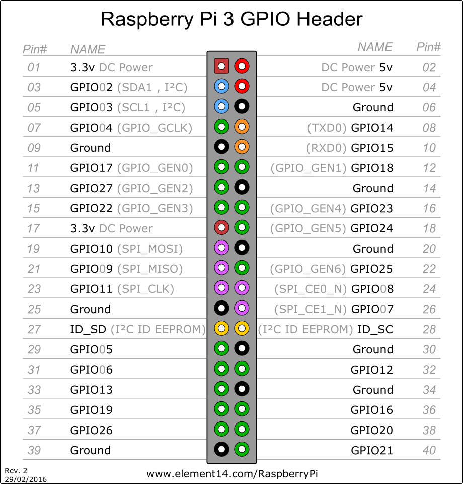

# ioBroker.rpi2


## Версии

Адаптер RPI-Monitor для ioBroker

Реализация RPI-Monitor для интеграции в ioBroker. Это та же реализация, что и для iobroker.rpi, но с использованием GPIO.

## Важная информация

**Для управления GPIO-портами ioBroker требуются специальные права доступа.** В большинстве дистрибутивов Linux это можно сделать, добавив пользователя ioBroker в список разрешений. `gpio` группа.

Вам необходимо установить `libgpiod-dev` **Перед** установкой адаптера убедитесь, что он установлен в версии **2.2 или новее** (см. ниже), иначе установка будет прервана. В Debian 13 / Trixie используется версия 2.2.1. В Debian 12 / Bookworm доступны только более старые версии (1.6 или 2.1 из других источников), которых **недостаточно** . Проверить установленную версию можно с помощью команды: `dpkg -s libgpiod-dev | grep Version`.

> \[!ВНИМАНИЕ] Версия 3.xx и новее этого адаптера поддерживает и требует Debian 13 / Trixie (ядро Linux 5.10 или новее). Не обновляйте, если вы используете более старую операционную систему.

## Установка

После установки вы можете настроить параметры монитора в параметрах экземпляра.

После начала `iobroker.rpi` При выборе всех модулей в Raspberry Pi создается дерево объектов в ioBroker.<instance> .<modulename> например `rpi.0.cpu`

Для работы адаптера требуются некоторые зависимости операционной системы. Обычно js-controller должен позаботиться об этом, но если у вас возникнут проблемы, пожалуйста, установите следующие пакеты вручную:

```bash
sudo apt update
sudo apt install -y build-essential
sudo apt install -y libgpiod-dev
sudo apt install -y pkg-config
```

`libgpiod-dev` (версия 2.2 или новее) всегда необходима, установка проверяет её наличие (с помощью `pkg-config` (если установлено).

### Температура диска

Вы можете считывать показания температуры NVMe и SATA/USB-накопителей (`temperature.disk_temp` (включите _параметр «Температура»_ в настройках экземпляра). Адаптер сообщает о первом диске, у которого есть температура, проверяя его. `/dev/nvme0` к `/dev/nvme9` сначала, затем `/dev/sda` к `/dev/sdz` Для этого необходимо установить `smartmontools` упаковать и разрешить `iobroker` пользователь для запуска `smartctl` от имени root:

```bash
sudo apt install smartmontools
sudo visudo -f /etc/sudoers.d/iobroker-disktemp
```

Не добавляйте это правило в файл sudoers. `/etc/sudoers.d/iobroker` оно сбрасывается `iob fix` Добавьте эти строки в новый файл:

```
Cmnd_Alias SMARTCTL = /usr/sbin/smartctl -A /dev/sd[a-z], \
                      /usr/sbin/smartctl -A /dev/nvme[0-9]
Defaults!SMARTCTL !syslog, !pam_session
iobroker ALL=(root) NOPASSWD: SMARTCTL
```

Данное правило разрешает только считывание значений этих дисков, но не изменение каких-либо настроек дисков. `!syslog` и `!pam_session` Не записывайте обычные показания в системный журнал. Некоторые USB-SATA адаптеры не передают данные SMART. Для проверки выполните команду: `sudo -u iobroker sudo -n smartctl -A /dev/sda` и искать `Temperature_Celsius` или `Temperature:` в выходных данных.

## GPIO

Вы также можете считывать данные с выводов GPIO и управлять ими. Все, что вам нужно сделать, это настроить параметры GPIO в параметрах (дополнительная вкладка).



После включения некоторых портов в дереве объектов появляются следующие состояния:

- rpi.0.gpio.PORT.state

Нумерация портов осуществляется по протоколу BCM (контакты BroadComm на микросхеме). Вы можете получить нумерацию с помощью... `gpio readall` Например, PI2:

```
+-----+-----+---------+------+---+---Pi 2---+---+------+---------+-----+-----+
| BCM | wPi |   Name  | Mode | V | Physical | V | Mode | Name    | wPi | BCM |
+-----+-----+---------+------+---+----++----+---+------+---------+-----+-----+
|     |     |    3.3v |      |   |  1 || 2  |   |      | 5v      |     |     |
|   2 |   8 |   SDA.1 | ALT0 | 1 |  3 || 4  |   |      | 5V      |     |     |
|   3 |   9 |   SCL.1 | ALT0 | 1 |  5 || 6  |   |      | 0v      |     |     |
|   4 |   7 | GPIO. 7 |   IN | 1 |  7 || 8  | 0 | IN   | TxD     | 15  | 14  |
|     |     |      0v |      |   |  9 || 10 | 1 | IN   | RxD     | 16  | 15  |
|  17 |   0 | GPIO. 0 |   IN | 0 | 11 || 12 | 0 | IN   | GPIO. 1 | 1   | 18  |
|  27 |   2 | GPIO. 2 |   IN | 0 | 13 || 14 |   |      | 0v      |     |     |
|  22 |   3 | GPIO. 3 |   IN | 0 | 15 || 16 | 0 | IN   | GPIO. 4 | 4   | 23  |
|     |     |    3.3v |      |   | 17 || 18 | 0 | IN   | GPIO. 5 | 5   | 24  |
|  10 |  12 |    MOSI |   IN | 0 | 19 || 20 |   |      | 0v      |     |     |
|   9 |  13 |    MISO |   IN | 0 | 21 || 22 | 1 | IN   | GPIO. 6 | 6   | 25  |
|  11 |  14 |    SCLK |   IN | 0 | 23 || 24 | 1 | IN   | CE0     | 10  | 8   |
|     |     |      0v |      |   | 25 || 26 | 1 | IN   | CE1     | 11  | 7   |
|   0 |  30 |   SDA.0 |   IN | 1 | 27 || 28 | 1 | IN   | SCL.0   | 31  | 1   |
|   5 |  21 | GPIO.21 |   IN | 1 | 29 || 30 |   |      | 0v      |     |     |
|   6 |  22 | GPIO.22 |   IN | 1 | 31 || 32 | 0 | IN   | GPIO.26 | 26  | 12  |
|  13 |  23 | GPIO.23 |   IN | 0 | 33 || 34 |   |      | 0v      |     |     |
|  19 |  24 | GPIO.24 |   IN | 0 | 35 || 36 | 0 | IN   | GPIO.27 | 27  | 16  |
|  26 |  25 | GPIO.25 |  OUT | 1 | 37 || 38 | 0 | IN   | GPIO.28 | 28  | 20  |
|     |     |      0v |      |   | 39 || 40 | 0 | IN   | GPIO.29 | 29  | 21  |
+-----+-----+---------+------+---+----++----+---+------+---------+-----+-----+
| BCM | wPi |   Name  | Mode | V | Physical | V | Mode | Name    | wPi | BCM |
+-----+-----+---------+------+---+---Pi 2---+---+------+---------+-----+-----+
```

### Входные данные

- Переключатель **Pull Up** / **Pull Down** расположен на внутреннем подтягивающем резисторе входа. При _включении Pull Up_ вход находится в низком активном состоянии: подключите переключатель между GPIO и GND, и состояние будет... `true` пока переключатель замкнут. При использовании _режима Pull Down_ подключите переключатель к напряжению 3,3 В; состояние будет следующим. `true` пока он закрыт. Без любого из этих вариантов подтягивающий резистор остается в исходном состоянии — либо в режиме по умолчанию Raspberry Pi (подтягивающий резистор для GPIO 0-8, отключающий резистор для всех остальных), либо в том, что вы установите. `config.txt` например `gpio=17=pu`.
- **Отладка/Опрос (мс)** : изменение регистрируется только после того, как входной сигнал стабилизируется в течение этого времени, например, 20-50 мс для переключателей и кнопок. Это делает ядро; если ваша система не поддерживает это, адаптер делает это самостоятельно и регистрирует сообщение.

## Датчики DHTxx/AM23xx

Вы можете считывать показания с датчиков температуры/влажности DHT11, DHT21 (AM2301), DHT22 и AM2302.

Подключите такой датчик к выводу GPIO, как описано на странице пакета [node-dht-sensor](https://www.npmjs.com/package/node-dht-sensor) . К нескольким выводам можно подключить _несколько_ датчиков (это _не_ шинная система), как обсуждалось ранее.

В таблице GPIO выберите `DHT11` для датчиков DHT11 и `DHT22/AM23xx` Для всех остальных датчиков введите интервал опроса в миллисекундах в столбец _«Отключение/Опрос»_ . Считывание показаний датчиков не может происходить чаще, чем каждые 2000 мс (DHT11: 1000 мс); при отсутствии значения адаптер опрашивает датчик каждые 30000 мс.

Для каждого датчика адаптер создает `gpio.N.temperature`, `gpio.N.humidity` и `gpio.N.dewpoint` Точка росы рассчитывается по формуле Магнуса на основе температуры и влажности. Точность определения зависит от датчика: около ±1 °C с датчиком DHT22, значительно меньше с датчиком DHT11.

Адаптер считывает данные с датчика одним из двух способов и при запуске регистрирует, какой из них используется для каждого датчика.

### Рекомендуемый драйвер ядра Linux

В Linux есть собственный драйвер для этих датчиков (он поддерживает DHT11, DHT22 и AM2302, и должен поддерживать и DHT21). Включите его для каждого датчика, добавив строку в файл конфигурации. `/boot/firmware/config.txt` (`/boot/config.txt` (на более старых системах) и перезагрузите систему:

```
dtoverlay=dht11,gpiopin=17
```

`gpiopin` Это номер GPIO (BCM), тот же, что и в таблице GPIO адаптера. Вы можете проверить его работоспособность с помощью... `cat /sys/bus/iio/devices/iio:device*/in_temp_input` (Значение указано в 1/1000 °C). Адаптер автоматически определяет драйвер и использует его, никаких дополнительных настроек не требуется.

Наложение является частью Raspberry Pi OS с 2015 года (Raspbian Jessie) и работает на всех Raspberry Pi, включая Pi 5, Pi 500 и Compute Module 5. Ядра, выпущенные до ноября 2024 года, часто не могли декодировать данные с более новых датчиков DHT11, отображающих данные с десятичными знаками («Не знаю, как декодировать данные» в `dmesg`); В операционной системе Raspberry Pi OS 13 (Trixie), которая требуется для этого адаптера, это исправление уже есть.

### node-dht-sensor

Без драйвера ядра адаптер переключается на node-dht-sensor. Это работает только на Raspberry Pi 1–4. На Raspberry Pi 5 (а также Pi 500 и Compute Module 5) это невозможно, поскольку он обращается к регистрам GPIO, которых нет у Pi 5 — в этом случае следует использовать драйвер ядра. В отличие от node-dht-sensor, драйвер ядра продолжает работать и после обновления Node.js и переустановки адаптера.

## Changelog

<!--
	PLACEHOLDER for the next version:
	### **WORK IN PROGRESS**
-->
### 5.0.0 (2026-11-11)
- (Garfonso/Claude) **BREAKING**: *Pull Up* and *Pull Down* switch on the internal pull resistors of inputs (#31). Before, *Pull Up* only inverted the value; it still does. If you used *Pull Up* just to invert an input that is switched to 3.3 V, the input now stays high: untick *Pull Up* and tick *Invert* instead. Also check inputs with *Pull Up* and an external pull-down resistor.
- (Garfonso/Claude) **BREAKING**: Inputs are debounced by the kernel. A change is reported once the input has been stable for the debounce time, instead of right away followed by a pause. Changes therefore arrive later by that time, and pulses shorter than the debounce time (e.g. from S0 or reed contact meters) are ignored - lower the debounce time below the shortest pulse. In return a short glitch no longer leaves the state wrong.
- (Grothesk242) **BREAKING**: `temperature.nvme_temp` is replaced by `temperature.disk_temp`. It is read with smartmontools from the first NVMe or SATA/USB drive that reports a temperature. The old state is deleted. Install `smartmontools` and replace the old `nvme` sudo rule by the new one from the README.
- (Garfonso/Claude) **NEW**: DHT sensors also report the dew point (`gpio.N.dewpoint`), calculated from temperature and humidity.
- (Garfonso/Claude) **ENHANCED**: An input that cannot be set up no longer disables all other GPIOs; the reason is logged.
- (Garfonso/Claude) A missing drive, WLAN or sudo rule is no longer logged as an error, and no longer shows a disk temperature of 0.
- (copilot) Adapter requires node.js >= 22.19.0 now
- (Garfonso/Claude) Removed `python` from the OS dependencies, there is no such package on current Debian.
- (Garfonso/Claude) DHT sensors: the README and the log messages recommend the Linux kernel driver, the instructions for rebuilding node-dht-sensor are removed. An already rebuilt node-dht-sensor keeps working.
- (Garfonso/Claude) The check for libgpiod 2.2 moved from the adapter's preinstall script into `@garfonso/opengpio`.
- (Garfonso/Claude) Removed the unused `ci` dependency, updated dependencies and added missing translations in the admin page.

### 4.0.0 (2026-10-07)
- (copilot) Adapter requires node.js >= 22 now
- (copilot) Adapter requires admin >= 7.7.22 now
- (mcm1957) Dependencies have been updated.
- (copilot) **ENHANCED**: Added `temperature.fan_activity` object to monitor fan RPM via `/sys/devices/platform/cooling_fan/...`; falls back to `0` when unavailable.
- (Garfonso/Claude) Improve GPIO handling.
- (Garfonso/Claude) **FIXED**: GPIO outputs no longer switch off and on again during adapter start (#431).
- (Garfonso/Claude) Use the `@garfonso/opengpio` npm package instead of a git branch of the fork.
- (Garfonso/Claude) **FIXED**: The fan parser unit test matched the old single-hwmon path and failed since the fan reading fix.
- (Garfonso/Claude) **FIXED**: DHT sensors ignored the configured poll interval (with no interval they were read continuously, so every read failed) and every sensor's timer read all sensors.
- (Garfonso/Claude) **NEW**: DHT sensors are read through the Linux dht11 kernel driver if it is enabled (`dtoverlay=dht11,gpiopin=<n>`). This makes them work on a Raspberry Pi 5 without rebuilding node-dht-sensor (#406).
- (Garfonso/Claude) **ENHANCED**: DHT sensor problems are logged with their cause and how to fix them; the startup log shows how each sensor is read.
- (Garfonso/Claude) **FIXED**: Raspberry Pi 500 and Compute Module 5 are recognised as Raspberry Pi 5 boards and use the same GPIO chip.
- (Garfonso/Claude) **FIXED**: The humidity object of a DHT sensor was named "temperature".
- (Garfonso/Claude) **BREAKING**: GPIO and DHT sensor handling changed in several places (see above). This mostly fixes problems, but please check your GPIO setup after updating.

### 3.0.2 (2025-12-01)
* (@klein0r) Check for required libgpiod-dev package version

### 3.0.1 (2025-11-28)
* (@klein0r) Updated logo, workflows and documentation
* (@klein0r) admin 7.6.17 and js-controller 6.0.11 (or later) are required

### 3.0.0 (2025-11-28)
* (@klein0r) NodeJS 20.x (or newer) is required
* (@klein0r) Updated opengpio to v2 (works on Debian trixie)

## License
MIT License

Copyright (c) 2026 iobroker-community-adapters <iobroker-community-adapters@gmx.de>  
Copyright (c) 2024-2025 Garfonso <garfonso@mobo.info>

Permission is hereby granted, free of charge, to any person obtaining a copy
of this software and associated documentation files (the "Software"), to deal
in the Software without restriction, including without limitation the rights
to use, copy, modify, merge, publish, distribute, sublicense, and/or sell
copies of the Software, and to permit persons to whom the Software is
furnished to do so, subject to the following conditions:

The above copyright notice and this permission notice shall be included in all
copies or substantial portions of the Software.

THE SOFTWARE IS PROVIDED "AS IS", WITHOUT WARRANTY OF ANY KIND, EXPRESS OR
IMPLIED, INCLUDING BUT NOT LIMITED TO THE WARRANTIES OF MERCHANTABILITY,
FITNESS FOR A PARTICULAR PURPOSE AND NONINFRINGEMENT. IN NO EVENT SHALL THE
AUTHORS OR COPYRIGHT HOLDERS BE LIABLE FOR ANY CLAIM, DAMAGES OR OTHER
LIABILITY, WHETHER IN AN ACTION OF CONTRACT, TORT OR OTHERWISE, ARISING FROM,
OUT OF OR IN CONNECTION WITH THE SOFTWARE OR THE USE OR OTHER DEALINGS IN THE
SOFTWARE.