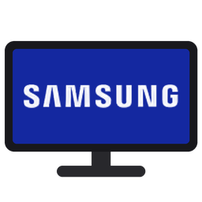

# ioBroker.samsung-mdc

## адаптер samsung-mdc для ioBroker

Управляйте [коммерческими вывесками Samsung](https://www.samsung.com/business/displays/) (семейства QBC/QMC/QEC/QHC и другие панели с поддержкой MDC) по протоколу Multiple Display Control (MDC) на TCP 1515: питание, источник входного сигнала, громкость, отключение звука и состояние.

## Что это делает

Один экземпляр может управлять любым количеством дисплеев. MDC работает внеполосно: для его работы не требуется приложение на дисплее и сопряжение, а панель продолжает отвечать в режиме ожидания, когда включен режим сетевого ожидания. Адаптер открывает новое TCP-соединение для каждого запроса, поэтому неработающая панель не может задерживать работу остальных.

Этот адаптер предназначен для **коммерческих рекламных** панелей. Бытовые телевизоры Samsung не поддерживают технологию MDC.

## Требования

- Node.js 22 или новее
- js-controller 6.0.11 или новее
- Администратор 7.6.20 или более поздняя версия
- На каждом дисплее:
  - **Система → Управление питанием → Режим ожидания сети: Вкл.** (и Максимальное энергосбережение: Выкл.). Без этого панель перестает отвечать примерно через минуту после выключения, и ее невозможно включить через MDC.
  - Управление MDC по сети включено, и идентификатор установленного дисплея известен (0 для панели, работающей по собственному адресу).

## Конфигурация

| Параметр                                               |                                                                                                                                                                                                                                                                                                         |
| ------------------------------------------------------ | ------------------------------------------------------------------------------------------------------------------------------------------------------------------------------------------------------------------------------------------------------------------------------------------------------- |
| Дисплеи                                                | Одна строка на каждый дисплей: имя, IP-адрес, порт (1515), идентификатор дисплея (идентификатор набора MDC) и необязательный MAC-адрес для функции Wake-on-LAN. Имя становится папкой объектов; оставьте его пустым, чтобы использовать IP-адрес. Отключенная строка сохраняет свои объекты.            |
| Поиск дисплеев                                         | Выполняет поиск в заданном диапазоне адресов панелей, отвечающих на MDC-запросы через порт 1515 с установленным ID 0, и добавляет их в таблицу. См. [раздел «Обнаружение»](#discovery) .                                                                                                                |
| Интервал опроса                                        | Частота опроса каждого дисплея: от 5 до 3600 секунд (по умолчанию 30); значение 0 отключает опрос. Опрос дисплеев осуществляется с интервалом в 250 мс, поэтому весь парк не опрашивается за один раз.                                                                                                  |
| Громкость по умолчанию при включении питания           | Дополнительный параметр громкости (0-100) отправляется после каждой команды включения питания.                                                                                                                                                                                                          |
| Используйте функцию Wake-on-LAN для включения питания. | Перед командой включения питания отправляет «магический пакет» на MAC-адрес дисплея. Это необходимо только для полностью выключенной панели; при включенном режиме сетевого ожидания это не требуется. Пакет отправляется только на панели, находящиеся в том же сетевом сегменте, что и хост ioBroker. |

## Штаты

```
info.connection                     true if any display answered its last poll
<display>.info.connection           this display is answering
<display>.control.power    (rw)     power on/off
<display>.control.input    (rw)     input source: 33 HDMI1, 35 HDMI2, 37 DisplayPort, 96 MagicInfo
<display>.media.volume     (rw)     volume 0-100
<display>.media.mute       (rw)     mute
```

Коды входных сигналов различаются в зависимости от модели. На QB43C поддерживаются только HDMI1, HDMI2 и MagicInfo; DisplayPort указан для более крупных панелей, имеющих соответствующий разъем.

### Поведение, требующее внимания

- **Включение питания занимает около 30 секунд на канале управления.** После команды включения питания служба MDC перезапускается и не отвечает около 30 секунд, хотя изображение восстанавливается гораздо раньше. Адаптер этого ожидает: в течение этого времени он не сообщает о недоступности дисплея.
- **Значение параметра «Отключение звука» не обновляется, пока дисплей находится в режиме ожидания.** Панель в режиме ожидания всегда сообщает о включении отключения звука, что ничего не говорит о состоянии её аудиосистемы, поэтому сохраняется последнее значение.
- **Команда, время выполнения которой истекло, могла быть выполнена.** Адаптер считывает данные с дисплея вскоре после каждой команды, поэтому состояния показывают, что на самом деле произошло с дисплеем.

## Команды из скриптов (sendTo)

Каждая команда принимает `device`: идентификатор папки дисплея, его заданное имя или IP-адрес. Его можно опустить, если настроен только один дисплей.

```javascript
sendTo('samsung-mdc.0', 'getStatus', { device: 'pitch_west' }, result => log(JSON.stringify(result)));
sendTo('samsung-mdc.0', 'power', { device: 'pitch_west', value: true });
sendTo('samsung-mdc.0', 'input', { device: 'pitch_west', value: 0x21 });
sendTo('samsung-mdc.0', 'volume', { device: 'pitch_west', value: 20 });
sendTo('samsung-mdc.0', 'mute', { device: 'pitch_west', value: false });
```

Ответ таков: `{ ok: true }` (или статус для `getStatus`), или `{ error: '...' }`.

## Открытие

MDC не имеет функций оповещения или широковещательной рассылки, поэтому дисплеи не могут быть обнаружены пассивно. **Поиск** подключается к порту 1515 по каждому адресу в диапазоне и отправляет запрос состояния; дисплей, подтвердивший запрос, добавляется в таблицу с пустым именем. Диапазон принимает `192.168.230.0/24`, `192.168.230.10-60`, `192.168.230.10-192.168.231.20` или отдельные адреса, разделенные запятыми, до 4096 адресов (запрос /24 занимает около 12 секунд). Поиск работает в маршрутизируемых подсетях, если хост ioBroker может до них дотянуться.

Результаты поиска объединяются с **сохраненной** конфигурацией, поэтому сначала сохраните ожидающие изменения. Дисплеи, соединенные последовательно за другой панелью с другим идентификатором набора, не будут найдены и должны быть добавлены вручную.

## Ввод в эксплуатацию дисплея без ioBroker

`test-mdc.js` В репозитории находится автономный зонд (только Node.js, без зависимостей), который считывает и записывает данные из панели напрямую и выводит необработанные кадры:

```bash
node test-mdc.js 192.168.230.200            # status, power, volume, mute, input
node test-mdc.js 192.168.230.200 power on
node test-mdc.js 192.168.230.200 discover   # try set IDs 0, 1 and 254
```

## Отказ от ответственности

Samsung является товарным знаком компании Samsung Electronics Co., Ltd. Данный адаптер не связан с компанией Samsung и не одобрен ею.

## Changelog
<!--
    Placeholder for the next version (at the beginning of the line):
    ### **WORK IN PROGRESS**
-->
### 0.1.0 (2026-09-25)
* (Alan Paris) First public release: any number of displays per instance, discovery by address range, Wake-on-LAN
* (Alan Paris) A display is reported unreachable only after two failed polls in a row, and not while it restarts after a power-on
* (Alan Paris) Switched-off display rows keep their objects

### 0.0.1 (2026-09-25)
* (Alan Paris) initial release

Older changes can be found in CHANGELOG_OLD.md

## License
MIT License

Copyright (c) 2026 Alan Paris <alan.paris@scottish.rugby>

Permission is hereby granted, free of charge, to any person obtaining a copy
of this software and associated documentation files (the "Software"), to deal
in the Software without restriction, including without limitation the rights
to use, copy, modify, merge, publish, distribute, sublicense, and/or sell
copies of the Software, and to permit persons to whom the Software is
furnished to do so, subject to the following conditions:

The above copyright notice and this permission notice shall be included in all
copies or substantial portions of the Software.

THE SOFTWARE IS PROVIDED "AS IS", WITHOUT WARRANTY OF ANY KIND, EXPRESS OR
IMPLIED, INCLUDING BUT NOT LIMITED TO THE WARRANTIES OF MERCHANTABILITY,
FITNESS FOR A PARTICULAR PURPOSE AND NONINFRINGEMENT. IN NO EVENT SHALL THE
AUTHORS OR COPYRIGHT HOLDERS BE LIABLE FOR ANY CLAIM, DAMAGES OR OTHER
LIABILITY, WHETHER IN AN ACTION OF CONTRACT, TORT OR OTHERWISE, ARISING FROM,
OUT OF OR IN CONNECTION WITH THE SOFTWARE OR THE USE OR OTHER DEALINGS IN THE
SOFTWARE.