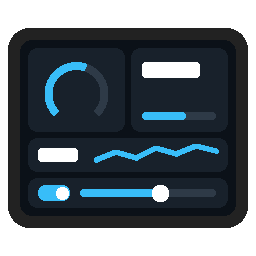

# ioBroker.satellite-display

На сенсорном дисплее голосовых спутников ESPHome отображаются плиточные страницы, заполняемые данными из ioBroker: значения, индикаторы, графики, переключатели, диммеры и кнопки, каждая из которых привязана к определенному состоянию. Касание переключателя, диммера или кнопки записывает состояние.

Он предназначен для [голосового сателлита Waveshare ESP32-S3-AUDIO](https://github.com/sadam6752-tech/esphome-waveshare-esp32-s3-audio-va) с [2,8-дюймовым емкостным сенсорным ЖК-дисплеем Waveshare](https://www.waveshare.com/wiki/2.8inch_Capacitive_Touch_LCD) (прошивка **2.0.0** или новее). Голосовая связь сателлита остается с [ioBroker.assistant](https://github.com/ioBroker/ioBroker.assistant) : этот адаптер открывает собственное соединение с нативным API ESPHome рядом с ним и обрабатывает только отображение.

Работает и дисплей без голосового управления: в репозитории прошивки есть `panel-lcd2.yaml` Для [Waveshare ESP32-S3-Touch-LCD-2](https://www.waveshare.com/wiki/ESP32-S3-Touch-LCD-2) , 2-дюймовой панели с плитками, имеющей те же страницы плиток и блокировку экрана. Добавьте её как сателлит (IP-адрес, порт 6053).

```
ioBroker states  ──▶  satellite-display  ──▶  satellite (tile pages)
       ▲                                           │
       └──────────────  a touch on a tile  ◀───────┘
```

## Плитка

Каждый спутник содержит до **4 страниц** . Страница представляет собой сетку из 2 столбцов × 4 строк на экране 320 × 240 и вмещает до 8 плиток. Чтобы перейти к ним, проведите пальцем влево от часов; страница без плиток пропускается.

| Размер    | Клетки | Пиксели   |
| --------- | ------ | --------- |
| маленький | 1 × 1  | 151 × 52  |
| квадрат   | 1 × 2  | 151 × 111 |
| широкий   | 2 × 1  | 308 × 52  |
| большой   | 2 × 2  | 308 × 111 |

| Добрый                | Шоу                                                                                                            | Размеры                        | Прикосновение                                  |
| --------------------- | -------------------------------------------------------------------------------------------------------------- | ------------------------------ | ---------------------------------------------- |
| Ценить                | имя, число с указанием единицы измерения или текст                                                             | все                            | –                                              |
| Измерять              | название, дуга от начала шкалы до ее конца, число                                                              | квадратный, большой            | –                                              |
| Значение с баром      | имя, номер, полоса на шкале                                                                                    | все                            | –                                              |
| Значение с диаграммой | имя, номер, строка последних 60 значений                                                                       | маленький, широкий, большой    | –                                              |
| Выключатель           | имя, переключатель; плитка загорается, когда включена                                                          | маленький, квадратный, широкий | переключает состояние                          |
| Диммер                | имя, переключатель, ползунок, процент                                                                          | широкий, большой               | Переключатель и ползунок записывают состояния. |
| Кнопка                | иконка, имя                                                                                                    | маленький, квадратный, широкий | пишет `true` к государству                      |
| Термостат             | имя, дуга с текущей температурой, − цель +, точка для реле отопления                                           | квадратный, большой            | − и + записывают целевое значение              |
| Группа                | До 4 значений в одном блоке, каждое со своим названием: строки, если блок высокий, столбцы, если блок плоский. | все                            | –                                              |
| Танк                  | Название, резервуар, заполненный по шкале, значение, дополнительное количество (в литрах) (по желанию)         | квадратный, большой            | –                                              |
| Батарея               | название, батарея, заряженная по шкале, болт во время зарядки, опциональная мощность                           | все                            | –                                              |
| Статус                | значок, имя, значение или текст; значок и плитка подсвечиваются во время работы.                               | маленький, квадратный, широкий | –                                              |

Еще четыре типа отображаются **только на планшетах** (веб-приложение и приложение ioBroker Visu; спутниковая связь их исключает с предупреждением). Планшет поддерживает еще два размера ячеек: 3 × 2 и 4 × 3.

| Добрый                 | Шоу                                                                                                                                   | Прикосновение                          |
| ---------------------- | ------------------------------------------------------------------------------------------------------------------------------------- | -------------------------------------- |
| Карта                  | Карта OpenStreetMap с изображением судна, его курса и траектории; опционально — целевые объекты AIS, якорный круг, морские ориентиры. | сковорода, щипок, + −, обратно к лодке |
| Поток энергии          | Солнечная энергия, аккумулятор, сеть и потребление вокруг инвертора, точки, работающие от источника энергии.                          | –                                      |
| Историческая диаграмма | до 4 серий данных за часы или дни с помощью адаптера истории, с осями                                                                 | точка; палец показывает значения       |
| Камера                 | Изображение с камеры, обновляемое каждые несколько секунд, или её прямая трансляция (MJPEG).                                          | изображение на всем экране             |

## Настройки

1. **Спутники:** имя (комната), IP-адрес и API-порт (6053) каждого спутника. Ключ шифрования API необходим только в том случае, если вы собрали прошивку с ним; в готовой прошивке его нет.
2. **Плитки:** графический редактор. Выберите спутник и страницу; в предварительном просмотре отобразится экран с текущими значениями. Щелкните свободную ячейку, чтобы добавить плитку, перетащите плитку в свободную ячейку, чтобы переместить ее, или на другую плитку, чтобы поменять их местами, щелкните плитку, чтобы отредактировать ее справа: тип, размер, состояние (с помощью обозревателя объектов в административной панели), имя, единица измерения, значок и масштаб. Выбор состояния заполняет его имя и единицу измерения; вы можете их изменить. Имя, единица измерения и масштаб также могут оставаться пустыми: они берутся из объекта состояния. «Копировать страницу» копирует страницу на другую страницу или спутник, Ctrl+Z отменяет последние изменения. «Показать на спутнике» размещает плитки редактора на спутнике без сохранения, чтобы попробовать размеры и места (экземпляр должен быть запущен). Плитка, которую адаптер не смог бы отобразить, помечается красным цветом с указанием причины (размер, для которого не существует нужного типа, термостат без целевого значения, более восьми плиток на странице).
3. **Диаграммы (необязательно):** адаптер истории (history, sql, influxdb). В этом случае диаграмма начинается с последних часов своего состояния, а не с пустого поля.

Подробности о видах:

- **Переключатель:** считывает состояние как включено/выключено (`true`, число, отличное от 0, `"on"` …) и указывает тип состояния (`true` /`false`, `1` /`0`).
- **Диммер:** состояние — это уровень, от 0 до 100, или диапазон его действия (`min` /`max` (например, 0-1 или 0-255); ползунок записывает уровень при отпускании. Второе состояние — это его включение/выключение. Без второго состояния уровень 0 означает выключение, а включение восстанавливает последний уровень.
- **Кнопка:** записывает `true` (или `1` (для числового состояния), например, для сцены или триггера сценария.
- **Цвета:** вкладка **«Внешний вид»** задает основной цвет всех плиток (значение, дуга, полоса, линия, переключатели); плитка может иметь свой собственный основной цвет и фон. **Состояние фона** окрашивает плитку из другого состояния: пока она включена (`true` (число, отличное от 0) плитка принимает выбранный цвет; состояние, содержащее цвет (`#7F1D1D`) задает этот цвет, например, из скрипта. При заданном пороге плитка все равно становится красной. Для фона требуется прошивка Satellite **версии 2.0.4** (основной цвет работает начиная с версии 2.0.3).
- **Иконки:** любой тип может отображать иконку. Маленькая (1 × 1) или широкая плитка отображает её слева посередине, большая — в верхнем левом углу; квадратные плитки (1 × 2) сохраняют своё расположение. «Только иконка» размещает её на месте названия. Маленький или широкий переключатель с иконкой и названием не имеет тумблера: вся плитка является переключателем и подсвечивается при включении; при наличии только иконки тумблер сохраняется. «Переключатели целиком» устанавливает это для каждого переключателя, включая квадратный. Требуется прошивка Satellite **2.0.4** .
- **Пороговые значения:** плитки «Значение», «Индикатор», «Гистограмма», «График», «Термостат», «Группа», «Банк» и «Батарея» имеют значения «Красный ниже» и «Красный выше»: за ними значение и его дуга, полоса или линия становятся красными, например, батарея разряжена менее чем на 20%. Требуется прошивка спутника **версии 2.0.3** ; более старая версия сохраняет цвета.
- **Термостат:** три состояния: текущая температура (дуга), целевая температура (обозначается символами − и +) и, опционально, реле нагрева (точка: зеленый цвет — включен, серый — выключен). − и + мгновенно изменяют целевую температуру на экране с шагом (0,5, если не задано отдельно); через одну секунду после последнего нажатия адаптер выводит её на экран. Шкала и пределы целевой температуры определяются объектом, для которого задана целевая температура. `min` /`max`), иначе 5-30. Требуется прошивка спутника **2.0.1** ; в журнале сообщается о более старой прошивке, и фрагмент отсутствует.
- **Группа, бак, батарея, статус:** требуется прошивка спутника **2.4.0** ; в журнале отображается более старая прошивка, и плитка отсутствует (на планшете они всегда есть).
  - Группа отображает состояния от 1 до 4, каждое со своим названием и единицей измерения (пустое поле: единицы измерения объекта) и десятичными знаками ячейки; заголовок является необязательным и располагается над строками высокой группы. Пороги окрашивают каждую строку.
  - На шкале отображается уровень заполнения резервуара (пустой: уровень объекта, в противном случае — от 0 до 100), а также, по желанию, второе значение ниже, например, объем в литрах. Пороговые значения окрашивают уровень заполнения.
  - Батарея отображает уровень заряда и, при необходимости, уровень заряда (второе состояние). Болт показывает состояние во время зарядки: из собственного состояния (третье состояние), если установлен, в противном случае, пока уровень заряда положительный. Зеленый цвет, если цвет или пороговое значение не указывают на иное.
  - Индикатор состояния загорается, когда индикатор включен. `true`, число, отличное от 0, "вкл."…) и отображает текст `common.states`, an/aus, или число с указанием единицы измерения.
- **Карта** (планшет): широта и долгота (обязательно), курс или направление в градусах и скорость в узлах (необязательно). Адаптер записывает траекторию (точка каждые 20 м, часы тайла, по умолчанию 24) даже когда планшет не используется, и сохраняет её после перезагрузки. С помощью экземпляра ioBroker.nmea (например) `nmea.0` На карте показаны цели AIS (ближайшие 100, без нашей лодки) и круг сигнала тревоги якоря. Используются тайлы OpenStreetMap, поскольку [политика использования тайлов](https://operations.osmfoundation.org/policies/tiles/) допускает умеренное использование с указанием авторства; можно настроить другие серверы тайлов. `{z}/{x}/{y}`), и морские ориентиры OpenSeaMap были включены.
- **Поток энергии** (таблица): солнечная энергия, энергия батареи (положительный полюс = зарядка), энергия сети или берегового источника (положительный полюс = используется), потребление и заряд батареи, каждый параметр необязателен. Мощность в кВт преобразуется в Вт; без собственного состояния рассчитывается потребление (солнечная энергия + энергия сети − энергия батареи).
- **График истории** (планшет): история каждой серии из экземпляра истории вкладки **«График»** (история, SQL или InfluxDB), 300 точек, считывается каждые 10 минут и при переключении периода на планшете (1 ч, 6 ч, 24 ч, 7 д, 30 д). Серии с двумя единицами получают по одной оси.
- **Камера** (планшет): адрес изображения (например, «Фрегат»). `http://…:5000/api/<camera>/latest.jpg?h=480`) или потока MJPEG (`…/api/<camera>?fps=5&h=480`, обновление 0), или состояние, содержащее такой адрес (также a) `data:image/…` (URL). Адаптер загружает изображение и передает его планшету: адрес, содержащий имя пользователя и пароль, никогда не покидает ioBroker. Изображение загружается только тогда, когда соответствующая страница отображается на экране; максимум 4 прямых трансляции на один планшет.
- Значение, не являющееся числом (текст, `true` /`false`) отображается в виде текста на плитке значения. Когда объект состояния имеет `common.states` (например `0: Aus, 1: Heizen, 2: Kühlen` Вместо числа на плитке значения отображается текст.

Переключатель и ползунок мгновенно меняются на экране. Если устройство не реагирует, через три секунды плитка снова отображает реальное состояние.

## блокировка экрана

Спутник можно заблокировать с помощью PIN-кода из 4-6 цифр (вкладка **«Спутники»** : «Блокировка экрана» и «PIN-код»). В заблокированном состоянии на дисплее отображаются только часы и дата, а вместо значка шестеренки — замок; страницы с плитками, системная страница и настройки недоступны, и спутник не реагирует на кодовое слово. При этом продолжают звучать объявления, будильники, таймеры и музыка. Прикосновение открывает клавиатуру; проверка PIN-кода происходит сразу после ввода всех цифр. После 5 неправильных PIN-кодов подряд клавиатура ожидает минуту; без ключа она закрывается через 30 секунд.

Вкладка **«Аутентификация»** определяет, когда разблокированный спутник снова блокируется: через несколько минут без касаний, когда дисплей автоматически возвращается к часам, или только вручную. Открытый замок рядом с шестеренкой блокируется мгновенно во всех режимах. Состояние `satellites.<name>.locked` Отображает состояние замка и блокирует или разблокирует его через ioBroker (например, ночью или при наличии сигнализации); `satellites.<name>.failedPins` Подсчитывает неверные PIN-коды.

PIN-код не покидает ioBroker: спутник получает его хеш SHA-256 и хранит его во флэш-памяти, поэтому блокировка работает и после перезагрузки, и без ioBroker. Требуется прошивка спутника версии **2.1.0** .

**Планшеты** (вкладка **«Планшеты»** : «Блокировка экрана» и «PIN-код») блокируются одинаково и следуют той же вкладке **«Аутентификация»** : «когда дисплей возвращается к часам» — это момент появления страницы с часами (минута без касаний, когда часы выключены), и блокировка на панели инструментов срабатывает мгновенно. На заблокированном планшете со страницей с часами сначала отображаются часы, а после касания — клавиатура. Их состояния: `tablets.<name>.locked` и `tablets.<name>.failedPins` Планшет проверяет PIN-код в своем браузере: это не позволяет детям и гостям получить доступ, но не останавливает того, кто знаком с инструментами разработчика браузера (спутник проверяет PIN-код в своей прошивке).

## Планшеты (веб-приложение, по умолчанию отключено)

Планшет на Android или iOS может отображать плитки, как спутник, без голосового сопровождения: адаптер предоставляет веб-приложение (PWA), а планшет поддерживает с ним соединение. Ничего из этого не работает, пока он не включен: без флажка адаптер не открывает порт и не создает объекты для планшетов.

1. В разделе « **Планшеты** » включите параметр «Планшеты с веб-приложением (PWA)», выберите порт (по умолчанию 8094) и укажите строку для каждого планшета: размер экрана в пикселях (например, iPad 2048 x 1536 в альбомной ориентации, 1536 x 2048 в вертикальном положении: редактор плиток отобразит планшет в этой форме), сетку, количество столбцов и строк на странице, а также количество страниц (10-дюймовый планшет в альбомной ориентации: 4 x 3).
2. Сохраните изменения, затем нажмите «Показать ссылки и QR-коды»: каждый планшет будет иметь свою собственную ссылку с ключом доступа, представленную в текстовом виде и в виде QR-кода.
3. Наведите камеру планшета на его код (или откройте ссылку там) и добавьте страницу на главный экран. Она запустится в полноэкранном режиме, останется включенной (если это позволяет браузер) и автоматически переключится обратно после того, как планшет перейдет в спящий режим.

**Сопряжение с приложением ioBroker Visu (Android)** : вместо создания строки вручную, включите веб-приложение, сохраните изменения и нажмите «Сопряжение планшета». Отображаемый QR-код — это одноразовая ссылка, действительная в течение 10 минут. В приложении ioBroker Visu на планшете (настройки, вкладка «Приложение», сателлитный дисплей, «Сканировать») планшет сканирует его, отправляет свое имя и размер экрана в пикселях CSS (например, 1280 x 800 для 10-дюймового планшета в альбомной ориентации), и адаптер вводит это как новую строку — вертикальный экран с перевернутой сеткой, 3 x 4 — сохраняет настройки и перезапускается; приложение получает ссылку на планшет и подключается. Страница настроек автоматически перезагружается, чтобы отобразить новую строку (если она не содержит несохраненных изменений). Затем присвойте планшету плитки в редакторе плиток. Имя, которое уже есть у сателлита или планшета, получает номер. Ссылка для сопряжения, открытая в браузере, только поясняет себя: браузер не может выполнить сопряжение.

На плитке в поле «спутник» указано название планшета, как у спутника; команды для агента ИИ (ниже) размещают плитки на планшете таким же образом, и `getTiles` Задает имя сетки каждого дисплея. Блокировка экрана с помощью PIN-кода (вкладка **«Планшеты»** , «Блокировка экрана») работает как на спутнике; планшет сам проверяет PIN-код.

- **HTTPS** : браузер устанавливает веб-приложение и поддерживает отображение экрана только из защищенного источника, на iOS — всегда. Включите «Использовать HTTPS» и выберите сертификат из коллекции ioBroker (Администрирование > Настройки > Сертификаты), ту же пару, что и веб-адаптер. Когда HTTPS включен и сертификат не может быть загружен, веб-приложение остается выключенным (оно не переключается на обычный HTTP). Без HTTPS страница по-прежнему работает в браузере или приложении киоска, без установки приложения.
- **iOS** разрывает соединение, когда экран гаснет; страница снова подключается, когда она отображается. Для панели на стене используйте функцию «Управляемый доступ» и оставьте дисплей включенным в настройках iPad.
- **Ключ доступа** хранится в объекте. `tablets.<name>` и остается неизменным после перезагрузки. Кто знает, может ли ссылка видеть и переключать плитки этого планшета, и ничего больше. Удалите строку на планшете (или выключите веб-приложение), чтобы сделать ее ссылку недействительной; новая строка получает новый ключ, и планшет со старой ссылкой сообщает, что его ссылка устарела. «Новая ссылка» на карточке планшета сразу же дает ему новый ключ (когда ссылка попала в чужие руки или планшет был подарен): старая ссылка перестает работать, в том числе и на главном экране планшета.
- **Переименование** планшета или сателлита в настройках сохраняет его прежним именем: при следующем запуске адаптер обнаруживает, что одно имя исчезло, а другое стало новым, присваивает планшету старый ключ доступа (его связь продолжает работать) и перемещает плитки под новое имя. Если одновременно изменено несколько устройств одного типа, редактор плиток отображает плитки со старым именем с кнопками «Переместить в...» и «Удалить эти плитки».
- Порт указан в реестре используемых ресурсов js-controller 8, поэтому администратор может отображать его как занятый.
- В редакторе плиток в административной панели планшеты отображаются рядом со спутниками, на сетке каждого из них.
- **Страницы** : свайп переворачивает страницу, как и касание точки на панели (необходимо на странице, заполненной картой, где свайп перемещает карту). Через минуту без касаний планшет возвращается на первую страницу.
- **Часы в режиме ожидания** (вкладка **«Планшеты»** , по умолчанию отключены): по истечении заданного количества минут без касания планшет отображает время и дату, как спутник показывает свои часы. При касании отображается клавиатура блокировки экрана или плитки, когда планшет не заблокирован. В режиме блокировки «когда дисплей возвращается к часам» планшет блокируется, когда наступает время его часов.
- **Заголовки страниц** : страница планшета может иметь заголовок (например, «Heizung»), устанавливаемый в редакторе плиток рядом с кнопками страницы или с помощью агента искусственного интеллекта. `setPageTitle` На панели планшета это отображается рядом с названием планшета, пока отображается эта страница; на клавиатуре блокировки экрана отображается только название. В спутниковых планшетах для этого нет места.

## Устройства (Диспетчер устройств)

На вкладке « **Устройства»** отображаются все сателлиты и планшеты экземпляра в виде карточек в диспетчере устройств ioBroker. `@iobroker/dm-utils` Администратор также может разместить Диспетчер устройств в левой боковой панели. Настройки остаются во вкладках «Спутники» и «Планшеты»: там можно добавлять, удалять и переименовывать дисплеи. Вкладка работает, пока запущен экземпляр.

- **Карта** : соединение (от `connected`), адрес спутника, тип дисплея.
- **Элементы управления** (кнопка с ползунками на карте), только то, что отображается на дисплее: блокировка экрана (с помощью PIN-кода), яркость дисплея и громкость плеера.
- **Действия** : «Отправить плитки снова» на каждой карточке; на планшете, во время работы веб-приложения, «Ссылка и QR-код» и «Новая ссылка» (предварительно запрашивается подтверждение; старая ссылка перестает работать сразу же, в том числе на главном экране планшета).
- **Подробная информация** (меню карточки): сетка и страницы, количество плиток и ссылка на QR-код планшета.
- **Ссылки на планшеты** в панели над карточками: QR-коды всех планшетов в одном диалоговом окне.
- **Подключите планшет** к панели над карточками, пока работает веб-приложение: одноразовый QR-код подключения (см. Планшеты).

## Команды (например, для агента ИИ)

Плитку также можно заменить с помощью `sendTo('satellite-display.0', command, message)` Например, с помощью ioBroker.pi-agent («добавить узкий переключатель для освещения в гостиной на дисплей Gast»). Ответы представляют собой короткие JSON-файлы; в сообщении об ошибке указывается, что именно нужно запросить у пользователя (какой спутник, на какой странице, когда все заполнены).

| Командование   | Сообщение                                                                                    | Делает                                                                                                                                                            |
| -------------- | -------------------------------------------------------------------------------------------- | ----------------------------------------------------------------------------------------------------------------------------------------------------------------- |
| `help`         | –                                                                                            | описывает команды, типы, размеры, значки и сетку: `{help, commands: [{command, write}]}`, `write` = меняет плитки                                                  |
| `getTiles`     | `{satellite?}`                                                                               | перечисляет спутники и планшеты, их сетки, их фрагменты (с указанием местоположения). `id`) и свободные клетки                                                    |
| `addTile`      | `{satellite, type, state, size?, icon?, label?, unit?, state2?, state3?, page?, col?, row?}` | добавляет плитку, не имея места в первой свободной клетке; отвечает, куда она делась (группа также берет `state4`, `title`, `label2` -`label4`, `unit2` -`unit4`) |
| `updateTile`   | `{id, ...fields}`                                                                            | меняет плитку                                                                                                                                                     |
| `moveTile`     | `{id, page, col?, row?}`                                                                     | перемещает плитку, не `col` /`row` к первой свободной ячейке страницы                                                                                              |
| `removeTile`   | `{id}`                                                                                       | удаляет плитку                                                                                                                                                    |
| `setPageTitle` | `{satellite, page, title}`                                                                   | Заголовок страницы планшета, отображаемый в его панели; пустая строка удаляет его.                                                                                |

Изменения сохраняются в настройках экземпляра, после чего он перезапускается и отправляет тайлы (через несколько секунд). В файле ioBroker.pi-agent для экземпляра необходимо указать «Разрешена запись» в параметрах прав записи.

## Штаты

| Состояние                                                       | Значение                                                                                                                                      |
| --------------------------------------------------------------- | --------------------------------------------------------------------------------------------------------------------------------------------- |
| `info.connection`                                               | Все спутники подключены и имеют свои тайлы (только на планшетах: работает веб-приложение).                                                    |
| `satellites.<name>.connected`                                   | Этот спутник подключен и имеет свои плитки (роль). `indicator.reachable`)                                                                     |
| `satellites.<name>.lastTouch`                                   | Последнее касание плитки в формате JSON (`page`, `slot`, `input`, `value`, `ts`)                                                             |
| `satellites.<name>.resend`                                      | кнопка: отправляет все тайлы снова                                                                                                            |
| `satellites.<name>.locked`                                      | Экран заблокирован; напишите `true` /`false` Заблокировать или разблокировать (только с помощью блокировки экрана)                             |
| `satellites.<name>.failedPins`                                  | На экране отображаются неверные PIN-коды подряд (только при блокировке экрана).                                                               |
| `satellites.<name>.media.url`                                   | Воспроизвести этот URL-адрес потока (отображается только при наличии проигрывателя, например, на панели с I2S-усилителем); пусто = остановить |
| `satellites.<name>.media.volume`                                | объем 0-100 %                                                                                                                                 |
| `satellites.<name>.media.title`                                 | Название, отображаемое на индикаторе часов во время воспроизведения (например, название станции).                                             |
| `satellites.<name>.media.stop`                                  | кнопка: остановить воспроизведение                                                                                                            |
| `satellites.<name>.media.state`                                 | `play` (в том числе и во время объявления), `pause` или `stop`                                                                                 |
| `satellites.<name>.brightness`                                  | Яркость дисплея 0-100 %, 0 = темный (только для дисплеев, получающих это значение от ioBroker, например, для плиточной панели).               |
| `tablets.<name>.connected`                                      | Этот планшет подключен к сети и имеет свои собственные плитки (планшет для сна — нет).                                                        |
| `tablets.<name>.lastTouch`, `.resend`, `.locked`, `.failedPins` | что касается спутника                                                                                                                         |

Спутник не сохраняет свою конфигурацию: после перезагрузки или потери соединения адаптер самостоятельно отправляет все тайлы и их значения заново.

## Примечания

- Для отображения небольших полос и графиков (1 × 1) требуется прошивка спутника **версии 2.0.2** ; более старая версия оставляет их пустыми и записывает предупреждение в свой собственный журнал.
- Для работы спутниковой прошивки необходима версия **2.0.0** или новее; более старая версия прошивки будет указана в журнале («для страниц тайлов требуется спутниковая прошивка версии 2.0.0»).
- Формат связи между адаптером и прошивкой описан в [файле docs/TILES.md прошивки](https://github.com/sadam6752-tech/esphome-waveshare-esp32-s3-audio-va/blob/main/docs/TILES.md) .
- Значки представляют собой фиксированный набор, встроенный в прошивку; в настройках доступен именно этот список.
- Веб-приложение для планшетов использует те же иконки из [Material Design Icons](https://pictogrammers.com) 7.4.47 (лицензия Apache 2.0), сгенерированные в `www/icons.js` к `tools/build-icons.js`.
- Спутник или планшет, удаленный или переименованный в настройках, сохраняет свои объекты, за исключением состояний, содержащих настройки других адаптеров (История, InfluxDB, SQL и т. д.): они остаются в папках выше, и в журнале им присваиваются имена. Удалите эти настройки и удалите объекты вручную, когда данные больше не нужны. То же самое относится и к `locked` и `failedPins` когда блокировка экрана выключена, и для `tablets.*` когда веб-приложение выключено.
- После обновления адаптера перезагрузите страницу администратора (F5): при открытом окне администратора старый редактор тайлов останется в памяти.

## Changelog

Older changes: CHANGELOG_OLD.md

<!--
    Placeholder for the next version (at the beginning of the line):
    ### **WORK IN PROGRESS**
-->

### 0.4.3 (2026-11-20)

- (sadam6752-tech) The text above the Devices tab has all size attributes (checker W5507)

### 0.4.2 (2026-11-19)

- (sadam6752-tech) The adapter declares that it answers `help` (`common.supportedMessages.help`, js-controller PR #3638), and the answer lists the commands with whether they change something (`commands: [{command, write}]`), so agents such as ioBroker.pi-agent find and use them

### 0.4.1 (2026-11-17)

- (GermanBluefox) "Pair a tablet" (tab Tablets and Device Manager): a one-time QR code that the ioBroker Visu app scans;
  the tablet enters itself in the settings with its name and screen size and gets its link
- (GermanBluefox) The web app of the tablets runs without a tablet entered too, so that one can pair itself
- (GermanBluefox) The links and QR codes of the tablets name the LAN address of the host, no longer the first address of
  its list, which was the one of Tailscale (100.x) on a host with Tailscale
- (GermanBluefox) Four new tile types, on the satellites (firmware 2.4.0) and the tablets: group (up to four values
  in one tile), tank (fill level, optional litres), battery (charge, bolt while charging, optional power) and status
  (an icon that lights up while on); the tile editor draws them, the commands `addTile`/`updateTile` take them
- (GermanBluefox) Tablet web app: the name of a value tile is no longer bold, and the toggle of a wide switch sits in
  the middle of its line instead of half cut off at the bottom edge
- (GermanBluefox) Four tile types for tablets only: map (OpenStreetMap with the boat, its track, AIS targets and the
  anchor circle of ioBroker.nmea, seamarks of OpenSeaMap), energy flow (solar, battery, grid, consumption), history
  chart (up to four series with axes, the period switched on the tablet) and camera (a picture or an MJPEG stream,
  fetched by the adapter, so the address with its password stays in ioBroker); two more sizes on a tablet, 3 × 2 and
  4 × 3
- (GermanBluefox) Tablet web app: a tap on a page dot in the bar goes to that page

### 0.4.0 (2026-11-16)

- (sadam6752-tech) New tab Devices with the ioBroker Device Manager: every satellite and tablet as a card with its
  connection, screen lock, brightness and volume, "Send the tiles again", and for a tablet the link with the QR code
  and "New link"; the details show grid, pages and tiles, the bar above the cards the links of all tablets

### 0.3.2 (2026-11-16)

- (sadam6752-tech) Objects of a removed or renamed satellite or tablet, of the tablets when the web app is off and of
  the screen lock when it is off are no longer deleted when they carry settings of other adapters (History, InfluxDB,
  SQL): they stay with a warning in the log (review of the repository PR)
- (sadam6752-tech) The API encryption key of a satellite is hidden in the settings (with a button to show it)
- (sadam6752-tech) `@iobroker/testing` 6.3.2

## License

MIT License

Copyright (c) 2026 sadam6752-tech <sadam6752@gmail.com>

Permission is hereby granted, free of charge, to any person obtaining a copy
of this software and associated documentation files (the "Software"), to deal
in the Software without restriction, including without limitation the rights
to use, copy, modify, merge, publish, distribute, sublicense, and/or sell
copies of the Software, and to permit persons to whom the Software is
furnished to do so, subject to the following conditions:

The above copyright notice and this permission notice shall be included in all
copies or substantial portions of the Software.

THE SOFTWARE IS PROVIDED "AS IS", WITHOUT WARRANTY OF ANY KIND, EXPRESS OR
IMPLIED, INCLUDING BUT NOT LIMITED TO THE WARRANTIES OF MERCHANTABILITY,
FITNESS FOR A PARTICULAR PURPOSE AND NONINFRINGEMENT. IN NO EVENT SHALL THE
AUTHORS OR COPYRIGHT HOLDERS BE LIABLE FOR ANY CLAIM, DAMAGES OR OTHER
LIABILITY, WHETHER IN AN ACTION OF CONTRACT, TORT OR OTHERWISE, ARISING FROM,
OUT OF OR IN CONNECTION WITH THE SOFTWARE OR THE USE OR OTHER DEALINGS IN THE
SOFTWARE.