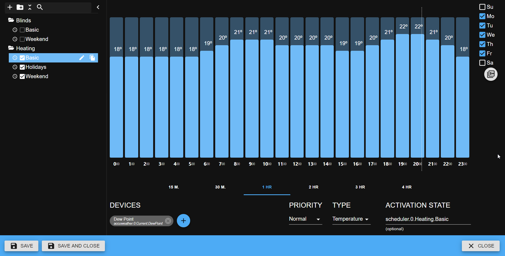
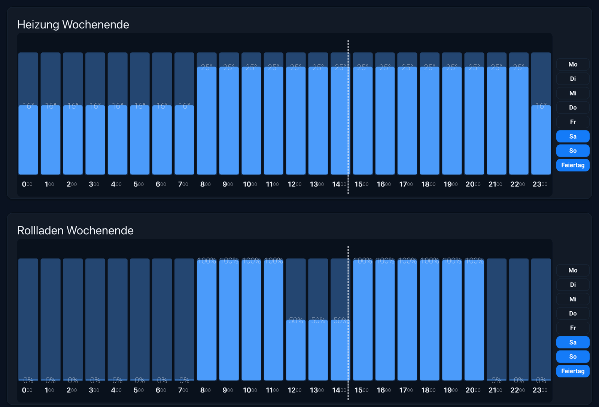

# Адаптер планировщика ioBroker
**Этот адаптер использует библиотеки Sentry для автоматического сообщения разработчикам об исключениях и ошибках в коде.** Для получения более подробной информации и сведений о том, как отключить отправку сообщений об ошибках, см. [Документация по плагину Sentry](https://github.com/ioBroker/plugin-sentry#plugin-sentry)! Отправка сообщений Sentry используется начиная с js-controller 3.0.

Этот адаптер предназначен для управления устройствами по расписанию. Например, для управления отоплением или поливом.

Вы можете создавать профили с разным приоритетом: обычный (например, рабочие дни), высокий (например, выходные) и наивысший (например, для праздников).
Профиль с более высоким приоритетом перегружает другие профили.

Для каждого профиля будет создана активная переменная.
Но пользователь может выбрать свою собственную активационную переменную, например, для управления праздниками.

Пользователь должен добавить устройства в профиль, и всем устройствам в профиле будет присвоено одно и то же значение.

Этот адаптер содержит виджет vis2.

Два виджета в темном режиме просмотра vis-2: заданная температура отопления и положение жалюзи в выходные дни.
Каждая полоса соответствует одному часу и устанавливается путем перетаскивания. Справа выбираются будние и праздничные дни профиля.

## Типы профилей и точки данных
Тип профиля определяет, какие точки данных можно в него добавить и какое значение в них записывается.

| Тип | Требуемая точка данных | Записанное значение |
|-------------|------------------------------------------------------------|---------------------------------------------------------------------------------------------|
| Процент | `number` с `min` и `max` | Значение масштабируется линейно между `min` и `max`: `min + round((max - min) * value / 100)` |
| Температура | `number` | Значение не изменилось |
| Вкл/Выкл | `boolean` | `true` или `false` |
| Пользовательский | `number` | Значение не изменяется |
| Пользовательский список значений | `number`, `string` или `boolean` | Значение выбранной записи, преобразованное в тип точки данных |
| Пользовательский список значений | `число`, `строка` или `логическое значение` | Значение выбранной записи, преобразованное в тип точки данных |

Для всех типов принимаются точки данных с `common.type` `mixed`.
Диалоговое окно выбора точек данных отображает только те точки, которые соответствуют типу профиля.
Не устанавливайте `common.type` для точки данных равным `custom`: это недопустимый тип ioBroker, используйте `number`.

## Значения: собственный диапазон и список значений
Профили типа «Температура» и «Пользовательские» имеют карточку **Значения**:

- **Собственный диапазон** (мин, макс, шаг): заменяет диапазон столбцов, который в противном случае берется из значений `min`/`max`

Первая точка данных (пользовательская, также из `states`) имеет диапазон 0-28° для температуры и 0-100 для пользовательской.
Например, 30-60° для горячей воды. В пустых полях сохраняется автоматическое значение.

- **Список значений** (только для пользовательских настроек): полосы выбирают одну из записей вместо номера. Каждая запись имеет метку и

либо фиксированное значение, либо состояние:

- Фиксированное значение записывается в виде текста и преобразуется в тип точки данных: число для `number`,

`true` для `true`/`1`/`on` и `false` в противном случае для `boolean`, текст для `string`.

Например, `"on"`/`"off"` для устройства, ожидающего текст, или уровни 0-3 вентиляции.

- Состояние: указывается его текущее значение, например, комфортная и экономичная температура, которые изменяются визуально.

Если состояние изменяется во время активности соответствующей записи, новое значение записывается немедленно.

Виджет vis-2 и веб-компонент отображают подписи к списку значений в столбцах.

## Веб-компоненты
Адаптер также предоставляет представление профиля в качестве веб-компонента (`common.webComponents`, `@iobroker/web-components`), так что Aura, `ioBroker.devices`, административная панель и любой другой хост могут его отображать. vis-2 продолжает отображать свой собственный виджет.

| Тег | Шоу |
|-------------------------|----------------------------------------------------------------------------------------|
| `iob-scheduler-profile` | Один профиль: полоса для каждого интервала дня, дни недели и флаг праздника |

Настройки:

- **Профиль** - состояние профиля, например, `scheduler.0.Heating.Living room_active`; экземпляр берется по идентификатору.
- **Заголовок** - отображается над профилем, если поле пустое, ничего не отображается.
- **Только для чтения**
- **Скрыть дни недели**

Перетащите полосу вверх или вниз, чтобы установить ее значение, или по нескольким полосам, чтобы установить их все. Коснитесь времени под полосой, чтобы выбрать ее: изменение будет применено ко всем выбранным интервалам. Интервалы включения/выключения переключаются одним касанием.

Веб-компонент не может записывать объекты, поэтому он отправляет свои изменения экземпляру с сообщением `setProfile` (`{ id, intervals?, dow?, holiday? }`), который записывает их в объект экземпляра от имени пользователя соединения. Для этого экземпляр должен быть запущен и перезапускается после каждого изменения, как после сохранения настроек в административной панели.

## Сообщения для скриптов и агентов ИИ
Сообщение `help` (`sendTo('scheduler.0', 'help', {}, result => ...)`) возвращает описание профилей, их состояний и сообщение `setProfile`, написанное для агентов ИИ (например, pi-agent) и авторов скриптов. Ответ `{ help, commands }` также перечисляет все команды, каждая из которых имеет `write: true`, если она что-то изменяет.

<!-- Заполнитель для следующей версии (в начале строки):

### **РАБОТА В ПРОЦЕССЕ** -->

## Changelog
### 2.3.0 (2026-11-19)
* (@GermanBluefox) Added the message "help": a description of the profiles and of all messages for AI agents (e.g. pi-agent), and `common.supportedMessages.help`
* (@GermanBluefox) Added the short form of the web component manifests (tag, name, icon, size) to `common.webComponents`, so that hosts like Aura can list the components before the adapter is installed; the build writes it with `iob-web-components sync-io-package`

### 2.2.0 (2026-11-12)
* (@GermanBluefox) The adapter declares the versions it needs: js-controller 6.0.11 and admin 7.6.20 or newer. It cannot be installed from GitHub, because the build is not part of the repository
* (@GermanBluefox) Fixed profiles of type Custom: the adapter rejected the data points accepted by admin and did not write the value. Documented which data points every profile type needs (#448)
* (@GermanBluefox) The configuration explains itself: a help dialog (question mark above the bars) describes profiles, intervals, days, holidays, priority, types, activation state and the advanced options. The type, the priority, the activation state and the advanced options show a short hint, and a data point of the wrong type tells which data point the profile type needs
* (@GermanBluefox) The configuration is animated: folders open and close, the menu symbol turns into an arrow, the trash can opens its lid, the clock of a profile turns on hover, new data points pop in, the days of week bounce and the line of the current time breathes. No animation runs if the system asks for less motion
* (@GermanBluefox) Fixed: the values of a profile changed every time the configuration was opened, if the first data point has its own `min`/`max` (#309)
* (@GermanBluefox) Temperature and Custom profiles can have their own range of the bars, e.g. 30-60° for hot water (#308)
* (@GermanBluefox) Custom profiles can have a value list: the bars choose an entry, which writes a fixed value (also text like `"on"`/`"off"`) or the value of a state, e.g. a comfort temperature changed in vis (#268, #181, #33)
* (@GermanBluefox) Added the Ukrainian title and description, the Sentry notice and the dependabot entries of all frontend packages

### 2.1.1 (2026-11-09)
* (@GermanBluefox) Web component: the holiday button shows its whole name, and decimal values follow the number format of the system

### 2.1.0 (2026-11-08)
* (@GermanBluefox) Added the web component `iob-scheduler-profile` for Aura and other hosts (`common.webComponents`); it saves its changes through the new message `setProfile`

### 2.0.3 (2026-11-02)
* (@GermanBluefox) Corrected the widget: changes in one widget were overwritten by other widgets of the same instance

## License
The MIT License (MIT)

Copyright (c) 2021-2026 bluefox <dogafox@gmail.com>

Permission is hereby granted, free of charge, to any person obtaining a copy
of this software and associated documentation files (the "Software"), to deal
in the Software without restriction, including without limitation the rights
to use, copy, modify, merge, publish, distribute, sublicense, and/or sell
copies of the Software, and to permit persons to whom the Software is
furnished to do so, subject to the following conditions:

The above copyright notice and this permission notice shall be included in all
copies or substantial portions of the Software.

THE SOFTWARE IS PROVIDED "AS IS", WITHOUT WARRANTY OF ANY KIND, EXPRESS OR
IMPLIED, INCLUDING BUT NOT LIMITED TO THE WARRANTIES OF MERCHANTABILITY,
FITNESS FOR A PARTICULAR PURPOSE AND NONINFRINGEMENT. IN NO EVENT SHALL THE
AUTHORS OR COPYRIGHT HOLDERS BE LIABLE FOR ANY CLAIM, DAMAGES OR OTHER
LIABILITY, WHETHER IN AN ACTION OF CONTRACT, TORT OR OTHERWISE, ARISING FROM,
OUT OF OR IN CONNECTION WITH THE SOFTWARE OR THE USE OR OTHER DEALINGS IN THE
SOFTWARE.