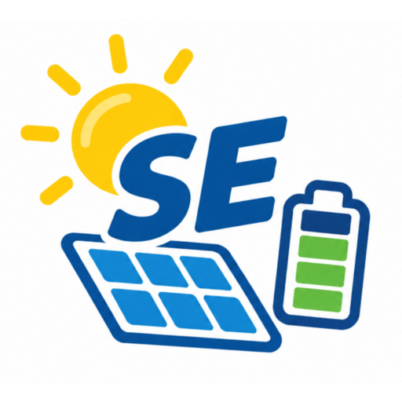

# Адаптер ioBroker для гибридных инверторов SolarEdge

> ⚠️ **Работа над проектом ведётся в процессе — используйте на свой страх и риск.** Этот адаптер находится в активной разработке. Интерфейсы и деревья состояний могут меняться между версиями.

## Отказ от ответственности

Данный проект является независимым проектом с открытым исходным кодом и не связан с компанией SolarEdge Technologies, Inc. или ее филиалами, не поддерживается ими и не спонсируется ими.

SolarEdge и SolarEdge Home Hub являются товарными знаками компании SolarEdge Technologies, Inc. В данном проекте эти названия используются исключительно для идентификации продуктов, с которыми совместим адаптер.

## Особенности и функции

Программа осуществляет мониторинг и управление гибридными инверторами SolarEdge по **протоколу Modbus TCP** (SunSpec). Она считывает данные о фотоэлектрических панелях, батарее и рабочих параметрах инвертора и отображает их в виде состояний ioBroker. Также она предоставляет доступ **к глобальному блоку управления StorEdge** (StorEdge Global Control Block) инвертора в виде набора состояний, доступных для записи, что позволяет вам (или вашим собственным скриптам ioBroker) напрямую управлять дистанционным управлением и соответствующими настройками хранилища (см. [блок управления StorEdge](#storedge-control-block) ).

## Требования

- [Инвертор SolarEdge Home Hub (гибридный)](https://www.solaredge.com/en/products/residential/pv-inverters/solaredge-home-hub-inverters) с **поддержкой Modbus TCP** , доступный в вашей сети.

> Обычно протокол Modbus TCP включается в меню SetApp/установщика инвертора. Порт TCP по умолчанию — **502** или **1502** .

## Установка

Установите **sehybrid** из административной панели ioBroker (вкладка «Адаптеры»), затем создайте экземпляр.

## Конфигурация

Откройте настройки экземпляра и настройте подключение к инвертору:

| Параметр             | По умолчанию    | Описание                                                                                |
| -------------------- | --------------- | --------------------------------------------------------------------------------------- |
| Хозяин               | _(пустой)_      | IP-адрес или имя хоста инвертора. Опрос не начнётся, пока этот параметр не будет задан. |
| Порт                 | `502` или `1502` | Порт Modbus TCP инвертора.                                                              |
| Идентификатор модуля | `1`             | Идентификатор блока Modbus / ведомого устройства инвертора.                             |
| Интервал опроса      | `30`            | Как часто (в секундах) адаптер считывает данные с инвертора.                            |

Для блока управления StorEdge не требуется отдельная конфигурация — он всегда создается и всегда активен, независимо от каких-либо настроек (см. [блок управления StorEdge](#storedge-control-block) ).

## Штаты

Адаптер распределяет считываемые значения по каналам:

- **info.connection** —`true` пока адаптер успешно опрашивает инвертор, `false` в противном случае.
- **Инвертор** — измерение мощности, энергии, переменного/постоянного тока и состояния инвертора.
- **Счетчик** — данные с подключенных счетчиков SunSpec (импорт/экспорт, мощность, энергия).
- **Батарея** — состояние заряда, мощность, температура и состояние подключенных батарей.
- **StorEdgeControlBlock** — девять регистров управления StorEdge, которые всегда создаются, считываются и записываются (см. ниже).

Точный список штатов зависит от модели вашего инвертора и подключенных к нему счетчиков/аккумуляторов.

## Блок управления StorageEdge

Адаптер всегда предоставляет доступ **к блоку управления Global Storage Control Block** инвертора — девяти регистрам, описанным производителем, начиная с `0xE004` — как квартира `StorEdgeControlBlock` Канал. Он создается безусловно при каждом запуске адаптера; для него нет переключателя включения и конфигурации.

В каждом цикле опроса все девять состояний обновляются текущими значениями инвертора. `ack=true`). В каждом из девяти состояний также разрешена запись: установка нового значения (`ack=false`) из скрипта, дерева объектов администратора или любого другого адаптера, и оно проходит проверку диапазона и записывается напрямую в инвертор через Modbus:

| Состояние (`StorEdgeControlBlock.*`) | Описание                                                                                                                   |
| ------------------------------------- | -------------------------------------------------------------------------------------------------------------------------- |
| `storageControlMode`                  | Режим управления хранилищем                                                                                                |
| `storageAcChargePolicy`               | Политика оплаты кондиционера                                                                                               |
| `storageAcChargeLimit`                | Ограничение заряда переменного тока                                                                                        |
| `storageBackupReservedSetting`        | Резервная зарезервированная настройка                                                                                      |
| `storageChargeDischargeDefaultMode`   | Режим зарядки/разрядки по умолчанию                                                                                        |
| `remoteControlCommandTimeout`         | Таймаут команды дистанционного управления                                                                                  |
| `remoteControlCommandMode`            | Режим дистанционного управления (чтение) `null` (при отключенном дистанционном управлении инвертором — см. примечание ниже) |
| `remoteControlChargeLimit`            | Дистанционное управление ограничением заряда                                                                               |
| `remoteControlDischargeLimit`         | Ограничение разряда дистанционного управления                                                                              |

Адрес регистра, кодировка, единица измерения, диапазон и код функции Modbus для каждого состояния указаны в сгенерированном ниже справочнике [регистров блока управления StorEdge](#storedge-control-block-registers) .

> ** `remoteControlCommandMode` является `null` Если не активировано дистанционное управление,** инвертор отображает только реальный режим управления. `0` –`7`) в этом регистре, пока `storageControlMode` установлено на `4` (Дистанционное управление). Когда инвертор находится в любом другом режиме управления накопителем, зарегистрируйте `0xE00D` возвращает SunSpec `NOT_IMPLEMENTED` часовой `0xFFFF`, к которому адаптер сопоставляет `null` Это ожидаемое поведение, а не ошибка — регистр снова принимает вещественное значение, как только... `storageControlMode = 4` устанавливается (и возвращается к `null` после того, как инвертор покинет пульт дистанционного управления, например, один раз `remoteControlCommandTimeout` (истекает). Адаптер записывает это. `null` Таким образом, при каждом опросе состояние всегда отражает текущие данные, а не сохраняет устаревший режим, оставшийся от предыдущего удержания при дистанционном управлении.

Допустимый диапазон температур для каждого штата указан на самом объекте. `common.min` /`common.max` (в дереве объектов администрирования). Запись за пределы этого диапазона отклоняется: адаптер регистрирует ошибку, не записывает данные в инвертор, и состояние сохраняет свое предыдущее значение. Подавление записи только при изменении отсутствует — каждая допустимая запись отправляется в инвертор каждый раз.

Сам адаптер никогда не вычисляет и не записывает значения в эти регистры (встроенной автоматизации на основе потребления нет). Управление этими регистрами для реализации таких функций, как дистанционное управление ограничением разряда на основе потребления дома/настенного зарядного устройства, осуществляется вашими собственными скриптами ioBroker, которые могут просто записывать данные в эти регистры. `StorEdgeControlBlock.remoteControlDischargeLimit` (и другие регистры, необходимые для режима дистанционного управления), как и любое другое записываемое состояние.

> **Для удаленного управления требуется наличие портала:** если вы планируете использовать режим управления хранилищем. `4` (Дистанционное управление) Сначала отключите профиль хранилища StorEdge на портале мониторинга SolarEdge / SetApp (Администрирование → Менеджер энергии → Профиль хранилища). В противном случае собственный облачный профиль инвертора будет конфликтовать с командами Modbus и примерно через 10 секунд вернет режим дистанционного управления в режим _«Максимизация собственного потребления»_ . Это однократная ручная операция на стороне инвертора; адаптер не сможет сделать это за вас. Это соответствует решению, описанному в сообществе (см. [binsentsu/home-assistant-solaredge-modbus #130](https://github.com/binsentsu/home-assistant-solaredge-modbus/issues/130) ).

> **Примечание по кодировке чисел с плавающей запятой:** регистры управления питанием StorEdge используют формат float32 с порядком байтов _Big Endian и перестановкой слов_ (байты в формате Big Endian, два 16-битных слова переставлены местами — младшее слово первым). Это соответствует типу данных "Big Endian Word swap" в стандартном адаптере ioBroker Modbus и было проверено в режиме реального времени на инверторе.

> **Безопасность:** написание письма `StorEdgeControlBlock` Данный адаптер записывает данные непосредственно в регистры управления батареей вашего инвертора. Тщательно проверьте его работу, прежде чем полагаться на какую-либо автоматизацию, построенную на его основе. Этот адаптер находится в стадии разработки; используйте его на свой страх и риск.

## Справочник регистров Modbus

В таблицах ниже представлен полный справочник регистров Modbus, сгенерированный непосредственно из исходных карт адаптера. `src/lib/sunspec-map.ts` и `src/lib/storedge-control-map.ts`) — они являются единственным источником истины, поэтому ссылка никогда не отклоняется от кода. Не редактируйте содержимое между сгенерированными маркерами вручную; запускайте `npm run docs:readme` чтобы восстановить его.

### Значения инвертора

<!-- BEGIN:GENERATED:sunspec-inverter -->

| Имя                      | Регистрация | Тип данных | Модель | Описание                                                                        |
| ------------------------ | ----------- | ---------- | ------ | ------------------------------------------------------------------------------- |
| acCurrent                | 40071       | uint16     | 101    | I\_AC\_Current — значение общего тока переменного тока                          |
| acCurrentA               | 40072       | uint16     | 101    | I\_AC\_CurrentA — Значение тока фазы A переменного тока                         |
| acCurrentB               | 40073       | uint16     | 101    | I\_AC\_CurrentB — Значение тока фазы B переменного тока                         |
| acCurrentC               | 40074       | uint16     | 101    | I\_AC\_CurrentC — Значение тока фазы C переменного тока                         |
| переменное напряжение AB | 40076       | uint16     | 101    | I\_AC\_VoltageAB — значение фазы AB переменного напряжения                      |
| acVoltageBC              | 40077       | uint16     | 101    | I\_AC\_VoltageBC — значение фазы переменного напряжения BC                      |
| acVoltageCA              | 40078       | uint16     | 101    | I\_AC\_VoltageCA — значение фазного напряжения переменного тока CA              |
| acVoltageAN              | 40079       | uint16     | 101    | I\_AC\_VoltageAN — значение переменного напряжения между фазами A и N.          |
| acVoltageBN              | 40080       | uint16     | 101    | I\_AC\_VoltageBN — значение переменного напряжения между фазами B и N.          |
| acVoltageCN              | 40081       | uint16     | 101    | I\_AC\_VoltageCN — значение переменного напряжения между фазами C и N.          |
| acPower                  | 40083       | int16      | 101    | I\_AC\_Power — значение мощности переменного тока                               |
| частота                  | 40085       | uint16     | 101    | I\_AC\_Frequency — значение частоты переменного тока                            |
| acVA                     | 40087       | int16      | 101    | I\_AC\_VA — Кажущаяся мощность                                                  |
| acVAR                    | 40089       | int16      | 101    | I\_AC\_VAR — Реактивная мощность                                                |
| acPF                     | 40091       | int16      | 101    | I\_AC\_PF — Коэффициент мощности                                                |
| acEnergyWh               | 40093       | акц32      | 101    | I\_AC\_Energy\_WH — Производство энергии переменного тока за весь срок службы   |
| dcCurrent                | 40096       | uint16     | 101    | I\_DC\_Current — значение постоянного тока                                      |
| постоянное напряжение    | 40098       | uint16     | 101    | I\_DC\_Voltage — значение постоянного напряжения                                |
| dcPower                  | 40100       | int16      | 101    | I\_DC\_Power — значение мощности постоянного тока                               |
| tempSink                 | 40103       | int16      | 101    | I\_Temp\_Sink — Температура радиатора                                           |
| статус                   | 40107       | uint16     | 101    | I\_Status — Рабочее состояние                                                   |
| статусПоставщик          | 40108       | uint16     | 101    | I\_Status\_Vendor — Коды рабочего состояния и ошибок, определяемые поставщиком. |

<!-- END:GENERATED:sunspec-inverter -->

### Значения счетчика

<!-- BEGIN:GENERATED:sunspec-meter -->

| Имя                 | Регистрация | Тип данных | Модель | Описание                                                                         |
| ------------------- | ----------- | ---------- | ------ | -------------------------------------------------------------------------------- |
| мТекущий            | 40190       | int16      | 201    | M\_AC\_Current — переменный ток (сумма активных фаз)                             |
| mCurrentA           | 40191       | int16      | 201    | M\_AC\_Current\_A — Переменный ток фазы A                                        |
| mCurrentB           | 40192       | int16      | 201    | M\_AC\_Current\_B — Переменный ток фазы B                                        |
| mCurrentC           | 40193       | int16      | 201    | M\_AC\_Current\_C — Переменный ток фазы C                                        |
| мВольтЛН            | 40195       | int16      | 201    | M\_AC\_Voltage\_LN — переменное напряжение между линией и нейтралью              |
| мВольтАН            | 40196       | int16      | 201    | M\_AC\_Voltage\_AN — Напряжение переменного тока между фазой А и нейтралью       |
| мВольтажBN          | 40197       | int16      | 201    | M\_AC\_Voltage\_BN — Напряжение переменного тока между фазой B и нейтралью       |
| мВольтажCN          | 40198       | int16      | 201    | M\_AC\_Voltage\_CN — Напряжение переменного тока между фазой C и нейтралью       |
| мВольтЛЛ            | 40199       | int16      | 201    | M\_AC\_Voltage\_LL — Межфазное напряжение переменного тока                       |
| мВольтАБ            | 40200       | int16      | 201    | M\_AC\_Voltage\_AB — Напряжение переменного тока между фазами A и B              |
| мВольтBC            | 40201       | int16      | 201    | M\_AC\_Voltage\_BC — Переменное напряжение между фазами B и C                    |
| мВольтCA            | 40202       | int16      | 201    | M\_AC\_Voltage\_CA — Напряжение переменного тока между фазой C и фазой A         |
| мчастота            | 40204       | int16      | 201    | M\_AC\_Freq — частота переменного тока                                           |
| mPower              | 40206       | int16      | 201    | M\_AC\_Power — Полная активная мощность (сумма активных фаз)                     |
| mPowerA             | 40207       | int16      | 201    | M\_AC\_Power\_A — Активная мощность переменного тока фазы A                      |
| mPowerB             | 40208       | int16      | 201    | M\_AC\_Power\_B — Активная мощность переменного тока фазы B                      |
| mPowerC             | 40209       | int16      | 201    | M\_AC\_Power\_C — Активная мощность переменного тока фазы C                      |
| мВА                 | 40211       | int16      | 201    | M\_AC\_VA — Полная мощность переменного тока (сумма активных фаз)                |
| мВАА                | 40212       | int16      | 201    | M\_AC\_VA\_A — Полная мощность переменного тока фазы A                           |
| мВАБ                | 40213       | int16      | 201    | M\_AC\_VA\_B — Полная мощность переменного тока фазы B                           |
| мВ переменного тока | 40214       | int16      | 201    | M\_AC\_VA\_C — Полная мощность переменного тока фазы C                           |
| мВАР                | 40216       | int16      | 201    | M\_AC\_VAR — Суммарная реактивная мощность переменного тока (сумма активных фаз) |
| mVARA               | 40217       | int16      | 201    | M\_AC\_VAR\_A — Реактивная мощность переменного тока фазы A                      |
| mVARB               | 40218       | int16      | 201    | M\_AC\_VAR\_B — Реактивная мощность переменного тока фазы B                      |
| mVARC               | 40219       | int16      | 201    | M\_AC\_VAR\_C — Реактивная мощность переменного тока фазы C                      |
| мФ                  | 40221       | int16      | 201    | M\_AC\_PF — Средний коэффициент мощности                                         |
| мПФА                | 40222       | int16      | 201    | M\_AC\_PF\_A — Коэффициент мощности фазы А                                       |
| mPFB                | 40223       | int16      | 201    | M\_AC\_PF\_B — Коэффициент мощности фазы B                                       |
| mPFC                | 40224       | int16      | 201    | M\_AC\_PF\_C — Коэффициент мощности фазы C                                       |
| mЭкспортированныйВх | 40226       | акц32      | 201    | M\_Экспорт — Общий объем экспортируемой реальной энергии                         |
| mExportedWhA        | 40228       | акц32      | 201    | M\_Exported\_A — Фаза A. Экспорт реальной энергии.                               |
| mExportedWhB        | 40230       | акц32      | 201    | M\_Exported\_B — Фаза B Экспорт реальной энергии                                 |
| mЭкспортированныйВК | 40232       | акц32      | 201    | M\_Exported\_C — Фаза C Экспорт реальной энергии                                 |
| импортированныйЧ    | 40234       | акц32      | 201    | M\_Imported — Общий объем импортируемой реальной энергии                         |
| mImportedWhA        | 40236       | акц32      | 201    | M\_Imported\_A — Фаза A. Импортированная реальная энергия                        |
| mImportedWhB        | 40238       | акц32      | 201    | M\_Imported\_B — Фаза B Импортируемая реальная энергия                           |
| mImportedWhC        | 40240       | акц32      | 201    | M\_Imported\_C — Фаза C Импортируемая реальная энергия                           |

<!-- END:GENERATED:sunspec-meter -->

### Значения батареи

<!-- BEGIN:GENERATED:sunspec-battery -->

| Имя                              | Регистрация | Тип данных | Модель  | Описание                                                                                                                      |
| -------------------------------- | ----------- | ---------- | ------- | ----------------------------------------------------------------------------------------------------------------------------- |
| ratedEnergy                      | 57666       | float32le  | батарея | Номинальная мощность батареи — Номинальная мощность                                                                           |
| maxChargeContinuousPower         | 57668       | float32le  | батарея | Максимальная непрерывная мощность заряда батареи —                                                                            |
| макс. разрядНепрерывная мощность | 57670       | float32le  | батарея | Максимальная непрерывная мощность разряда батареи — максимальная непрерывная мощность разряда.                                |
| maxChargePeakPower               | 57672       | float32le  | батарея | Максимальная пиковая мощность заряда батареи —                                                                                |
| макс. разряд Пиковая мощность    | 57674       | float32le  | батарея | Максимальная пиковая мощность разряда батареи —                                                                               |
| средняя температура              | 57708       | float32le  | батарея | Средняя температура батареи — Средняя температура                                                                             |
| максимальная температура         | 57710       | float32le  | батарея | Максимальная температура батареи — Максимальная температура                                                                   |
| мгновенное напряжение            | 57712       | float32le  | батарея | Мгновенное напряжение батареи — Мгновенное напряжение                                                                         |
| мгновенныйТекущий                | 57714       | float32le  | батарея | Мгновенный ток батареи — Мгновенный ток                                                                                       |
| мгновенная мощность              | 57716       | float32le  | батарея | Мгновенная мощность батареи — Мгновенная мощность                                                                             |
| lifetimeExportEnergy             | 57718       | uint64le   | батарея | Запас энергии, экспортируемой из батареи — Общий объем экспортируемой энергии                                                 |
| пожизненный импорт энергии       | 57722       | uint64le   | батарея | Срок службы батареи\_Импорт\_энергии — Общий объем импортируемой энергии                                                      |
| максимальная энергия             | 57726       | float32le  | батарея | Максимальная энергия батареи — Максимальная энергия                                                                           |
| доступная энергия                | 57728       | float32le  | батарея | Доступная энергия батареи — Доступная энергия                                                                                 |
| сох                              | 57730       | float32le  | батарея | Battery SOH — Состояние здоровья                                                                                              |
| сое                              | 57732       | float32le  | батарея | Состояние энергетического сектора в сфере аккумуляторных батарей — State of Energy                                            |
| статус                           | 57734       | uint32le   | батарея | Состояние батареи — Статус (0 Выкл., 1 В режиме ожидания, 2 Инициализация, 3 Зарядка, 4 Разрядка, 5 Неисправность, 6 Простой) |
| статусВнутренний                 | 57736       | uint32le   | батарея | Состояние батареи\_Внутреннее — Внутреннее состояние                                                                          |

<!-- END:GENERATED:sunspec-battery -->

### Регистры блока управления StorageEdge

<!-- BEGIN:GENERATED:storedge-control -->

| Имя                               | Адрес  | Кодирование | Единица | Диапазон | Код функции |
| --------------------------------- | ------ | ----------- | ------- | -------- | ----------- |
| storageControlMode                | 0xE004 | uint16      |         | 0..4     | FC06        |
| storageAcChargePolicy             | 0xE005 | uint16      |         | 0..3     | FC06        |
| storageAcChargeLimit              | 0xE006 | float32     | кВтч    | 0..∞     | FC16        |
| storageBackupReservedSetting      | 0xE008 | float32     | %       | 0..100   | FC16        |
| storageChargeDischargeDefaultMode | 0xE00A | uint16      |         | 0..7     | FC06        |
| remoteControlCommandTimeout       | 0xE00B | uint32      | с       | 0..86400 | FC16        |
| remoteControlCommandMode          | 0xE00D | uint16      |         | 0..7     | FC06        |
| remoteControlChargeLimit          | 0xE00E | float32     | В       | 0..10000 | FC16        |
| remoteControlDischargeLimit       | 0xE010 | float32     | В       | 0..10000 | FC16        |

<!-- END:GENERATED:storedge-control -->

## Поиск неисправностей

- **Нет данных /`info.connection` пребывание `false` ** — Убедитесь, что хост настроен правильно, Modbus TCP включен на инверторе и порту. `502` или `1502` Доступен с вашего хоста ioBroker.
- **В журнале ошибок подключения зафиксированы ошибки** — убедитесь, что идентификатор устройства соответствует вашему инвертору и что ни один другой клиент не удерживает единственное соединение Modbus TCP, разрешенное инвертором.
- **Режим удаленного управления через несколько секунд переключается в режим максимального потребления ресурсов** — вы не отключили профиль хранилища StorEdge на портале мониторинга SolarEdge / в приложении SetApp. См. предварительные условия, указанные выше.
- **Запись в `StorEdgeControlBlock` Состояние не оказывает никакого эффекта** — проверьте журнал адаптера; значение, вероятно, выходит за пределы задокументированного диапазона этого состояния (отображается как `common.min` /`common.max` (на объекте) и был отклонен до отправки в инвертор.

## Поддерживать

Пожалуйста, сообщайте о проблемах в [разделе Issues на GitHub](https://github.com/heresiarch/ioBroker.sehybrid/issues) .

Разработчикам: инструкции по сборке, тестированию и выпуску см. в файле [README\_dev.md](/#/docs/adapterref/iobroker.sehybrid/README_dev.md) .

## Changelog
### 1.1.4 (2026-11-09)
* fix GH workflows

### 1.1.3 (2026-11-05)
fix: tolerate rejected meter presence read on meterless inverters

### 1.1.2 (2026-10-31)
* fix log priority for modbus write op
* fix translation in io-package.json

### 1.1.1 (2026-10-15)
* fix size attributes

### 1.1.0 (2026-10-15)
* jsonConfig Migration for Admin UI
* fix Readme.md
* fix JSDoc warnings

## License

Copyright (c) 2026 René Meyer <heresiarch@online.de>
see [LICENSE](https://github.com/heresiarch/ioBroker.sehybrid/blob/main/LICENSE)