# ioBroker.senec

## Адаптер SENEC для ioBroker

Контролируйте и управляйте вашей домашней системой хранения данных SENEC. Адаптер поддерживает четыре независимых разъема, которые можно использовать по отдельности или в комбинации:

- **Локальный** (lala.cgi) — Прямой запрос к локальной сети с данными в реальном времени за 10 секунд. Предоставляет полные данные BMS, показания сетевых счетчиков, данные настенного блока и управление устройствами.
- **API приложения SENEC** — Запросы через API приложения SENEC на основе облачных технологий. Данные панели мониторинга, история измерений, сведения о системе и информация о настенном блоке.
- **mein-senec.de** — Веб-портал для запросов. Обзор состояния, история измерений, автономность, аварийное электропитание, сглаживание пиковых нагрузок, готовность к использованию энергосберегающих устройств (SG-Ready) и управление переключаемыми розетками.
- **SENEC.Connect** — API на базе Azure. Данные о батарее и счетчиках передаются по ключу подписки.

Не все коннекторы обязательно должны быть активированы. Выбирайте в соответствии с вашими потребностями — чисто локальные настройки работают так же хорошо, как и чисто облачные конфигурации для систем без локального веб-интерфейса.

### Поддерживаемые системы

Практически все системы хранения данных SENEC совместимы: серия Home, начиная с ранних моделей на свинцовом и литиевом топливе, включая V2, V2.1 и V3, и заканчивая текущим поколением V4 | P4 | E4, а также бизнес-модели и варианты от партнеров ADS Tec, OEM LG и Solarinvert.

Системы с локальным веб-интерфейсом могут использовать все пять коннекторов. Системы без него, включая поколение V4, работают через API приложения SENEC, mein-senec.de и SENEC.Connect. Локальный OpenAPI на порту 4424 также требует локального веб-интерфейса и поэтому доступен на поколениях V2 и V3, но не на V4, P4 или E4. Доступные точки данных зависят от модели.

[Полный список моделей](https://github.com/nobl/ioBroker.senec/blob/master/docs/SUPPORTED_SYSTEMS.md) поможет вам найти подходящую систему.

## Отказ от ответственности

**Все названия продуктов и компаний, а также логотипы являются товарными знаками™ или зарегистрированными® товарными знаками соответствующих владельцев. Их использование не подразумевает какой-либо связи с этими компаниями или их филиалами, а также не подразумевает одобрения с их стороны! Этот личный проект создан в свободное время и не преследует коммерческих целей.**

**Никаких гарантий и никакой ответственности.** Этот адаптер — любительский проект, предоставляется «как есть» под лицензией MIT. Он взаимодействует с дорогостоящим устройством через интерфейсы, которые SENEC не документирует и не поддерживает, и может отправлять команды, изменяющие поведение этого устройства. Все, что вы с ним делаете, вы делаете на свой страх и риск. Автор не несет ответственности за повреждение вашей системы, за потерю или некорректные данные, за потерю выработки электроэнергии или любые другие последствия его использования, а также не может сказать вам, повлияет ли его использование на гарантию или поддержку со стороны SENEC или вашего установщика. Если вы не принимаете эти условия, не используйте этот адаптер.

## Требования

- ioBroker с Node.js >= 22
- Система хранения данных SENEC в локальной сети (для локального коннектора)
- Аккаунт my-senec.de (для API и веб-коннектора)
- Установлен адаптер ioBroker.web (для интегрированной панели управления).

## установка

Установите адаптер через репозиторий адаптеров ioBroker. После установки создайте экземпляр адаптера и настройте как минимум один коннектор.

## конфигурация

Настройки адаптера организованы в виде вкладок — по одной для каждого разъема, а также общие настройки и параметры отладки. Два локальных интерфейса, `lala.cgi` и OpenAPI на порту 4424 используют общую вкладку _«Локальное подключение»_ и адрес предприятия.

### Счет SENEC

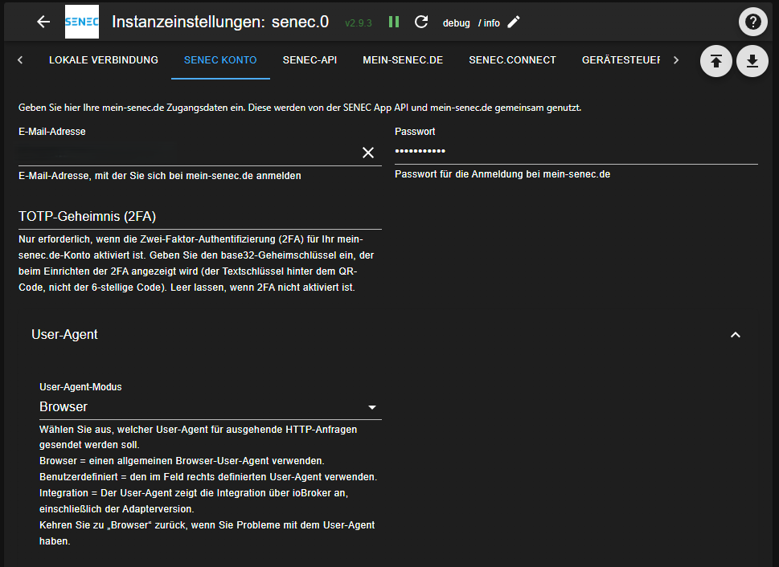

Введите здесь свои учетные данные для входа в mein-senec.de. Эти данные используются API приложения SENEC и сайтом mein-senec.de. Здесь же вы можете настроить режим user-agent для исходящих HTTP-запросов.

#### Двухфакторная аутентификация (2FA)

Если для учетной записи mein-senec.de активирована двухфакторная аутентификация, адаптер все равно сможет автоматически входить в систему — никому не нужно будет сидеть рядом с ним и вводить код.

В процессе настройки отобразится QR-код приложения-аутентификатора, а также тот же секретный ключ в текстовом виде. Этот текст следует записать в поле **«Секрет TOTP»** . Запишите его, пока открыта страница настройки: После активации секретный ключ больше не будет отображаться; новый будет сгенерирован только при повторной настройке. Пробелы и дефисы в секретном ключе не имеют значения.

Речь идёт о постоянном секретном ключе, а не о шестизначном коде из приложения — он меняется каждые тридцать секунд и истек бы задолго до того, как адаптер смог бы его использовать.

Для обоих облачных коннекторов достаточно одного секретного ключа, поскольку они оба авторизуются в одной и той же учетной записи. Если запись отсутствует, даже если требуется двухфакторная аутентификация, адаптер явно указывает на это в журнале, вместо того чтобы просто сообщать о неудачной попытке входа.

### Локальное соединение (lala.cgi)

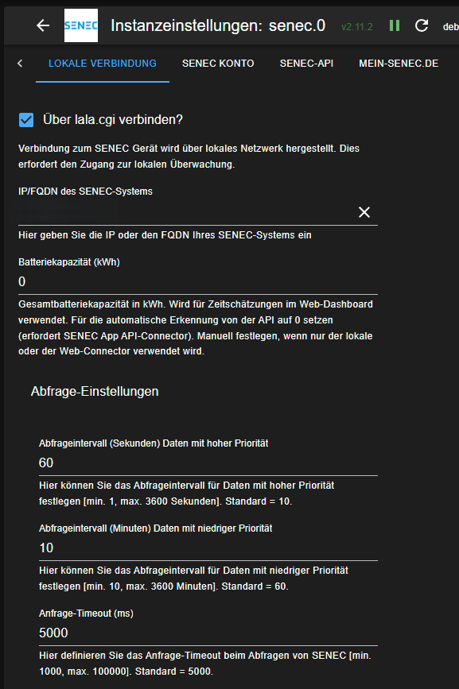

| Отношение                  | Описание                                          | стандарт |
| -------------------------- | ------------------------------------------------- | -------- |
| Подключение через lala.cgi | Включить локальный запрос                         | Из       |
| Система IP SENEC           | IP-адрес или полное доменное имя устройства SENEC | —        |

Разверните **настройки запроса** для параметров времени:

| Отношение                            | Описание                                                     | стандарт |
| ------------------------------------ | ------------------------------------------------------------ | -------- |
| Интервал запроса (высокий приоритет) | Интервал для передачи данных в реальном времени (в секундах) | 10       |
| Интервал запроса (низкий приоритет)  | Интервал для редко изменяющихся данных (минуты)              | 60       |
| Превышено время ожидания запроса     | Ограничение по времени для HTTP-запросов (мс)                | 5000     |

В случае ошибок подключения адаптер автоматически повторяет попытки с экспоненциальной задержкой — ручная настройка не требуется. Если устройство SENEC временно недоступно (перезагрузка, обновление прошивки), запрос автоматически возобновится, как только устройство снова подключится к сети.

#### Проверка TLS-сертификата

Адаптер проверяет HTTPS-сертификат устройства SENEC с помощью многоэтапного процесса:

1. Сертификация **CA пользователя** — Загрузите сертификат SenecGui-Root CA через панель управления (вкладка «Система» → «Сертификат TLS»). Скачайте его с сайта mein-senec.de (Документы / Общие документы / SenecGui-Root), затем загрузите файл .pem или .zip. SENEC распространяет этот сертификат после авторизации, поэтому адаптер не может его включить.
2. **Кэшированный сертификат центра сертификации** — Если пользовательский сертификат отсутствует, адаптер может автоматически загрузить сертификат центра сертификации с сайта mein-senec.de (при условии, что коннектор mein-senec.de включен). Загруженный сертификат сохраняется в состоянии адаптера и остается активным после перезапуска.
3. **TOFU (Trust On First Use)** — Если сертификат центра сертификации не подтвержден, адаптер запоминает отпечаток сертификата устройства при первом контакте и сравнивает с ним каждое последующее соединение. Если происходят изменения (например, после обновления прошивки), регистрируется предупреждение, и автоматически применяется новый отпечаток.

Адаптер последовательно проверяет каждый этап и использует тот, который проходит проверку.

TOFU — это проверка целостности, а не привязка сертификата: она уведомляет вас об изменении сертификата устройства, но не отклоняет новый и не проверяет цепочку сертификатов. Это преднамеренный компромисс для устройства в вашей собственной сети — законное изменение сертификата не должно отключать адаптер на такое длительное время, чтобы кто-то заметил запись в журнале. Для полной проверки вы указываете центр сертификации (CA): загрузка CA необязательна, но является более надежным вариантом.

Если автоматическая загрузка сертификата CA не удалась и вы хотите повторить попытку, установите... `_local.tls.certFetchFailed` на `false` — Адаптер попытается загрузить данные при следующем перезапуске или немедленно, если он запущен.

**Важно** : чрезмерная частота запросов или слишком большое количество точек данных могут перегрузить устройство SENEC. Это может привести к перезапускам, недоступности или отсутствию синхронизации с облаком. В случае возникновения проблем уменьшите частоту запросов или остановите адаптер.

#### Дополнительные приоритетные данные опросов общественного мнения

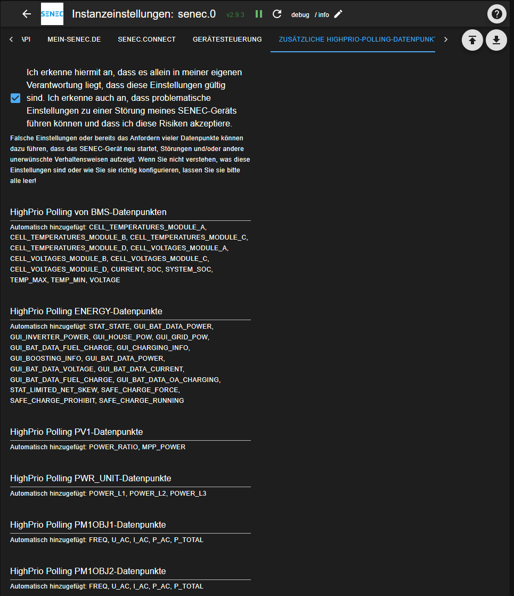

Вы можете добавить дополнительные диапазоны данных (например, BMS, PV1, WALLBOX) к опросу с высоким приоритетом. Для этого необходимо принять соответствующее заявление. Допускаются только символы от A до Z, цифры от 0 до 9 и запятые.

### Локальный OpenAPI (порт 4424)

Второй локальный интерфейс, независимый от `lala.cgi` Доступ к нему осуществляется по протоколу HTTPS через порт 4424 системы. Он использует вкладку _«Локальное подключение»_ и системный адрес совместно с локальным коннектором; при этом каждый из них работает независимо от другого.

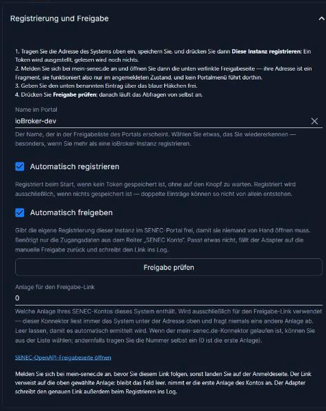

| Отношение                                  | Описание                                                                                                                           | стандарт                               |
| ------------------------------------------ | ---------------------------------------------------------------------------------------------------------------------------------- | -------------------------------------- |
| Используйте локальный OpenAPI предприятия. | Включить возможность отправки запросов через порт 4424                                                                             | Из                                     |
| Название устройства                        | Название, которое будет опубликовано на портале SENEC.                                                                             | ioBroker                               |
| Автоматическая регистрация                 | Если токен не сохранен, запросите его при запуске системы.                                                                         | А                                      |
| Автоматический выпуск                      | Чтобы самостоятельно активировать свою регистрацию через портал,                                                                   | А                                      |
| Вложение со ссылкой на релиз.              | К какому компоненту учетной записи относится данный компонент?                                                                     | Автоматически                          |
| Интервал запроса                           | Как часто читаются выбранные области (в секундах)                                                                                  | 60                                     |
| Истекло время ожидания запроса             | Время ожидания запроса (мс)                                                                                                        | 10000                                  |
| Области, требующие запроса                 | Какие маршруты запрашиваются за цикл? Для выбора также считывается табличка с типом; настенные блоки необходимо явно активировать. | Батарея, счетчик, табличка с названием |

Интерфейс доступен только для чтения. Маршруты, которые устанавливают мощность зарядки или разрядки, отклоняют любые запросы, которые может отправить клиентский токен — как до, так и после активации. Следовательно, в него нечего записывать. Что предлагает и что запрещает интерфейс, определено в [файле LOCAL\_OPENAPI\_4424.md](https://github.com/nobl/ioBroker.senec/blob/master/docs/LOCAL_OPENAPI_4424.md) .

Этот порт открывают только системы с локальным веб-интерфейсом: поколения V2 и V3 — да, поколения V4 | P4 | E4 — нет. Система, обслуживающая порт 4424, но не — нет. `lala.cgi`, неизвестен — следовательно, этот интерфейс дополняет локальный опрос, а не заменяет его.

Интервал опроса намеренно установлен на 60 секунд. Насколько эта служба способна обрабатывать данные, не тестировалось, и система легко перегружается — см. примечание выше относительно чрезмерно частого опроса. `lala.cgi` Здесь действует тот же принцип.

#### регистрация

В отличие от `lala.cgi` Для использования этого интерфейса требуется одноразовая регистрация, авторизацию которой может осуществить только владелец учетной записи.

**Если данные учетной записи SENEC введены на вкладке _«Учетная запись SENEC»_ , это происходит автоматически:** адаптер регистрируется, активирует свою регистрацию и начинает чтение. Для этого не требуется активировать коннектор mein-senec.de — адаптер один раз входит в систему для активации, а затем немедленно разрывает сессию.

Тем, кто сначала настроит коннектор mein-senec.de, сохранит его и перезапустит адаптер перед включением, будет проще найти это в журнале: сессия уже существует, и система известна, поэтому этот коннектор вообще не нужно регистрироваться.

Без указания данных учетной записи подтверждение осуществляется вручную:

1. Введите адрес растения на вкладке выше и сохраните.
2. Нажмите **«Зарегистрировать этот экземпляр»** . Система выдаст токен, который адаптер сохранит. Пока ничего не считывается.
3. **Сначала войдите на сайт mein-senec.de** , затем перейдите по ссылке активации во вкладке. Адрес является неполной ссылкой — если вы откроете её, не войдя в систему, вы попадёте на страницу входа, и цель будет потеряна. Страница недоступна через меню портала, только по этой ссылке.
4. Активируйте запись, указав имя своего устройства, нажав на синюю галочку.
5. Нажмите **«Проверить подтверждение** ». После получения сообщения о подтверждении запроса он начнется автоматически.

`_openapi.info.approvalState` Отображает состояние в любой момент времени: `unregistered`, `pending`, `approved`, `rejected` — токен был выведен с портала или принадлежит другому инвестиционному инструменту — или `error`.

**Удаление токена** приводит к удалению сохраненного токена, а также к аннулированию регистрации на портале, при условии, что данные учетной записи были введены и система идентифицирована, так что не осталось "осиротевших" записей; система перестанет принимать старый токен примерно через минуту. Если адаптер не может запросить портал, он сообщит об этом, и запись необходимо будет удалить вручную. При включенной автоматической регистрации новый токен запрашивается немедленно — таким образом, процесс начинается заново. Двойная регистрация без аннулирования первой записи приводит к появлению двух записей с одинаковым именем и невозможности их различить; поэтому регистрация отклоняется до тех пор, пока хранится токен.

### API приложения SENEC

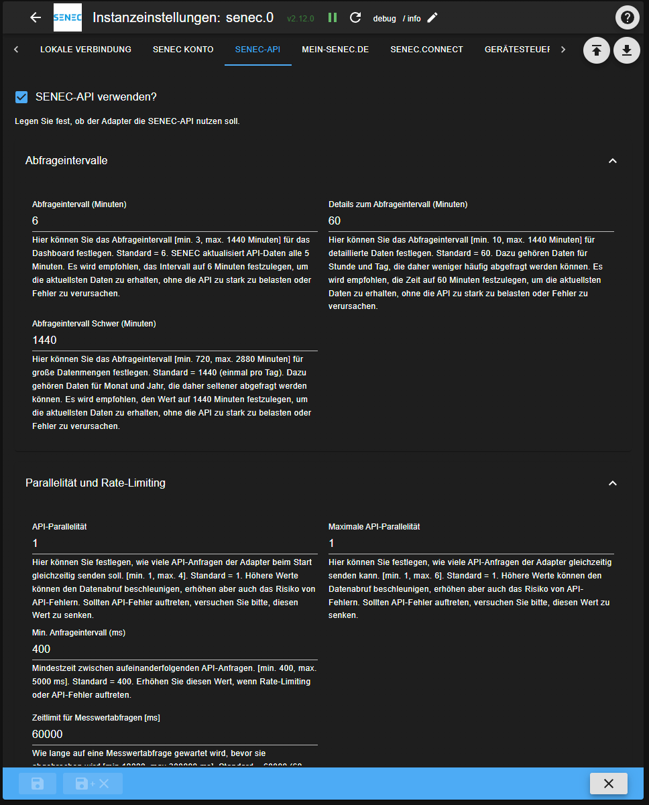

| Отношение                                       | Описание                                                                                                                                                             | стандарт     |
| ----------------------------------------------- | -------------------------------------------------------------------------------------------------------------------------------------------------------------------- | ------------ |
| Использование API приложения SENEC              | Включить запрос к Cloud API                                                                                                                                          | Из           |
| Интервал панели мониторинга                     | Интервал запроса данных на панели мониторинга/текущих данных (в минутах)                                                                                             | 6            |
| Детальный интервал                              | Интервал запроса для ежедневных измерений (в минутах)                                                                                                                | 60           |
| Тяжелый интервал                                | Интервал запроса для ежемесячных/годовых измерений (в минутах)                                                                                                       | 14:40 (24 ч) |
| Параллелизм / Максимальный параллелизм          | Ограничения на количество параллельных запросов к API.                                                                                                               | 1 / 1        |
| Минимальный интервал запроса                    | Минимальное время между запросами к API (мс)                                                                                                                         | 400          |
| Ограничение по времени для запросов к API       | Время ожидания обычного API-запроса — Панель мониторинга, Состояние системы, Подробности (мс). Увеличьте это значение, если эти запросы регистрируются как таймауты. | 30000        |
| Ограничение по времени для запроса на измерение | Время ожидания агрегации измерений (мс). Увеличьте это значение, если частые опросы в журнале приводят к превышению времени ожидания.                                | 60000        |

#### Восстановление истории

API-коннектор может полностью восстановить исторические данные измерений (суммы за все время). Настройте режим восстановления и начальный год по мере необходимости. Этот процесс выполняется в фоновом режиме во время интенсивного цикла опроса.

### mein-senec.de

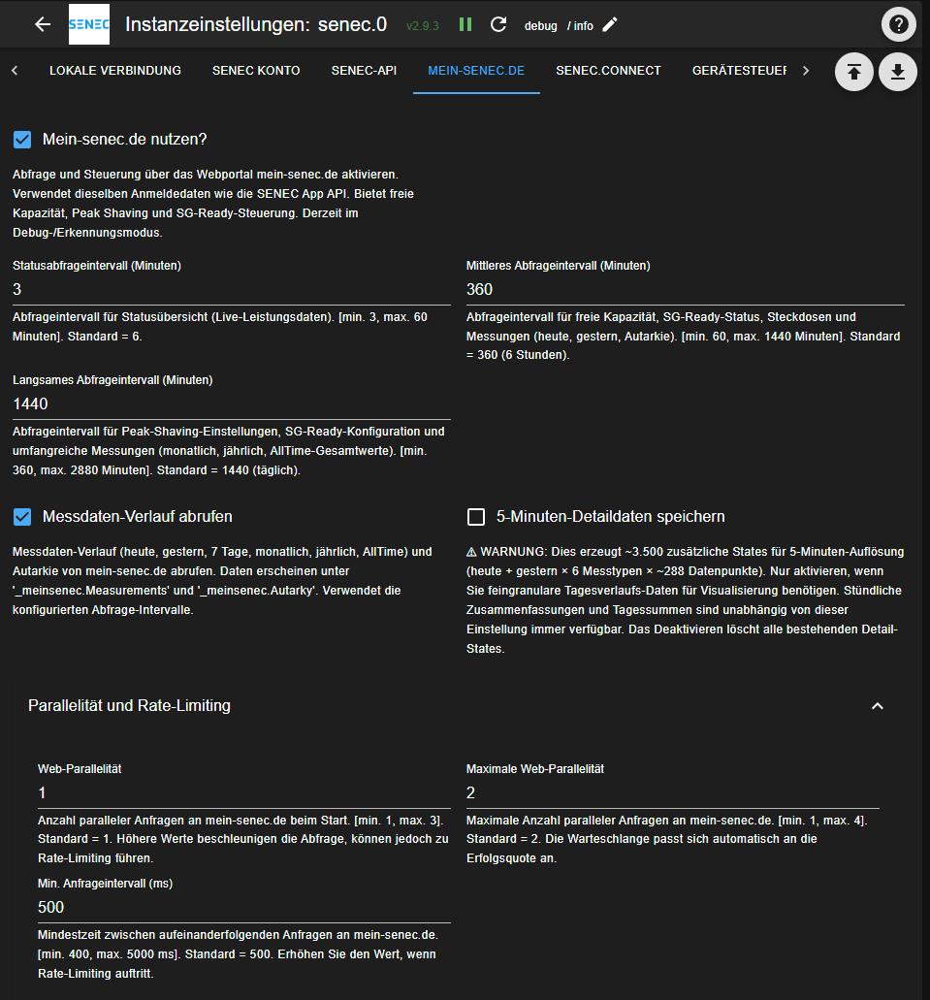

| Отношение                              | Описание                                                                              | стандарт     |
| -------------------------------------- | ------------------------------------------------------------------------------------- | ------------ |
| use mein-senec.de                      | Активировать запрос веб-портала                                                       | Из           |
| Интервал состояния                     | Интервал запроса данных о состоянии (минуты)                                          | 6            |
| Средний интервал                       | Интервал запроса за вчерашний день/самодостаточность/резервная мощность (в минутах)   | 360 (6 ч)    |
| Медленный интервал                     | Интервал запроса для получения ежемесячных/годовых/общевременных данных (в минутах)   | 14:40 (24 ч) |
| История измерений запроса              | Активировать запрос данных измерений                                                  | Из           |
| Включите подробные данные за 5 минут.  | Запрос подробных данных с высокой степенью детализации (\~3500 дополнительных штатов) | Из           |
| Параллелизм / Максимальный параллелизм | Ограничения на количество параллельных запросов                                       | 1 / 2        |
| Минимальный интервал запроса           | Минимальное время между запросами (мс)                                                | 500          |

### Прочие активы счета

Если к учетной записи mein-senec.de привязано несколько систем (замененное устройство остается видимым рядом со своим преемником), адаптер распознает все системы при запуске и помещает каждую из них в \[соответствующую категорию/настройку]. `_meinsenec.Plants.{steuereinheitnummer}.` к.

По умолчанию запрашивается только первая система. Каждая дополнительная система получает свой собственный переключатель. `control.Plants.{steuereinheitnummer}.poll` Изначально эта функция отключена. При её включении уровень медленных запросов включает эту систему и заполняет её той же структурой измерений, что и основная система:

| Состояние                                                       | Содержание                                         |
| --------------------------------------------------------------- | -------------------------------------------------- |
| `_meinsenec.Plants.{sn}.System.*`                               | Название продукта, номер устройства, номер системы |
| `_meinsenec.Plants.{sn}.Measurements.Daily.today` /`.yesterday` | Почасовые значения                                 |
| `_meinsenec.Plants.{sn}.Measurements.Monthly.*`                 | Суточные значения за месяц                         |
| `_meinsenec.Plants.{sn}.Measurements.Yearly.*`                  | Ежемесячные значения в год                         |
| `_meinsenec.Plants.{sn}.Measurements.AllTime.*`                 | Итоговые суммы                                     |
| `_meinsenec.Plants.{sn}.Autarky.*`                              | Самодостаточность за период                        |

Суммарные значения извлекаются один раз при первом обнаружении системы, даже если переключатель выключен — таким образом, окончательные значения деактивированного устройства доступны без постоянного запроса к нему.

Обратите внимание, что каждая дополнительно активированная система увеличивает количество запросов к порталу. Если вам нужны только исторические данные по более старому устройству, лучше оставить переключатель выключенным.

### SENEC.Connect

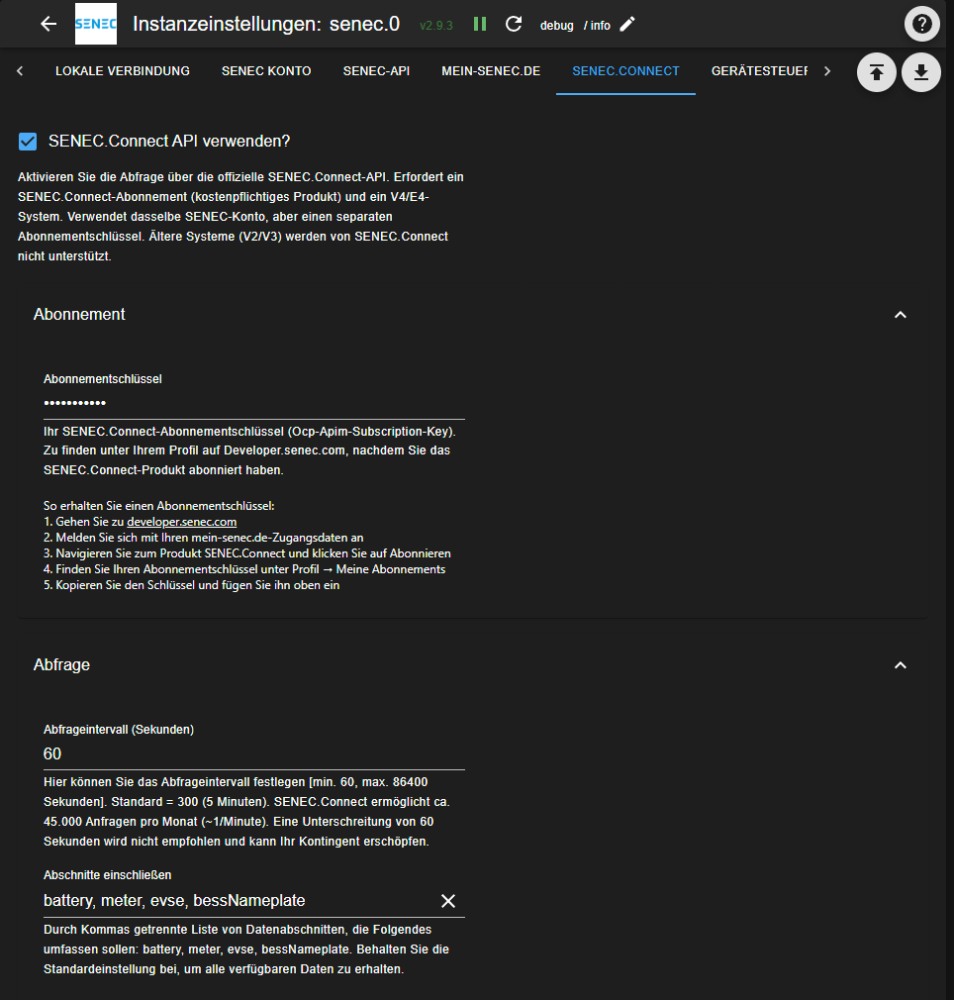

| Отношение                      | Описание                                  | стандарт                                          |
| ------------------------------ | ----------------------------------------- | ------------------------------------------------- |
| Используйте SENEC.Connect      | Включите выполнение запросов к API Azure. | Из                                                |
| Интервал запроса               | Частота запросов (в секундах)             | 300                                               |
| Истекло время ожидания запроса | Время ожидания ответа (мс)                | 30000                                             |
| Ключ подписки                  | Ключ подписки API Azure                   | —                                                 |
| Включенные области             | Какие области данных запрашиваются?       | батарея, счетчик, EVSE, табличка с названием Bess |

### Внешние источники

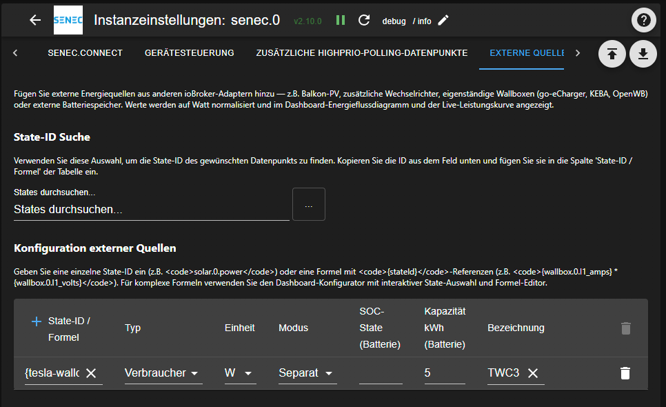

Добавьте внешние источники энергии от других адаптеров ioBroker — например, солнечные панели на балконе, дополнительные инверторы, автономные настенные зарядные устройства, тепловые насосы или внешние аккумуляторные батареи. Значения нормализуются в ваттах и отображаются на диаграмме потока энергии и кривой мощности в реальном времени на панели управления.

Воспользуйтесь **поиском по идентификатору штата** , чтобы найти идентификатор штата нужной точки данных и вставить его в таблицу.

| Расколоть                     | Описание                                                                                                                                         |
| ----------------------------- | ------------------------------------------------------------------------------------------------------------------------------------------------ |
| Идентификатор штата / Формула | Идентификатор одного штата (например, `solar.0.power`) или формула с `{stateId}` -Ссылки (например, `{wallbox.0.l1_amps} * {wallbox.0.l1_volts}`) |
| тип                           | Фотоэлектрические панели, потребители (настенные панели, тепловые насосы и т. д.) или аккумуляторы.                                              |
| Единица                       | Вт или кВт — это значение, применяемое к конечному значению.                                                                                     |
| режим                         | **Интегрировать** = добавить к общему значению SENEC (один узел). **Разделить** = отобразить как отдельный узел в потоке энергии.                |
| штат СОК                      | (Только для батареи) Укажите идентификатор штата для определения уровня заряда (%)                                                               |
| емкость                       | (Только для батареи) Емкость батареи в кВт·ч — позволяет оценить время работы.                                                                   |
| Обозначение                   | Отобразить имя на диаграмме потока энергии                                                                                                       |

Поддержка формул `+ - * / ( )` Операторы. Идентификаторы состояний без фигурных скобок автоматически распознаются, если они содержат арифметические операторы. Для сложных формул планируется внедрение конфигуратора на основе панели управления с интерактивным выбором состояний.

### Управление устройством

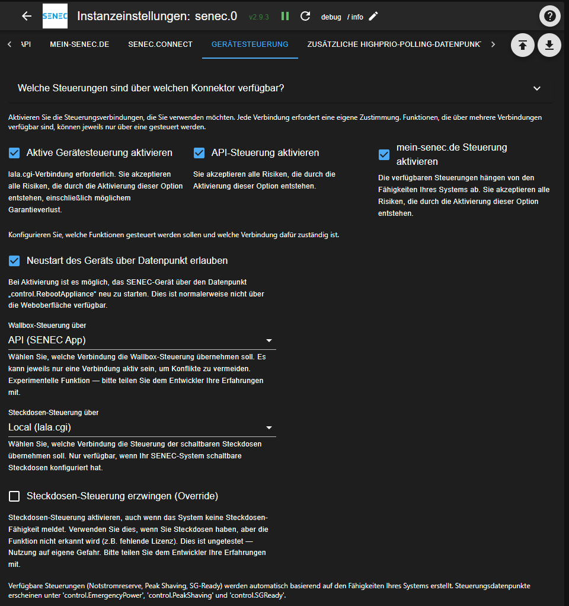

Функции управления позволяют изменять настройки устройства SENEC. Каждая функция управления доступна через определенные разъемы:

| рулевое управление                  | Местный | API | Веб |
| ----------------------------------- | :-----: | :-: | :-: |
| Принудительная зарядка аккумулятора |    х    |     |     |
| Блокировка разряда                  |    х    |     |     |
| Перезагрузите устройство            |    х    |     |     |
| Аварийный резерв электроэнергии     |         |     |  х  |
| Peak Shaving                        |         |     |  х  |
| SG-Ready                            |         |     |  х  |
| Розетки с переключателем            |    х    |     |  х  |
| Управление настенным блоком         |    х    |  х  |     |

**Используйте на свой страх и риск.** Функции управления должны быть явно включены в настройках с соответствующим предупреждением. Адаптер не защищает от конфликтующих команд от нескольких разъемов.

### Отладка и ведение журналов

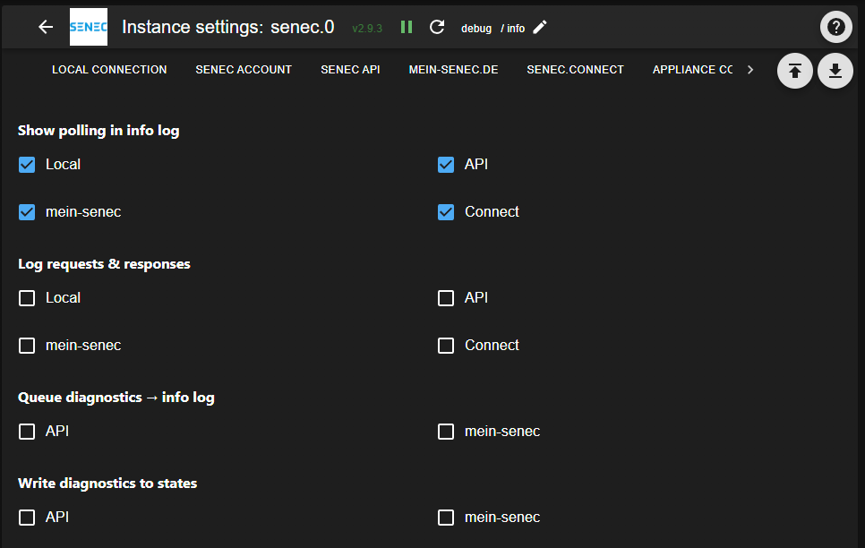

Настраивается для каждого коннектора (Local, local OpenAPI, API, mein-senec.de, Connect):

- **Отображать информацию об опросе в журнале информации** — Отображает сообщения о состоянии опроса в журнале информации, а не только в журнале отладки.
- **Запись запросов и ответов в журнал** — Ведет журнал подробных сведений о HTTP-запросах на уровне отладки (может содержать конфиденциальные данные).
- **Диагностика очереди в информационном журнале** — Отображает статистику очереди в информационном журнале (только для API и веб-версии)
- **Запись диагностических данных в состояния** — Записывает данные очереди в выделенные состояния ioBroker (только для API и веб-версии)

#### Создать отладочный журнал

Большинство проблем можно выявить по лог-файлу, а без него — практически ни одной.

1. Установите уровень логирования для экземпляра в **режим отладки** : ioBroker Admin → Instances → senec instance → Поле выбора уровня логирования. `silly` Оно существует, но редко даёт более глубокое понимание и порождает много шума.
2. На вкладке **«Отладка и логирование»** адаптера включите параметр _«Логировать запросы и ответы»_ для соответствующего коннектора. Этот параметр изменяет сообщение «запрос не удался» на «данный URL ответил с таким-то статусом».
3. Дайте процессу поработать достаточно долго, чтобы проблема возникла хотя бы один раз. Для медленно обрабатываемых запросов — значений измерений, ежемесячных или годовых данных — это может означать ожидание следующего цикла вместо перезапуска.
4. Скопируйте лог из вкладки «Логи» ioBroker или из файла. `/opt/iobroker/log/` использовать.
5. Затем переключитесь обратно в **режим «информация»** . Журнал отладки очень обширен и может заполнить жесткий диск на несколько недель.

**Пожалуйста, ознакомьтесь с этим перед пересылкой.** Журнал запросов содержит URL-адреса и ответы, которые могут включать идентификатор системы, номер системы и серийный номер. Пароли не включены, но это ваши данные. Замените все, что вы не хотите делать общедоступным.

#### Сообщить об ошибке

Пожалуйста, отправляйте отчеты через [GitHub](https://github.com/nobl/ioBroker.senec/issues) . Вот что ускоряет обработку отчета:

- **Какая система** — модель и, если известно, версия прошивки (`FACTORY.*` и `SYS_UPDATE.*` (Включает оба варианта при условии, что локальный коннектор запущен)
- **Какие коннекторы** активны, поскольку один и тот же симптом может иметь разные причины как локально, так и в облаке.
- **Версии адаптера и ioBroker** , а также версия для Node.js.
- **Что ожидалось и что произошло вместо этого** — фразу «отсутствует уровень заряда батареи» можно отредактировать, «не работает» требует уточнения.
- **Приведен соответствующий фрагмент журнала** на уровне отладки, содержащий несколько строк до и после ошибки, а не только саму строку с ошибкой.

Прежде чем начать: неправдоподобные значения обычно исходят от устройства, а не от адаптера. Адаптер в основном передает значения, поэтому температура или уровень заряда, которые отображаются некорректно на панели управления, обычно будут выглядеть так же некорректно и в веб-интерфейсе устройства. Быстрый просмотр там часто решает проблему — а если нет, то это сравнение является наиболее полезной информацией в сообщении.

## Встроенная панель управления

Адаптер включает в себя полноценную веб-панель управления, доступную по адресу: `http://<iobroker-ip>:8082/senec/` Для его работы требуется адаптер ioBroker.web, и он отображается на главной странице ioBroker.web.

Функции:

- Темный и светлый дизайн (переключаются в заголовке).
- Интернационализация — 11 языков, соответствует языковым настройкам браузера.
- Обновления в реальном времени через подписки на состояние socket.io.
- Данные со всех коннекторов, имеющих значки источника.
- Доступ с помощью клавиатуры (навигация по вкладкам, метки ARIA).

### вкладка «Обзор»

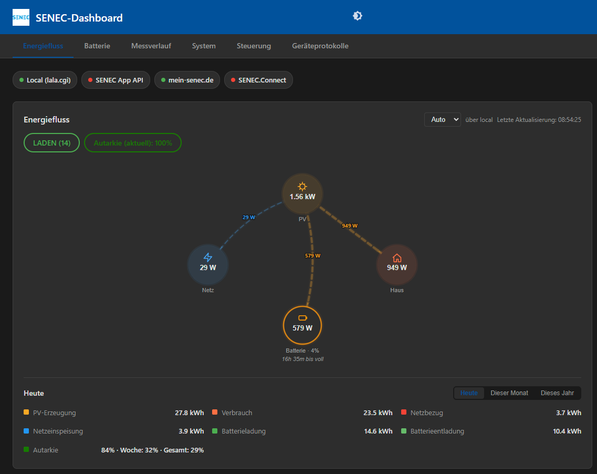

**Диаграмма потока энергии** — Визуализация потоков энергии в реальном времени в формате SVG между фотоэлектрическими панелями, батареей, сетью, домом и настенным зарядным устройством. Анимированные пути потока с толщиной, пропорциональной мощности. Отображение состояния заряда батареи (SOC) с указанием уровня заряда. Значок режима работы. Оценка времени (до разряда/заряда). Итоговые данные за период (сегодня/месяц/год) с указанием процента самообеспечения. Выбор источника данных (Авто/Локальный/API/Веб).

**График изменения мощности в реальном** времени — линейный график изменения мощности в реальном времени для всех пяти показателей (солнечные батареи, дом, сеть, батарея, настенное зарядное устройство). Плавная монотонная кубическая интерполяция между точками данных. Предустановленные временные окна от 10 минут до 24 часов, а также масштабирование с помощью колесика мыши (от 5 мин до 30 дней, с понижением разрешения для повышения производительности). Перетаскивание для прокрутки истории с отложенной загрузкой и маркерами даты в полночь. Отдельные линии можно отображать/скрывать, включая дополнительную линию состояния заряда (по умолчанию отключена) справа по оси 0–100%. Переключатель паузы/отключения. Кнопка «Live» для возврата к реальному времени. Когда адаптер истории (InfluxDB, SQL или History) включен для состояний мощности, график предварительно заполняется историческими данными о нагрузке. Каждое состояние обрабатывается индивидуально — состояния могут записываться разными адаптерами истории, и незарегистрированное состояние влияет только на свою собственную линию. Кнопка ⓘ отображает состояния за каждой линией вместе с адаптером истории записи — это позволяет легко понять, почему у линии нет прошлых данных. Кнопка **«Цвета»** задает цвет каждой линии; **цвет по умолчанию** сбрасывается; тип сохраняет свой цвет на каждом графике, который его отображает, а палитра находится в адаптере, а не в браузере — все страницы, указывающие на экземпляр, используют ее совместно.

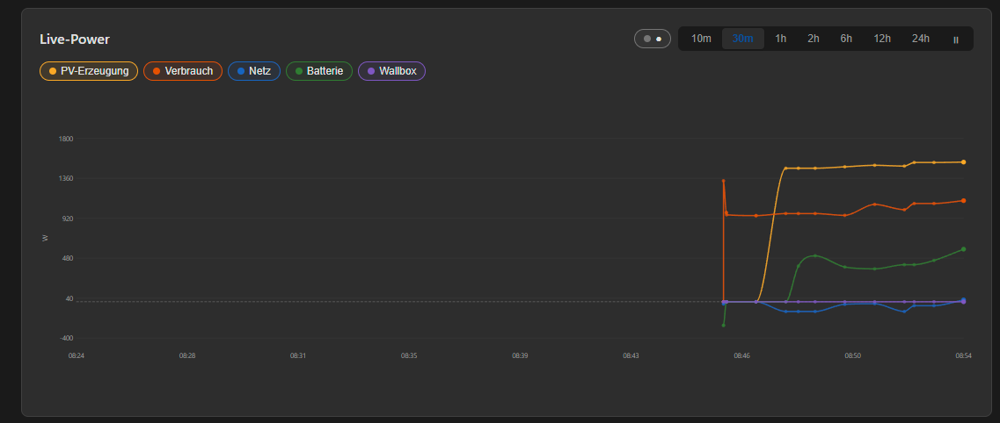

**Хронология событий** — компактная 24-часовая полоса, отображающая сегодняшние оповещения (оранжевый), ошибки (красный) и сбои (фиолетовый) из журнала устройства. Наведите курсор для получения подробной информации. Автоматически обновляется каждые 10 минут. Требуется настроенный IP-адрес устройства.

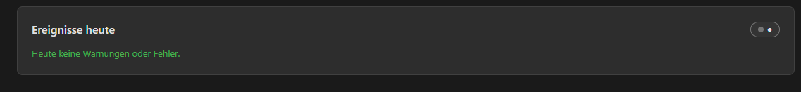

### Планшет с батарейным питанием

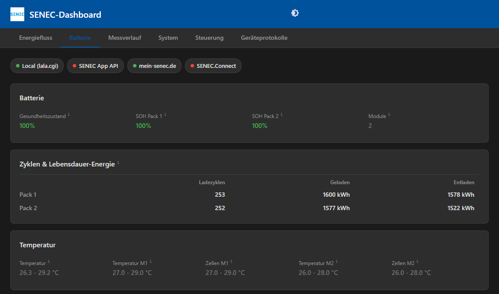

- **Отчет о состоянии здоровья (SOH)** — Состояние здоровья системы и упаковки с цветовой кодировкой (зеленый > 80%, оранжевый > 60%, красный)
- **Статус модуля** — Количество активных/загружаемых/выгружаемых модулей
- **Циклы зарядки** — количество циклов на один комплект и энергия за весь срок службы (заряжено/разряжено)
- **Тепловая карта напряжения ячеек** — цветовая сетка, отображающая напряжение отдельных ячеек во всех модулях. Красный = самое низкое значение, зеленый = самое высокое. Индикаторы разницы для каждого модуля. Позволяет мгновенно увидеть дисбаланс ячеек.
- **Температуры** — общая, на модуль и на ячейку.
- **Комплект электрических систем** — Pro-Pack для измерения напряжения и тока

Данные получены из локальных источников (BMS) и/или API (SystemDetails) с указанием источника.

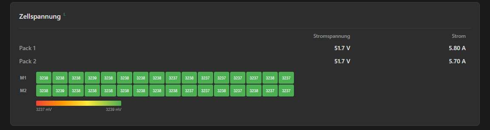

### вкладка «Диаграммы»

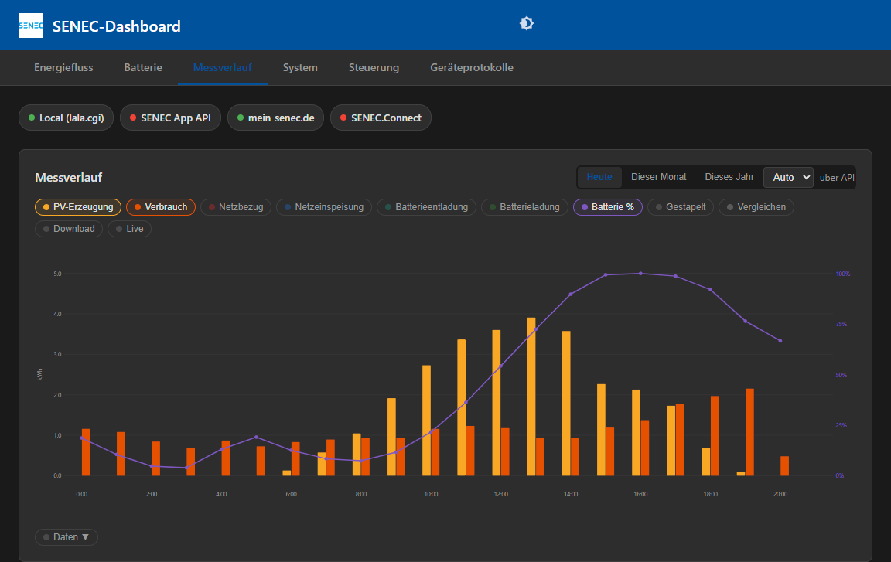

Гистограммы данных измерений энергопотребления:

- **Сегодня** — Часовая шкала (автоматически ограничивается часами, по которым есть данные)
- **В этом месяце** — ежедневные бары
- **В этом году** — Месячные бары

Функции:

- Можно отображать/скрывать отдельные типы измерений (солнечные батареи, потребление, импорт/экспорт в сеть, зарядка/разрядка аккумуляторов).
- Сводная диаграмма (производство против потребления)
- Режим сравнения (вчера, предыдущий месяц, выбираемый год)
- Наложение графика уровня заряда батареи (%) . API-коннектор считывает эти данные из истории измерений. Сайт mein-senec.de не предоставляет такой истории, поэтому веб-коннектор вместо этого измеряет текущий уровень заряда: почасовые средние значения для ежедневного просмотра, суточные средние значения для месячного просмотра. Таким образом, эти значения начинают отображаться только тогда, когда адаптер работает — для дня, когда адаптер не работал после полуночи, суточные средние значения отсутствуют и не могут быть получены задним числом. В годовом просмотре уровень заряда батареи в веб-коннекторе не отображается.
- Выбор источника данных (Автоматический/API/Веб)
- Таблица данных
- экспорт изображения в формате PNG
- режим автоматического обновления
- Цвета рядов отображаются за кнопкой **«Цвета»** , при этом доступны **цвета по умолчанию** для сброса. Ряды сравнения намеренно исключены из выбора: сравнение отображается цветом своего типа с уменьшенной прозрачностью, автоматически следуя его настройкам.

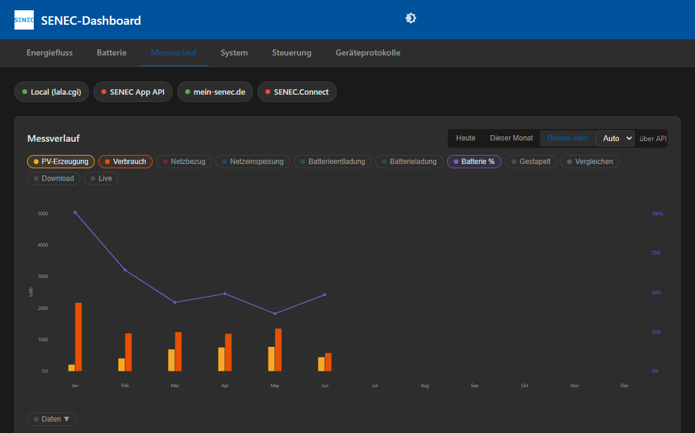

### Вкладка «Система»

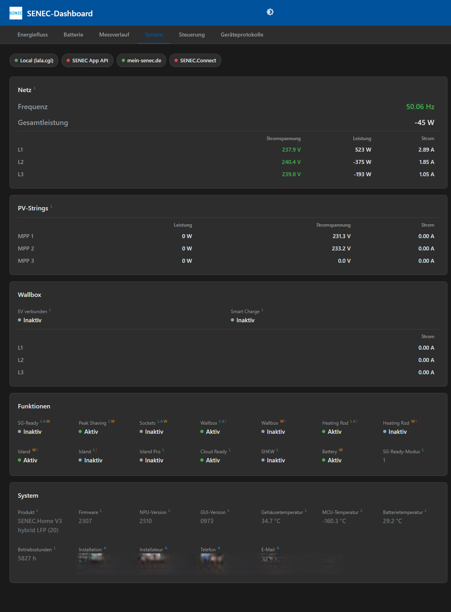

- **Качество электроэнергии** — частота, полная мощность, напряжение/мощность/ток по фазам. Поддерживает EnFluRi 1 и EnFluRi 2 (автоматическое определение).
- **Фотоэлектрические стринги** — мощность, напряжение и ток Pro-Tracker MPP
- **Wallbox** — состояние подключения электромобиля, интеллектуальная зарядка, ток зарядки по фазам.
- **Флаги функций** — Активные функции для каждого разъема с обнаружением отклонений
- **Сведения о системе** — Продукт, версия прошивки, версия графического интерфейса/нейронного процессора, состояние инвертора, температура (корпуса, микроконтроллера, батареи, инвертора), время работы, дата установки, контактные данные установщика.

На значках источника указано, какой коннектор обеспечивает соответствующее значение.

### Вкладка «Управление»

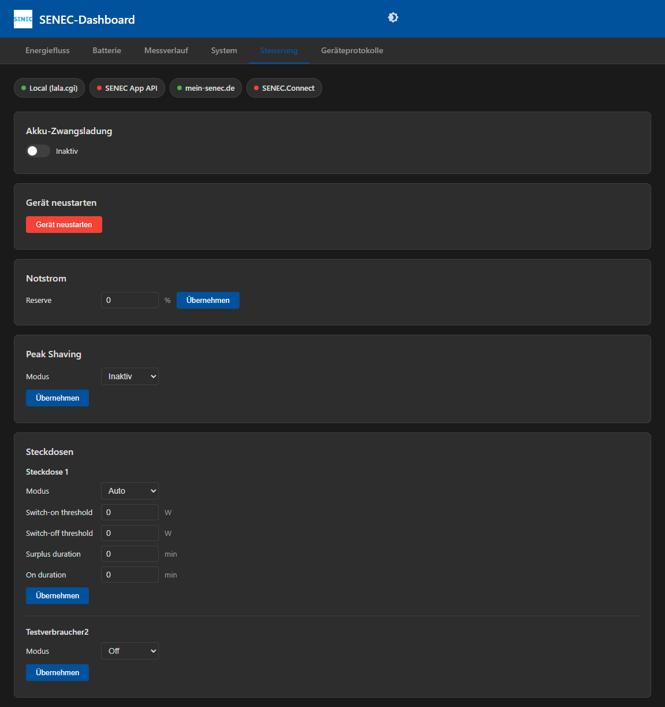

Интерактивное управление, соответствующее возможностям управления адаптера:

- Принудительная зарядка аккумулятора (переключатель)
- Перезагрузите устройство (с подтверждением).
- Аварийный резерв мощности (в процентах)
- Сглаживание пиков (поля, зависящие от моды)
- SG-Ready (Активация + Пороги)
- Переключаемые сокеты (режим работы каждого сокета, пороговые значения, редактирование имени)
- Настенная зарядная станция (умная зарядка, ограничение тока)

Контроллеры проверяют доступность разъемов и отображают предупреждения, если необходимый разъем неактивен. Кнопка «Применить» отображает сообщение «Отправлено».

### вкладка «Статистика»

mein-senec.de предлагает еженедельный экспорт CSV-файлов с 5-минутным разрешением, охватывающий несколько лет — гораздо больше данных, чем может содержать ioBroker. Таким образом, данные не сохраняются постоянно: адаптер хранит только список доступных недель, обновляемый раз в день, и загружает данные за одну неделю только по запросу. Данные существуют только пока открыта вкладка.

- Выбор системы, который также отображает предыдущие устройства учетной записи (не применимо, если имеется только одна система). Система, запрашиваемая данным экземпляром, будет предварительно выбрана.
- Выбор недели с указанием диапазона дат по неделям.
- Ежедневный фильтр — ограничивает количество строк за неделю (примерно 2000) одним днем.
- Разрешение — почасовые средние значения или 5-минутные исходные значения.
- Переключатели для десяти экспортируемых столбцов, включая напряжение батареи, ток и уровень заряда.
- Заголовки столбцов можно сортировать; третий щелчок восстанавливает хронологический порядок.
- Сводная строка, отображающая минимальное, среднее и максимальное значения отображаемых строк.
- Табличный или графический вид; на диаграмме столбцы мощности имеют общую левую ось кВт, процентные значения имеют свою собственную правую ось 0–100%, а пробелы в строке разрывают линию, а не перекрываются.
- Скачать текущий выбор в виде CSV-файла

Для работы требуется активированный и подключенный коннектор mein-senec.de.

### вкладка «Протоколы»

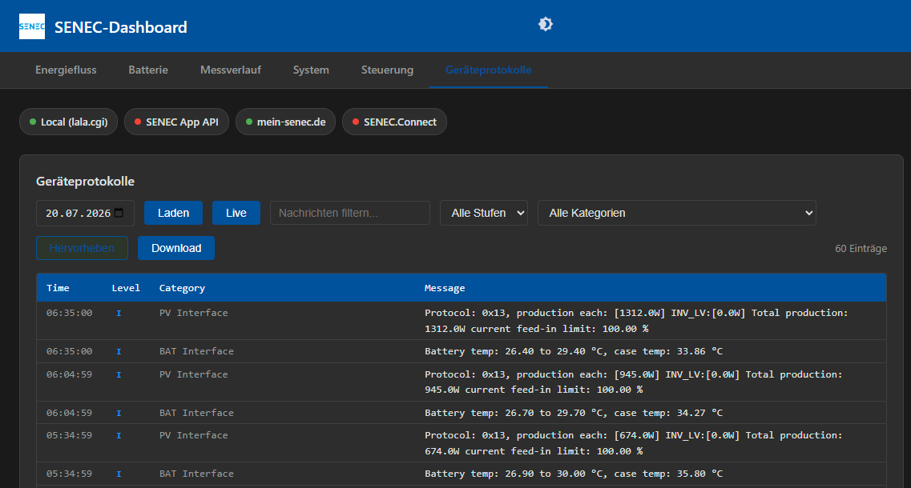

Поиск в журналах устройств SENEC по дате:

- Фильтруемая таблица (время, уровень, категория, сообщение)
- Фильтры этапов: Информация, Предупреждение, Ошибка, Паника
- Фильтр по категориям (автоматически заполняется на основе записей журнала)
- Поиск по свободному тексту
- Цветовая кодировка линий в зависимости от степени тяжести
- Самые новые записи — первыми
- Режим реального времени — автоматическое обновление журнала за сегодняшний день (совместимость с UTC)
- Загрузите необработанные файлы журналов.

Требуется указать IP-адрес устройства (даже если локальный коннектор не включен).

## Ссылка на штат

Адаптер создает состояния, организованные по типу коннектора и области данных. Все состояния доступны только для чтения, если в следующих таблицах они не помечены как доступные для записи.

### Подключение и статус (`info.*`)

| Состояние                | Описание                                                                                                                     |
| ------------------------ | ---------------------------------------------------------------------------------------------------------------------------- |
| `info.connection`        | Общий статус соединения (истина, если коннектор активен)                                                                     |
| `info.connectionStatus`  | Подробная информация о состоянии соединения: `all` (все настроенные разъемы подключены) `partial` (частично связанные), `none` |
| `info.localConnected`    | Статус локального соединения (lala.cgi)                                                                                      |
| `info.apiConnected`      | статус подключения API приложения SENEC                                                                                      |
| `info.webConnected`      | статус подключения my-senec.de                                                                                               |
| `info.connectConnected`  | Статус подключения SENEC.Connect                                                                                             |
| `info.openapiConnected`  | Статус подключения локального OpenAPI (порт 4424)                                                                            |
| `info.lastPoll.HighPrio` | Временная метка последнего локального запроса с высоким приоритетом.                                                         |
| `info.lastPoll.LowPrio`  | Временная метка последнего локального запроса с низким приоритетом.                                                          |

### Штаты TLS (`_local.tls.*`)

| Состояние                    | тип        | Писать | Описание                                                                                 |
| ---------------------------- | ---------- | :----: | ---------------------------------------------------------------------------------------- |
| `_local.tls.mode`            | нить       |   нет  | Активный режим проверки TLS: `user`, `cached`, `tofu` или `none`                          |
| `_local.tls.fingerprint`     | нить       |   нет  | Отпечаток SHA-256 принятого сертификата устройства (режим TOFU, зашифрованный)           |
| `_local.tls.userCaPem`       | нить       |   Да   | Сертификат центра сертификации, загруженный пользователем (PEM, зашифрованный).          |
| `_local.tls.cachedCaPem`     | нить       |   нет  | Сертификат центра сертификации (CA) загружен с сайта mein-senec.de (PEM, зашифрованный). |
| `_local.tls.certFetchFailed` | логический |   Да   | На `false` запланирована попытка загрузки нового сертификата CA.                          |

### Настройки веб-панели управления (`_dashboard.*`)

| Состояние           | тип  | Писать | Описание                                                                                                                                                                                                                                                                                                                                                                                                                                                                                    |
| ------------------- | ---- | :----: | ------------------------------------------------------------------------------------------------------------------------------------------------------------------------------------------------------------------------------------------------------------------------------------------------------------------------------------------------------------------------------------------------------------------------------------------------------------------------------------------- |
| `_dashboard.colors` | нить |   Да   | Цвета диаграммы, выбранные на веб-панели управления, передаются в виде JSON-объекта из элемента палитры. `#rrggbb` Сохраняются только те записи, которые отклоняются от встроенного стандарта. Панель управления записывает значение, адаптер просто хранит его и никогда не вычисляет — оно находится здесь, а не в браузере, поэтому все страницы одного и того же экземпляра используют одну и ту же палитру. Записи, которые панель управления не распознает, игнорируются при загрузке. |

### Местные штаты

Данные из запроса lala.cgi хранятся непосредственно под именем области (например, `ENERGY.*`, `BMS.*`, `PV1.*`, `WIZARD.*`).

**Ключевые энергетические государства:**

| Состояние                         | тип       | Описание                                                                                              |
| --------------------------------- | --------- | ----------------------------------------------------------------------------------------------------- |
| `ENERGY.GUI_INVERTER_POWER`       | Число (W) | Текущая выработка фотоэлектрической энергии                                                           |
| `ENERGY.GUI_BAT_DATA_POWER`       | Число (W) | Питание от батареи (положительный полюс = зарядка, отрицательный = разрядка)                          |
| `ENERGY.GUI_GRID_POW`             | Число (W) | Мощность сети (положительный полюс = потребление, отрицательный полюс = подача электроэнергии в сеть) |
| `ENERGY.GUI_HOUSE_POW`            | Число (W) | Текущее потребление домохозяйств                                                                      |
| `ENERGY.GUI_BAT_DATA_FUEL_CHARGE` | Число (%) | Уровень заряда батареи                                                                                |
| `ENERGY.STAT_STATE`               | Число     | код состояния работы                                                                                  |
| `ENERGY.STAT_STATE_Text`          | текст     | Рабочий статус в текстовом виде                                                                       |
| `ENERGY.STAT_HOURS_OF_OPERATION`  | Число (h) | Часы работы                                                                                           |

**Важные состояния системы управления батареей (BMS):**

| Состояние                              | тип         | Описание                             |
| -------------------------------------- | ----------- | ------------------------------------ |
| `BMS.MODULE_COUNT`                     | Число       | Количество аккумуляторных модулей    |
| `BMS.SOH.{n}`                          | Число (%)   | Состояние здоровья по каждому модулю |
| `BMS.CYCLES.{n}`                       | Число       | Циклы зарядки на модуль              |
| `BMS.CELL_VOLTAGES_MODULE_{A-D}.{n}`   | Число (мВ)  | Напряжение отдельных ячеек           |
| `BMS.TEMP_MIN.{n}` /`BMS.TEMP_MAX.{n}` | Число (°C)  | Диапазон рабочих температур модуля   |
| `BMS.VOLTAGE.{n}` /`BMS.CURRENT.{n}`   | Номер (В/А) | Напряжение и ток батареи             |

### Состояния API (`_api.*`)

Данные Cloud API хранятся в `_api.Anlagen.{systemId}.*` сохранено:

- `Dashboard.currently.*` — Значения мощности в реальном времени (Вт)
- `Measurements.Daily.*` — Данные почасовых измерений (кВт·ч)
- `Measurements.Monthly.*` — Данные ежедневных измерений (кВт·ч)
- `Measurements.Yearly.*` — Ежемесячные данные измерений (кВт·ч)
- `Measurements.AllTime.*` — Общее потребление энергии за весь срок службы (кВт·ч)
- `SystemDetails.*` — Подробная информация о батарее, температурах, прошивке
- `SystemStatus.*` — Рабочее состояние, флаги функций

### Состояния веб-сайта (`_meinsenec.*`)

Данные mein-senec.de хранятся в `_meinsenec.*` сохранено:

- `Status.*` — Текущие значения мощности (кВт), рабочее состояние
- `Measurements.*` — Исторические данные измерений (кВт·ч)
- `Autarky.*` — Процент самообеспеченности (день/неделя/месяц/год/всего)
- `EmergencyPower.*` — Настройки аварийного резерва питания
- `PeakShaving.*` — Максимальная конфигурация для бритья
- `SGReady.*` — Настройки, соответствующие требованиям SG
- `Sockets.*` — Состояния переключаемых розеток

### Соединить состояния (`_connect.*`)

Данные SENEC.Connect хранятся в `_connect.Systems.{system_id}.*` с подобластями батареи и счетчика. Учетная запись может включать несколько систем; каждая получает свой собственный канал, названный в соответствии с ее моделью и адресованный через в `bessNameplate` Сообщаемый идентификатор системы — это позволяет системе сохранять свои состояния, даже если API возвращает системы в другом порядке. `_connect.info.systemCount` сообщает, сколько систем видит API.

Раздел `bessNameplate` Запрос выполняется всегда, независимо от настроенных разделов, поскольку он содержит этот идентификатор.

Настенные коробки хранятся аналогичным образом, под соответствующим указанным номером. `id`: `_connect.Systems.{system_id}.evse.{wallbox_id}.*` Если объект wallbox исчезает из ответа, его состояния удаляются, а не сохраняются с последними значениями.

Если система не сообщает об отсутствии `system_id` Вместо этого используется серийный номер. Система распознается по каждому идентификатору, который она когда-либо сообщала, поэтому ответ, в котором отсутствует один из этих идентификаторов, не приведет к его перенаправлению. Если ответ вообще не содержит идентификатора, система использует позицию в ответе, как это было до версии 2.15.0, и очистка приостанавливается на это время.

Состояния системы, которая больше не отправляет данные в API, удаляются. В адаптерах до версии 2.15.0 системы нумеровались в соответствии с их позицией в ответе. `_connect.Systems.0.*` Эти состояния будут удалены во время первого опроса после обновления, как только будут идентифицированы соответствующие системы.

**Для пользователей, регистрирующих состояния SENEC.Connect с помощью адаптера истории** (History, InfluxDB, SQL): этот параметр привязан к самому состоянию и будет потерян вместе со старым состоянием. Автоматическое продолжение регистрации данных прекратится — пожалуйста, повторно включите регистрацию состояний по новым путям после обновления.

### OpenAPI утверждает (`_openapi.*`)

Измеренные значения локального OpenAPI приведены ниже. `_openapi.*` по одному каналу на каждую область:

| канал                          | Содержание                                                                                                                       |
| ------------------------------ | -------------------------------------------------------------------------------------------------------------------------------- |
| `_openapi.battery.*`           | Состояние заряда, рабочее состояние, мощность, напряжение, ток                                                                   |
| `_openapi.meter.*`             | Электроэнергия из сети, потребление домохозяйств, фотоэлектрическая энергия, избыток электроэнергии                              |
| `_openapi.bessNameplate.*`     | Модель, серийный номер, вместимость и номинальные значения                                                                       |
| `_openapi.evse.{wallbox_id}.*` | На каждую розетку настенной приставки приходится один канал — система показывает четыре канала, даже без подключенной приставки. |
| `_openapi.bess.*`              | Только при выборе нескольких значений возвращается пустой результат.                                                             |
| `_openapi.info.approvalState`  | `unregistered`, `pending`, `approved`, `rejected` или `error`                                                                    |
| `_openapi.info.lastPoll`       | Временная метка последнего успешного запроса                                                                                     |

Памятка считывается в каждом цикле, даже если устройство не выбрано. Обычно адаптер распознает устройство по общему имени сертификата, который он предоставляет на порту 4424 — это имя является серийным номером самого устройства. Таким образом, сертификат присваивает имя именно этому устройству, чего не делает сертификат локального веб-интерфейса. Памятка служит резервным вариантом на случай, если это имя нечитаемо: в этом случае устройство идентифицируется по серийному номеру, и это единственный способ привязать устройство к учетной записи — и, следовательно, автоматически активировать регистрацию.

Регистрационный токен хранится в зашифрованном виде. `_openapi.token` Таким образом, дерево объектов содержит зашифрованный текст, а не сам токен. Состояние помечено как нечитаемое, но эта пометка является лишь индикацией в ioBroker — фактической защитой является шифрование.

Эти данные поступают непосредственно с предприятия и получены из `lala.cgi` - Штаты независимы. Если оба показывают одно и то же значение, значит, измерения проводились в разных точках, и их значения в ваттах не обязательно должны совпадать.

### Внешние состояния (`_external.*`)

Данные из внешних источников хранятся в `_external.{typ}.{index}.*` сохранено:

| Состояние                        | Описание                                           |
| -------------------------------- | -------------------------------------------------- |
| `_external.pv.{n}.power`         | Внешняя фотоэлектрическая мощность (Вт)            |
| `_external.consumer.{n}.power`   | Внешний потребитель (W)                            |
| `_external.battery.{n}.power`    | Питание от внешней батареи (Вт, обозначено знаком) |
| `_external.battery.{n}.soc`      | Уровень заряда внешней батареи (%)                 |
| `_external.battery.{n}.capacity` | Емкость внешнего аккумулятора (кВт·ч)              |
| `_external.{typ}.{n}.label`      | Пользовательская метка                             |
| `_external.{typ}.{n}.mode`       | Режим отображения (интегрированный/раздельный)     |
| `_external.{typ}.{n}.sourceId`   | Идентификатор иностранного государства или формула |

### Управляющие состояния (`control.*`)

Доступные для записи состояния для управления устройством:

| Состояние                                 | тип        | Описание                                       |
| ----------------------------------------- | ---------- | ---------------------------------------------- |
| `control.ForceLoadBattery`                | Логический | Принудительная зарядка аккумулятора (вкл/выкл) |
| `control.RebootAppliance`                 | Логический | Запустить перезапуск устройства                |
| `control.EmergencyPower.ReserveInPercent` | Число      | Аварийный резерв мощности (%)                  |
| `control.PeakShaving.*`                   | Различный  | Максимальные настройки бритья                  |
| `control.SGReady.*`                       | Различный  | Настройки SG-Ready                             |
| `control.Sockets.{n}.*`                   | Различный  | Управление розетками Pro                       |
| `control.Wallbox.{n}.*`                   | Различный  | Управление настенным блоком                    |

Состояния управления создаются только в том случае, если соответствующая функция включена и доступна через настроенный коннектор.

## Поиск неисправностей

**Устройство не отвечает / часто перезагружается** : уменьшите интервал опроса с высоким приоритетом или удалите пользовательские точки данных с высоким приоритетом. Устройство SENEC имеет ограниченные ресурсы.

**Нет данных из API/веб-интерфейса** : проверьте свои учетные данные для входа на mein-senec.de на вкладке «Учетная запись SENEC». Адаптер регистрирует ошибки аутентификации на уровне предупреждения.

**Панель управления не загружается** : Убедитесь, что ioBroker.web работает на порту 8082. Панель управления установлена как веб-расширение. `/senec/` предоставил.

**Отсутствующие состояния** : Доступные состояния зависят от модели вашего SENEC, версии прошивки и настроенных разъемов. Не все состояния доступны во всех системах.

**Состояния управления не отображаются** : функции управления должны быть явно включены в настройках управления устройством. Для каждого элемента управления требуется определенный активный разъем.

**Ошибка TLS-сертификата при локальном подключении** : адаптер обрабатывает проверку сертификата автоматически. Проверьте `_local.tls.mode` Чтобы узнать, какой метод проверки активен. Если активен режим TOFU и вы хотите перейти на проверку CA, активируйте коннектор mein-senec.de — адаптер попытается автоматически загрузить сертификат CA. Если предыдущая загрузка не удалась, установите `_local.tls.certFetchFailed` на `false` попробовать еще раз.

## Помощь и обмен

Для вопросов, настроек и обмена информацией с другими пользователями существует [специальная тема на форуме ioBroker](https://forum.iobroker.net/topic/30620/neuer-adapter-senec-home-adapter) — обычно это самый быстрый способ получить ответ.

Если вам кажется, что это ошибка, пожалуйста, создайте заявку на [GitHub](https://github.com/nobl/ioBroker.senec/issues) . Инструкции по [созданию отладочного журнала](#debug-log-erstellen) и по тому, как [сделать сообщение редактируемым,](#fehler-melden) приведены выше.

## Changelog

<!--
  Placeholder for the next version (at the beginning of the line):
  ### **WORK IN PROGRESS**
-->
### **WORK IN PROGRESS**

### 2.16.6 (2026-11-11)
- Change: **The energy totals are grouped by direction.** One column lists where the energy came from — generation, grid draw, battery discharge — and the next where it went: consumption, feed-in and battery charge. The wallbox, when it reports a figure, is indented beneath consumption rather than listed as a destination of its own, because the energy-flow diagram above draws it as a branch off the house. Grouping the figures this way is also what keeps the card readable at any width, because a column is now a whole group rather than a single figure, which is what limits how many columns there can be.
- Fixed: **The energy totals no longer run off the side of the card.** The *Autarkie* line lists the week, month, year and lifetime figures beside today's, and as one unbreakable cell it widened its column until the columns beside it were pushed out of view — on a tablet the third column was simply gone. That line now sits below the totals, spanning the card and wrapping. The totals themselves also size their columns by the width of the card rather than of the window, which the card is free to be far narrower than, and no longer let a column grow wide enough to strand a figure far from its own label.
- Fixed: On a screen narrower than about 330 pixels the dashboard card stopped shrinking and reached into the page's side margin. It now follows the width it is given.
- Fixed: The App API's daily wallbox energy was declared in watts although it is reported in watt-hours, so anything reading the unit — Admin, charts, a history adapter — labelled it as power.
- Dependency Updates

### 2.16.5 (2026-10-30)
- New: **The energy totals can look back.** Each of *Tag*, *Monat* and *Jahr* carries arrows now that step to the day, month or year beside the one shown, and the card's heading names the period on display — *Heute*, *28. Oktober 2026*, *Oktober 2026*, *2026*. The three buttons are named for the span they select rather than for the current one, which is why *Dieser Monat* and *Dieses Jahr* are now simply *Monat* and *Jahr*. How far back the arrows reach is whatever the adapter has stored, and it differs per span: every year the App API's all-time rebuild has filled in — and its month-by-month breakdown reaches exactly as far back, since the rebuild fills in both together — while mein-senec.de keeps a monthly breakdown for the current and previous year only; single days reach the current and previous month, on either source. The arrow stops where the data does, and never offers a period that has not happened yet. Where both sources hold a span, the one that actually recorded it is used, and a recycled month is read only once the month it holds is the month asked for. An installation polling the appliance alone has no history to step through and gets no arrows at all.
- New: **The *Autarkie* pill on the energy flow steps through periods.** Clicking it moves from the live figure to the day, week, month, year and lifetime one and back again, naming the period it is showing. It offers only what the installation actually has: the week figure comes from mein-senec.de alone, so an installation running only the App API steps from day straight to month, and one polling only the appliance keeps the single live figure and no longer responds to a click at all.
- Change: **Self-sufficiency is SENEC's own figure wherever SENEC reports one.** The App API gives an *Autarkie* for each day, month and year, which the dashboard had been ignoring in favour of working the number out from the period's energy totals. The stored figure is now shown, and the calculation is kept only for periods no source reports — a past day read from mein-senec.de, for instance. Beside today's figure, whichever of week, month, year and lifetime the installation has are listed. A period whose figures have only partly arrived — a measurement poll settles generation, consumption, grid and battery independently — leaves the percentage blank rather than reading a missing figure as zero.
- Fixed: **The App API's month-by-month history was a month out.** Every month's energy sat in the slot before it — so the year chart showed September's bars for October, and January was inflated because it had swallowed February as well. A month's readings run from local midnight to local midnight, but the adapter sorted them into months by UTC, which in Central Europe puts the first hour of each month into the one before it. The same mistake in the request window let an hour of New Year's Day land in the previous December. The stored history's monthly breakdown is re-read once after the update so that what is already recorded is corrected; the year's own total is left as it was, since the bug never sorted that figure into a slot at all.
- Fixed: The App API's monthly and yearly totals never appeared. The dashboard asked for them under the field names the dashboard endpoint uses, but the measurement history stores the cloud's own names and counts in kWh rather than Wh — so an installation running only the App API saw *no data* on both tabs.
- Fixed: **Days that had not happened yet carried last month's readings.** The day-by-day series read from mein-senec.de was only written for the days the portal answered with, so when a 31-day month gave way to a shorter one the leftover days kept their old values — a chart drawn from the portal showed bars for days still in the future. Every day of the month is now written on each poll, as the App API's series already was.
- Fixed: Long values in the web dashboard's *System* card no longer paint over the cell beside them — a serial number or an installer e-mail address wraps inside its own column instead. The serial number is also shown last, on a line of its own, since it is the longest value in the card.
- Fixed: the Ukrainian labels *тиждень* and *вчора* are capitalized like every other button label.

### 2.16.4 (2026-10-28)
- New: **Chart colors can be changed.** The *Live Power* chart and the *Measurement History* tab each carry a **Colors** button that opens a picker per series, plus a **Default colors** button that puts them all back. A type keeps one color across both charts, so setting PV once is enough; a comparison series has nothing to pick, because it is drawn in its own type's color. The palette is stored in the adapter, not in the browser, so a phone and a wall tablet looking at the same system agree on it — and a color changed on one page appears on any other page that is open.
- Change: Battery charge level is drawn in one color now rather than two — the live chart's state-of-charge line takes the purple the measurement history already used, and the live chart's wallbox line moves to the shade the energy flow's wallbox total uses, so the two are still told apart. Both are pickable.

### 2.16.3 (2026-10-27)
- dependency updates

### 2.16.2 (2026-10-26)
- fixed bogus readme

### Former Updates

## License
MIT License

Copyright (c) 2020-2026 Norbert Bluemle <github@bluemle.org>

Permission is hereby granted, free of charge, to any person obtaining a copy
of this software and associated documentation files (the "Software"), to deal
in the Software without restriction, including without limitation the rights
to use, copy, modify, merge, publish, distribute, sublicense, and/or sell
copies of the Software, and to permit persons to whom the Software is
furnished to do so, subject to the following conditions:

The above copyright notice and this permission notice shall be included in all
copies or substantial portions of the Software.

THE SOFTWARE IS PROVIDED "AS IS", WITHOUT WARRANTY OF ANY KIND, EXPRESS OR
IMPLIED, INCLUDING BUT NOT LIMITED TO THE WARRANTIES OF MERCHANTABILITY,
FITNESS FOR A PARTICULAR PURPOSE AND NONINFRINGEMENT. IN NO EVENT SHALL THE
AUTHORS OR COPYRIGHT HOLDERS BE LIABLE FOR ANY CLAIM, DAMAGES OR OTHER
LIABILITY, WHETHER IN AN ACTION OF CONTRACT, TORT OR OTHERWISE, ARISING FROM,
OUT OF OR IN CONNECTION WITH THE SOFTWARE OR THE USE OR OTHER DEALINGS IN THE
SOFTWARE.