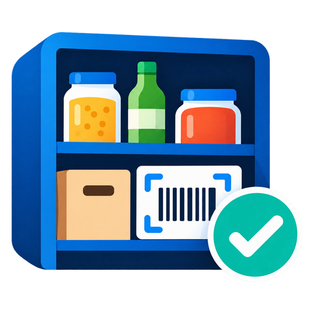

  

# ioBroker.shelfmate

**ShelfMate – deine Vorräte im Blick.**

ShelfMate — это управляющий менеджер ioBroker. Damit weißt du jederzeit, welche Lebensmittel du zu Hause hast, wo sie Ligen унд был nachgekauft werden muss.

Продукты, предназначенные для сканирования штрих-кодов, можно приобрести или получить автоматически, а также автоматически использовать в наборе Einkaufsliste. Auch Mindestbestände, Haltbarkeitsdaten und der Verbrauch werden berücksichtigt.

Die Bedienung erfolgt über eine Web-App, die du auf dem Smartphone öffnen und zum Homescreenhinzufügen kannst. Отдельное приложение не работает.

**Английский:** [README.md](/#/adapters/shelfmate)\
&#x20;**Anleitungen:** [немецкий](https://github.com/backfisch88/ioBroker.shelfmate/blob/main/docs/de/tutorial.md) · [английский](/#/docs/adapterref/iobroker.shelfmate/docs/en/tutorial.md)

---

## Функции

### Produkte und Lagerorte

- Продукты для штрих-кода или ручного ввода, ручного ввода с именами и категориями пассажиров
- Warennummern (PLU) von Obst und Gemüse und Data-Matrix-Etiketten von Waagen werden erkannt; Эйне Эйджин Листе в `plu.data` benennt Händler-Nummern
- Eigene Produktdatenbank (Datenpunkt, Datei или Netzwerk-Adresse; JSON или CSV с свободным полем), die zuerst gefragt wird; Продукты с собственными штрих-кодами, принадлежащими их штрих-кодам
- Bücher (ISBN), Zeitschriften (ISSN) и Noten (ISMN) были erkannt und bei Open Library, der Deutschen Nationalbibliothek и Google Books geucht
- Медицинские услуги, связанные с PZN (Strichcode или Data Matrix) и современными штрих-кодами, которые вы можете приобрести в аптеке или в аптеке для поддержания жизненной силы; Данные о данных в Data-Matrix-Code используются как MHD mitgebucht
- Die Reihenfolge, in der die Produktquellen gefragt werden, ist in den Adaptor-Einstellungen änderbar (Стандарт: Lebensmittel, Drogerie, Tierbedarf, Haushalt, Medikamente, Bücher)
- Автоматизированные данные о продуктах с открытой информацией о пищевых продуктах (название, марка, упаковка, нутри-оценка и категория)
- Produktdaten jderzeit beiten und actualisieren
- Eigene EAN-13-Штрих-коды для других продуктов Barcode erstellen
- Eigene Produktbilder hochladen (werden autotisch verkleinert)
- Lagerbereiche und Lagerorte anlegen, zum Beispiel Küche, Vorratsschrank oder Keller
- Lagerorte с QR-кодами auswählen
- Bestände einlagern, entnehmen und zwischen Lagerorten verschieben
- Alle Buchungen в einer Historie nachvollziehen
- Produkte schnell über die Muche finden, включая Vorschlägen während der Eingabe
- Различные продукты Marken zu Gruppen zusammenfassen, zum Beispiel Mehl или Zucker

### Mindestbestand и Einkaufsliste

- Mindestbestand für einzelne Produkte или ganze Produktgruppen festlegen
- Автоматический продукт в наборе Einkaufsliste, sobald der Mindestbestand erreicht ist
- Einkaufslisten über Datenpunkte, Принесите! или принеси! Специальные предложения
- Дополнительный die fehlende Menge mitschreiben (Bring! Spezial und Script-Modus)
- Бэй, принеси! Spezial werden Mengen und Zusätze auf demselben Eintrag zusammengeführt, statt doppelte Einträge anzulegen
- Автоматическое добавление продуктов из Einkaufsliste entfernen
- Verbrauch der Letzten 30 Tage auswerten
- Passenden Mindestbestand anhand des bisherigen Verbrauchs vorschlagen

### Haltbarkeit und MHD

- Mindesthaltbarkeitsdatum опционально для продукта или для специальных предложений
- Предупреждаем о продукции
- Standard-Haltbarkeit für viele Lebensmittel autotisch vorschlagen
- Haltbarkeit nach dem Öffnen berücksichtigen
- Gefrierorte mit eigener Gefrier-Haltbarkeit; TK-Produkte behalten ihrenormale Haltbarkeit
- Продукты, представленные в продаже или на маркировке
- Automatisch eingetragene Werte am Funken-Symbol erkennen
- Eigene Haltbarkeitswerte für Produkte und Gruppen festlegen
- Babynahrung im Gläschen bekommt nach dem offnen nur 1 bis 2 Tage
- Haltbarkeitsregeln (Stichwörter mit Tagen vor und nach dem Öffnen) selbst Bearbeiten und alle Produkte mit ihrer Haltbarkeit durchsuchen

### Zutaten prüfen

Вы могли бы проверить, что вы знаете и знаете, как все это произошло?

ShelfMate может быть составлен из вашего списка приложений, где вы можете использовать приложение Rezept-App, с помощью нашего приложения.

Fehlende Zutaten lassen sich direkt auf die Einkaufsliste setzen. Было bereits vorhanden ist, wird nicht erneut hinzugefügt.

### Scannen und Etiketten

- Штрих-коды с камерой смартфона или другим сканером доступны
- QR-коды для пива Lagerorte erstellen и Drucken
- EAN- и QR-Etiketten in eigenen Größen Drucken, zum Beispiel 50 × 30 мм
- Etiketten für Regale, Boxen, Gefrierfach (mit freier Textzeile, zum Beispiel dem Gewicht) и Geöffnete Produkte; EAN-Etikett und ein Gefrier-Etikett mit EAN und Einfrierdatum lassen sich auch auf der Produktseite Drucken
- Библиотека кодексов: собственные коды, а также этикетты, а также коды Штойера в PDF-файлах.
- Einstellen, welche Etiketten in der App angeboten werden
- Zähl-Modus: Jeder Scan lagert ohne Lagerort ein Stück ein, drei Scans sind drei Stück
- Scanner-Modus für das Ein- und Auslagern ohne geöffnete Web-App, а также со Scannern mit Speicher; Сканер с USB-ключом или Bluetooth можно использовать напрямую с хостом ioBroker-Host.
- MHD для большего количества продуктов: в Einräum-Modus для Scan-Code, über `SM:COPY` скопировать заказ в список «Ohne MHD» для марки Lagerorte
- Mehrfach scannen löst frei wählbare Aktionen aus (am letzten Lagerort einlagern, als leer markieren, auf die Einkaufsliste setzen und mehr)
- Unbekannte Barcodes werden im Scanner-Modus autotisch angelegt (Datan von Open Food Facts) и bei fehlenden Daten zum Ergänzen vorgemerkt
- Изобретение для списка продуктов или сканера в будущем

### Übersicht und Benachrichtigungen

- Gesamten Bestand nach Lagerort anzeigen
- Предупреждения о продуктах Mindestbestand und ablaufenden
- Доступ к Telegram, Telegrammenu2, Pushover, Signal, WhatsApp, Matrix или электронной почте
- Tägliche Übersicht über bald ablaufende und abgelaufene Produkte, auf Wunsch nur an bestimmten Tagen vor dem Datum (zum Beispiel 7,4,3,2,1,0)
- Der Reiter «Aufgaben» включает в себя все Offene: новые продукты, новые изобретения, предложения для групп и разумных продуктов без данных (Datum leer lassen = die angekreuzten Packungen bleiben ohne MHD)
- Inventur-Erinnerungen
- Предоставление информации о группах продуктов и рекомендациях
- Bestand ausgewählter Lagerorte (zum Beispiel Kühlschrank) как Verbrauchswaren-Liste в Datenpunkten, mit geöffneten Produkten und bald ablaufendem MHD
- Datenpunkte für die Einbindung в VIS или собственный скрипт
- Экспорт резервных копий JSON в формате CSV или PDF

### Веб-приложение

- Прямой доступ к браузеру на смартфоне, планшете и ПК
- Можно ли использовать iPhone- или Android-Homescreen abgelegt werden
- suchleisten im Glas-Look, die beim Scrollen oben bleiben, mit Knopf zum Löschen des Textes
- Moderne Glasoptik в стиле iOS 27: глянец навигационных страниц, его прокрутка по краям края, глянец Schalter und Regler, systemnahe Schrift
- Akzentfarbe und Hintergrundfarbe wählbar; ein Regler bestimmt, wie durchsichtig die gläsernen Teile sind
- Offline-Warteschlange für Buchungen bei Verbindungsproblemen
- Gerätenamen vergeben, damit Buchungen in der Historie zugeordnet werden können
- Letzte Buchung rückgängig machen
- HTTPS-Unterstützung mit eigenen или autotisch erstellten Zertifikaten
- Опционально Zugriffsschlüssel для API
- Языковая практика: немецкий, английский, русский, португальский, нидерландский, французский, итальянский, испанский, польский, украинский и китайский.

---

## Voraussetzungen

- ioBroker js-controller >= 6.0.11
- Администратор >= 7.6.20
- Node.js >= 22.12
- HTTPS с сертификатом безопасности на смартфоне (для камеры и автономных функций)

## Установка

ShelfMate можно использовать и установить ioBroker-Adapter.

1. Я установил ioBroker-Admin **вместе** с адаптером.
2. Eine Instanz anlegen.
3. Die Web-App über `https://<Host>:8120/` öffnen.
4. Дополнительный экран на главном экране.

Der Standardport ist `8120` и канн в ден Einstellungen geändert werden.

## Первая Шритте

1. **Anlegen Lagerorte:** Erstelle deine Lagerbereiche und Lagerorte, zum Beispiel Küche → Vorratsschrank → Fach 1.
2. **QR-коды пьяны:** Принесите QR-коды, чтобы получить больше удовольствия.
3. **Рекомендации по продукту:** Отсканируйте штрих-код или введите вручную другой продукт. Viele Produktdaten werden autotisch von Open Food Facts geladen.
4. **Для получения дополнительной информации:** выберите QR-код с помощью QR-кода и получите желаемый результат.
5. **Лучшее и полезное:** ShelfMate может быть автоматическим продуктом в вашем Einkaufsliste Setzen, Sobald der Vorrat Knapp Wird.

Eine ausführliche Beschreibung findest du in der [Anleitung](https://github.com/backfisch88/ioBroker.shelfmate/blob/main/docs/de/tutorial.md) .

---

## Einstellungen

Wichtigsten Funktionen lassen sich непосредственно в конфигурации адаптера.

| Einstellung                         | Описание                                                                                                                                                                                              |
| ----------------------------------- | ----------------------------------------------------------------------------------------------------------------------------------------------------------------------------------------------------- |
| Darstellung (in der App)            | Design, Akzentfarbe (стандарт: Blau), Hintergrundfarbe (стандарт: Grau), Transparenz und Unschärfe der gläsernen Teile. Gilt nur für dieses Gerät                                                     |
| Порт / Адрес привязки               | Порт и сеть веб-серверов (стандарт: 8120)                                                                                                                                                             |
| HTTPS                               | Активация HTTPS и дополнительная сертификация                                                                                                                                                         |
| Zertifikat erstellen                | Укажите сертификат, подтверждающий имя хоста и IP-адрес, для 825 тегов. Danach die Instantz neu starten                                                                                               |
| Сертификаты                         | Сертификация для ioBroker или для использования адаптера acme-Adapter                                                                                                                                 |
| Zugriffsschlüssel                   | Опционально Schutz für den API-Zugriff, einmalige Eingabe pro Gerät                                                                                                                                   |
| Список покупок                      | Аус, сценарий, принеси! или принеси! Специальный                                                                                                                                                      |
| MHD-Verwaltung                      | Aus, pro Produkt или pro Einlagerung                                                                                                                                                                  |
| Формат данных                       | TT.MM.JJJJ, TT/MM/JJJJ или JJJJ-MM-TT                                                                                                                                                                 |
| Benachrichtigungen                  | Адаптер, Empfänger и Gewünschte Meldungen auswählen                                                                                                                                                   |
| Автоматическая стабилизация         | Стандартное погружение, только в режиме сканирования или в другом месте                                                                                                                               |
| Standardwerte verwenden             | Все подсказки Haltbarkeiten или nur die eingebaute Trockenwarenliste                                                                                                                                  |
| Ablaufwarnung                       | Festlegen, wie viele Tage vor Ablauf gewarnt wird                                                                                                                                                     |
| Zutaten-Prüfung                     | Автоматическое выполнение действий в наборе Einkaufsliste и дополнительном выборе, когда необходимо выполнить настройку, но не в списке камней.                                                       |
| Собственный банк данных о продуктах | Festlegen, ob sie zuerst, allein oder gar nicht gefragt wird; Datenpunkt, Datei или Netzwerk-Adresse (JSON или CSV) доступные и собственные поля                                                      |
| Режим сканера                       | Сканер-Gerät, Zeitabstände, Präfix, Suffix и QR-Code-Art einstellen; «Сканирование = Menge» lagert pro Scan ein Stück ohne Lagerort ein (Standard-Lagerort für neue Produkte, `SM:OUT` (zum Entnehmen) |
| Этикетки                            | Verfügbare Etikettentypen und Druckoptionen auswählen                                                                                                                                                 |
| Inventur-Erinnerung                 | Erinnerung nach einer festgelegten Anzahl von Tagen ohne Inventur                                                                                                                                     |

### Mindesthaltbarkeit

Для MHD-Verwaltung gibt es drei Möglichkeiten:

- **Из:** Keine MHD-Verwaltung.
- **Профессиональный продукт:** один из лучших MHD для продуктов.
- **Pro Einlagerung:** Jede Einlagerung cann ein eigenes MHD haben. Bei der Entnahme wird zuerst der älteste Bestand berücksichtigt.

ShelfMate может автоматически включаться в стандартную остановку. Selbst eingetragene Werte haben Vorrang.

### Список покупок

ShelfMate позволяет использовать Моди:

- **Aus:** Keine autotische Einkaufsliste.
- **Сценарий:** Übergabe über ioBroker-Datenpunkte. Вариант для выбора варианта использования сценария `Name, Menge` (пример) `Milch, 2`); der Listen-Datenpunkt darf mehr Felder als `name` enthalten, sie werden ignoriert. Следующая статья может быть загружена с помощью JSON в `shopping.lastItem`.
- **Bring!:** Produkte werden zur Bring!-Einkaufsliste hinzugefügt.
- **Приносить! Специальное предложение:** Vorhandene Einträge werden nicht übersprungen. Mengen werden hochgezählt, Zusätze ergänzt (zum Beispiel) `Feta, Kräuter, 200g`).

Дополнительный продукт может быть добавлен в список, включенный в список.

Weitere Informationen findest du in der [Anleitung zu den Einkaufslisten](https://github.com/backfisch88/ioBroker.shelfmate/blob/main/docs/de/tutorial.md#einkaufslisten-modi) .

### Benachrichtigungen

Обратите внимание на следующие варианты адаптера:

- Telegram und telegrammenu2
- Слабак
- Сигнал
- WhatsApp
- Матрица
- Электронная почта

Вы можете быть уверены в том, что ShelfMate будет лучшим выбором, если вы используете продукт или лучший изобретатель, который будет полезен.

Для того, чтобы текст Ablaufmeldung lässt sich eine feste Uhrzeit einstellen und dazu die Tage vor dem Datum, an denen gemeldet wird (zum Beispiel `7,4,3,2,1,0`; `0` = am Tag selbst, leer = täglich Internalhalb der Warnfrist).

---

## Точки данных

ShelfMate предоставляет вам информацию и функции, а также данные ioBroker-Datenpunkte.

### Bestand und Statistiken

| Пункт данных          | Описание                                          |
| --------------------- | ------------------------------------------------- |
| `info.connection`     | Webserver läuft                                   |
| `stats.products`      | Количество товаров                                |
| `stats.locations`     | Anzahl der Lagerorte                              |
| `stats.inventory`     | Gesamter Bestand als JSON                         |
| `stats.inventoryHtml` | Лучше всего как HTML-таблица для VIS              |
| `stats.lowStockCount` | Anzahl der Produkte mit niedrigem Bestand         |
| `stats.lowStockList`  | Список продуктов с Niedrigem Bestand              |
| `stats.consumption`   | Verbrauch der letzten 30 Tage                     |
| `stats.expiringCount` | Продукты Anzahl bald ablaufender und abgelaufener |
| `stats.expiring`      | Ablaufende Produkte als JSON                      |
| `stats.expiringHtml`  | Ablaufende Produkte как HTML-Tabelle              |

### Einkaufsliste und Zutaten

| Пункт данных         | Описание                                                                               |
| -------------------- | -------------------------------------------------------------------------------------- |
| `shopping.addItem`   | Produkt zur Einkaufsliste hinzufügen (`ack=false`)                                    |
| `shopping.lastItem`  | Режим сценария: zuletzt hinzugefügter Artikel als JSON (Имя, Значение, Einheit, Текст) |
| `check.request`      | Zutatenliste zur Prüfung übergeben (`ack=false`)                                      |
| `check.result`       | Ergebnis der letzten Zutaten-Prüfung как JSON                                          |
| `check.available`    | Vorhandene Zutaten                                                                     |
| `check.missing`      | Fehlende Zutaten                                                                       |
| `check.allAvailable` | `true`, если все Zutaten vorhanden sind                                               |
| `check.addMissing`   | Fehlende Zutaten auf die Einkaufsliste setzen                                          |

### Режим сканера

| Пункт данных         | Описание                                                                                                      |
| -------------------- | ------------------------------------------------------------------------------------------------------------- |
| `ownDb.data`         | Eigene Produktdatenbank как JSON-Liste; Продукты с собственными штрих-кодами автоматически обрабатываются     |
| `plu.data`           | Эйджин Вареннумерн (PLU) как JSON, zum Beispiel `{"4238": "Banane Bio"}`; sie gehen der eingebauten Liste vor |
| `scanner.active`     | Scanner-Modus ein- oder ausschalten                                                                           |
| `scanner.input`      | Штрих-код или QR-код доступен (`ack=false`)                                                                  |
| `scanner.lastCode`   | Zuletzt gescannter Code                                                                                       |
| `scanner.lastAction` | Letzte Aktion eines mehrfachen Scans (Regel) как Text                                                         |
| `scanner.result`     | Ergebnis des letzten Scans                                                                                    |

Пример для `scanner.result`:

`Fusilli ×1 eingelagert in Regal 1`

Дополнительная информация: [Scanner-Modus ohne App](https://github.com/backfisch88/ioBroker.shelfmate/blob/main/docs/de/tutorial.md#scanner-modus-ohne-app)

---

## Datensicherung

Alle Bestandsdaten werden in der Datei `shelfmate.json` Я получил информацию об адаптерах.

Über die Web-App kannst du:

- Скачать резервную копию в формате JSON
- Ein vorhandenes Backup wiederherstellen
- Лучше всего экспортировать в формате CSV или PDF.
- Alle Daten löschen

Импортировать резервные копии или сохранять данные, используя резервные копии. `shelfmate.json.bak` gesichert.

---

## Документация

Eine ausführliche Anleitung mit Beispielen und Erklärungen gibt es hier:

- [Anleitung auf Deutsch](https://github.com/backfisch88/ioBroker.shelfmate/blob/main/docs/de/tutorial.md)
- [Учебное пособие на английском языке](/#/docs/adapterref/iobroker.shelfmate/docs/en/tutorial.md)

Да, мы всегда были вместе с вами, включая Bedienung der Web-App, Lagerorte, Produktgruppen, Mindestbestand, MHD, Scanner-Modus, Etiketten, Einkaufsliste und Inventur erklärt.

---

## Rückmeldung

Идея, вопрос или вопрос, который может быть использован в [GitHub-Issue](https://github.com/backfisch88/ioBroker.shelfmate/issues) , может быть рассмотрен.

## Änderungsverlauf

Den vollständigen Änderungsverlauf находится на [английском языке README](/#/adapters/shelfmate#changelog) .

## Лицензия

Die mitgelieferte Schrift Inter (`www/fonts/`) под лицензией SIL Open Font License 1.1, здесь `www/fonts/interLicense.txt`.

Лицензия MIT

Авторские права (c) 2026 Хенрик Шёнхофен\
&#x20;[ЛИЦЕНЗИЯ](https://github.com/backfisch88/ioBroker.shelfmate/blob/main/LICENSE)