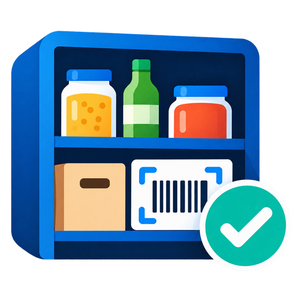

  

# ioBroker.shelfmate

**ShelfMate – все продукты в вашей кладовой с первого взгляда.**

ShelfMate — это менеджер запасов продуктов для ioBroker. Он в любое время покажет вам, какие продукты у вас есть дома, где они хранятся и что нужно докупить.

Сканируйте товары по штрихкоду, управляйте их размещением на полках и в шкафах и автоматически добавляйте в список покупок по мере необходимости. Также учитываются минимальный запас, сроки годности и потребление.

Вы используете его через веб-приложение, которое открываете на телефоне и добавляете на главный экран. Отдельное приложение не требуется.

**Deutsch:** [README.de.md](/#/docs/adapterref/iobroker.shelfmate/README.de.md)\
&#x20;**Путеводители:** [английский](/#/docs/adapterref/iobroker.shelfmate/docs/en/tutorial.md) · [немецкий](https://github.com/backfisch88/ioBroker.shelfmate/blob/main/docs/de/tutorial.md)

---

## Функции

### Продукция и места хранения

- Добавляйте товары по штрихкоду или вручную, при этом при ручном создании будут предложены варианты названий и соответствующая категория.
- Идентифицируются товарные номера (PLU) фруктов и овощей, а также метки Data Matrix весов; собственный список в `plu.data` имена, присвоенные розничным продавцом номера
- Используйте собственную базу данных товаров (точку данных, файл или веб-адрес; JSON или CSV с произвольными именами полей), которая запрашивается первой; товары с собственными штрихкодами сохраняют свой штрихкод.
- Книги (ISBN), журналы (ISSN) и ноты (ISMN) признаются и индексируются в Open Library, Немецкой национальной библиотеке и Google Books.
- Лекарственные препараты, обозначенные штрихкодом PZN (или Data Matrix), а также обычные штрихкоды, неизвестные другим лицам, имеют названия, аналогичные Shop Apotheke или vitality-fit; срок годности в коде Data Matrix обозначается как дата «лучше употребить до».
- Порядок запроса источников продукции можно изменить в настройках адаптера (стандартный: продукты питания, аптека, товары для животных, товары для дома, лекарства и аптечные товары, книги).
- Автоматическая загрузка данных о продуктах из Open Food Facts и связанных с ним баз данных (косметика, корма для животных, товары для дома) (название, марка, размер упаковки, Nutri-Score и категории); источник данных отображается в приложении.
- Неизвестные штрихкоды: кнопка выполняет поиск в интернете по названию, бренду и изображению, в том числе по всем новым товарам сразу (с отображением страницы обзора перед сохранением) или только по изображению (только по запросу, можно отключить).
- Редактируйте и обновляйте данные о товаре в любое время.
- Создавайте собственные штрихкоды EAN-13 для товаров, не имеющих штрихкода.
- Загрузите собственные изображения товаров (автоматически уменьшая масштаб).
- Создайте зоны и места для хранения, например, на кухне, в кладовой или подвале.
- Выберите места хранения с QR-кодами.
- Вносить, выносить и перемещать товары между местами хранения.
- Отслеживайте каждое бронирование в истории.
- Быстро находите товары с помощью поиска, включая подсказки во время ввода текста.
- Сгруппируйте продукты разных марок, например, муку или сахар.

### Минимальный запас товаров и список покупок

- Установите минимальный запас для отдельных товаров или целых групп товаров.
- Автоматическое добавление товаров в список покупок при достижении минимального уровня запасов.
- Управляйте списком покупок с помощью точек данных, функций «Принеси!» или «Принеси!».
- В функции Bring! special количество и варианты объединяются в одной и той же позиции, а не создаются дубликаты.
- Автоматическое удаление товаров из списка покупок при пополнении запасов.
- При желании укажите недостающее количество в списке покупок.
- Укажите запасы расходных материалов в местах их хранения (например, в холодильнике) в виде точек данных.
- Оцените потребление за последние 30 дней.
- Предложите подходящий минимальный уровень запасов, исходя из предыдущего потребления.

### Срок годности и дата «лучше употребить до»

- Укажите срок годности (MHD) отдельно для каждого продукта или для каждой партии товара.
- Предупреждение о товарах, срок годности которых скоро истекает или уже истек.
- Вкладка «Задачи» собирает все задачи: новые товары для завершения производства, сроки проведения инвентаризации, предложения по группам и минимальному запасу, а также товары без указания даты (оставьте дату пустым, чтобы выбранные наборы оставались без указания даты).
- Автоматически предлагать стандартный срок годности для многих продуктов.
- Учитывайте срок годности после вскрытия упаковки.
- Морозильные камеры имеют собственный срок годности замороженных продуктов; продукты, купленные в замороженном виде, сохраняют свой обычный срок годности.
- Помечайте продукты как вскрытые или испорченные.
- Автоматическое распознавание заполненных значений по символу мерцания.
- Установите собственные значения срока годности для продуктов и групп товаров.
- Детское питание в баночках имеет короткий стандартный срок годности после вскрытия (1-2 дня).
- Отредактируйте правила определения срока годности (ключевые слова с указанием количества дней до и после вскрытия упаковки) и выполните поиск по всем товарам, указав срок годности, включая значение после вскрытия упаковки.

### Проверьте состав ингредиентов

Хотите что-нибудь приготовить и хотите узнать, есть ли все необходимые ингредиенты дома? ShelfMate может сравнить список ингредиентов, например, из приложения с рецептами, с вашими запасами. Недостающие ингредиенты можно сразу добавить в список покупок. То, что уже есть в наличии, не добавляется заново.

### Сканирование и маркировка

- Снимайте штрихкоды с помощью камеры телефона или сканера.
- Создавайте и распечатывайте QR-коды для мест хранения.
- Печатайте этикетки с EAN-кодом и QR-кодом в удобном для вас размере, например, 50 × 30 мм.
- Наклейки для полок, коробок, морозильной камеры (с возможностью ввода текста, например, о весе) и вскрытых упаковок; также можно распечатать с страницы товара этикетку с кодом EAN и этикетку для морозильной камеры с кодом EAN и датой заморозки.
- Выберите, какие метки предлагает приложение.
- Библиотека кодов: сохраняйте собственные коды (например, с других сканеров или приложений), распечатывайте их в виде этикеток и выбирайте, какие из управляющих кодов будут включены в PDF-файл.
- Режим сканирования для учета поступления и отгрузки товаров без открытия веб-приложения; сканеры с USB-адаптером или Bluetooth считывают данные непосредственно с хоста ioBroker.
- Повторные сканирования (три и более) запускают выбранные вами действия: пополнение запасов в последнем месте хранения, пометка как пустое, добавление в список покупок и многое другое.
- Режим подсчета: при каждом сканировании товар отображается как один экземпляр без указания места хранения; три сканирования — это три экземпляра.
- Проведите инвентаризацию по списку товаров или с помощью сканера.

### Обзор и уведомления

- Показать весь товарный запас по месту хранения.
- Предупреждения о минимальном количестве товара на складе и товарах с истекающим сроком годности.
- Уведомления через Telegram, telegrammenu2, Pushover, Signal, WhatsApp, Matrix или электронную почту.
- Ежедневная сводка по товарам, срок годности которых скоро истекает или уже истек, с возможностью выбора только за выбранные дни до указанной даты (например, 7, 4, 3, 2, 1, 0).
- Напоминания о проведении инвентаризации
- Рекомендации по группам товаров и минимальному запасу
- Точки данных для VIS или ваших собственных скриптов
- Резервное копирование в формате JSON и экспорт в CSV или PDF.

### Веб-приложение

- Работает непосредственно в браузере на телефоне, планшете и ПК.
- Можно добавить на главный экран iPhone или Android.
- Современный стеклянный дизайн в стиле iOS 27: стеклянная панель вкладок, которая складывается в круг при прокрутке, стеклянные переключатели и ползунки, системные шрифты.
- Поисковые строки в стеклянном стиле, которые остаются вверху при прокрутке, с кнопкой для очистки текста.
- Выберите акцентный цвет и цвет фона; два ползунка регулируют прозрачность и степень размытия стеклянных элементов.
- Очередь на бронирование в автономном режиме при потере соединения.
- Присвойте каждому устройству имя, чтобы можно было различать бронирования в истории.
- Отменить последнее бронирование
- HTTPS с использованием собственных или автоматически созданных сертификатов.
- Дополнительный ключ доступа к API
- Владение несколькими языками: немецкий, английский, русский, португальский, нидерландский, французский, итальянский, испанский, польский, украинский и китайский.

---

## Требования

- ioBroker js-controller >= 6.0.11
- Администратор >= 7.6.20
- Node.js >= 22.12
- HTTPS с сертификатом, которому доверяет ваш телефон (для камеры и функций работы в автономном режиме).

## Установка

ShelfMate устанавливается так же, как и любой другой адаптер ioBroker.

1. Установите адаптер **shelfmate** в административной панели ioBroker.
2. Создайте экземпляр.
3. Откройте веб-приложение по адресу: `https://<host>:8120/`.
4. При желании можно добавить страницу на главный экран.

Порт по умолчанию —`8120` и это можно изменить в настройках.

## Начиная

1. **Создайте места для хранения:** создайте зоны и места для хранения, например, Кухня → Кладовая → Полка 1.
2. **Распечатайте QR-коды:** прикрепите соответствующие QR-коды к местам хранения.
3. **Добавление товаров:** отсканируйте штрихкод или создайте товар вручную. Большая часть данных о товарах автоматически загружается из Open Food Facts.
4. **Наличие товара:** выберите местоположение по QR-коду и внесите необходимое количество.
5. **Установите минимальный уровень запасов:** ShelfMate сможет автоматически добавлять товары в ваш список покупок, когда запасы начнут заканчиваться.

Подробное описание содержится в [руководстве](/#/docs/adapterref/iobroker.shelfmate/docs/en/tutorial.md) .

---

## Настройки

Наиболее важные функции можно настроить непосредственно в конфигурации адаптера.

| Параметр                                          | Описание                                                                                                                                                                                                                                             |
| ------------------------------------------------- | ---------------------------------------------------------------------------------------------------------------------------------------------------------------------------------------------------------------------------------------------------- |
| Внешний вид (в приложении)                        | Тема оформления, акцентный цвет (по умолчанию синий), цвет фона (по умолчанию серый), прозрачность и размытие стеклянных элементов. Применяется только к этому устройству.                                                                           |
| Порт / адрес привязки                             | Порт и сетевой интерфейс веб-сервера (по умолчанию: 8120)                                                                                                                                                                                            |
| HTTPS                                             | Включите HTTPS и выберите сертификаты.                                                                                                                                                                                                               |
| Создать сертификат                                | Создает самоподписанный сертификат для имени хоста и IP-адресов, действительный в течение 825 дней. После этого перезапустите экземпляр.                                                                                                             |
| Сертификаты                                       | Используйте сертификаты от ioBroker или, например, от адаптера acme.                                                                                                                                                                                 |
| Ключ доступа                                      | Дополнительная защита доступа к API, задается один раз для каждого устройства.                                                                                                                                                                       |
| Список покупок                                    | Выкл., сценарий, Bring! или Bring! специальный выпуск                                                                                                                                                                                                |
| Поиск в интернете неизвестных товаров             | Добавляет кнопку «Поиск в интернете» в редактор товаров (включена по умолчанию). Она срабатывает только при нажатии и отправляет только штрихкод.                                                                                                    |
| Токен для ean-search.org                          | Дополнительный бесплатный токен. С ним веб-поиск использует официальный интерфейс ean-search.org и не блокируется после нескольких запросов.                                                                                                         |
| Ключ для базы данных Open EAN                     | Дополнительный бесплатный идентификатор запроса opengtindb.org. С его помощью веб-поиск также запрашивает имя из базы данных Open EAN / GTIN.                                                                                                        |
| Название группы в списке                          | Сгруппированные товары добавляются в список покупок с указанием названия группы (по умолчанию). Выкл.: первый пустой товар в группе.                                                                                                                 |
| Срок годности                                     | Скидка, за каждый товар или за каждый товар в наличии.                                                                                                                                                                                               |
| Формат даты                                       | ДД.ММ.ГГГГ, ДД/ММ/ГГГГ или ГГГГ-ММ-ДД                                                                                                                                                                                                                |
| Уведомления                                       | Выберите адаптер, получателя и желаемые сообщения.                                                                                                                                                                                                   |
| Автоматическое заполнение данных о сроке годности | Всегда вводите стандартные значения, только в режиме сканера или никогда.                                                                                                                                                                            |
| Какие стандартные значения                        | Все сроки годности хранящихся товаров или только указанный в списке сухих продуктов                                                                                                                                                                  |
| Предупреждение об истечении срока действия        | За сколько дней до истечения срока годности следует выносить предупреждение?                                                                                                                                                                         |
| Проверка ингредиентов                             | Автоматически добавлять недостающие ингредиенты в список покупок и, при желании, получать сообщение о тех ингредиентах, которые не были включены в список.                                                                                           |
| Собственная база данных продукции                 | Выберите, будет ли этот вопрос запрашиваться первым, единственным или никогда; добавьте точку данных, файл или веб-адрес (JSON или CSV) и сопоставьте собственные имена полей.                                                                       |
| Режим сканера                                     | Установите устройство сканирования, временные интервалы, префикс, суффикс и тип QR-кода; "Сканирований = количество" — товары по одному за сканирование без указания местоположения (местоположение по умолчанию для новых товаров). `SM:OUT` вынуть) |
| Метки                                             | Выберите доступные типы этикеток и параметры печати.                                                                                                                                                                                                 |
| Напоминание о проведении инвентаризации           | Напоминание через заданное количество дней без проведения инвентаризации.                                                                                                                                                                            |

### Срок годности

Существует три режима контроля срока годности:

- **Отключено:** Нет информации о сроке годности.
- **На каждый продукт:** один общий срок годности.
- **На каждый рождественский** носок может быть свой срок годности. При извлечении используется самый старый носок.

ShelfMate также может автоматически заполнять стандартные сроки годности. Значения, которые вы вводите самостоятельно, всегда имеют приоритет.

### Список покупок

ShelfMate поддерживает четыре режима:

- **Выкл.:** Автоматический список покупок отключен.
- **Скрипт:** Данные передаются через ioBroker. С возможностью указать недостающую сумму, скрипт получает `Name, amount` (например `Milk, 2` Список состояний может содержать больше полей, чем `name` Они игнорируются. Последний добавленный элемент также доступен в формате JSON. `shopping.lastItem`.
- **Bring!:** Товары добавляются в список покупок Bring!
- **Специальное предложение Bring!:** существующие записи не пропускаются. Количество увеличивается, и добавляются варианты (например) `Feta, Kräuter, 200g`).

При желании товары могут быть снова удалены из списка при пополнении запасов.

Более подробная информация содержится в [руководстве по составлению списка покупок](/#/docs/adapterref/iobroker.shelfmate/docs/en/tutorial.md#shopping-list-modes) .

### Уведомления

Сообщения можно отправлять через следующие адаптеры:

- Telegram и telegrammenu2
- Слабак
- Сигнал
- WhatsApp
- Матрица
- Электронная почта

Вы сами выбираете, будет ли ShelfMate уведомлять вас о низком уровне запасов, товарах с истекающим сроком годности или о предстоящей инвентаризации. Для ежедневного уведомления об истечении срока годности вы можете установить фиксированное время и количество дней до даты отправки (например, `7,4,3,2,1,0`; `0` = в день, пустой = каждый день в течение периода предупреждения).

---

## Точки данных

ShelfMate предоставляет важную информацию и функционирует как точки данных ioBroker.

### Фондовый рынок и статистика

| Точка данных           | Описание                                                                                  |
| ---------------------- | ----------------------------------------------------------------------------------------- |
| `info.connection`      | Веб-сервер запущен                                                                        |
| `stats.products`       | Количество товаров                                                                        |
| `stats.locations`      | Количество мест хранения                                                                  |
| `stats.inventory`      | Весь ассортимент в формате JSON                                                           |
| `stats.inventoryHtml`  | Акции в виде HTML-таблицы для визуализации                                                |
| `stats.lowStockCount`  | Количество товаров с низким уровнем запасов                                               |
| `stats.lowStockList`   | Список товаров с низким запасом                                                           |
| `stats.consumption`    | Потребление за последние 30 дней                                                          |
| `history.last24h`      | Все бронирования за последние 24 часа представлены в формате JSON, начиная с самых новых. |
| `history.last24hCount` | Количество бронирований за последние 24 часа                                              |
| `stats.expiringCount`  | Количество товаров, срок годности которых скоро истекает или уже истек.                   |
| `stats.expiring`       | Срок действия товаров в формате JSON                                                      |
| `stats.expiringHtml`   | Товары с истекающим сроком годности в виде HTML-таблицы                                   |

### Список покупок и ингредиенты

| Точка данных         | Описание                                                                                              |
| -------------------- | ----------------------------------------------------------------------------------------------------- |
| `shopping.addItem`   | Добавить товар в список покупок (`ack=false`)                                                        |
| `shopping.lastItem`  | Режим скрипта: элемент добавлен последним в формате JSON (имя, количество, единица измерения, текст). |
| `check.request`      | Предоставьте список ингредиентов для проверки (`ack=false`)                                          |
| `check.result`       | Результат последней проверки ингредиентов в формате JSON.                                             |
| `check.available`    | Ингредиенты в наличии                                                                                 |
| `check.missing`      | Отсутствующие ингредиенты                                                                             |
| `check.allAvailable` | `true` если все ингредиенты есть в наличии                                                            |
| `check.addMissing`   | Внесите недостающие ингредиенты в список покупок.                                                     |

### Режим сканера

| Точка данных         | Описание                                                                                                              |
| -------------------- | --------------------------------------------------------------------------------------------------------------------- |
| `ownDb.data`         | Собственная база данных товаров в формате JSON-списка; товары с собственными штрихкодами добавляются автоматически.   |
| `plu.data`           | Например, собственные товарные номера (PLU) в формате JSON. `{"4238": "Banane Bio"}`; они побеждают встроенный список |
| `scanner.active`     | Включение или выключение режима сканера                                                                               |
| `scanner.input`      | Предъявите штрихкод или QR-код (`ack=false`)                                                                         |
| `scanner.lastCode`   | Последний отсканированный код                                                                                         |
| `scanner.lastAction` | Последнее действие повторного сканирования (правила), в виде текста.                                                  |
| `scanner.result`     | Результат последнего сканирования                                                                                     |

Пример для `scanner.result`:

`Fusilli ×1 stocked in at Shelf 1`

Дополнительная информация: [режим сканирования без приложения.](/#/docs/adapterref/iobroker.shelfmate/docs/en/tutorial.md#scanner-mode-without-the-app)

---

## Резервная копия

Все данные о наличии товаров хранятся в файле. `shelfmate.json` в каталоге данных адаптера. В веб-приложении вы можете:

- Скачать резервную копию в формате JSON
- Восстановить существующую резервную копию
- Экспорт данных о наличии товара в формате CSV или PDF.
- Удалите все данные

При импорте резервной копии или удалении данных предыдущее состояние сохраняется. `shelfmate.json.bak`.

---

## Документация

Подробное руководство с примерами и пояснениями:

- [Путеводитель на английском языке](/#/docs/adapterref/iobroker.shelfmate/docs/en/tutorial.md)
- [Anleitung auf Deutsch](https://github.com/backfisch88/ioBroker.shelfmate/blob/main/docs/de/tutorial.md)

В нем объясняется работа веб-приложения, места хранения, группы товаров, минимальный запас, срок годности, режим сканирования, этикетки, список покупок и инвентаризация, а также многое другое.

---

## Обратная связь

Идеи, пожелания или сообщения об ошибках можно оставлять в виде [сообщений на GitHub](https://github.com/backfisch88/ioBroker.shelfmate/issues) .

## Changelog
### **WORK IN PROGRESS**
- New: codes made of letters and digits (Amazon FNSKU like X001R86CKT, shop article numbers; 6 to 20 characters) are accepted as product codes; the product is created as "New product" plus the code" to be renamed once, no online search
- Fixed: labels of scales with a store's own number (for example 2806 for carrots at REWE) are recognised; the product is created as "New product 2806" to be renamed once, the number is remembered

### 0.6.0 (2026-11-18)
- New: the action for two scans is configurable (for example two scans = open, three scans = take out); new action "Take out"; one scan stays stock in
- New: stock bookings and new products made in the app are written to the log; fewer messages at info level, the rest at debug
- New: books, magazines and sheet music (category "Books") need no best-before date, shelf life, stock type or unit; the pack size field becomes "Pages", the brand field "Author / publisher"
- New: a location can be the default for categories (for example books → bookcase); stocking in suggests it, and an external scanner books there with one scan; a location you scan or choose for stocking in overrides it
- Changed: books show no opened / freezer labels and no "spoiled" choice when taking out
- Fixed: book covers of the National Library are loaded by the adapter and made small in the app (a phone cannot load them itself)
- Changed: one lookup chain everywhere (phone, external scanner, stocking in, new product, batch import): own database, then the catalogue of the code (books for ISBN / ISSN / ISMN, pharmacy shops for a PZN) and only if it does not know the article the Open Facts databases (dm right after the first one); the external scanner now asks dm too
- Changed: the batch import no longer searches the web by itself, a button does that; the web text search uses strict safe search
- Fixed: medicine names keep their brand ("Ibuprofen-ct 400 mg", "Aspirin Complex"), web addresses no longer show up as book tags, a children's fantasy book is no longer tagged as a crime novel
- Fixed: when Open Food Facts does not answer, the other Open Facts databases are still asked; the batch import repeats such codes once and spaces its requests
- New: the batch import ends with a report (all codes, results and search steps) with a copy button
- Changed: names from the Open Facts databases only count when they are German (or one word); other names go through dm and the web search, the foreign name stays in the name field
- Fixed: pharmacy articles show their pack size ("20 St"), advertising and company names behind a title are cut, magazines keep title and short subtitle, book genres come first in the tags
- Fixed: a slow acknowledgement of ioBroker no longer ends a command with "no answer"; amounts like "400 g e" and doubled brands from Open Food Facts are cleaned
- Fixed: after an update the app loads its script files fresh, so a new version no longer runs with an old script once
- Fixed: searching an ISBN no longer waits for the food databases and dm one after another; the book catalogues are asked at the same time
- New: books get genre tags (children's book, crime, cookbook, …) and subject words from the catalogues; cover and page count are filled in from another catalogue (or the cover service of the National Library / Open Library by ISBN; small covers are stored in the product) if the first has none
- Improved: the code fields say which codes work (EAN, ISBN, ISSN, PZN); typed ISBNs with hyphens and `PZN-` numbers are converted in the editor; the examples for unit and package size depend on the category
- Fixed: searching by barcode in the editor without a connection to ioBroker no longer ends with a raw error; the Open Facts databases are still asked
- Changed: the locations page is grouped by area; areas fold open and closed, and are edited inside the area (no separate areas list)
- New: small icons in the locations list for freezer, consumables and "record best-before when stocking in"; areas show the total
- Improved: the consumables text data point is translated into all languages
- Fixed: English example for the data point `plu.data`
- New: clear feedback for every camera scan (vibration, coloured frame and a status bar with product name and count: searching, found, new, unknown)
- New: stocking in by camera has the buttons "To the list" and "Stock in (n)" under the picture
- Fixed: the history shows the current product name instead of the name at the time of booking
- Fixed: the web search left the name of products created by scanning as "Unknown product …" (only brand and size were taken over)
- Fixed: stocking in - a new product scanned while the lookup was still running, or when the location was scanned right after, ended up with 0 pieces; finishing now waits for running lookups
- New: books by ISBN (also ISBN-10 and the ISBN as text), magazines (barcode 977, ISSN) and sheet music (ISMN, 9790) are recognised and looked up at Open Library, the German National Library (DNB) and Google Books; new category "Books"
- New: medicines by PZN (barcode, plain number or Data Matrix) are named automatically from Shop Apotheke or vitality-fit (which also know ordinary barcodes, asked after the other sources); the best-before date from a medicine Data Matrix (PPN) or a GS1 code is booked together with the stock
- Changed: creating a new product (Tasks → Create new product) and entering a barcode: the new button "Search product data" asks all sources like the scanner does, in the order of the settings, and the web last; for an unknown product from the list "Search the web" only searches the web, the databases were asked already
- Fixed: books were not found when the first catalogue was slow or did not know the ISBN: all catalogues (lobid, the SRU interface of the German National Library, Open Library, Google Books) are asked at once, also by the ISBN-10; the app waits as long as the web search
- Fixed: the scanner page (typing or scanning a barcode, then the editor opens) did not look for books and in the pharmacy shops; now it does, also when a database knows the barcode but no name
- New: setting "Order of the product sources" in the adapter settings (standard: food, drugstore, pets, household, medicines and pharmacy, books); put your main kind of products first so not every scan asks all databases

### 0.5.2 (2026-11-10)
- New: scanner mode "Scans = quantity" (every scan stocks in one piece, default location in the settings) and the control code `SM:OUT` to take out
- New: EAN label and freezer label with EAN and freezing date as buttons on the product page (settings under labels)
- New: a freezer location can move opened packages to another location automatically (for example the fridge); the history shows the move, and "Undo opening" puts the package back into the freezer
- New: produce numbers (PLU) and GS1 data matrix labels of scales are recognised; built-in list of about 1,500 numbers (IFPS 2024) with names in all languages, own entries in the data point `plu.data`
- Docs: tip against the camera question on every start of the iPhone app
- Changed: product groups in the overview start closed and no longer remember being opened
- New: own product database, asked before Open Food Facts: data point `ownDb.data` (always there, own barcodes are added to it), plus data point, file or web address from the settings; JSON list, JSON object or CSV; free field names; own first, own only or off
- New: optional message through the notification adapter with the ingredients of a check that were not put on the shopping list because they are in stock, with the products that were counted
- New: mark storage locations as freezer; stock in there gets a frozen shelf life (own value per product or a default from the settings, 180 days), moving into the freezer sets a new date, and "Frozen product" keeps the normal shelf life for products bought frozen
- New: history entries open the product
- Changed: the ingredient check counts only products named like the ingredient (or in a group of that name), no longer "Gehackte Tomaten" for "Tomaten"

### 0.5.1 (2026-11-04)
- New: free text instead of "Haltbar bis" on the freezer label (settings, labels)
- Improved: the scanner finds the barcode anywhere in the picture, also on dark backgrounds; faster product lookup
- Fixed: product database reported as unreachable on single scans

### 0.5.0 (2026-11-01)
- New: web search for unknown barcodes in the product editor (dm, Shop Apotheke, vitality-fit, barcode databases, search engines); optional token for ean-search.org and key for the Open EAN database
- New: Open Food Facts sister databases (cosmetics, pet food, household); the source is shown in the app
- New: category Medikamente; medicines take their tags from Shop Apotheke
- New: barcode field at the top of a new product (the one under "More" stays)
- New: group name on the shopping list (setting), data points `history.last24h` and `history.last24hCount`
- Improved: never more than two requests to the outside at once
- Fixed: the camera restarts by itself when it hangs after a scan (iPhone)

### 0.4.1 (2026-10-29)
- Changed: the ingredient check no longer uses tags; it looks at the product name, then the group, then a whole word in the name, so "Milch" no longer finds milk rice or coconut milk
- Improved: Bring! Special waits for the next list update of the Bring adapter (changed or not, at most 150 seconds) before it writes the next batch; everything queued at that time is written in a row

### 0.4.0 (2026-10-28)
- New: set minimum stock and group for several products at once (Tasks → Minimum stock / Groups); new products join a matching group automatically
- New: editable shelf life rules (Tasks → Shelf life), search in the shelf life list, baby food in jars now has 120 days
- New: code library under Settings → Scanner with your own codes and printable labels
- New: help texts behind a small "i" icon; they fold away again when you tap elsewhere or change the page
- New: Inter font on devices without the Apple system font
- Changed: dates in expiry messages, the HTML list and the consumables text follow the date format from the system settings
- Improved: glass look of search bars, tab bar and buttons, redesigned product details page, all buttons the same height
- Fixed: back arrow and swipe-back in the scanner, scroll position when going back, texts that stayed German in other languages

### 0.3.0 (2026-10-24)
- New: glass look in the style of iOS 27 – glass tab bar that folds into a circle while scrolling (the icon shrinks with it), glass scan button, glass switches, tick circles and sliders that light up while pressed, system-like fonts and text sizes
- New: accent colour (default blue) and background colour (default grey) under Settings → Appearance, with custom colours; plus and minus stay green and red
- New: sliders "Transparency" and "Blur" for the glass parts (tab bar, scan button, back button, search bars, messages); the cards stay as they are
- New: the text size follows the system text size (iOS Dynamic Type, Android font size); pinching to zoom stays off
- Changed: Tasks → "Tools" groups shelf life and database; re-reading all tags now asks first; "Customize" in the shelf life rules is now "Edit"
- Changed: one scale for corner radii, the same empty and loading states everywhere, transitions for suggestion lists, the clear button, segmented controls and sections
- New: entering a best-before date: × button to clear a field, quick buttons with the dates already stored for the same product, "same as above" when editing several packages; the field is emptied after "Set date"
- New: the brand is shown next to the product name in the task lists
- Changed: the back arrow and the swipe-back gesture return to the page you came from (also when a product was opened from Tasks); the page behind a swipe uses the current background
- Fixed: the app no longer reports a new version on every start

### 0.2.1 (2026-10-23)
- New: expiry messages can be staggered with a list of days before the date (for example `7,4,3,2,1,0`); empty keeps one message per day within the warning period
- New: tab "Tasks" replaces "Scan" in the bottom navigation with a dot when something is to do; the scan button above the navigation can be switched off per device
- New: settings to show products with a soon best-before date and opened products first, per device
- New: leave the date empty in "Ohne MHD" to keep the ticked packages without a date; round tick circles everywhere; numeric keypad and a "+" shortcut for the date fields
- Fixed: multi-line QR codes of locations are joined into one scan; umlauts in location names match; the private key of the certificate is no longer written to the debug log; layout fixes (filter chips scroll sideways, history undo tile on iPad landscape, sticky search bar)

### 0.2.0 (2026-10-23)
- New: optional quantity on the shopping list ("Flour, 2"): the missing amount (minimum stock minus stock) is written when the minimum is reached, and only the difference when the stock keeps falling (Bring! special and script mode)
- New: mark a storage location as consumables (for example the fridge); its stock appears in the data points `stats.consumables` (JSON, with opened amount and nearest best-before date) and `stats.consumablesText` (one line per product)
- New: script mode also writes the last item as JSON to the data point `shopping.lastItem` (name, quantity, unit, text)
- New: best-before date block while stocking (`SM:DATE:7` in stocking mode), `SM:COPY` copies a date, locations can be marked "record best-before date" and the filter "Ohne MHD" sets one date for several products
- New: repeated scans (3 times and more) trigger configurable actions (stock in at the last location, several at once, mark as empty, toggle opened/closed, shopping list), with a time window and the data point `scanner.lastAction`
- New: headless scanner creates unknown products (Open Food Facts lookup, tags, shown under "edit new products" when incomplete)
- New: wording of the expiry message can be changed (title, line with placeholders for brand, days and amount)
- New: the short scanner code of a location can be switched back to the normal QR code
- Changed: the shopping button sits flush with the tab menu on the phone
- Fixed: product groups can be collapsed while searching or filtering by tag, and the list keeps its position when a group is opened or closed
- Fixed: hints are synchronised between devices, long group keys are no longer cut off
- Fixed: a doubled adapter start no longer resets `info.connection` of the running process
- New: when creating a product by hand, the name field suggests products from a ready-made list (about 1,200) and sets the category
- Changed: documentation split into a short README and a guide (English and German); the Bring! special examples now show how quantities and variants merge on one entry
- New: product editor in collapsible sections (basics, stock, group and tags, shelf life, more) with a short summary on every closed section, Nutri-Score as a coloured row of buttons, package size next to the unit
- New: product page with a tidier button layout (stock in / take out, move / open, shopping list, edit / delete)
- New: a small sparkle symbol on the product page shows that the standard shelf life, the shelf life after opening or a best-before date was filled in automatically; earlier automatic dates are recognised when "Fill in shelf life automatically" runs again
- New: option for when the standard shelf life is filled in automatically (always, only without the app, never) and what is filled in (everything with a standard shelf life or only dry goods from the built-in list)
- New: "Reload from Open Food Facts" in the product editor for products that came from there
- New: best-before dates of opened packages can be edited as well
- New: search field with a clear button; suggestions can be tapped on the phone
- New: ingredient check now reserves the minimum stock (needed amount minus stock plus minimum stock) and prefers products that are named like the ingredient; `check.request` is emptied after every run
- Improved: standard shelf life list with stricter values (for example oils, juices, nuts, pesto, dressings, wholemeal flour), no standard value for fresh baked goods and baby porridge powder, more precise matching for drinks, oils, yeast and sauces
- Fixed: going back from a product that is part of a unfolded group keeps the scroll position; removing shelf lives in the settings list updates at once
- New: status filters on the overview (opened, best before soon, expired, reorder, empty), search suggestions as a dropdown under the search field, expired and soon-to-expire batches highlighted
- New: a product without its own shelf life takes the one of its product group; settings list to review, change and remove all own shelf lives
- New: option for when the standard shelf life is filled in automatically (always, only without the app, never)
- New: shelf life after opening is suggested automatically as well (own value, product group, then the list); same switch as the standard shelf life
- Improved: much larger standard shelf life list (specific words first, compound words, soups, spices, baking, drinks), fixed wrongly excluded products such as milk porridge and chopped tomatoes
- New: ingredient check: write ingredients to `check.request`, get what is in stock and what is missing as datapoints, optionally put the missing ones on the shopping list
- New: date format setting (31.10.2026, 31/10/2026 or 2026-10-31) applied to all dates in the web app
- New: set the best-before date of every package of existing stock on its own line on the product page, or headless for all unopened stock with the scanner codes `SM:DATE:<days>` (undoable)
- New: quick date input for the best-before date (`+3d`, `+2w`, `+1m`, `+1y`, `12/26`, `2412`, `24.12.26`, `tomorrow`, `x` = no date), with a live preview
- New: suggestions while typing in the search (product names, brands, tags)
- New: suggested shelf life for dry goods from a built-in list (can be switched off)
- Fixed: white screen when the app is opened without a connection to the server (barcode script now comes from the cache and no longer blocks the page)
- Changed: the access key is now stored encrypted; if you had set one, enter it again once in the adapter settings
- Fixed: missing translations (loading texts, opened lines)
- Changed: all emojis in the app replaced by one consistent set of flat, multicolour SVG icons
- New: opened products carry a 📭 symbol in the overview
- Fixed: product, location and history lists no longer flicker on background updates
- Changed: the tab menu stays visible on every page
- New: "Reset statistics" button in the settings (history is kept)
- New: optional standard shelf life and shelf life after opening per product
- New: mark a unit as opened, mark stock as spoiled, undo the last booking (app and scanner codes)
- New: scanner mode: book stock in and out with scanned codes through data points (`scanner.input`, `scanner.active`, `scanner.result`), without the app
- New: a wireless scanner whose dongle sits in the ioBroker host (keyboard device) is read directly, with prefix and suffix
- New: own label size for the shelf label, the box label and the full-page code (A6, A5, A4), the small label size stays the default
- New: unknown barcodes are created from Open Food Facts while stocking; products without data show up as a suggestion to edit
- New: stocking page in the app (location, products, location again) for whole shelves
- New: stocking mode for the scanner: scan a location, then all products, then the location again (for example a shelf of baby food jars)
- New: setting for location labels: QR code or Code 128 barcode (for scanners without 2D)
- New: short scanner code for locations (`SM:L:<id>`) and a printable sheet with quantity and cancel codes

### 0.1.13 (2026-10-21)
- New: area filter in the overview; the location filter then only offers the locations of that area
- Fix: the camera is switched off reliably when you leave the scanner while it is still starting (the camera indicator stayed on)
- Fix: the product list no longer flickers (it was redrawn every few seconds, even without changes); expanded groups span the full row on wide screens
- Fix: stocktaking rows keep the input field and check mark side by side, also with long product names

### 0.1.12 (2026-10-21)
- New: on wide screens (tablet, desktop) products, storage locations and the history are shown in two or three columns; the phone layout is unchanged

### 0.1.11 (2026-10-21)
- New: notifications through any installed notification adapter (Telegram, telegrammenu2, Pushover, Signal, WhatsApp, Matrix, e-mail): minimum stock reached and a daily message about expired / expiring products, with a test button
- New: consumption of the last 30 days per product in the app and as data point `stats.consumption`, with a suggestion for the minimum stock
- New: stocktaking per storage location (list or scan variant, chosen in the settings)
- New: stocktaking reminder (interval in days) in the notification settings; a stocktaking without differences also counts as done and shows "Last stocktaking" per location
- New: bulb icon in the header with all suggestions; group suggestions show product images and package sizes and keep the scroll position
- New: device name in the settings, shown in the history for every booking
- New: export of the stock as CSV or as a PDF in the settings under "Data"
- Change: minimum stock suggestions only for regularly used products (removals on at least 4 days in at least 3 different weeks)
- New: tutorials for the main functions in the README
- Change: stocktaking by scanning shows product images and a summary per finished location; a location is finished only by scanning its own QR code again
- New: stocktaking by scanning: scan a location QR, then its products, then the same location QR again to finish it (also with the camera); a summary shows which locations of the area are done
- Chore: non-critical Dependabot updates are merged automatically after the checks
- New: group suggestions (Settings / Data): products with similar names can be combined into one group with one tap
- New: more label templates ("opened on", freezer, large shelf, box with contents, QR only); the adapter settings choose which label buttons the app shows

### 0.1.10 (2026-10-21)
- Maintenance: repository checker fixes (Node 26 in the test matrix, workflow, metadata, Node.js >= 22.12); the certificate collection is chosen from a drop-down list

### 0.1.9 (2026-10-21)
- New: adding to or removing from the shopping list works offline; the change is queued and sent once the connection is back

### 0.1.8 (2026-10-21)
- New: "Delete all data" button in the settings (two confirmations; the previous state is kept as `shelfmate.json.bak`)
- New: a new installation (and "Delete all data") starts with an example area and location (e.g. "Pantry · Shelf 1") in the ioBroker system language and the Barilla Fusilli No. 98 from Open Food Facts as example product
- Fix: confirmation dialogs are now translated

### 0.1.7 (2026-10-20)
- New: the brand is printed on the EAN label in front of the product name (long names wrap to two lines)
- Change: "Generate EAN" no longer asks for confirmation

### 0.1.6 (2026-10-20)
- New: products with the same product type (group, e.g. flour) are grouped in the overview and can be expanded; the "reorder" mark appears once for the group

### 0.1.5 (2026-10-20)
- New: label size (width × height in mm) in the app settings; EAN and QR labels follow its aspect ratio, the QR code fills the label
- New: the barcode of products taken from Open Food Facts is locked (greyed out); the label can still be printed
- Fix: the Nutri-Score letter A was shown as "Nach" because of a translation lookup error

### 0.1.4 (2026-10-20)
- New: "New product" button in the scanner
- New: own EAN-13 codes for products without a barcode, with a label preview and a printable label
- New: upload your own product image (scaled down and compressed automatically)
- Chore: merged the unpublished 0.1.1 entry into 0.1.2

### 0.1.3 (2026-10-20)
- New: the app and the HTML data points follow the ioBroker system language (11 languages)
- New: Open Food Facts lookups use the app language (English as fallback)
- New: button in the settings that creates a self-signed certificate

Older entries: CHANGELOG_OLD.md

## License
The bundled font Inter (`www/fonts/`) is licensed under the SIL Open Font License 1.1, see `www/fonts/interLicense.txt`.

MIT License

Copyright (c) 2026 Henrik Schoenhofen <henrik.schoenhofen@icloud.com>

Permission is hereby granted, free of charge, to any person obtaining a copy of this software and associated documentation files (the "Software"), to deal in the Software without restriction, including without limitation the rights to use, copy, modify, merge, publish, distribute, sublicense, and/or sell copies of the Software, and to permit persons to whom the Software is furnished to do so, subject to the following conditions:

The above copyright notice and this permission notice shall be included in all copies or substantial portions of the Software.

THE SOFTWARE IS PROVIDED "AS IS", WITHOUT WARRANTY OF ANY KIND, EXPRESS OR IMPLIED, INCLUDING BUT NOT LIMITED TO THE WARRANTIES OF MERCHANTABILITY, FITNESS FOR A PARTICULAR PURPOSE AND NONINFRINGEMENT. IN NO EVENT SHALL THE AUTHORS OR COPYRIGHT HOLDERS BE LIABLE FOR ANY CLAIM, DAMAGES OR OTHER LIABILITY, WHETHER IN AN ACTION OF CONTRACT, TORT OR OTHERWISE, ARISING FROM, OUT OF OR IN CONNECTION WITH THE SOFTWARE OR THE USE OR OTHER DEALINGS IN THE SOFTWARE.